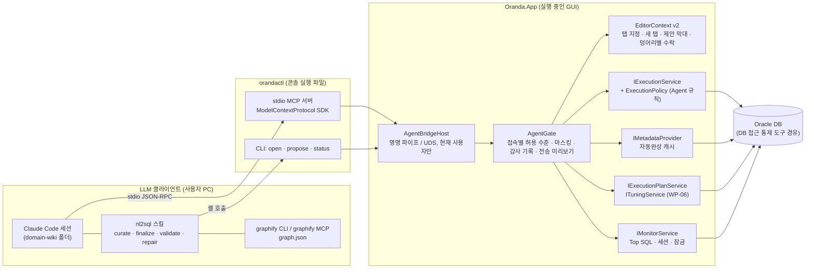
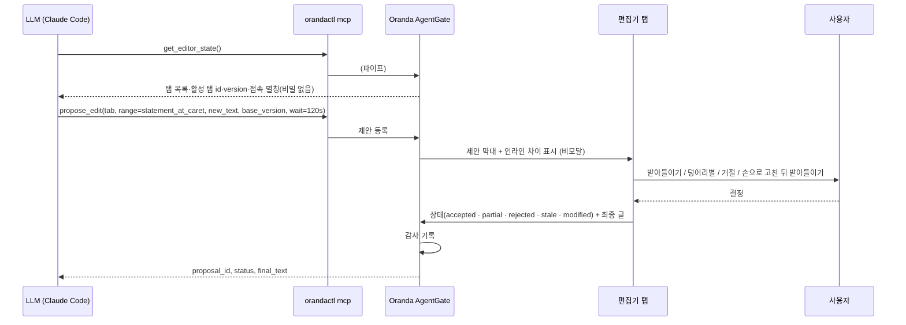
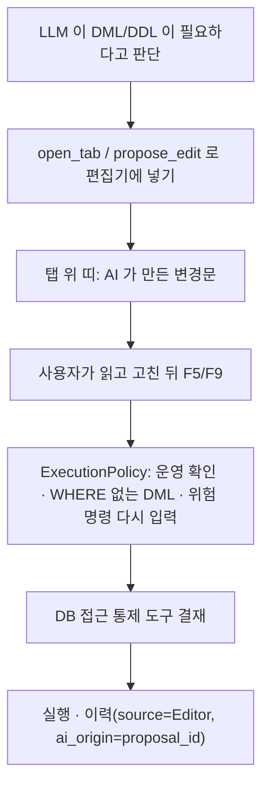
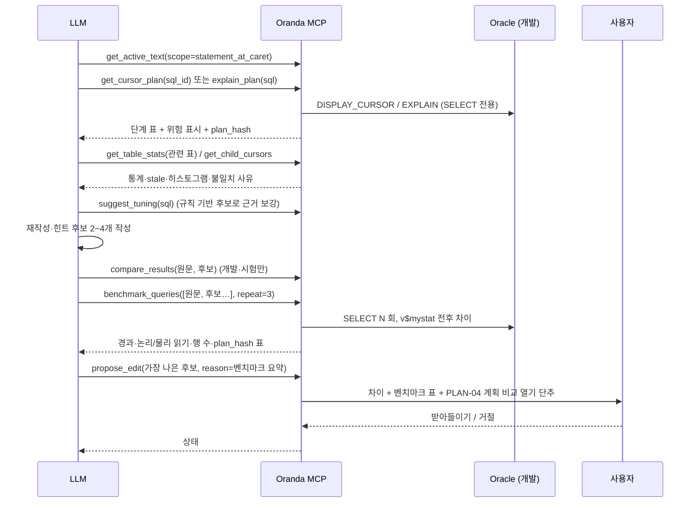
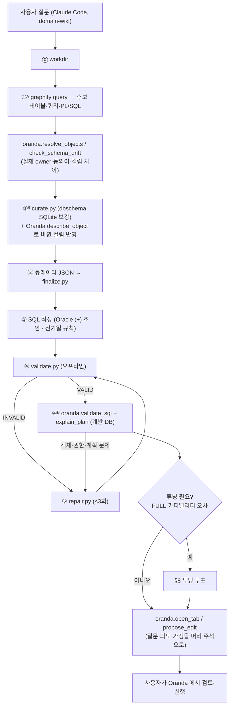

# LLM 이 쓴 쿼리·튜닝 결과를 Oranda 편집기에 넣는 방법 — 연구서

- 작성일: 2026-10-24
- 질문: 「LLM 에서 쿼리 작성 및 튜닝을 수행한 뒤, 그 결과가 Oranda 편집기에 추가·수정되게 하려면 어떻게 해야 하나」 (docs/idea.md 6행)
- 대상: Oranda (Oracle SQL 클라이언트, .NET 10 + Avalonia 12, Windows·macOS), 도메인 지식 프로젝트 domain-wiki(nl2sql·graphify)
- 범위: 저장소 코드는 읽기만 했다. 이 문서는 조사와 설계안이고 구현은 하지 않았다.
- 표기: 출처나 코드로 확인하지 못한 내용은 「확인 못 함」으로 적는다.

---

## 0. 결론

1. **권장 구조는 「Oranda 안의 에이전트 다리 + 작은 MCP 중계 실행 파일」이다.**
   - 실행 중인 Oranda 가 사용자 전용 명명 파이프(Windows)나 Unix 도메인 소켓(macOS)을 연다.
   - 별도 콘솔 실행 파일 `orandactl` 이 `orandactl mcp` 로 실행되면 stdio MCP 서버가 되어 그 파이프에 요청을 넘긴다.
   - Claude Code·Claude Desktop·Cursor·VS Code Copilot 은 모두 stdio MCP 서버를 띄울 수 있다. 그래서 TCP 포트를 열지 않고도 모든 클라이언트를 붙일 수 있다.
   - 같은 파이프를 단일 실행(두 번째 `oranda` 실행은 인자를 넘기고 끝남)과 사람용 CLI(`orandactl open x.sql`, `orandactl propose`)도 같이 쓴다.
2. **편집기 반영은 언제나 「제안」이다.** LLM 은 편집기 글을 바로 바꾸지 못하고 `propose_edit` 만 부른다.
   - 사용자가 차이를 보고 전부·일부를 받아들이거나 거절한다. 받아들인 변경은 실행 취소 1단계로 들어간다.
   - 지금 있는 `IEditorContext.ProposeEditAsync` 가 이 규칙의 출발점이다. 다만 활성 탭만 대상으로 삼고, 모달 창이며, 일부 받아들이기와 상태 반환이 없어서 넓혀야 한다.
3. **에이전트가 직접 실행할 수 있는 것은 SELECT 와 계획·통계 조회뿐이다.**
   - DML·DDL·PL/SQL 은 MCP 로 절대 실행하지 않는다. 편집기에 제안으로 넣고 사람이 평소 실행 경로로 돌린다.
   - 그러면 SAFE-03 확인 대화상자와 업무 환경의 DB 접근 통제 도구를 그대로 거친다.
   - 지금 `ExecutionPolicy` 는 실행 출처(`HistorySource.Extension`)를 이력에만 남기고 판단에는 쓰지 않는다. 그래서 「에이전트 출처면 조회 외 거부」 규칙을 새로 넣어야 한다.
4. **도메인 지식(domain-wiki)은 Claude Code 세션에서 nl2sql 스킬이 맡고, Oranda 는 그 흐름의 「살아 있는 DB 근거」와 「편집기 출구」를 맡는다.**
   - nl2sql 의 검증기는 오프라인(sqlglot + dbschema SQLite)이다.
   - Oranda MCP 는 실제 사전과 비교(드리프트 확인), 개발 DB 계획 확인, 결과를 편집기 탭으로 보내기를 더한다.
5. **단계는 셋으로 나눈다.**
   - 단계 1: 다리·읽기 도구·편집기 제안 (약 8 w)
   - 단계 2: SELECT 실행·계획·튜닝 루프 (약 8 w, WP-06 뒤)
   - 단계 3: domain-wiki 연결 정식화와 내장 기능 (약 10 w)
   - D-04(1.0 은 AI 를 구현하지 않음) 결정을 언제 풀지 사용자가 정해야 한다.

---

## 1. 지금 코드에 있는 것

### 1.1 확장 지점과 편집기

| 항목 | 위치 | 지금 동작 | LLM 연동에서 쓸 점 / 빈 곳 |
|---|---|---|---|
| `IEditorContext` | `src/Oranda.Core/Extensibility/IEditorContext.cs`, 구현 `src/Oranda.App/Features/SqlEditor/EditorContext.cs` | `GetActiveDocument()`(탭 ID·글·선택·커서·제목·접속 ID), `GetCurrentStatement()`, `ProposeEditAsync(TextEdit)` | 활성 탭만 다룬다. 탭 ID 지정, 새 탭 열기, 일부 받아들이기, 결과 상태(거절·낡음)가 없다. `EditorSnapshot.SessionId` 는 정의만 있고 채우지 않는다 |
| 차이 미리보기 | `AvaloniaEditorDialogs.PreviewEditAsync` → `BuildPreviewEditPanel` | 모달 창에 「현재」「제안」 두 코드 뷰를 나란히 둔다. 줄 단위 강조는 없다. 단추는 「적용」「거절」 | 에이전트가 기다리는 동안 사용자가 편집기를 못 쓴다. 줄 diff 는 MyBatis 쪽 `MapperLineDiff`·`SaveDiffWindow` 를 다시 쓸 수 있다 |
| 문서 변경 검사 | `EditorContext.ProposeEditAsync` | 미리보기 전후로 `tab.Version` 이 다르면 적용하지 않는다(false) | 안전하지만 사용자가 다른 곳을 고쳐도 통째로 버린다. 에이전트는 이유를 모른다 |
| 적용 | `SqlEditorViewModel.Apply(TextOpResult)` | `Document.Replace` 한 번 = 실행 취소 1단계 | 여러 덩어리를 받아들일 때는 `BeginUpdate/EndUpdate` 로 묶어야 1단계가 된다 |
| 명령 | `ICommandRegistry`(`src/Oranda.Core/Shell/Commands.cs`), `[OrandaCommand]`, `ShellCommandRunner` | 메뉴·툴바·단축키·팔레트가 모두 `ExecuteAsync(id)` 한 길로 간다. 실행 중 `Register` 가능 | 에이전트 기능의 받아들이기·거절·설정도 명령 ID 로 둔다(`oranda.agent.*`) |
| 도구 창 | `IToolPanelRegistry`, `ToolPanelViewModelBase` | 도킹 패널 붙이기 | 「에이전트」 패널(제안 목록·감사 기록·전송 미리보기)을 붙인다 |
| 시험 패널 | `src/Oranda.App/Features/ExtensionTest/*`, 명령 `oranda.view.extensionTest`(활성 조건 `devBuild`) | 확장 지점만으로 읽기·제안·실행·메타데이터·외부 전송을 시험 | 단계 1의 첫 시험장으로 알맞다 |
| 외부 전송 동의 | `IOutboundConsent`, `OutboundPurpose { UpdateCheck, CrashReport, Extension }` | 보낼 글을 그대로 보이고 허락받는다 | `Agent` 목적을 더한다. MCP 에서는 「보내기」가 도구 결과를 클라이언트에 돌려주는 일이다 |

### 1.2 실행·정책·이력

| 항목 | 위치 | 지금 동작 | 빈 곳 |
|---|---|---|---|
| 실행 단일 경로 | `IExecutionService.ExecuteAsync(ISession, SqlStatement, binds, ExecutionOptions)` | 치환 변수 → 바인드 → 정책 관문 → 드라이버. `ExecutionOptions.Source` 가 이력 출처가 된다 | 에이전트용 행 상한·시간 상한 선택지가 없다 |
| 정책 관문 | `src/Oranda.Core/Execution/ExecutionPolicy.cs` | 규칙 순서: 읽기 전용 접속 거부 → 라이선스 팩 거부 → 운영 DML/DDL/PLSQL 확인 → WHERE 없는 DML 확인 → 위험 명령 이름 다시 입력. 분류가 불확실하면 DML 로 본다 | `PolicyContext.Source` 를 받지만 판단에 쓰지 않는다. **개발 접속에서는 확장이 보낸 DML 도 확인 없이 통과한다**(WHERE 가 있으면). `SELECT … FOR UPDATE` 를 따로 잡는 코드는 찾지 못했다 |
| 읽기 전용 접속 | `ConnectionProfile.ReadOnly` | 파서 분류로 막는다 | PRD SAFE-02 의 `SET TRANSACTION READ ONLY` 를 보내는 코드는 검색으로 찾지 못했다(확인 못 함) |
| 이력 | `HistoryEntry`(`oranda.db` history), `HistorySource { Editor, Script, GridEdit, SchemaBrowser, Monitor, Extension }` | SQL(비밀 가림 후)·출처·상태·바인드 JSON | 요청 원문·클라이언트 이름·도구 이름이 없다 |
| 서버 추적 | `OracleSessionManager`: `DBMS_APPLICATION_INFO.SET_MODULE`, `DBMS_SESSION.SET_IDENTIFIER` | v$session 에 Oranda 표시 | 에이전트 세션은 action 을 `agent:<클라이언트>` 로 구별할 수 있다 |
| 세션 종류 | `SessionPurpose { Work, Monitor, Dedicated }` | 작업 세션·모니터 세션·탭 전용 세션 | 에이전트 전용 세션(`Agent`)이 필요하다. 사용자의 작업 트랜잭션과 섞이면 안 된다 |
| 민감 컬럼 가림 | — | 코드 없음(idea.md 2절 아이디어) | 행 데이터를 보내기 전에 새로 만들어야 한다 |

### 1.3 계획·모니터·튜닝

| 항목 | 위치 | 쓸 점 |
|---|---|---|
| 예상·실제 계획 | `IExecutionPlanService.ExplainAsync`, `GetCursorPlanAsync(CursorRef, format)`, 구현 `OracleExecutionPlanService` | `PlanStep` 에 비용·E/A-Rows·predicate·위험(FullScan·Cartesian·CardinalityMisestimate) 표시가 있어 LLM 에 줄 구조화 결과로 알맞다. 읽기 전용 접속에서 EXPLAIN PLAN 이 ORA-01456 이면 DISPLAY_CURSOR 를 쓰라고 안내한다 |
| 모니터 | `IMonitorService`: 세션·블로킹 트리·Top SQL(`GetTopSqlAsync`)·SQL 상세·잠금(TSK-05-01 계약) | 「지금 왜 느려」 진단 도구의 원천 |
| 튜닝(WP-06, 미구현) | `docs/oranda1/wbs.md` TSK-06-01~07 | `ITuningService`(표·열 통계, 자식 커서, 불일치 사유, 대기 표본, 인덱스 후보, 재작성 후보, 벤치마크), **벤치마크 실행기는 SELECT 만 허용**(StatementClassifier 로 거부, v$mystat 전후 차이), 튜닝 HTML 보고서(TSK-06-07). LLM 튜닝 루프는 이 계약을 그대로 도구로 노출하면 된다 |

### 1.4 명령줄·다중 실행·파일 감시

- `Program.Main` 은 Velopack 처리 뒤 바로 `StartWithClassicDesktopLifetime(args)` 를 부른다. **단일 실행 처리나 IPC 는 없다.** 두 번째 `oranda` 실행은 새 프로세스·새 창이 된다(Mutex·NamedPipe 검색 결과 없음).
- `App.OpenCommandLineFiles` → `DroppedWorkspaceFiles.Pick` 은 `.sqd` 만 연다. MyBatis 훅이 있으면 `.xml` 도 연다. `.sql`·`.workspace.md` 인자는 명령줄로 열리지 않는다(`Pick` 조건 기준).
- `oranda user@alias [as sysdba]` 는 접속 관리자를 그 프로필을 고른 채로 연다(TSK-03-05).
- 밖에서 바뀐 파일 처리:
  - MyBatis 매퍼에만 있다(`MapperFileWatcher` = FileSystemWatcher, `MapperMerge` = 기준·디스크·내 고침의 3방향 문장 병합, 알림 띠 「파일 것으로 / 내 것으로」).
  - 일반 `.sql`·Markdown 작업 공간 파일에는 감시가 없다(SqlEditor 폴더에서 검색 결과 없음).
- macOS 의 「이 앱으로 열기」 이벤트 처리 코드는 찾지 못했다(확인 못 함).

### 1.5 domain-wiki 의 도메인 지식 흐름

| 요소 | 내용(파일 기준) |
|---|---|
| nl2sql 스킬 | `domain-wiki/.claude/skills/nl2sql/SKILL.md`. 업무 도메인 질문을 Oracle SQL 로 만든다. Claude Code 세션의 Claude 가 곧 LLM 이다(SDK·API 안 씀) |
| 7단계 | ⓪ `mktemp` workdir → ①ᴬ `graphify query "<질문>" --budget 1500` → ①ᴮ `curate.py`(graphify 결과 + dbschema SQLite 로 PK·컬럼·조인·코드값·인덱스·전기일 보강 → `curate.md`, `ctx.json`) → ② 큐레이터 JSON(`final_tables`·`concept_mappings`·`open_ambiguities`) → `finalize.py`(후보 밖 테이블·없는 컬럼 거부) → ③ SQL JSON → ④ `validate.py`(sqlglot 구문·컬럼·함수·조인 검사) → ⑤ `repair.py`(최대 3회) → 보고 |
| 규칙 | Oracle `(+)` 외부 조인만 쓰고 ANSI JOIN 은 금지한다. 전기일(07:00~익일 06:59)은 7/24 보정한다. 환각을 금지한다. 모호하면 묻는다 |
| graphify | `domain-wiki/global/graphify-out/graph.json`(64 MB, 노드 5만여·간선 9만여, `TB_` 접두 테이블 노드 다수, 노드 속성 `label·source_file·source_location·community`). `graphify query`(BFS/DFS, LLM 호출 없음), `path`, `explain`, `--mcp`(stdio 서버: `query_graph`·`get_node`·`get_neighbors`·`get_community`·`god_nodes`·`graph_stats`·`shortest_path`) |
| 한계 | 검증이 오프라인이다. 실제 DB 의 컬럼 변경·권한·동의어·통계·계획을 모른다. 결과는 대화창의 코드 블록이라 편집기로 옮기려면 복사·붙여 넣기를 해야 한다. 스킬 안의 경로가 macOS(`/Users/<user>/...`)라 win144 에서는 바꿔 읽어야 한다 |

---

## 2. 다른 도구는 어떻게 하나

| 도구 | 연결 방식 | 편집기 반영 | 실행 통제 | Oranda 에 주는 교훈 |
|---|---|---|---|---|
| Oracle SQLcl MCP (25.2+) | `sql -mcp` stdio. 도구: `list-connections`, `connect`, `disconnect`, `run-sql`, `run-sqlcl`. 이 PC 의 SQLcl 25.4.1 `dbtools-mcp.jar` 에는 `run-sql-async`, `schema-information` 도 있다(클래스 문자열로 확인) | 없음(결과 CSV 를 돌려줌) | `-R` RESTRICT 수준(기본 4 = 호스트 명령·스크립트 금지). DML 은 DB 권한이 막는다. 서버 테이블 `DBTOOLS$MCP_LOG` 에 모든 요청을 기록한다(jar 안 `insert.dbtools.mcp.log` 쿼리). v$session MODULE=클라이언트, ACTION=모델 이름 | **이 환경에는 그대로 맞지 않는다.** 서버 테이블 생성·INSERT 는 C-05 위반이고 DB 접근 통제 도구 결재 대상이다. 로그를 끄는 선택지는 문서에서 찾지 못했다(확인 못 함). MODULE/ACTION 표시는 따라 한다 |
| SQL Developer for VS Code | SQLcl MCP 를 Copilot 에 자동 등록 | Copilot Agent 모드가 파일을 고친다 | Copilot 이 도구마다 사용 확인을 묻고, 도구를 하나씩 끌 수 있다 | 클라이언트 쪽 확인에만 기대지 않고 서버(Oranda) 쪽에서 막는다 |
| DataGrip 2026.1~2026.2 | IDE 내장 MCP 서버(SSE·stdio·HTTP Stream). Claude Code·Codex·VS Code 자동 설정 | 에이전트가 IDE 파일을 고친다 | `execute_sql_query` 는 확인 여부가 문서에 없다. 읽기 전용은 「권한이 좁은 DB 사용자」로 하라고 안내한다 | 도구 이름 구성(`list_database_connections`, `list_schema_objects`, `get_database_object_description`, `introspect_schema`, `execute_sql_query`, `fetch_query_result`, `cancel_sql_query`, `list_recent_sql_queries`)이 참고가 된다 |
| DBeaver 26.1~26.2 | 내장 AI Chat + 외부 MCP 도구 허용 목록 | 제안을 스크립트 알맞은 자리에 넣고, 새 SQL 콘솔로 열 수도 있다 | 접속마다 처음 한 번 메타데이터 전송 동의. 기본은 테이블·컬럼 이름만 보낸다. Scope 칸으로 범위를 정한다. 읽기 전용 접속이면 AI 에 알린다 | 접속별 첫 동의·범위 지정·「보낸 요청 로그」를 그대로 쓴다 |
| JetBrains AI Assistant | IDE 내장 | 채팅 코드 블록에 「복사·캐럿에 넣기·새 파일」. 편집기 생성 코드는 AI Diff(통합·양쪽 보기, 덩어리별 Accept) → 2024.2 부터 같은 탭 인라인 Accept/Discard + 거터 Revert | — | 덩어리별 받아들이기와 인라인 보기가 표준 모양이다 |
| Claude Code IDE 연동 | IDE 가 `~/.claude/ide/<port>.lock`(pid·작업 폴더·`authToken`)을 쓰고 localhost WebSocket MCP 를 연다. 도구: `openDiff`, `getCurrentSelection`, `getOpenEditors`, `openFile`, `getDiagnostics`, `checkDocumentDirty`, `saveDocument`, `close_tab` 등 | `openDiff` 는 사용자가 정할 때까지 막혀 있다가 `FILE_SAVED`·`DIFF_REJECTED` 를 돌려준다. 사용자가 제안을 손으로 고친 뒤 받아들일 수 있다 | 기본 권한에서는 검토 없이 디스크에 쓰지 않는다 | **Oranda `propose_edit` 의 모델로 가장 가깝다.** 「막혀 기다림 + 결과 상태 + 사용자가 고친 최종본 반환」을 따른다 |
| SSMS Copilot Agent mode, Beekeeper Studio | 내장 | — | SSMS 는 질의마다 승인하고 「DB 권한이 실제 보안 경계」라고 적는다. Beekeeper 는 읽기 전용 SELECT 만 자동 실행한다 | 자동 실행은 SELECT 만 |
| Toad for Oracle 2026 R2 | Toad Chat + 내장 MCP | — | — | 같은 시장에서 「내장 MCP」가 표준이 되고 있다 |

---

## 3. 연동 방식 비교

| 방식 | 연결 | 편집기 반영 | 안전 | 작업량 | 판단 |
|---|---|---|---|---|---|
| A. Oranda 안에서 Streamable HTTP MCP | 앱이 `127.0.0.1:<port>/mcp` 를 연다. 클라이언트는 URL 로 붙는다 | 앱 안이라 바로 가능 | 명세상 Origin 검사·localhost 바인딩·인증이 필요하다(DNS rebinding). 토큰 파일 관리가 필요하다 | 중 (ASP.NET Core 호스트를 GUI 앱에 넣음) | 가능하지만 GUI 앱에 웹 서버가 들어가 시작 시간 규칙(D-006)과 충돌하기 쉽다 |
| **B. stdio 중계 실행 파일 + 앱 IPC** | 클라이언트가 `orandactl mcp` 를 띄운다. 중계 파일이 명명 파이프·UDS 로 앱에 붙는다 | 앱이 실행 중일 때만 가능. 앱이 없으면 「Oranda 를 여세요」를 돌려주거나 앱을 띄운다 | TCP 포트가 없다. `PipeOptions.CurrentUserOnly` 로 다른 사용자를 막는다 | 중 | **권장.** 모든 클라이언트가 stdio 를 지원하고, 같은 파이프로 단일 실행·CLI 도 해결한다 |
| C. CLI + IPC 만 | LLM 이 셸에서 `orandactl propose --file out.sql` 을 부른다 | 가능 | 위와 같다 | 소 | B 의 일부로 같이 만든다. nl2sql 처럼 셸을 쓰는 스킬에 바로 붙는다 |
| D. 파일 기반 | LLM 이 `.sql`·`.workspace.md` 를 디스크에 쓰고 Oranda 가 감시한다 | 일반 SQL 파일에는 감시·병합이 없다. MyBatis 매퍼에만 3방향 병합이 있다 | 사용자 편집과 경합하고, 「제안」 단계가 없다 | 중(감시·병합을 일반 파일로 넓힘) | 보조 경로로만. MyBatis 매퍼는 지금도 이 경로가 동작한다(밖 변경 → 알림 띠) |
| E. 내장 채팅 패널(LLM API 직접 호출) | Oranda 가 제공자 API(사용자 키·조직 내부 게이트웨이·로컬 모델)를 부른다 | `IEditorContext` 로 바로 | 전송 동의·비용 한도·키 저장을 Oranda 가 모두 진다 | 대 | 단계 3. domain-wiki 의 지식·스킬을 쓰지 못하므로 지금 쓰는 흐름(Claude Code + 스킬)을 대신하지 못한다 |
| F. 클립보드 | 사람이 복사·붙여 넣기 | 수동 | — | 0 | 지금 상태 |

---

## 4. 권장 구조

### 4.1 구성도



- **`orandactl`** 은 Avalonia 를 싣지 않는 작은 콘솔 프로젝트(`src/Oranda.Agent.Cli` 가칭)다.
  - GUI 실행 파일(WinExe)을 stdio 서버로 쓰면 콘솔 붙임·시작 시간 문제가 생긴다. 그래서 따로 둔다.
  - MCP 명세상 stdout 에는 MCP 메시지만 쓰고 로그는 stderr 로 보낸다.
- **IPC 규약**은 MCP 와 같은 JSON-RPC 로 한다. 중계 파일은 도구 호출을 거의 그대로 넘긴다.
  - Windows: `\\.\pipe\oranda-agent-<사용자 SID 해시>`
  - macOS: `~/Library/Application Support/Oranda/run/agent.sock`. 폴더 권한은 0700 으로 둔다.
  - .NET 의 `NamedPipeServerStream` 은 Unix 에서 UDS 를 쓴다. 두 OS 모두 `PipeOptions.CurrentUserOnly` 를 준다.
- **단일 실행**: `Oranda.App` 이 시작할 때 파이프에 먼저 붙어 본다.
  - 붙으면 인자(파일·`user@alias`)를 넘기고 끝낸다. 못 붙으면 자기가 서버가 된다.
  - 지금 동작(창이 여러 개 뜸)이 바뀌므로 설정으로 끌 수 있게 한다.
- **앱이 꺼져 있을 때**: `orandactl mcp` 는 읽기 도구에 `oranda_not_running` 오류와 안내를 돌려준다. 설정이 켜져 있으면 앱을 띄우고 기다린다.
- **SDK**: 공식 C# SDK `ModelContextProtocol` 2.3.0(2026-10-20, net8·net9·net10, 안정판)을 쓴다. stdio 는 `WithStdioServerTransport()`, 도구는 특성(`[McpServerTool]`)으로 등록한다. 버전마다 기본값(HTTP Stateless 등)이 달라 고정 버전을 쓴다.

### 4.2 Claude Code 세션 구성 예 (domain-wiki 폴더 `.mcp.json`)

```json
{
  "mcpServers": {
    "oranda":   { "type": "stdio", "command": "C:\\Users\\<사용자>\\AppData\\Local\\Oranda\\current\\orandactl.exe", "args": ["mcp"] },
    "graphify": { "type": "stdio", "command": "python", "args": ["-m", "graphify.serve", "global/graphify-out/graph.json"] }
  }
}
```

- Velopack 설치 경로(`%LocalAppData%\Oranda\current`)는 확인 못 함이다. 설치 뒤 「에이전트 설정」 화면에서 경로를 복사해 주는 단추를 둔다. DataGrip 의 Auto-Configure 와 같다.
- Claude Code 는 프로젝트 범위 `.mcp.json` 서버를 처음 쓸 때 승인을 묻는다.
  - 도구 결과가 1만 토큰을 넘으면 경고하고, 기본 최대는 2.5만 토큰(`MAX_MCP_OUTPUT_TOKENS`)이다.
  - 그래서 Oranda 도구 결과는 요약을 먼저 주고, 자세한 것은 페이지 단위로 준다.
- VS Code 는 `.vscode/mcp.json` 의 `servers` 키를, Cursor·Claude Desktop 은 `mcpServers` 키를 쓴다. 설정 복사 단추를 클라이언트별로 둔다.

### 4.3 제안 흐름



---

## 5. 도구 목록

모든 도구는 `AgentGate` 를 지난다.

- **허용 수준**: 접속마다 `끔 / 메타데이터 / 계획 / 조회 실행 / 조회 + 행 값` 다섯 단계로 정하고, 도구는 그 수준 안에서만 동작한다.
- **표시(annotations)**: `readOnlyHint` 등은 클라이언트에 주는 참고일 뿐 보안 판단 근거가 아니다(명세 해설). 실제 통제는 Oranda 쪽에서 한다.

### 5.1 접속·메타데이터 (읽기)

| 도구 | 매개변수 | 돌려주는 것 | 안전 | 기반 |
|---|---|---|---|---|
| `list_connections` | — | 별칭, 환경 라벨(개발·시험·운영), DB 버전, 기본 스키마, 에이전트 허용 수준, 연결 여부 | **비밀번호·호스트·서비스 이름은 주지 않는다**(운영은 기본으로 목록에서 뺀다) | 접속 프로필 |
| `list_objects` | connection, owner?, name_like?, types?, limit≤500 | 이름·종류·상태·주석 | 메타데이터 수준 | `IMetadataProvider.ListObjectsAsync` |
| `describe_object` | connection, object | 컬럼(이름·형·NULL·기본값·주석), PK/UK/FK, 인덱스 | 〃 | `GetTableAsync`, `GetObjectDetailAsync` |
| `get_ddl` | connection, object, options? | DDL 글 | 〃 | `GetDdlAsync` |
| `get_source` | connection, object, member? | PL/SQL 원문(멤버 단위로 잘라 줌) | 〃 · 원문은 데이터 블록으로 감싼다 | `GetSourceAsync` |
| `resolve_objects` | connection, names[] | 이름별 실제 owner·종류·동의어 경로·있는지 여부·last_ddl_time | 〃 | 메타데이터 + 동의어 |
| `check_schema_drift` | connection, table, expected_columns[] | 위키(dbschema)와 실제 사전의 컬럼 차이(없음·형 다름·새 컬럼) | 〃 | `describe_object` 비교 |

### 5.2 검증·계획·통계·튜닝 (읽기)

| 도구 | 매개변수 | 돌려주는 것 | 안전 | 기반 |
|---|---|---|---|---|
| `validate_sql` | connection?, sql | Oranda 파서 분류(Query·DML…·불확실), 문장 수, 바인드 이름, 구문 오류 위치. 접속을 주고 수준이 `계획` 이상이면 객체·컬럼 존재 확인 | DB 에 보내지 않는 검사가 기본 | Oranda.Language |
| `explain_plan` | connection, sql | 단계 표(비용·E-Rows·predicate·위험), plan_hash | SELECT 만. EXPLAIN PLAN 은 PLAN_TABLE 에 행을 쓰므로 접속 설정 `allowExplainPlan` 이 켜진 경우만(§6.3) | `ExplainAsync` |
| `get_cursor_plan` | connection, sql_id, child?, format=`ALLSTATS LAST` | 실제 계획(A-Rows·Starts·시간) | 팩 불필요 | `GetCursorPlanAsync` |
| `get_table_stats` | connection, table | 표·열 통계, 히스토그램, stale, 인덱스 통계 | 〃 | `ITuningService`(TSK-06-02) |
| `get_child_cursors` | connection, sql_id | 자식 커서·불일치 사유 | 〃 | 〃 |
| `get_top_sql` | connection, criteria(elapsed·cpu·gets), limit | sql_id·실행 수·실행당 값·SQL 앞부분 | 모니터 세션 사용 | `GetTopSqlAsync` |
| `get_sql_detail` | connection, sql_id | 전문·바인드 캡처 여부·통계 | 바인드 **값**은 기본으로 가린다 | `GetSqlDetailAsync` |
| `get_sessions`, `get_locks` | connection, filter | 세션·블로킹 트리·잠금(TSK-05-02 뒤) | 읽기 전용, 세션 종료 도구는 두지 않는다 | `IMonitorService` |
| `suggest_tuning` | connection, sql | 규칙 기반 인덱스 후보·재작성 후보·힌트 대안(DDL 문안 포함, 실행 안 함) | 〃 | TSK-06-05 |
| `benchmark_queries` | connection, variants[{label, sql}], repeat=3, max_rows | 변형별 경과·논리/물리 읽기·행 수·plan_hash, 원문과 행 수 다르면 경고 | **SELECT 만**(아니면 거부), 운영은 거부 또는 사용자 확인 | TSK-06-02 벤치마크 실행기 |
| `compare_results` | connection, sql_a, sql_b, method=`count_hash`·`minus` | 같은지, 다른 행 수(행 값은 수준이 `조회 + 행 값` 일 때만) | 개발·시험 접속만 | 새로 |

### 5.3 실행 (조회만)

| 도구 | 매개변수 | 돌려주는 것 | 안전 |
|---|---|---|---|
| `run_query` | connection, sql, binds?, max_rows=100, timeout_s=30 | 열 이름·형, 행(가림 적용), 잘림 여부, 경과, sql_id | Query 분류만 실행하고 불확실 분류는 거부한다. `FOR UPDATE` 도 거부한다(새 파서 표시 필요). 에이전트 전용 세션에서 실행하고 이력에 `Agent` 출처로 남긴다. 행 값은 `조회 + 행 값` 수준일 때만 주고, 그 밖에는 행 수·열 형만 준다 |
| `fetch_more` | result_id, page | 다음 행 | 〃 |
| `cancel_query` | result_id | — | — |

**두지 않는 도구**: DML·DDL·PL/SQL 실행, 커밋·롤백, 세션 종료, `ALTER SYSTEM`, 파일 쓰기, 외부 URL 호출.

### 5.4 편집기

| 도구 | 매개변수 | 동작 | 안전 |
|---|---|---|---|
| `get_editor_state` | — | 열린 탭(id·제목·접속 별칭·종류 SQL/MyBatis/PLSQL·dirty·version)과 활성 탭 | 글 내용은 주지 않는다 |
| `get_active_text` | tab?, scope=`selection`·`statement_at_caret`·`document`, max_chars | 글·범위·version | 탭 글은 사용자의 작업이다. 접속 허용 수준이 `끔`인 탭은 거부한다 |
| `open_tab` | text, title?, connection?, kind=`sql` | 새 탭을 「AI 제안」 표시와 함께 열고 tab_id 를 돌려준다 | 기존 글을 덮지 않으므로 바로 연다. DML·DDL 이 들어 있으면 탭 위에 「AI 가 만든 변경문 — 검토 후 직접 실행」 띠를 단다 |
| `propose_edit` | tab, range(`selection`·`statement_at_caret`·`document`·`{start,length,expected_text_hash}`), new_text, title, reason?, base_version, wait_s≤600 | 제안 등록 → 사용자 결정까지 기다리거나 proposal_id 만 돌려준다 | 언제나 사용자 승인. 상태: `accepted`·`partial`·`modified`·`rejected`·`stale`·`timeout` |
| `insert_text`, `replace_selection` | tab, text, … | `propose_edit` 의 줄인 형태(범위가 커서 위치·선택) | 〃 |
| `get_proposal_status` | proposal_id | 상태·최종 글 | — |

### 5.5 리소스·프롬프트

- 리소스(MCP resources):
  - `oranda://editor/active`
  - `oranda://conn/{alias}/object/{owner}.{name}/ddl`
  - `oranda://tuning-report/{sql_id}` — TSK-06-07 HTML 보고서의 텍스트판
  - `oranda://history/agent?since=` — 에이전트 실행 기록
- 프롬프트(MCP prompts): `tune-statement`(현재 문장 튜닝 루프), `explain-statement`, `fix-error`(마지막 ORA 오류 + 문장 + 관련 객체), `nl2sql-handoff`(nl2sql 결과를 검증하고 편집기로).
- Claude Code 가 MCP 리소스(@ 언급)와 프롬프트(슬래시 명령)를 어떻게 보이는지는 문서 앞부분에서 확인 못 함이다. 도구만으로도 동작하게 만든다.

---

## 6. 실행 안전

### 6.1 정책 관문에 넣을 규칙

`ExecutionPolicy.Evaluate` 맨 앞에 규칙 0 「에이전트 출처」를 넣는다.

- `HistorySource.Agent` 를 새로 만든다. 지금의 `Extension` 은 시험 패널·플러그인용으로 남긴다.
- `PolicyRule.AgentWrite` 를 새로 만든다. 판단은 다음과 같다.
  - 실효 분류가 `Query` 가 아니면 **Deny**: DML·DDL·PL/SQL·트랜잭션 제어·SQL*Plus 명령·불확실 분류
  - `Query` 라도 `FOR UPDATE`, DB 링크(`@dblink`), 사용자 함수 호출이 있으면 Deny 또는 경고. 함수 판별은 파서 표시를 새로 만들어야 한다
- 에이전트 세션은 `SessionPurpose.Agent`(새 값)로 따로 연다.
  - 모든 트랜잭션은 `SET TRANSACTION READ ONLY` 로 시작해 자율 트랜잭션이 아닌 쓰기를 서버가 막게 한다.
  - `DBMS_APPLICATION_INFO` action 은 `agent:<클라이언트 이름>` 으로 둔다. 클라이언트 이름은 MCP initialize 의 clientInfo 에서 얻는다.
- 행 상한(기본 100)·시간 상한(기본 30초)·동시 실행 1개를 지킨다.
- 같은 SQL 을 짧은 시간에 되풀이하면 멈춘다(비용 한도와 함께 둔다).

### 6.2 DML·DDL 은 「편집기 제안」으로만



- 사람이 실행한 AI 변경문은 이력에 `source=Editor` 로 남기고, 따로 `ai_origin` 열에 proposal_id 를 남긴다. 「AI 가 쓴 문장」 표시가 이력 화면에 보인다.
- 「DML 시험 실행」(개발 접속에서 실행 → 영향 행 수 → 롤백)은 DB 접근 통제 도구 가 INSERT·UPDATE·DELETE 를 결재 대상으로 잡으므로 이 업무 환경에서는 쓰지 않는다. 트리거·자율 트랜잭션·시퀀스 증가는 롤백되지 않는다는 문제도 그대로다.

### 6.3 DB 접근 통제 도구와 SELECT 전용 원칙

업무 환경의 DB 접근 통제·결재 도구는 INSERT·UPDATE·DELETE 를 결재 대상으로 잡는다. 에이전트 경로가 보낼 수 있는 문장 중 경계에 있는 것은 다음과 같다.

| 문장 | 왜 경계인가 | 안 |
|---|---|---|
| `EXPLAIN PLAN FOR …` | PLAN_TABLE 에 INSERT 한다. DB 접근 통제 도구 가 이것을 DML 로 잡는지 확인 못 함 | 접속 설정 `allowExplainPlan`(개발 기본 켬, 운영 기본 끔). 끄면 `/*+ GATHER_PLAN_STATISTICS */` 사본 실행 + `DISPLAY_CURSOR` 로 대신한다(실제로 실행하므로 비용 확인 필요) |
| `SET TRANSACTION READ ONLY`, `ALTER SESSION SET STATISTICS_LEVEL=ALL` | DML 은 아니다. 결재 도구 분류는 확인 못 함 | 통제 환경 PC 에서 한 번 시험한다 |
| `BEGIN DBMS_APPLICATION_INFO.SET_MODULE… END;` | 지금도 세션을 열 때 보낸다(기존 동작) | 변화 없음 |
| `compare_results` 의 `MINUS` | SELECT 다 | 그대로 |
| 인덱스 후보 시험 | `CREATE INDEX … INVISIBLE` 은 DDL 이다 | 에이전트는 문안만 편집기에 넣는다. idea.md 5절 「새 인덱스 시험」은 사람 경로에서만 한다 |

### 6.4 운영 라벨

- 운영 접속의 에이전트 허용 수준은 기본 `끔` 이고 `list_connections` 에도 나오지 않는다.
- 켜려면 접속 편집 화면에서 접속 이름을 다시 입력한다(SAFE-08 과 같은 방식).
- 운영의 최대 수준은 `계획` 이다. 행 값은 운영에서 보내지 않는다. 바꾸려면 따로 결정해야 한다.

---

## 7. 데이터 보호

### 7.1 보내는 것

| 항목 | 기본 | 조건 |
|---|---|---|
| 비밀번호·지갑·토큰 | **절대 안 보냄** | `SecureCredential` 은 다리 계층에 들어오지 않는다 |
| 호스트·포트·서비스 이름 | 안 보냄 | 별칭과 환경 라벨만 보낸다 |
| 객체 이름·형·주석·FK·인덱스 | 보냄 | 접속 수준 `메타데이터` 이상. 사용자가 범위(스키마·객체 목록)를 정할 수 있다(DBeaver Scope 칸, Select AI 프로필 방식) |
| PL/SQL 원문·뷰 정의 | 보냄 | 〃. 데이터 블록으로 감싸 지시로 읽히지 않게 한다 |
| 계획·통계 | 보냄 | `계획` 이상 |
| SQL 글(편집기·Top SQL) | 보냄 | 리터럴 값은 선택에 따라 `:v1` 로 바꿔 보낸다(기본 끔) |
| 바인드 값(캡처·이력) | 안 보냄 | 사용자가 켜면 보낸다(PRD 「바인드 값 기록은 사용자 선택」과 맞춤) |
| 결과 행 | 안 보냄(행 수·열 형만) | `조회 + 행 값` 수준 + 접속별 첫 동의. 민감 컬럼 가림 규칙(주민번호·전화·이메일·계좌 이름 규칙 + 사용자 지정)을 먼저 적용한다 |

### 7.2 미리보기와 동의

- 접속마다 처음 요청이 올 때 동의 창을 띄운다. 이것이 DBeaver 의 첫 사용 동의에 해당한다.
- 창에서는 이번 범위를 고른다: 이번만, 항상, 거절.
- `IOutboundConsent` 에 `OutboundPurpose.Agent` 를 더해 같은 창을 쓴다.
- 「에이전트」 도구 창에 최근 도구 호출과 **클라이언트로 돌려준 글 그대로**를 보인다(전송 미리보기·사후 확인).
- `조회 + 행 값` 도구는 「보내기 전에 묻기」 모드를 고를 수 있다. 결과를 미리 보여 주고 승인해야 돌려준다.
  - MCP elicitation(2025-06-18 명세, C# SDK 지원)으로 클라이언트 쪽에서 물을 수도 있지만, 묻는 화면은 Oranda 쪽에 둔다(클라이언트마다 지원이 다르다).

### 7.3 감사 기록

- `oranda.db` 에 `agent_audit` 표를 둔다. 열:
  - 시각, 클라이언트 이름·버전, 도구, 매개변수(비밀 가림), 접속 별칭
  - 판단(허용·거부·사용자 거절), 돌려준 글 크기, 연결된 history id, proposal id
- 서버에는 아무것도 쓰지 않는다(C-05). SQLcl MCP 의 `DBTOOLS$MCP_LOG` 와 다른 점이다.
- 7일 로그 정책과 따로 보관 기간 설정을 둔다.

### 7.4 프롬프트 인젝션 대비

- 행 값·주석·PL/SQL 원문·alert log·MyBatis XML 은 `<data source="…">` 블록으로 감싸 「데이터로만 다루라」는 머리말을 붙인다.
- Oranda MCP 에는 밖으로 쓰는 도구(HTTP·파일·메일)를 두지 않는다.
  - 다만 같은 Claude Code 세션의 웹·셸 도구까지 막을 수는 없다. 「비공개 데이터 + 믿을 수 없는 입력 + 밖으로 쓰는 경로」가 한 세션에 모이지 않게 하라고 안내한다(Supabase MCP 사고).
  - 그래서 `조회 + 행 값` 수준을 켤 때 경고를 띄운다.

---

## 8. 튜닝 루프



- **도구가 LLM 제안을 그대로 믿지 않는다.**
  - 결과 동일성(`compare_results`, 양방향 `MINUS` 또는 건수·해시)과 비용·실측(`benchmark_queries`)을 Oranda 가 직접 잰다.
  - 제안 막대에 그 결과를 같이 보인다.
- 인덱스 제안은 `CREATE INDEX` 문안을 새 탭에 넣기만 한다. 실행·INVISIBLE 시험은 사람이 한다.
- Tuning Advisor·baseline 스크립트(TSK-06-06)도 「새 탭에 넣기만」 규칙을 따른다.
- 팩이 필요한 정보(ASH·AWR·SQL Monitor)는 SAFE-07 선언이 있을 때만 도구 결과에 담는다.
- 튜닝 HTML 보고서(TSK-06-07)의 텍스트판을 리소스로 주면, LLM 이 한 번에 진단 자료를 읽어 호출 수가 줄어든다.

---

## 9. 편집기 UX

### 9.1 어느 탭에 넣나

1. `tab` 을 명시하면 그 탭에 넣는다.
2. 없으면 이 MCP 세션이 `open_tab` 으로 연 마지막 탭에 넣는다.
3. 그것도 없으면 활성 탭에 넣는다. 단 요청한 접속과 탭의 접속이 다르면 넣지 않고 `connection_mismatch` 를 돌려준다.
4. 읽기 전용 탭(`IsReadOnly`, `.sqd` 원본 등)은 새 탭을 연다.
5. MyBatis 문장 탭은 그 문장 원문에 제안한다. 저장은 기존 매퍼 저장 흐름(바뀐 문장만 쓰기·3방향 병합)을 그대로 탄다.

### 9.2 보기

- **작은 제안**(바뀌는 줄 30줄 이하)은 같은 탭에 인라인 차이로 보인다.
  - 지울 줄은 붉은 배경과 취소선, 더할 줄은 녹색 배경의 가상 줄로 그린다(AvaloniaEdit 배경 렌더러).
  - 편집기 위에 비모달 제안 막대를 둔다.
- **큰 제안·문서 전체**는 「제안: <제목>」 비교 문서 탭을 나란히 보기로 연다. Claude Code `openDiff` 와 같은 모양이다.
  - `MapperLineDiff`(앞뒤 같은 줄 접기)와 `SaveDiffWindow` 를 다시 쓴다.
- 지금의 모달 `PreviewEditAsync` 는 확장 시험 패널용으로 남긴다.

```text
┌ AI 제안 · Claude Code · 「NOT IN → NOT EXISTS 재작성」 ───────────────────────────────┐
│ 벤치마크: 원문 1.82 s / 41,200 gets → 제안 0.21 s / 3,050 gets · 행 수 같음 · plan 바뀜  │
│ [모두 받아들이기 Alt+A] [거절 Alt+R] [다음 덩어리 Alt+↓] [계획 비교] [사유 보기]         │
└──────────────────────────────────────────────────────────────────────────────────────┘
  12   WHERE d.dept_id NOT IN (SELECT dept_id FROM closed_depts)        ← 붉은 줄, 거터 [✓][✗]
  12+  WHERE NOT EXISTS (SELECT 1 FROM closed_depts c                   ← 녹색 줄
  13+                    WHERE c.dept_id = d.dept_id)
```

### 9.3 받아들이기·일부·실행 취소

- 덩어리마다 거터에 ✓·✗ 를 둔다. 「모두 받아들이기」는 아직 정하지 않은 덩어리를 모두 적용한다.
- 받아들인 덩어리는 `Document.BeginUpdate()`~`EndUpdate()` 안에서 한 번에 바꾼다. 그래서 Ctrl+Z 한 번에 되돌아간다.
- 사용자가 제안 쪽 글을 손으로 고친 뒤 받아들일 수 있다. 이때 상태는 `modified` 이고 최종 글을 LLM 에 돌려준다.
- 명령: `oranda.agent.acceptProposal`, `oranda.agent.rejectProposal`, `oranda.agent.acceptHunk`, `oranda.agent.rejectHunk`, `oranda.agent.nextHunk`, `oranda.agent.showPanel`, `oranda.agent.settings`
  - 키는 키맵 파일에만 둔다(commands.md 2장 규칙).

### 9.4 사용자가 그동안 입력했을 때

- 제안 범위를 AvaloniaEdit `TextAnchor` 로 잡아 둔다. 사용자가 범위 **밖**을 고치면 범위가 따라 움직이고 제안은 그대로 유효하다.
  - 지금은 version 이 바뀌면 통째로 버린다. 이것을 바꾼다.
- 범위 **안**을 고치면 제안을 `stale` 로 바꾸고 「다시 비교」 단추를 보인다(지금 글과 제안 글로 차이를 다시 계산). 조용히 덮어쓰지 않는다.
- 에이전트에는 `stale` 과 지금 글을 돌려줘 다시 시도하게 한다.
- 한 탭에 제안은 하나만 열어 둔다. 새 제안이 오면 줄을 세우고, 제안 막대에 「대기 1」을 보인다.
- `wait_s` 가 지나면 `timeout` 을 돌려주되 제안은 화면에 남긴다. 나중 결정은 `get_proposal_status` 로 알 수 있다.

---

## 10. 도메인 지식(domain-wiki)과 Oranda 잇기

### 10.1 흐름



### 10.2 Oranda 가 더하는 것

| nl2sql 의 빈 곳 | Oranda 도구 | 효과 |
|---|---|---|
| 검증이 sqlglot 구문·dbschema 컬럼 대조뿐 | `validate_sql`(Oracle 전용 파서), `explain_plan` | 실제 DB 의 객체·권한·동의어·형 변환 오류를 생성 단계에서 잡는다 |
| dbschema SQLite 가 스냅샷 | `check_schema_drift` | 위키가 낡은 테이블을 알려 주고, `repair.py` 힌트로 쓴다 |
| 성능을 모름 | `explain_plan`, `get_table_stats`, `benchmark_queries` | 「맞지만 느린」 SQL 을 걸러 낸다 |
| 결과가 대화창 코드 블록 | `open_tab`, `propose_edit` | 복사·붙여 넣기가 없어지고, 질문·의도·사용 자산·가정이 탭 머리 주석으로 남는다 |
| MyBatis 매퍼로 옮기기 | `propose_edit`(MyBatis 문장 탭) | 매퍼 저장 흐름(바뀐 문장만·3방향 병합)을 그대로 쓴다 |

- nl2sql 스킬 수정은 domain-wiki 쪽 일이다. 이 문서는 고칠 곳만 제안한다.
  - SKILL.md 의 Step 5 뒤에 「Oranda MCP 가 연결돼 있으면 ④ᴮ 와 편집기 보내기를 한다」는 절을 더한다.
  - Oranda 가 없으면 지금처럼 끝낸다.

### 10.3 graphify 그래프와 Oranda 메타데이터 연결

- 그래프의 테이블 노드는 `label=TB_…`, `source_file=TB_….md`, `community` 를 가진다.
  - owner 가 없으므로 Oranda `resolve_objects` 가 실제 owner·동의어를 붙인다.
- Oranda 쪽(단계 3)에서는 다음을 한다.
  - 스키마 브라우저의 객체 상세에 「위키」 링크를 둔다(같은 이름의 `source_file` 이 domain-wiki 에 있으면 연다). domain-wiki 경로는 설정으로 받는다.
  - 「이 테이블과 연결된 쿼리·PL/SQL」(graphify 이웃 노드)을 보이는 패널은 graphify MCP 를 Oranda 가 클라이언트로 부르는 방식으로 한다. graph.json 은 64 MB 라 Oranda 가 직접 읽지 않는다.
- graphify 에 Oranda 실제 사전을 넣는 방향(라이브 컬럼을 노드로)은 그래프를 다시 만들어야 한다. 비용이 커서 하지 않는다. 드리프트 검사로 대신한다.

---

## 11. LLM 기능 목록 (idea.md 8절 이관)

이 목록은 DB 도구가 2024~2026년에 낸 LLM 기능을 웹으로 조사(2026-10-20)해 Oranda 에 맞게 고른 것이다.

- 검색 요약으로 모았으므로 버전·날짜는 출처에서 다시 확인한다.
- D-04 에 따라 1.0 에서는 만들지 않는다.
- 기능을 고르는 기준은 TRD 4.10 확장 지점(`IMetadataProvider`·`IEditorContext`·`IExecutionPolicy`·`IOutboundConsent`·`IToolPanelRegistry`)만으로 붙는지다.
- 「경로」 열은 이 문서의 구조에서 어디로 붙는지를 적는다: MCP = 외부 에이전트 + Oranda 도구, 내장 = 단계 3 내장 채팅·명령.
- 「사례」 열은 같은 기능을 낸 도구다.

### 11.1 먼저 할 기능 (원래 우선순위)

| 순서 | 기능 | 이유 | 이 문서의 단계 |
|---|---|---|---|
| 1 | SQL 설명 | SQL 과 메타데이터만 보내므로 위험이 가장 낮고, 레거시 SQL 을 읽는 시간을 바로 줄인다 | 단계 1(MCP 읽기 도구만으로 된다) |
| 2 | 오류 고치기 | 오류·문장·관련 객체 정의로 원인과 수정 차이를 보인다. 실행은 사람이 한다 | 단계 1~2(`fix-error` 프롬프트 + `propose_edit`) |
| 3 | 자연어 → SQL | 사용자가 고른 객체의 메타데이터만 보내고, 만든 SQL 은 편집기에 넣기만 한다 | 단계 1(nl2sql + `open_tab`), 단계 3(내장) |
| 4 | 실행 계획 해설 + 검증 | 도구가 결과 동일성과 계획 비용을 비교해 보인다 | 단계 2(§8) |
| 5 | Oranda MCP 서버 | 코딩 에이전트가 Oranda 에 저장된 접속을 정책 관문 안에서만 쓰게 한다 | 단계 1~2(§4~§6) |

### 11.2 SQL 작성

| 기능 | 내용 | 사례 | 경로·단계 |
|---|---|---|---|
| 자연어 → SQL | 한국어 질문과 고른 테이블의 컬럼·주석·FK·annotation 으로 SQL 을 만든다. 국내 DB 는 컬럼 주석이 한글인 경우가 많아 주석을 함께 보내면 정확도가 오른다 | DataGrip text-to-SQL, DBeaver AI, Toad Chat, Redgate SQL Prompt AI, Select AI `showsql`, APEX SQL Workshop | MCP(nl2sql §10) 1, 내장 3 |
| 주석으로 SQL 쓰기·인라인 완성 | `-- 부서별 이번 달 매출 상위 5` 를 쓰고 Tab 을 누르면 그 아래에 SQL 을 채운다. 커서 다음에 올 내용을 회색 글자로 제안한다 | Toad + Copilot Next Edit Suggestion | 내장 3(지연 시간 때문에 MCP 로는 맞지 않음) |
| 선택 영역 고치기 | 「월별 집계로 바꿔」「부서명도 같이 보여 줘」 지시로 고친 차이를 보이고 받아들일지 묻는다(`IEditorContext`) | DataGrip AI chat | MCP `replace_selection` 1 |
| 다른 DBMS SQL → Oracle | MySQL·PostgreSQL·SQL Server SQL 을 Oracle 로 바꾼다(`LIMIT`→`FETCH FIRST`, `ISNULL`→`NVL`). 빈 문자열을 NULL 로 다루는 차이처럼 결과가 달라질 곳은 따로 경고한다. 19c ↔ 23ai 문법 변환도 같은 기능으로 한다 | — | MCP 1, 경고 규칙은 Oranda 파서 2 |
| 그리드 자연어 필터 | 결과 거르기 줄(GRID-10)에 「지난달 가입한 서울 고객」을 쓰면 WHERE 절로 바꿔 칸에 보이고 Enter 로 적용한다. 컬럼 메타데이터만 필요하다 | — | 내장 3 |
| MyBatis 매퍼 작성 | 테이블과 조건을 말하면 `<select>`·`<if>`·`<foreach>` 를 쓴 매퍼 XML 초안을 만든다. 기존 동적 SQL 을 설명한다(EDIT-09) | — | MCP(MyBatis 탭 `propose_edit`) 2 |

### 11.3 이해·설명

| 기능 | 내용 | 사례 | 경로·단계 |
|---|---|---|---|
| SQL 설명 | 긴 레거시 SQL 을 단계별로 한국어로 설명한다(조인 관계, 걸러지는 조건, 업무 의미) | Select AI `explainsql`, Toad Chat, SQL Prompt explain query | MCP 1 |
| 실행 계획 해설·튜닝 제안 | `DBMS_XPLAN` 출력·통계·기존 인덱스로 병목을 설명하고 재작성·인덱스·힌트를 제안한다. 도구가 검증한다: 재작성 SQL 의 결과 동일성(양방향 `MINUS` 나 건수·해시, 개발 접속만), 계획 비용은 PLAN-04 비교 화면. 제안 인덱스는 자동으로 만들지 않고 5절 「새 인덱스 시험」처럼 INVISIBLE 로 내 세션에서만 시험한다(사람 경로, §6.3) | pgAdmin 9.13 AI Insights for EXPLAIN, SQL Prompt index analysis | MCP 2(§8) |
| 결과 요약 | 결과 그리드에서 눈에 띄는 점을 문장으로 요약한다. 행 데이터를 보내므로 접속별 동의와 민감 컬럼 가림이 필요하다 | Select AI `narrate` | MCP `조회 + 행 값` 2, 내장 3 |
| 의존 관계·데이터 흐름 설명 | 「이 테이블을 누가 쓰고 이 컬럼 값은 어디서 오나」를 `ALL_DEPENDENCIES`, 뷰 정의, 소스 검색(SCH-09)으로 설명한다 | — | MCP 2(도구 `get_dependencies` 추가), graphify 이웃과 함께 3 |
| 변경 요약 | 운영 반영 스크립트 묶음(6절)이나 스키마 비교 결과를 변경 요약·릴리스 노트로 만든다 | Flyway Desktop AI migration summaries | 3 |

### 11.4 오류 수정·검토

| 기능 | 내용 | 사례 | 경로·단계 |
|---|---|---|---|
| 오류 고치기 | ORA-·PLS- 오류, 오류 위치, 문장, 관련 객체 정의로 원인과 수정 차이를 보인다. 3절 「ORA 오류 도우미」 규칙으로 풀리지 않는 오류를 맡는다 | Databricks Diagnose Error·Quick Fix | MCP `fix-error` 1~2 |
| 이름 오타 제안 | 없는 테이블·컬럼이면 사전에서 비슷한 이름을 찾는다. 도구가 규칙(편집 거리)으로 먼저 찾고, LLM 은 뜻이 비슷한 이름까지 넓힌다 | DataGrip 2026.2 | `validate_sql` 결과에 후보를 담는다 2 |
| AI 코드 검토 | SQL 점검(lint) 규칙에 LLM 검토를 더한다. PL/SQL 에서 `EXECUTE IMMEDIATE` 에 문자열을 이어 붙인 곳(SQL 주입), `WHEN OTHERS THEN NULL`, 루프 안 단건 DML(`BULK COLLECT`·`FORALL` 제안)을 찾는다 | Toad SQL Validate | MCP 2 |

### 11.5 스키마·설계

| 기능 | 내용 | 사례 | 경로·단계 |
|---|---|---|---|
| 자연어로 테이블 설계 | 「주문·주문상세·고객 테이블」에서 DDL 초안을 만든다. 표준 용어 사전(6절)·명명 규칙·`VARCHAR2 CHAR` 길이 의미·identity 를 반영하고, 초안은 테이블 구조 편집기(1절)에 열어 사람이 고친다 | VS Code mssql Schema Designer + Copilot, APEX Create Data Model Using AI | MCP `open_tab`(DDL 띠) 2, 구조 편집기 연결 3 |
| 설계 검토 | PK 없는 테이블, 날짜를 VARCHAR2 에 담은 컬럼, 인덱스 없는 FK, 정규화 문제를 찾는다 | VS Code mssql Schema Designer | MCP 2 |
| 주석·한글명 초안 | 주석 없는 테이블·컬럼에 이름·타입(동의하면 가린 샘플 값까지)으로 초안을 만들고 주석 일괄 편집(1절) 화면에 채운다. 한글 이름에서 표준 영문 컬럼명을 제안한다 | — | 3 |
| 변경 스크립트 초안 | 스키마 비교 차이로 ALTER 문과 되돌리기 스크립트 초안을 만든다. **파괴적인 DDL 은 검토 단계를 반드시 거친다** | — | 3 |

### 11.6 데이터 작업

| 기능 | 내용 | 사례 | 경로·단계 |
|---|---|---|---|
| 테스트 데이터 규칙 만들기 | 테이블 정의와 제약만 보내고 행은 보내지 않는다. LLM 은 컬럼마다 현실적인 한국어 값 규칙을 만들고, 값은 도구가 만든다(2절 「테스트 데이터 생성」) | Select AI synthetic data | 3 |
| 데이터 정제 SQL | 「전화번호를 010-0000-0000 형식으로」 같은 지시로 `REGEXP_REPLACE` UPDATE 와 바뀔 행 미리보기(SELECT)를 만든다. 실행은 2절 「대량 DML 나눠 실행」으로 넘긴다(사람 경로, DB 접근 통제 도구 결재) | — | MCP 제안 2 |

### 11.7 PL/SQL

| 기능 | 내용 | 경로·단계 |
|---|---|---|
| 작성·설명·문서화 | 패키지 요약, 멤버별 설명 주석, 호출 예제. 긴 패키지는 멤버 단위로 잘라 보낸다 | MCP `get_source(member)` 2 |
| 단위 시험 생성 | 프로시저 서명과 관련 테이블 정의로 시험 코드를 만든다. 서버에 utPLSQL 이 있으면 그 형식, 없으면 익명 블록(서버에 설치하지 않는다) | MCP `open_tab` 2 |
| 컴파일 오류 풀이 | `USER_ERRORS` 와 소스 줄로 원인과 수정 차이(PLSQL-02 확장) | MCP(`GetCompileErrorsAsync`) 2 |

### 11.8 운영·DBA

| 기능 | 내용 | 사례 | 경로·단계 |
|---|---|---|---|
| 읽기 전용 진단 도우미 | 「지금 왜 느려?」에 정해 둔 조회 목록(세션·대기·블로킹·Top SQL 카탈로그 쿼리)만 도구로 실행해 해설한다. 모니터링 연결(CONN-07)을 쓰고 읽기 전용 트랜잭션으로 연다. Pack 이 필요한 뷰는 SAFE-07 을 지난다 | SSMS Copilot Agent mode, pgAdmin AI reports, Toad Chat + 내장 MCP | MCP `get_top_sql`·`get_sessions`·`get_locks` 2 |
| 점검 보고서 | 권한·프로필·파라미터·보안 설정 검토 보고서(PRD 6.13 「상태 점검 보고서」 후보). 보고서 자체가 민감하므로 로컬에만 저장한다 | pgAdmin 9.13 AI security·schema·performance reports | 3 |
| alert log·트레이스 해석 | 5절 「alert log 보기」에서 고른 오류 묶음의 원인과 확인할 점(트레이스는 TSK-06-04 트레이스 보기와 잇는다) | — | 3 |

### 11.9 에이전트·MCP 연동

| 기능 | 내용 | 사례 | 이 문서 |
|---|---|---|---|
| Oranda MCP 서버 | Claude Code·Copilot 같은 코딩 에이전트가 Oranda 접속으로 스키마를 조회하고 SQL 을 실행한다. 비밀번호는 넘기지 않고, 모든 실행은 정책 관문을 지난다. 운영 라벨 접속은 기본으로 빼고, 접속마다 허용 도구(조회만·실행 포함)를 고른다 | DataGrip 2026.1~2026.2 MCP tools, Toad 내장 MCP, Oracle SQLcl MCP(`run-sql`, RESTRICT 수준), Flyway Enterprise MCP | §4~§6 |
| 에이전트 실행 기록 | 에이전트가 실행한 SQL 을 실행 이력(EXEC-07)에 「AI」 표시와 요청 원문과 함께 남긴다. Oranda 는 서버 객체를 만들지 않으므로 로컬에 남긴다 | DataGrip 은 에이전트 질의를 질의 이력에 남기고, SQLcl MCP 는 서버 표 `DBTOOLS$MCP_LOG` 에 남긴다 | §6.1, §7.3 |
| Select AI 연결 [ADB][확인] | 26ai(23.26.x) Autonomous 의 `DBMS_CLOUD_AI` 프로필(`DBA_CLOUD_AI_PROFILES`)을 쓰면 서버가 자연어를 SQL 로 바꾼다. 도구가 API 키를 들지 않아도 되므로 APP-07 을 시작할 때 첫 단계로 알맞다. 서버가 만든 SQL 도 SAFE-02·03 을 똑같이 거친다(idea.md 7절에서 옮김) | Select AI | 내장 경로의 대안(별도 DB 가 ADB 가 아니면 해당 없음 — 확인 못 함) |

### 11.10 안전·거버넌스 (전제 포함)

| 원칙 | 내용 | 사례 | 이 문서 |
|---|---|---|---|
| 넣기만, 실행은 사람 | AI 가 만든 SQL 은 차이 미리보기를 거쳐 편집기에 넣기만 하고, 실행은 사람이 쓴 SQL 과 같은 정책 관문(SAFE-02·03, TRD 4.9)을 지난다 | — | §6.2, §9 |
| 보내는 범위 | 사용자가 고른 객체로 한정한다. 기본은 이름·타입·주석·FK 같은 메타데이터만 보낸다. 행 데이터는 접속마다 따로 동의받고 민감 컬럼은 가린다 | DBeaver Scope 칸, Select AI 프로필 | §7.1 |
| 데이터는 데이터로만 | 행 값·주석·PL/SQL 소스·alert log 의 글은 데이터로만 다룬다(프롬프트 인젝션 대비). 구분된 데이터 블록으로 넣고, 비공개 데이터를 읽는 에이전트가 밖으로 쓰는 도구를 함께 갖지 않게 한다 | — | §7.4 |
| AI 실행 관문 | AI SQL 은 키워드가 아니라 파서로 분류한다. DDL, `TRUNCATE`, WHERE 없는 UPDATE·DELETE, 익명 블록, `EXECUTE IMMEDIATE`, `DBMS_SCHEDULER`, DB 링크, 커밋하는 프로시저 호출을 따로 잡는다. 운영은 기본 차단하고 쓰기는 사람이 확인하는 경로로만 연다 | SSMS Agent mode 질의별 승인, Beekeeper Studio 「읽기 전용 SELECT 만 자동 실행」 | §6.1(에이전트 경로는 Query 외 전부 거부로 더 좁힘) |
| 에이전트 세션 읽기 전용 | SAFE-02 와 같이 `SET TRANSACTION READ ONLY` 로 연다. 권한이 좁은 계정을 쓰도록 안내한다 | SSMS 문서 「DB 권한이 실제 보안 경계」 | §6.1 |
| DML 시험 실행 | 개발 접속에서 DML 을 실행해 영향 행 수만 보이고 롤백한 뒤 확인받는다. **트리거·자율 트랜잭션·시퀀스 증가는 롤백되지 않으므로 운영에서는 쓰지 않는다** | — | §6.2: DB 접근 통제 도구 환경에서는 쓰지 않음 |
| 전송 통제 | 접속마다 처음 한 번 동의, 보낼 객체 범위 지정, 보낸 요청 원문 보기·로그(`IOutboundConsent`), 민감 컬럼은 2절 「민감 컬럼 가림」 규칙 | DBeaver AI 데이터 보호 설정, Redgate trust and transparency 페이지 | §7.2 |
| 제공자 선택 | 사용자 키(OpenAI·Anthropic·Azure OpenAI·Gemini), 조직 내부 게이트웨이(OpenAI 호환 URL, LiteLLM), 로컬 모델(Ollama·LM Studio). APP-07 대로 로컬 모델 우선 | DBeaver(Ollama), pgAdmin 9.14 사용자 지정 제공자 URL | 내장 경로(단계 3). MCP 경로는 클라이언트가 제공자를 정한다. domain-wiki 정책은 Claude 백엔드다 |
| 비용 한도 | 하루·한 달 토큰 한도, 요청마다 예상 토큰, 같은 일을 되풀이하면 멈춤 | Snowflake AI 예산 | 내장 3. MCP 경로는 도구 호출 횟수·되풀이 감지(§6.1) |

### 11.11 참고한 사고 사례

| 사고 | 내용 | 교훈 | 이 문서 |
|---|---|---|---|
| Replit (2025-07) | 코드 동결 중 에이전트가 운영 DB 를 지우고 가짜 데이터를 만들었다 | 프롬프트의 규칙은 잠금이 아니다. 실행기에서 막고 개발·운영 접속을 나눈다 | §6.1 규칙 0, §6.4 |
| Supabase MCP (2025-07) | 지원 티켓에 심은 지시문 때문에 에이전트가 비공개 토큰 표를 읽어 티켓에 다시 썼다 | 비공개 데이터·믿을 수 없는 입력·밖으로 쓰는 경로를 한 에이전트에 함께 주지 않는다 | §7.4 |
| PocketOS (2026-04, 창업자 설명 기준) | 에이전트가 관계없는 파일에 있던 권한이 넓은 토큰으로 볼륨과 백업을 지웠다 | 자격 증명 범위를 좁히고, 백업은 에이전트 자격 증명이 닿지 않는 곳에 둔다 | §7.1(비밀은 다리에 들어오지 않음) |

---

## 12. 단계 계획

크기는 wbs.md 의 `w`(작업 일 단위)로 어림잡았다.

### 단계 1 — 다리·읽기 도구·편집기 제안 (약 8 w)

| 일 | 바뀌는 곳 | 크기 |
|---|---|---|
| 계약: `IAgentBridge`, 도구 요청·응답 레코드, `HistorySource.Agent`, `PolicyRule.AgentWrite`, `SessionPurpose.Agent`, `OutboundPurpose.Agent`, 접속 프로필의 `AgentAccess` 수준 | `src/Oranda.Core/Extensibility/*`, `Execution/ExecutionPolicy.cs`(규칙 0), `History/HistoryEntry.cs`, `Sessions/ISession.cs`, `Connection/ConnectionProfile.cs`, `docs/design/extension-points.md`·`data-model.md` | 1 |
| `IEditorContext` 넓히기: 탭 지정·새 탭·제안 객체(상태·덩어리·앵커)·비동기 결과 | `IEditorContext.cs`, `EditorContext.cs`, `SqlEditorViewModel.cs`(묶음 적용) | 1.5 |
| 제안 막대·인라인 차이·비교 탭(`MapperLineDiff` 재사용), 명령 `oranda.agent.*` | `Features/SqlEditor/*`, 새 `Features/Agent/*`, 키맵 프리셋, `commands.md` | 2 |
| 파이프 서버·단일 실행 전달(설정) | `Program.cs`/`App.axaml.cs`(시작 전 파이프 확인), 새 `Features/Agent/AgentBridgeHost.cs`(`IStartupTask` AfterFirstFrame) | 1 |
| `orandactl` 콘솔 프로젝트(MCP stdio + CLI `open`·`propose`·`status`), Velopack 패키지에 포함 | 새 `src/Oranda.Agent.Cli`, `Oranda.sln`, `Directory.Packages.props`(ModelContextProtocol 고정), 배포 스크립트 | 1.5 |
| 읽기 도구(`list_connections`·`list_objects`·`describe_object`·`get_ddl`·`get_source`·`resolve_objects`·`validate_sql`) + 편집기 도구 + 감사 표 + 「에이전트」 도구 창(호출 기록·돌려준 글) | `Features/Agent/*`, `Oranda.Platform/Storage`(마이그레이션) | 1 |

- 수락 기준
  - Claude Code 에서 `open_tab`·`propose_edit` 로 넣은 글이 받아들일 때만 들어가고, Ctrl+Z 한 번에 빠진다.
  - 사용자가 범위 밖을 고쳐도 제안이 살고, 범위 안을 고치면 `stale` 이다.
  - 운영 접속은 목록에 없다.
  - 에이전트 출처 UPDATE 는 개발 접속에서도 거부된다.

### 단계 2 — 조회 실행·계획·튜닝 루프 (약 8 w, WP-05·WP-06 뒤)

| 일 | 바뀌는 곳 | 크기 |
|---|---|---|
| 에이전트 세션(읽기 전용 트랜잭션·action 표시·상한) | `Oranda.Oracle/Sessions/OracleSessionManager.cs`, 실행 엔진 옵션 | 1 |
| `run_query`·`fetch_more`·`cancel_query`, 민감 컬럼 가림 규칙, 「보내기 전에 묻기」 | `Features/Agent/*`, 새 `Oranda.Core/Masking` | 2 |
| 계획·통계·튜닝 도구(`explain_plan`·`get_cursor_plan`·`get_table_stats`·`get_child_cursors`·`suggest_tuning`·`benchmark_queries`·`compare_results`) | `ITuningService` 구현(TSK-06-02·05) 위에 얇게 | 2 |
| 모니터 도구(`get_top_sql`·`get_sql_detail`·`get_sessions`·`get_locks`) | `IMonitorService` 위에 | 1 |
| 제안 막대에 벤치마크 표·PLAN-04 비교 열기, 리소스(튜닝 보고서 텍스트판)·프롬프트(`tune-statement`·`fix-error`) | `Features/Agent/*`, `Features/ExecutionPlan`(소유 레인과 조율) | 1.5 |
| 통제 환경 PC 시험: DB 접근 통제 도구 가 EXPLAIN PLAN·SET TRANSACTION·ALTER SESSION 을 어떻게 잡는지 | 문서(`docs/oranda1/itest`) | 0.5 |

### 단계 3 — 도메인 지식 연결 정식화·내장 기능 (약 10 w)

| 일 | 크기 |
|---|---|
| domain-wiki nl2sql 스킬에 Oranda 절 추가 제안(④ᴮ 실제 DB 검증·드리프트·편집기 보내기), Windows 경로 정리 — domain-wiki 쪽 작업 | 1 |
| `check_schema_drift`·`get_dependencies`, 스키마 브라우저 「위키」 링크·graphify 이웃 패널(graphify MCP 클라이언트) | 2 |
| 내장 채팅 패널(제공자 선택·로컬 우선·비용 한도·전송 미리보기) — 11절의 내장 기능(인라인 완성·그리드 자연어 필터·주석 초안 등) | 5 |
| 파일 기반 보조 경로: 일반 `.sql`·`.workspace.md` 밖 변경 감지(MyBatis `MapperWatchService` 일반화) | 1.5 |
| 명령줄 `.sql`·`.workspace.md` 열기, macOS 「이 앱으로 열기」 이벤트 | 0.5 |

---

## 13. 위험과 열린 질문

### 13.1 위험

| 위험 | 영향 | 대응 |
|---|---|---|
| 결재 도구가 EXPLAIN PLAN(PLAN_TABLE INSERT)·읽기 전용 트랜잭션 문장을 결재 대상으로 잡음(확인 못 함) | 에이전트 계획 도구가 결재 요청을 쏟아냄 | 단계 2 첫 일로 통제 환경 PC 에서 시험한다. 기본은 DISPLAY_CURSOR 경로 |
| 사용자 함수·자율 트랜잭션이 SELECT 안에서 쓰기를 함 | 파서 분류로 못 막음 | 읽기 전용 트랜잭션 + 권한 좁은 계정 안내 |
| 프롬프트 인젝션(주석·원문·행 값) | 에이전트가 엉뚱한 도구를 부름 | 쓰기 도구가 없고, 편집기 반영은 사람 승인이다. 행 값은 기본으로 보내지 않는다 |
| 단일 실행 전환 | 「창 두 개로 다른 접속」 습관이 깨짐 | 설정으로 끌 수 있게 하고, 전달만 하고 창은 새로 열 수 있게 |
| 도구 결과 크기 | Claude Code 2.5만 토큰 상한·문맥 낭비 | 요약 먼저·페이지·행 상한 |
| SDK 판 변화(2.x 기본값 변경) | 빌드·동작 차이 | 버전 고정, 계약 시험 |
| GUI 가 꺼져 있을 때 | 도구가 실패 | `oranda_not_running` + 띄우기 선택지 |
| 64 MB graph.json 을 질문마다 읽는 시간 | nl2sql 지연 | graphify MCP 상주 서버를 쓴다(측정 확인 못 함) |

### 13.2 사용자가 정할 것

1. D-04(「1.0 은 AI 를 구현하지 않는다」)를 언제 풀 것인가. 단계 1을 개발 빌드(`devBuild`) 전용으로 먼저 낼 것인가.
2. 조직 DB 메타데이터(테이블·컬럼 이름·한글 주석)를 클라우드 LLM(Claude)에 보내는 것이 허용되는가. domain-wiki 는 이미 그렇게 쓰고 있지만 **행 값**은 별도 결정이 필요하다.
3. 운영 접속에 에이전트 `계획` 수준을 허용할 것인가, 아니면 아예 막을 것인가.
4. 개발 접속에서 EXPLAIN PLAN 을 에이전트가 자동으로 보내도 되는가(결재 도구 시험 결과에 따라).
5. 단일 실행을 기본으로 켤 것인가.
6. LLM 이 만든 SQL 을 받아들일 때 Oranda 포매터를 적용할 것인가. nl2sql 은 Oracle `(+)` 와 앞 쉼표 정렬을 쓰므로 기본은 「그대로」를 권한다.
7. nl2sql 스킬(domain-wiki)에 Oranda 절을 더하는 일을 누가 언제 할 것인가. 스킬 경로가 macOS 기준이다.
8. 내장 채팅(단계 3)이 필요한가, 아니면 Claude Code + MCP 로 충분한가.

---

## 14. idea.md 8절에서 옮긴 항목

| idea.md 원래 소제목 | 이 문서 |
|---|---|
| 8절 머리말(조사 방법·D-04·TRD 4.10 기준) | §11 머리말 |
| 먼저 할 LLM 기능 | §11.1 |
| 모든 LLM 기능의 전제 | §11.10(넣기만·범위·데이터로만), §6.2, §7 |
| SQL 작성 | §11.2 |
| 이해·설명 | §11.3, §8 |
| 오류 수정·검토 | §11.4 |
| 스키마·설계 | §11.5 |
| 데이터 작업 | §11.6 |
| PL/SQL | §11.7 |
| 운영·DBA | §11.8 |
| 에이전트·MCP 연동 | §11.9, §4~§7 |
| 안전·거버넌스 | §11.10, §6, §7 |
| 참고한 사고 사례 | §11.11 |
| 출처 | §15 「idea.md 8절에서 옮긴 출처」 |
| 7절 26ai 「Select AI 연결」 | §11.9 |

---

## 15. 출처

### 15.1 저장소·로컬 파일 (읽기만)

- `docs/idea.md`(6행, 7절 Select AI, 8절), `docs/PRD.md`(APP-07, APP-09, D-04, SAFE-01~08, C-05, C-06), `docs/TRD.md` 4.10·4.12, `docs/design/extension-points.md`, `docs/design/commands.md`, `docs/oranda1/wbs.md`(WP-05, WP-06), `docs/oranda1/PRD.md`(TN-01~16)
- `src/Oranda.Core/Extensibility/IEditorContext.cs`, `IOutboundConsent.cs`, `src/Oranda.Core/Shell/Commands.cs`, `src/Oranda.Core/Execution/IExecutionService.cs`, `IExecutionPolicy.cs`, `ExecutionPolicy.cs`, `src/Oranda.Core/History/HistoryEntry.cs`, `src/Oranda.Core/Plans/IExecutionPlanService.cs`, `src/Oranda.Core/Monitoring/IMonitorService.cs`, `src/Oranda.Core/Metadata/IMetadataProvider.cs`, `src/Oranda.Core/Sessions/*`
- `src/Oranda.App/Program.cs`, `App.axaml.cs`, `Shell/ShellCommandRunner.cs`, `Features/SqlEditor/EditorContext.cs`, `AvaloniaEditorDialogs.cs`, `SqlEditorHost*.cs`, `SqlEditorViewModel.cs`, `DroppedWorkspaceFiles.cs`, `WorkspaceFiles.cs`, `Features/MyBatisWorkspace/Save/*`, `Features/ExtensionTest/*`, `src/Oranda.Oracle/Sessions/OracleSessionManager.cs`, `Plans/OracleExecutionPlanService.cs`
- `C:\Users\<user>\project\domain-wiki\.claude\skills\nl2sql\SKILL.md`, `domain-wiki/nl2sql/README.md`, `nl2sql/validator/*`, `domain-wiki/global/graphify-out/graph.json`(통계만 읽음)
- `C:\Users\<user>\.claude\skills\graphify\SKILL.md`
- `C:\Users\<user>\project\sqlcl\lib\dbtools-mcp.jar`(SQLcl 25.4.1, 목록·문자열만 확인)

### 15.2 이번에 조사한 웹 자료

- MCP 전송 명세(stdio·Streamable HTTP 보안): https://modelcontextprotocol.io/specification/2025-11-25/basic/transports
- MCP elicitation(2025-06-18): https://modelcontextprotocol.io/specification/2025-06-18/client/elicitation.md
- MCP 도구 표시(annotations) 해설: https://www.speakeasy.com/docs/mcp/build/gram-functions/tool-annotations
- 로컬 Streamable HTTP DNS rebinding 취약점 예(CVE-2025-66414): https://www.sentinelone.com/vulnerability-database/cve-2025-66414/
- C# SDK NuGet `ModelContextProtocol`(2.3.0): https://www.nuget.org/packages/ModelContextProtocol
- C# SDK 시작 안내: https://csharp.sdk.modelcontextprotocol.io/concepts/getting-started.html
- C# SDK 전송 비교(stdio·Streamable HTTP): https://www.devleader.ca/2026/07/17/mcp-transports-in-c-stdio-vs-streamable-http-vs-legacy-sse
- C# SDK 2025-06-18 지원(elicitation 등): https://www.infoq.com/news/2025/08/csharp-mcp-sdk-update
- Claude Code MCP 설정: https://code.claude.com/docs/en/mcp
- Claude Code IDE 연동: https://docs.anthropic.com/s/claude-code-ide-integrations
- Claude Code IDE 프로토콜(openDiff 등, claudecode.nvim): https://github.com/coder/claudecode.nvim/blob/main/PROTOCOL.md
- VS Code MCP 설정: https://code.visualstudio.com/docs/copilot/reference/mcp-configuration
- 클라이언트별 설정 키 차이(블로그): https://buildtolaunch.substack.com/p/mcp-setup-claude-chatgpt-vscode-cursor
- SQLcl MCP 도구: https://docs.oracle.com/en/database/oracle/sql-developer-vscode/25.3/sqdnx/sqlcl-mcp-server-tools.html
- SQLcl MCP RESTRICT 수준: https://docs.oracle.com/en/database/oracle/sql-developer-command-line/25.3/sqcug/configuring-restrict-levels-sqlcl-mcp-server.html
- SQLcl MCP 모니터링(DBTOOLS$MCP_LOG, MODULE/ACTION): https://docs.oracle.com/en/database/oracle/sql-developer-vscode/25.3/sqdnx/monitoring-sqlcl-mcp-server.html
- SQLcl 25.3.1 릴리스 노트: https://www.oracle.com/tools/sqlcl/sqlcl-relnotes-25.3.1.html
- SQL Developer for VS Code + Copilot: https://docs.oracle.com/en/database/oracle/sql-developer-vscode/25.2/sqdnx/starting-and-managing-sqlcl-mcp-server.html
- DataGrip MCP 서버: https://www.jetbrains.com/help/datagrip/mcp-server.html
- DBeaver 26.1·26.2: https://dbeaver.com/dbeaver-ultimate-26-1/ , https://dbeaver.com/dbeaver-enterprise-26-2/
- JetBrains AI 「Use code from chat」: https://jetbrains.com/guide/ai/tips/use-code-from-chat
- JetBrains AI in editor(Diff·Accept): https://jetbrains.com/help/datagrip/2024.2/use-ai-in-editor.html , https://jetbrains.com/help/idea/2024.1/use-ai-in-editor.html
- .NET 단일 실행(명명 파이프): https://medo64.com/posts/single-instance-application-for-net-6-or-7
- 인자 전달 단일 실행 라이브러리 예: https://www.nuget.org/packages/CommandLineSwitchPipe/2.2.0
- DB 접근 통제·결재 도구(제품 이름은 적지 않는다)

### 15.3 idea.md 8절에서 옮긴 출처

- DataGrip 2026.2: https://blog.jetbrains.com/datagrip/2026/07/16/datagrip-2026-2-ai-agent-skills-mcp-tools-and-cli-commands-for-data-source-management-bundled-jdbc-drivers-and-improved-session-control/
- DBeaver AI 데이터 보호: https://dbeaver.com/docs/dbeaver/26.1/AI-Assistance-and-Data-Privacy/
- SQLcl MCP: https://docs.oracle.com/en/database/oracle/sql-developer-vscode/25.3/sqdnx/sqlcl-mcp-server-tools.html
- Select AI: https://docs.oracle.com/en/database/oracle/oracle-database/26/selai/use-ai-keyword-enter-prompts.html
- APEX AI 데이터 모델: https://docs.oracle.com/en/database/oracle/apex/24.2/aeutl/creating-data-model-ai.html
- SSMS Agent mode: https://learn.microsoft.com/en-us/ssms/github-copilot/agent-mode
- VS Code mssql: https://devblogs.microsoft.com/azure-sql/vscode-mssql-june-2026/
- Redgate SQL Prompt AI: https://www.red-gate.com/our-company/newsroom/press-releases/redgate-introduces-ai-powered-features-in-sql-prompt/
- Toad for Oracle 2026 R2: https://forums.toadworld.com/t/toad-for-oracle-2026-r2-is-now-available/61764
- pgAdmin 9.13·9.14: https://www.postgresql.org/about/news/pgadmin-4-v913-released-3253 , https://www.postgresql.org/about/news/pgadmin-4-v914-released-3267
- Databricks Genie Code: https://docs.databricks.com/aws/en/genie-code/features-capabilities
- Supabase MCP 사고: https://simonwillison.net/2025/Jul/6/supabase-mcp-lethal-trifecta
- Replit 사고: https://www.bytebase.com/blog/how-to-prevent-ai-agent-from-dropping-your-production-database/
- PocketOS 사고: https://zenity.io/blog/ai-agent-database-deletion-pocketos
