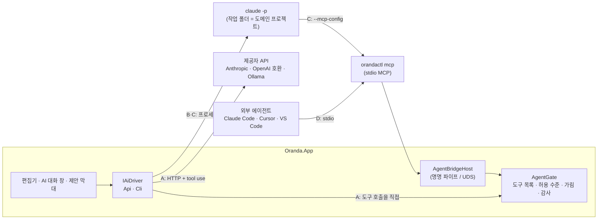
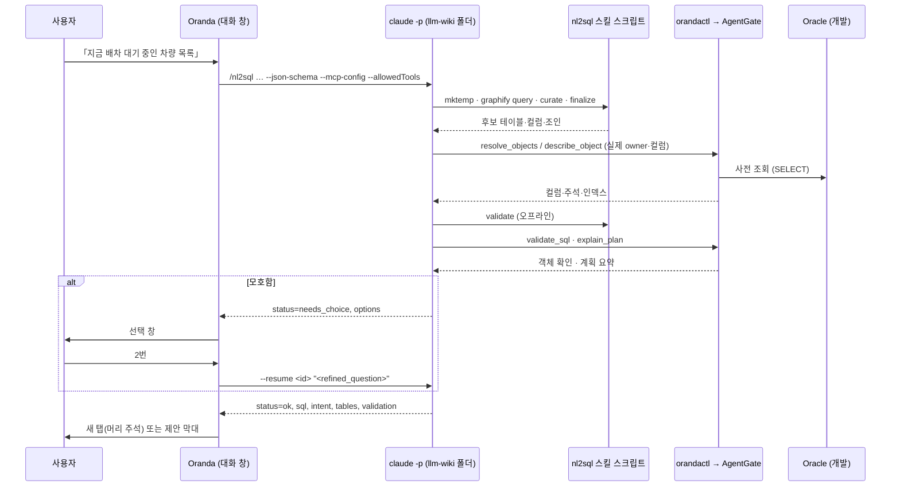

# LLM 호출 방식 비교와 도메인 프로젝트·튜닝 정보 제공 설계

- 작성일: 2026-10-28
- 앞 문서: [LLM 연동 연구서](llm-editor-integration-2026-10-24.md) (이하 「연구서」). 이 문서는 연구서 §0 결론 1·5와 §3 비교표를 넓힌다. 바뀌는 점은 §0 에 적는다.
- 화면 시안: Claude 디자인 캔버스 「Oranda LLM 연동 시안」 https://claude.ai/artifact/VH7d8pBVVk3r6dXeEMGig5 (비공개, 2026-10-28)
- 질문
  1. LLM 을 직접 호출하기, Claude Code 를 `-p` 로 실행하기, MCP 로 외부 LLM 에서 작업하기 중 무엇이 좋은가
  2. llm-wiki 같은 「도메인을 분석한 프로젝트」를 등록하고 nl2sql 같은 스킬을 불러 쿼리를 만들려면 어떻게 하나
  3. LLM 으로 튜닝할 때, LLM 이 요청하면 테이블 정보와 인덱스 정보를 어떻게 주나
  4. 여러 번 주고받으려면(멀티턴) 채팅창이 필요한가
- 표기: 이 PC 에서 실행해 확인한 것은 「실측」, 코드·출처로 확인하지 못한 것은 「확인 못 함」으로 적는다.
- 도메인 프로젝트의 회사 이름·DB 별칭·호스트는 적지 않는다. 예시는 llm-wiki 의 폴더 구조만 쓴다.

---

## 0. 결론

1. **호출 방식은 넷으로 나누어 보고, 도구 층은 하나로 둔다.**
   - A. Oranda 가 제공자 API 를 직접 부른다 (Anthropic·OpenAI 호환·Ollama).
   - B. Oranda 가 `claude -p` 를 글만 주고받는 방식으로 띄운다 (ddobak 방식).
   - C. Oranda 가 `claude -p` 를 띄우면서 `--mcp-config` 로 Oranda 자신의 MCP 서버(`orandactl mcp`)를 붙인다. 시작은 Oranda 가 하고, LLM 은 필요할 때 Oranda 도구로 테이블·인덱스 정보를 가져간다.
   - D. 사용자가 Claude Code 등 외부 에이전트를 쓰고, Oranda 는 MCP 서버만 된다 (연구서 §4 권장안).
   - 도구 목록(연구서 §5)은 제공자와 무관한 JSON 스키마로 **한 번만** 정의한다. C·D 에는 MCP 로, A 에는 함수 호출(tool use) 정의로 같은 목록을 내보낸다. 판단·가림·감사 기록은 모두 `AgentGate` 한 곳에서 한다.
2. **주 경로는 C 다.** 스킬(nl2sql)을 쓸 수 있는 경로는 C·D 뿐이고, 시작을 Oranda 편집기에서 하려면 C 다. D 는 사용자가 이미 Claude Code 세션에서 일할 때 그대로 둔다. A 는 스킬 없이 빠르게 끝나는 일(SQL 설명·오류 고치기·인라인 완성)과 로컬 모델 전용으로 둔다. B 는 C 에서 도구를 뺀 것이라 따로 만들지 않는다.
3. **도메인 프로젝트는 「CLI 프로필 + 폴더 + 스킬 + 허용 명령」 묶음으로 등록한다.** Oranda 는 그 폴더를 작업 폴더로 `claude -p "/nl2sql <질문>"` 을 실행한다. 결과는 `--json-schema` 로 정한 구조로 받고, 모호하면 `needs_choice` 를 받아 선택지를 보인 뒤 `--resume` 으로 잇는다 (§4).
4. **튜닝 정보는 「씨앗 + 요청 시 가져가기」로 준다.** 첫 프롬프트에는 문장이 참조하는 객체 이름과 행 수만 넣고, 열·인덱스·통계·히스토그램·계획은 LLM 이 도구로 요청할 때 준다. 대부분 `ITuningService`·`IMetadataProvider` 에 이미 구현되어 있다 (§5).
   - **히스토그램 끝값(`endpoint_actual_value`)은 실제 열 값이다.** 메타데이터 수준에서는 개수만 주고 값은 「조회 + 행 값」 수준에서만 준다. 그러지 않으면 「행 값은 보내지 않는다」는 약속(연구서 §7.1)이 깨진다.
5. **멀티턴에는 채팅창이 필요하다.** 「AI 대화」 도구 창을 두고, 대화 하나를 CLI 세션 하나(`session_id`)에 묶는다. 다만 선택지 하나 고르기(`needs_choice`)나 제안 받아들이기처럼 한 번 끝나는 대답은 채팅창 없이 선택 창·제안 막대로 처리한다 (§3).
6. 연구서와 달라지는 점 (제안 — 사용자 결정 필요, §8-7)
   - 연구서 §3 의 E(내장 채팅)는 단계 3 이었다. CLI 프로필을 쓰면 키·과금 관리 없이 사용자의 Claude Code 로그인으로 부를 수 있으므로, **C 와 채팅창을 단계 1 로 앞당기기를 제안한다.** 단계 1 의 다리(`orandactl`)를 C 도 그대로 쓰므로 일이 겹치지 않는다. 이 제안은 D-04(1.0 은 AI 를 구현하지 않음)를 언제 푸느냐에 달려 있다.
   - A 의 API 키를 키체인에 저장하면, ad-hoc 서명 빌드에서는 빌드마다 키체인 허용 창이 다시 뜬다(2026-10-28 진단). A 를 넣기 전에 고정 인증서 서명을 먼저 해야 한다.

---

## 1. 이 PC 에서 확인한 것 (2026-10-28 실측)

| 항목 | 결과 |
|---|---|
| Claude Code 버전 | 2.1.312 |
| 헤드리스 플래그 | `--json-schema`, `--input-format stream-json`, `--output-format stream-json`, `--resume`, `--session-id`, `--mcp-config`, `--strict-mcp-config`, `--allowedTools`, `--disallowedTools`, `--permission-prompts`, `--setting-sources`, `--append-system-prompt`, `--max-budget-usd`, `--no-session-persistence` 가 있다 (`claude --help`) |
| 프로젝트 스킬 읽기 | llm-wiki 폴더에서 `--setting-sources project --strict-mcp-config` 로 실행하면 `nl2sql` 을 포함한 프로젝트 스킬 11개가 보인다. 응답 5.2 초 |
| 권한 없이 `/nl2sql` | 멈추지 않는다. `mktemp`·`graphify query` 가 「requires approval」로 거부되고, 스킬이 SQL 을 만들지 않고 이유와 허용 목록 후보를 말한 뒤 끝난다. 4턴·16 초. 결과의 `permission_denials` 에 거부된 호출이 모두 남는다 |
| 허용 목록만 주고 `/nl2sql` | 스킬이 `mktemp` 로 만든 작업 폴더(`$TMPDIR/nl2sql.*`)가 세션 작업 폴더 밖이라 `tee`·`>` 쓰기가 모두 거부된다. 7턴·29 초, SQL 없이 끝남 |
| 작업 폴더를 미리 만들고 `--add-dir` + `--json-schema` | **성공.** 21턴·78 초·API 환산 0.78 달러. 결과가 `structured_output` 에 스키마대로(`status: ok`, `validation.offline: valid`, `repairs: 0`) 온다. 거부 4건은 스킬이 Write 도구로 우회했다 (§4.6) |
| ddobak 의 CLI 호출 | `claude -p --output-format text --system-prompt … --setting-sources "" --strict-mcp-config --disable-slash-commands`. 스킬·설정을 **끄는** 조합이라 nl2sql 에는 쓸 수 없다. `--bare` 는 OAuth·키체인을 읽지 않아 구독 인증이 깨진다는 기록이 있다 (`ddobakddobak/backend/app/services/llm_service.rb`) |
| Codex CLI·Antigravity CLI | 이 PC 에 Codex 가 없다. 두 CLI 가 `.claude/skills` 를 읽는지, MCP 를 어떻게 붙이는지는 확인 못 함 |
| Oranda 튜닝 조회 | `OracleTuningService` 가 표·열 통계, 히스토그램, 인덱스 통계, 인덱스 열, 자식 커서, 벤치마크, SQL 통계, 계획 지적 줄을 구현했다 (§5.2) |

---

## 2. 호출 방식 비교

### 2.1 네 경로



| 경로 | 시작 | 스킬 | LLM 이 필요할 때 정보 요청 | 인증 | 대화 잇기 | 로컬 모델 | Windows |
|---|---|---|---|---|---|---|---|
| A 직접 API | Oranda | 없음 | Oranda 가 도구 호출 반복(agent loop)을 직접 만들고 모델이 tool use 를 지원해야 한다 | API 키(키체인·DPAPI) 또는 없음(Ollama) | Oranda 가 메시지 기록을 들고 있다 | **가능** | 가능 |
| B `claude -p` 글만 | Oranda | 끔(ddobak 방식) | 불가 | Claude Code 로그인 | `--resume` | 불가 | 가능(경로 확인 필요) |
| **C `claude -p` + Oranda MCP** | Oranda | **가능** (작업 폴더의 `.claude/skills`) | **가능** (Oranda 도구) | Claude Code 로그인 | `--resume` 또는 stream-json 입력 | 불가 | 가능(도메인 프로젝트 경로·스킬 안 경로 확인 필요) |
| D 외부 에이전트 + Oranda MCP | 사용자(외부 창) | 가능 | 가능 | 클라이언트 몫 | 클라이언트 몫 | 클라이언트 몫 | 가능 |

| 경로 | 지연 | 비용 관리 | Oranda 가 질 일 | 맞는 기능 |
|---|---|---|---|---|
| A | 가장 짧다 (프로세스 시작 없음) | Oranda 가 토큰 한도를 진다 | 키 저장, 제공자별 형식 차이, 도구 반복, 재시도 | SQL 설명, 오류 고치기, 인라인 완성(로컬), 그리드 자연어 필터 |
| B | 프로세스 시작 수 초 | CLI 계정 한도 | 프로세스 관리뿐 | C 로 대신한다 |
| C | 시작 수 초 + 스킬 단계 수(§4.6) | CLI 계정 한도, API 키 사용자는 `--max-budget-usd` | 프로세스 관리, 결과 스키마, 허용 목록, 대화 창 | 자연어 → SQL(도메인 스킬), 튜닝 루프, 여러 단계 작업 |
| D | 클라이언트 몫 | 클라이언트 몫 | MCP 서버뿐 | 사용자가 이미 에이전트 창에서 일할 때 |

### 2.2 판단

- 사용자가 요청한 「LLM 이 요청하면 테이블·인덱스 정보를 준다」는 B 로는 할 수 없다. 남는 것은 A(도구 반복을 Oranda 가 구현)와 C·D(MCP)다.
- 도메인 스킬(nl2sql)은 Claude Code 가 실행하는 것이라 A 로는 쓸 수 없다. graphify·curate·validate 같은 스크립트를 Oranda 가 다시 구현하지 않는 한 그렇다.
- 그래서 **C 가 주 경로**이고, A 는 「스킬이 필요 없고 빨라야 하는 일」과 「클라우드로 보내면 안 되는 일(로컬 모델)」에 쓴다.
- C 와 D 는 같은 `orandactl` 과 같은 도구를 쓴다. C 는 D 의 클라이언트를 Oranda 가 띄워 주는 것일 뿐이다. 그래서 C 를 만들면 D 도 거의 같이 된다.

### 2.3 `IAiDriver` 계약 (안)

```csharp
// Oranda.Core/Ai — 제공자와 무관한 한 번의 요청·응답 흐름
public interface IAiDriver
{
    AiDriverCapabilities Capabilities { get; }      // Skills, Tools, Resume, LocalOnly, Streaming
    IAsyncEnumerable<AiEvent> RunAsync(AiRequest request, CancellationToken ct);
}

public sealed record AiRequest(
    string Prompt,                        // 사용자 글 또는 "/nl2sql <질문>"
    AiContext Context,                    // 탭·선택·접속 별칭·허용 수준 (비밀 없음)
    string? ResumeId,                     // CLI session_id 또는 Oranda 대화 id
    DomainProject? Project,               // C 에서만
    JsonElement? OutputSchema);           // 결과 구조 (§4.4)

// AiEvent: TextDelta · ToolCall(이름, 인자 요약) · ToolResult(크기, 판단) · NeedsChoice · Final(구조 결과) · Error · Usage
```

- `CliDriver` 는 `claude` 프로세스를 띄워 `stream-json` 줄을 `AiEvent` 로 바꾼다. 도구 호출은 `orandactl` 을 거쳐 `AgentGate` 로 오므로, 드라이버는 화면 표시용 사건만 넘긴다.
- `ApiDriver` 는 같은 도구 목록을 제공자 형식의 tool 정의로 바꿔 보내고, 응답의 tool use 를 `AgentGate` 로 직접 부른 뒤 결과를 다시 보낸다. 반복 상한(기본 8회)과 토큰 한도를 둔다.
- 화면(대화 창·제안 막대)은 `AiEvent` 만 보므로 경로가 달라도 같다.

---

## 3. 멀티턴과 채팅창

### 3.1 채팅창이 필요한 경우와 필요 없는 경우

| 상황 | 화면 |
|---|---|
| 「부서명도 같이 보여 줘」처럼 앞 결과를 고쳐 달라고 이어서 말한다 | **AI 대화 창** |
| 튜닝 루프 중간에 「인덱스는 만들지 말고 힌트로만」처럼 방향을 바꾼다 | **AI 대화 창** |
| nl2sql 이 「코일 위치」가 모호하다며 1·2·3 중 고르라고 한다 | 선택 창(대화 창이 열려 있으면 그 안의 선택 카드) |
| 제안을 받아들일지 정한다 | 편집기 제안 막대 (연구서 §9) |
| SQL 설명·오류 고치기를 한 번 받는다 | 결과 창 한 번. 「이어서 묻기」를 누르면 그 내용을 들고 대화 창으로 넘어간다 |

### 3.2 AI 대화 창

- 도킹 도구 창(`IToolPanelRegistry`)으로 둔다. 연구서 §4.1 의 「에이전트」 창과 같은 창의 탭으로 둔다: 「대화」 · 「호출 기록」 · 「돌려준 글」.
- 대화 하나에 다음을 묶는다: 드라이버(A·C), 프로필(모델), 도메인 프로젝트(C), 접속, CLI `session_id`(C) 또는 메시지 기록(A).
- 위쪽 띠에 문맥 칩을 둔다: `현재 탭` · `선택 영역` · `DEV-ERP` · `llm-wiki/nl2sql`. 칩을 끄면 그 문맥을 보내지 않는다.
- 메시지 안의 SQL 블록마다 「편집기에 넣기(제안)」 · 「새 탭」 · 「차이 보기」 단추를 둔다. 넣기는 언제나 `propose_edit` 와 같은 제안 흐름을 탄다.
- 도구 호출은 접힌 카드로 보인다(`describe_object TB_ORDER · 1.2 KB · 허용`). 펼치면 돌려준 글을 그대로 보인다.
- 「멈춤」 단추는 CLI 프로세스를 끝내거나 API 요청을 취소한다. 진행 중이던 제안은 남긴다.
- 대화 기록은 `oranda.db` 에 둔다. 보관 기간은 「보낸 요청 기록 보관」 설정을 따른다. 행 값이 들어간 메시지는 보관하지 않는 선택지를 둔다.

### 3.3 대화를 잇는 방법

| 경로 | 방법 | 비고 |
|---|---|---|
| C, 한 번에 한 요청 | 첫 실행 결과의 `session_id` 를 저장하고 다음 요청은 `claude -p --resume <id> "<글>"` | 요청마다 프로세스 시작 비용(수 초)이 든다. 세션 기록이 디스크에 남아야 하므로 `--no-session-persistence` 를 쓰지 않는다 |
| C, 대화 창이 열려 있는 동안 | `claude -p --input-format stream-json --output-format stream-json` 프로세스 하나를 살려 두고 사용자 글을 줄 단위로 넣는다 | 시작 비용이 한 번뿐이다. 대화 창을 닫거나 10분 쉬면 끝내고, 다음에는 `--resume` 으로 잇는다. 장시간 유지 시 동작은 확인 못 함 |
| A | Oranda 가 메시지 목록을 들고 매번 다시 보낸다 | 문맥 길이를 넘으면 앞 대화를 요약해 줄인다 |

---

## 4. 도메인 프로젝트 등록과 스킬 호출

### 4.1 무엇을 등록하나

「도메인 프로젝트」는 업무 도메인을 분석해 둔 폴더다. llm-wiki 를 예로 들면 다음이 있다.

- `.claude/skills/*/SKILL.md`: nl2sql, analyze-queries 같은 스킬
- `global/graphify-out/graph.json`: 테이블·쿼리·PL/SQL 지식 그래프
- `dbschema/`: 모듈별 스키마 스냅샷(SQLite)
- `CLAUDE.md`: 프로젝트 규칙

설정 › AI 모델 아래에 「도메인 프로젝트」 절을 둔다. 한 항목의 필드는 다음과 같다.

| 필드 | 예 | 설명 |
|---|---|---|
| 이름 | `MES 위키` | 표시용 |
| 폴더 | macOS `~/project/llm-wiki`, Windows `C:\work\llm-wiki` | OS 마다 따로 저장한다. 설정 파일을 두 PC 가 공유해도 맞는 경로를 고른다 |
| CLI 프로필 | `Claude Code · opus` | CLI 프로필만 고를 수 있다. API 프로필은 스킬을 실행하지 못한다 |
| 스킬 | `nl2sql` (발견 목록에서 고름) | 폴더의 `.claude/skills/*/SKILL.md` 앞머리(`name`·`description`)를 읽어 목록을 만든다 |
| 용도 | `자연어 → SQL` | Oranda 기능과 스킬을 잇는다. 한 기능에 스킬 하나 |
| 호출 형식 | `/nl2sql {question}` | `{question}` 자리에 사용자 질문을 넣는다 |
| 허용 명령 | `Bash(cd:*)`, `Bash(graphify query:*)`, `Bash(python3 nl2sql/cli/*)`, `Bash(python3 dictionaries/lookup.py:*)`, `Read`, `Glob`, `Grep`, 쓰기는 작업 폴더로 좁힌 규칙 하나 | `--allowedTools` 로 넘긴다. 「거부된 호출에서 추가」 단추로 채운다(§4.5). 작업 폴더는 Oranda 가 만들므로 `mktemp` 는 넣지 않는다. `tee` 는 넣지 않는다: 3회차에서 허용했어도 `cd` 와 섞여 거부되었고, 셸로 아무 경로에나 쓰는 길만 연다 |
| 쓰기 규칙 | `Edit(//<작업 폴더>/**)` 꼴 (아래 주의) | 맨 `Write` 를 허용하면 작업 폴더가 도메인 프로젝트 폴더라서 SKILL.md·dbschema 같은 프로젝트 파일도 덮어쓸 수 있다. 3회차의 실제 쓰기는 모두 작업 폴더 안이었다. **경로를 좁힌 쓰기 규칙의 정확한 문법(절대 경로 표기, Edit 규칙이 Write 에도 걸리는지)은 확인 못 함**이다. 확인 전에는 「맨 Write 허용 + 실행 뒤 도메인 프로젝트 폴더의 git 변경 검사(바뀐 파일이 있으면 경고)」로 대신한다 |
| 작업 폴더 규칙 | `Step 0 을 건너뛰고 {workdir} 를 쓴다` | 스킬이 스스로 임시 폴더를 만드는 단계를 Oranda 가 대신한다(§4.2) |
| 막을 도구 | `WebFetch`, `WebSearch` (고정) | 사용자가 지울 수 없다 (연구서 §7.4) |
| 연결 접속 | `DEV-ERP`, `TEST-ERP` | 이 프로젝트의 SQL 을 검증·계획할 접속. 운영 라벨 접속은 고를 수 없다 |
| 시간 상한 | 300 초 | 넘으면 프로세스를 끝낸다 |
| 결과 형식 | `nl2sql-result` (§4.4) | 내장 스키마 이름 |

- 등록할 때 「점검」 단추로 다음을 확인한다.
  - CLI 가 있고 로그인되어 있는가 (`claude -p "ok" --max-turns 1`)
  - 스킬이 보이는가 (§1 의 스킬 목록 실측과 같은 호출)
  - graphify 같은 바깥 명령이 PATH 에 있는가 (`graphify --version`)
- 스킬 파일 안에 macOS 절대 경로(`/Users/<사용자>/project/llm-wiki`)가 박혀 있으면 경고한다. 그 경우 Windows 에서는 실패한다. 고치는 일은 도메인 프로젝트 쪽 몫이다(연구서 §13.2-7).

### 4.2 실행 명령

Oranda 가 띄우는 명령은 다음과 같다. 작업 폴더는 도메인 프로젝트 폴더다.

실행 전에 Oranda 가 실행마다 작업 폴더를 만든다(`<앱 데이터>/ai/runs/<실행 id>`, 사용자 전용 권한). 스킬은 중간 파일(`curate.md`·`curated.json`·`out.sql`)을 이 폴더에 쓴다. 실행이 끝나면 결과와 함께 7일 보관한 뒤 지운다.

```text
claude -p "/nl2sql 지금 배차 대기 중인 차량 목록"   < /dev/null   # 표준 입력을 닫는다 (안 닫으면 3초 기다린 뒤 경고)
  --setting-sources project              # 프로젝트 스킬·설정만. 사용자 전역 플러그인·훅을 싣지 않는다
  --add-dir <작업 폴더>                    # 스킬의 중간 파일을 쓸 곳. 없으면 쓰기가 모두 거부된다 (§1 실측)
  --output-format stream-json --verbose  # 진행 사건을 줄 단위로 받는다
  --json-schema <oranda 결과 스키마>      # 마지막 결과를 구조로 받는다 (§4.4)
  --append-system-prompt <Oranda 머리말>  # 결과 규칙·문맥 (§4.3)
  --mcp-config <oranda-mcp.json> --strict-mcp-config   # Oranda 도구만 붙인다
  --allowedTools <등록한 허용 명령> mcp__oranda__*
  --disallowedTools WebFetch WebSearch
  --model opus
```

- `--setting-sources project` 로 사용자 전역 설정을 빼면, 이 PC 의 전역 플러그인·훅이 스킬 실행에 끼어들지 않는다. 스킬은 그대로 읽힌다(§1 실측).
- `oranda-mcp.json` 은 Oranda 가 실행 때마다 임시 폴더에 쓴다. 내용은 `orandactl mcp --session <대화 id>` 하나다. `--session` 으로 이 대화의 접속·허용 수준을 다리 쪽에 알린다.
- ddobak 의 `--disable-slash-commands`·`--setting-sources ""` 는 스킬을 끄므로 이 경로에서는 쓰지 않는다. `--bare` 도 쓰지 않는다(구독 인증이 깨짐).

### 4.3 Oranda 머리말 (`--append-system-prompt`)

스킬 본문은 고치지 않고, Oranda 가 실행할 때만 다음 규칙을 덧붙인다.

```text
[Oranda 에서 실행됨]
- Step 0 의 작업 폴더는 이미 만들었다: <작업 폴더>. mktemp 를 하지 말고 이 경로를 그대로 쓴다.
- 대상 접속: DEV-ERP (개발). 허용 수준: 계획. 비밀번호·호스트는 받을 수 없다.
- 스킬의 Step 5 (오프라인 검증)가 VALID 이면, mcp__oranda__validate_sql 과 mcp__oranda__explain_plan 으로
  실제 DB 에서 한 번 더 확인한다. 객체·권한 오류가 나면 Step 6 자기수정으로 돌아간다.
- 사용자에게 묻는 대신, 모호하면 결과 status 를 needs_choice 로 하고 선택지를 options 에 담아 끝낸다.
- 최종 보고는 마크다운이 아니라 지정된 JSON 구조로 낸다. sql 에는 SQL 한 문장만 넣는다.
- 편집기에 직접 넣지 않는다. Oranda 가 결과를 받아 제안으로 보인다.
```

### 4.4 결과 스키마 (`nl2sql-result`)

```json
{
  "type": "object",
  "required": ["status"],
  "properties": {
    "status": { "enum": ["ok", "needs_choice", "failed"] },
    "sql": { "type": "string" },
    "intent": { "type": "string" },
    "tables": { "type": "array", "items": { "type": "string" } },
    "plsql": { "type": "array", "items": { "type": "string" } },
    "assumptions": { "type": "array", "items": { "type": "string" } },
    "validation": {
      "type": "object",
      "properties": {
        "offline": { "enum": ["valid", "invalid", "skipped"] },
        "repairs": { "type": "integer" },
        "live": { "enum": ["valid", "invalid", "skipped"] },
        "live_message": { "type": "string" }
      }
    },
    "question": { "type": "string" },
    "options": {
      "type": "array",
      "items": { "type": "object", "required": ["label", "refined_question"],
                 "properties": { "label": { "type": "string" }, "detail": { "type": "string" },
                                 "refined_question": { "type": "string" } } }
    },
    "reason": { "type": "string" }
  }
}
```

- `ok`: Oranda 가 `sql` 을 새 탭(또는 현재 탭 제안)으로 넣는다. 머리 주석에 질문·의도·사용 자산·가정을 넣는다(연구서 §10.2).
- `needs_choice`: 선택 창을 띄운다. 사용자가 고르면 `--resume <session_id> "<refined_question>"` 로 잇는다. nl2sql 은 선택한 뜻을 명시한 새 질문으로 Step 1 부터 다시 돈다.
- `failed`: `reason` 과 `permission_denials`(있으면)를 보인다.
- 스킬의 Step 7 은 마크다운 보고를 하라고 적혀 있지만, `--json-schema` 와 머리말을 주면 스키마대로 끝낸다(§4.6 실측). 결과는 stream-json 의 마지막 `result` 사건의 `structured_output` 에서 읽는다. 모델은 마지막에 `StructuredOutput` 도구를 불러 이 값을 낸다.
- 스키마에 없는 필드(`question`)를 모델이 더 넣기도 했다. Oranda 는 모르는 필드를 무시한다.

### 4.5 권한

- 헤드리스 실행에서 허용되지 않은 도구는 **멈추지 않고 거부된다**(§1 실측). 결과의 `permission_denials` 에 명령이 그대로 남는다.
- 그래서 등록 화면에 「점검 실행」을 두고, 거부된 명령을 목록으로 보여 「허용 명령에 추가」를 누르게 한다. 사용자가 보지 않은 명령은 허용하지 않는다.
- 허용 명령은 접두어 단위(`Bash(python3 nl2sql/cli/*)`)로만 받는다. `Bash(*)`·`Bash(python3:*)` 처럼 넓은 규칙은 경고하고, 지우기 전에는 저장하지 않는다.
- `WebFetch`·`WebSearch` 는 늘 막는다. 행 값을 읽을 수 있는 대화(허용 수준 「조회 + 행 값」)에서는 `Bash` 전체를 막고 Oranda 도구만 남기는 선택지를 둔다. 비공개 데이터와 밖으로 쓰는 경로를 한 세션에 두지 않기 위해서다(연구서 §7.4).
- `--permission-prompts host` 와 권한 질문 도구를 쓰면 승인 창을 Oranda 에 띄울 수 있다. 이 방식이 `-p` 단독 실행에서 어떻게 동작하는지는 확인 못 함이다. 1차는 「허용 목록 + 거부 목록 보여 주기」로 한다.

### 4.6 탐침 결과 (2026-10-28, llm-wiki, 질문 「지금 배차 대기 중인 차량 목록」)

| 회차 | 조건 | 결과 | 턴·시간·비용(API 환산) |
|---|---|---|---|
| 1 | 허용 목록 없음 | `mktemp`·`graphify query` 거부. SQL 없이 이유와 허용 후보를 말하고 끝남 | 4턴·16 초·0.23 달러 |
| 2 | 허용 목록만 | 스킬이 만든 `$TMPDIR` 작업 폴더가 작업 폴더 밖이라 `tee`·`>`·`mkdir` 거부. SQL 없이 끝남 | 7턴·29 초·0.29 달러 |
| 3 | 작업 폴더 미리 생성 + `--add-dir` + `--json-schema` + 머리말 | **성공.** `status: ok`, 테이블 1개, 가정 5개, 오프라인 검증 통과·수정 0회 | 21턴·78 초·0.78 달러 |

3회차에서 본 것

- 단계 순서가 스킬과 같았다: graphify query → curate.py → 사전 조회(lookup.py) → curated.json 쓰기 → finalize.py → out.sql 쓰기 → validate.py → `StructuredOutput`.
- 거부 4건이 있었지만 모두 우회했다.
  - `cd X && … > 파일` 처럼 디렉터리 이동과 쓰기를 한 명령에 섞으면, 허용된 명령끼리여도 「경로 평가를 위해 승인 필요」로 거부된다.
  - `--add-dir` 로 준 폴더 **안**으로의 `>` 리다이렉션도 승인이 필요하다고 거부되었다.
  - `validate.py …; echo "exit=$?"` 의 `echo` 가 허용 목록에 없어 거부되었다.
  - 모델은 쓰기를 Write 도구로 바꾸고 `echo` 를 빼서 다시 실행했다. 실패는 아니지만 턴이 늘어난다.
- 개선: 도메인 프로젝트 쪽 스킬이 리다이렉션 대신 스크립트의 `--out` 인자나 Write 도구를 쓰게 하면 턴이 줄어든다. 이것은 도메인 프로젝트 쪽 몫이다. Oranda 쪽은 거부 목록을 점검 화면에 보여 주는 것으로 충분하다.
- graphify 가 문장 형태 질문에서 노드를 찾지 못했고(`No matching nodes found`), curate.py 의 키워드 검색으로 대신 찾았다. 결과에는 이 사실이 가정으로 적혀 왔다.
- 이번 실행에는 Oranda MCP 를 붙이지 않았다(다리 미구현). 그래서 실제 DB 확인(④ᴮ)은 하지 않았고 `validation.live` 는 비어 있다.
- 시간: 78 초 중 대부분이 모델 턴이다. 사용자는 대화 창에서 단계별 진행(도구 카드)을 보며 기다리게 한다. 「멈춤」 단추가 필요하다.

### 4.7 전체 흐름



### 4.8 다른 CLI

- Codex CLI 는 `codex exec` 로 비대화형 실행을 하고 MCP 서버 설정을 가진다. 하지만 `.claude/skills` 의 스킬을 그대로 읽는지는 확인 못 함이다.
- Antigravity CLI 도 같다.
- 그래서 도메인 프로젝트의 CLI 프로필은 1차에 Claude Code 만 받는다. 다른 CLI 는 「스킬 없음, Oranda 도구만」으로 A 와 같은 일에 쓴다.

---

## 5. 튜닝할 때 테이블·인덱스 정보 주기

### 5.1 원칙

1. **씨앗 + 요청 시 가져가기.**
   - 첫 프롬프트에는 문장과, Oranda 파서로 찾은 참조 객체의 「실제 owner.이름 · 종류 · 행 수 · 통계 날짜」만 넣는다(`SynonymResolver` 로 동의어를 푼다).
   - 열·인덱스·통계·히스토그램·계획은 LLM 이 도구로 요청할 때 준다.
   - 큰 표를 통째로 처음부터 넣지 않아도 되므로 문맥이 덜 찬다. Claude Code 의 MCP 결과 상한(기본 2.5만 토큰, 연구서 §4.2)에도 덜 걸린다.
2. **도구가 없는 모델에는 같은 모양을 미리 묶어 준다.** A 경로에서 tool use 를 못 하는 로컬 모델이면 `get_tuning_context` 결과(§5.3)를 프롬프트에 넣는다. 도구 결과와 같은 JSON 모양이라 프롬프트 규칙이 하나다.
3. **범위 밖은 주지 않는다.** 요청한 객체가 이 문장이 참조하는 객체, 그 객체의 인덱스·FK 상대, 접속의 「보낼 범위」 중 어디에도 없으면 거부하고 이유를 돌려준다. LLM 이 관계없는 표를 훑지 못하게 한다.
4. **사용자 작업 세션을 쓰지 않는다.** 조회는 모니터 세션 또는 에이전트 세션(연구서 §6.1, `SessionPurpose.Agent`)에서 한다. 사용자의 트랜잭션과 섞이지 않는다.
5. **실행 한 번 동안 캐시한다.** 키는 (접속, owner, 이름, `last_analyzed`, `last_ddl_time`)이다. 같은 대화에서 같은 표를 다시 물으면 DB 에 다시 가지 않는다.

### 5.2 도구와 기존 코드

| 도구 | 매개변수 | 돌려주는 것 | 허용 수준 | 기존 코드 |
|---|---|---|---|---|
| `describe_object` | connection, object | 열(이름·형·NULL·기본값·주석), PK/UK/FK, 인덱스 이름·열 | 메타데이터 | `IMetadataProvider.GetTableAsync` (`TableInfo`·`IndexInfo`) |
| `get_index_info` (새) | connection, table | 인덱스마다: 이름, 고유 여부, 종류, 열 순서·내림차순·함수식, 상태·보이기(VISIBLE/INVISIBLE), 분할 여부, blevel, leaf_blocks, distinct_keys, clustering_factor, 통계 날짜·stale | 계획 | `GetIndexStatsAsync` + `GetIndexColumnsAsync` + `ITableKeyDetailProvider.GetIndexColumnsAsync`(`IndexColumnDetail`: 위치·열·식·내림차순)를 하나로 합친다 |
| `get_table_stats` | connection, table, columns? | 표: num_rows, blocks, avg_row_len, 통계 날짜, stale. 열(요청한 열 또는 문장이 쓰는 열): num_distinct, num_nulls, density, 히스토그램 종류, 버킷 수 | 계획 | `GetTableStatsAsync`, `GetColumnStatsAsync` |
| `get_histogram` | connection, table, column | 버킷 수와 버킷별 개수. **끝값은 「조회 + 행 값」에서만** | 계획(개수) / 조회 + 행 값(값) | `GetHistogramAsync` (`HistogramBucket.EndpointValue` 는 `endpoint_actual_value`) |
| `get_cursor_plan` | connection, sql_id, child? | 실제 계획(A-Rows·Starts·시간), plan_hash | 계획 | `IExecutionPlanService.GetCursorPlanAsync` |
| `explain_plan` | connection, sql | 예상 계획 | 계획 + 접속의 `allowExplainPlan` | `ExplainAsync` |
| `get_child_cursors` | connection, sql_id | 자식 커서·불일치 사유 | 계획 | `GetChildCursorsAsync`, `GetSharedCursorReasonsAsync` |
| `get_sql_stats` | connection, sql_id | 실행 수·실행당 경과·gets·행 | 계획 | `GetSqlStatsAsync` |
| `get_tuning_context` (새) | connection, sql 또는 sql_id, budget_tokens | 아래 §5.3 묶음 | 계획 | 위 도구들을 묶는다 |
| `benchmark_queries` | connection, variants, repeat | 경과·논리/물리 읽기·행 수·plan_hash | 조회 실행, 개발·시험만 | `RunBenchmarkAsync` (SELECT 만) |

- `get_index_info` 를 따로 두는 이유: 튜닝에서 LLM 이 가장 자주 묻는 것이 「이 열로 시작하는 인덱스가 있나, 선택도는 어떤가」다. 열 순서·함수식·clustering_factor 가 한 번에 있어야 판단할 수 있다. 지금은 세 호출에 흩어져 있다.
- ASH·AWR 처럼 Diagnostics Pack 이 필요한 정보는 연구서 §8 처럼 SAFE-07 선언이 있을 때만 준다.

### 5.3 `get_tuning_context` 묶음

```json
{
  "statement": { "sql_id": "7h35uxf5uhmm1", "plan_hash": 2481234567, "text_chars": 612 },
  "objects": [
    {
      "name": "APP_OWNER.TB_ORDER", "kind": "TABLE",
      "stats": { "num_rows": 18234511, "blocks": 402113, "last_analyzed": "2026-10-27", "stale": false },
      "used_columns": [
        { "name": "STAT_CD", "type": "VARCHAR2(2 CHAR)", "nullable": true, "comment": "상태코드",
          "num_distinct": 6, "num_nulls": 0, "histogram": "FREQUENCY" },
        { "name": "ORDER_DT", "type": "DATE", "nullable": false, "comment": "주문일시",
          "num_distinct": 4120533, "histogram": "NONE" }
      ],
      "indexes": [
        { "name": "IX_ORDER_01", "unique": false, "columns": ["CUST_ID", "ORDER_DT DESC"],
          "visible": true, "blevel": 3, "leaf_blocks": 61234, "distinct_keys": 9120044,
          "clustering_factor": 15022110, "stale": false }
      ]
    }
  ],
  "plan_findings": [ { "id": 4, "operation": "TABLE ACCESS FULL", "object": "TB_ORDER", "note": "E-Rows 12 / A-Rows 2,103,442" } ],
  "omitted": [ "TB_ORDER 의 쓰지 않는 열 41개", "히스토그램 끝값(행 값 수준 아님)" ]
}
```

- `used_columns` 는 Oranda 파서가 문장에서 찾은 열(SELECT·WHERE·JOIN·GROUP BY·ORDER BY)과 인덱스 열의 합이다. 나머지 열은 개수만 `omitted` 에 적는다. LLM 이 더 필요하면 `describe_object` 로 가져간다.
- `budget_tokens` 를 넘으면 계획 지적 줄 → 인덱스 통계 → 열 통계 순서로 줄이고, 줄인 것을 `omitted` 에 적는다.
- 값의 모양은 §5.2 의 개별 도구 결과와 같다. 그래서 A(미리 묶음)와 C(요청 시)가 같은 해석 규칙을 쓴다.

### 5.4 행 값이 새는 곳

| 정보 | 왜 행 값인가 | 처리 |
|---|---|---|
| 히스토그램 끝값 `endpoint_actual_value` | 실제 열 값(코드·이름·번호)이다 | 「조회 + 행 값」 수준에서만, 민감 컬럼 가림 뒤에 준다 |
| `low_value`·`high_value` (열 통계) | 실제 최솟값·최댓값이다 | 지금 `ColumnStatsRow` 에 없다. 넣는다면 히스토그램과 같은 규칙을 따른다 |
| 바인드 캡처 값 | 사용자가 넣은 값이다 | 기본으로 가린다 (연구서 §5.2 `get_sql_detail`) |
| SQL 글의 리터럴 | `WHERE CUST_ID = '…'` | 설정 「리터럴을 :v1 로 바꿔 보냄」(시안 1) |

### 5.5 튜닝 대화 예

```text
사용자 (대화 창, 현재 탭 문장 선택): 이 쿼리 느린데 봐 줘
Oranda → LLM: 문장 + 씨앗(TB_ORDER 1,823만 행, TB_DEPT 120 행, 통계 어제)
LLM → get_cursor_plan(sql_id)            # 실제 계획: TB_ORDER FULL, E-Rows 12 / A-Rows 210만
LLM → get_index_info(TB_ORDER)           # STAT_CD 로 시작하는 인덱스 없음
LLM → get_table_stats(TB_ORDER, [STAT_CD, ORDER_DT])   # STAT_CD 6종, FREQUENCY 히스토그램
LLM → get_histogram(TB_ORDER, STAT_CD)   # 버킷 개수만 (값은 가림): 한 값이 전체의 0.4%
LLM: 재작성 후보 2개 + 인덱스 후보 1개 (CREATE INDEX 문안은 새 탭에만)
LLM → benchmark_queries([원문, 후보1, 후보2])
LLM → propose_edit(후보1, reason=벤치마크 요약)
Oranda: 제안 막대 (시안 7)
```

---

## 6. 시안과 맞추기

- 시안 1 의 프로필 콤보에서 무엇을 고르느냐에 따라 할 수 있는 일이 다르다. 화면에 그 차이를 적는다.
  - CLI 프로필(Claude Code): 스킬·Oranda 도구·대화 잇기 모두 된다. 도메인 프로젝트를 고를 수 있다.
  - API 프로필: Oranda 도구는 Oranda 의 도구 반복으로만 쓰고, 스킬은 없다. 도메인 프로젝트 칸이 꺼진다.
  - 로컬 모델(Ollama): 위와 같고, tool use 를 못 하는 모델이면 `get_tuning_context` 미리 묶음을 쓴다.
- 시안 8 「AI 대화 창」: 문맥 칩, 도구 카드(접기), `needs_choice` 선택 카드, SQL 블록의 「편집기에 넣기」, 이어 말하기 → 편집기 제안을 보인다 (§3).
- 시안 9 「AI 튜닝」 버튼: 편집기 툴바의 나눔 버튼(누르면 이 문장 튜닝, ▾ 는 해설·설명·오류 고치기). 시작 전 확인 창에 「먼저 보낼 것 / 요청 시 줄 것 / 보내지 않음」을 보이고, 시작하면 대화 창에서 도구 호출이 차례로 보인다 (§5.1·§5.5).
- 시안에 아직 없는 화면: 도메인 프로젝트 등록·점검.

---

## 7. 단계 (연구서 §12 고침)

| 단계 | 일 | 크기(w) |
|---|---|---|
| 1-a | 도구 계약을 제공자 중립 JSON 스키마로 정의, `AgentGate`, `orandactl mcp`, 읽기 도구(연구서 §12 단계 1 그대로) | 연구서 단계 1 |
| 1-b | `IAiDriver` + `CliDriver`(Claude Code), 결과 스키마, 대화 창(한 번에 한 요청 + `--resume`), `needs_choice` 선택 창 | 3 |
| 1-c | 도메인 프로젝트 등록·스킬 발견·점검·허용 명령 관리, 자연어 → SQL 을 nl2sql 로 연결 | 2 |
| 2-a | 튜닝 도구: `get_index_info`·`get_table_stats`·`get_histogram`(값 가림)·`get_tuning_context`, 세션 캐시 | 2 |
| 2-b | 튜닝 루프를 대화 창에서 실행(연구서 §8), stream-json 입력으로 프로세스 유지 | 1.5 |
| 3 | `ApiDriver`(Anthropic·OpenAI 호환·Ollama) + Oranda 도구 반복 + 토큰 한도, 고정 인증서 서명(키체인 창) 선행 | 3 |

수락 기준(1-b·1-c)

- llm-wiki 를 등록하고 「지금 배차 대기 중인 차량 목록」을 물으면 새 탭에 SQL 과 머리 주석이 들어간다. 편집기 글은 받아들이기 전에는 바뀌지 않는다.
- 모호한 질문이면 선택 창이 뜨고, 고른 뒤 같은 CLI 세션으로 이어 결과가 나온다.
- 허용하지 않은 명령은 실행되지 않고, 점검 화면에 거부 목록으로 나온다.
- 대화 창에서 「부서명도 같이」라고 이어 말하면 앞 SQL 을 고친 제안이 나온다.

수락 기준(2-a)

- 계획 수준 접속에서 `get_histogram` 결과에 끝값이 없다. 행 값 수준으로 올리면 가림 규칙을 지난 값이 나온다.
- 문장이 참조하지 않고 보낼 범위에도 없는 표를 `get_index_info` 로 물으면 거부된다.

---

## 8. 열린 질문

1. ~~스킬의 마크다운 보고(Step 7)를 `--json-schema` 가 대신하는가~~ → 대신한다(§4.6 3회차). 다만 한 번의 실행이므로, 모호한 질문(`needs_choice`)과 검증 실패(`repairs` > 0) 경우를 더 시험한다.
2. stream-json 입력으로 프로세스를 오래 살려 둘 때 메모리·인증 만료는 어떻게 되는가 (확인 못 함).
3. `--permission-prompts host` 로 승인 창을 Oranda 에 띄울 수 있는가 (확인 못 함).
4. Codex·Antigravity CLI 가 프로젝트 스킬을 읽는가 (확인 못 함, 이 PC 에 Codex 없음).
5. 히스토그램 끝값을 「계획」 수준에서도 코드값 열(예: 상태코드)에 한해 보낼 것인가. 튜닝 정확도에는 도움이 되지만 행 값 규칙의 예외가 된다. 사용자가 정한다.
6. 대화 기록 보관을 기본으로 켤 것인가. 행 값이 들어간 메시지는 기본으로 보관하지 않기를 권한다.
7. C 경로와 대화 창을 단계 1 로 앞당길 것인가(§0-6). D-04 를 푸는 시점과 함께 사용자가 정한다. §7 단계표는 앞당긴다는 가정으로 적었다.
8. 경로를 좁힌 쓰기 허용 규칙의 문법(§4.1 쓰기 규칙). Claude Code 권한 문서로 확인한 뒤 맨 `Write` 허용을 바꾼다.
