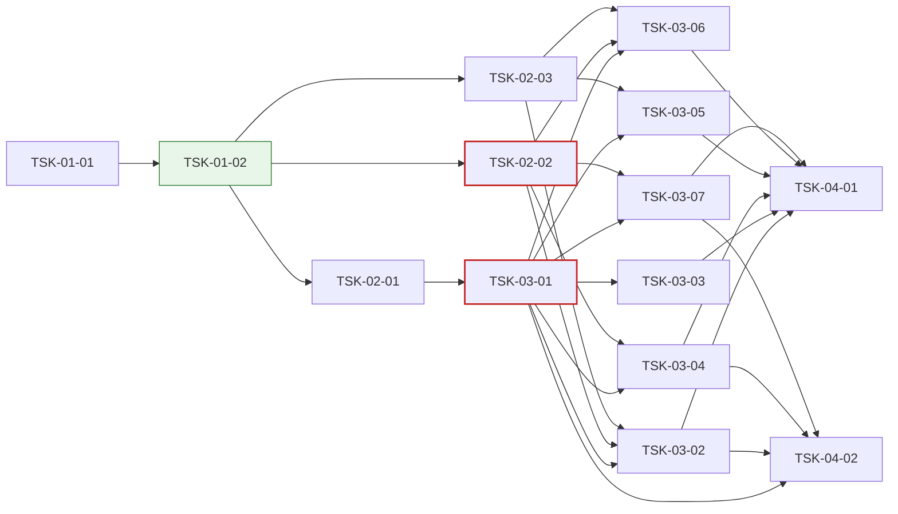

# WBS - Oranda MyBatis 작업 공간

> depth: 3
> start-date: 2026-10-23 / target-date: 2026-11-09 / updated: 2026-10-23
> source: docs/oranda1/PRD.md, docs/oranda1/TRD.md

## WP-01: 기본 설계·공유 계약
<!-- 담당 PC: win144(Windows 개발 PC) — 맥북 세션은 이 WP 의 Task 를 하지 않는다. 시안 A(decisions D-001)를 설계로 옮기고, 기능 Task 들이 함께 쓰는 인터페이스·데이터 모델·편집 지점을 먼저 정한다 -->

- [x] TSK-01-01: MyBatis 작업 공간 기본 설계 (화면·흐름·저장 방식) [win144] w:1 2026-10-23~2026-10-24
  - category: design
  - domain: infra
  - model: opus
  - priority: high
  - tags: mybatis, design, win144
  - prd-ref: PRD 3, PRD 5, MB-01~MB-10
  - requirements: docs/oranda1/design.md 를 쓴다: 화면 구성(시안 A 영역별 역할), 문서 종류 `MyBatis` 와 도구 창 보임 규칙, 명령 목록·단축키, 저장 흐름(바뀌는 부분 창·원자적 쓰기·3방향 문장 병합), 시나리오 저장 위치, 지금 ReadMyBatis 에서 계산기로 옮길 부분; 지금 코드에서 고쳐야 할 공유 지점(WorkspaceFiles·SqlEditorHost.Files·도킹 규칙·작업 공간 문서 종류)을 찾아 적는다; 제약: 상위 docs/PRD.md·TRD.md·design/ 은 고치지 않는다; 기술: TRD 2 계층과 위치, TRD 6 화면 배선; 화면: 시안 캔버스 Main·Convert·SaveDiff·Combos 아트보드; 비고: 담당 PC: win144(Windows 개발 PC) — 맥북 세션은 이 Task 를 하지 않는다. 2026-10-23 사용자 결정 시안 A(「A가 좋아보이네」). 시안 캔버스 https://claude.ai/artifact/JeoMQCGye8RCEqGmGVPKEa (Main = 시안 A, Convert·SaveDiff·Combos = 흐름)
  - acceptance: design.md 가 PRD MB-01~MB-10 을 빠짐없이 화면·명령·데이터에 대응시킨다 / 공유 지점 목록이 TSK-01-02 의 「기능 Task 편집 지점」 표의 입력이 된다

- [x] TSK-01-02: MyBatis 모델·계산기·시나리오 인터페이스와 편집 지점 (계약 전용) [win144] w:1 2026-10-25~2026-10-26
  - category: infra
  - domain: backend
  - model: opus
  - priority: critical
  - tags: mybatis, contract, win144
  - depends: TSK-01-01
  - prd-ref: MB-01, MB-02, MB-04, TRD 3, TRD 4, TRD 2, TRD 3.1·3.2·3.3
  - requirements: 인터페이스·모델 형만 정의한다: IMyBatisMapperDocument·MyBatisElement·MapperEdit·MapperWriteCheck(Language), EvalResult·MyBatisParameter·ConditionCombination·IMyBatisEvaluator·IMyBatisFragmentResolver(Language), IMyBatisScenarioStore·MyBatisScenario(Core); 시나리오 표 `mybatis_scenario` 의 마이그레이션(빈 표)을 로컬 데이터 모델에 더한다; 문서 종류 `MyBatis` 와 도구 창 2개(「문장」·「파라미터 · 시나리오」), 아래 패널 쪽 2개(「펼친 SQL」·「조합 검사」)의 등록 자리를 만든다(빈 화면). 도구 창 보임 규칙에 MyBatis 문서 조건을 더한다; design.md 에 `## 기능 Task 편집 지점` 표(기능 Task → 소유 파일·시험 파일)를 쓰고, 기능 Task 마다 빈 시험 파일(Skip 시험 틀)을 만든다; 공용 시험 헬퍼: 표본 매퍼 xml 모음(BOM·CRLF·CDATA·주석·엔티티·한글·DOCTYPE·시안 EmpMapper), 가짜 시나리오 저장소; 제약: Core·Language 는 Avalonia·ODP.NET 을 참조하지 않는다. 명령은 [OrandaCommand] 특성 자동 수집을 쓴다; API: TRD 4 인터페이스(계약); 비고: 담당 PC: win144(Windows 개발 PC) — 맥북 세션은 이 Task 를 하지 않는다. 기능 Task 9개가 같은 인터페이스·문서 종류·도구 창 자리를 쓰므로 먼저 동결한다
  - acceptance: 실행 로직 없음 (contract-only) / `dotnet build Oranda.sln -warnaserror` 통과 / 공유 시험은 틀의 존재·탑재 순서만 단정한다. 빈 라우터·스텁 목록(`STUBS` 등)을 단정하지 않는다 / 기능 Task 마다 자기 시험 파일과 소유 파일을 design.md `## 기능 Task 편집 지점` 에 적고, 두 Task 가 한 파일을 나눠 갖지 않는다 / 등록(라우트·핸들러 목록)은 자동 수집이며 기능 Task 가 공유 진입점에 줄을 더하지 않아도 된다 / 계약 문서가 지정한 파일(공용 시험 헬퍼 포함)이 모두 있다 / 인터페이스·형 존재, 도구 창 등록 자리 존재, 마이그레이션 적용 후 빈 표 존재

## WP-02: 매퍼 모델·계산기·시나리오 저장 (UI 없음)
<!-- 담당 PC: win144(Windows 개발 PC) — 맥북 세션은 이 WP 의 Task 를 하지 않는다. 화면 Task 들이 실제로 쓰는 Language·Core 구현 -->

- [x] TSK-02-01: 매퍼 원문 모델 — 원문 위치를 지키며 읽고 문장 단위로 쓰기 [win144] w:3 2026-10-27~2026-10-29
  - category: dev
  - domain: backend
  - model: opus
  - priority: high
  - tags: mybatis, xml, roundtrip, win144
  - depends: TSK-01-02
  - prd-ref: MB-01, TRD 3.1
  - requirements: 매퍼를 읽어 요소마다 원문 범위(요소 전체·안쪽 본문)·종류·id·속성을 가진 IMyBatisMapperDocument 를 만든다. 주석·CDATA·엔티티·공백은 원문 그대로 둔다; 문장 본문 바꾸기, 새 문장 추가(`</mapper>` 앞, 앞 문장 들여쓰기), 지우기, id 바꾸기를 원문 조각 바꾸기로 한다. 바꾸지 않은 부분은 바이트까지 같다; 인코딩(xml 선언·BOM)·줄 끝(CRLF·LF)·끝 줄바꿈 유무를 지킨다; 쓰기 전 검사(MapperWriteCheck): 잘 짜인 xml, 문장 id 겹침, 연 때 해시와 디스크 해시 비교; DTD·외부 엔티티를 읽지 않는다. 루트가 mapper 가 아니면 알림과 함께 거부한다; 계약 Task design.md 「기능 Task 편집 지점」 의 자기 소유 파일만 고친다; 제약: XDocument 로 다시 직렬화하지 않는다; 기술: XmlReader + IXmlLineInfo 로 요소 시작을 얻고 원문을 직접 훑어 범위를 잡는다. 편집은 범위 바꾸기를 뒤에서부터 적용한다; API: TRD 4 IMyBatisMapperDocument Parse·Apply·Check; 비고: 담당 PC: win144(Windows 개발 PC) — 맥북 세션은 이 Task 를 하지 않는다. 지금 WorkspaceFiles.ReadMyBatis 는 XDocument 로 읽어 원문 위치가 없다 — 쓰기에는 원문 조각 모델이 필요하다
  - acceptance: 표본 매퍼를 읽고 아무것도 바꾸지 않고 쓰면 원본과 바이트가 같다 / 문장 하나의 본문을 바꿔 쓰면 원본과의 차이가 그 문장 안쪽 줄뿐이다 / 왕복: BOM 있음·없음, CRLF·LF, CDATA, 주석, 엔티티, 한글, DOCTYPE, namespace 없음, 끝 줄바꿈 없음 / 추가·지우기·id 바꾸기, 깨진 xml(읽으면 알림·쓰기 거부), id 겹침, 해시 바뀜, 1MB 매퍼 파싱 200 ms 이하

- [x] TSK-02-02: 동적 SQL 계산기 — 파라미터 값으로 태그를 펼치고 켜진·꺼진 범위 돌려주기 [win144] w:4 2026-10-27~2026-10-30
  - category: dev
  - domain: backend
  - model: opus
  - priority: high
  - tags: mybatis, dynamic-sql, ognl, win144
  - depends: TSK-01-02
  - prd-ref: MB-02, TRD 3.2
  - requirements: 입력 = 문장 요소 + 조각 해석기 + 파라미터 값 + 블록 덮어쓰기. 출력 = EvalResult(펼친 SQL, 바인드, 치환, 블록 범위·켬/끔, 계산 못 한 식); 태그: if, choose/when/otherwise, where, set, trim(prefix·suffix·prefixOverrides·suffixOverrides), foreach(collection·item·index·open·close·separator), include(refid, property 치환), bind; test 식 = OGNL 부분집합: null, 숫자·글자 리터럴, `== != < <= > >=` 와 eq·neq·lt·lte·gt·gte, and·or·not·`!`, 괄호, 점 경로 속성, size()·isEmpty()·length()·trim()·equals(). 그 밖의 식은 「계산 못 함」(위치·이유)으로 돌려주고 덮어쓰기로 켬·끔을 정할 수 있다; `#{x}` → `:x`(`#{x,jdbcType=…}` 는 타입 힌트), foreach 안 `#{item}` → `:item_1`… 겹치지 않는 이름, `${x}` → 값 글자(치환 목록에 넣음); ExtractParameters: `#{}`·`${}`·test 식·foreach collection·bind 의 이름, 쓰인 곳, 타입 힌트; 조합 만들기: 조건 8개 이하 전부, 넘으면 하나씩 끄기 + 모두 켬 + 모두 끔; 지금 WorkspaceFiles.ReadMyBatis 의 MyBatisText(where·set·trim·include)를 이 계산기로 옮기고 지운다. 값 없이 부르면 「모두 켬」으로 펼쳐 지금 열기 결과와 같게 한다; 계약 Task design.md 「기능 Task 편집 지점」 의 자기 소유 파일만 고친다; 제약: 식 계산은 위 목록만 지원한다(반사·동적 코드 생성·임의 메서드 호출 없음); 기술: TRD 2 Language 계층(MyBatisEvaluator, OgnlLite); API: TRD 4 Evaluate·ExtractParameters·Combinations; 비고: 담당 PC: win144(Windows 개발 PC) — 맥북 세션은 이 Task 를 하지 않는다. 2026-10-23 사용자 지적(「IF 태그 같은 것을 실제 값을 실행때 테스트 해야 쿼리가 정해지잖아」)
  - acceptance: 표본 문장 × 값 묶음 골든 결과가 MyBatis 3.5 실제 출력(공백 정규화 후)과 같다 / 시안 selectEmpList 시나리오 4개(이름 검색·부서 목록·전체 조건·조건 없음) 결과가 시안과 같다 / 기존 ReadMyBatis 시험이 그대로 통과한다 / 태그별, 식 연산자별, where 앞 AND·OR 떼기, set 끝 쉼표, trim, foreach 빈 목록·null, choose 첫 참·otherwise, include 중첩·순환(오류), bind, 계산 못 하는 식·덮어쓰기, 블록 범위, 조합 수, 문장 500줄 계산 50 ms 이하

- [x] TSK-02-03: 시나리오 저장소 (SQLite) [win144] w:2 2026-10-27~2026-10-28
  - category: dev
  - domain: backend
  - model: sonnet
  - priority: high
  - tags: mybatis, scenario, storage, win144
  - depends: TSK-01-02
  - prd-ref: MB-04, TRD 3.3
  - requirements: IMyBatisScenarioStore 를 로컬 SQLite 표 `mybatis_scenario` 에 저장하는 클래스로 만든다: List·Save·Rename·Duplicate·Delete·MoveStatement(id 바꾸기 따라가기); 매퍼 경로는 정규화한 절대 경로로 저장하고(Windows 대소문자 무시), 경로로 못 찾으면 namespace + statement_id 로 찾는다; 이름에 pass·pwd·secret·token 이 든 파라미터 값은 저장하지 않는다(null 로 둔다); 계약 Task design.md 「기능 Task 편집 지점」 의 자기 소유 파일만 고친다; 제약: 쓰기는 백그라운드 스레드에서 한다; 기술: Microsoft.Data.Sqlite(상위 로컬 데이터 모델과 같은 DB); API: TRD 4 IMyBatisScenarioStore; 비고: 담당 PC: win144(Windows 개발 PC) — 맥북 세션은 이 Task 를 하지 않는다. 시나리오는 매퍼 폴더가 아니라 앱 데이터에 둔다(D-001)
  - acceptance: 앱을 다시 켜도 시나리오가 남고, 문장 id 를 바꾸면 시나리오가 따라간다 / 저장·목록·이름 바꾸기·복제·지우기·순서, id 바꾸기, 매퍼 옮김 뒤 namespace 로 찾기, 비밀 값 버림, 한글 이름

## WP-03: MyBatis 작업 공간 화면 (편집·시험·저장)
<!-- 담당 PC: win144(Windows 개발 PC) — 맥북 세션은 이 WP 의 Task 를 하지 않는다. 시안 A 화면과 흐름 -->

- [x] TSK-03-01: MyBatis 작업 공간 화면 — 문장 도구 창·문장 원문 탭·XML 강조 [win144] w:2 2026-10-30~2026-11-02
  - category: dev
  - domain: fullstack
  - model: opus
  - priority: high
  - tags: mybatis, workspace, editor, docking, win144
  - depends: TSK-02-01
  - prd-ref: MB-03
  - entry-point: 파일 > 작업 공간 열기(.xml), 끌어 놓기·명령줄 인자, 도구 창 「문장」
  - requirements: .xml 매퍼를 열면 MyBatis 작업 공간이 된다(문서 탭 = 파일 이름 + 「MyBatis」 표시). 지금의 「SQL 로 펼쳐 읽기 전용으로 열기」를 대신한다. 같은 파일을 다시 열면 그 작업 공간으로 옮겨 간다; 왼쪽 「문장」 도구 창: 매퍼 경로·namespace, 종류별 묶음(select·insert·update·delete·sql 조각·resultMap), 수정·새 문장 표시, 두 번 누르면 그 문장 탭, 「+ 새 문장」(종류·id 묻기), 오른쪽 클릭 = id 바꾸기·지우기·펼친 SQL 을 새 SQL 탭으로. resultMap·그 밖의 요소는 목록에만 보이고, sql 조각은 편집할 수 있고 쓰는 곳 수를 보인다; SQL 탭 줄 = 문장 탭(SEL·INS·UPD·DEL 표시, 수정 점). 탭 안 = 그 문장 요소의 원문(여는 태그 ~ 닫는 태그); 강조: XML 태그·속성, `#{}`·`${}`, SQL 구간은 기존 SQL 강조. 문장 머리 줄 = 「파일 › 문장 id」, 동적 태그 수; 앱을 다시 켜면 열린 매퍼·고르던 문장·저장 안 한 고침(복구)이 돌아온다; 계약 Task design.md 「기능 Task 편집 지점」 의 자기 소유 파일만 고친다; 제약: 이 Task 에서는 매퍼 파일에 쓰지 않는다; 기술: TRD 6 화면 배선(문서 종류·도구 창 보임 규칙·MyBatis 강조 모드); 화면: 시안 캔버스 Main 아트보드(왼쪽 문장 목록·가운데 문장 탭); 비고: 담당 PC: win144(Windows 개발 PC) — 맥북 세션은 이 Task 를 하지 않는다. 시안 A Main 아트보드. 저장은 TSK-03-03
  - acceptance: 매퍼를 열면 문장 수만큼 목록 항목이 생기고, 문장을 고르면 원문 탭이 열리며, 고치면 목록·탭에 수정 표시가 붙는다 / 다른 문서로 가면 「문장」·「파라미터 · 시나리오」 도구 창이 숨고 돌아오면 다시 보인다 / Headless: 열기·목록 묶음·탭 열기·수정 표시·새 문장·id 바꾸기·지우기, 강조 분류, 도구 창 보임·숨김, 복구 (1MB 매퍼 열기 1 s 이하 성능 측정은 TSK-04-02)

- [ ] TSK-03-02: 파라미터(바인드 변수 창)·시나리오와 펼친 SQL·시나리오 값으로 실행 [win144] w:3 2026-11-03~2026-11-05
  - category: dev
  - domain: fullstack
  - model: opus
  - priority: high
  - tags: mybatis, binds, scenario, execution, win144
  - depends: TSK-03-01, TSK-02-02, TSK-02-03
  - prd-ref: MB-04, MB-05
  - entry-point: 도구 창 「바인드 변수」(MyBatis 문서에서 파라미터 행), 「펼친 SQL」 머리 줄 시나리오 콤보, 아래 패널 「펼친 SQL」, 도구 막대·단축키 「시나리오 값으로 실행」(F9·Ctrl+Enter), 「펼친 SQL 복사」
  - requirements: 「바인드 변수」 도구 창(기존 재사용, 2026-10-23 사용자 결정): MyBatis 문서에서는 문장에서 찾은 파라미터 전부가 행(켬·끔과 무관, 이름·값·형식, 빈 칸 = null, `''` = 빈 글자, 목록 = `['A', 'B', 'C']`). 시나리오(추가·이름 바꾸기·복제·지우기)는 「펼친 SQL」 머리 줄 콤보, 고르면 값이 채워진다(TSK-02-03 저장소); 편집기: 이번 값으로 빠지는 블록을 흐리게, if·when 머리 줄 여백에 켬(채운 점)·끔(빈 점), 계산 못 한 식은 물결 밑줄 + 켬·끔 고르기; 「펼친 SQL」 쪽: 펼친 문장(SQL 강조) + 바인드·치환 목록. 값·원문을 고칠 때마다 300 ms 디바운스 뒤 다시 계산한다; 「시나리오 값으로 실행」은 펼친 SQL 과 바인드를 기존 실행 경로(IExecutionService·정책 관문·탭 접속)로 실행하고 결과를 「결과」 쪽에 보인다. 실행 계획, 펼친 SQL 복사(바인드 그대로 / 값을 넣은 글); `${}` 치환이 있으면 실행 전 치환 값을 보이고, 운영 접속이면 확인을 받는다; 계약 Task design.md 「기능 Task 편집 지점」 의 자기 소유 파일만 고친다; 제약: 정책 관문을 우회하는 실행 경로를 만들지 않는다. UI 스레드에서 DB 호출 금지; 기술: TRD 6 화면 배선; API: TRD 4 Evaluate·ExtractParameters, IMyBatisScenarioStore; 화면: 시안 캔버스 Main 아트보드(오른쪽·아래 패널); 비고: 담당 PC: win144(Windows 개발 PC) — 맥북 세션은 이 Task 를 하지 않는다. 시안 A 의 오른쪽·아래 패널
  - acceptance: 시안 A 처럼 시나리오를 바꾸면 흐린 줄·펼친 SQL·바인드가 바로 바뀐다 / 실행 결과가 같은 SQL·바인드를 일반 SQL 탭에서 실행한 결과와 같다(Oracle 시험) / 파라미터 표시, 시나리오 고르기·추가·고치기·지우기, 흐림 범위, 계산 못 한 식 덮어쓰기, 실행(Oracle 통합 1건 이상), 운영 접속 `${}` 확인, 복사 2종

- [ ] TSK-03-03: 매퍼에 저장 — 바뀐 문장만 쓰기·바뀌는 부분 창·밖에서 바뀐 파일 처리 [win144] w:2 2026-11-03~2026-11-04
  - category: dev
  - domain: fullstack
  - model: opus
  - priority: high
  - tags: mybatis, save, diff, file-watch, win144
  - depends: TSK-03-01
  - prd-ref: MB-06
  - entry-point: Ctrl+S·도구 막대 「xml 에 저장」, 파일 감시 알림 띠
  - requirements: 저장은 바뀐 문장만 매퍼에 쓴다(TSK-02-01 Apply). 쓰기 전 「바뀌는 부분」 창: 바뀐 문장 목록(체크로 일부만 저장), 한 줄·나란히 diff, 검사 결과(XML 형식·id 겹침·밖에서 바뀜·조합 검사 여부). 「저장할 때마다 이 창 보기」를 끄면 바로 저장한다; 원자적 쓰기(같은 폴더 임시 파일 → 바꾸기), 원래 인코딩·BOM·줄 끝 유지; 파일 감시(300 ms 디바운스): 고친 문장이 없으면 다시 읽고 알린다. 있으면 알림 띠 — 안 고친 문장은 파일 것으로 반영하고, 양쪽이 고친 문장만 「차이 보고 고르기 / 파일 것으로 / 내 것으로」를 묻는다; 지워짐·옮겨짐은 알리고 다른 이름으로 저장을 권한다. 읽기 전용·쓰기 오류는 알리고 고침을 남긴다; 저장 안 한 문장이 있는 매퍼 작업 공간을 닫으면 저장 / 저장 안 함 / 취소를 묻는다. 앱 종료 때는 복구에 남기고 다음 시작 때 돌려준다; 계약 Task design.md 「기능 Task 편집 지점」 의 자기 소유 파일만 고친다; 제약: 파일 전체를 다시 쓰는 경로를 만들지 않는다; 기술: TRD 5 저장·파일 감시; API: TRD 4 Apply·Check; 화면: 시안 캔버스 SaveDiff 아트보드; 비고: 담당 PC: win144(Windows 개발 PC) — 맥북 세션은 이 Task 를 하지 않는다. 시안 SaveDiff 아트보드
  - acceptance: 문장 2개를 고쳐 저장하면 git diff 에 그 문장 안쪽 줄만 나온다 / IDE 에서 다른 문장을 고쳐 저장한 뒤 Oranda 에서 저장해도 IDE 의 고침이 남는다 / 저장 창(일부 체크·검사 결과), 바로 저장, 밖에서 바뀜 3경우(고침 없음·다른 문장·같은 문장), 지워짐, 읽기 전용, CRLF·BOM 파일, 닫기 확인, 복구

- [ ] TSK-03-04: 조합 검사와 자동 고침(<set>·<where> 감싸기) [win144] w:3 2026-11-03~2026-11-05
  - category: dev
  - domain: fullstack
  - model: opus
  - priority: medium
  - tags: mybatis, dynamic-sql, lint, win144
  - depends: TSK-03-01, TSK-02-02
  - prd-ref: MB-07
  - entry-point: 도구 막대 「조합 검사」, 아래 패널 「조합 검사」, 편집기 자동 고침
  - requirements: 문장의 조건(if·when, foreach 빈 목록·값 있음)을 켜고 끄는 조합을 펼쳐 검사한다(TSK-02-02 Combinations). 시나리오가 있으면 그 값 묶음도 함께 검사한다; 검사 = Oranda 구문 분석(L2 파서)이 기본이다. 고르면 실행 계획(EXPLAIN PLAN, 접속 필요)으로도 확인한다. 어느 경우에도 문장을 실행하지 않는다(DML 포함); 결과 표: 조합(조건별 켬·끔)·결과(통과 / 오류 이유)·펼친 SQL. 고르면 오른쪽에 펼친 SQL 과 오류 위치, 「편집기에서 보기」, 「시나리오로 저장」; 자동 고침: SET 뒤의 if 들 → `<set>` 으로 감싸기, WHERE 뒤의 if 들(WHERE 1=1 없음) → `<where>` 로 감싸기. 미리보기 뒤 적용; 「문장」 도구 창에 조합 오류 수를 표시한다; 계약 Task design.md 「기능 Task 편집 지점」 의 자기 소유 파일만 고친다; 제약: 검사는 백그라운드에서 하고 취소할 수 있다. 실행 계획도 정책 관문을 거친다; 기술: 상위 Oranda.Language L2 파서 재사용; API: TRD 4 Combinations; 화면: 시안 캔버스 Combos 아트보드; 비고: 담당 PC: win144(Windows 개발 PC) — 맥북 세션은 이 Task 를 하지 않는다. 시안 Combos 아트보드
  - acceptance: 시안 updateEmpSal 예시에서 오류 2개(WHERE 앞 쉼표, SET 뒤 비어 있음)가 나오고 「<set> 으로 고치기」 뒤 조합 4개가 모두 통과한다 / 조합 수 계산·줄이기, 오류 판정, 자동 고침 2종, 실행 계획 경로가 문장을 실행하지 않음(Oracle 통합), 취소 (조합 256개 3 s 이하 성능 측정은 TSK-04-02)

- [ ] TSK-03-05: 일반 작업 공간을 MyBatis 작업 공간으로 바꾸기 [win144] w:3 2026-11-03~2026-11-05
  - category: dev
  - domain: fullstack
  - model: opus
  - priority: medium
  - tags: mybatis, workspace, convert, win144
  - depends: TSK-03-01, TSK-02-03
  - prd-ref: MB-08
  - entry-point: 문서 탭 오른쪽 클릭·파일 메뉴 「MyBatis 작업 공간으로 바꾸기…」
  - requirements: 대화 상자: 대상 = 새 매퍼 파일(경로·namespace) 또는 기존 매퍼에 추가(id 겹침 표시). 탭 목록 = 포함 여부·탭 이름·문장 id 제안(고칠 수 있음)·종류 자동(select·insert·update·delete, MERGE → update, PL/SQL 익명 블록은 기본으로 빼고 고르면 `<update statementType="CALLABLE">`)·확인(바인드 수, 치환 경고); 바꾸는 방법: `:x` → `#{x}`, `&x`·`&&x` → `${x}`(경고), 타입을 아는 바인드에 jdbcType 붙이기(선택), WHERE 의 바인드 조건을 `<where><if test="x != null">` 로 감싸기(선택), `<`·`>` 가 있으면 CDATA 로 감싸기(끄면 엔티티), 서식은 기본 포매터 프로필(CDATA 안 4칸); 문자열 리터럴·주석 안의 `:x`·`&x`, PL/SQL 대입 `:=` 는 바꾸지 않는다(렉서 사용); 탭 바인드 값은 그 문장의 첫 시나리오로 저장한다(TSK-02-03). 미리보기(고른 탭의 xml). 바꾸면 새 MyBatis 문서 탭이 열리고 원래 작업 공간 파일은 그대로 둔다; 계약 Task design.md 「기능 Task 편집 지점」 의 자기 소유 파일만 고친다; 제약: 매퍼 쓰기는 TSK-02-01 Apply 만 쓴다; 기술: 상위 L1 렉서·포매터 재사용; API: TRD 4 Apply, IMyBatisScenarioStore; 화면: 시안 캔버스 Convert 아트보드; 비고: 담당 PC: win144(Windows 개발 PC) — 맥북 세션은 이 Task 를 하지 않는다. 2026-10-23 사용자 요청(「일반 작업 공간도 마이바티스 작업공간으로 변경이 가능하면 좋겠어」). 시안 Convert 아트보드
  - acceptance: 탭 4개 작업 공간을 바꿔 연 매퍼에서 각 문장을 첫 시나리오로 실행하면 원래 탭 결과와 같다 / 기존 매퍼에 추가하면 원래 문장들은 바이트가 같다 / 바인드·치환 바꾸기(리터럴·주석·`:=` 제외), id 제안·겹침, 종류 판정, CDATA·엔티티, 새 파일·기존 파일 추가, 시나리오 생성, 원래 파일 그대로

- [x] TSK-03-06: MyBatis 로그 붙여 넣기로 문장 찾아 열고 값을 시나리오로 저장 [win144] w:2 2026-11-03~2026-11-04
  - category: dev
  - domain: fullstack
  - model: sonnet
  - priority: medium
  - tags: mybatis, log, scenario, win144
  - depends: TSK-03-01, TSK-02-02, TSK-02-03
  - prd-ref: MB-09
  - entry-point: 편집 > MyBatis 로그 붙여 넣기(MyBatis 문서에서)
  - requirements: MyBatis 문서에서 로그를 붙여 넣으면 로그 줄의 logger 이름(namespace.id, 예 `DEBUG com.acme.hr.EmpMapper.selectEmpList - ==>  Preparing: …`)으로 열린 매퍼에서 문장을 찾아 연다. logger 이름이 없으면 펼친 SQL 모양이 같은 문장 후보를 고르게 한다; Parameters 값을 그 문장의 파라미터에 맞춘다: 그 값으로 펼친 SQL 의 `?` 순서(foreach 포함)와 맞대 이름을 붙이고 새 시나리오 「로그 HH:mm」로 저장한다. 맞출 수 없으면 알리고 일반 SQL 탭 붙여 넣기로 연다; 일반 SQL 탭에서는 지금 동작을 그대로 둔다; 계약 Task design.md 「기능 Task 편집 지점」 의 자기 소유 파일만 고친다; 제약: MyBatisLogParser 를 복사하지 않고 다시 쓴다; 기술: Oranda.Language.MyBatis.MyBatisLogParser 재사용; API: TRD 4 Evaluate, IMyBatisScenarioStore; 비고: 담당 PC: win144(Windows 개발 PC) — 맥북 세션은 이 Task 를 하지 않는다. 기존 MyBatisLogParser(상위 TSK-13-03)를 다시 쓴다
  - acceptance: 시안 selectEmpList 로그를 붙여 넣으면 그 문장 탭이 열리고 시나리오가 생겨 실행할 수 있다 / logger 있는·없는 로그, 여러 문장 로그, foreach 값 맞추기, 맞출 수 없음, 비밀 값 저장 안 함

- [ ] TSK-03-07: 매퍼 폴더 열기 — 폴더 트리·다른 파일 include·문장 찾기 [win144] w:3 2026-11-03~2026-11-05
  - category: dev
  - domain: fullstack
  - model: sonnet
  - priority: low
  - tags: mybatis, folder, navigation, win144
  - depends: TSK-03-01, TSK-02-02
  - prd-ref: MB-10
  - entry-point: 파일 > 매퍼 폴더 열기, 「문장」 도구 창 폴더 트리, 명령 「MyBatis 문장 찾기」
  - requirements: 「매퍼 폴더 열기」: 폴더(예 src/main/resources/mapper) 아래 루트가 mapper 인 *.xml 을 찾아 「문장」 도구 창에 폴더 > 파일 > 문장 트리로 보인다. 파일·문장을 열면 MyBatis 작업 공간으로 연다. 최근 폴더를 기억한다; 다른 파일의 sql 조각 include(`refid="ns.frag"`)를 펼친다(폴더 안 파일을 찾는 IMyBatisFragmentResolver 를 만든다). sql 조각·resultMap 을 쓰는 곳 찾기; 「MyBatis 문장 찾기」: namespace.id 또는 id 일부로 폴더 안 문장을 찾아 연다. 로그 붙여 넣기(TSK-03-06)도 폴더 안을 찾는다; 계약 Task design.md 「기능 Task 편집 지점」 의 자기 소유 파일만 고친다; 제약: 폴더 훑기는 백그라운드에서 하고, 매퍼 2,000개 폴더에서도 UI 스레드를 100 ms 넘게 막지 않는다; API: TRD 4 IMyBatisFragmentResolver; 비고: 담당 PC: win144(Windows 개발 PC) — 맥북 세션은 이 Task 를 하지 않는다. 파일 하나 단위로 먼저 하고 폴더는 나중(2026-10-23 대화)
  - acceptance: 매퍼 2개 이상인 폴더에서 다른 파일 조각을 include 한 문장의 펼친 SQL 이 맞다 / 폴더 훑기(mapper 아닌 xml 거름), 다른 파일 include·순환, 문장 찾기, 폴더 안 파일 바뀜 감시

## WP-04: 통합테스트
<!-- TSK-04-01 담당 PC: win144(Windows 개발 PC) — 맥북 세션은 TSK-04-01 을 하지 않는다. 기능 간 흐름 검증(개별 기능 재검증 아님). TSK-04-02 는 기능 레인에서 떼어 낸 성능 측정(2026-10-23 대화) -->

- [ ] TSK-04-01: MyBatis 작업 공간 흐름 — 열기→시험→검사→저장→충돌→바꾸기→로그 [win144] w:2 2026-11-06~2026-11-09
  - category: itest
  - domain: test
  - model: sonnet
  - priority: high
  - tags: integration, e2e, mybatis, win144
  - depends: TSK-03-02, TSK-03-03, TSK-03-04, TSK-03-05, TSK-03-06, TSK-03-07
  - prd-ref: PRD 3, PRD 8
  - requirements: 흐름: 매퍼 열기 → 문장 고치기 → 시나리오 만들기 → 시나리오 값으로 실행 → 조합 검사·자동 고침 → 저장(바뀌는 부분 확인) → IDE 에서 같은 파일 고친 뒤 충돌 처리 → 일반 작업 공간 바꾸기 → 로그 붙여 넣기로 문장 찾기 → 매퍼 폴더 열기; 11g 컨테이너(oranda-ora11g)와 19c 이상에서 실행 결과를 확인한다; 성능 수치(PRD 6)를 시험 PC 에서 잰다; 제약: 실앱 눈 확인 항목은 사용자 몫으로 표시한다; 비고: 담당 PC: win144(Windows 개발 PC) — 맥북 세션은 이 Task 를 하지 않는다. 결과서 docs/oranda1/itest/TSK-04-01.md
  - acceptance: 모든 흐름이 끝까지 가고, 저장한 매퍼를 git diff 로 보면 고친 문장 줄만 바뀌어 있다 / 발견 결함은 해당 기능 WP에 defect Task로 등록됨 / 흐름별 결과표(정상·경계·오류·되돌림)

- [ ] TSK-04-02: MyBatis 작업 공간 성능 시험 — PRD 6 수치 측정·병목 고침 w:1 2026-11-06~2026-11-09
  - category: itest
  - domain: test
  - model: sonnet
  - priority: medium
  - tags: perf, mybatis
  - depends: TSK-03-01, TSK-03-02, TSK-03-04, TSK-03-07
  - prd-ref: PRD 6
  - requirements: 기능 Task 에서 성능 시험을 떼어 이 Task 에서 한꺼번에 잰다(기능 레인의 병목 제거, 2026-10-23 대화); 대상(PRD 6): 문장 3,000줄·매퍼 1MB 를 열어 「문장」 창 목록이 보일 때까지 1 s 이하, 값·원문을 고친 뒤 펼친 SQL 다시 계산 디바운스 300 ms 뒤 50 ms 이하, 조합 검사 조합 256개 구문 분석 3 s 이하(백그라운드·취소), 매퍼 2,000개 폴더 훑기 중 UI 스레드 막힘 100 ms 이하; App.Tests `Category=Perf&FullyQualifiedName~MyBatis` 시험을 모으고 없는 수치는 시험을 추가한다; 상한을 넘으면 원인을 찾아 해당 기능 소유 파일을 고치거나 defect Task 로 등록한다; 제약: 맥 Debug 수치는 상한값으로 기록하고, win144 수치는 TSK-04-01 결과서에 함께 적는다; 비고: 결과서 docs/oranda1/itest/TSK-04-02.md
  - acceptance: PRD 6 수치 4개가 모두 Perf 시험으로 있고 상한 안에 든다 / 수치표(항목·상한·측정값·PC·빌드 구성) / 넘은 항목은 고침 커밋 또는 defect Task 로 남음

## 의존 그래프

### 그래프 (Mermaid)

### 통계

| 항목 | 값 | 임계값 |
|------|-----|--------|
| 최장 체인 깊이 | 6 (공정 앞쪽 2 + 기능 구간 3 + 통합테스트 1) | 3 초과 시 검토 (공정 양끝 +2 는 구조 비용 허용) |
| 전체 Task 수 | 14 | — |
| Fan-in ≥ 3 Task 수 | 4 | 계약 추출 후보 (모듈 계약·itest Task 는 구조적 예외) |
| Diamond 패턴 수 | 26 | 자주 발생 시 apex 계약 추출 |

- 최장 경로: TSK-01-01 → TSK-01-02 → TSK-02-01 → TSK-03-01 → TSK-03-02 → TSK-04-01
- 기능 구간 내부 깊이는 3 이다(TSK-02-01 → TSK-03-01 → TSK-03-02).
- FS 겹침 검증: depends 가 있는 모든 쌍에서 후행 시작일 > 선행 종료일.

**Fan-in Top 5**

| Task | Fan-in | 계약 추출 가능? |
|------|--------|----------------|
| TSK-03-01 | 7 | 아니오 — MyBatis 문서·문장 탭·도구 창이 실제로 있어야 다른 화면이 붙는다(인터페이스·등록 자리는 이미 TSK-01-02 에 분리) |
| TSK-02-02 | 4 | 아니오 — 펼친 SQL·조합·로그·폴더 include 가 실제 계산 결과를 쓴다(인터페이스는 TSK-01-02) |
| TSK-01-02 | 3 | 이미 계약 전용 Task (구조적 예외) |
| TSK-02-03 | 3 | 아니오 — 시나리오를 실제로 저장·복원해야 한다(인터페이스는 TSK-01-02) |
| TSK-01-01 | 1 | — |

**Diamond 패턴** (apex 별 요약, 전체 26건)

| Apex | 분기 (예) | Merge (예) | 건수 |
|------|-----------|------------|------|
| TSK-03-01 | TSK-03-02, TSK-03-03 | TSK-04-01 | 15 |
| TSK-02-02 | TSK-03-02, TSK-03-04 | TSK-04-01 | 6 |
| TSK-02-03 | TSK-03-02, TSK-03-05 | TSK-04-01 | 3 |
| TSK-01-02 | TSK-02-02, TSK-02-03 | TSK-03-02 | 2 |

대부분의 diamond 는 통합테스트 Task(TSK-04-01)가 기능 체인 말단을 함께 받는 데서 생긴다. 통합테스트의 정의상 생기는 구조라 apex 계약 추출 대상이 아니다.

### 리뷰 후보 (review_candidates)

| Task | 신호 | 판정 | 근거 |
|------|------|------|------|
| TSK-01-02 | fan_in=3 | 유지 | 계약 전용 Task — fan-in 이 높은 것이 목적이다 |
| TSK-02-02 | fan_in=4 | 유지 | 진짜 구현 의존. 인터페이스는 TSK-01-02 에 있다 |
| TSK-02-03 | fan_in=3 | 유지 | 진짜 구현 의존. 인터페이스는 TSK-01-02 에 있다 |
| TSK-03-01 | fan_in=7 | 유지 | 진짜 구현 의존. 화면 자리·문서 종류 등록은 TSK-01-02 에 있고, 소유 파일은 design.md 편집 지점 표로 나눈다 |
| TSK-04-01 | depends=6 | 유지 | 통합테스트 — 흐름이 관통하는 기능 체인 말단을 모두 받는다 |
