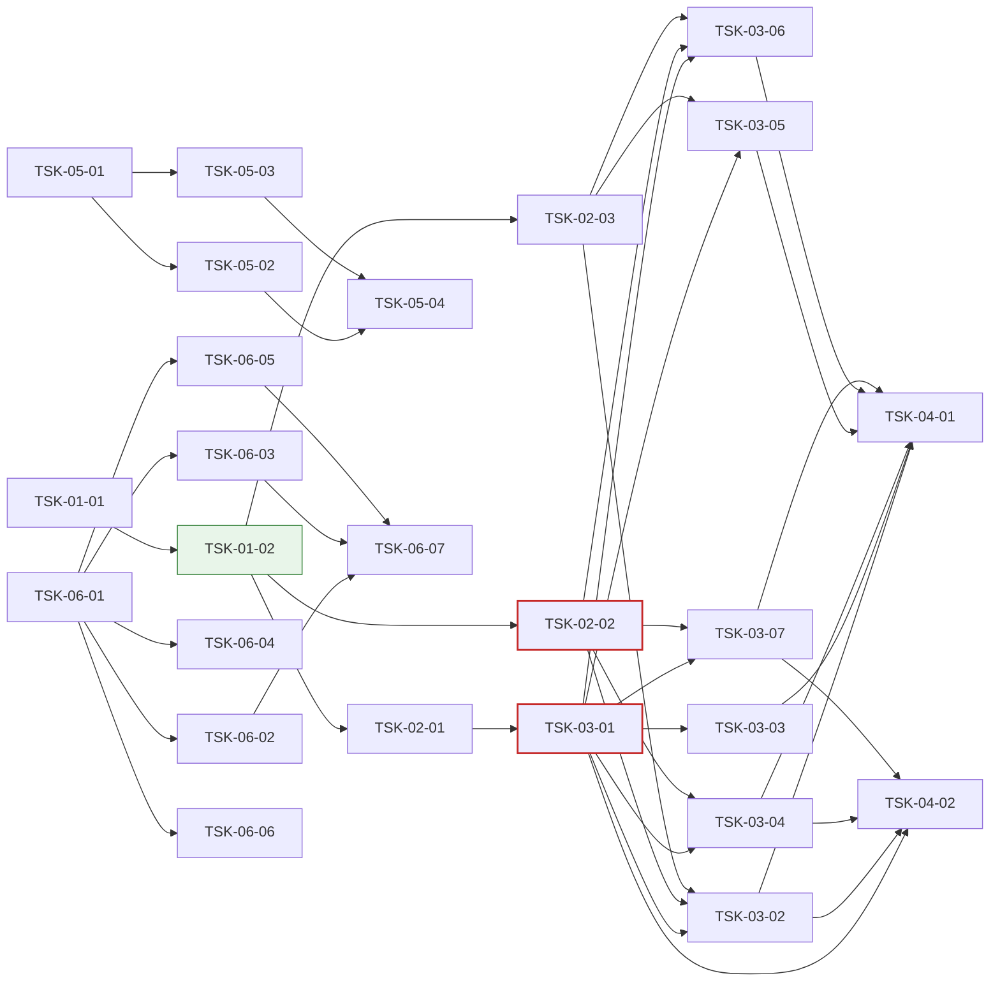

# WBS - Oranda MyBatis 작업 공간

> depth: 3
> start-date: 2026-10-23 / target-date: 2026-11-09 / updated: 2026-10-24
> source: docs/oranda1/PRD.md, docs/oranda1/TRD.md

## WP-01: 기본 설계·공유 계약
<!-- 담당 PC: win144(Windows 개발 PC) — 맥북 세션은 이 WP 의 Task 를 하지 않는다. 시안 A(decisions D-001)를 설계로 옮기고, 기능 Task 들이 함께 쓰는 인터페이스·데이터 모델·편집 지점을 먼저 정한다 -->

- [x] TSK-01-01: MyBatis 작업 공간 기본 설계 (화면·흐름·저장 방식) [win144] w:1 2026-10-23~2026-10-24
  - category: design
  - domain: infra
  - model: opus
  - priority: high
  - tags: mybatis, design, win144
  - prd-ref: PRD 3, PRD 5, MB-01~MB-10
  - requirements: docs/oranda1/design.md 를 쓴다: 화면 구성(시안 A 영역별 역할), 문서 종류 `MyBatis` 와 도구 창 보임 규칙, 명령 목록·단축키, 저장 흐름(바뀌는 부분 창·원자적 쓰기·3방향 문장 병합), 시나리오 저장 위치, 지금 ReadMyBatis 에서 계산기로 옮길 부분; 지금 코드에서 고쳐야 할 공유 지점(WorkspaceFiles·SqlEditorHost.Files·도킹 규칙·작업 공간 문서 종류)을 찾아 적는다; 제약: 상위 docs/PRD.md·TRD.md·design/ 은 고치지 않는다; 기술: TRD 2 계층과 위치, TRD 6 화면 배선; 화면: 시안 캔버스 Main·Convert·SaveDiff·Combos 아트보드; 비고: 담당 PC: win144(Windows 개발 PC) — 맥북 세션은 이 Task 를 하지 않는다. 2026-10-23 사용자 결정 시안 A(「A가 좋아보이네」). 시안 캔버스 https://claude.ai/artifact/JeoMQCGye8RCEqGmGVPKEa (Main = 시안 A, Convert·SaveDiff·Combos = 흐름)
  - acceptance: design.md 가 PRD MB-01~MB-10 을 빠짐없이 화면·명령·데이터에 대응시킨다 / 공유 지점 목록이 TSK-01-02 의 「기능 Task 편집 지점」 표의 입력이 된다

- [x] TSK-01-02: MyBatis 모델·계산기·시나리오 인터페이스와 편집 지점 (계약 전용) [win144] w:1 2026-10-25~2026-10-26
  - category: infra
  - domain: backend
  - model: opus
  - priority: critical
  - tags: mybatis, contract, win144
  - depends: TSK-01-01
  - prd-ref: MB-01, MB-02, MB-04, TRD 3, TRD 4, TRD 2, TRD 3.1·3.2·3.3
  - requirements: 인터페이스·모델 형만 정의한다: IMyBatisMapperDocument·MyBatisElement·MapperEdit·MapperWriteCheck(Language), EvalResult·MyBatisParameter·ConditionCombination·IMyBatisEvaluator·IMyBatisFragmentResolver(Language), IMyBatisScenarioStore·MyBatisScenario(Core); 시나리오 표 `mybatis_scenario` 의 마이그레이션(빈 표)을 로컬 데이터 모델에 더한다; 문서 종류 `MyBatis` 와 도구 창 2개(「문장」·「파라미터 · 시나리오」), 아래 패널 쪽 2개(「펼친 SQL」·「조합 검사」)의 등록 자리를 만든다(빈 화면). 도구 창 보임 규칙에 MyBatis 문서 조건을 더한다; design.md 에 `## 기능 Task 편집 지점` 표(기능 Task → 소유 파일·시험 파일)를 쓰고, 기능 Task 마다 빈 시험 파일(Skip 시험 틀)을 만든다; 공용 시험 헬퍼: 표본 매퍼 xml 모음(BOM·CRLF·CDATA·주석·엔티티·한글·DOCTYPE·시안 EmpMapper), 가짜 시나리오 저장소; 제약: Core·Language 는 Avalonia·ODP.NET 을 참조하지 않는다. 명령은 [OrandaCommand] 특성 자동 수집을 쓴다; API: TRD 4 인터페이스(계약); 비고: 담당 PC: win144(Windows 개발 PC) — 맥북 세션은 이 Task 를 하지 않는다. 기능 Task 9개가 같은 인터페이스·문서 종류·도구 창 자리를 쓰므로 먼저 동결한다
  - acceptance: 실행 로직 없음 (contract-only) / `dotnet build Oranda.sln -warnaserror` 통과 / 공유 시험은 틀의 존재·탑재 순서만 단정한다. 빈 라우터·스텁 목록(`STUBS` 등)을 단정하지 않는다 / 기능 Task 마다 자기 시험 파일과 소유 파일을 design.md `## 기능 Task 편집 지점` 에 적고, 두 Task 가 한 파일을 나눠 갖지 않는다 / 등록(라우트·핸들러 목록)은 자동 수집이며 기능 Task 가 공유 진입점에 줄을 더하지 않아도 된다 / 계약 문서가 지정한 파일(공용 시험 헬퍼 포함)이 모두 있다 / 인터페이스·형 존재, 도구 창 등록 자리 존재, 마이그레이션 적용 후 빈 표 존재
  - note: Core LockMonitorModels.cs 형 11개·IMonitorService 기본 NotSupported 메서드 8개(GetRecentDeadlocksAsync 포함)·App LockMonitorCommands 패널/명령 ID 상수·commands.md 모니터 행 10개 (win144)

## WP-02: 매퍼 모델·계산기·시나리오 저장 (UI 없음)
<!-- 담당 PC: win144(Windows 개발 PC) — 맥북 세션은 이 WP 의 Task 를 하지 않는다. 화면 Task 들이 실제로 쓰는 Language·Core 구현 -->

- [x] TSK-02-01: 매퍼 원문 모델 — 원문 위치를 지키며 읽고 문장 단위로 쓰기 [win144] w:3 2026-10-27~2026-10-29
  - category: dev
  - domain: backend
  - model: opus
  - priority: high
  - tags: mybatis, xml, roundtrip, win144
  - depends: TSK-01-02
  - prd-ref: MB-01, TRD 3.1
  - requirements: 매퍼를 읽어 요소마다 원문 범위(요소 전체·안쪽 본문)·종류·id·속성을 가진 IMyBatisMapperDocument 를 만든다. 주석·CDATA·엔티티·공백은 원문 그대로 둔다; 문장 본문 바꾸기, 새 문장 추가(`</mapper>` 앞, 앞 문장 들여쓰기), 지우기, id 바꾸기를 원문 조각 바꾸기로 한다. 바꾸지 않은 부분은 바이트까지 같다; 인코딩(xml 선언·BOM)·줄 끝(CRLF·LF)·끝 줄바꿈 유무를 지킨다; 쓰기 전 검사(MapperWriteCheck): 잘 짜인 xml, 문장 id 겹침, 연 때 해시와 디스크 해시 비교; DTD·외부 엔티티를 읽지 않는다. 루트가 mapper 가 아니면 알림과 함께 거부한다; 계약 Task design.md 「기능 Task 편집 지점」 의 자기 소유 파일만 고친다; 제약: XDocument 로 다시 직렬화하지 않는다; 기술: XmlReader + IXmlLineInfo 로 요소 시작을 얻고 원문을 직접 훑어 범위를 잡는다. 편집은 범위 바꾸기를 뒤에서부터 적용한다; API: TRD 4 IMyBatisMapperDocument Parse·Apply·Check; 비고: 담당 PC: win144(Windows 개발 PC) — 맥북 세션은 이 Task 를 하지 않는다. 지금 WorkspaceFiles.ReadMyBatis 는 XDocument 로 읽어 원문 위치가 없다 — 쓰기에는 원문 조각 모델이 필요하다
  - acceptance: 표본 매퍼를 읽고 아무것도 바꾸지 않고 쓰면 원본과 바이트가 같다 / 문장 하나의 본문을 바꿔 쓰면 원본과의 차이가 그 문장 안쪽 줄뿐이다 / 왕복: BOM 있음·없음, CRLF·LF, CDATA, 주석, 엔티티, 한글, DOCTYPE, namespace 없음, 끝 줄바꿈 없음 / 추가·지우기·id 바꾸기, 깨진 xml(읽으면 알림·쓰기 거부), id 겹침, 해시 바뀜, 1MB 매퍼 파싱 200 ms 이하

- [x] TSK-02-02: 동적 SQL 계산기 — 파라미터 값으로 태그를 펼치고 켜진·꺼진 범위 돌려주기 [win144] w:4 2026-10-27~2026-10-30
  - category: dev
  - domain: backend
  - model: opus
  - priority: high
  - tags: mybatis, dynamic-sql, ognl, win144
  - depends: TSK-01-02
  - prd-ref: MB-02, TRD 3.2
  - requirements: 입력 = 문장 요소 + 조각 해석기 + 파라미터 값 + 블록 덮어쓰기. 출력 = EvalResult(펼친 SQL, 바인드, 치환, 블록 범위·켬/끔, 계산 못 한 식); 태그: if, choose/when/otherwise, where, set, trim(prefix·suffix·prefixOverrides·suffixOverrides), foreach(collection·item·index·open·close·separator), include(refid, property 치환), bind; test 식 = OGNL 부분집합: null, 숫자·글자 리터럴, `== != < <= > >=` 와 eq·neq·lt·lte·gt·gte, and·or·not·`!`, 괄호, 점 경로 속성, size()·isEmpty()·length()·trim()·equals(). 그 밖의 식은 「계산 못 함」(위치·이유)으로 돌려주고 덮어쓰기로 켬·끔을 정할 수 있다; `#{x}` → `:x`(`#{x,jdbcType=…}` 는 타입 힌트), foreach 안 `#{item}` → `:item_1`… 겹치지 않는 이름, `${x}` → 값 글자(치환 목록에 넣음); ExtractParameters: `#{}`·`${}`·test 식·foreach collection·bind 의 이름, 쓰인 곳, 타입 힌트; 조합 만들기: 조건 8개 이하 전부, 넘으면 하나씩 끄기 + 모두 켬 + 모두 끔; 지금 WorkspaceFiles.ReadMyBatis 의 MyBatisText(where·set·trim·include)를 이 계산기로 옮기고 지운다. 값 없이 부르면 「모두 켬」으로 펼쳐 지금 열기 결과와 같게 한다; 계약 Task design.md 「기능 Task 편집 지점」 의 자기 소유 파일만 고친다; 제약: 식 계산은 위 목록만 지원한다(반사·동적 코드 생성·임의 메서드 호출 없음); 기술: TRD 2 Language 계층(MyBatisEvaluator, OgnlLite); API: TRD 4 Evaluate·ExtractParameters·Combinations; 비고: 담당 PC: win144(Windows 개발 PC) — 맥북 세션은 이 Task 를 하지 않는다. 2026-10-23 사용자 지적(「IF 태그 같은 것을 실제 값을 실행때 테스트 해야 쿼리가 정해지잖아」)
  - acceptance: 표본 문장 × 값 묶음 골든 결과가 MyBatis 3.5 실제 출력(공백 정규화 후)과 같다 / 시안 selectEmpList 시나리오 4개(이름 검색·부서 목록·전체 조건·조건 없음) 결과가 시안과 같다 / 기존 ReadMyBatis 시험이 그대로 통과한다 / 태그별, 식 연산자별, where 앞 AND·OR 떼기, set 끝 쉼표, trim, foreach 빈 목록·null, choose 첫 참·otherwise, include 중첩·순환(오류), bind, 계산 못 하는 식·덮어쓰기, 블록 범위, 조합 수, 문장 500줄 계산 50 ms 이하

- [x] TSK-02-03: 시나리오 저장소 (SQLite) [win144] w:2 2026-10-27~2026-10-28
  - category: dev
  - domain: backend
  - model: sonnet
  - priority: high
  - tags: mybatis, scenario, storage, win144
  - depends: TSK-01-02
  - prd-ref: MB-04, TRD 3.3
  - requirements: IMyBatisScenarioStore 를 로컬 SQLite 표 `mybatis_scenario` 에 저장하는 클래스로 만든다: List·Save·Rename·Duplicate·Delete·MoveStatement(id 바꾸기 따라가기); 매퍼 경로는 정규화한 절대 경로로 저장하고(Windows 대소문자 무시), 경로로 못 찾으면 namespace + statement_id 로 찾는다; 이름에 pass·pwd·secret·token 이 든 파라미터 값은 저장하지 않는다(null 로 둔다); 계약 Task design.md 「기능 Task 편집 지점」 의 자기 소유 파일만 고친다; 제약: 쓰기는 백그라운드 스레드에서 한다; 기술: Microsoft.Data.Sqlite(상위 로컬 데이터 모델과 같은 DB); API: TRD 4 IMyBatisScenarioStore; 비고: 담당 PC: win144(Windows 개발 PC) — 맥북 세션은 이 Task 를 하지 않는다. 시나리오는 매퍼 폴더가 아니라 앱 데이터에 둔다(D-001)
  - acceptance: 앱을 다시 켜도 시나리오가 남고, 문장 id 를 바꾸면 시나리오가 따라간다 / 저장·목록·이름 바꾸기·복제·지우기·순서, id 바꾸기, 매퍼 옮김 뒤 namespace 로 찾기, 비밀 값 버림, 한글 이름

## WP-03: MyBatis 작업 공간 화면 (편집·시험·저장)
<!-- 담당 PC: win144(Windows 개발 PC) — 맥북 세션은 이 WP 의 Task 를 하지 않는다. 시안 A 화면과 흐름 -->

- [x] TSK-03-01: MyBatis 작업 공간 화면 — 문장 도구 창·문장 원문 탭·XML 강조 [win144] w:2 2026-10-30~2026-11-02
  - category: dev
  - domain: fullstack
  - model: opus
  - priority: high
  - tags: mybatis, workspace, editor, docking, win144
  - depends: TSK-02-01
  - prd-ref: MB-03
  - entry-point: 파일 > 작업 공간 열기(.xml), 끌어 놓기·명령줄 인자, 도구 창 「문장」
  - requirements: .xml 매퍼를 열면 MyBatis 작업 공간이 된다(문서 탭 = 파일 이름 + 「MyBatis」 표시). 지금의 「SQL 로 펼쳐 읽기 전용으로 열기」를 대신한다. 같은 파일을 다시 열면 그 작업 공간으로 옮겨 간다; 왼쪽 「문장」 도구 창: 매퍼 경로·namespace, 종류별 묶음(select·insert·update·delete·sql 조각·resultMap), 수정·새 문장 표시, 두 번 누르면 그 문장 탭, 「+ 새 문장」(종류·id 묻기), 오른쪽 클릭 = id 바꾸기·지우기·펼친 SQL 을 새 SQL 탭으로. resultMap·그 밖의 요소는 목록에만 보이고, sql 조각은 편집할 수 있고 쓰는 곳 수를 보인다; SQL 탭 줄 = 문장 탭(SEL·INS·UPD·DEL 표시, 수정 점). 탭 안 = 그 문장 요소의 원문(여는 태그 ~ 닫는 태그); 강조: XML 태그·속성, `#{}`·`${}`, SQL 구간은 기존 SQL 강조. 문장 머리 줄 = 「파일 › 문장 id」, 동적 태그 수; 앱을 다시 켜면 열린 매퍼·고르던 문장·저장 안 한 고침(복구)이 돌아온다; 계약 Task design.md 「기능 Task 편집 지점」 의 자기 소유 파일만 고친다; 제약: 이 Task 에서는 매퍼 파일에 쓰지 않는다; 기술: TRD 6 화면 배선(문서 종류·도구 창 보임 규칙·MyBatis 강조 모드); 화면: 시안 캔버스 Main 아트보드(왼쪽 문장 목록·가운데 문장 탭); 비고: 담당 PC: win144(Windows 개발 PC) — 맥북 세션은 이 Task 를 하지 않는다. 시안 A Main 아트보드. 저장은 TSK-03-03
  - acceptance: 매퍼를 열면 문장 수만큼 목록 항목이 생기고, 문장을 고르면 원문 탭이 열리며, 고치면 목록·탭에 수정 표시가 붙는다 / 다른 문서로 가면 「문장」·「파라미터 · 시나리오」 도구 창이 숨고 돌아오면 다시 보인다 / Headless: 열기·목록 묶음·탭 열기·수정 표시·새 문장·id 바꾸기·지우기, 강조 분류, 도구 창 보임·숨김, 복구 (1MB 매퍼 열기 1 s 이하 성능 측정은 TSK-04-02)

- [x] TSK-03-02: 파라미터(바인드 변수 창)·시나리오와 펼친 SQL·시나리오 값으로 실행 [win144] w:3 2026-11-03~2026-11-05
  - category: dev
  - domain: fullstack
  - model: opus
  - priority: high
  - tags: mybatis, binds, scenario, execution, win144
  - depends: TSK-03-01, TSK-02-02, TSK-02-03
  - prd-ref: MB-04, MB-05
  - entry-point: 도구 창 「바인드 변수」(MyBatis 문서에서 파라미터 행), 「펼친 SQL」 머리 줄 시나리오 콤보, 아래 패널 「펼친 SQL」, 도구 막대·단축키 「시나리오 값으로 실행」(F9·Ctrl+Enter), 「펼친 SQL 복사」
  - requirements: 「바인드 변수」 도구 창(기존 재사용, 2026-10-23 사용자 결정): MyBatis 문서에서는 문장에서 찾은 파라미터 전부가 행(켬·끔과 무관, 이름·값·형식, 빈 칸 = null, `''` = 빈 글자, 목록 = `['A', 'B', 'C']`). 시나리오(추가·이름 바꾸기·복제·지우기)는 「펼친 SQL」 머리 줄 콤보, 고르면 값이 채워진다(TSK-02-03 저장소); 편집기: 이번 값으로 빠지는 블록을 흐리게, if·when 머리 줄 여백에 켬(채운 점)·끔(빈 점), 계산 못 한 식은 물결 밑줄 + 켬·끔 고르기; 「펼친 SQL」 쪽: 펼친 문장(SQL 강조) + 바인드·치환 목록. 값·원문을 고칠 때마다 300 ms 디바운스 뒤 다시 계산한다; 「시나리오 값으로 실행」은 펼친 SQL 과 바인드를 기존 실행 경로(IExecutionService·정책 관문·탭 접속)로 실행하고 결과를 「결과」 쪽에 보인다. 실행 계획, 펼친 SQL 복사(바인드 그대로 / 값을 넣은 글); `${}` 치환이 있으면 실행 전 치환 값을 보이고, 운영 접속이면 확인을 받는다; 계약 Task design.md 「기능 Task 편집 지점」 의 자기 소유 파일만 고친다; 제약: 정책 관문을 우회하는 실행 경로를 만들지 않는다. UI 스레드에서 DB 호출 금지; 기술: TRD 6 화면 배선; API: TRD 4 Evaluate·ExtractParameters, IMyBatisScenarioStore; 화면: 시안 캔버스 Main 아트보드(오른쪽·아래 패널); 비고: 담당 PC: win144(Windows 개발 PC) — 맥북 세션은 이 Task 를 하지 않는다. 시안 A 의 오른쪽·아래 패널
  - acceptance: 시안 A 처럼 시나리오를 바꾸면 흐린 줄·펼친 SQL·바인드가 바로 바뀐다 / 실행 결과가 같은 SQL·바인드를 일반 SQL 탭에서 실행한 결과와 같다(Oracle 시험) / 파라미터 표시, 시나리오 고르기·추가·고치기·지우기, 흐림 범위, 계산 못 한 식 덮어쓰기, 실행(Oracle 통합 1건 이상), 운영 접속 `${}` 확인, 복사 2종

- [x] TSK-03-03: 매퍼에 저장 — 바뀐 문장만 쓰기·바뀌는 부분 창·밖에서 바뀐 파일 처리 [win144] w:2 2026-11-03~2026-11-04
  - category: dev
  - domain: fullstack
  - model: opus
  - priority: high
  - tags: mybatis, save, diff, file-watch, win144
  - depends: TSK-03-01
  - prd-ref: MB-06
  - entry-point: Ctrl+S·도구 막대 「xml 에 저장」, 파일 감시 알림 띠
  - requirements: 저장은 바뀐 문장만 매퍼에 쓴다(TSK-02-01 Apply). 쓰기 전 「바뀌는 부분」 창: 바뀐 문장 목록(체크로 일부만 저장), 한 줄·나란히 diff, 검사 결과(XML 형식·id 겹침·밖에서 바뀜·조합 검사 여부). 「저장할 때마다 이 창 보기」를 끄면 바로 저장한다; 원자적 쓰기(같은 폴더 임시 파일 → 바꾸기), 원래 인코딩·BOM·줄 끝 유지; 파일 감시(300 ms 디바운스): 고친 문장이 없으면 다시 읽고 알린다. 있으면 알림 띠 — 안 고친 문장은 파일 것으로 반영하고, 양쪽이 고친 문장만 「차이 보고 고르기 / 파일 것으로 / 내 것으로」를 묻는다; 지워짐·옮겨짐은 알리고 다른 이름으로 저장을 권한다. 읽기 전용·쓰기 오류는 알리고 고침을 남긴다; 저장 안 한 문장이 있는 매퍼 작업 공간을 닫으면 저장 / 저장 안 함 / 취소를 묻는다. 앱 종료 때는 복구에 남기고 다음 시작 때 돌려준다; 계약 Task design.md 「기능 Task 편집 지점」 의 자기 소유 파일만 고친다; 제약: 파일 전체를 다시 쓰는 경로를 만들지 않는다; 기술: TRD 5 저장·파일 감시; API: TRD 4 Apply·Check; 화면: 시안 캔버스 SaveDiff 아트보드; 비고: 담당 PC: win144(Windows 개발 PC) — 맥북 세션은 이 Task 를 하지 않는다. 시안 SaveDiff 아트보드
  - acceptance: 문장 2개를 고쳐 저장하면 git diff 에 그 문장 안쪽 줄만 나온다 / IDE 에서 다른 문장을 고쳐 저장한 뒤 Oranda 에서 저장해도 IDE 의 고침이 남는다 / 저장 창(일부 체크·검사 결과), 바로 저장, 밖에서 바뀜 3경우(고침 없음·다른 문장·같은 문장), 지워짐, 읽기 전용, CRLF·BOM 파일, 닫기 확인, 복구

- [x] TSK-03-04: 조합 검사와 자동 고침(<set>·<where> 감싸기) [win144] w:3 2026-11-03~2026-11-05
  - category: dev
  - domain: fullstack
  - model: opus
  - priority: medium
  - tags: mybatis, dynamic-sql, lint, win144
  - depends: TSK-03-01, TSK-02-02
  - prd-ref: MB-07
  - entry-point: 도구 막대 「조합 검사」, 아래 패널 「조합 검사」, 편집기 자동 고침
  - requirements: 문장의 조건(if·when, foreach 빈 목록·값 있음)을 켜고 끄는 조합을 펼쳐 검사한다(TSK-02-02 Combinations). 시나리오가 있으면 그 값 묶음도 함께 검사한다; 검사 = Oranda 구문 분석(L2 파서)이 기본이다. 고르면 실행 계획(EXPLAIN PLAN, 접속 필요)으로도 확인한다. 어느 경우에도 문장을 실행하지 않는다(DML 포함); 결과 표: 조합(조건별 켬·끔)·결과(통과 / 오류 이유)·펼친 SQL. 고르면 오른쪽에 펼친 SQL 과 오류 위치, 「편집기에서 보기」, 「시나리오로 저장」; 자동 고침: SET 뒤의 if 들 → `<set>` 으로 감싸기, WHERE 뒤의 if 들(WHERE 1=1 없음) → `<where>` 로 감싸기. 미리보기 뒤 적용; 「문장」 도구 창에 조합 오류 수를 표시한다; 계약 Task design.md 「기능 Task 편집 지점」 의 자기 소유 파일만 고친다; 제약: 검사는 백그라운드에서 하고 취소할 수 있다. 실행 계획도 정책 관문을 거친다; 기술: 상위 Oranda.Language L2 파서 재사용; API: TRD 4 Combinations; 화면: 시안 캔버스 Combos 아트보드; 비고: 담당 PC: win144(Windows 개발 PC) — 맥북 세션은 이 Task 를 하지 않는다. 시안 Combos 아트보드
  - acceptance: 시안 updateEmpSal 예시에서 오류 2개(WHERE 앞 쉼표, SET 뒤 비어 있음)가 나오고 「<set> 으로 고치기」 뒤 조합 4개가 모두 통과한다 / 조합 수 계산·줄이기, 오류 판정, 자동 고침 2종, 실행 계획 경로가 문장을 실행하지 않음(Oracle 통합), 취소 (조합 256개 3 s 이하 성능 측정은 TSK-04-02)

- [x] TSK-03-05: 일반 작업 공간을 MyBatis 작업 공간으로 바꾸기 [win144] w:3 2026-11-03~2026-11-05
  - category: dev
  - domain: fullstack
  - model: opus
  - priority: medium
  - tags: mybatis, workspace, convert, win144
  - depends: TSK-03-01, TSK-02-03
  - prd-ref: MB-08
  - entry-point: 문서 탭 오른쪽 클릭·파일 메뉴 「MyBatis 작업 공간으로 바꾸기…」
  - requirements: 대화 상자: 대상 = 새 매퍼 파일(경로·namespace) 또는 기존 매퍼에 추가(id 겹침 표시). 탭 목록 = 포함 여부·탭 이름·문장 id 제안(고칠 수 있음)·종류 자동(select·insert·update·delete, MERGE → update, PL/SQL 익명 블록은 기본으로 빼고 고르면 `<update statementType="CALLABLE">`)·확인(바인드 수, 치환 경고); 바꾸는 방법: `:x` → `#{x}`, `&x`·`&&x` → `${x}`(경고), 타입을 아는 바인드에 jdbcType 붙이기(선택), WHERE 의 바인드 조건을 `<where><if test="x != null">` 로 감싸기(선택), `<`·`>` 가 있으면 CDATA 로 감싸기(끄면 엔티티), 서식은 기본 포매터 프로필(CDATA 안 4칸); 문자열 리터럴·주석 안의 `:x`·`&x`, PL/SQL 대입 `:=` 는 바꾸지 않는다(렉서 사용); 탭 바인드 값은 그 문장의 첫 시나리오로 저장한다(TSK-02-03). 미리보기(고른 탭의 xml). 바꾸면 새 MyBatis 문서 탭이 열리고 원래 작업 공간 파일은 그대로 둔다; 계약 Task design.md 「기능 Task 편집 지점」 의 자기 소유 파일만 고친다; 제약: 매퍼 쓰기는 TSK-02-01 Apply 만 쓴다; 기술: 상위 L1 렉서·포매터 재사용; API: TRD 4 Apply, IMyBatisScenarioStore; 화면: 시안 캔버스 Convert 아트보드; 비고: 담당 PC: win144(Windows 개발 PC) — 맥북 세션은 이 Task 를 하지 않는다. 2026-10-23 사용자 요청(「일반 작업 공간도 마이바티스 작업공간으로 변경이 가능하면 좋겠어」). 시안 Convert 아트보드
  - acceptance: 탭 4개 작업 공간을 바꿔 연 매퍼에서 각 문장을 첫 시나리오로 실행하면 원래 탭 결과와 같다 / 기존 매퍼에 추가하면 원래 문장들은 바이트가 같다 / 바인드·치환 바꾸기(리터럴·주석·`:=` 제외), id 제안·겹침, 종류 판정, CDATA·엔티티, 새 파일·기존 파일 추가, 시나리오 생성, 원래 파일 그대로

- [x] TSK-03-06: MyBatis 로그 붙여 넣기로 문장 찾아 열고 값을 시나리오로 저장 [win144] w:2 2026-11-03~2026-11-04
  - category: dev
  - domain: fullstack
  - model: sonnet
  - priority: medium
  - tags: mybatis, log, scenario, win144
  - depends: TSK-03-01, TSK-02-02, TSK-02-03
  - prd-ref: MB-09
  - entry-point: 편집 > MyBatis 로그 붙여 넣기(MyBatis 문서에서)
  - requirements: MyBatis 문서에서 로그를 붙여 넣으면 로그 줄의 logger 이름(namespace.id, 예 `DEBUG com.acme.hr.EmpMapper.selectEmpList - ==>  Preparing: …`)으로 열린 매퍼에서 문장을 찾아 연다. logger 이름이 없으면 펼친 SQL 모양이 같은 문장 후보를 고르게 한다; Parameters 값을 그 문장의 파라미터에 맞춘다: 그 값으로 펼친 SQL 의 `?` 순서(foreach 포함)와 맞대 이름을 붙이고 새 시나리오 「로그 HH:mm」로 저장한다. 맞출 수 없으면 알리고 일반 SQL 탭 붙여 넣기로 연다; 일반 SQL 탭에서는 지금 동작을 그대로 둔다; 계약 Task design.md 「기능 Task 편집 지점」 의 자기 소유 파일만 고친다; 제약: MyBatisLogParser 를 복사하지 않고 다시 쓴다; 기술: Oranda.Language.MyBatis.MyBatisLogParser 재사용; API: TRD 4 Evaluate, IMyBatisScenarioStore; 비고: 담당 PC: win144(Windows 개발 PC) — 맥북 세션은 이 Task 를 하지 않는다. 기존 MyBatisLogParser(상위 TSK-13-03)를 다시 쓴다
  - acceptance: 시안 selectEmpList 로그를 붙여 넣으면 그 문장 탭이 열리고 시나리오가 생겨 실행할 수 있다 / logger 있는·없는 로그, 여러 문장 로그, foreach 값 맞추기, 맞출 수 없음, 비밀 값 저장 안 함

- [x] TSK-03-07: 매퍼 폴더 열기 — 폴더 트리·다른 파일 include·문장 찾기 [win144] w:3 2026-11-03~2026-11-05
  - category: dev
  - domain: fullstack
  - model: sonnet
  - priority: low
  - tags: mybatis, folder, navigation, win144
  - depends: TSK-03-01, TSK-02-02
  - prd-ref: MB-10
  - entry-point: 파일 > 매퍼 폴더 열기, 「문장」 도구 창 폴더 트리, 명령 「MyBatis 문장 찾기」
  - requirements: 「매퍼 폴더 열기」: 폴더(예 src/main/resources/mapper) 아래 루트가 mapper 인 *.xml 을 찾아 「문장」 도구 창에 폴더 > 파일 > 문장 트리로 보인다. 파일·문장을 열면 MyBatis 작업 공간으로 연다. 최근 폴더를 기억한다; 다른 파일의 sql 조각 include(`refid="ns.frag"`)를 펼친다(폴더 안 파일을 찾는 IMyBatisFragmentResolver 를 만든다). sql 조각·resultMap 을 쓰는 곳 찾기; 「MyBatis 문장 찾기」: namespace.id 또는 id 일부로 폴더 안 문장을 찾아 연다. 로그 붙여 넣기(TSK-03-06)도 폴더 안을 찾는다; 계약 Task design.md 「기능 Task 편집 지점」 의 자기 소유 파일만 고친다; 제약: 폴더 훑기는 백그라운드에서 하고, 매퍼 2,000개 폴더에서도 UI 스레드를 100 ms 넘게 막지 않는다; API: TRD 4 IMyBatisFragmentResolver; 비고: 담당 PC: win144(Windows 개발 PC) — 맥북 세션은 이 Task 를 하지 않는다. 파일 하나 단위로 먼저 하고 폴더는 나중(2026-10-23 대화)
  - acceptance: 매퍼 2개 이상인 폴더에서 다른 파일 조각을 include 한 문장의 펼친 SQL 이 맞다 / 폴더 훑기(mapper 아닌 xml 거름), 다른 파일 include·순환, 문장 찾기, 폴더 안 파일 바뀜 감시

- [x] TSK-03-08: 「문장」 도구 창을 공용 격자 양식으로·이름 「매퍼 쿼리」로 [win144] w:1 2026-10-23~2026-10-24
  - category: dev
  - domain: frontend
  - model: sonnet
  - priority: high
  - tags: mybatis, ui, grid, win144
  - depends: TSK-03-01
  - prd-ref: MB-02
  - entry-point: 매퍼를 열면 왼쪽 도구 창
  - requirements: 「문장」 창 목록을 공용 격자 양식(Styles/GridC, 상세 표와 같은 머리글·행 높이·선택색)으로 보인다(종류·id·수정 표시·조합 오류 수·쓰는 곳 수 열). 묶음(select·insert·update·delete·sql 조각·resultMap)과 폴더 트리 보기를 유지한다; 창 이름 「문장」 → 「매퍼 쿼리」(영문 Mapper Queries), 메뉴·명령 이름의 「문장」도 같은 말로 맞춘다; 비고: 2026-10-23 사용자 수정 요청(「문장이 너무 보기 안 좋다, 기본 그리드 양식, 이름도 적절하게」)
  - acceptance: 라이트·다크 렌더 PNG 에서 상세 표 격자와 같은 양식이다 / 두 번 누르기·우클릭 메뉴·폴더 트리·수정 표시가 그대로 동작한다
  - note: 「매퍼 쿼리」 창을 공용 격자(GridC) 목록·머리글로, 폴더 트리 머리글·행 높이·선택색 맞춤, 명령·창 이름 문장→쿼리 (win144)

- [x] TSK-03-09: 바인드 변수 창 — 격자 양식·자료형 서식·블록 복사 붙여 넣기 [win144] w:2 2026-10-23~2026-10-24
  - category: dev
  - domain: frontend
  - model: sonnet
  - priority: high
  - tags: bind, ui, grid, win144
  - depends: TSK-03-02
  - prd-ref: MB-05
  - entry-point: 바인드 변수 도구 창(일반 SQL·MyBatis 공용)
  - requirements: 바인드 변수 창을 공용 격자 양식(Styles/GridC)으로; 값을 넣으면 자료형에 맞게 서식(NUMBER = 숫자만·자리 구분 없음, DATE·TIMESTAMP = 설정의 날짜 서식, VARCHAR2·CHAR = 그대로, 잘못된 값은 칸 표시와 툴팁); 여러 행을 블록으로 잡아 변수·값·자료형·방향 4열을 TSV 로 복사하고, 같은 형식을 붙여 넣으면 이름이 같은 변수에 값·자료형·방향을 채운다(Orange 동작); 비고: 2026-10-23 사용자 수정 요청
  - acceptance: 일반 SQL·MyBatis 문서 둘 다에서 동작 / 복사 → 다른 탭 붙여 넣기 왕복이 같다 / 잘못된 숫자·날짜 처리
  - note: 바인드 창 GridC 격자·행 블록 선택, 값 칸 자료형 서식(NUMBER·DATE)·잘못된 값 붉은 테두리, Ctrl+C/V TSV 4열 복사·붙여 넣기(App.Tests BindGridTests 35개 통과)

- [x] TSK-03-10: 펼친 SQL 을 쿼리 편집 탭 안 분할(세로 기본·가로)로 옮기기 [win144] w:2 2026-10-23~2026-10-24
  - category: dev
  - domain: frontend
  - model: opus
  - priority: high
  - tags: mybatis, expanded, layout, win144
  - depends: TSK-03-02
  - prd-ref: MB-05
  - entry-point: MyBatis 쿼리 탭
  - requirements: 「펼친 SQL」 아래 도킹 패널을 없애고 MyBatis 쿼리 탭 안에서 원문 편집기 옆(세로 분할, 기본)·아래(가로 분할)에 보인다. 탭 머리 줄에 분할 아이콘 버튼(세로·가로, 고른 것은 기억); 펼친 SQL 의 바인드·치환 입력 목록을 지운다 — 값은 바인드 변수 창에서만 넣는다(치환 `${}` 도 바인드 변수 창 행); MyBatis 쿼리 탭이 열려 있을 때만 펼친 SQL 이 보인다(「매퍼 쿼리」 창에서 고르기만 하고 탭을 열지 않으면 안 보임). 조회 결과 창을 덮지 않는다; 시나리오 콤보·복사·실행 계획 명령은 분할 머리 줄로 옮긴다; 비고: 2026-10-23 사용자 수정 요청(「펼친 SQL 이 조회결과를 덮어서 불편」)
  - acceptance: 쿼리 탭을 열면 오른쪽에 펼친 SQL, 아이콘으로 가로 전환·되돌림 / 탭 없이 목록 선택만 하면 펼친 SQL 없음 / 실행 결과 창이 가려지지 않음 / 바인드 값 바꾸면 300 ms 뒤 다시 계산
  - note: 펼친 SQL 아래 패널을 없애고 쿼리 탭 안 분할(세로 기본·가로·숨김, 방향·비율 설정 기억)로 옮김, 바인드·치환 목록 삭제(치환도 바인드 변수 창 $행), 탭이 있을 때만 보임 — ParamsRunSplitTests 6건·사용자 매퍼 153문장 화면 확인

- [x] TSK-03-11: 조합 검사 — 처음 보는 문장 모양의 첫 구문 분석이 0.1~7.6 s (ANTLR 예측 캐시 만들기) [win144] w:2 2026-10-24~2026-10-25
  - category: defect
  - domain: backend
  - model: opus
  - priority: medium
  - tags: mybatis, combos, perf, antlr, win144
  - depends: TSK-03-04
  - prd-ref: MB-07, PRD 6
  - requirements: 사용자 매퍼(요소 153개)로 조합 검사(구문 분석만)를 하면, 같은 모양을 처음 분석하는 문장의 첫 분석이 보통 문장 92~655 ms, 처음 보는 모양은 2.7~5.8 s, 긴 문장(3.5·10.8·17 KB)은 0.7~7.6 s 걸린다. 같은 글을 다시 분석하면 9 ms, 글자만 다른 변형은 1~40 ms 라 시간은 파싱이 아니라 문장 모양마다 ANTLR 예측 캐시(DFA)를 만드는 데 쓰인다(Debug·Release 동일). 앱은 유휴 때 간단한 문장 4개로만 미리 데운다(PlSqlWarmUpTask). 첫 결과가 3 s 안에 나오게 한다; 후보: 워밍업 문장을 늘리거나 매퍼를 연 뒤 유휴 때 그 매퍼의 문장을 미리 분석, 예측 캐시 공유 범위 점검; 제약: Oranda.Language(TSK-04-03 소유) 수정이라 소유자 검토; 비고: 측정 docs/oranda1/itest/TSK-04-01.md 3c·3d
  - acceptance: 사용자 매퍼 문장 아무거나 조합 검사 첫 실행의 첫 결과가 3 s 이하(부하 없는 win144) / 합성 조합 256개 3 s 시험(TSK-04-02) 그대로 통과 / 워밍업이 시작 시간(D-006)을 늘리지 않음
  - note: 2026-10-23 저부하 재측정(Release, CPU 7~11 %) 1회: 사용자 매퍼 첫 분석 보통 문장 최대 1.09 s·긴 문장 최대 2.6 s(모두 3 s 이내), 환산 256개 467 ms — 부하 탓이 컸던 것으로 보임, 고치기 전 사용자 결정 (win144) — docs/oranda1/itest/TSK-04-02.md; 2026-10-23 고침: 매퍼를 열면 낮은 우선순위 백그라운드에서 문장마다 모두 켬·모두 끔 SQL 을 미리 분석해 예측 캐시를 데움(시작 때 안 함·취소 가능) — 고친 뒤 1회(CPU 40 % 이하): 데우기 끝난 뒤 조합 검사 첫 결과 보통 문장 최대 25 ms·긴 문장 최대 11 ms(목표 1.5 s), 합성 256개 통과, 데우기 자체는 153문장 25 s (win144)

- [x] TSK-03-12: 매퍼 2,000개 폴더 훑기가 끝날 때 UI 스레드 최대 막힘 121~207 ms (상한 100 ms) [win144] w:2 2026-10-24~2026-10-25
  - category: defect
  - domain: frontend
  - model: sonnet
  - priority: medium
  - tags: mybatis, folder, perf, ui, win144
  - depends: TSK-03-07
  - prd-ref: MB-10, PRD 6
  - requirements: win144 Release 6회 121/126/167/183/188/207 ms, Debug 438 ms(CPU 24~97 % 부하 속). 막힘을 단계로 쟀다: 훑기 시작 때 60~170 ms(감시 걸기·최근 폴더·빈 트리), 훑기가 끝난 뒤 트리 다시 짓기(MapperFolderTreeViewModel.Rebuild) 30~80 ms, 그 뒤 트리 첫 그리기 100~330 ms. Rebuild 를 떨어진 목록에 지어 한 번에 붙이는 시도는 효과가 구분되지 않아 되돌렸다. 후보: 폴더 노드의 파일 자식을 펼칠 때 만들기(점진 생성)·가상화, 훑기 시작 때 하는 일을 UI 밖으로; 제약: MapperFolderTests 가 펼치지 않고 Children 을 읽으므로 시험 수정이 필요할 수 있다; 비고: 측정 docs/oranda1/itest/TSK-04-01.md 4. 무부하 PC 에서 다시 재서 확정한다
  - acceptance: MyBatisWorkspacePerfTests.Scanning_a_folder_of_2000_mappers_blocks_the_ui_thread_at_most_100_ms 가 win144 Release 에서 3회 연속 통과 / MapperFolderTests 통과
  - note: 2026-10-23 저부하 재측정(Release, CPU 17~23 %) 1회: 최대 막힘 89 ms(상한 100 ms 통과, 여유 작음), 3회 연속은 미확인 (win144) — docs/oranda1/itest/TSK-04-02.md; 2026-10-23 고침: 파일 노드의 요소 자식을 처음 읽을 때 만들고, 트리 최상위 노드를 4개씩 배경 우선순위로 나눠 붙이고 패널을 가상화 — 고친 뒤 1회(CPU 40 % 이하): 최대 막힘 64 ms(목표 70 ms), 단계 = 시작 2 ms·다시 짓기 13 ms·첫 그리기는 나눠 붙임. 3회 연속은 「한 번씩만」 규칙으로 돌리지 않음 (win144)

- [x] TSK-03-13: 매퍼 2,000개 폴더 훑기 전체가 9~27 s (파일을 한 줄로 차례로 읽음) [win144] w:1 2026-10-24~2026-10-25
  - category: defect
  - domain: backend
  - model: sonnet
  - priority: low
  - tags: mybatis, folder, perf, win144
  - depends: TSK-03-07
  - prd-ref: MB-10
  - requirements: MapperFolderIndex.Scan 이 파일을 스레드 풀 한 개로 차례로 열고 파싱한다. win144 에서 2,000개가 Release 9~27 s(맥 Debug 248 ms). UI 는 막지 않지만 큰 폴더를 열면 한참 기다린다. 후보: 파일 읽기·파싱을 병렬로(Parallel.ForEach, 결과는 경로순으로 정렬), 앞부분 읽기와 전체 읽기를 한 번에; 비고: 측정 docs/oranda1/itest/TSK-04-01.md 4. PRD 에 상한이 없어 우선순위 낮음, 원인(Windows 파일 열기 비용·실시간 검사·부하)을 먼저 가른다
  - acceptance: 같은 합성 폴더 2,000개 훑기 전체가 절반 이하 / 폴더 훑기 시험(MapperFolderTests) 통과
  - note: 2026-10-23 저부하 재측정(Release, CPU 17~23 %) 1회: 훑기 전체 8,995 ms — 부하와 무관하게 9 s 대, 병렬화 필요 (win144) — docs/oranda1/itest/TSK-04-02.md; 2026-10-23 고침: 파일 읽기·파싱을 코어 수만큼 병렬(경로순 정렬), 파일은 한 번만 열어 앞부분 판정과 전체 읽기를 이음 — 고친 뒤 1회(CPU 40 % 이하): 8,995 → 2,656 ms (win144)

- [x] TSK-03-14: 실제 앱에서 바인드 변수 창 Ctrl+C/V 가 편집기·결과 그리드로 감 (TSK-03-09 결함) [win144] w:1 2026-10-23~2026-10-23
  - category: defect
  - domain: frontend
  - model: opus
  - priority: high
  - tags: bind, ui, keymap, clipboard, win144
  - depends: TSK-03-09
  - prd-ref: MB-05
  - entry-point: 바인드 변수 도구 창(일반 SQL·MyBatis 공용)
  - requirements: 사용자 보고(2026-10-23 실앱): 바인드 변수 복사·붙여 넣기가 안 된다. 원인: 주 창 Tunnel 키 처리기(MainWindow.OnKeyDownTunnel)가 바인드 창 목록보다 먼저 키를 받아 키맵으로 보낸다. 바인드 창엔 포커스 자리(FocusSlot)가 없어 직전 자리(편집기 sqlText·결과 sqlGrid)가 그대로 남고, Ctrl+C/V 가 oranda.edit.copy/paste(editorFocus)·oranda.grid.copy(gridFocus)로 처리돼 Handled — 목록 처리기(RowList Tunnel)에 닿지 않는다(TSV 가 편집기에 붙음). 값 칸 TextBox 안에서만 주 창이 키를 넘겨 동작했다. Headless 시험(BindGridTests)은 뷰 모델 CopyText/PasteText 를 직접 불러 셸 키 경로를 거치지 않아 통과했다. 우클릭 메뉴(Click)·클립보드 호출 자체는 문제없음
  - acceptance: 편집기를 쓰다 바인드 창 줄을 클릭하고 Ctrl+C → 바인드 TSV, Ctrl+V → 값 채움(편집기 그대로) / 값 칸 글 선택 Ctrl+C = 글 복사 / 우클릭 「머리글 포함 복사」·「붙여 넣기」 / 편집기 포커스 Ctrl+C = 편집기 복사(회귀)
  - note: 고침 — 글자 편집 키를 스스로 처리하는 영역 표시 EditKeyScope(Shell/Keymaps) 를 두고 바인드 창 목록에 붙임, 주 창은 그 영역에 포커스가 있으면 글자 편집 키를 키맵으로 보내지 않음(TextBox 와 같은 규칙), macOS 시스템 메뉴(⌘C·⌘V)도 그 영역으로 넘김, 목록 처리기는 플랫폼 기본 수식키(⌘/Ctrl), 클립보드 실패는 창 아래 줄에 알림. 시험 BindPaneShellKeysTests 7개(셸 주 창 + 도킹 바인드 창에 실제 키·마우스 입력, 고치기 전 3개 실패 확인). 실앱 자동 확인은 다른 창이 앞에 있어(포그라운드 잠금) 못 함 (win144)

## WP-04: 통합테스트
<!-- TSK-04-01 담당 PC: win144(Windows 개발 PC) — 맥북 세션은 TSK-04-01 을 하지 않는다. 기능 간 흐름 검증(개별 기능 재검증 아님). TSK-04-02 는 기능 레인에서 떼어 낸 성능 측정(2026-10-23 대화) -->

- [x] TSK-04-01: MyBatis 작업 공간 흐름 — 열기→시험→검사→저장→충돌→바꾸기→로그 [win144] w:2 2026-11-06~2026-11-09
  - category: itest
  - domain: test
  - model: sonnet
  - priority: high
  - tags: integration, e2e, mybatis, win144
  - depends: TSK-03-02, TSK-03-03, TSK-03-04, TSK-03-05, TSK-03-06, TSK-03-07, TSK-03-08, TSK-03-09, TSK-03-10
  - prd-ref: PRD 3, PRD 8
  - requirements: 흐름: 매퍼 열기 → 문장 고치기 → 시나리오 만들기 → 시나리오 값으로 실행 → 조합 검사·자동 고침 → 저장(바뀌는 부분 확인) → IDE 에서 같은 파일 고친 뒤 충돌 처리 → 일반 작업 공간 바꾸기 → 로그 붙여 넣기로 문장 찾기 → 매퍼 폴더 열기; 11g 컨테이너(oranda-ora11g)와 19c 이상에서 실행 결과를 확인한다; 성능 수치(PRD 6)를 시험 PC 에서 잰다; 제약: 실앱 눈 확인 항목은 사용자 몫으로 표시한다; 비고: 담당 PC: win144(Windows 개발 PC) — 맥북 세션은 이 Task 를 하지 않는다. 결과서 docs/oranda1/itest/TSK-04-01.md
  - acceptance: 모든 흐름이 끝까지 가고, 저장한 매퍼를 git diff 로 보면 고친 문장 줄만 바뀌어 있다 / 발견 결함은 해당 기능 WP에 defect Task로 등록됨 / 흐름별 결과표(정상·경계·오류·되돌림)
  - note: 시안·사용자 매퍼(153개) 흐름 시험 8개(열기→탭·분할→고치기→바인드→시나리오→조합 검사·자동 고침→저장 git diff→충돌→바꾸기→로그→폴더) 전부 통과, DB 실행은 사용자 확인으로 남김, 성능 재측정에서 결함 3건(TSK-03-11~13) 등록 — 결과서 docs/oranda1/itest/TSK-04-01.md (win144)

- [x] TSK-04-02: MyBatis 작업 공간 성능 시험 — PRD 6 수치 측정·병목 고침 w:1 2026-11-06~2026-11-09
  - category: itest
  - domain: test
  - model: sonnet
  - priority: medium
  - tags: perf, mybatis
  - depends: TSK-03-01, TSK-03-02, TSK-03-04, TSK-03-07
  - prd-ref: PRD 6
  - requirements: 기능 Task 에서 성능 시험을 떼어 이 Task 에서 한꺼번에 잰다(기능 레인의 병목 제거, 2026-10-23 대화); 대상(PRD 6): 문장 3,000줄·매퍼 1MB 를 열어 「문장」 창 목록이 보일 때까지 1 s 이하, 값·원문을 고친 뒤 펼친 SQL 다시 계산 디바운스 300 ms 뒤 50 ms 이하, 조합 검사 조합 256개 구문 분석 3 s 이하(백그라운드·취소), 매퍼 2,000개 폴더 훑기 중 UI 스레드 막힘 100 ms 이하; App.Tests `Category=Perf&FullyQualifiedName~MyBatis` 시험을 모으고 없는 수치는 시험을 추가한다; 상한을 넘으면 원인을 찾아 해당 기능 소유 파일을 고치거나 defect Task 로 등록한다; 제약: 맥 Debug 수치는 상한값으로 기록하고, win144 수치는 TSK-04-01 결과서에 함께 적는다; 비고: 결과서 docs/oranda1/itest/TSK-04-02.md
  - acceptance: PRD 6 수치 4개가 모두 Perf 시험으로 있고 상한 안에 든다 / 수치표(항목·상한·측정값·PC·빌드 구성) / 넘은 항목은 고침 커밋 또는 defect Task 로 남음

## WP-05: Lock 모니터
<!-- 담당 PC: win144(Windows 개발 PC) — 맥북 세션은 이 WP 의 Task 를 하지 않는다. 2026-10-24 사용자 지시 「다른 DB도구의 Lock 모니터 기능들을 조사해서 구현하자」「P2 까지 모두 구현하자」. 조사 근거 = Toad Session Browser Locks 탭, DBeaver Lock Manager, OEM Blocking Sessions, Quest Spotlight Locks Tree. 모든 조회는 SELECT 전용(Chakra Max 결재 회피). dba_waiters·dba_blockers(catblock.sql 필요)는 쓰지 않는다 -->

- [x] TSK-05-01: Lock 모니터 조회 계약 — 레코드·IMonitorService 메서드·명령 ID (계약 전용) [win144] w:1 2026-10-24~2026-10-24
  - category: infra
  - domain: backend
  - model: sonnet
  - priority: critical
  - tags: lock, monitor, contract, win144
  - prd-ref: LK-01~LK-12
  - requirements: Core(src/Oranda.Core/Monitoring)에 Lock 모니터 형을 정의한다: LockRow(인스턴스·SID·SERIAL#·사용자·머신·프로그램·잠금 유형 TM/TX/UL 등·id1·id2·보유 모드·요청 모드·ctime 초·block 여부·대상 객체 owner.name·트랜잭션 시작 시각·undo 블록·대기 이벤트·대기 초·sql_id·prev_sql_id·blocking 인스턴스/세션), LockFilter(최소 대기 초 기본 0, 사용자, 스키마, 인스턴스, 대기·차단만, 유형 목록), LockSnapshot(행 목록 + 대기 트리 BlockingTree 재사용 + 수집 시각), BlockerImpact(보유자 SessionKey·대기자 수·최대 대기 초·합계 대기 초), LockedRowInfo(rowid 문자열·owner·table·열 이름·값), DdlLockRow(세션·owner·name·type·보유/요청 모드), WaitingBind(이름·위치·값 문자열·형); IMonitorService 에 GetLocksAsync·GetBlockerImpactAsync·GetLockedRowAsync·GetDdlLocksAsync·GetWaitingBindsAsync·GetIdleTransactionsAsync 를 기본 구현 NotSupportedException 으로 더한다(GetMyBlockingAsync 패턴); 명령 ID 상수(oranda.monitor.locks 등)와 패널 ID oranda.panel.lockMonitor 를 정하고 docs/design/commands.md 모니터 표에 행을 더한다; 제약: 실행 로직 없음; 비고: 담당 PC: win144(Windows 개발 PC) — 맥북 세션은 이 Task 를 하지 않는다
  - acceptance: 실행 로직 없음 (contract-only) / `dotnet build Oranda.sln -warnaserror` 통과 / 기존 가짜 IMonitorService 구현체가 고치지 않고 빌드된다 / 형·메서드·ID 존재

- [ ] TSK-05-02: Lock 모니터 조회 — 카탈로그 SQL·Oracle 구현 (11g·RAC) [win144] w:2 2026-10-24~2026-10-25
  - category: dev
  - domain: backend
  - model: opus
  - priority: high
  - tags: lock, monitor, oracle, win144
  - depends: TSK-05-01
  - prd-ref: LK-01~LK-12
  - requirements: Catalog/session(또는 Catalog/lock)에 SELECT 전용 SQL 을 더한다: lock.list(gv$lock + gv$session, TM 은 id1=object_id → @PFX@_objects, TX 는 gv$transaction(xidusn·xidslot·xidsqn) 조인으로 start_date·used_ublk, 백그라운드·시스템 잠금(MR·AE·TO 등)은 기본 제외, ROWNUM 상한), lock.blocker_impact(보유자별 대기자 수·최대·합계 대기 초), lock.locked_row(row_wait_obj#·file#·block#·row# → DBMS_ROWID.ROWID_CREATE 로 rowid, enq: TX - row lock contention 일 때만; 행 값은 SELECT * FROM owner.table WHERE ROWID = :r 를 따옴표 식별자로), lock.ddl_locks(dba_ddl_locks, 권한 없으면 기능 끔), lock.waiting_binds(gv$sql_bind_capture, 대기 세션 sql_id·child), lock.idle_transactions(gv$transaction + gv$session status INACTIVE 와 경과 초); 11g 변형이 필요한 파일은 같은 id 의 min-version 11 파일로 둔다(FETCH FIRST·con_id 금지); IN 목록 1000개 제한을 피해 조인으로 쓴다; OracleMonitorService.Locks.cs partial 로 TSK-05-01 메서드를 구현한다; 시험: SessionCatalogTests·Oracle11CatalogTests 항목, 카탈로그에 DML 이 없음을 단정, 통합 시험은 Lock_contention_shows_holder_and_waiter_and_kill_releases_it 구성을 재사용해 TX 행 잠금·TM 잠금·잠긴 행 rowid·보유자 영향·idle 트랜잭션을 확인한다(23ai 컨테이너, 가능하면 oranda-ora11g); 비고: 담당 PC: win144(Windows 개발 PC) — 맥북 세션은 이 Task 를 하지 않는다
  - acceptance: 모든 쿼리가 SELECT 이고 결재 대상 DML·임시 표·쓰기 패키지를 쓰지 않는다 / 11g·19c 이상에서 카탈로그 선택이 된다 / 통합 시험에서 보유자·대기자·잠긴 행이 맞게 나온다 / 권한 부족(all_* 만)에서 오류 대신 빈 결과·이유
  - note: 진행 중(2026-10-24) — 레인 lk-data(opus)가 구현·시험 중 (win144)

- [ ] TSK-05-03: Lock 모니터 화면 — 대기 트리·잠금 목록·SQL·잠긴 행·영향 순위·원인 힌트·세션 종료 [win144] w:3 2026-10-24~2026-10-26
  - category: dev
  - domain: frontend
  - model: opus
  - priority: high
  - tags: lock, monitor, ui, win144
  - depends: TSK-05-01
  - prd-ref: LK-01~LK-09
  - requirements: Features/LockMonitor 에 문서 패널 oranda.panel.lockMonitor(「Lock 모니터」)를 만든다. 「모니터」 메뉴에 「Lock 모니터」를 더하고 세션 모니터와 같은 모니터 전용 세션·MonitorAccess(권한 배너·다른 접속)를 쓴다; 화면: 위쪽 대기 트리(보유자 루트 → 대기자, 대기 초·이벤트·객체), 아래 잠금 목록(DetailTable: 유형·모드·요청·ctime·객체·트랜잭션 시작·block 강조), 오른쪽 상세 탭(보유자·대기자 SQL 전문 gv$sql 클릭 때만, 잠긴 행 rowid·열 값, 대기 바인드, DDL 잠금 탭, 원인 힌트: enq: TX row lock / enq: TM contention(FK 인덱스 누락 의심) / enq: TX allocate ITL / library cache lock·pin); 보유자 영향 순위 표(대기자 수·최대·합계 대기 초 순); 거르기: 최소 대기 초(기본 0, 3초 단추), 사용자·스키마·인스턴스, 대기·차단만; 자동 새로 고침(간격); 세션 종료·연결 끊기는 세션 모니터 흐름 재사용, 확인 창에 「이 세션 때문에 N개 세션이 기다립니다」; 세션 모니터로 이동(SID·INST_ID); 트리·목록 복사·CSV 내보내기; BlockerAlert 상태 줄 클릭은 Lock 모니터를 연다; 한글 리터럴은 literals-en.json·CommandTitles·strings 에 영어 짝; 시험: ViewModel(가짜 서비스)·Headless 렌더·명령 등록·LocalizationTests; 비고: 담당 PC: win144(Windows 개발 PC) — 맥북 세션은 이 Task 를 하지 않는다
  - acceptance: 가짜 서비스로 트리·목록·상세·영향 순위·힌트가 보인다 / 세션 종료 확인 창에 대기자 수 / 권한 없을 때 배너 / 전체 시험 통과 / 실앱 눈 확인 항목은 사용자 몫으로 결과에 적는다
  - note: 시안 완료(2026-10-24, 시안 https://claude.ai/artifact/J4YBzmpMsbvecm8aSv4rGx 화면 b·c), 화면 레인 착수 대기 (win144)

- [ ] TSK-05-04: Lock 모니터 이력·알림·방치 트랜잭션·데드락 힌트 (P2) [win144] w:2 2026-10-26~2026-10-27
  - category: dev
  - domain: fullstack
  - model: opus
  - priority: medium
  - tags: lock, monitor, history, win144
  - depends: TSK-05-02, TSK-05-03
  - prd-ref: LK-10~LK-12
  - requirements: 이력 타임라인: 새로 고침마다 대기자 수·최대 대기 초를 메모리에 쌓아(최근 N분, 설정) 작은 그래프로 보이고, 원하면 로컬 파일(앱 데이터 폴더, DB 쓰기 아님)로 저장한다. ASH 는 쓰지 않는다(Diagnostics Pack); 임계치 알림: 「N초 이상 또는 대기자 M명 이상」이면 상태 줄·알림을 띄우고 그 시점 보유자·대기자 SQL 스냅샷을 로컬 텍스트로 남긴다(기존 BlockerWatcher 확장, 설정); 방치 트랜잭션 탭: INACTIVE 인데 트랜잭션을 연 세션과 경과 시간·undo 크기; 데드락 힌트: 대기 그래프에 순환이 보이면 표시, 권한이 있으면 alert 로그(12c+ v$diag_alert_ext, 11g 는 끔)에서 ORA-00060 최근 항목을 읽기 전용으로 보인다; 시험: 단위·Headless·통합(가능한 범위); 비고: 담당 PC: win144(Windows 개발 PC) — 맥북 세션은 이 Task 를 하지 않는다
  - acceptance: 이력 그래프·임계치 알림·방치 트랜잭션·데드락 힌트가 동작한다 / DB 에 쓰지 않는다 / 전체 시험 통과
  - note: 시안 완료(2026-10-24, 시안 https://claude.ai/artifact/J4YBzmpMsbvecm8aSv4rGx 화면 d), 05-02·05-03 뒤 착수 (win144)

## WP-06: 튜닝 메뉴와 쿼리 튜닝 기능
<!-- 담당 PC: win144(Windows 개발 PC) — 맥북 세션은 이 WP 의 Task 를 하지 않는다. 2026-10-24 사용자 지시 「또 다른 도구와 비교해서 쿼리 튜닝에 대한 기능을 조사해줘」「튜닝 기능도 조사 끝나면 같이 구현하자. 튜닝 메뉴를 따로 만들어서 거기에 넣으면 될것 같다」. 조사 근거 = Toad SQL Optimizer·TKProf, SQL Developer Autotrace·Tune SQL·Monitor SQL, PL/SQL Developer, OEM 어드바이저·SPM. 원칙: 팩 없는 읽기 전용. DB 에 쓰는 기능(Tuning Advisor 태스크·DBMS_STATS·baseline 적용)은 스크립트 문안까지만 만들고 실행은 사용자가 편집기에서 한다. 팩이 필요한 기능은 SAFE-07 라이선스 관문 뒤에서만 -->

- [x] TSK-06-01: 「튜닝」 메뉴와 튜닝 조회 계약 (계약 전용) [win144] w:1 2026-10-24~2026-10-24
  - category: infra
  - domain: backend
  - model: sonnet
  - priority: critical
  - tags: tuning, menu, contract, win144
  - prd-ref: TN-01~TN-16
  - requirements: 최상위 메뉴 「튜닝」(id tuning)을 「모니터」 다음에 더한다(MenuModel 최상위 순서 배열·메뉴 제목 ko/en); 기존 명령 배치를 옮긴다: 실행 계획 형식 옵션·계획 고정·계획 비교 → menu:tuning, SQL 모니터(oranda.monitor.sql 과 sqlSearch·sqlShowPlan·sqlShowBinds) → menu:tuning. 예상 계획·실제 계획은 SQL 메뉴에 두고 튜닝 메뉴에도 같이 둔다(Placements 여러 줄). 단축키·툴바는 그대로; Core 에 ITuningService 를 기본 구현 NotSupportedException 메서드로 정의: 표·열 통계·히스토그램·stale(TableStatsRow, ColumnStatsRow, HistogramBucket, IndexStatsRow), 자식 커서와 불일치 사유(ChildCursorRow: child·plan_hash·is_bind_sensitive·is_bind_aware·is_shareable·실행 수·gets·elapsed, SharedCursorReason), 자식 커서별 계획(기존 계획 형 재사용), 대기 표본(WaitSample), 트레이스 파일(TraceFileInfo·본문 줄)과 TKPROF 식 요약 형(TraceSummary: 문장별 parse/exec/fetch count·cpu·elapsed·disk·query·current·rows, 대기 합계), 인덱스 후보(IndexCandidate: 표·열·근거 단계·기존 인덱스 겹침·DDL 문안), 벤치마크(BenchmarkCase·BenchmarkResult: 반복·경과·논리 읽기·물리 읽기·행 수·plan_hash), 재작성 후보(RewriteCandidate: 규칙·설명·SQL), AWR 계획 이력(AwrPlanRow, license diagnostics), ASH 대기 분해(AshWaitRow, license diagnostics), SQL Profile·Baseline·Patch 보기(SqlPlanControlRow), 스크립트 만들기(TuningScript: 종류 dbms_stats/tuning_advisor/baseline, 본문); 명령 ID·패널 ID 상수(oranda.tuning.*)만 두고 처리기·특성은 만들지 않는다; docs/design/commands.md 에 「튜닝」 표; 시험: 메뉴 순서·옮긴 배치, 빌드; 비고: 담당 PC: win144(Windows 개발 PC) — 맥북 세션은 이 Task 를 하지 않는다
  - acceptance: 실행 로직 없음 (contract-only) / 「튜닝」 메뉴가 보이고 옮긴 명령이 그 아래에 있다 / 기존 단축키·툴바 유지 / `dotnet build Oranda.sln -warnaserror` 통과
  - note: 「튜닝」 최상위 메뉴(monitor 다음)·계획/SQL 모니터 명령 옮김, Core/Tuning ITuningService(기본 NotSupported 16개 메서드)·레코드, TuningCommands 상수, commands.md 「튜닝」 절, TuningMenuTests (win144)

- [ ] TSK-06-02: 튜닝 조회 — 카탈로그 SQL·OracleTuningService·TKPROF 파서·벤치마크 실행기 [win144] w:3 2026-10-25~2026-10-27
  - category: dev
  - domain: backend
  - model: opus
  - priority: high
  - tags: tuning, oracle, win144
  - depends: TSK-06-01
  - prd-ref: TN-02~TN-16
  - requirements: Catalog/tuning 에 SELECT 전용 SQL: 표·열 통계(@PFX@_tab_statistics.stale_stats·@PFX@_tab_col_statistics·@PFX@_tab_histograms·@PFX@_ind_statistics), 자식 커서(gv$sql is_bind_sensitive·is_bind_aware·is_shareable), 불일치 사유(gv$sql_shared_cursor 의 'Y' 열을 행으로 펼침, 버전별 열 차이는 11g 변형), 자식별 계획(gv$sql_plan_statistics_all child 지정), 대기 표본(gv$session 의 sql_id·event·wait_class, 팩 없음), 트레이스(v$diag_info 경로, 12.2+ v$diag_trace_file_contents 본문, 11g 는 끔과 이유), AWR 계획 이력(dba_hist_sql_plan·dba_hist_sqlstat·dba_hist_snapshot, license: diagnostics), ASH 대기(gv$active_session_history, license: diagnostics), 프로필·baseline·패치 보기(dba_sql_profiles·dba_sql_plan_baselines·dba_sql_patches, 권한 없으면 끔), 인덱스 겹침 확인(@PFX@_ind_columns); OracleTuningService 구현(OracleMonitorService.SessionQueryAsync 와 같은 카탈로그·@PFX@·게이트·라이선스 경로); TKPROF 식 요약 파서는 Core(단위 시험: PARSING IN CURSOR·PARSE·EXEC·FETCH·WAIT·STAT 줄); 벤치마크 실행기: SELECT 만 허용(StatementClassifier 로 거부), 문장마다 v$mystat 전후 차이(SessionStatistics 재사용)·경과·plan_hash 를 N 회; 시험: 카탈로그 시험(DML 없음·11g 선택·license 머리)·통합 시험(23ai 컨테이너: 통계 수집된 표·자식 커서 두 개·벤치마크)·파서 단위 시험; 비고: 담당 PC: win144(Windows 개발 PC) — 맥북 세션은 이 Task 를 하지 않는다
  - acceptance: 모든 조회가 SELECT 다 / 팩 쿼리는 보유 선언 없으면 보내지 않는다 / 11g 에서 없는 기능은 이유와 함께 꺼진다 / 통합 시험 통과
  - note: 진행 중(2026-10-24) — 레인 tn-data(opus)가 구현·시험 중 (win144)

- [ ] TSK-06-03: 통계·자식 커서 화면 — 표·열 통계·히스토그램·stale·자식 커서 비교·불일치 사유 [win144] w:2 2026-10-25~2026-10-26
  - category: dev
  - domain: frontend
  - model: opus
  - priority: high
  - tags: tuning, ui, stats, win144
  - depends: TSK-06-01
  - prd-ref: TN-03, TN-04, TN-05, TN-16
  - requirements: Features/Tuning/Stats 에 문서 패널 「통계 보기」: 표 고르기(편집기 커서 아래 표·계획 단계에서 열기·스키마 브라우저 컨텍스트 메뉴), 표 통계(행 수·블록·마지막 수집·stale 강조), 열 통계(고유 값·null·밀도·히스토그램 종류·버킷 수), 히스토그램 막대 그래프, 인덱스 통계(clustering factor·leaf blocks·distinct keys), 「통계 수집 스크립트 만들기」(DBMS_STATS.GATHER_TABLE_STATS 문안을 새 편집기 탭에 넣기만, 실행 안 함); Features/Tuning/Cursors 에 문서 패널 「자식 커서」: sql_id 로 자식 커서 목록(바인드 민감·인식·공유 가능·plan_hash·실행 수·gets/exec·elapsed/exec), 불일치 사유 표, 두 자식 골라 계획 비교(PlanComparer 재사용, ExecutionPlan 파일은 고치지 않고 호출만); SQL 모니터·계획 창에서 열 수 있게 명령만 등록(그 창의 단추는 각 소유 레인이 단다); 「튜닝」 메뉴 배치; 가짜 ITuningService 로 ViewModel·Headless 시험; 리터럴 ko/en; 비고: 담당 PC: win144(Windows 개발 PC) — 맥북 세션은 이 Task 를 하지 않는다
  - acceptance: 가짜 서비스로 통계·히스토그램·자식 커서·사유·비교가 보인다 / 스크립트 만들기는 DB 에 보내지 않는다 / 전체 시험 통과
  - note: 시안 완료(2026-10-24, 시안 https://claude.ai/artifact/J4YBzmpMsbvecm8aSv4rGx 화면 e·f), 화면 레인 착수 대기 (win144)

- [ ] TSK-06-04: 계획 화면 보강 — 실제 계획 전제 보정·계획 그래프·SQL 모니터 보고서·트레이스 보기·TKPROF 요약·10053 [win144] w:3 2026-10-25~2026-10-27
  - category: dev
  - domain: frontend
  - model: opus
  - priority: high
  - tags: tuning, plan, trace, win144
  - depends: TSK-06-01
  - prd-ref: TN-02, TN-06, TN-07, TN-08, TN-15
  - requirements: ExecutionPlan 기능 파일의 소유자다(다른 레인은 PlanView 를 고치지 않는다); 실제 계획: A-Rows 가 비면 「통계 수집이 꺼져 있어 실제 행 수가 없습니다」 배너와 두 해결 단추(① 이 문장에 /*+ GATHER_PLAN_STATISTICS */ 를 넣은 사본 실행 ② ALTER SESSION SET STATISTICS_LEVEL = ALL 뒤 다시 실행 — 운영에서도 묻지 않는 ALTER SESSION), 설정으로 실제 계획 실행 때 힌트 자동 주입; 예상 계획 툴팁에 「EXPLAIN PLAN 은 PLAN_TABLE 에 행을 씁니다」 안내, 실행한 문장이면 실제 계획 권장; 계획 그래프 탭: 단계 트리를 노드·간선으로 그리고 노드 크기·색 = 비용·시간 비중, 위험 단계 강조, 클릭하면 트리 선택 동기화; 계획 창 도구 모음에 「통계 보기」「자식 커서」 열기 단추(TSK-06-03 명령 호출); SQL 모니터 보고서: 기존 GetSqlMonitorReportAsync(Tuning 팩 관문)를 계획 창에 탭으로 연결(텍스트, HTML 은 외부 브라우저); 트레이스 보기 패널(Features/Tuning/Trace): 세션 모니터·내 세션의 트레이스 파일을 12.2+ 에서 읽어 본문·TKPROF 식 요약(문장별 정렬: elapsed·cpu·disk·query, 대기 합계), 11g 는 서버 경로와 이유만; 10053: 「옵티마이저 트레이스(10053)」 명령 = ALTER SESSION SET EVENTS '10053 trace name context forever, level 1' → 주석을 붙여 하드 파스시킨 사본 실행 → 끄기 → 트레이스 보기로 열기; 「튜닝」 메뉴 배치; 시험: ViewModel·Headless·파서 연결; 비고: 담당 PC: win144(Windows 개발 PC) — 맥북 세션은 이 Task 를 하지 않는다
  - acceptance: A-Rows 없음 배너와 두 해결 경로 / 그래프 탭 / 보고서는 팩 선언 없으면 이유 / 트레이스 요약 / 전체 시험 통과
  - note: 시안 완료(2026-10-24, 시안 https://claude.ai/artifact/J4YBzmpMsbvecm8aSv4rGx 화면 g·h), 화면 레인 착수 대기 (win144)

- [ ] TSK-06-05: 튜닝 도우미 — 인덱스 후보·재작성 후보·힌트 대안·변형 SQL 벤치마크 [win144] w:3 2026-10-26~2026-10-28
  - category: dev
  - domain: fullstack
  - model: opus
  - priority: medium
  - tags: tuning, advisor, benchmark, win144
  - depends: TSK-06-01
  - prd-ref: TN-09, TN-10, TN-11
  - requirements: Features/Tuning/Assistant 에 문서 패널 「튜닝 도우미」: 입력 = 편집기 문장 + 그 계획; 인덱스 후보(규칙 기반): TABLE ACCESS FULL·INDEX FULL SCAN 단계의 access/filter predicate 열과 조인 열을 뽑아 기존 인덱스와 겹침을 보고 후보·근거·CREATE INDEX 문안(실행 안 함)을 보인다; 재작성 후보(규칙 기반, Language 계층에 규칙 모음): NOT IN → NOT EXISTS, OR → UNION ALL, 열에 함수 씌운 조건 경고, 암시적 형 변환 의심(predicate 의 INTERNAL_FUNCTION·TO_NUMBER), 스칼라 하위 질의 → 조인, SELECT * 경고; 힌트 대안: LEADING·USE_NL·USE_HASH·INDEX·FULL·PARALLEL(설정) 조합을 계획의 표 이름·별칭으로 만든다; 벤치마크: 원문 + 고른 후보를 SELECT 일 때만 N 회(기본 3) 실행해 경과·논리 읽기·물리 읽기·행 수·plan_hash 표, 결과 행 수가 원문과 다르면 경고, 가장 나은 것 강조, 운영 접속에서는 실행 전 확인; 「튜닝」 메뉴·편집기 컨텍스트 메뉴 배치; 시험: 규칙 단위 시험(정상·경계·오류)·ViewModel·Headless; 비고: 담당 PC: win144(Windows 개발 PC) — 맥북 세션은 이 Task 를 하지 않는다
  - acceptance: 후보·문안·벤치마크 표가 나온다 / SELECT 가 아닌 문장은 벤치마크 거부 / 만든 DDL 은 실행하지 않는다 / 전체 시험 통과
  - note: 시안 완료(2026-10-24, 시안 https://claude.ai/artifact/J4YBzmpMsbvecm8aSv4rGx 화면 i), 화면 레인 착수 대기 (win144)

- [ ] TSK-06-06: 대기·이력·계획 관리 보기 — SQL 별 대기 분해·AWR 계획 이력·ASH·Profile·Baseline·Patch·Advisor 스크립트 [win144] w:2 2026-10-26~2026-10-28
  - category: dev
  - domain: frontend
  - model: opus
  - priority: medium
  - tags: tuning, awr, ash, win144
  - depends: TSK-06-01
  - prd-ref: TN-12, TN-13, TN-14, TN-16
  - requirements: SQL 모니터 창(SqlMonitor 기능 파일의 소유자)에 탭을 더한다: 대기 분해(팩 없음: N 초 동안 gv$session 표본을 모아 sql_id 별 event·wait_class 비율, 진행·취소; Diagnostics 선언 있으면 ASH 로 과거 구간), AWR 계획 이력(snap 구간별 plan_hash·실행 수·elapsed/exec 그래프·두 plan_hash 계획 비교, Diagnostics), 계획 관리 보기(이 sql_id·signature 의 SQL Profile·Baseline·Patch, 보기만); SQL 모니터 도구 모음에 「자식 커서」 열기 단추(TSK-06-03 명령 호출); 「Tuning Advisor 스크립트 만들기」·「baseline 고정 스크립트 만들기」: DBMS_SQLTUNE.CREATE_TUNING_TASK·EXECUTE_TUNING_TASK·REPORT_TUNING_TASK 와 DBMS_SPM.LOAD_PLANS_FROM_CURSOR_CACHE 문안을 새 편집기 탭에 넣기만(실행 안 함, 머리 주석에 「DB 에 씁니다·Tuning Pack 필요」); 「튜닝」 메뉴 배치; 시험: 가짜 서비스 ViewModel·Headless·라이선스 꺼짐 표시; 비고: 담당 PC: win144(Windows 개발 PC) — 맥북 세션은 이 Task 를 하지 않는다
  - acceptance: 팩 없는 대기 분해가 동작 / 팩 기능은 선언 없으면 이유 / 스크립트는 DB 로 보내지 않는다 / 전체 시험 통과
  - note: 시안 완료(2026-10-24, 시안 https://claude.ai/artifact/J4YBzmpMsbvecm8aSv4rGx 화면 j), 화면 레인 착수 대기 (win144)

- [ ] TSK-06-07: SQL 튜닝 HTML 보고서 — 한 문장의 진단 자료를 HTML 파일 하나로 [win144] w:2 2026-10-28~2026-10-29
  - category: dev
  - domain: fullstack
  - model: opus
  - priority: medium
  - tags: tuning, report, html, win144
  - depends: TSK-06-02, TSK-06-03, TSK-06-05
  - prd-ref: TN-17
  - requirements: 2026-10-24 사용자 질문 「튜닝을 위한 HTML 보고서를 만들어주던데 그것도 가능하나?」. 참고 = Oracle SQLHC(sqlhc.sql, 읽기 전용 HTML)·SQLT XTRACT(서버에 스키마를 설치하므로 쓰지 않음)·SQL Monitor active report; 「튜닝」 메뉴·SQL 모니터·계획 창·튜닝 도우미에서 「튜닝 보고서 만들기」(sql_id 또는 편집기 문장); 담는 것: 요약(진단 결과 상위 항목·가장 비싼 단계·stale 통계·자식 커서 수), SQL 전문·바인드(캡처 값), 자식 커서별 실제 계획(ALLSTATS LAST 단계 표·비용·시간 비중 막대·predicate), 계획 그래프(인라인 SVG), 실행 통계(gv$sql 누적·실행당), 관련 표·인덱스·열 통계·히스토그램, 불일치 사유, 대기 분해(있으면), AWR 이력(Diagnostics 선언 때만), 인덱스 후보·재작성 후보(TSK-06-05 규칙 재사용), 환경(DB 버전·optimizer 매개변수 v$parameter 일부·NLS); 형식: 자기 완결 HTML 파일 하나(CSS·SVG 인라인, 외부 자원·스크립트 없음, 인쇄용 스타일, 라이트·다크), 접을 수 있는 절, 목차; 저장 = 사용자가 고른 경로, 저장 뒤 기본 브라우저로 열기; 모든 수집은 SELECT 전용(DB 에 쓰지 않음), 팩 항목은 선언 없으면 「포함 안 함: 이유」; 민감 정보: 바인드 값 포함 여부를 만들기 전에 고르게 한다(기본 포함 안 함); 시험: 보고서 생성기 단위 시험(가짜 서비스 → HTML 구조·이스케이프·팩 제외), Headless 대화 상자 시험; 비고: 담당 PC: win144(Windows 개발 PC) — 맥북 세션은 이 Task 를 하지 않는다
  - acceptance: 외부 자원 없는 HTML 하나가 만들어지고 브라우저에서 열린다 / SQL·값은 HTML 이스케이프 / 바인드 값은 고른 경우에만 / 팩 항목은 선언 없으면 빠지고 이유가 적힌다 / DB 에 쓰지 않는다 / 전체 시험 통과
  - note: 시안 완료(2026-10-24, 시안 https://claude.ai/artifact/J4YBzmpMsbvecm8aSv4rGx 화면 k), 06-02·06-03·06-05 뒤 착수 (win144)

## 의존 그래프

### 그래프 (Mermaid)

### 통계

| 항목 | 값 | 임계값 |
|------|-----|--------|
| 최장 체인 깊이 | 6 (공정 앞쪽 2 + 기능 구간 3 + 통합테스트 1) | 3 초과 시 검토 (공정 양끝 +2 는 구조 비용 허용) |
| 전체 Task 수 | 14 | — |
| Fan-in ≥ 3 Task 수 | 4 | 계약 추출 후보 (모듈 계약·itest Task 는 구조적 예외) |
| Diamond 패턴 수 | 26 | 자주 발생 시 apex 계약 추출 |

- 최장 경로: TSK-01-01 → TSK-01-02 → TSK-02-01 → TSK-03-01 → TSK-03-02 → TSK-04-01
- 기능 구간 내부 깊이는 3 이다(TSK-02-01 → TSK-03-01 → TSK-03-02).
- FS 겹침 검증: depends 가 있는 모든 쌍에서 후행 시작일 > 선행 종료일.

**Fan-in Top 5**

| Task | Fan-in | 계약 추출 가능? |
|------|--------|----------------|
| TSK-03-01 | 7 | 아니오 — MyBatis 문서·문장 탭·도구 창이 실제로 있어야 다른 화면이 붙는다(인터페이스·등록 자리는 이미 TSK-01-02 에 분리) |
| TSK-02-02 | 4 | 아니오 — 펼친 SQL·조합·로그·폴더 include 가 실제 계산 결과를 쓴다(인터페이스는 TSK-01-02) |
| TSK-01-02 | 3 | 이미 계약 전용 Task (구조적 예외) |
| TSK-02-03 | 3 | 아니오 — 시나리오를 실제로 저장·복원해야 한다(인터페이스는 TSK-01-02) |
| TSK-01-01 | 1 | — |

**Diamond 패턴** (apex 별 요약, 전체 26건)

| Apex | 분기 (예) | Merge (예) | 건수 |
|------|-----------|------------|------|
| TSK-03-01 | TSK-03-02, TSK-03-03 | TSK-04-01 | 15 |
| TSK-02-02 | TSK-03-02, TSK-03-04 | TSK-04-01 | 6 |
| TSK-02-03 | TSK-03-02, TSK-03-05 | TSK-04-01 | 3 |
| TSK-01-02 | TSK-02-02, TSK-02-03 | TSK-03-02 | 2 |

대부분의 diamond 는 통합테스트 Task(TSK-04-01)가 기능 체인 말단을 함께 받는 데서 생긴다. 통합테스트의 정의상 생기는 구조라 apex 계약 추출 대상이 아니다.

### 리뷰 후보 (review_candidates)

| Task | 신호 | 판정 | 근거 |
|------|------|------|------|
| TSK-01-02 | fan_in=3 | 유지 | 계약 전용 Task — fan-in 이 높은 것이 목적이다 |
| TSK-02-02 | fan_in=4 | 유지 | 진짜 구현 의존. 인터페이스는 TSK-01-02 에 있다 |
| TSK-02-03 | fan_in=3 | 유지 | 진짜 구현 의존. 인터페이스는 TSK-01-02 에 있다 |
| TSK-03-01 | fan_in=7 | 유지 | 진짜 구현 의존. 화면 자리·문서 종류 등록은 TSK-01-02 에 있고, 소유 파일은 design.md 편집 지점 표로 나눈다 |
| TSK-04-01 | depends=6 | 유지 | 통합테스트 — 흐름이 관통하는 기능 체인 말단을 모두 받는다 |
