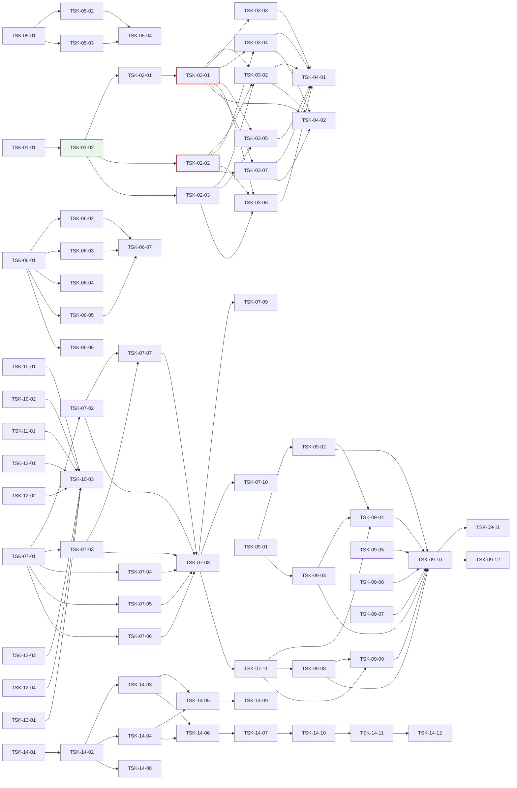

# WBS - Oranda MyBatis 작업 공간

> depth: 3
> start-date: 2026-10-23 / target-date: 2026-11-09 / updated: 2026-10-26
> source: docs/oranda1/PRD.md, docs/oranda1/TRD.md

## WP-01: 기본 설계·공유 계약
<!-- 담당 PC: win144(Windows 개발 PC) — 맥북 세션은 이 WP 의 Task 를 하지 않는다. 시안 A(decisions D-001)를 설계로 옮기고, 기능 Task 들이 함께 쓰는 인터페이스·데이터 모델·편집 지점을 먼저 정한다 -->

- [x] TSK-01-01: MyBatis 작업 공간 기본 설계 (화면·흐름·저장 방식) [win144] w:1 2026-10-23~2026-10-24
  - category: design
  - domain: infra
  - model: opus
  - priority: high
  - tags: mybatis, design, win144
  - prd-ref: PRD 3, PRD 5, MB-01~MB-10
  - requirements: docs/oranda1/design.md 를 쓴다: 화면 구성(시안 A 영역별 역할), 문서 종류 `MyBatis` 와 도구 창 보임 규칙, 명령 목록·단축키, 저장 흐름(바뀌는 부분 창·원자적 쓰기·3방향 문장 병합), 시나리오 저장 위치, 지금 ReadMyBatis 에서 계산기로 옮길 부분; 지금 코드에서 고쳐야 할 공유 지점(WorkspaceFiles·SqlEditorHost.Files·도킹 규칙·작업 공간 문서 종류)을 찾아 적는다; 제약: 상위 docs/PRD.md·TRD.md·design/ 은 고치지 않는다; 기술: TRD 2 계층과 위치, TRD 6 화면 배선; 화면: 시안 캔버스 Main·Convert·SaveDiff·Combos 아트보드; 비고: 담당 PC: win144(Windows 개발 PC) — 맥북 세션은 이 Task 를 하지 않는다. 2026-10-23 사용자 결정 시안 A(「A가 좋아보이네」). 시안 캔버스 https://claude.ai/artifact/JeoMQCGye8RCEqGmGVPKEa (Main = 시안 A, Convert·SaveDiff·Combos = 흐름)
  - acceptance: design.md 가 PRD MB-01~MB-10 을 빠짐없이 화면·명령·데이터에 대응시킨다 / 공유 지점 목록이 TSK-01-02 의 「기능 Task 편집 지점」 표의 입력이 된다

- [x] TSK-01-02: MyBatis 모델·계산기·시나리오 인터페이스와 편집 지점 (계약 전용) [win144] w:1 2026-10-25~2026-10-26
  - category: infra
  - domain: backend
  - model: opus
  - priority: critical
  - tags: mybatis, contract, win144
  - depends: TSK-01-01
  - prd-ref: MB-01, MB-02, MB-04, TRD 3, TRD 4, TRD 2, TRD 3.1·3.2·3.3
  - requirements: 인터페이스·모델 형만 정의한다: IMyBatisMapperDocument·MyBatisElement·MapperEdit·MapperWriteCheck(Language), EvalResult·MyBatisParameter·ConditionCombination·IMyBatisEvaluator·IMyBatisFragmentResolver(Language), IMyBatisScenarioStore·MyBatisScenario(Core); 시나리오 표 `mybatis_scenario` 의 마이그레이션(빈 표)을 로컬 데이터 모델에 더한다; 문서 종류 `MyBatis` 와 도구 창 2개(「문장」·「파라미터 · 시나리오」), 아래 패널 쪽 2개(「펼친 SQL」·「조합 검사」)의 등록 자리를 만든다(빈 화면). 도구 창 보임 규칙에 MyBatis 문서 조건을 더한다; design.md 에 `## 기능 Task 편집 지점` 표(기능 Task → 소유 파일·시험 파일)를 쓰고, 기능 Task 마다 빈 시험 파일(Skip 시험 틀)을 만든다; 공용 시험 헬퍼: 표본 매퍼 xml 모음(BOM·CRLF·CDATA·주석·엔티티·한글·DOCTYPE·시안 EmpMapper), 가짜 시나리오 저장소; 제약: Core·Language 는 Avalonia·ODP.NET 을 참조하지 않는다. 명령은 [OrandaCommand] 특성 자동 수집을 쓴다; API: TRD 4 인터페이스(계약); 비고: 담당 PC: win144(Windows 개발 PC) — 맥북 세션은 이 Task 를 하지 않는다. 기능 Task 9개가 같은 인터페이스·문서 종류·도구 창 자리를 쓰므로 먼저 동결한다
  - acceptance: 실행 로직 없음 (contract-only) / `dotnet build Oranda.sln -warnaserror` 통과 / 공유 시험은 틀의 존재·탑재 순서만 단정한다. 빈 라우터·스텁 목록(`STUBS` 등)을 단정하지 않는다 / 기능 Task 마다 자기 시험 파일과 소유 파일을 design.md `## 기능 Task 편집 지점` 에 적고, 두 Task 가 한 파일을 나눠 갖지 않는다 / 등록(라우트·핸들러 목록)은 자동 수집이며 기능 Task 가 공유 진입점에 줄을 더하지 않아도 된다 / 계약 문서가 지정한 파일(공용 시험 헬퍼 포함)이 모두 있다 / 인터페이스·형 존재, 도구 창 등록 자리 존재, 마이그레이션 적용 후 빈 표 존재
  - note: Core LockMonitorModels.cs 형 11개·IMonitorService 기본 NotSupported 메서드 8개(GetRecentDeadlocksAsync 포함)·App LockMonitorCommands 패널/명령 ID 상수·commands.md 모니터 행 10개 (win144)

## WP-02: 매퍼 모델·계산기·시나리오 저장 (UI 없음)
<!-- 담당 PC: win144(Windows 개발 PC) — 맥북 세션은 이 WP 의 Task 를 하지 않는다. 화면 Task 들이 실제로 쓰는 Language·Core 구현 -->

- [x] TSK-02-01: 매퍼 원문 모델 — 원문 위치를 지키며 읽고 문장 단위로 쓰기 [win144] w:3 2026-10-27~2026-10-29
  - category: dev
  - domain: backend
  - model: opus
  - priority: high
  - tags: mybatis, xml, roundtrip, win144
  - depends: TSK-01-02
  - prd-ref: MB-01, TRD 3.1
  - requirements: 매퍼를 읽어 요소마다 원문 범위(요소 전체·안쪽 본문)·종류·id·속성을 가진 IMyBatisMapperDocument 를 만든다. 주석·CDATA·엔티티·공백은 원문 그대로 둔다; 문장 본문 바꾸기, 새 문장 추가(`</mapper>` 앞, 앞 문장 들여쓰기), 지우기, id 바꾸기를 원문 조각 바꾸기로 한다. 바꾸지 않은 부분은 바이트까지 같다; 인코딩(xml 선언·BOM)·줄 끝(CRLF·LF)·끝 줄바꿈 유무를 지킨다; 쓰기 전 검사(MapperWriteCheck): 잘 짜인 xml, 문장 id 겹침, 연 때 해시와 디스크 해시 비교; DTD·외부 엔티티를 읽지 않는다. 루트가 mapper 가 아니면 알림과 함께 거부한다; 계약 Task design.md 「기능 Task 편집 지점」 의 자기 소유 파일만 고친다; 제약: XDocument 로 다시 직렬화하지 않는다; 기술: XmlReader + IXmlLineInfo 로 요소 시작을 얻고 원문을 직접 훑어 범위를 잡는다. 편집은 범위 바꾸기를 뒤에서부터 적용한다; API: TRD 4 IMyBatisMapperDocument Parse·Apply·Check; 비고: 담당 PC: win144(Windows 개발 PC) — 맥북 세션은 이 Task 를 하지 않는다. 지금 WorkspaceFiles.ReadMyBatis 는 XDocument 로 읽어 원문 위치가 없다 — 쓰기에는 원문 조각 모델이 필요하다
  - acceptance: 표본 매퍼를 읽고 아무것도 바꾸지 않고 쓰면 원본과 바이트가 같다 / 문장 하나의 본문을 바꿔 쓰면 원본과의 차이가 그 문장 안쪽 줄뿐이다 / 왕복: BOM 있음·없음, CRLF·LF, CDATA, 주석, 엔티티, 한글, DOCTYPE, namespace 없음, 끝 줄바꿈 없음 / 추가·지우기·id 바꾸기, 깨진 xml(읽으면 알림·쓰기 거부), id 겹침, 해시 바뀜, 1MB 매퍼 파싱 200 ms 이하

- [x] TSK-02-02: 동적 SQL 계산기 — 파라미터 값으로 태그를 펼치고 켜진·꺼진 범위 돌려주기 [win144] w:4 2026-10-27~2026-10-30
  - category: dev
  - domain: backend
  - model: opus
  - priority: high
  - tags: mybatis, dynamic-sql, ognl, win144
  - depends: TSK-01-02
  - prd-ref: MB-02, TRD 3.2
  - requirements: 입력 = 문장 요소 + 조각 해석기 + 파라미터 값 + 블록 덮어쓰기. 출력 = EvalResult(펼친 SQL, 바인드, 치환, 블록 범위·켬/끔, 계산 못 한 식); 태그: if, choose/when/otherwise, where, set, trim(prefix·suffix·prefixOverrides·suffixOverrides), foreach(collection·item·index·open·close·separator), include(refid, property 치환), bind; test 식 = OGNL 부분집합: null, 숫자·글자 리터럴, `== != < <= > >=` 와 eq·neq·lt·lte·gt·gte, and·or·not·`!`, 괄호, 점 경로 속성, size()·isEmpty()·length()·trim()·equals(). 그 밖의 식은 「계산 못 함」(위치·이유)으로 돌려주고 덮어쓰기로 켬·끔을 정할 수 있다; `#{x}` → `:x`(`#{x,jdbcType=…}` 는 타입 힌트), foreach 안 `#{item}` → `:item_1`… 겹치지 않는 이름, `${x}` → 값 글자(치환 목록에 넣음); ExtractParameters: `#{}`·`${}`·test 식·foreach collection·bind 의 이름, 쓰인 곳, 타입 힌트; 조합 만들기: 조건 8개 이하 전부, 넘으면 하나씩 끄기 + 모두 켬 + 모두 끔; 지금 WorkspaceFiles.ReadMyBatis 의 MyBatisText(where·set·trim·include)를 이 계산기로 옮기고 지운다. 값 없이 부르면 「모두 켬」으로 펼쳐 지금 열기 결과와 같게 한다; 계약 Task design.md 「기능 Task 편집 지점」 의 자기 소유 파일만 고친다; 제약: 식 계산은 위 목록만 지원한다(반사·동적 코드 생성·임의 메서드 호출 없음); 기술: TRD 2 Language 계층(MyBatisEvaluator, OgnlLite); API: TRD 4 Evaluate·ExtractParameters·Combinations; 비고: 담당 PC: win144(Windows 개발 PC) — 맥북 세션은 이 Task 를 하지 않는다. 2026-10-23 사용자 지적(「IF 태그 같은 것을 실제 값을 실행때 테스트 해야 쿼리가 정해지잖아」)
  - acceptance: 표본 문장 × 값 묶음 골든 결과가 MyBatis 3.5 실제 출력(공백 정규화 후)과 같다 / 시안 selectEmpList 시나리오 4개(이름 검색·부서 목록·전체 조건·조건 없음) 결과가 시안과 같다 / 기존 ReadMyBatis 시험이 그대로 통과한다 / 태그별, 식 연산자별, where 앞 AND·OR 떼기, set 끝 쉼표, trim, foreach 빈 목록·null, choose 첫 참·otherwise, include 중첩·순환(오류), bind, 계산 못 하는 식·덮어쓰기, 블록 범위, 조합 수, 문장 500줄 계산 50 ms 이하

- [x] TSK-02-03: 시나리오 저장소 (SQLite) [win144] w:2 2026-10-27~2026-10-28
  - category: dev
  - domain: backend
  - model: sonnet
  - priority: high
  - tags: mybatis, scenario, storage, win144
  - depends: TSK-01-02
  - prd-ref: MB-04, TRD 3.3
  - requirements: IMyBatisScenarioStore 를 로컬 SQLite 표 `mybatis_scenario` 에 저장하는 클래스로 만든다: List·Save·Rename·Duplicate·Delete·MoveStatement(id 바꾸기 따라가기); 매퍼 경로는 정규화한 절대 경로로 저장하고(Windows 대소문자 무시), 경로로 못 찾으면 namespace + statement_id 로 찾는다; 이름에 pass·pwd·secret·token 이 든 파라미터 값은 저장하지 않는다(null 로 둔다); 계약 Task design.md 「기능 Task 편집 지점」 의 자기 소유 파일만 고친다; 제약: 쓰기는 백그라운드 스레드에서 한다; 기술: Microsoft.Data.Sqlite(상위 로컬 데이터 모델과 같은 DB); API: TRD 4 IMyBatisScenarioStore; 비고: 담당 PC: win144(Windows 개발 PC) — 맥북 세션은 이 Task 를 하지 않는다. 시나리오는 매퍼 폴더가 아니라 앱 데이터에 둔다(D-001)
  - acceptance: 앱을 다시 켜도 시나리오가 남고, 문장 id 를 바꾸면 시나리오가 따라간다 / 저장·목록·이름 바꾸기·복제·지우기·순서, id 바꾸기, 매퍼 옮김 뒤 namespace 로 찾기, 비밀 값 버림, 한글 이름

## WP-03: MyBatis 작업 공간 화면 (편집·시험·저장)
<!-- 담당 PC: win144(Windows 개발 PC) — 맥북 세션은 이 WP 의 Task 를 하지 않는다. 시안 A 화면과 흐름 -->

- [x] TSK-03-01: MyBatis 작업 공간 화면 — 문장 도구 창·문장 원문 탭·XML 강조 [win144] w:2 2026-10-30~2026-11-02
  - category: dev
  - domain: fullstack
  - model: opus
  - priority: high
  - tags: mybatis, workspace, editor, docking, win144
  - depends: TSK-02-01
  - prd-ref: MB-03
  - entry-point: 파일 > 작업 공간 열기(.xml), 끌어 놓기·명령줄 인자, 도구 창 「문장」
  - requirements: .xml 매퍼를 열면 MyBatis 작업 공간이 된다(문서 탭 = 파일 이름 + 「MyBatis」 표시). 지금의 「SQL 로 펼쳐 읽기 전용으로 열기」를 대신한다. 같은 파일을 다시 열면 그 작업 공간으로 옮겨 간다; 왼쪽 「문장」 도구 창: 매퍼 경로·namespace, 종류별 묶음(select·insert·update·delete·sql 조각·resultMap), 수정·새 문장 표시, 두 번 누르면 그 문장 탭, 「+ 새 문장」(종류·id 묻기), 오른쪽 클릭 = id 바꾸기·지우기·펼친 SQL 을 새 SQL 탭으로. resultMap·그 밖의 요소는 목록에만 보이고, sql 조각은 편집할 수 있고 쓰는 곳 수를 보인다; SQL 탭 줄 = 문장 탭(SEL·INS·UPD·DEL 표시, 수정 점). 탭 안 = 그 문장 요소의 원문(여는 태그 ~ 닫는 태그); 강조: XML 태그·속성, `#{}`·`${}`, SQL 구간은 기존 SQL 강조. 문장 머리 줄 = 「파일 › 문장 id」, 동적 태그 수; 앱을 다시 켜면 열린 매퍼·고르던 문장·저장 안 한 고침(복구)이 돌아온다; 계약 Task design.md 「기능 Task 편집 지점」 의 자기 소유 파일만 고친다; 제약: 이 Task 에서는 매퍼 파일에 쓰지 않는다; 기술: TRD 6 화면 배선(문서 종류·도구 창 보임 규칙·MyBatis 강조 모드); 화면: 시안 캔버스 Main 아트보드(왼쪽 문장 목록·가운데 문장 탭); 비고: 담당 PC: win144(Windows 개발 PC) — 맥북 세션은 이 Task 를 하지 않는다. 시안 A Main 아트보드. 저장은 TSK-03-03
  - acceptance: 매퍼를 열면 문장 수만큼 목록 항목이 생기고, 문장을 고르면 원문 탭이 열리며, 고치면 목록·탭에 수정 표시가 붙는다 / 다른 문서로 가면 「문장」·「파라미터 · 시나리오」 도구 창이 숨고 돌아오면 다시 보인다 / Headless: 열기·목록 묶음·탭 열기·수정 표시·새 문장·id 바꾸기·지우기, 강조 분류, 도구 창 보임·숨김, 복구 (1MB 매퍼 열기 1 s 이하 성능 측정은 TSK-04-02)

- [x] TSK-03-02: 파라미터(바인드 변수 창)·시나리오와 펼친 SQL·시나리오 값으로 실행 [win144] w:3 2026-11-03~2026-11-05
  - category: dev
  - domain: fullstack
  - model: opus
  - priority: high
  - tags: mybatis, binds, scenario, execution, win144
  - depends: TSK-03-01, TSK-02-02, TSK-02-03
  - prd-ref: MB-04, MB-05
  - entry-point: 도구 창 「바인드 변수」(MyBatis 문서에서 파라미터 행), 「펼친 SQL」 머리 줄 시나리오 콤보, 아래 패널 「펼친 SQL」, 도구 막대·단축키 「시나리오 값으로 실행」(F9·Ctrl+Enter), 「펼친 SQL 복사」
  - requirements: 「바인드 변수」 도구 창(기존 재사용, 2026-10-23 사용자 결정): MyBatis 문서에서는 문장에서 찾은 파라미터 전부가 행(켬·끔과 무관, 이름·값·형식, 빈 칸 = null, `''` = 빈 글자, 목록 = `['A', 'B', 'C']`). 시나리오(추가·이름 바꾸기·복제·지우기)는 「펼친 SQL」 머리 줄 콤보, 고르면 값이 채워진다(TSK-02-03 저장소); 편집기: 이번 값으로 빠지는 블록을 흐리게, if·when 머리 줄 여백에 켬(채운 점)·끔(빈 점), 계산 못 한 식은 물결 밑줄 + 켬·끔 고르기; 「펼친 SQL」 쪽: 펼친 문장(SQL 강조) + 바인드·치환 목록. 값·원문을 고칠 때마다 300 ms 디바운스 뒤 다시 계산한다; 「시나리오 값으로 실행」은 펼친 SQL 과 바인드를 기존 실행 경로(IExecutionService·정책 관문·탭 접속)로 실행하고 결과를 「결과」 쪽에 보인다. 실행 계획, 펼친 SQL 복사(바인드 그대로 / 값을 넣은 글); `${}` 치환이 있으면 실행 전 치환 값을 보이고, 운영 접속이면 확인을 받는다; 계약 Task design.md 「기능 Task 편집 지점」 의 자기 소유 파일만 고친다; 제약: 정책 관문을 우회하는 실행 경로를 만들지 않는다. UI 스레드에서 DB 호출 금지; 기술: TRD 6 화면 배선; API: TRD 4 Evaluate·ExtractParameters, IMyBatisScenarioStore; 화면: 시안 캔버스 Main 아트보드(오른쪽·아래 패널); 비고: 담당 PC: win144(Windows 개발 PC) — 맥북 세션은 이 Task 를 하지 않는다. 시안 A 의 오른쪽·아래 패널
  - acceptance: 시안 A 처럼 시나리오를 바꾸면 흐린 줄·펼친 SQL·바인드가 바로 바뀐다 / 실행 결과가 같은 SQL·바인드를 일반 SQL 탭에서 실행한 결과와 같다(Oracle 시험) / 파라미터 표시, 시나리오 고르기·추가·고치기·지우기, 흐림 범위, 계산 못 한 식 덮어쓰기, 실행(Oracle 통합 1건 이상), 운영 접속 `${}` 확인, 복사 2종

- [x] TSK-03-03: 매퍼에 저장 — 바뀐 문장만 쓰기·바뀌는 부분 창·밖에서 바뀐 파일 처리 [win144] w:2 2026-11-03~2026-11-04
  - category: dev
  - domain: fullstack
  - model: opus
  - priority: high
  - tags: mybatis, save, diff, file-watch, win144
  - depends: TSK-03-01
  - prd-ref: MB-06
  - entry-point: Ctrl+S·도구 막대 「xml 에 저장」, 파일 감시 알림 띠
  - requirements: 저장은 바뀐 문장만 매퍼에 쓴다(TSK-02-01 Apply). 쓰기 전 「바뀌는 부분」 창: 바뀐 문장 목록(체크로 일부만 저장), 한 줄·나란히 diff, 검사 결과(XML 형식·id 겹침·밖에서 바뀜·조합 검사 여부). 「저장할 때마다 이 창 보기」를 끄면 바로 저장한다; 원자적 쓰기(같은 폴더 임시 파일 → 바꾸기), 원래 인코딩·BOM·줄 끝 유지; 파일 감시(300 ms 디바운스): 고친 문장이 없으면 다시 읽고 알린다. 있으면 알림 띠 — 안 고친 문장은 파일 것으로 반영하고, 양쪽이 고친 문장만 「차이 보고 고르기 / 파일 것으로 / 내 것으로」를 묻는다; 지워짐·옮겨짐은 알리고 다른 이름으로 저장을 권한다. 읽기 전용·쓰기 오류는 알리고 고침을 남긴다; 저장 안 한 문장이 있는 매퍼 작업 공간을 닫으면 저장 / 저장 안 함 / 취소를 묻는다. 앱 종료 때는 복구에 남기고 다음 시작 때 돌려준다; 계약 Task design.md 「기능 Task 편집 지점」 의 자기 소유 파일만 고친다; 제약: 파일 전체를 다시 쓰는 경로를 만들지 않는다; 기술: TRD 5 저장·파일 감시; API: TRD 4 Apply·Check; 화면: 시안 캔버스 SaveDiff 아트보드; 비고: 담당 PC: win144(Windows 개발 PC) — 맥북 세션은 이 Task 를 하지 않는다. 시안 SaveDiff 아트보드
  - acceptance: 문장 2개를 고쳐 저장하면 git diff 에 그 문장 안쪽 줄만 나온다 / IDE 에서 다른 문장을 고쳐 저장한 뒤 Oranda 에서 저장해도 IDE 의 고침이 남는다 / 저장 창(일부 체크·검사 결과), 바로 저장, 밖에서 바뀜 3경우(고침 없음·다른 문장·같은 문장), 지워짐, 읽기 전용, CRLF·BOM 파일, 닫기 확인, 복구

- [x] TSK-03-04: 조합 검사와 자동 고침(<set>·<where> 감싸기) [win144] w:3 2026-11-03~2026-11-05
  - category: dev
  - domain: fullstack
  - model: opus
  - priority: medium
  - tags: mybatis, dynamic-sql, lint, win144
  - depends: TSK-03-01, TSK-02-02
  - prd-ref: MB-07
  - entry-point: 도구 막대 「조합 검사」, 아래 패널 「조합 검사」, 편집기 자동 고침
  - requirements: 문장의 조건(if·when, foreach 빈 목록·값 있음)을 켜고 끄는 조합을 펼쳐 검사한다(TSK-02-02 Combinations). 시나리오가 있으면 그 값 묶음도 함께 검사한다; 검사 = Oranda 구문 분석(L2 파서)이 기본이다. 고르면 실행 계획(EXPLAIN PLAN, 접속 필요)으로도 확인한다. 어느 경우에도 문장을 실행하지 않는다(DML 포함); 결과 표: 조합(조건별 켬·끔)·결과(통과 / 오류 이유)·펼친 SQL. 고르면 오른쪽에 펼친 SQL 과 오류 위치, 「편집기에서 보기」, 「시나리오로 저장」; 자동 고침: SET 뒤의 if 들 → `<set>` 으로 감싸기, WHERE 뒤의 if 들(WHERE 1=1 없음) → `<where>` 로 감싸기. 미리보기 뒤 적용; 「문장」 도구 창에 조합 오류 수를 표시한다; 계약 Task design.md 「기능 Task 편집 지점」 의 자기 소유 파일만 고친다; 제약: 검사는 백그라운드에서 하고 취소할 수 있다. 실행 계획도 정책 관문을 거친다; 기술: 상위 Oranda.Language L2 파서 재사용; API: TRD 4 Combinations; 화면: 시안 캔버스 Combos 아트보드; 비고: 담당 PC: win144(Windows 개발 PC) — 맥북 세션은 이 Task 를 하지 않는다. 시안 Combos 아트보드
  - acceptance: 시안 updateEmpSal 예시에서 오류 2개(WHERE 앞 쉼표, SET 뒤 비어 있음)가 나오고 「<set> 으로 고치기」 뒤 조합 4개가 모두 통과한다 / 조합 수 계산·줄이기, 오류 판정, 자동 고침 2종, 실행 계획 경로가 문장을 실행하지 않음(Oracle 통합), 취소 (조합 256개 3 s 이하 성능 측정은 TSK-04-02)

- [x] TSK-03-05: 일반 작업 공간을 MyBatis 작업 공간으로 바꾸기 [win144] w:3 2026-11-03~2026-11-05
  - category: dev
  - domain: fullstack
  - model: opus
  - priority: medium
  - tags: mybatis, workspace, convert, win144
  - depends: TSK-03-01, TSK-02-03
  - prd-ref: MB-08
  - entry-point: 문서 탭 오른쪽 클릭·파일 메뉴 「MyBatis 작업 공간으로 바꾸기…」
  - requirements: 대화 상자: 대상 = 새 매퍼 파일(경로·namespace) 또는 기존 매퍼에 추가(id 겹침 표시). 탭 목록 = 포함 여부·탭 이름·문장 id 제안(고칠 수 있음)·종류 자동(select·insert·update·delete, MERGE → update, PL/SQL 익명 블록은 기본으로 빼고 고르면 `<update statementType="CALLABLE">`)·확인(바인드 수, 치환 경고); 바꾸는 방법: `:x` → `#{x}`, `&x`·`&&x` → `${x}`(경고), 타입을 아는 바인드에 jdbcType 붙이기(선택), WHERE 의 바인드 조건을 `<where><if test="x != null">` 로 감싸기(선택), `<`·`>` 가 있으면 CDATA 로 감싸기(끄면 엔티티), 서식은 기본 포매터 프로필(CDATA 안 4칸); 문자열 리터럴·주석 안의 `:x`·`&x`, PL/SQL 대입 `:=` 는 바꾸지 않는다(렉서 사용); 탭 바인드 값은 그 문장의 첫 시나리오로 저장한다(TSK-02-03). 미리보기(고른 탭의 xml). 바꾸면 새 MyBatis 문서 탭이 열리고 원래 작업 공간 파일은 그대로 둔다; 계약 Task design.md 「기능 Task 편집 지점」 의 자기 소유 파일만 고친다; 제약: 매퍼 쓰기는 TSK-02-01 Apply 만 쓴다; 기술: 상위 L1 렉서·포매터 재사용; API: TRD 4 Apply, IMyBatisScenarioStore; 화면: 시안 캔버스 Convert 아트보드; 비고: 담당 PC: win144(Windows 개발 PC) — 맥북 세션은 이 Task 를 하지 않는다. 2026-10-23 사용자 요청(「일반 작업 공간도 마이바티스 작업공간으로 변경이 가능하면 좋겠어」). 시안 Convert 아트보드
  - acceptance: 탭 4개 작업 공간을 바꿔 연 매퍼에서 각 문장을 첫 시나리오로 실행하면 원래 탭 결과와 같다 / 기존 매퍼에 추가하면 원래 문장들은 바이트가 같다 / 바인드·치환 바꾸기(리터럴·주석·`:=` 제외), id 제안·겹침, 종류 판정, CDATA·엔티티, 새 파일·기존 파일 추가, 시나리오 생성, 원래 파일 그대로

- [x] TSK-03-06: MyBatis 로그 붙여 넣기로 문장 찾아 열고 값을 시나리오로 저장 [win144] w:2 2026-11-03~2026-11-04
  - category: dev
  - domain: fullstack
  - model: sonnet
  - priority: medium
  - tags: mybatis, log, scenario, win144
  - depends: TSK-03-01, TSK-02-02, TSK-02-03
  - prd-ref: MB-09
  - entry-point: 편집 > MyBatis 로그 붙여 넣기(MyBatis 문서에서)
  - requirements: MyBatis 문서에서 로그를 붙여 넣으면 로그 줄의 logger 이름(namespace.id, 예 `DEBUG com.acme.hr.EmpMapper.selectEmpList - ==>  Preparing: …`)으로 열린 매퍼에서 문장을 찾아 연다. logger 이름이 없으면 펼친 SQL 모양이 같은 문장 후보를 고르게 한다; Parameters 값을 그 문장의 파라미터에 맞춘다: 그 값으로 펼친 SQL 의 `?` 순서(foreach 포함)와 맞대 이름을 붙이고 새 시나리오 「로그 HH:mm」로 저장한다. 맞출 수 없으면 알리고 일반 SQL 탭 붙여 넣기로 연다; 일반 SQL 탭에서는 지금 동작을 그대로 둔다; 계약 Task design.md 「기능 Task 편집 지점」 의 자기 소유 파일만 고친다; 제약: MyBatisLogParser 를 복사하지 않고 다시 쓴다; 기술: Oranda.Language.MyBatis.MyBatisLogParser 재사용; API: TRD 4 Evaluate, IMyBatisScenarioStore; 비고: 담당 PC: win144(Windows 개발 PC) — 맥북 세션은 이 Task 를 하지 않는다. 기존 MyBatisLogParser(상위 TSK-13-03)를 다시 쓴다
  - acceptance: 시안 selectEmpList 로그를 붙여 넣으면 그 문장 탭이 열리고 시나리오가 생겨 실행할 수 있다 / logger 있는·없는 로그, 여러 문장 로그, foreach 값 맞추기, 맞출 수 없음, 비밀 값 저장 안 함

- [x] TSK-03-07: 매퍼 폴더 열기 — 폴더 트리·다른 파일 include·문장 찾기 [win144] w:3 2026-11-03~2026-11-05
  - category: dev
  - domain: fullstack
  - model: sonnet
  - priority: low
  - tags: mybatis, folder, navigation, win144
  - depends: TSK-03-01, TSK-02-02
  - prd-ref: MB-10
  - entry-point: 파일 > 매퍼 폴더 열기, 「문장」 도구 창 폴더 트리, 명령 「MyBatis 문장 찾기」
  - requirements: 「매퍼 폴더 열기」: 폴더(예 src/main/resources/mapper) 아래 루트가 mapper 인 *.xml 을 찾아 「문장」 도구 창에 폴더 > 파일 > 문장 트리로 보인다. 파일·문장을 열면 MyBatis 작업 공간으로 연다. 최근 폴더를 기억한다; 다른 파일의 sql 조각 include(`refid="ns.frag"`)를 펼친다(폴더 안 파일을 찾는 IMyBatisFragmentResolver 를 만든다). sql 조각·resultMap 을 쓰는 곳 찾기; 「MyBatis 문장 찾기」: namespace.id 또는 id 일부로 폴더 안 문장을 찾아 연다. 로그 붙여 넣기(TSK-03-06)도 폴더 안을 찾는다; 계약 Task design.md 「기능 Task 편집 지점」 의 자기 소유 파일만 고친다; 제약: 폴더 훑기는 백그라운드에서 하고, 매퍼 2,000개 폴더에서도 UI 스레드를 100 ms 넘게 막지 않는다; API: TRD 4 IMyBatisFragmentResolver; 비고: 담당 PC: win144(Windows 개발 PC) — 맥북 세션은 이 Task 를 하지 않는다. 파일 하나 단위로 먼저 하고 폴더는 나중(2026-10-23 대화)
  - acceptance: 매퍼 2개 이상인 폴더에서 다른 파일 조각을 include 한 문장의 펼친 SQL 이 맞다 / 폴더 훑기(mapper 아닌 xml 거름), 다른 파일 include·순환, 문장 찾기, 폴더 안 파일 바뀜 감시

- [x] TSK-03-08: 「문장」 도구 창을 공용 격자 양식으로·이름 「매퍼 쿼리」로 [win144] w:1 2026-10-23~2026-10-24
  - category: dev
  - domain: frontend
  - model: sonnet
  - priority: high
  - tags: mybatis, ui, grid, win144
  - depends: TSK-03-01
  - prd-ref: MB-02
  - entry-point: 매퍼를 열면 왼쪽 도구 창
  - requirements: 「문장」 창 목록을 공용 격자 양식(Styles/GridC, 상세 표와 같은 머리글·행 높이·선택색)으로 보인다(종류·id·수정 표시·조합 오류 수·쓰는 곳 수 열). 묶음(select·insert·update·delete·sql 조각·resultMap)과 폴더 트리 보기를 유지한다; 창 이름 「문장」 → 「매퍼 쿼리」(영문 Mapper Queries), 메뉴·명령 이름의 「문장」도 같은 말로 맞춘다; 비고: 2026-10-23 사용자 수정 요청(「문장이 너무 보기 안 좋다, 기본 그리드 양식, 이름도 적절하게」)
  - acceptance: 라이트·다크 렌더 PNG 에서 상세 표 격자와 같은 양식이다 / 두 번 누르기·우클릭 메뉴·폴더 트리·수정 표시가 그대로 동작한다
  - note: 「매퍼 쿼리」 창을 공용 격자(GridC) 목록·머리글로, 폴더 트리 머리글·행 높이·선택색 맞춤, 명령·창 이름 문장→쿼리 (win144)

- [x] TSK-03-09: 바인드 변수 창 — 격자 양식·자료형 서식·블록 복사 붙여 넣기 [win144] w:2 2026-10-23~2026-10-24
  - category: dev
  - domain: frontend
  - model: sonnet
  - priority: high
  - tags: bind, ui, grid, win144
  - depends: TSK-03-02
  - prd-ref: MB-05
  - entry-point: 바인드 변수 도구 창(일반 SQL·MyBatis 공용)
  - requirements: 바인드 변수 창을 공용 격자 양식(Styles/GridC)으로; 값을 넣으면 자료형에 맞게 서식(NUMBER = 숫자만·자리 구분 없음, DATE·TIMESTAMP = 설정의 날짜 서식, VARCHAR2·CHAR = 그대로, 잘못된 값은 칸 표시와 툴팁); 여러 행을 블록으로 잡아 변수·값·자료형·방향 4열을 TSV 로 복사하고, 같은 형식을 붙여 넣으면 이름이 같은 변수에 값·자료형·방향을 채운다(Orange 동작); 비고: 2026-10-23 사용자 수정 요청
  - acceptance: 일반 SQL·MyBatis 문서 둘 다에서 동작 / 복사 → 다른 탭 붙여 넣기 왕복이 같다 / 잘못된 숫자·날짜 처리
  - note: 바인드 창 GridC 격자·행 블록 선택, 값 칸 자료형 서식(NUMBER·DATE)·잘못된 값 붉은 테두리, Ctrl+C/V TSV 4열 복사·붙여 넣기(App.Tests BindGridTests 35개 통과)

- [x] TSK-03-10: 펼친 SQL 을 쿼리 편집 탭 안 분할(세로 기본·가로)로 옮기기 [win144] w:2 2026-10-23~2026-10-24
  - category: dev
  - domain: frontend
  - model: opus
  - priority: high
  - tags: mybatis, expanded, layout, win144
  - depends: TSK-03-02
  - prd-ref: MB-05
  - entry-point: MyBatis 쿼리 탭
  - requirements: 「펼친 SQL」 아래 도킹 패널을 없애고 MyBatis 쿼리 탭 안에서 원문 편집기 옆(세로 분할, 기본)·아래(가로 분할)에 보인다. 탭 머리 줄에 분할 아이콘 버튼(세로·가로, 고른 것은 기억); 펼친 SQL 의 바인드·치환 입력 목록을 지운다 — 값은 바인드 변수 창에서만 넣는다(치환 `${}` 도 바인드 변수 창 행); MyBatis 쿼리 탭이 열려 있을 때만 펼친 SQL 이 보인다(「매퍼 쿼리」 창에서 고르기만 하고 탭을 열지 않으면 안 보임). 조회 결과 창을 덮지 않는다; 시나리오 콤보·복사·실행 계획 명령은 분할 머리 줄로 옮긴다; 비고: 2026-10-23 사용자 수정 요청(「펼친 SQL 이 조회결과를 덮어서 불편」)
  - acceptance: 쿼리 탭을 열면 오른쪽에 펼친 SQL, 아이콘으로 가로 전환·되돌림 / 탭 없이 목록 선택만 하면 펼친 SQL 없음 / 실행 결과 창이 가려지지 않음 / 바인드 값 바꾸면 300 ms 뒤 다시 계산
  - note: 펼친 SQL 아래 패널을 없애고 쿼리 탭 안 분할(세로 기본·가로·숨김, 방향·비율 설정 기억)로 옮김, 바인드·치환 목록 삭제(치환도 바인드 변수 창 $행), 탭이 있을 때만 보임 — ParamsRunSplitTests 6건·사용자 매퍼 153문장 화면 확인

- [x] TSK-03-11: 조합 검사 — 처음 보는 문장 모양의 첫 구문 분석이 0.1~7.6 s (ANTLR 예측 캐시 만들기) [win144] w:2 2026-10-24~2026-10-25
  - category: defect
  - domain: backend
  - model: opus
  - priority: medium
  - tags: mybatis, combos, perf, antlr, win144
  - depends: TSK-03-04
  - prd-ref: MB-07, PRD 6
  - requirements: 사용자 매퍼(요소 153개)로 조합 검사(구문 분석만)를 하면, 같은 모양을 처음 분석하는 문장의 첫 분석이 보통 문장 92~655 ms, 처음 보는 모양은 2.7~5.8 s, 긴 문장(3.5·10.8·17 KB)은 0.7~7.6 s 걸린다. 같은 글을 다시 분석하면 9 ms, 글자만 다른 변형은 1~40 ms 라 시간은 파싱이 아니라 문장 모양마다 ANTLR 예측 캐시(DFA)를 만드는 데 쓰인다(Debug·Release 동일). 앱은 유휴 때 간단한 문장 4개로만 미리 데운다(PlSqlWarmUpTask). 첫 결과가 3 s 안에 나오게 한다; 후보: 워밍업 문장을 늘리거나 매퍼를 연 뒤 유휴 때 그 매퍼의 문장을 미리 분석, 예측 캐시 공유 범위 점검; 제약: Oranda.Language(TSK-04-03 소유) 수정이라 소유자 검토; 비고: 측정 docs/oranda1/itest/TSK-04-01.md 3c·3d
  - acceptance: 사용자 매퍼 문장 아무거나 조합 검사 첫 실행의 첫 결과가 3 s 이하(부하 없는 win144) / 합성 조합 256개 3 s 시험(TSK-04-02) 그대로 통과 / 워밍업이 시작 시간(D-006)을 늘리지 않음
  - note: 2026-10-23 저부하 재측정(Release, CPU 7~11 %) 1회: 사용자 매퍼 첫 분석 보통 문장 최대 1.09 s·긴 문장 최대 2.6 s(모두 3 s 이내), 환산 256개 467 ms — 부하 탓이 컸던 것으로 보임, 고치기 전 사용자 결정 (win144) — docs/oranda1/itest/TSK-04-02.md; 2026-10-23 고침: 매퍼를 열면 낮은 우선순위 백그라운드에서 문장마다 모두 켬·모두 끔 SQL 을 미리 분석해 예측 캐시를 데움(시작 때 안 함·취소 가능) — 고친 뒤 1회(CPU 40 % 이하): 데우기 끝난 뒤 조합 검사 첫 결과 보통 문장 최대 25 ms·긴 문장 최대 11 ms(목표 1.5 s), 합성 256개 통과, 데우기 자체는 153문장 25 s (win144)

- [x] TSK-03-12: 매퍼 2,000개 폴더 훑기가 끝날 때 UI 스레드 최대 막힘 121~207 ms (상한 100 ms) [win144] w:2 2026-10-24~2026-10-25
  - category: defect
  - domain: frontend
  - model: sonnet
  - priority: medium
  - tags: mybatis, folder, perf, ui, win144
  - depends: TSK-03-07
  - prd-ref: MB-10, PRD 6
  - requirements: win144 Release 6회 121/126/167/183/188/207 ms, Debug 438 ms(CPU 24~97 % 부하 속). 막힘을 단계로 쟀다: 훑기 시작 때 60~170 ms(감시 걸기·최근 폴더·빈 트리), 훑기가 끝난 뒤 트리 다시 짓기(MapperFolderTreeViewModel.Rebuild) 30~80 ms, 그 뒤 트리 첫 그리기 100~330 ms. Rebuild 를 떨어진 목록에 지어 한 번에 붙이는 시도는 효과가 구분되지 않아 되돌렸다. 후보: 폴더 노드의 파일 자식을 펼칠 때 만들기(점진 생성)·가상화, 훑기 시작 때 하는 일을 UI 밖으로; 제약: MapperFolderTests 가 펼치지 않고 Children 을 읽으므로 시험 수정이 필요할 수 있다; 비고: 측정 docs/oranda1/itest/TSK-04-01.md 4. 무부하 PC 에서 다시 재서 확정한다
  - acceptance: MyBatisWorkspacePerfTests.Scanning_a_folder_of_2000_mappers_blocks_the_ui_thread_at_most_100_ms 가 win144 Release 에서 3회 연속 통과 / MapperFolderTests 통과
  - note: 2026-10-23 저부하 재측정(Release, CPU 17~23 %) 1회: 최대 막힘 89 ms(상한 100 ms 통과, 여유 작음), 3회 연속은 미확인 (win144) — docs/oranda1/itest/TSK-04-02.md; 2026-10-23 고침: 파일 노드의 요소 자식을 처음 읽을 때 만들고, 트리 최상위 노드를 4개씩 배경 우선순위로 나눠 붙이고 패널을 가상화 — 고친 뒤 1회(CPU 40 % 이하): 최대 막힘 64 ms(목표 70 ms), 단계 = 시작 2 ms·다시 짓기 13 ms·첫 그리기는 나눠 붙임. 3회 연속은 「한 번씩만」 규칙으로 돌리지 않음 (win144)

- [x] TSK-03-13: 매퍼 2,000개 폴더 훑기 전체가 9~27 s (파일을 한 줄로 차례로 읽음) [win144] w:1 2026-10-24~2026-10-25
  - category: defect
  - domain: backend
  - model: sonnet
  - priority: low
  - tags: mybatis, folder, perf, win144
  - depends: TSK-03-07
  - prd-ref: MB-10
  - requirements: MapperFolderIndex.Scan 이 파일을 스레드 풀 한 개로 차례로 열고 파싱한다. win144 에서 2,000개가 Release 9~27 s(맥 Debug 248 ms). UI 는 막지 않지만 큰 폴더를 열면 한참 기다린다. 후보: 파일 읽기·파싱을 병렬로(Parallel.ForEach, 결과는 경로순으로 정렬), 앞부분 읽기와 전체 읽기를 한 번에; 비고: 측정 docs/oranda1/itest/TSK-04-01.md 4. PRD 에 상한이 없어 우선순위 낮음, 원인(Windows 파일 열기 비용·실시간 검사·부하)을 먼저 가른다
  - acceptance: 같은 합성 폴더 2,000개 훑기 전체가 절반 이하 / 폴더 훑기 시험(MapperFolderTests) 통과
  - note: 2026-10-23 저부하 재측정(Release, CPU 17~23 %) 1회: 훑기 전체 8,995 ms — 부하와 무관하게 9 s 대, 병렬화 필요 (win144) — docs/oranda1/itest/TSK-04-02.md; 2026-10-23 고침: 파일 읽기·파싱을 코어 수만큼 병렬(경로순 정렬), 파일은 한 번만 열어 앞부분 판정과 전체 읽기를 이음 — 고친 뒤 1회(CPU 40 % 이하): 8,995 → 2,656 ms (win144)

- [x] TSK-03-14: 실제 앱에서 바인드 변수 창 Ctrl+C/V 가 편집기·결과 그리드로 감 (TSK-03-09 결함) [win144] w:1 2026-10-23~2026-10-23
  - category: defect
  - domain: frontend
  - model: opus
  - priority: high
  - tags: bind, ui, keymap, clipboard, win144
  - depends: TSK-03-09
  - prd-ref: MB-05
  - entry-point: 바인드 변수 도구 창(일반 SQL·MyBatis 공용)
  - requirements: 사용자 보고(2026-10-23 실앱): 바인드 변수 복사·붙여 넣기가 안 된다. 원인: 주 창 Tunnel 키 처리기(MainWindow.OnKeyDownTunnel)가 바인드 창 목록보다 먼저 키를 받아 키맵으로 보낸다. 바인드 창엔 포커스 자리(FocusSlot)가 없어 직전 자리(편집기 sqlText·결과 sqlGrid)가 그대로 남고, Ctrl+C/V 가 oranda.edit.copy/paste(editorFocus)·oranda.grid.copy(gridFocus)로 처리돼 Handled — 목록 처리기(RowList Tunnel)에 닿지 않는다(TSV 가 편집기에 붙음). 값 칸 TextBox 안에서만 주 창이 키를 넘겨 동작했다. Headless 시험(BindGridTests)은 뷰 모델 CopyText/PasteText 를 직접 불러 셸 키 경로를 거치지 않아 통과했다. 우클릭 메뉴(Click)·클립보드 호출 자체는 문제없음
  - acceptance: 편집기를 쓰다 바인드 창 줄을 클릭하고 Ctrl+C → 바인드 TSV, Ctrl+V → 값 채움(편집기 그대로) / 값 칸 글 선택 Ctrl+C = 글 복사 / 우클릭 「머리글 포함 복사」·「붙여 넣기」 / 편집기 포커스 Ctrl+C = 편집기 복사(회귀)
  - note: 고침 — 글자 편집 키를 스스로 처리하는 영역 표시 EditKeyScope(Shell/Keymaps) 를 두고 바인드 창 목록에 붙임, 주 창은 그 영역에 포커스가 있으면 글자 편집 키를 키맵으로 보내지 않음(TextBox 와 같은 규칙), macOS 시스템 메뉴(⌘C·⌘V)도 그 영역으로 넘김, 목록 처리기는 플랫폼 기본 수식키(⌘/Ctrl), 클립보드 실패는 창 아래 줄에 알림. 시험 BindPaneShellKeysTests 7개(셸 주 창 + 도킹 바인드 창에 실제 키·마우스 입력, 고치기 전 3개 실패 확인). 실앱 자동 확인은 다른 창이 앞에 있어(포그라운드 잠금) 못 함 (win144)

## WP-04: 통합테스트
<!-- TSK-04-01 담당 PC: win144(Windows 개발 PC) — 맥북 세션은 TSK-04-01 을 하지 않는다. 기능 간 흐름 검증(개별 기능 재검증 아님). TSK-04-02 는 기능 레인에서 떼어 낸 성능 측정(2026-10-23 대화) -->

- [x] TSK-04-01: MyBatis 작업 공간 흐름 — 열기→시험→검사→저장→충돌→바꾸기→로그 [win144] w:2 2026-11-06~2026-11-09
  - category: itest
  - domain: test
  - model: sonnet
  - priority: high
  - tags: integration, e2e, mybatis, win144
  - depends: TSK-03-02, TSK-03-03, TSK-03-04, TSK-03-05, TSK-03-06, TSK-03-07, TSK-03-08, TSK-03-09, TSK-03-10
  - prd-ref: PRD 3, PRD 8
  - requirements: 흐름: 매퍼 열기 → 문장 고치기 → 시나리오 만들기 → 시나리오 값으로 실행 → 조합 검사·자동 고침 → 저장(바뀌는 부분 확인) → IDE 에서 같은 파일 고친 뒤 충돌 처리 → 일반 작업 공간 바꾸기 → 로그 붙여 넣기로 문장 찾기 → 매퍼 폴더 열기; 11g 컨테이너(oranda-ora11g)와 19c 이상에서 실행 결과를 확인한다; 성능 수치(PRD 6)를 시험 PC 에서 잰다; 제약: 실앱 눈 확인 항목은 사용자 몫으로 표시한다; 비고: 담당 PC: win144(Windows 개발 PC) — 맥북 세션은 이 Task 를 하지 않는다. 결과서 docs/oranda1/itest/TSK-04-01.md
  - acceptance: 모든 흐름이 끝까지 가고, 저장한 매퍼를 git diff 로 보면 고친 문장 줄만 바뀌어 있다 / 발견 결함은 해당 기능 WP에 defect Task로 등록됨 / 흐름별 결과표(정상·경계·오류·되돌림)
  - note: 시안·사용자 매퍼(153개) 흐름 시험 8개(열기→탭·분할→고치기→바인드→시나리오→조합 검사·자동 고침→저장 git diff→충돌→바꾸기→로그→폴더) 전부 통과, DB 실행은 사용자 확인으로 남김, 성능 재측정에서 결함 3건(TSK-03-11~13) 등록 — 결과서 docs/oranda1/itest/TSK-04-01.md (win144)

- [x] TSK-04-02: MyBatis 작업 공간 성능 시험 — PRD 6 수치 측정·병목 고침 w:1 2026-11-06~2026-11-09
  - category: itest
  - domain: test
  - model: sonnet
  - priority: medium
  - tags: perf, mybatis
  - depends: TSK-03-01, TSK-03-02, TSK-03-04, TSK-03-07
  - prd-ref: PRD 6
  - requirements: 기능 Task 에서 성능 시험을 떼어 이 Task 에서 한꺼번에 잰다(기능 레인의 병목 제거, 2026-10-23 대화); 대상(PRD 6): 문장 3,000줄·매퍼 1MB 를 열어 「문장」 창 목록이 보일 때까지 1 s 이하, 값·원문을 고친 뒤 펼친 SQL 다시 계산 디바운스 300 ms 뒤 50 ms 이하, 조합 검사 조합 256개 구문 분석 3 s 이하(백그라운드·취소), 매퍼 2,000개 폴더 훑기 중 UI 스레드 막힘 100 ms 이하; App.Tests `Category=Perf&FullyQualifiedName~MyBatis` 시험을 모으고 없는 수치는 시험을 추가한다; 상한을 넘으면 원인을 찾아 해당 기능 소유 파일을 고치거나 defect Task 로 등록한다; 제약: 맥 Debug 수치는 상한값으로 기록하고, win144 수치는 TSK-04-01 결과서에 함께 적는다; 비고: 결과서 docs/oranda1/itest/TSK-04-02.md
  - acceptance: PRD 6 수치 4개가 모두 Perf 시험으로 있고 상한 안에 든다 / 수치표(항목·상한·측정값·PC·빌드 구성) / 넘은 항목은 고침 커밋 또는 defect Task 로 남음

## WP-05: Lock 모니터
<!-- 담당 PC: win144(Windows 개발 PC) — 맥북 세션은 이 WP 의 Task 를 하지 않는다. 2026-10-24 사용자 지시 「다른 DB도구의 Lock 모니터 기능들을 조사해서 구현하자」「P2 까지 모두 구현하자」. 조사 근거 = Toad Session Browser Locks 탭, DBeaver Lock Manager, OEM Blocking Sessions, Quest Spotlight Locks Tree. 모든 조회는 SELECT 전용(DB 접근 통제 도구의 결재 회피). dba_waiters·dba_blockers(catblock.sql 필요)는 쓰지 않는다 -->

- [x] TSK-05-01: Lock 모니터 조회 계약 — 레코드·IMonitorService 메서드·명령 ID (계약 전용) [win144] w:1 2026-10-24~2026-10-24
  - category: infra
  - domain: backend
  - model: sonnet
  - priority: critical
  - tags: lock, monitor, contract, win144
  - prd-ref: LK-01~LK-12
  - requirements: Core(src/Oranda.Core/Monitoring)에 Lock 모니터 형을 정의한다: LockRow(인스턴스·SID·SERIAL#·사용자·머신·프로그램·잠금 유형 TM/TX/UL 등·id1·id2·보유 모드·요청 모드·ctime 초·block 여부·대상 객체 owner.name·트랜잭션 시작 시각·undo 블록·대기 이벤트·대기 초·sql_id·prev_sql_id·blocking 인스턴스/세션), LockFilter(최소 대기 초 기본 0, 사용자, 스키마, 인스턴스, 대기·차단만, 유형 목록), LockSnapshot(행 목록 + 대기 트리 BlockingTree 재사용 + 수집 시각), BlockerImpact(보유자 SessionKey·대기자 수·최대 대기 초·합계 대기 초), LockedRowInfo(rowid 문자열·owner·table·열 이름·값), DdlLockRow(세션·owner·name·type·보유/요청 모드), WaitingBind(이름·위치·값 문자열·형); IMonitorService 에 GetLocksAsync·GetBlockerImpactAsync·GetLockedRowAsync·GetDdlLocksAsync·GetWaitingBindsAsync·GetIdleTransactionsAsync 를 기본 구현 NotSupportedException 으로 더한다(GetMyBlockingAsync 패턴); 명령 ID 상수(oranda.monitor.locks 등)와 패널 ID oranda.panel.lockMonitor 를 정하고 docs/design/commands.md 모니터 표에 행을 더한다; 제약: 실행 로직 없음; 비고: 담당 PC: win144(Windows 개발 PC) — 맥북 세션은 이 Task 를 하지 않는다
  - acceptance: 실행 로직 없음 (contract-only) / `dotnet build Oranda.sln -warnaserror` 통과 / 기존 가짜 IMonitorService 구현체가 고치지 않고 빌드된다 / 형·메서드·ID 존재

- [x] TSK-05-02: Lock 모니터 조회 — 카탈로그 SQL·Oracle 구현 (11g·RAC) [win144] w:2 2026-10-24~2026-10-25
  - category: dev
  - domain: backend
  - model: opus
  - priority: high
  - tags: lock, monitor, oracle, win144
  - depends: TSK-05-01
  - prd-ref: LK-01~LK-12
  - requirements: Catalog/session(또는 Catalog/lock)에 SELECT 전용 SQL 을 더한다: lock.list(gv$lock + gv$session, TM 은 id1=object_id → @PFX@_objects, TX 는 gv$transaction(xidusn·xidslot·xidsqn) 조인으로 start_date·used_ublk, 백그라운드·시스템 잠금(MR·AE·TO 등)은 기본 제외, ROWNUM 상한), lock.blocker_impact(보유자별 대기자 수·최대·합계 대기 초), lock.locked_row(row_wait_obj#·file#·block#·row# → DBMS_ROWID.ROWID_CREATE 로 rowid, enq: TX - row lock contention 일 때만; 행 값은 SELECT * FROM owner.table WHERE ROWID = :r 를 따옴표 식별자로), lock.ddl_locks(dba_ddl_locks, 권한 없으면 기능 끔), lock.waiting_binds(gv$sql_bind_capture, 대기 세션 sql_id·child), lock.idle_transactions(gv$transaction + gv$session status INACTIVE 와 경과 초); 11g 변형이 필요한 파일은 같은 id 의 min-version 11 파일로 둔다(FETCH FIRST·con_id 금지); IN 목록 1000개 제한을 피해 조인으로 쓴다; OracleMonitorService.Locks.cs partial 로 TSK-05-01 메서드를 구현한다; 시험: SessionCatalogTests·Oracle11CatalogTests 항목, 카탈로그에 DML 이 없음을 단정, 통합 시험은 Lock_contention_shows_holder_and_waiter_and_kill_releases_it 구성을 재사용해 TX 행 잠금·TM 잠금·잠긴 행 rowid·보유자 영향·idle 트랜잭션을 확인한다(23ai 컨테이너, 가능하면 oranda-ora11g); 비고: 담당 PC: win144(Windows 개발 PC) — 맥북 세션은 이 Task 를 하지 않는다
  - acceptance: 모든 쿼리가 SELECT 이고 결재 대상 DML·임시 표·쓰기 패키지를 쓰지 않는다 / 11g·19c 이상에서 카탈로그 선택이 된다 / 통합 시험에서 보유자·대기자·잠긴 행이 맞게 나온다 / 권한 부족(all_* 만)에서 오류 대신 빈 결과·이유
  - note: Catalog/lock 7개(lock.deadlocks 만 19+, 나머지 11 공용)·OracleMonitorService.Locks.cs 로 8개 메서드 구현, gv$lock 에 요청 행이 없는 큐 대기(23ai TM)는 대기 인자로 채움, 잠긴 행 값 못 읽으면 열 ["오류"]+이유; 23ai 통합 6건·11.2(oranda-ora11g) 2건 통과 (win144)

- [x] TSK-05-03: Lock 모니터 화면 — 대기 트리·잠금 목록·SQL·잠긴 행·영향 순위·원인 힌트·세션 종료 [win144] w:3 2026-10-24~2026-10-26
  - category: dev
  - domain: frontend
  - model: opus
  - priority: high
  - tags: lock, monitor, ui, win144
  - depends: TSK-05-01
  - prd-ref: LK-01~LK-09
  - requirements: Features/LockMonitor 에 문서 패널 oranda.panel.lockMonitor(「Lock 모니터」)를 만든다. 「모니터」 메뉴에 「Lock 모니터」를 더하고 세션 모니터와 같은 모니터 전용 세션·MonitorAccess(권한 배너·다른 접속)를 쓴다; 화면: 위쪽 대기 트리(보유자 루트 → 대기자, 대기 초·이벤트·객체), 아래 잠금 목록(DetailTable: 유형·모드·요청·ctime·객체·트랜잭션 시작·block 강조), 오른쪽 상세 탭(보유자·대기자 SQL 전문 gv$sql 클릭 때만, 잠긴 행 rowid·열 값, 대기 바인드, DDL 잠금 탭, 원인 힌트: enq: TX row lock / enq: TM contention(FK 인덱스 누락 의심) / enq: TX allocate ITL / library cache lock·pin); 보유자 영향 순위 표(대기자 수·최대·합계 대기 초 순); 거르기: 최소 대기 초(기본 0, 3초 단추), 사용자·스키마·인스턴스, 대기·차단만; 자동 새로 고침(간격); 세션 종료·연결 끊기는 세션 모니터 흐름 재사용, 확인 창에 「이 세션 때문에 N개 세션이 기다립니다」; 세션 모니터로 이동(SID·INST_ID); 트리·목록 복사·CSV 내보내기; BlockerAlert 상태 줄 클릭은 Lock 모니터를 연다; 한글 리터럴은 literals-en.json·CommandTitles·strings 에 영어 짝; 시험: ViewModel(가짜 서비스)·Headless 렌더·명령 등록·LocalizationTests; 비고: 담당 PC: win144(Windows 개발 PC) — 맥북 세션은 이 Task 를 하지 않는다
  - acceptance: 가짜 서비스로 트리·목록·상세·영향 순위·힌트가 보인다 / 세션 종료 확인 창에 대기자 수 / 권한 없을 때 배너 / 전체 시험 통과 / 실앱 눈 확인 항목은 사용자 몫으로 결과에 적는다
  - note: Features/LockMonitor 문서 패널(대기 트리·영향 순위·DDL 잠금 탭, 방치·데드락 탭은 05-04 자리)·잠금 목록·SQL/잠긴 행/바인드/원인 힌트 상세, 상태 5종, 종료 확인 창(대기자 수·목록), 세션 모니터로 이동, 복사·CSV, 막음 칩 → Lock 모니터, F5(lockMonitorFocus), 시험 LockMonitorTests·LockMonitorViewTests (win144)

- [x] TSK-05-04: Lock 모니터 이력·알림·방치 트랜잭션·데드락 힌트 (P2) [win144] w:2 2026-10-26~2026-10-27
  - category: dev
  - domain: fullstack
  - model: opus
  - priority: medium
  - tags: lock, monitor, history, win144
  - depends: TSK-05-02, TSK-05-03
  - prd-ref: LK-10~LK-12
  - requirements: 이력 타임라인: 새로 고침마다 대기자 수·최대 대기 초를 메모리에 쌓아(최근 N분, 설정) 작은 그래프로 보이고, 원하면 로컬 파일(앱 데이터 폴더, DB 쓰기 아님)로 저장한다. ASH 는 쓰지 않는다(Diagnostics Pack); 임계치 알림: 「N초 이상 또는 대기자 M명 이상」이면 상태 줄·알림을 띄우고 그 시점 보유자·대기자 SQL 스냅샷을 로컬 텍스트로 남긴다(기존 BlockerWatcher 확장, 설정); 방치 트랜잭션 탭: INACTIVE 인데 트랜잭션을 연 세션과 경과 시간·undo 크기; 데드락 힌트: 대기 그래프에 순환이 보이면 표시, 권한이 있으면 alert 로그(12c+ v$diag_alert_ext, 11g 는 끔)에서 ORA-00060 최근 항목을 읽기 전용으로 보인다; 시험: 단위·Headless·통합(가능한 범위); 비고: 담당 PC: win144(Windows 개발 PC) — 맥북 세션은 이 Task 를 하지 않는다
  - acceptance: 이력 그래프·임계치 알림·방치 트랜잭션·데드락 힌트가 동작한다 / DB 에 쓰지 않는다 / 전체 시험 통과
  - note: 이력 띠(LockHistoryBuffer 프로필별 메모리·lock-history CSV 선택)·임계치 알림(LockThresholdTracker, 창 알림 8 초·SQL 스냅샷 텍스트, BlockerWatcher 「⚠ N 세션 막음 · M 초」 칩)·방치 트랜잭션 탭·데드락 기록 탭(19c+, 11g·18c 는 이유)·순환 대기 띠(WaitCycles)·알림 설정 플라이아웃(settings monitor.lockAlert), 계약에 Status·파일/블록/행·바인드 캡처 시각·잠금 수 init 추가, 트랜잭션 시작 UTC 보정 (win144)

## WP-06: 튜닝 메뉴와 쿼리 튜닝 기능
<!-- 담당 PC: win144(Windows 개발 PC) — 맥북 세션은 이 WP 의 Task 를 하지 않는다. 2026-10-24 사용자 지시 「또 다른 도구와 비교해서 쿼리 튜닝에 대한 기능을 조사해줘」「튜닝 기능도 조사 끝나면 같이 구현하자. 튜닝 메뉴를 따로 만들어서 거기에 넣으면 될것 같다」. 조사 근거 = Toad SQL Optimizer·TKProf, SQL Developer Autotrace·Tune SQL·Monitor SQL, PL/SQL Developer, OEM 어드바이저·SPM. 원칙: 팩 없는 읽기 전용. DB 에 쓰는 기능(Tuning Advisor 태스크·DBMS_STATS·baseline 적용)은 스크립트 문안까지만 만들고 실행은 사용자가 편집기에서 한다. 팩이 필요한 기능은 SAFE-07 라이선스 관문 뒤에서만 -->

- [x] TSK-06-01: 「튜닝」 메뉴와 튜닝 조회 계약 (계약 전용) [win144] w:1 2026-10-24~2026-10-24
  - category: infra
  - domain: backend
  - model: sonnet
  - priority: critical
  - tags: tuning, menu, contract, win144
  - prd-ref: TN-01~TN-16
  - requirements: 최상위 메뉴 「튜닝」(id tuning)을 「모니터」 다음에 더한다(MenuModel 최상위 순서 배열·메뉴 제목 ko/en); 기존 명령 배치를 옮긴다: 실행 계획 형식 옵션·계획 고정·계획 비교 → menu:tuning, SQL 모니터(oranda.monitor.sql 과 sqlSearch·sqlShowPlan·sqlShowBinds) → menu:tuning. 예상 계획·실제 계획은 SQL 메뉴에 두고 튜닝 메뉴에도 같이 둔다(Placements 여러 줄). 단축키·툴바는 그대로; Core 에 ITuningService 를 기본 구현 NotSupportedException 메서드로 정의: 표·열 통계·히스토그램·stale(TableStatsRow, ColumnStatsRow, HistogramBucket, IndexStatsRow), 자식 커서와 불일치 사유(ChildCursorRow: child·plan_hash·is_bind_sensitive·is_bind_aware·is_shareable·실행 수·gets·elapsed, SharedCursorReason), 자식 커서별 계획(기존 계획 형 재사용), 대기 표본(WaitSample), 트레이스 파일(TraceFileInfo·본문 줄)과 TKPROF 식 요약 형(TraceSummary: 문장별 parse/exec/fetch count·cpu·elapsed·disk·query·current·rows, 대기 합계), 인덱스 후보(IndexCandidate: 표·열·근거 단계·기존 인덱스 겹침·DDL 문안), 벤치마크(BenchmarkCase·BenchmarkResult: 반복·경과·논리 읽기·물리 읽기·행 수·plan_hash), 재작성 후보(RewriteCandidate: 규칙·설명·SQL), AWR 계획 이력(AwrPlanRow, license diagnostics), ASH 대기 분해(AshWaitRow, license diagnostics), SQL Profile·Baseline·Patch 보기(SqlPlanControlRow), 스크립트 만들기(TuningScript: 종류 dbms_stats/tuning_advisor/baseline, 본문); 명령 ID·패널 ID 상수(oranda.tuning.*)만 두고 처리기·특성은 만들지 않는다; docs/design/commands.md 에 「튜닝」 표; 시험: 메뉴 순서·옮긴 배치, 빌드; 비고: 담당 PC: win144(Windows 개발 PC) — 맥북 세션은 이 Task 를 하지 않는다
  - acceptance: 실행 로직 없음 (contract-only) / 「튜닝」 메뉴가 보이고 옮긴 명령이 그 아래에 있다 / 기존 단축키·툴바 유지 / `dotnet build Oranda.sln -warnaserror` 통과
  - note: 「튜닝」 최상위 메뉴(monitor 다음)·계획/SQL 모니터 명령 옮김, Core/Tuning ITuningService(기본 NotSupported 16개 메서드)·레코드, TuningCommands 상수, commands.md 「튜닝」 절, TuningMenuTests (win144)

- [x] TSK-06-02: 튜닝 조회 — 카탈로그 SQL·OracleTuningService·TKPROF 파서·벤치마크 실행기 [win144] w:3 2026-10-25~2026-10-27
  - category: dev
  - domain: backend
  - model: opus
  - priority: high
  - tags: tuning, oracle, win144
  - depends: TSK-06-01
  - prd-ref: TN-02~TN-16
  - requirements: Catalog/tuning 에 SELECT 전용 SQL: 표·열 통계(@PFX@_tab_statistics.stale_stats·@PFX@_tab_col_statistics·@PFX@_tab_histograms·@PFX@_ind_statistics), 자식 커서(gv$sql is_bind_sensitive·is_bind_aware·is_shareable), 불일치 사유(gv$sql_shared_cursor 의 'Y' 열을 행으로 펼침, 버전별 열 차이는 11g 변형), 자식별 계획(gv$sql_plan_statistics_all child 지정), 대기 표본(gv$session 의 sql_id·event·wait_class, 팩 없음), 트레이스(v$diag_info 경로, 12.2+ v$diag_trace_file_contents 본문, 11g 는 끔과 이유), AWR 계획 이력(dba_hist_sql_plan·dba_hist_sqlstat·dba_hist_snapshot, license: diagnostics), ASH 대기(gv$active_session_history, license: diagnostics), 프로필·baseline·패치 보기(dba_sql_profiles·dba_sql_plan_baselines·dba_sql_patches, 권한 없으면 끔), 인덱스 겹침 확인(@PFX@_ind_columns); OracleTuningService 구현(OracleMonitorService.SessionQueryAsync 와 같은 카탈로그·@PFX@·게이트·라이선스 경로); TKPROF 식 요약 파서는 Core(단위 시험: PARSING IN CURSOR·PARSE·EXEC·FETCH·WAIT·STAT 줄); 벤치마크 실행기: SELECT 만 허용(StatementClassifier 로 거부), 문장마다 v$mystat 전후 차이(SessionStatistics 재사용)·경과·plan_hash 를 N 회; 시험: 카탈로그 시험(DML 없음·11g 선택·license 머리)·통합 시험(23ai 컨테이너: 통계 수집된 표·자식 커서 두 개·벤치마크)·파서 단위 시험; 비고: 담당 PC: win144(Windows 개발 PC) — 맥북 세션은 이 Task 를 하지 않는다
  - acceptance: 모든 조회가 SELECT 다 / 팩 쿼리는 보유 선언 없으면 보내지 않는다 / 11g 에서 없는 기능은 이유와 함께 꺼진다 / 통합 시험 통과
  - note: Catalog/tuning 15개(SELECT 전용, AWR·ASH license diagnostics, trace_lines min-version 12·12.2 미만은 Readable=false+이유), OracleTuningService 15개 메서드(자식 계획은 IExecutionPlanService 재사용, 공유 커서 사유는 SELECT * 를 C# 에서 펼침), Core TraceParser·TuningScripts, 벤치마크(SELECT/WITH 한 문장만, v$mystat 차·prev_sql_id 계획 해시), TraceStatement.Depth 추가; 단위 49·카탈로그 시험·23ai 통합 6건 통과 (win144)

- [x] TSK-06-03: 통계·자식 커서 화면 — 표·열 통계·히스토그램·stale·자식 커서 비교·불일치 사유 [win144] w:2 2026-10-25~2026-10-26
  - category: dev
  - domain: frontend
  - model: opus
  - priority: high
  - tags: tuning, ui, stats, win144
  - depends: TSK-06-01
  - prd-ref: TN-03, TN-04, TN-05, TN-16
  - requirements: Features/Tuning/Stats 에 문서 패널 「통계 보기」: 표 고르기(편집기 커서 아래 표·계획 단계에서 열기·스키마 브라우저 컨텍스트 메뉴), 표 통계(행 수·블록·마지막 수집·stale 강조), 열 통계(고유 값·null·밀도·히스토그램 종류·버킷 수), 히스토그램 막대 그래프, 인덱스 통계(clustering factor·leaf blocks·distinct keys), 「통계 수집 스크립트 만들기」(DBMS_STATS.GATHER_TABLE_STATS 문안을 새 편집기 탭에 넣기만, 실행 안 함); Features/Tuning/Cursors 에 문서 패널 「자식 커서」: sql_id 로 자식 커서 목록(바인드 민감·인식·공유 가능·plan_hash·실행 수·gets/exec·elapsed/exec), 불일치 사유 표, 두 자식 골라 계획 비교(PlanComparer 재사용, ExecutionPlan 파일은 고치지 않고 호출만); SQL 모니터·계획 창에서 열 수 있게 명령만 등록(그 창의 단추는 각 소유 레인이 단다); 「튜닝」 메뉴 배치; 가짜 ITuningService 로 ViewModel·Headless 시험; 리터럴 ko/en; 비고: 담당 PC: win144(Windows 개발 PC) — 맥북 세션은 이 Task 를 하지 않는다
  - acceptance: 가짜 서비스로 통계·히스토그램·자식 커서·사유·비교가 보인다 / 스크립트 만들기는 DB 에 보내지 않는다 / 전체 시험 통과
  - note: 시안 완료(2026-10-24, 시안 https://claude.ai/artifact/J4YBzmpMsbvecm8aSv4rGx 화면 e·f), 통계 보기(요약·열·히스토그램·인덱스 CF 막대·stale)·자식 커서(체크 두 개 자동 비교·불일치 사유 사전)·DBMS_STATS 문안 탭(실행 안 함)·편집기·스키마 문맥 메뉴·TuningNavigation 대상 넘기기, 가짜 서비스 ViewModel·Headless 시험 (win144)

- [x] TSK-06-04: 계획 화면 보강 — 실제 계획 전제 보정·계획 그래프·SQL 모니터 보고서·트레이스 보기·TKPROF 요약·10053 [win144] w:3 2026-10-25~2026-10-27
  - category: dev
  - domain: frontend
  - model: opus
  - priority: high
  - tags: tuning, plan, trace, win144
  - depends: TSK-06-01
  - prd-ref: TN-02, TN-06, TN-07, TN-08, TN-15
  - requirements: ExecutionPlan 기능 파일의 소유자다(다른 레인은 PlanView 를 고치지 않는다); 실제 계획: A-Rows 가 비면 「통계 수집이 꺼져 있어 실제 행 수가 없습니다」 배너와 두 해결 단추(① 이 문장에 /*+ GATHER_PLAN_STATISTICS */ 를 넣은 사본 실행 ② ALTER SESSION SET STATISTICS_LEVEL = ALL 뒤 다시 실행 — 운영에서도 묻지 않는 ALTER SESSION), 설정으로 실제 계획 실행 때 힌트 자동 주입; 예상 계획 툴팁에 「EXPLAIN PLAN 은 PLAN_TABLE 에 행을 씁니다」 안내, 실행한 문장이면 실제 계획 권장; 계획 그래프 탭: 단계 트리를 노드·간선으로 그리고 노드 크기·색 = 비용·시간 비중, 위험 단계 강조, 클릭하면 트리 선택 동기화; 계획 창 도구 모음에 「통계 보기」「자식 커서」 열기 단추(TSK-06-03 명령 호출); SQL 모니터 보고서: 기존 GetSqlMonitorReportAsync(Tuning 팩 관문)를 계획 창에 탭으로 연결(텍스트, HTML 은 외부 브라우저); 트레이스 보기 패널(Features/Tuning/Trace): 세션 모니터·내 세션의 트레이스 파일을 12.2+ 에서 읽어 본문·TKPROF 식 요약(문장별 정렬: elapsed·cpu·disk·query, 대기 합계), 11g 는 서버 경로와 이유만; 10053: 「옵티마이저 트레이스(10053)」 명령 = ALTER SESSION SET EVENTS '10053 trace name context forever, level 1' → 주석을 붙여 하드 파스시킨 사본 실행 → 끄기 → 트레이스 보기로 열기; 「튜닝」 메뉴 배치; 시험: ViewModel·Headless·파서 연결; 비고: 담당 PC: win144(Windows 개발 PC) — 맥북 세션은 이 Task 를 하지 않는다
  - acceptance: A-Rows 없음 배너와 두 해결 경로 / 그래프 탭 / 보고서는 팩 선언 없으면 이유 / 트레이스 요약 / 전체 시험 통과
  - note: 완료(2026-10-24) — A-Rows 없음 띠(힌트 사본·STATISTICS_LEVEL=ALL, 설정 execution.gatherPlanStatisticsHint)·그래프 탭·SQL 모니터 보고서 탭·통계/자식 커서 단추(명령 있을 때만)·트레이스 보기 패널(TKPROF 요약·본문·11g/권한 상태)·10053(DBMS_SQL.PARSE 로 파싱만), 실앱 확인은 사람 몫 (win144)

- [x] TSK-06-05: 튜닝 도우미 — 인덱스 후보·재작성 후보·힌트 대안·변형 SQL 벤치마크 [win144] w:3 2026-10-26~2026-10-28
  - category: dev
  - domain: fullstack
  - model: opus
  - priority: medium
  - tags: tuning, advisor, benchmark, win144
  - depends: TSK-06-01
  - prd-ref: TN-09, TN-10, TN-11
  - requirements: Features/Tuning/Assistant 에 문서 패널 「튜닝 도우미」: 입력 = 편집기 문장 + 그 계획; 인덱스 후보(규칙 기반): TABLE ACCESS FULL·INDEX FULL SCAN 단계의 access/filter predicate 열과 조인 열을 뽑아 기존 인덱스와 겹침을 보고 후보·근거·CREATE INDEX 문안(실행 안 함)을 보인다; 재작성 후보(규칙 기반, Language 계층에 규칙 모음): NOT IN → NOT EXISTS, OR → UNION ALL, 열에 함수 씌운 조건 경고, 암시적 형 변환 의심(predicate 의 INTERNAL_FUNCTION·TO_NUMBER), 스칼라 하위 질의 → 조인, SELECT * 경고; 힌트 대안: LEADING·USE_NL·USE_HASH·INDEX·FULL·PARALLEL(설정) 조합을 계획의 표 이름·별칭으로 만든다; 벤치마크: 원문 + 고른 후보를 SELECT 일 때만 N 회(기본 3) 실행해 경과·논리 읽기·물리 읽기·행 수·plan_hash 표, 결과 행 수가 원문과 다르면 경고, 가장 나은 것 강조, 운영 접속에서는 실행 전 확인; 「튜닝」 메뉴·편집기 컨텍스트 메뉴 배치; 시험: 규칙 단위 시험(정상·경계·오류)·ViewModel·Headless; 비고: 담당 PC: win144(Windows 개발 PC) — 맥북 세션은 이 Task 를 하지 않는다
  - acceptance: 후보·문안·벤치마크 표가 나온다 / SELECT 가 아닌 문장은 벤치마크 거부 / 만든 DDL 은 실행하지 않는다 / 전체 시험 통과
  - note: 완료(2026-10-24) — 규칙 API Oranda.Language.Tuning(IndexAdvisor·RewriteAdvisor·HintAdvisor·BenchmarkRules·PlanPredicates, 06-07 재사용), 문서 패널 Features/Tuning/Assistant(후보 3탭·벤치마크 표·상태 화면·운영 확인), 튜닝 메뉴 도우미 400~·편집기 오른쪽 클릭, 가짜 서비스로 시험(Oracle RunBenchmarkAsync 는 tn-data) (win144)

- [x] TSK-06-06: 대기·이력·계획 관리 보기 — SQL 별 대기 분해·AWR 계획 이력·ASH·Profile·Baseline·Patch·Advisor 스크립트 [win144] w:2 2026-10-26~2026-10-28
  - category: dev
  - domain: frontend
  - model: opus
  - priority: medium
  - tags: tuning, awr, ash, win144
  - depends: TSK-06-01
  - prd-ref: TN-12, TN-13, TN-14, TN-16
  - requirements: SQL 모니터 창(SqlMonitor 기능 파일의 소유자)에 탭을 더한다: 대기 분해(팩 없음: N 초 동안 gv$session 표본을 모아 sql_id 별 event·wait_class 비율, 진행·취소; Diagnostics 선언 있으면 ASH 로 과거 구간), AWR 계획 이력(snap 구간별 plan_hash·실행 수·elapsed/exec 그래프·두 plan_hash 계획 비교, Diagnostics), 계획 관리 보기(이 sql_id·signature 의 SQL Profile·Baseline·Patch, 보기만); SQL 모니터 도구 모음에 「자식 커서」 열기 단추(TSK-06-03 명령 호출); 「Tuning Advisor 스크립트 만들기」·「baseline 고정 스크립트 만들기」: DBMS_SQLTUNE.CREATE_TUNING_TASK·EXECUTE_TUNING_TASK·REPORT_TUNING_TASK 와 DBMS_SPM.LOAD_PLANS_FROM_CURSOR_CACHE 문안을 새 편집기 탭에 넣기만(실행 안 함, 머리 주석에 「DB 에 씁니다·Tuning Pack 필요」); 「튜닝」 메뉴 배치; 시험: 가짜 서비스 ViewModel·Headless·라이선스 꺼짐 표시; 비고: 담당 PC: win144(Windows 개발 PC) — 맥북 세션은 이 Task 를 하지 않는다
  - acceptance: 팩 없는 대기 분해가 동작 / 팩 기능은 선언 없으면 이유 / 스크립트는 DB 로 보내지 않는다 / 전체 시험 통과
  - note: 완료(2026-10-24): SQL 모니터에 대기 분해(gv$session 표본·진행·취소, Diagnostics 선언 시 ASH)·AWR 계획 이력(그래프·두 plan_hash 비교)·계획 관리 탭, 자식 커서·Tuning Advisor·baseline 스크립트 단추, 튜닝 메뉴 대기·이력 500~ (win144)

- [x] TSK-06-07: SQL 튜닝 HTML 보고서 — 한 문장의 진단 자료를 HTML 파일 하나로 [win144] w:2 2026-10-28~2026-10-29
  - category: dev
  - domain: fullstack
  - model: opus
  - priority: medium
  - tags: tuning, report, html, win144
  - depends: TSK-06-02, TSK-06-03, TSK-06-05
  - prd-ref: TN-17
  - requirements: 2026-10-24 사용자 질문 「튜닝을 위한 HTML 보고서를 만들어주던데 그것도 가능하나?」. 참고 = Oracle SQLHC(sqlhc.sql, 읽기 전용 HTML)·SQLT XTRACT(서버에 스키마를 설치하므로 쓰지 않음)·SQL Monitor active report; 「튜닝」 메뉴·SQL 모니터·계획 창·튜닝 도우미에서 「튜닝 보고서 만들기」(sql_id 또는 편집기 문장); 담는 것: 요약(진단 결과 상위 항목·가장 비싼 단계·stale 통계·자식 커서 수), SQL 전문·바인드(캡처 값), 자식 커서별 실제 계획(ALLSTATS LAST 단계 표·비용·시간 비중 막대·predicate), 계획 그래프(인라인 SVG), 실행 통계(gv$sql 누적·실행당), 관련 표·인덱스·열 통계·히스토그램, 불일치 사유, 대기 분해(있으면), AWR 이력(Diagnostics 선언 때만), 인덱스 후보·재작성 후보(TSK-06-05 규칙 재사용), 환경(DB 버전·optimizer 매개변수 v$parameter 일부·NLS); 형식: 자기 완결 HTML 파일 하나(CSS·SVG 인라인, 외부 자원·스크립트 없음, 인쇄용 스타일, 라이트·다크), 접을 수 있는 절, 목차; 저장 = 사용자가 고른 경로, 저장 뒤 기본 브라우저로 열기; 모든 수집은 SELECT 전용(DB 에 쓰지 않음), 팩 항목은 선언 없으면 「포함 안 함: 이유」; 민감 정보: 바인드 값 포함 여부를 만들기 전에 고르게 한다(기본 포함 안 함); 시험: 보고서 생성기 단위 시험(가짜 서비스 → HTML 구조·이스케이프·팩 제외), Headless 대화 상자 시험; 비고: 담당 PC: win144(Windows 개발 PC) — 맥북 세션은 이 Task 를 하지 않는다
  - acceptance: 외부 자원 없는 HTML 하나가 만들어지고 브라우저에서 열린다 / SQL·값은 HTML 이스케이프 / 바인드 값은 고른 경우에만 / 팩 항목은 선언 없으면 빠지고 이유가 적힌다 / DB 에 쓰지 않는다 / 전체 시험 통과
  - note: 완료(2026-10-24) — 「튜닝 보고서 만들기…」(튜닝 메뉴 @490·도우미·계획 창·SQL 모니터 단추) 대화 상자 → 수집기(SELECT 만, 절별 실패·취소, 팩 없으면 AWR 안 보냄) → 순수 HTML 생성기(시안 11절·인라인 CSS/SVG·스크립트 없음·이스케이프·바인드 기본 뺌), 카탈로그 tuning.sql_stats·report_env, 26ai·11g 통합 보고서 생성 확인 (win144)

## WP-07: Role 기반 메뉴·기능 구성
<!-- 담당 PC: win144(Windows 개발 PC) — 맥북 세션은 이 WP 의 Task 를 하지 않는다. 2026-10-25 사용자 확정(조사 docs/oranda1/research/role-features.md 권장안 승인): Role 6개 겹쳐 고르기 + 기능별 덮어쓰기, 1단계 = 메뉴 단순화 + 시작 초기화 빼기(어셈블리 분리 없음, 성능 비교 결과서만), 조회 전용 실제 차단. 설계 = PRD 12, TRD 10, decisions D-002~D-012. 계약(TSK-07-01)을 단독으로 먼저 머지하고 07-02~07-06 을 레인 5개로 병렬, 07-07 은 07-02·03 머지 뒤, 07-08 이 마지막. 파일 소유 = TRD 10.9 -->

- [x] TSK-07-01: 기능 카탈로그·Role 프리셋·IFeatureGate·설정 스키마·문구 예약 (계약 전용) [win144] w:1 2026-10-26~2026-10-26
  - category: infra
  - domain: backend
  - model: opus
  - priority: critical
  - tags: role, feature, contract, win144
  - prd-ref: RL-01~RL-13, TRD 10.2~10.4, TRD 10.8~10.9
  - requirements: Core `src/Oranda.Core/Features/` 에 기능 id 상수 25개(PRD 12.2)·Role id 상수 6개(PRD 12.1)·`FeatureCatalog` 데이터(기능별 묶음·이름 문구 키·StartupBound·WritesOnly·Requires, Role 별 기본 켬 목록, TRD 10.2 의 네임스페이스 접두 표·id 덮어쓰기 표·형 이름 덮어쓰기 표)와 `IFeatureGate`(TRD 10.4 그대로)를 둔다; `src/Oranda.Core/Settings/FeaturesSettings.cs`(Roles null 가능·Enabled·Disabled, 목록 순서 무시 값 같음 Equals/GetHashCode)와 `AppSettings.Features` 섹션을 더하고, `SettingsStore.ChangedSections` 에 "features"·`Normalize` 에 중복 제거·enabled/disabled 겹침 정리(모르는 id 는 남김)를 더한다. SchemaVersion 은 올리지 않는다; `src/Oranda.App/Shell/Features/FeatureGate.cs` 에 IFeatureGate 의 틀 구현(모든 기능 켬, ReadOnlyRole=false, PendingRestart 빈 목록, Changed 안 냄)과 `FeatureCommandIds.cs`(oranda.tools.roles 상수)를 만들고 `AppComposition` 에 `IFeatureGate → FeatureGate` 싱글턴 등록 한 줄을 더한다(레지스트리·ExecutionPolicy 배선은 하지 않는다); TRD 10.8 의 모든 문구를 strings-ko/en·literals-en·CommandTitles(ko/en)에 넣는다; `tests/Oranda.Testing/FakeFeatureGate.cs`(켬 집합·ReadOnlyRole·PendingRestart 를 시험이 정하고 Changed 를 낼 수 있음); TRD 10.9 의 시험 파일을 모두 Skip 틀로 만든다; `docs/oranda1/design.md` 에 `## 기능 Task 편집 지점 (WP-07)` 표(TRD 10.9 를 실제 코드에 맞춰 옮김), `docs/design/commands.md` 에 oranda.tools.roles 행; 제약: 실행 로직 없음, Core 는 App 형을 참조하지 않는다(네임스페이스는 문자열); 비고: 담당 PC: win144(Windows 개발 PC) — 맥북 세션은 이 Task 를 하지 않는다. 여러 레인(07-02~07-07)이 같은 id·인터페이스·설정 키·문구를 쓰므로 먼저 동결한다
  - acceptance: 실행 로직 없음 (contract-only) / `dotnet build Oranda.sln -warnaserror` 통과, 기존 시험이 고치지 않고 통과(게이트 틀이 전부 켬이라 동작 불변) / FeatureCatalogTests: 기능 id 25개·Role 6개 존재, Role 기본 켬 표가 PRD 12.2 와 같음, 카탈로그가 모르는 id 를 참조하지 않음, features 섹션 JSON 왕복과 키 없는 옛 settings.json 읽기 / LocalizationTests 통과(예약 문구 ko/en 짝) / 공유 시험은 틀의 존재·탑재 순서만 단정한다. 빈 라우터·스텁 목록(`STUBS` 등)을 단정하지 않는다 / 기능 Task 마다 자기 시험 파일과 소유 파일을 design.md `## 기능 Task 편집 지점` 에 적고, 두 Task 가 한 파일을 나눠 갖지 않는다 / 등록(라우트·핸들러 목록)은 자동 수집이며 기능 Task 가 공유 진입점에 줄을 더하지 않아도 된다 / 계약 문서가 지정한 파일(공용 시험 헬퍼 포함)이 모두 있다
  - note: 완료(2026-10-25) — Core Features(id 25·Role 6·FeatureCatalog 꼬리표 표·RoleDefaults/Resolve 1~4단계·IFeatureGate·FeatureTexts 키), FeaturesSettings(순서 무시 Equals)·AppSettings.Features·SettingsStore 정규화/features 알림(스키마 버전 그대로), App FeatureGate 모두 켬 틀·FeatureCommandIds·AppComposition 등록 한 줄, 문구 65키+명령 제목 예약(ko/en·literals), FakeFeatureGate, 시험 틀 9개, design.md 「기능 Task 편집 지점 (WP-07)」·commands.md 행. 단독 레인 rl-contract, 머지 후 07-02~07-06 레인 시작 (win144)

- [x] TSK-07-02: 기능 게이트 해석·명령·도구 창 레지스트리 거르기·즉시 재계산·feature 문맥 키 [win144] w:3 2026-10-27~2026-10-29
  - category: dev
  - domain: frontend
  - model: opus
  - priority: critical
  - tags: role, feature, registry, shell, win144
  - depends: TSK-07-01
  - prd-ref: RL-02, RL-03, RL-06, TRD 10.2, TRD 10.5, TRD 10.6, TRD 10.7.1
  - requirements: `Shell/Features/FeatureGate.cs` 를 실제 구현으로 바꾼다: TRD 10.5 해석(바탕 → +Enabled −Disabled → ReadOnlyRole 이면 WritesOnly 끔 → Requires → StartupBound 는 시작 때 값과 AND·PendingRestart), TRD 10.2 꼬리표 찾기(id 덮어쓰기 → 형 이름 덮어쓰기 → 네임스페이스 가장 긴 접두, 결과 캐시), SettingsChanged("features") 구독 → 다시 해석 → Changed, 문맥 키 `feature.<id>` 를 ContextKeyService 에 반영; 레지스트리가 설정보다 먼저 생기는 문제(App.axaml.cs:64-65): `CommandRegistry`·`ToolPanelRegistry` 가 전체 항목을 들고 게이트로 거른 스냅숏을 낸다(`Commands`·`Panels`·`Find`·`ExecuteAsync`·실행 중 `Register` 모두), 게이트 Changed 에 다시 계산해 CommandsChanged/PanelsChanged 를 낸다. 개발 빌드 전용 거르기(ToolPanelRegistry.cs:20)는 그대로; `ShellController.LoadAsync` 에서 설정을 읽은 직후·레이아웃 짓기 전에 게이트를 처음 해석시킨다(이 값이 시작 때 값). 이 해석은 스레드 풀에서 일어나므로 UI 구독자는 Dispatcher 로 넘긴다; 주 메뉴에서 자식이 모두 걸러진 최상위 메뉴(R6 의 monitor·tuning)는 그리지 않는다(Menus); 키맵 파일의 꺼진 명령 묶음은 지우지 않는다; 실행 중 끈 기능의 열린 도구 창·문서는 닫지 않는다(D-010); 시험: 해석 규칙 표 시험(Role 조합·덮어쓰기·겹침·조회 전용·Requires·StartupBound·모르는 id), 꼬리표 전수 시험(실제 스캔 결과의 모든 명령·도구 창·상태 칸·시작 작업이 기능 하나 또는 공통에 매핑, 모든 기능 id 에 항목 1개 이상), features 없음 = 거르기 전과 같은 집합(명령·도구 창 수 단정), 꺼진 명령은 Find null·ExecuteAsync false·단축키 무반응, 설정 바꿈 → CommandsChanged 한 번·메뉴 다시 짓기(Headless), 시작 순서 시험(Initialize·Attach 전에 해석됨); 계약 Task design.md 「기능 Task 편집 지점」 의 자기 소유 파일만 고친다; 비고: 담당 PC: win144(Windows 개발 PC) — 맥북 세션은 이 Task 를 하지 않는다
  - acceptance: R6 만 고르면 주 메뉴에 「모니터」「튜닝」 이 없고 팔레트·툴바·우클릭에도 그 명령이 없다 / 설정을 바꾸면 재시작 없이 메뉴·툴바·팔레트·단축키가 바뀐다 / features 섹션이 없으면 명령·도구 창 집합이 a507d81 과 같다 / 실행 중 MyBatis 를 켜도 MyBatis 명령은 재시작 전까지 나타나지 않고 PendingRestart 에 myBatis 가 있다 / 전체 시험 통과
  - note: 담당 PC: win144(Windows 개발 PC) — 맥북 세션은 이 Task 를 하지 않는다. 크기 L. 레인 rl-registry. 다른 레인은 FakeFeatureGate 로 시험하므로 이 Task 머지 전에도 진행할 수 있다. 결과: FeatureGate 5단계(StartupBound·PendingRestart)·꼬리표 캐시·SettingsChanged 재해석·feature.* 키, 레지스트리 게이트 거르기(Find·ExecuteAsync·Register)와 바뀔 때만 CommandsChanged/PanelsChanged, LoadAsync 직후 첫 해석, 빈 최상위 메뉴·튜닝 묶음 꺼짐이면 튜닝 메뉴 숨김(공통 계획 명령이 남아서), 꺼진 명령 단축키 흘려보냄, 열린 도구 창 유지; ShowSettings(prepare) 진입점 추가 (win144)

- [x] TSK-07-03: 시작 작업·상태 칸 거르기·PL/SQL 작업 공간 나누기·블로커 칸 대체 클릭 [win144] w:2 2026-10-27~2026-10-28
  - category: dev
  - domain: frontend
  - model: opus
  - priority: high
  - tags: role, feature, startup, statusbar, win144
  - depends: TSK-07-01
  - prd-ref: RL-04, RL-06, RL-11, TRD 10.7.2, TRD 10.7.3
  - requirements: 시작 작업을 형 단계에서 거른다: `App.axaml.cs:148` 의 `GetService<IEnumerable<IStartupTask>>()` 는 모든 작업을 만들어 버리므로(MapperWatchStartup → MapperWatchService 등 생성자 부작용), `ServiceContainer` 에 구현 형 조건(`IFeatureGate.IsTypeEnabled`)으로 거른 IEnumerable 을 만드는 길을 두고 첫 프레임 뒤·지연 어셈블리 훑기 뒤(`App.axaml.cs:135-142`) 모두 그것을 쓴다. 건너뛴 작업은 Trace 에 「시작 작업 건너뜀: <형>」, 끝에 돈/건너뛴 수를 남긴다(TSK-07-07 이 센다); 상태 칸: `ViewModels/MainViewModel.cs:27` 에서 IsTypeEnabled 가 거짓인 칸은 만들지 않는다(블로커 칸을 안 만들면 BlockerWatcher·15초 폴링·모니터 세션도 없음, MyBatis 칸 없음); PL/SQL 작업 공간 나누기(TRD 10.7.3): `PlsqlWorkspacePersistence` 는 plsqlEditor 에 매달려 돌고, 안에서 plsqlWorkspace 가 꺼져 있으면 라우터만 만들고 복원·자동 저장 타이머·종료 저장을 하지 않는다; 블로커 칸 클릭(`BlockerStatusItem.cs:122`): lockMonitor 가 꺼져 있으면 Lock 모니터 대신 예약 문구 안내 플라이아웃과 「설정 열기」(oranda.tools.roles 실행), 툴팁 「눌러서 Lock 모니터 열기」 도 바꾼다. Lock 모니터 임계치 이벤트 구독은 그대로 둔다; Platform(ChangeJournalRecorder)·Language(PlSqlWarmUpTask) 시작 작업도 같은 규칙을 탄다(PlSqlWarmUpTask 는 공통이라 돈다); 시험: FakeFeatureGate 로 MyBatis 끔 → MyBatis 시작 작업 4개를 만들지도 부르지도 않음(생성자 호출 0회), 블로커 끔 → 칸·감시기 없음, plsqlWorkspace 끔 → 라우터는 있고 복원·타이머 없음, 지연 어셈블리 훑기 뒤에도 거름, lockMonitor 끔 → 클릭 안내; 계약 Task design.md 「기능 Task 편집 지점」 의 자기 소유 파일만 고친다; 비고: 담당 PC: win144(Windows 개발 PC) — 맥북 세션은 이 Task 를 하지 않는다
  - acceptance: R1 만 고르면 MyBatis 시작 작업 4개·MyBatis 상태 칸·PL/SQL 작업 공간 복원이 돌지 않고 블로커 칸은 남는다 / R6 만 고르면 블로커 칸·변경 일지 기록기가 없다 / features 없음 = 시작 작업 14개·상태 칸 10개 그대로 / 블로커 칸 클릭 대체가 동작 / 전체 시험 통과
  - note: 담당 PC: win144(Windows 개발 PC) — 맥북 세션은 이 Task 를 하지 않는다. 크기 M. 레인 rl-startup. 결과: ServiceContainer.GetStartupTasks(형 단계 거름, IEnumerable<IStartupTask> 해석도 거름)·건너뜀/돈 수 Trace, 상태 칸 거름, PL/SQL 작업 공간 끔 = 라우터만, Lock 모니터 끔 블로커 칸 클릭 = 안내 플라이아웃 + 「설정 열기」, StartupFilterTests 22건 (win144)

- [x] TSK-07-04: 설정 창 「기능」 탭 — Role 선택·기능 세부·재시작 안내·oranda.tools.roles [win144] w:2 2026-10-27~2026-10-28
  - category: dev
  - domain: frontend
  - model: sonnet
  - priority: high
  - tags: role, feature, settings, ui, win144
  - depends: TSK-07-01
  - prd-ref: RL-05, RL-06, RL-08, RL-12, TRD 10.7.6
  - requirements: `SettingsWindow.axaml` 의 「일반」 다음에 「기능」 탭(D-011): 「모든 기능 쓰기(Role 고르지 않음)」/「Role 로 고르기」 라디오, Role 확인란 6개(이름·한 줄 설명), 「기능 세부」 묶음 5개·확인란 25개(FeatureCatalog 에서 만든다, 하드코딩 금지), 기본값과 다르면 「직접 켬」·「직접 끔」 표시, 「Role 기본값으로 되돌리기」, Requires 못 채움 흐림·이유, 조회 전용만이면 WritesOnly 흐림·이유와 탭 위 안내, 튜너를 고르면 팩 선언 안내(D-012); 확인란을 바꾸면 Enabled/Disabled 를 Role 기본값과 비교해 최소로 적는다(기본값과 같아지면 목록에서 뺀다); 저장 = 기존 설정 창 저장 흐름(SettingsService.UpdateAsync), 저장 뒤 IFeatureGate.PendingRestart 가 있으면 「재시작하면 적용됩니다: {0}」 띠; 명령 oranda.tools.roles(도구 메뉴 「Role·기능 고르기…」)를 새 파일(`Shell/Settings/FeatureSettingsCommands.cs`)에 [OrandaCommand] 로 등록하고 설정 창을 「기능」 탭으로 연다; 화면 품질: ko/en 전환·라이트/다크·키보드만으로 모든 조작(탭 순서·접근 이름)·설정 창 최소 크기에서 잘림 없음(스크롤)·문구는 계약이 예약한 것만 쓴다; 시험: ViewModel(Role 조합 → 확인란 상태, 직접 켬/끔 최소 기록, 되돌리기, 조회 전용만 흐림, Requires), Headless 렌더(ko/en·다크), 명령 등록, FakeFeatureGate 의 PendingRestart → 띠; 계약 Task design.md 「기능 Task 편집 지점」 의 자기 소유 파일만 고친다; 비고: 담당 PC: win144(Windows 개발 PC) — 맥북 세션은 이 Task 를 하지 않는다
  - acceptance: 탭에서 R4 를 더하고 저장하면 settings.json features.roles 에 tuner 가 들어간다 / 기능 하나를 Role 기본과 다르게 바꾸면 그 id 만 enabled 또는 disabled 에 남는다 / 조회 전용만이면 쓰기 전용 기능을 켤 수 없다 / ko/en·다크 Headless 렌더 통과 / 실앱 눈 확인 항목은 사람 몫으로 결과에 적는다 / 전체 시험 통과
  - note: 담당 PC: win144(Windows 개발 PC) — 맥북 세션은 이 Task 를 하지 않는다. 크기 M. 레인 rl-settings. 결과: 설정 창 일반 다음 「기능」 탭(FeatureSettingsPage·View), Role 여러 개 선택·기능 25개 묶음별 직접 켬/끔(Role 기본과 다른 것만 기록)·되돌리기·조회 전용/Requires 흐림·튜너 팩 안내·재시작 띠(저장 뒤 창 유지), oranda.tools.roles 처리기 (win144)

- [x] TSK-07-05: 조회 전용 Role 실행 차단 — 정책 관문 ReadOnlyRole 규칙·readOnlySession 키 [win144] w:2 2026-10-27~2026-10-28
  - category: dev
  - domain: backend
  - model: opus
  - priority: high
  - tags: role, feature, policy, readonly, win144
  - depends: TSK-07-01
  - prd-ref: RL-07, RL-08, TRD 10.7.4
  - requirements: `ExecutionPolicy` 에 `PolicyRule.ReadOnlyRole` 을 더한다(IExecutionPolicy.cs enum): 자리 = 1번 읽기 전용 프로필 바로 뒤·라이선스 앞, 허용 = 기존 IsReadOnlySafe(질의·트랜잭션 제어·SQL*Plus·EXPLAIN), 분류 불확실은 DML 로 본다, 거부 문구 = TRD 10.7.4 예약 문구; 게이트는 생성자 인자 `IFeatureGate?`(null 이면 규칙 끔, 기존 `new ExecutionPolicy()` 호출이 고치지 않고 빌드). 앱 조립의 AddType 은 등록된 게이트를 받고, `ExecutionCommands.cs:117-119` 의 대체 등록도 게이트를 넘긴다; `ExecutionState` 의 readOnlySession 키 = 프로필 읽기 전용 또는 게이트 ReadOnlyRole, 게이트 Changed 에 다시 계산(UI 스레드로); 실행 엔진을 거치지 않는 쓰기 경로를 찾는다(그리드 편집 적용·가져오기·LOB 저장·플래시백 복원 등): 엔진을 거치면 시험으로 확인만, 거치지 않으면 그 경로 소유 파일이 이 Task 소유가 아니므로 결과에 적고 통합테스트에 넘긴다; 시험: 정책 단위 시험(R6 만 → SELECT·WITH·COMMIT·EXPLAIN 허용, UPDATE·MERGE·CREATE·ALTER SYSTEM·익명 블록·CALL·분류 불확실 거부, 다른 Role 과 함께 → 거부 없음, 프로필 읽기 전용과 겹치면 기존 규칙이 먼저), 실행 컨트롤러 시험(가짜 엔진 호출 0회·메시지 창에 이유), readOnlySession 키와 쓰기 명령 흐림; 계약 Task design.md 「기능 Task 편집 지점」 의 자기 소유 파일만 고친다; 비고: 담당 PC: win144(Windows 개발 PC) — 맥북 세션은 이 Task 를 하지 않는다
  - acceptance: R6 만 고르면 SQL 편집기·스크립트(F5)·전용 세션에서 DML·DDL·PL/SQL 이 거부되고 이유가 보이며 SELECT 는 실행된다 / R6 + R1 이면 거부 없음 / 거부는 드라이버 호출 전 / 엔진 밖 쓰기 경로 목록이 결과에 있다 / 전체 시험 통과
  - note: 담당 PC: win144(Windows 개발 PC) — 맥북 세션은 이 Task 를 하지 않는다. 크기 M. 레인 rl-guard. 결과 — ExecutionPolicy 에 ReadOnlyRole 규칙(읽기 전용 프로필 뒤·라이선스 앞, IsReadOnlySafe 기준, 게이트 생성자 인자), 대체 등록·Install·Resolve 가 게이트를 넘김, readOnlySession = 프로필 읽기 전용 또는 Role(게이트 Changed 를 UI 스레드로). 엔진 밖 쓰기 경로 = COMMIT/ROLLBACK 직접 호출뿐(툴바 커밋·롤백·자동 커밋·RowEditor·LobWriter·가져오기 커밋, WHENEVER SQLERROR EXIT COMMIT) — 문장 쓰기는 모두 엔진을 거쳐 거부됨, 07-08 이 확인 (win144)

- [x] TSK-07-06: 꺼진 기능 대체 경로 — PL/SQL 읽기 전용 소스·MyBatis 끔 매퍼 열기·계획 고급 탭·시작 화면 [win144] w:3 2026-10-27~2026-10-29
  - category: dev
  - domain: frontend
  - model: opus
  - priority: high
  - tags: role, feature, fallback, plsql, mybatis, win144
  - depends: TSK-07-01
  - prd-ref: RL-09, RL-10, RL-11, RL-12, TRD 10.7.5
  - requirements: PL/SQL 끔 소스 열기(D-007): `SchemaObjectOpener` 에서 PanelFor 가 PL/SQL 작업 공간인데 plsqlEditor 가 꺼져 있으면 서버 소스를 기존 메타데이터 공급자로 읽어 새 SQL 편집기 탭에 넣고 읽기 전용·제목 「[읽기 전용] OWNER.NAME」·상태 줄 안내, 같은 객체 탭이 있으면 앞으로 낸다; 정의로 이동·Quick Open 객체 열기(`Navigation/ObjectNavigationCommands.cs`)·객체 검색(`DbTools/ObjectSearchViewModel.cs`)·변경 일지(`ChangeJournal/ChangeJournalViewModel.cs`)·`oranda.plsql.openSource` 처리기(`PlsqlEditor/PlsqlEditorCommands.cs`, 꼬리표는 공통으로 덮어써져 있음)가 이 분기를 부르게 한다; MyBatis 끔 매퍼 열기(D-008): 훅이 MyBatisHooks.Empty 인 상태에서 파일 열기·끌어 놓기(DroppedWorkspaceFiles.Pick)·최근 파일·명령줄 열기가 `WorkspaceFiles.ReadMyBatis` 펼침으로 일반 SQL 탭을 만들고 매퍼 파일에 쓰지 않는지 시험으로 확인하고 다르게 가는 곳만 고친다. 처음 한 번 상태 줄 안내. 루트가 mapper 가 아닌 xml 은 지금과 같다; 계획 창(`Features/ExecutionPlan/`): planAdvanced 가 꺼지면 그래프 탭·SQL Monitor 보고서 탭·비교 영역을 숨긴다(feature.planAdvanced 키 또는 게이트 Changed). 표 통계·자식 커서·보고서 단추(`PlanViewModel.Boost.cs:513-518`)와 SQL 모니터 단추(`SqlMonitorViewModel.Tuning.cs:283`)가 레지스트리 거르기와 CommandsChanged 로 바로 숨는지 시험하고 안 되는 곳을 고친다; 시작 화면(`Shell/StartPage.cs:210`): myBatis 끔이면 MyBatis 문구를 예약 문구로, Role 을 고른 적 없으면 「Role 고르기…」 링크(oranda.tools.roles); 시험: FakeFeatureGate 로 각 경로(정상·경계: 이미 열린 탭·소스 읽기 실패·비-mapper xml); 계약 Task design.md 「기능 Task 편집 지점」 의 자기 소유 파일만 고친다; 비고: 담당 PC: win144(Windows 개발 PC) — 맥북 세션은 이 Task 를 하지 않는다
  - acceptance: PL/SQL 끔에서 스키마 브라우저·정의로 이동·객체 검색·변경 일지로 패키지를 열면 읽기 전용 SQL 탭이 열린다 / MyBatis 끔에서 매퍼를 열면 문장마다 SQL 탭이 생기고 매퍼 파일의 해시가 그대로다 / planAdvanced 끔에서 계획 창 고급 탭이 없고 튜닝 끔에서 계획 창 통계·자식 커서 단추가 없다 / 전체 시험 통과
  - note: 담당 PC: win144(Windows 개발 PC) — 맥북 세션은 이 Task 를 하지 않는다. 크기 L. 레인 rl-fallback. 결과: PL/SQL 끔 소스 열기를 SchemaObjectOpener 한 곳에서 읽기 전용 SQL 탭(「[읽기 전용] OWNER.NAME」, 미리보기 재사용·같은 객체 앞으로)으로, MyBatis 끔 매퍼는 파일 열기·최근 파일·끌어 놓기·명령줄 모두 ReadMyBatis 펼침(매퍼 해시 불변, 첫 회 상태 표시줄 안내), 계획 창 planAdvanced 끔이면 비교·그래프·보고서·고정·형식 숨김과 튜닝 단추·SQL 모니터 바로 가기 CommandsChanged 즉시 반영, 시작 화면 「Role 고르기…」 줄(StartPage 에 services 인자, MainWindow 전달은 07-02 몫) (win144)

- [x] TSK-07-07: Role 구성별 성능 비교 — 시작·유휴 메모리·스레드·시작 작업·추가 세션 결과서 [win144] w:2 2026-10-30~2026-10-31
  - category: research
  - domain: test
  - model: sonnet
  - priority: medium
  - tags: role, feature, perf, win144
  - depends: TSK-07-02, TSK-07-03
  - prd-ref: RL-13, TRD 10.10
  - requirements: `tests/Oranda.Perf` 에 실행 전 데이터 폴더 `settings.json` 에 features 구성을 쓰는 선택지(예: `--features all|sqlDev|myBatisDev|tuner,dba|viewer`)를 더하고 옵션 해석 시험을 둔다; 구성 V0 설정 없음·V1 R1·V2 R3·V3 R4+R5·V4 R6 을 같은 PC·같은 Release 게시본·docs/perf/README.md 측정 조건으로 잰다: 시작 표식(app-init·composed·settings-loaded·shell-attached·첫 프레임), 접속 0·탭 0 유휴 30초 전용 메모리, 스레드·핸들 수, 돈/건너뛴 시작 작업 수(TSK-07-03 Trace), 상태 칸 수; 접속 시나리오(`tests/Oranda.Perf.Ui` DB 시나리오, 26ai 상주 컨테이너, ORANDA_IT_* 환경 변수, 비밀번호 출력 금지): 미커밋 DML 뒤 1분 동안 앱이 연 DB 세션 수(V0·V1·V4); 구성마다 12회·앞 2회 버림·중앙값; 결과서 `docs/oranda1/itest/TSK-07-07.md`: 수치표(항목·구성·중앙값·p95·PC·빌드)와 D-003 기준에 따른 어셈블리 분리 결론(분리 검토면 후보 어셈블리와 예상 이득); 화면 잠김 등으로 못 잰 항목은 「참고」로 표시; 비고: 담당 PC: win144(Windows 개발 PC) — 맥북 세션은 이 Task 를 하지 않는다
  - acceptance: 5개 구성의 수치표가 있다 / V4 에서 블로커 모니터 세션이 열리지 않음이 수치로 보인다 / D-003 기준에 따른 결론 한 줄이 있다 / Perf 도구 시험 통과
  - note: 담당 PC: win144(Windows 개발 PC) — 맥북 세션은 이 Task 를 하지 않는다. 크기 M. 레인 rl-perf. 결과: Perf 도구에 --features(all|Role 목록|none, +/-기능)·--input-grace-s, 앱 안 roles·sessions 시나리오, scripts/perf/run-roles.ps1 를 더하고 V0~V4 를 구성 순서를 돌려 가며 12회(앞 2회 버림) 쟀다 — 유휴 전용 메모리 V0 201.2/V1 201.9/V2 201.2/V3 198.5/V4 197.8 MB, 시작 작업 돈 14/9/13/10/8, 상태 칸 10/9/10/9/7, V4 는 블로커 칸 없음; D-003 판정 「분리하지 않음」(차 3.4 MB·1.7 %); 못 잰 것: 미커밋 DML 뒤 DB 세션 수(podman 꺼짐·비밀번호 없음 — 참고, 사람이 run-roles.ps1 로 재측정); 결과서 docs/oranda1/itest/TSK-07-07.md (win144)

- [x] TSK-07-08: Role 기반 메뉴·기능 통합테스트 — 기본값→Role 고르기→즉시 반영→조회 전용→대체 경로→재시작 [win144] w:2 2026-11-02~2026-11-03
  - category: itest
  - domain: test
  - model: sonnet
  - priority: high
  - tags: integration, e2e, role, feature, win144
  - depends: TSK-07-02, TSK-07-03, TSK-07-04, TSK-07-05, TSK-07-06, TSK-07-07
  - prd-ref: PRD 12.4, TRD 10.11
  - requirements: 흐름: settings.json 없음으로 시작 → 명령·도구 창·상태 칸·시작 작업 수가 a507d81 과 같음 → 설정 「기능」 탭에서 R1 고르기 → 재시작 없이 메뉴 바뀜·MyBatis 재시작 안내 → 재시작 → MyBatis 시작 작업·상태 칸 없음·블로커 칸 있음 → R6 만 고르기 → 「모니터」「튜닝」 메뉴 없음·23ai 와 oranda-ora11g 에서 UPDATE·CREATE·익명 블록 거부·SELECT 실행 → R6 + R1 → 거부 없음 → PL/SQL 끔에서 스키마 브라우저로 패키지 열기 = 읽기 전용 SQL 탭 → MyBatis 끔에서 매퍼 열기 = SQL 탭·파일 불변 → Lock 모니터 끔에서 블로커 칸 클릭 안내 → R4 더하기 → 튜닝 메뉴 즉시 나타남 → 「모든 기능 쓰기」 로 되돌리기 → 원래 집합; 각 레인 결과에 적힌 빠진 문구를 문구 파일 4종에 넣는다; 07-05 가 넘긴 엔진 밖 쓰기 경로를 확인한다; 제약: 실앱 눈 확인 항목은 사용자 몫으로 표시한다(실앱 SendKeys 금지, Headless 까지); 비고: 담당 PC: win144(Windows 개발 PC) — 맥북 세션은 이 Task 를 하지 않는다. 결과서 docs/oranda1/itest/TSK-07-08.md
  - acceptance: 모든 흐름이 끝까지 간다 / 발견 결함은 WP-07 에 defect Task 로 등록됨 / 흐름별 결과표(정상·경계·오류·되돌림) / 전체 시험 통과
  - note: 담당 PC: win144(Windows 개발 PC) — 맥북 세션은 이 Task 를 하지 않는다. 크기 M. 레인 rl-itest(마지막) 결과 — 실제 FeatureGate 로 앱을 조립해 Role 16구성의 메뉴·툴바·우클릭·팔레트·단축키·도구 창·상태 칸·시작 작업을 PRD 12.2 독립 정답표와 대조(App.Tests Integration/Roles 49건, 26ai), 처음→R1→재시작→R6→R6+R1→+R4→모든 기능 쓰기 흐름, 대체 경로 실게이트 재확인, 조회 전용 실제 Oracle 차단(26ai 23.26·11.2.0.2 각각: 거부 문장은 서버 user calls 증가 0, DB 무변경) 53건. 문구 1건(흐린 쓰기 명령 툴팁) 수정. 결함 4건(D-1~D-4)은 TSK-07-09·10 으로 등록, 사용자 결정 3건(U-1~U-3)은 결과서 docs/oranda1/itest/TSK-07-08.md (win144)

- [x] TSK-07-09: 저장 알림 칸이 gridEdit 와 함께 꺼져 조회 전용·튜너에서 내보내기 완료·대체 열기 안내가 보이지 않음 [win144] w:1 2026-11-04~2026-11-04
  - category: defect
  - domain: frontend
  - model: sonnet
  - priority: medium
  - tags: role, feature, status-bar, export, win144
  - depends: TSK-07-08
  - prd-ref: PRD 12.3 RL-03·RL-04·RL-11, TRD 10.2·10.7.2
  - requirements: 상태 칸 「저장 알림」(`Features/GridEdit/SaveStatusItem.cs` 의 `SaveStatusViewModel`)이 `GridEdit` 네임스페이스라 gridEdit 가 꺼지면(R4 튜너·R6 조회 전용) 만들어지지 않는다. 그런데 `SaveFeedback` 은 Excel·CSV 내보내기 결과(`DataTransfer`, 「열기」「폴더 열기」 링크), 튜닝 보고서 저장(`Tuning/Report`), 최근 파일 없음(`RecentFilesService`), MyBatis 끔·PL/SQL 끔 대체 열기 안내(`SqlEditorHost.Files`·`SchemaObjectOpener`)까지 싣는다. 내보내기가 핵심 기능인 R6 에서 완료 알림이 보이지 않는다. 고칠 길(후보): 꼬리표 형 이름 덮어쓰기 표(TRD 10.2, `FeatureCatalog`)에 `Oranda.App.Features.GridEdit.SaveStatusViewModel` → 공통을 더한다(칸은 알림이 없으면 보이지 않으므로 늘 만들어도 비용이 없다). 다른 알림 전용 칸(블로커·MyBatis 저장)은 그대로. 근거 = 결과서 D-1, 현재 동작을 단정한 시험 `RoleEdgeCaseTests.Defect_save_feedback_notices_have_no_status_item_when_grid_edit_is_off`(고치면 이 단정을 뒤집는다)
  - acceptance: R6·R4 로 시작해도 Excel 내보내기·튜닝 보고서 저장·대체 열기 안내 뒤 상태 줄에 알림이 보인다 / R1 등 gridEdit 켬 구성의 동작은 그대로 / 상태 칸 수 정답표(RoleSurfaceMatrixTests)와 시작 작업 시험 갱신 / 전체 시험 통과
  - note: TSK-07-08 에서 발견(D-1). 담당 PC: win144(Windows 개발 PC) — 맥북 세션은 이 Task 를 하지 않는다 / 결과: 저장 알림 칸을 형 이름 덮어쓰기(TypeOverrides, null = 공통)로 늘 만든다 — R4·R6 에서도 내보내기 완료·튜닝 보고서·대체 열기 안내가 상태 줄에 보임(알림이 없으면 접힘). RoleEdgeCase·RoleSurfaceMatrix 정답표·시작 작업 시험 갱신, 화면 PNG 라이트·다크 확인 (win144)

- [x] TSK-07-10: 조회 전용 안내 보강 — 상태 표시줄 읽기 전용 칸의 Role 반영·SET SERVEROUTPUT 거부 문구·Role 0개 설명 [win144] w:1 2026-11-04~2026-11-05
  - category: defect
  - domain: frontend
  - model: sonnet
  - priority: low
  - tags: role, readonly, message, settings, win144
  - depends: TSK-07-08
  - prd-ref: PRD 12.3 RL-05·RL-07, TRD 10.7.4·10.7.6
  - requirements: (1) 상태 표시줄 「읽기 전용」 칸(`ProtectionStatusViewModel`)이 프로필 읽기 전용(`ShownReadOnly`)만 보고 조회 전용 Role 은 보지 않아, R6 단독 + 쓰기 가능 프로필이면 칸이 비어 쓰기가 왜 막히는지 상태 줄에서 알 수 없다 — Role 때문일 때 「조회 전용 Role」 같은 짧은 글을 보인다(새 문구 ko/en). (2) R6 에서 `SET SERVEROUTPUT ON|OFF [SIZE n]` 을 치면 SQL*Plus 처리기가 안쪽에서 보낸 `BEGIN DBMS_OUTPUT.ENABLE … END;` 가 거부되어 「조회 전용 Role 에서는 BEGIN 을(를) 실행할 수 없습니다」 로 나오고, 처리기는 거부 전에 `ServerOutput` 상태를 먼저 바꿔 둔다 — 안쪽 블록이 거부되면 사용자가 친 명령 이름으로 말하고 상태를 바꾸지 않는다(읽기 전용 프로필도 같은 길). (3) 설정 「기능」 탭에서 「Role 로 고르기」 + Role 확인란 0개면 25개 기능이 모두 꺼져 보일 뿐 설명이 없다 — 「Role 을 하나도 고르지 않으면 공통 기능만 켜집니다」 한 줄(새 문구). 근거 = 결과서 D-2~D-4, 현재 동작을 단정한 시험 `Defect_status_bar_read_only_mark_ignores_the_viewer_role…`·`Defect_choose_by_role_with_no_role_ticked…`·`ReadOnlyRoleEngineTests`(SET SERVEROUTPUT 거부 문구)
  - acceptance: 세 현상이 고쳐지고 해당 `Defect_` 시험의 단정이 새 동작으로 바뀐다 / 새 문구가 ko·en 문구 파일에 있고 LocalizationTests 통과 / 전체 시험 통과
  - note: TSK-07-08 에서 발견(D-2~D-4). 사용자 결정 U-1~U-3(미커밋 전환·R6 DB 이중 방어·깨진 features 처리)은 결과서 참조 — 결정이 나면 이 Task 에 합치거나 새 Task 로. 담당 PC: win144(Windows 개발 PC) — 맥북 세션은 이 Task 를 하지 않는다 / 결과: 상태 줄 칸이 조회 전용 Role 도 반영(「조회 전용 Role」 + 풀 방법 도움말, 프로필이면 「읽기 전용」), SET SERVEROUTPUT·EXEC 거부 문구가 친 명령 기준이고 거부되면 상태 불변(26ai·11.2 실DB 통과), 「Role 로 고르기」 + Role 0개면 한 줄 안내. 새 문구 3개 ko·en·literals (win144)

- [x] TSK-07-11: Role 기본값을 SQL 개발자로 [win144] w:1 2026-11-05~2026-11-05
  - category: feat
  - domain: fullstack
  - model: opus
  - priority: high
  - tags: role, feature, settings, start-page, simplify, win144
  - depends: TSK-07-08
  - prd-ref: PRD 12.3 RL-01·RL-02·RL-05·RL-12·12.4, TRD 10.3·10.5·10.7.5·10.7.6, D-013
  - requirements: 사용자 결정(2026-10-25, 회차 simplify, 사용 복잡도 줄이기): features 설정이 없으면(새 설치·Role 을 고르지 않은 기존 사용자) 기본 Role = R1 SQL 개발자 — D-011 의 「기본 = 모든 기능 켬」을 뒤집는다(D-013). 해석: `FeaturesSettings.AllFeatures`(새 키 `allFeatures`) = 「모든 기능 쓰기」, roles 있으면 그 Role, 아무것도 없으면 R1, roles 없이 직접 켬·끔만 있으면 옛 「모든 기능 쓰기」 저장이라 모든 기능(기존 파일 호환, 스키마 버전 그대로); 정규화·직렬화 왕복 시험; 시작 화면: 고른 적 없으면 「지금 SQL 개발자 메뉴입니다 — 바꾸기…」 카드(모달 아님, oranda.tools.roles), 직접 고르면 사라짐; 설정 「기능」 탭: 설정 없음이면 「Role 로 고르기」 + SQL 개발자가 골라진 채 열리고 안내 띠, 손대지 않고 저장하면 설정 그대로; 「설정 없음 = 모든 기능」을 가정한 시험(헤드리스 셸 하네스·Integration/Roles 정답표 V0·성능 하네스 --features all)을 의도에 맞게 「모든 기능」을 명시하거나 기대값을 R1 로 바꾼다(시험을 끄지 않는다); Headless PNG 라이트·다크; 비고: 담당 PC: win144(Windows 개발 PC) — 맥북 세션은 이 Task 를 하지 않는다
  - acceptance: 설정 없음 = R1 과 보이는 면(메뉴·도구 창·상태 칸·시작 작업)이 같고 시작 화면 카드만 다르다 / 「모든 기능 쓰기」 를 고르면 a507d81 과 같은 수 / 기존 roles·「모든 기능」+직접 끔 저장 파일은 그대로 읽힌다 / 전체 시험 통과
  - note: 담당 PC: win144(Windows 개발 PC) — 맥북 세션은 이 Task 를 하지 않는다. 레인 fx-default(회차 simplify) / 결과: 설정 없음(roles·enabled·disabled 없음) = R1 SQL 개발자, 「모든 기능 쓰기」는 새 키 allFeatures 로 따로 저장(옛 roles·「모든 기능」+직접 끔 파일은 그대로 읽힘, 스키마 버전 그대로), 시작 화면 「지금 SQL 개발자 메뉴입니다 — 바꾸기…」 카드·설정 「기능」 탭 기본 R1 + 안내 띠, 셸 시험 하네스는 기본 「모든 기능 쓰기」로 띄우고 Roles 정답표·흐름·Perf --features(all=allFeatures, default=설정 없음)를 새 뜻에 맞춤. 단위 5,692·Roles 통합 56 통과, PNG 라이트·다크 (win144)

## WP-08: 공개 배포 준비
<!-- 담당 PC: win144(Windows 개발 PC) — 맥북 세션은 이 WP 의 Task 를 하지 않는다. 2026-10-25 사용자 결정(D-014): 무료 공개 소프트웨어, MIT, Windows 서명은 SignPath Foundation 신청 전제·승인 전 무서명 배포, macOS 는 기존 Apple 서명·공증(비밀값 있을 때만). 회차 simplify 레인 pub. src/** 는 고치지 않는다(필요한 것은 후보로 보고) -->

- [x] TSK-08-01: 라이선스·README·외부 고지 (MIT·README 영/한·THIRD-PARTY-NOTICES) [win144] w:1 2026-10-25~2026-10-25
  - category: infra
  - domain: infra
  - model: opus
  - priority: high
  - tags: release, license, docs, win144
  - prd-ref: D-014
  - requirements: 루트 LICENSE(MIT, `Copyright (c) 2026 jongik-sv`); README.md(영어 기본)·README.ko.md — 무엇인지(Orange for ORACLE 대체 무료 Oracle 클라이언트), 주요 기능(Role 별 메뉴 포함), 지원 Oracle 버전(11.2 이상, PRD 7.1·D-026·D-030 근거), 지원 OS, 설치·첫 실행, 빌드(.NET 10 SDK), 라이선스, 스크린샷 자리; THIRD-PARTY-NOTICES.md — Directory.Packages.props 런타임 패키지 전부(시험 전용 제외)의 라이선스를 NuGet 캐시 nuspec·LICENSE 로 확인, Oracle.ManagedDataAccess.Core 라이선스 원문과 재배포 조건, 확인 못 한 것은 「미확인」; Directory.Build.props 에 Authors·Copyright·PackageLicenseExpression·RepositoryUrl 메타; 제약: src 는 고치지 않는다(정보 창 라이선스 표시는 후보로 보고); 비고: 담당 PC: win144(Windows 개발 PC) — 맥북 세션은 이 Task 를 하지 않는다
  - acceptance: LICENSE·README 2종·THIRD-PARTY-NOTICES.md 가 있다 / 고지표가 `dotnet list package --include-transitive` 의 출하 패키지를 빠짐없이 덮는다 / Oracle 라이선스 원문이 고지에 그대로 들어 있다 / `dotnet build Oranda.sln -warnaserror` 통과
  - note: 담당 PC: win144(Windows 개발 PC) — 맥북 세션은 이 Task 를 하지 않는다. 결과 — LICENSE(MIT, jongik-sv), README.md·README.ko.md(기능·Role·지원 버전·설치·빌드·Code signing policy·개인정보·상표 고지), THIRD-PARTY-NOTICES.md(출하 패키지(전이 포함) 표, Oracle Free Use Terms 원문·info.txt 고지·ANGLE·Apache-2.0·MIT·BSD-3 원문, PL/SQL 문법 Apache-2.0, 미확인: Inter 글꼴 OFL·AvaloniaUI.DiagnosticsSupport(Debug 전용)), Directory.Build.props 공개 메타, scripts/release/copy-notices.ps1(설치 폴더 licenses/ 에 고지 동봉) (win144)

- [x] TSK-08-02: 조직 내부 정보 노출 점검 (보고만, 고치지 않음) [win144] w:1 2026-10-25~2026-10-25
  - category: research
  - domain: infra
  - model: opus
  - priority: critical
  - tags: release, security, audit, win144
  - prd-ref: D-014
  - requirements: git 추적 파일 전체에서 조직 이름·내부 서버/호스트·IP·TNS 별칭·계정·내부 URL·내부 시스템 이름·개인 이름·이메일·토큰을 찾는다(예: TESTDB); .gitignore 로 뺀 docs/orange-analysis.md·docs/orange5-features.md·.dflow 가 추적되지 않는지 확인; 과거 커밋은 `git log -p -S<문자열>` 로 표본 확인; 결과는 저장소 밖 ~/.coord/simplify/pub-exposure.md 에 표(파일:줄, 무엇, 위험 상·중·하, 권장 조치); 제약: 저장소 파일을 고치지 않는다; 비고: 담당 PC: win144(Windows 개발 PC) — 맥북 세션은 이 Task 를 하지 않는다
  - acceptance: 추적 파일 전부를 훑은 표가 있다 / 위험 「상」 항목과 이력 재작성 필요 여부가 보고 첫머리에 있다 / 저장소에 변경이 없다
  - note: 담당 PC: win144(Windows 개발 PC) — 맥북 세션은 이 Task 를 하지 않는다. 결과 — 추적 파일 1,694개 점검, 상 4·중 11·하 9(보고서 ~/.coord/simplify/pub-exposure.md, 커밋 안 함). 저장소가 이미 PUBLIC 이고 상 항목(운영 SQL 이 든 .sqd 시험 표본, 조직 이름, DB 별칭·계정, 실제 스키마 이름)이 과거 커밋에도 있어 이력 재작성 필요 — 사용자 결정 (win144)

- [x] TSK-08-03: CI Windows 설치 패키지·GitHub Release 두 채널·SignPath 조건부 서명 [win144] w:2 2026-10-25~2026-10-25
  - category: infra
  - domain: infra
  - model: opus
  - priority: high
  - tags: release, ci, velopack, signpath, win144
  - prd-ref: D-014
  - requirements: ci.yml windows 작업에 Velopack 패키지(vpk pack: Setup.exe·Portable zip·nupkg)를 macOS 와 같은 방식(버전 규칙·이전 릴리스 델타·산출물)으로 넣고 release 작업이 두 채널을 GitHub Release 에 올리게; 비밀값 없으면 무서명; SignPath 비밀값(SIGNPATH_API_TOKEN·SIGNPATH_ORGANIZATION_ID)이 있을 때만 `signpath/github-action-submit-signing-request` 고정 태그로 서명; 로컬 검증(dotnet publish + vpk pack 또는 YAML 문법); docs/release.md 갱신(Windows 포함, 서명 상태별 동작); 제약: push·실제 GitHub 실행 금지; 비고: 담당 PC: win144(Windows 개발 PC) — 맥북 세션은 이 Task 를 하지 않는다
  - acceptance: ci.yml 이 YAML 로 읽히고 release 가 windows·macos 둘 다에 depends / 비밀값 없는 경로가 서명 단계를 모두 건너뛴다 / 로컬 vpk pack 이 Setup.exe·Portable·nupkg·releases.win.json 을 만든다 / docs/release.md 에 서명 상태별 동작 표
  - note: 담당 PC: win144(Windows 개발 PC) — 맥북 세션은 이 Task 를 하지 않는다. 결과 — windows 작업: 버전 규칙·고지 동봉·vpk download/pack `--channel win`·SignPath v3.0 두 단계(Oranda.* 먼저, Setup.exe 나중, 릴리스+비밀값 있을 때만)·서명 보고·크기 검사·release-windows-x64 산출물; release 작업: windows·macos 버전 일치 확인 후 `--channel win`/`osx` `--publish --merge`(이전엔 채널을 안 적어 Linux 러너 기본 linux 채널이 됐을 것); 로컬 publish+vpk pack 무서명 Setup 83,864,323 bytes(상한까지 21,757 bytes), YAML 파싱 확인, docs/release.md 갱신 (win144)

- [x] TSK-08-04: 설치 안내(한/영)·SignPath 신청서 초안·README 서명 고지 [win144] w:1 2026-10-25~2026-10-25
  - category: infra
  - domain: infra
  - model: opus
  - priority: medium
  - tags: release, docs, signpath, win144
  - prd-ref: D-014
  - requirements: docs/user/install.md + install.en.md — Windows SmartScreen 「추가 정보 → 실행」, macOS 「우클릭 → 열기」·격리 해제, 자동 업데이트, 제거; SignPath Foundation 신청서 초안(프로젝트 설명·저장소·라이선스·빌드 방식·릴리스 주기 등)을 저장소 밖 ~/.coord/simplify/signpath-application.md 에; SignPath OSS 조건(Code signing policy·고지 문구·역할·개인정보)을 웹에서 확인해 README 에 넣는다; 비고: 담당 PC: win144(Windows 개발 PC) — 맥북 세션은 이 Task 를 하지 않는다
  - acceptance: 설치 안내 2종에 설치·막힐 때·업데이트·제거가 있다 / README 에 「Code signing policy」 절과 SignPath 고지 문구·역할·개인정보 절 / 신청서 초안이 저장소 밖에 있다
  - note: 담당 PC: win144(Windows 개발 PC) — 맥북 세션은 이 Task 를 하지 않는다. 결과 — install.md 를 공개 배포용으로 다시 씀(GitHub Releases, SmartScreen·브라우저 차단·스마트 앱 컨트롤, macOS 14/15 열기·xattr, 업데이트 끄기, 제거·남는 폴더) + install.en.md; README Code signing policy(고지 문구·역할·승인 전 무서명)·Privacy(업데이트 확인 기본 켬을 사실대로); 신청서 초안에 거절 위험(Oracle 드라이버 비 OSI·평판·릴리스 없음·업데이트 확인 개인정보 문구) 정리 (win144)

- [x] TSK-08-05: GitHub Actions ci 전 작업 통과 [win144] w:1 2026-10-25~2026-10-25
  - category: infra
  - domain: test
  - model: opus
  - priority: high
  - tags: ci, github-actions, test, win144
  - requirements: `.github/workflows/ci.yml` 의 windows-x64·macos-arm64·integration(ubuntu, Testcontainers) 작업이 모두 통과한다(release 는 태그 때만). 제품 결함은 제품을, OS·CI 환경을 잘못 가정한 시험은 시험을 고친다. 흔들림은 조건 기다림으로 고치고 시간만 늘리지 않는다. Skip·삭제 없음. 패키지·release 단계는 건드리지 않는다; 비고: 담당 PC: win144(Windows 개발 PC) — 맥북 세션은 이 Task 를 하지 않는다
  - acceptance: 실제 GitHub Actions 실행에서 세 작업 모두 success / 로컬 `dotnet build Oranda.sln -warnaserror` 와 단위·UI 시험 통과
  - note: 담당 PC: win144(Windows 개발 PC) — 맥북 세션은 이 Task 를 하지 않는다. 완료(2026-10-25) — 세 작업 첫 통과 run 40184318617(ci-green). 11g 통합 ORA-00604/01882 = 러너 시간대 Etc/UTC 를 11.2 XE 가 몰라 접속 거부(제품 결함: 모든 연결을 `CreateConnection` 으로 만들어 UseHourOffsetForUnsupportedTimezone 켬), 이력 파일 이름이 macOS 에서 ':'·'*'·'?' 를 남김(제품: OS 무관 금지 글자), macOS 헤드리스 TextBox 복사 키·C:\ 경로 가정(시험), 상태 줄·세션 등록·닫기 시작·차단 칸 알림의 비동기 Post 를 바로 단정(시험: 조건 기다림·UI 스레드 실행), 글자 배율 시험이 1.5 배를 되돌리지 않아 뒤 시험의 행 높이가 커짐(시험: 설정 복원) (win144)
- [x] TSK-08-06: 공개 저장소 사내 정보 정리 [win144] w:1 2026-10-25~2026-10-25
  - category: infra
  - domain: infra
  - model: opus
  - priority: critical
  - tags: release, security, scrub, win144
  - prd-ref: D-014
  - requirements: 노출 점검 보고(TSK-08-02)의 상·중 항목과 쉬운 하 항목을 지금부터의 파일에서 정리한다(이력 재작성·force push 는 하지 않음 — 사용자 결정 2026-10-25); 실제 운영 SQL 이 든 orange-workspace-sample.sqd 를 같은 구조(HEADER·WORKSPACE·NAME·STMT·VAR, CP949, 탭, 한글 바인드 이름)의 가짜 SQL 로 다시 만들고 시험 기대값을 맞춘다; 조직 이름·시스템 코드·DB 별칭·실제 스키마/표 이름을 일반 이름(APP_USER·EAI_USER·TESTDB·TB_ORD_*)으로; 접근 통제 도구 이름·도메인 지식 저장소 이름·다른 저장소 훅·D'Flow 프로젝트 UUID·로컬 경로·「내부 전용」 표현 일반화; README 의 Role 기본 동작 문장을 D-013 에 맞춤
  - acceptance: 보고서 패턴을 git grep 하면 0건(남긴 것은 이유를 적음) / 빌드 -warnaserror 통과 / 고친 시험 통과 / Category!=Integration&Category!=Perf 전체 통과
  - note: 담당 PC: win144(Windows 개발 PC) — 맥북 세션은 이 Task 를 하지 않는다. 결과 — 가짜 .sqd 표본(8탭·바인드 4종)으로 교체하고 WorkspaceFilesSqdTests·SqlEditorSqdTests 기대값 갱신; 스키마·표 이름·DB 별칭 치환(시험·예제·문서·axaml·literals-en); 포매터 골든 샘플의 출처 표지·공정 코드·COIL_ 칼럼 일반화; llm-editor-integration 문서·PRD D-01(공개 MIT)·TRD·itest·spikes 의 내부 전용 표현 정리; 다른 저장소용 .claude 훅 설정 파일·docs/idea.md 의 원격 접속 줄 삭제, .dflow.local.example UUID 제거; 로컬 경로 일반화; README 영/한 Role 문장 고침. 이력은 그대로(과거 커밋에는 옛 값이 남음). 남긴 것: 가짜 MES 냄새 자료(시험용 가짜 값), win144 표시, Orange 호환 자료, ANTLR 문법 머리말 (win144)

- [x] TSK-08-07: CI 다시 통과(설치 파일 크기·Linux 통합) [win144] w:1 2026-10-25~2026-10-25
  - category: infra
  - domain: infra
  - model: opus
  - priority: high
  - tags: ci, github-actions, release, win144
  - prd-ref: PRD 7.2(설치 파일 80 MB 이하, DEF-07)
  - requirements: run 40200535112(a5080f1)의 실패 두 가지를 고친다 — windows-x64 「Installer size check (80 MB)」(Oranda-win-Setup.exe 83,927,190 > 83,886,080 bytes)는 상한을 올리지 않고 게시본에서 쓰지 않는 파일을 빼 줄인다(언어·Oracle 드라이버·글꼴은 그대로); integration(ubuntu) UxFlowTests 2건(ICredentialStore 미등록, 접속 관리자 창 기다림 시간 초과)은 원인을 고친다(시간만 늘리지 않음); 비고: 담당 PC: win144(Windows 개발 PC) — 맥북 세션은 이 Task 를 하지 않는다
  - acceptance: 실제 GitHub Actions 실행(ci-green)에서 windows·macos·integration 세 작업 모두 success / 로컬 `dotnet build Oranda.sln -warnaserror` 와 바뀐 시험 통과
  - note: 담당 PC: win144(Windows 개발 PC) — 맥북 세션은 이 Task 를 하지 않는다. 결과 — 세 작업 통과 run 40204749210(ci-green). 설치 파일 83,927,190 → 80,387,765 bytes(CI, 상한까지 3,498,315): Windows 게시본에서 디버거·덤프 전용 런타임 파일(mscordaccore·mscordbi·DiaSymReader·createdump)과 독립 GC(clrgc·clrgcexp)를 런타임 팩 자산 단계에서 빼고(deps.json 도 같이), 위성 리소스를 ko;en 으로(AvaloniaEdit zh-Hans 빠짐). 언어 리소스·Oracle 드라이버·Inter 글꼴 그대로, CI 시작 측정 5회 모두 ok. 상한은 그대로. Linux 2건은 원인 하나 — ICredentialStore 가 Windows(DPAPI)·macOS(키체인)에만 등록되어 Linux 에서 접속 서비스를 만드는 명령(계획·접속 관리자)이 죽었다(제품 결함): ServicePlatform.Other + 메모리 전용 VolatileCredentialStore(디스크에 안 씀, 재시작하면 다시 물음). 「나중에」 시험의 창 기다림 시간 초과도 접속 관리자 명령이 같은 예외로 창을 못 연 것. 확인 중 macOS 에서 LocalFilterTests 상태 줄 단정이 모델 Changed 이벤트보다 먼저 읽는 흔들림이 나와 상태 줄까지 조건 기다림으로 고침. 대가: 설치본 앱에는 디버거를 붙일 수 없음 (win144)

## WP-09: 사용 복잡도 줄이기
<!-- 담당 PC: win144(Windows 개발 PC) — 맥북 세션은 이 WP 의 Task 를 하지 않는다. 2026-10-25 사용자 결정 「기본안으로 해」(조사 docs/oranda1/research/usage-complexity.md 6장 Q1~Q12 권장안 전부, Q6 = D-013 기본 Role SQL 개발자). 설계 = PRD 13, TRD 11, decisions D-015~D-023. 레인 5개: ux-menu(09-01 계약 → 09-02)·ux-layout(09-05 → 09-06)는 바로, ux-export(09-07)는 의존 없음(슬롯이 나면), ux-role(09-08 → 09-09)도 TSK-07-11(fx-default)이 52601b9 에 머지되어 바로 착수 가능, ux-shell(09-03 → 09-04)은 09-01 머지 뒤, 09-10 통합테스트가 마지막. 동시 레인 5개 제한 때문에 처음에는 ux-menu·ux-layout·ux-role 셋부터. 파일 소유 = TRD 11.10, 문구 파일 소유 = TRD 11.9. 후보(이 WP 밖) = PRD 13.1 -->

- [x] TSK-09-01: 명령 이름 정리·「(이번 실행)」/「기본값」 표기·하위 메뉴 이름 예약 (계약) [win144] w:1 2026-11-09~2026-11-09
  - category: infra
  - domain: frontend
  - model: opus
  - priority: critical
  - tags: ux, menu, naming, contract, win144
  - prd-ref: UX-04, UX-08, PRD 13.4, TRD 11.2, TRD 11.9, TRD 11.10
  - requirements: PRD 13.4 표대로 `src/Oranda.App/Shell/Resources/CommandTitles.json`·`CommandTitles-en.json` 의 이름을 바꾼다(실행 취소(서버 중단) → 실행 중지, 힌트 넣은 사본으로 실행, 세션 종료(KILL)…·세션 연결 끊기(DISCONNECT)… 를 세션 모니터·Lock 모니터 둘 다, Lock 자동 새로 고침 → 자동 새로 고침, 표 통계 보기… 2개, 표 통계 수집 스크립트 (DBMS_STATS), 내보내기 → 파일로 내보내기…, 실행 상태 토글 4종 「(이번 실행)」). 특성에 `Title =` 으로 이름을 박은 명령은 그 줄도 바꾸고, 세션 종료 확인 창 문구도 같은 낱말로; 하위 메뉴 제목 키를 TRD 11.2 표대로 strings-ko/en 에 예약한다(`Menu.edit.case`·`lines`·`format`·`marks`·`go`·`assist`, `Menu.file.workspace`·`connection`·`tabs`·`mybatis`, `Menu.sql.plsql`, `Menu.context.grid.copyAs`·`filter`·`edit`·`flashback`·`columns`, 스크립트 오류 시 하위 메뉴 제목에 「(이번 실행)」). 실제 키가 표와 다르면 실제 키로; 설정 「실행」 탭 칸 이름에 「(기본값)」(`Shell.settings.*`)과 탭 위 안내 한 줄 「새 탭·다음 실행의 기본값입니다. 지금 탭은 SQL 메뉴에서 바꿉니다.」(`SettingsWindow.axaml` 실행 탭에 TextBlock 하나); 영어 짝은 같은 원칙(Stop Execution, Kill Session (KILL)…, Disconnect Session (DISCONNECT)…, Table Statistics…, Export to File…, … (this run), … (default)); `docs/oranda1/design.md` 에 `## 기능 Task 편집 지점 (WP-09)` 표(TRD 11.10 을 실제 코드에 맞춰 옮김, 하위 메뉴 키 표 포함), `docs/design/commands.md` 제목 열; 옛 제목을 단정한 시험을 새 이름으로 고친다; 제약: 배치(`Placements`)·`When`·로직은 고치지 않는다. 문구 파일은 이 Task 뒤로 ux-menu 레인만 고친다(D-023); 비고: 담당 PC: win144(Windows 개발 PC) — 맥북 세션은 이 Task 를 하지 않는다
  - acceptance: 실행 로직 없음 (contract-only) / 메뉴·툴바·팔레트에 「실행 취소」 와 「실행 중지」 가 따로 보이고 두 모니터의 세션 끊기 이름이 같다 / 예약한 하위 메뉴 키가 ko·en 짝으로 있고 LocalizationTests 통과 / design.md 「기능 Task 편집 지점 (WP-09)」 에 레인마다 소유 파일·시험 파일·고치지 않는 것이 있고 두 레인이 한 파일을 나눠 갖지 않는다 / `dotnet build Oranda.sln -warnaserror` 통과, 전체 시험 통과
  - note: 담당 PC: win144(Windows 개발 PC) — 맥북 세션은 이 Task 를 하지 않는다. 크기 S. 레인 ux-menu(첫 Task, 단독 먼저 머지). 머지 뒤 ux-shell 레인 착수 가능. 결과: 명령 이름 14개 ko·en 정리(실행 중지·세션 종료(KILL)…·세션 연결 끊기(DISCONNECT)…·표 통계·파일로 내보내기…·「(이번 실행)」 3개), 하위 메뉴 키 16개 예약 + 스크립트 오류 시 (이번 실행), 설정 실행 탭 「(기본값)」·안내 줄, 세션 모니터 확인 문구, design.md 「기능 Task 편집 지점 (WP-09)」. 스크립트 오류 명령 3개 제목은 팔레트 때문에 앞말을 남김 (win144)

- [x] TSK-09-02: 파일·편집·보기·SQL 메뉴 하위 메뉴 묶기·중복 자리 정리·PL/SQL 주 메뉴·MyBatis 명령 문맥 [win144] w:2 2026-11-10~2026-11-11
  - category: dev
  - domain: frontend
  - model: sonnet
  - priority: high
  - tags: ux, menu, placement, win144
  - depends: TSK-09-01
  - prd-ref: UX-01, UX-02, UX-05, UX-06, UX-07, PRD 13.3, TRD 11.2, TRD 11.10
  - requirements: `[OrandaCommand]` 의 `menu:` 배치를 PRD 13.3 표대로 바꾼다: 편집 = 대소문자 6·줄·주석 8(주석 4·들여쓰기·내어쓰기·줄 복제·줄 삭제)·포맷 6·북마크·접기 9(북마크 3·접기 4·다중 커서 2)·입력 도우미 3(자동 완성 2·스니펫)을 하위 메뉴로(`menu:edit/case/upper@10` 꼴), 탐색 명령은 `menu:navigate/…` 를 `menu:edit/go/<키>@n` 으로 바꾸고 다음/이전 찾기·줄로 이동·짝 괄호로 이동도 「이동 ▸」 에; 파일 = 접속 7개 「접속 ▸」, 새 작업 공간과 SQL·PL/SQL·MyBatis 작업 공간 명령 「작업 공간 ▸」(최근 작업 공간 하위 메뉴를 옮기면 `RecentFilesService.WorkspacesMenuKey` 도 바꿈), 닫은 탭 다시 열기·탭 복사·탭 이름 바꾸기 「탭 ▸」, 매퍼 폴더 열기·xml 에 저장 「MyBatis ▸」(툴바 자리는 그대로); 보기 = 「도구 창 ▸」 토글과 겹치는 명령 7개(oranda.view.outline·output·messages·plan·rowView·compileErrors·templates)의 `menu:view/*` 배치를 빼고, 템플릿의 `menu:tools/templates` 와 레이아웃 초기화의 `menu:view/resetLayout` 도 뺀다(명령·단축키·팔레트는 남음); SQL = PL/SQL 컴파일·명세/본문 전환·서버와 차이(`PlsqlEditorCommands.cs:30-32`)와 실행 대화상자(`PlsqlRunCommands.cs:35`)를 `menu:sql/plsql/<키>@n`, `When = plsqlEditorFocus`; MyBatis 명령 5개(xml 에 저장·매퍼 전체 포맷·되돌리기·조합 검사·펼친 SQL 실행 계획)에 `When = mybatisDocFocus`(매퍼 폴더 열기·MyBatis 쿼리 찾기·MyBatis 작업 공간으로 바꾸기는 그대로); `oranda.file.saveWorkspace`·`openWorkspace`(저장소)는 `ShowInPalette = false`; 시험: 새 `tests/Oranda.App.Tests/Shell/MenuGroupingTests.cs`(모델 단계에서 편집 한 단계 줄 수 ≤ 15·파일 ≤ 15·보기 ≤ 7, 모든 명령 id 가 메뉴·팔레트·단축키 중 하나에 남음, 하위 메뉴 키가 문구에 있음), `SqlEditorWorkspaceMenuTests.cs` 갱신; 제약: `Shell/Menus/**`·그리드 3파일(`ResultGridCommands.cs`·`GridEditCommands.cs`·`FlashbackCommands.cs`)·`Features/DataTransfer/**` 는 고치지 않는다. 기존 메뉴 Headless 시험(ux-shell 소유)이 깨지면 고치지 말고 결과에 적고 조정자에게 알린다; 비고: 담당 PC: win144(Windows 개발 PC) — 맥북 세션은 이 Task 를 하지 않는다
  - acceptance: 「모든 기능」 에서 편집·파일 메뉴 한 단계 줄 수 각각 15 이하, 보기 7 이하 / 보기 메뉴에 「도구 창 ▸」 토글과 같은 창을 여는 줄이 없다 / PL/SQL 편집기에 포커스가 있으면 SQL > PL/SQL ▸ 에 4개가 보인다 / SQL 탭에서 MyBatis 전용 5개가 메뉴에 없다 / 명령 id 집합·키맵이 그대로 / 전체 시험 통과
  - note: 담당 PC: win144(Windows 개발 PC) — 맥북 세션은 이 Task 를 하지 않는다. 크기 M. 레인 ux-menu(두 번째). 머지 순서: TSK-09-03 보다 먼저 머지한다(겹치는 시험이 생기면 나중 쪽이 맞춤). 결과: 「모든 기능」 한 단계 줄 수 편집 53→15·파일 32→15·보기 14→6, 탐색 9개를 편집 > 이동 ▸ 로, 보기 중복 7·템플릿 도구 메뉴·보기 레이아웃 초기화 자리 뺌, SQL > PL/SQL ▸ 4개, MyBatis 5개 When=mybatisDocFocus, 저장소 작업 공간 2개 팔레트 숨김, 최근 작업 공간 키 Menu.file.workspace.recentWorkspaces, 새 MenuGroupingTests 15건 (win144)

- [x] TSK-09-03: 오른쪽 클릭 하위 메뉴 허용·결과 메뉴 옮겨 싣기 하위 메뉴·그리드 메뉴 묶기 [win144] w:3 2026-11-10~2026-11-12
  - category: dev
  - domain: frontend
  - model: opus
  - priority: high
  - tags: ux, menu, context-menu, grid, win144
  - depends: TSK-09-01
  - prd-ref: UX-03, PRD 13.3, TRD 11.2, TRD 11.10
  - requirements: `MenuModelBuilder.BuildContext`·`ContextSections`(`src/Oranda.App/Shell/Menus/MenuModel.cs:278-332`)에 TRD 11.2 의 새 규칙을 더한다: `context:<표면>/<묶음>/<하위 메뉴>@n` → 그 묶음 안의 하위 메뉴(제목 키 `Menu.context.<표면>.<하위 메뉴>`), 편집기처럼 순서 번호로 묶는 관례는 그대로; 결과·데이터베이스 메뉴 옮겨 싣기(`MenuModel.cs:203-221`)가 하위 메뉴를 그대로 하위 메뉴로 싣는다; `MenuControls.cs` 의 Avalonia 오른쪽 클릭·주 메뉴와 macOS 네이티브 그리기가 하위 메뉴를 그리고, 안 항목이 모두 숨으면 하위 메뉴 머리도 숨긴다; 남는 `navigate` 배치가 없으면 `NavigateOffset` 옮기기 코드를 지운다(있으면 그대로); 그리드 배치(`ResultGridCommands.cs:53-87`, `GridEditCommands.cs:44-60`, `FlashbackCommands.cs:28-32`)를 묶는다: 복사(TSV)는 최상위, 나머지 복사 6개 「복사 형식 ▸」(`context:grid/copy/copyAs@n`), 거르기 6개 「거르기 ▸」, 그리드 편집 9개 「행 편집 ▸」, 플래시백 3개 「플래시백 ▸」, 열 3개 「열 ▸」. 행 보기(`LobRowViewCommands`)·내보내기 2개(`DataTransfer`)는 파일을 고치지 않고 최상위에 남는다; 시험: 새 `tests/Oranda.App.Tests/Shell/ContextSubmenuTests.cs`(규칙 표 시험: 묶음·하위 메뉴·순서·구분선·편집기 관례 불변·옮겨 싣기), 기존 메뉴 Headless 시험(MenuStateHeadlessTests·MenuBarTargetTests·NativeMenuTests·MenuVisibilityTests·TuningMenuTests)을 하위 메뉴에 맞춰 고침, 그리드 오른쪽 클릭 Headless 렌더(ko/en·다크); 제약: 다른 `*Commands.cs` 와 문구 파일은 고치지 않는다(빠진 문구는 결과에 적음); 비고: 담당 PC: win144(Windows 개발 PC) — 맥북 세션은 이 Task 를 하지 않는다
  - acceptance: 「모든 기능」 에서 그리드 오른쪽 클릭·결과 메뉴 한 단계 줄 수 각각 15 이하(넘으면 탐색 2개를 하위 메뉴로) / 복사(TSV)·행 보기·파일로 내보내기·Excel 로 내보내기가 최상위에 있다 / 편집기·스키마·모니터 오른쪽 클릭 모양이 그대로 / macOS 네이티브 메뉴 모델 시험 통과 / 전체 시험 통과
  - note: 담당 PC: win144(Windows 개발 PC) — 맥북 세션은 이 Task 를 하지 않는다. 크기 L. 레인 ux-shell(첫 Task). TSK-09-02 와 소유 파일이 겹치지 않아 동시에 진행하되 머지는 09-02 뒤 / 결과: BuildContext 가 `context:<표면>/<묶음>/<하위 메뉴>@n` 을 하위 메뉴(제목 키 Menu.context.<표면>.<이름>, 안쪽 구분선 @n/100)로 묶고 결과 메뉴 옮겨 싣기도 하위 메뉴 그대로; 그리드 묶음 = 복사(TSV)·복사 형식▸ / 행 보기·값 보기 / 거르기▸·열▸ / 행 수·모두 가져오기·결과 탭 고정 / 부모·자식 행 / 행 편집▸·플래시백▸ / Excel·파일로 내보내기 — 그리드 오른쪽 클릭 37 → 한 단계 15, 결과 메뉴 37 → 15; 편집기·스키마·모니터 등 다른 표면과 다른 주 메뉴는 바뀌기 전과 같은 모양(덤프 비교); navigate 배치가 남지 않아 NavigateOffset 옮기기 코드 지움; 새 ContextSubmenuTests(규칙 표·옮겨 싣기·숨김·Headless ko/en 렌더), MenuStateHeadless·NativeMenu 시험 추가, ResultFilterTests 배치 단정 갱신; 빠진 문구 없음 (win144)

- [x] TSK-09-04: 툴바가 명령 When 을 따름·조회 전용에서 커밋·롤백 숨김(미커밋 있으면 보임) [win144] w:1 2026-11-13~2026-11-13
  - category: dev
  - domain: frontend
  - model: sonnet
  - priority: medium
  - tags: ux, toolbar, readonly, role, win144
  - depends: TSK-09-02, TSK-09-03, TSK-07-11
  - prd-ref: UX-17, TRD 11.3, D-022
  - requirements: `MenuModelBuilder.BuildToolbar`(`MenuModel.cs:252-272`)가 명령의 `When` 을 노드에 싣고, 툴바 단추·넘침 메뉴(`ToolbarOverflow.cs`)가 주 메뉴와 같은 `MenuVisibility` 평가로 문맥 키가 바뀔 때 보이고 숨는다. 양옆 단추가 모두 숨으면 구분선도 숨김; 지금 `When` 이 있으면서 툴바에 놓인 명령을 모두 찾아 결과에 적고 숨는 것이 의도와 다르면 시험으로 막는다; `Features/Execution/ExecutionCommands.cs:280-282` 의 `oranda.txn.commit`·`oranda.txn.rollback` 에 `When = "!readOnlySession || txnPending"`(Enablement 그대로); 시험: 새 `tests/Oranda.App.Tests/Shell/ToolbarWhenTests.cs`(가짜 문맥 키로 숨김·보임·구분선), Headless(R6 만 + 미커밋 없음 → 툴바·SQL 메뉴에 커밋·롤백 없음, txnPending 참 → 나타남, R1 → 늘 보임, 프로필 읽기 전용도 같은 규칙), `Integration/Roles/RoleSurfaceMatrixTests.cs` 툴바 정답표 갱신; 제약: 문구 파일·FeatureGate 는 고치지 않는다; 비고: 담당 PC: win144(Windows 개발 PC) — 맥북 세션은 이 Task 를 하지 않는다. TSK-07-08 U-1 해결
  - acceptance: R6 만 고르고 미커밋이 없으면 툴바 단추가 12개(조사 14개에서 커밋·롤백 2개 숨김)이고 미커밋이 생기면 14개 / R1 툴바는 그대로 / 전체 시험 통과
  - note: 담당 PC: win144(Windows 개발 PC) — 맥북 세션은 이 Task 를 하지 않는다. 크기 S. 레인 ux-shell(두 번째). ExecutionCommands.cs 는 09-02 가 먼저 고치므로 그 머지 뒤, Roles 시험은 TSK-07-11 머지 뒤 / 결과: BuildToolbar 가 When·Enablement 를 싣고 MenuControls 가 키 바뀔 때마다 MenuVisibility.Toolbar 로 단추·구분선을 숨김(toolbar-out-of-scope 클래스, 주 창 넘침 「…」 도 숨은 단추를 세지 않음); 커밋·롤백 When = `!readOnlySession || txnPending`(툴바·SQL 메뉴); When 이 있는 주 툴바 명령 = 실행·스크립트 실행·실행 중지·예상 계획(sqlDocFocus)·포맷(editorFocus)·커밋·롤백 — 탭 범위 키는 툴바에서 참으로 보아 실행·포맷 단추는 탭에 따라 사라지지 않음(시험으로 막음), MyBatis 문서 도구 막대(toolbar:mybatis)는 따로 그려 영향 없음; R6 툴바 14 → 12(미커밋 있으면 14), R1·모든 기능 그대로; 새 ToolbarWhenTests·RoleSurfaceMatrixTests 툴바 정답표, commands.md 커밋·롤백 when 열 갱신 (win144)

- [x] TSK-09-05: 기본 레이아웃 덜어내기 — 아래 탭 3개·오른쪽 창 닫힘·필요할 때 자동 열림 [win144] w:2 2026-11-09~2026-11-10
  - category: dev
  - domain: frontend
  - model: opus
  - priority: high
  - tags: ux, layout, docking, win144
  - prd-ref: UX-14, TRD 11.6, D-019
  - requirements: `src/Oranda.App/Shell/Layout/LayoutPlanner.cs` 의 `CreateDefault` 를 바꾼다: 아래 묶음 = `oranda.panel.results`·`oranda.panel.messages`·`oranda.panel.output`(목록 상수), 나머지 아래 도구 창(plan·history·changeJournal·compileErrors)과 오른쪽 도구 창 전부(binds·templates 포함)는 `HiddenTools`, `Migrations` 에 `rightToolsOpen` 유지(`OpenRightTools` 상수와 옛 배치 이주 코드 `:104-112` 는 저장된 옛 배치를 위해 그대로); `Reconcile` 는 바꾸지 않는다(저장된 배치 유지); 자동 열기 확인: 예상·실제 계획(`ExecutionPlanCommands.cs:107` ShowTool), 컴파일 오류(`PlsqlEditorCommands.cs:253`, `ExecutionController.Body.cs:289` ActivatePanel), 바인드 변수(`ExecutionController.Binds.cs:33,79` ActivatePanel)가 숨은 창을 기본 위치에 열어 보이는지 시험하고, `DockWorkspace.ActivateTool`(`Shell/Docking/DockWorkspace.cs:329`)이 숨은 창을 열지 않으면 Docking 쪽에서 고친다; 시험: `LayoutPlannerTests.cs`(기본 배치 보이는 집합·숨은 집합·이주 표지), 저장된 배치 왕복 불변(`rightToolsOpen` 있음/없음), 새 `tests/Oranda.App.Tests/Shell/Headless/DefaultLayoutAutoOpenTests.cs`(레이아웃 초기화 → 아래 3·오른쪽 0, 예상 계획 → 계획 창 열림, 바인드 있는 문장 실행 → 바인드 창 열림, 컴파일 오류 → 오류 창 열림), `NamedLayoutTests.cs` 필요 시 갱신; 제약: `*Commands.cs`·`[OrandaToolPanel]` 특성·`Features/Execution/**` 는 고치지 않는다(필요하면 결과에 적고 조정자에게); 비고: 담당 PC: win144(Windows 개발 PC) — 맥북 세션은 이 Task 를 하지 않는다. TSK-13-16 결정 되돌림(D-019)
  - acceptance: 레이아웃 초기화 뒤 SQL 탭과 함께 보이는 도구 창이 조사 11개에서 6개 이하(왼쪽 + 아래 3) / 실행 계획·컴파일 오류·바인드 변수 창이 필요할 때 자동으로 열린다 / 기존 저장 배치를 읽으면 지금과 같다 / 화면 PNG(라이트·다크) 확인 / 전체 시험 통과
  - note: 담당 PC: win144(Windows 개발 PC) — 맥북 세션은 이 Task 를 하지 않는다. 크기 M. 레인 ux-layout(첫 Task, 바로 착수 가능) / 결과: LayoutPlanner.CreateDefault 아래 = 조회 결과·메시지·DBMS 출력(+ MyBatis 조합 검사, MyBatis 문서에서만), 오른쪽·나머지 아래 창은 hiddenTools, rightToolsOpen 표지 유지·Reconcile 그대로; 계획·컴파일 오류·바인드 자동 열기는 지금 ShowTool·ActivateTool 경로로 숨은 창도 기본 위치에 열려 Docking 수정 없음; SQL 탭과 함께 보이는 도구 창 11 → 5; LayoutPlannerTests·새 DefaultLayoutAutoOpenTests(Headless, PNG 라이트·다크)·ShellHeadlessTests 갱신 (win144)

- [x] TSK-09-06: Windows MyBatis 탭 Ctrl+Enter 로 시나리오 실행 [win144] w:1 2026-11-11~2026-11-11
  - category: dev
  - domain: frontend
  - model: sonnet
  - priority: medium
  - tags: ux, keymap, mybatis, win144
  - prd-ref: UX-16, TRD 11.8, D-021
  - requirements: `docs/design/keymaps/default.json:59` 의 `oranda.mybatis.runScenario` keys 를 `["Primary+Enter", "F9"]` 로(mac 은 그대로); MyBatis 문서에서 `oranda.exec.runStatement`(`default.json:52`, when `sqlDocFocus`)가 키를 먼저 가져가는지 `KeyDispatcher`·`KeyBindingTable` 규칙을 시험으로 확인하고, 가져가면 그 바인딩 when 에 `&& !mybatisDocFocus` 를 더한다(디스패처 규칙은 바꾸지 않는 것이 먼저); orange5·plsqldev·sqldev 프리셋에도 같은 규칙(그 프리셋이 MyBatis 문서의 Ctrl+Enter 를 다른 명령에 쓰면 그대로 두고 결과에 적음); 시험: `KeymapLoaderTests.cs`(프리셋 4종 로드·충돌 없음), 새 `tests/Oranda.App.Tests/Shell/MyBatisRunKeyTests.cs`(Windows 키 해석: MyBatis 문서 Ctrl+Enter → runScenario, SQL 문서 Ctrl+Enter → runStatement, F9 그대로); 제약: `*Commands.cs` 는 고치지 않는다. 사용자 키맵 파일은 건드리지 않는다; 비고: 담당 PC: win144(Windows 개발 PC) — 맥북 세션은 이 Task 를 하지 않는다
  - acceptance: Windows 에서 MyBatis 문서 Ctrl+Enter 가 시나리오를 실행하고 SQL 문서 Ctrl+Enter 는 현재 문장 실행 그대로 / 메뉴 단축키 표시가 새 키를 보인다 / 전체 시험 통과
  - note: 담당 PC: win144(Windows 개발 PC) — 맥북 세션은 이 Task 를 하지 않는다. 크기 S. 레인 ux-layout(두 번째) / 결과: default·orange5·plsqldev 의 runScenario keys = Primary+Enter, F9(mac 그대로, sqldev 는 이미 같음). 포커스 자리가 한 순간에 하나라(mybatisText ↔ sqlText·sqlGrid) runStatement 가 키를 먼저 가져가지 않아 when·디스패처 수정 없음. 다른 프리셋이 MyBatis 문서 Ctrl+Enter 를 다른 명령에 쓰는 곳 없음. 새 MyBatisRunKeyTests(프리셋 4종 Windows 해석·F9·메뉴 단축키 글·mac 불변·기능 꺼짐·디스패처) 통과. commands.md 617줄 기본 키 열(F9)은 ux-menu 소유라 남김 (win144)

- [x] TSK-09-07: 내보내기 대화상자 하나로 합치기 — 「Excel 로 내보내기」 는 빠른 길 [win144] w:2 2026-11-09~2026-11-10
  - category: dev
  - domain: frontend
  - model: opus
  - priority: high
  - tags: ux, export, dialog, win144
  - prd-ref: UX-15, TRD 11.7, D-020
  - requirements: `src/Oranda.App/Features/DataTransfer/ExportDialogViewModel.cs`·`ExportDialogWindow.axaml*` 를 기준으로 `ExcelExportDialogViewModel.cs`·`ExcelExportDialogWindow.axaml*`(`:14-22` 범위 4종·내보낸 뒤 열기)를 합친다: 형식(CSV·TSV·Excel·JSON·INSERT) + 범위(불러온 행·전체·고른 셀/행) + 저장 위치 칸과 「찾아보기…」 + 「내보낸 뒤 열기」, Excel 을 고르면 Excel 전용 선택이 같은 창에 나타남; `oranda.grid.export`(`DataTransferCommands.cs:94`) = 마지막에 쓴 형식(앱 실행 동안 기억, 처음 CSV)으로, Excel 내보내기 명령(`ExcelExportCommands.cs:169`) = Excel 골라진 상태로 같은 창을 연다. 명령 id·배치·단축키·끝난 뒤 `SaveFeedback`(열기·폴더 열기)은 그대로; 형식별 쓰기 코드는 바꾸지 않는다. 다른 호출자가 없으면 `ExcelExportDialogWindow` 를 지운다; 새 문구는 `Export.*` 접두로 strings-ko/en, 리터럴은 literals-en 의 기존 내보내기 문구 바로 뒤(파일 끝 금지); 화면 품질: ko/en·라이트/다크·키보드만으로 모든 칸·최소 크기에서 잘림 없음; 시험: `tests/Oranda.App.Tests/Features/DataTransfer/**`(ViewModel: 여는 길별 기본 형식·범위, Excel 선택 칸 보이기, 경로 검증, 기존 `ExcelExportTests.cs` 결과 파일 단정 유지, Headless 렌더 ko/en·다크); 제약: `CommandTitles*.json`(이름은 TSK-09-01)·`Shell/Menus/**`·가져오기(`Import*`)는 고치지 않는다; 비고: 담당 PC: win144(Windows 개발 PC) — 맥북 세션은 이 Task 를 하지 않는다
  - acceptance: 그리드 「파일로 내보내기…」·「Excel 로 내보내기…」 가 같은 대화상자를 연다(Excel 은 Excel 골라짐) / R1 조회 → Excel 내보내기 클릭 수가 조사 4클릭(대화상자 2)에서 3클릭(대화상자 1)으로 준다 / CSV·Excel·JSON·INSERT 결과 파일이 지금과 같다 / R6 에서 끝난 뒤 저장 알림이 보인다 / 전체 시험 통과
  - note: 담당 PC: win144(Windows 개발 PC) — 맥북 세션은 이 Task 를 하지 않는다. 크기 M. 레인 ux-export(의존 없음 — 동시 레인 슬롯이 나면 바로). 결과: ExportDialogWindow 하나(형식·범위 4종·저장 위치 미리 채움·내보낸 뒤 열기·고급 접기, 내보내는 동안 입력 잠금), Excel 빠른 길 = Excel 골라진 같은 창(R1 3클릭), 파일로 내보내기 = 마지막 형식(처음 CSV), ExcelExportDialog* 삭제, 쓰기는 ExportRunner 공통; 바뀐 점: 그리드 경로 xlsx 시트 이름 = 표 이름(옛 Sheet1), 거르기 중 기본 범위 = 보이는 행 (win144)

- [x] TSK-09-08: 설정 「기능」 탭 — 주 업무 하나 + PL/SQL·MyBatis 덧붙임, 기능 25개 「고급」 접기, 팩 선언 바로 가기 [win144] w:2 2026-11-10~2026-11-11
  - category: dev
  - domain: frontend
  - model: opus
  - priority: high
  - tags: ux, role, feature, settings, win144
  - depends: TSK-07-11
  - prd-ref: UX-09, UX-10, UX-11, TRD 11.4, D-017
  - requirements: 새 `src/Oranda.Core/Features/PrimaryWork.cs`(순수 로직): `FromSettings(FeaturesSettings?)` → 주 업무(All·SqlDev·Tuner·Dba·Viewer·Custom)·덧붙임 2개·Custom Role 목록, `Apply(현재 설정, 고른 값)` → FeaturesSettings. TRD 11.4 표 그대로(allFeatures → 모든 기능, IsUnchosen → SQL 개발 표시, 주 업무 정확히 1개 + 덧붙임 부분집합 → 그 값, viewer + 덧붙임·주 업무 0/2개 이상·`[]`·모르는 id → Custom), 건드리지 않으면 roles·allFeatures 보존, enabled/disabled 는 새 Role 기본값과 비교해 최소로; `Shell/Settings/FeatureSettingsView.axaml*`·`FeatureSettingsPage.cs`: 모드 라디오(모든 기능 쓰기/Role 로 고르기)와 Role 확인란 6개를 「주 업무」 라디오 5개 + 덧붙임 확인란 2개(「PL/SQL 패키지·프로시저도 고친다」·「MyBatis 매퍼를 쓴다」) + Custom 줄 「지금 조합: {0}(그대로 두기)」(Custom 일 때만)로 바꾼다. 모든 기능·조회만이면 덧붙임 흐림 + 이유; 기능 25개 묶음은 `Expander`(기본 접힘, 머리 「기능 하나씩 켜고 끄기(고급) — 켜진 기능 {0}/{1} · 직접 바꾼 것 {2}개」) 안으로, 안쪽 동작은 지금 그대로; TSK-07-10 의 Role 0개 안내는 Custom `[]` 일 때만; 팩 선언 안내 줄 끝에 「접속 관리자 열기」 링크(`oranda.conn.manage`); 새 문구는 `FeatureTexts`·strings `Features.*`·`Role.*`; 화면 품질: ko/en·라이트/다크·키보드만으로 조작·최소 크기 잘림 없음; 시험: 새 `tests/Oranda.Core.Tests/Features/PrimaryWorkTests.cs`(모든 기존 features 모양 왕복 불변, 고른 값 → 저장 형식 표), `Features/Roles/FeatureSettingsViewTests.cs`(라디오·덧붙임·흐림·Custom 보존·접힘 요약 숫자, Headless ko/en·다크), `Integration/Roles/RoleMenuFlowTests.cs`·`RoleEdgeCaseTests.cs`·`RoleRenderTests.cs` 를 새 화면 조작으로 고침; 제약: `FeatureCatalog.cs`(해석 규칙)·`FeaturesSettings.cs`·`SettingsStore.cs`·`FeatureGate.cs` 는 고치지 않는다(TSK-07-11 소유 결과를 쓴다); 비고: 담당 PC: win144(Windows 개발 PC) — 맥북 세션은 이 Task 를 하지 않는다
  - acceptance: 기능 탭을 처음 열면 보이는 입력 칸이 10개 이하(조사 33개) / 「SQL 개발」 + PL/SQL 저장 → settings.json `features.roles` = ["sqlDev","plsqlDev"], 「모든 기능」 → `allFeatures: true` / `["tuner","dba"]` 설정을 열어 저장만 하면 roles 그대로 / 조회만이면 덧붙임을 켤 수 없다 / ko/en·다크 Headless 렌더 통과 / 전체 시험 통과
  - note: 담당 PC: win144(Windows 개발 PC) — 맥북 세션은 이 Task 를 하지 않는다. 크기 M. 레인 ux-role(첫 Task). FeatureSettings*·FeatureTexts 는 TSK-07-11(fx-default, 머지됨)의 결과(`allFeatures`·`IsUnchosen`·`EffectiveRoles`·`DefaultRoleNotice`) 위에서 고친다 / 결과: 새 Core `PrimaryWork`(FromSettings·RolesFor·Apply, 모든 Role 조합 63가지·옛 파일 왕복 시험), 기능 탭 = 주 업무 라디오 5 + 덧붙임 2 + 맞지 않는 조합은 「지금 조합: …(그대로 두기)」 라디오(고르면 원래 roles 저장), 모든 기능·조회만·지금 조합이면 덧붙임 흐림 + 이유, 기능 25개는 접힌 「고급」(머리 = 켜진 기능 n/25 · 직접 바꾼 것 n개, 펼치면 머리를 본문 맨 위로)·되돌리기도 그 안, 팩 안내 끝 「접속 관리자 열기」(oranda.conn.manage). 처음 보이는 입력 칸 8~10개(조사 33). 저장 형식·합집합·allFeatures·IsUnchosen 그대로, 손대지 않고 저장 = 설정 그대로. 주 업무를 직접 고르면 모르는 Role id 는 빠짐(모르는 기능 id 는 보존). 기능 탭 모드·제목 문구 4개 지우고 Features.primary/addon/advanced/packLink 17개 더함, 기본 Role·Role 0개·조회 전용 안내 문구를 「주 업무」 말로 고침. PNG ko/en·라이트/다크 (win144)

- [x] TSK-09-09: 새 설치 시작 화면 「주로 하는 일은?」 카드·첫 접속 흐름(접속 추가 강조·접속 뒤 SQL 탭) [win144] w:2 2026-11-12~2026-11-13
  - category: dev
  - domain: frontend
  - model: sonnet
  - priority: high
  - tags: ux, role, start-page, onboarding, win144
  - depends: TSK-09-08, TSK-07-11
  - prd-ref: UX-12, UX-13, TRD 11.5, D-018
  - requirements: `src/Oranda.App/Shell/Settings/SettingsService.cs` 에 `IsFirstRun`(LoadAsync 때 settings.json 이 없었음, 실행 동안 고정); `Shell/StartPage.cs`: `IsFirstRun && FeatureCatalog.IsUnchosen(features)` 이면 맨 위에 카드(모달 아님): 제목 「주로 하는 일은?」, 주 업무 단추 5개(TSK-09-08 의 이름·한 줄 설명, `PrimaryWork` 재사용), 덧붙임 확인란 2개, 「나중에」. 단추 → `PrimaryWork.Apply` → `SettingsService.UpdateAsync` → 카드 닫힘(메뉴 즉시 반영, 재시작 필요 기능은 기존 안내). 「나중에」 → 설정을 그대로 저장(파일 생김) → 카드 닫힘 → D-013 한 줄 카드. 새 설치가 아니면 TSK-07-11 의 한 줄 카드 그대로; 첫 접속 흐름: 접속 프로필이 0개면 시작 화면 첫 줄을 「접속 추가…」(접속 관리자를 새 접속 상태로 여는 기존 명령)로 바꾸고 강조, 접속 성공 이벤트(지금 있는 SessionOpened 등)를 구독하는 새 `Shell/FirstConnectEditor.cs` 가 열린 문서 0개일 때만 그 세션으로 새 SQL 편집기를 연다(복원 탭·전용 세션·모니터 접속이면 열지 않음); 새 문구는 `FeatureTexts`·strings 시작 화면 키; 화면 품질: ko/en·라이트/다크·키보드 조작·좁은 창에서 줄바꿈; 시험: `Shell/Headless/StartPageHostTests.cs`, 새 `tests/Oranda.App.Tests/Shell/Headless/FirstRunCardTests.cs`(새 설치 → 카드, 조회만 → 재시작 없이 모니터·튜닝 메뉴 사라짐, 나중에 → 파일 생김·다음 시작 한 줄 카드, 새 설치 아님 → 카드 없음, 프로필 0개 → 접속 추가 강조, 접속 → SQL 탭 1개, 복원 탭 있으면 안 엶); 제약: `ConnectionManager/ConnectionManagerCommands.cs`(ux-menu)·FeatureCatalog 해석은 고치지 않는다; 비고: 담당 PC: win144(Windows 개발 PC) — 맥북 세션은 이 Task 를 하지 않는다. D-011 일부 변경(D-018)
  - acceptance: settings.json 없이 시작하면 카드가 있고 단추 하나로 Role 이 저장·반영된다 / 「나중에」 뒤 다시 시작하면 카드 대신 D-013 한 줄 카드 / 기존 사용자 화면은 그대로 / 처음 쓰는 사람의 접속 → SQL 탭 클릭 수가 조사보다 2 준다 / 실앱 눈 확인 항목은 사람 몫으로 결과에 적는다 / 전체 시험 통과
  - note: 담당 PC: win144(Windows 개발 PC) — 맥북 세션은 이 Task 를 하지 않는다. 크기 M. 레인 ux-role(두 번째). StartPage.cs 의 D-013 한 줄 카드(`_roleCard`, TSK-07-11)는 새 설치가 아닐 때 그대로 쓴다 / 결과: `SettingsService.IsFirstRun`(첫 LoadAsync 때 settings.json 없음, 실행 동안 고정, DI 는 IAppDataPaths 생성자) + `FirstRunCardDismissed`, 시작 화면 맨 위 「주로 하는 일은?」 카드(새 설치·고른 적 없음일 때만 지음, 단추 5 = 이름 + 두 줄 설명·툴팁, 덧붙임 2, 「나중에」) → `PrimaryWork.Apply` 저장·즉시 반영, 「나중에」 = 그대로 저장(파일 생김) → D-013 한 줄 카드, 재시작 대기 기능은 시작 화면에 「재시작하면 적용됩니다: …」 줄. 접속 프로필 0개면 첫 줄 = 강조(accent) 「접속 추가…」(접속 관리자 줄 숨김, 프로필은 IConnectionStore 로만 읽어 Oracle 어셈블리를 깨우지 않음), 접속 관리자는 프로필 0개면 「새 접속」 상태로 열림(ConnectionManagerViewModel.Profiles.cs LoadAsync 몇 줄, 그래서 보이게 된 새 접속 폼의 영어 placeholder 잘림 3개는 literals-en 영어를 줄여 고침), 새 `Shell/FirstConnectEditor.cs` = Work 세션 SessionOpened + 열린 문서 0개일 때만 새 SQL 편집기(전용·모니터·복원 탭이면 안 엶). 처음 쓰는 사람 접속 → SQL 탭: 접속 관리자 「새 접속」 클릭·접속 뒤 「새 SQL 편집기」 클릭 2번이 준다. 실앱 눈 확인(사람 몫): 새 데이터 폴더로 첫 실행 카드·「조회만」 즉시 메뉴 변화·「나중에」 뒤 재시작·접속 0개 첫 접속 흐름. PNG ko/en·라이트/다크·좁은 창 520 (win144)

- [x] TSK-09-10: 사용 복잡도 통합테스트 — Role 별 메뉴 너비 다시 세기·주 흐름 확인 [win144] w:2 2026-11-16~2026-11-17
  - category: itest
  - domain: test
  - model: sonnet
  - priority: high
  - tags: integration, e2e, ux, menu, role, win144
  - depends: TSK-09-02, TSK-09-03, TSK-09-04, TSK-09-05, TSK-09-06, TSK-09-07, TSK-09-08, TSK-09-09
  - prd-ref: PRD 13.5, TRD 11.11, TRD 11.12
  - requirements: 실제 `FeatureGate` 로 앱을 조립하는 도우미(`Integration/Roles/RoleApp.cs` 방식, 새 파일은 `tests/Oranda.App.Tests/Integration/Ux/`)로 구성(모든 기능·아무것도 고르지 않음(D-013 = R1)·R1~R6·R1+R4·Role 0개)마다 TRD 11.11 의 7개 숫자를 센다: 메뉴 항목 총수(조사 1.1 주1 규칙), 최상위 메뉴 수, 한 단계 줄 수가 15를 넘는 메뉴 수(최상위·하위 메뉴 모두, When 숨김 미적용), 최상위 메뉴별 한 단계 줄 수, 그리드 오른쪽 클릭 한 단계 줄 수, 툴바 단추 수(미커밋 없음/있음), 기본 배치에서 SQL 탭과 함께 보이는 도구 창 수. 보조 열 = SQL 탭 활성 상태 보이는 항목 수; 흐름: settings.json 없음 → 시작 화면 카드 → 「조회만」 → 모니터·튜닝 메뉴 없음·커밋·롤백 없음 → SELECT 뒤 「Excel 로 내보내기…」 → 하나로 합친 대화상자 → 저장 알림 → 설정 기능 탭 「SQL 개발」 + MyBatis → MyBatis 문서 Ctrl+Enter 시나리오 실행 → 레이아웃 초기화 → 아래 3탭 → 예상 계획 → 계획 창 자동 열림 → 「모든 기능」 → 원래 명령 집합; 각 레인 결과에 적힌 빠진 문구를 문구 파일에 넣는다; 제약: 실앱 SendKeys 금지(Headless 까지), 실앱 눈 확인 항목은 사용자 몫으로 표시; 비고: 담당 PC: win144(Windows 개발 PC) — 맥북 세션은 이 Task 를 하지 않는다. 결과서 docs/oranda1/itest/TSK-09-10.md
  - acceptance: 결과서에 구성 × 7개 숫자 표가 있고 각 칸에 「조사(413a33d)」·「지금」·「목표」·「차이 이유」가 있다 / 한 단계 줄 수가 15를 넘는 메뉴가 「모든 기능」 4개 이하(조사 표기 8, 같은 기준 재계산 값도 결과서에 적음), R1 2개 이하(조사 5), R6 1개 이하(조사 5)이고, 편집·파일·결과·그리드 오른쪽 클릭이 각각 15 이하 / 최상위 메뉴 수가 조사 표(모든 기능 11·R1 10·R6 9)와 같거나 작다 / 메뉴 항목 총수 차이가 뺀 중복(보기 7·템플릿 1·레이아웃 초기화 1)과 더한 PL/SQL 4 로 설명된다 / 모든 흐름이 끝까지 간다 / 발견 결함은 WP-09 에 defect Task 로 등록됨 / 전체 시험 통과
  - note: 담당 PC: win144(Windows 개발 PC) — 맥북 세션은 이 Task 를 하지 않는다. 크기 M. 레인 ux-itest(마지막) / 결과: 실제 FeatureGate 로 10구성의 메뉴 너비를 다시 세어 413a33d(같은 도우미로 재계산 = 조사 1.1 숫자)와 비교 — 모든 기능 메뉴 항목 274→269(= −중복 9 +PL/SQL 4)·15줄 넘는 메뉴 8(재계산 7)→4·R1 5(4)→1·R6 5(4)→1, 편집 53→15·파일 32→15·결과 37→15·그리드 오른쪽 클릭 37→15·보기 14→6, 최상위 11·10·9 그대로, R6 툴바 14→12(미커밋이면 14), SQL 탭과 보이는 도구 창 11→5, 기능 탭 첫 화면 입력 33→8~10. 새 Integration/Ux 43건(숫자 고정·목표·차이 설명·주 흐름: 새 설치 카드→조회만→Excel 하나의 창→SQL 개발+MyBatis→재시작→Ctrl+Enter→레이아웃 초기화→계획 창→모든 기능→재시작 뒤 같은 면, 나중에→접속 추가→첫 접속 SQL 탭, R6 툴바 실제 미커밋 이벤트, 묶인 명령 단축키·팔레트). Oracle: App Roles+Ux+Transfer 26ai 107/107, Oracle Roles 53/53, 11.2 TransferFlowTests S6_2 약한 단정 실패(→TSK-09-12). 빠진 문구 1(commands.md runScenario 키), BottomPanelTableTests 흔들림 = 공유 Headless 대기열 시간(본문 로그 격리 1줄). 결함 2건 TSK-09-11·12, 사용자 결정 U-1~U-8, 결과서 docs/oranda1/itest/TSK-09-10.md (win144)

- [x] TSK-09-11: 영어 화면 상태 줄·접속 콤보에 한국어 「접속 안 됨」·「줄 1, 열 1」 이 나옴 [win144] w:1 2026-11-18~2026-11-18
  - category: defect
  - domain: frontend
  - model: sonnet
  - priority: low
  - tags: localization, status-bar, win144
  - depends: TSK-09-10
  - prd-ref: PRD 13.2, TRD 11.9
  - requirements: TSK-09-10 결과서 D-1(09-03 보고, 07-10 과 같은 뿌리). 글자가 코드에 박혀 있어 en 에서도 한국어다: `Features/ConnectionManager/ConnectionStatusItem.cs:50`(「접속 안 됨」·「접속 안 됨({0})」), `Features/ConnectionManager/ConnectionCombo.cs:50`(「접속 안 됨」), `Features/SqlEditor/EditorStatusViewModel.cs:45`·`Features/SqlEditor/SqlEditorViewModel.cs:314`(「줄 {0}, 열 {1}」). strings-ko/en 에 키를 만들어 `ShellText`/`UiText` 로 읽고 언어가 바뀌면 다시 그린다. 상태 줄의 다른 칸도 같은 방식인지 훑는다
  - acceptance: en 으로 바꾸면 상태 줄·접속 콤보가 「Not connected」·「Ln 1, Col 1」 류 영어 / ko 는 지금 글자 그대로 / LocalizationTests 가 하드코딩을 잡는 시험 추가 / 전체 시험 통과
  - note: TSK-09-10 에서 발견(D-1). 담당 PC: win144(Windows 개발 PC) — 맥북 세션은 이 Task 를 하지 않는다 / 결과: 상태 줄·접속 콤보·편집기 줄 열·실행 상태·마지막 실행·미커밋·읽기 전용·환경 칩의 박힌 한글을 strings-ko/en 의 Execution.status.*·Execution.combo.*·Editor.status.* 25키로 옮기고(UiText.Format·WatchLanguage 추가) 언어를 바꾸면 다시 그린다(마지막 실행은 글이 아니라 요약을 담아 바뀐 언어로 만든다). 영어 Headless 시험 3건(상태 줄·콤보에 한글 없음·ko 복귀·박힌 한글 소스 검사)과 en 라이트·다크 PNG 확인. 남은 한글(시작 화면·스키마 브라우저 안내문·MyBatis 안내문)은 이 Task 밖 (win144)

- [x] TSK-09-12: 가져오기 오류 행 문구에 오류 코드가 두 번(ORA-00001: ORA-00001:) + TransferFlowTests S6_2 행 번호 약한 단정 [win144] w:1 2026-11-18~2026-11-18
  - category: defect
  - domain: backend
  - model: sonnet
  - priority: low
  - tags: data-transfer, import, test, win144
  - depends: TSK-09-10
  - prd-ref: PRD 6(가져오기), TRD 11.12
  - requirements: TSK-09-10 결과서 D-2. `src/Oranda.Oracle/Transfer/OracleDataTransferService.cs` 의 `ErrorText` 가 `{Code}: {Message}` 로 잇는데 드라이버 메시지에 이미 「ORA-00001: …」 이 들어 있어 「행 4: ORA-00001: ORA-00001: unique constraint (…) violated」 가 된다(모든 버전). 코드가 메시지 앞에 이미 있으면 한 번만 쓴다. 함께: `tests/Oranda.App.Tests/Integration/TransferFlowTests.cs` S6_2 가 `Assert.Contains("3", 오류 줄)` 로 「행 3」 을 보려 하지만 제품은 머리글 포함 파일 줄 번호 「행 4」 를 낸다 — 26ai 는 제약·사용자 이름의 무작위 숫자에 3 이 있어 우연히 통과, 11.2 XE 에서 실패했다. 행 번호 규칙(파일 줄 번호 vs 데이터 행 번호)을 정해 단정을 `StartsWith("행 N:")` 로 고친다
  - acceptance: 오류 줄에 오류 코드가 한 번 / S6_2 가 26ai·11.2 모두에서 결정적으로 통과 / 가져오기 대화상자 오류 목록 문구 확인 / 전체 시험 통과
  - note: TSK-09-10 에서 발견(D-2). 담당 PC: win144(Windows 개발 PC) — 맥북 세션은 이 Task 를 하지 않는다 / 결과: ErrorText 가 메시지가 이미 같은 코드로 시작하면 코드를 다시 붙이지 않음(단위 시험 11건). 행 번호 규칙 = 머리글을 센 파일 줄 번호(문서화), S6_2 단정을 StartsWith(「행 4: ORA-00001: 」)+「ORA-00001: ORA-00001」 없음으로 고침. TransferFlowTests 3건 26ai 3/3·11.2 XE 3/3 통과 (win144)

## WP-10: 스크립트 창 검색·스크립트 추가
<!-- 담당 PC: win144(Windows 개발 PC) — 맥북 세션은 이 WP 의 Task 를 하지 않는다. 2026-10-26 사용자 요청 「스크립트 창에서 검색하고 스크립트를 추가」, 조정자 기본안(사용자 「묻지 말고 진행」). 설계 = PRD 14, TRD 12, decisions D-024~D-028. 레인: sc-search(10-01)·sc-add(10-02)는 서로 depends 없이 병렬(둘 다 ScriptsView.axaml·.axaml.cs·ScriptsViewModel.cs·literals-en.json 을 만지므로 자기 몫만 바꾸고 나중에 머지하는 쪽이 rebase 충돌을 푼다, TRD 12.1), 통합 확인 10-03(WP-11·WP-12 범위 포함)이 마지막. 문구 키 접두: Scripts.search.*·Scripts.new.* -->

- [x] TSK-10-01: 스크립트 창 이름·내용 검색 (거르기 줄·결과 목록) [win144] w:2 2026-10-27~2026-10-28
  - category: dev
  - domain: frontend
  - model: opus
  - priority: high
  - tags: scripts, search, ux, win144
  - prd-ref: PRD 14 SC-01~SC-08, SC-14, TRD 12.2, D-024, D-025
  - requirements: 스크립트 창 툴바 아래에 기존 거르기 줄 모양의 거르기 줄 하나(칸 + 오른쪽 「내용」 토글)를 더한다. 입력이 비면 지금 트리 그대로, 입력하면 트리 대신 결과 목록(연결한 모든 폴더 하위, 숨김 폴더 제외, 트리와 같은 스크립트 파일 판정). 이름 검색 = 대소문자 무시 부분 일치(공백으로 나눈 낱말 모두 포함), 내용 검색 = 대소문자 무시 일반 글자(정규식 아님), 결과 = 파일별 묶음 + 줄 번호 + 그 줄 미리보기(일치 부분 강조), 내용을 켜면 이름 일치 파일도 함께. Enter·두 번 누름 = 파일 열기(내용 결과는 그 줄로 이동), Esc = 검색 지우고 트리로, 창 안 Ctrl+F = 거르기 칸으로. 입력 멈춘 뒤 250 ms 에 `Task.Run` 으로 검색, 새 입력이 오면 앞 검색 취소, 한도 일치 1,000곳·2 MB 넘는 파일은 내용 검색에서 건너뜀, 상태 줄 「n개 파일에서 m곳 (한도 도달)」. 순수 클래스 `ScriptSearch`(검색기)·`ScriptSearchModels`(결과 모델)를 `Features/HistoryScripts/` 에 새로 만든다. 파일 읽기는 `FileEncoding.Decode`(편집기와 같은 방법). 상태 화면(처음·검색 중·결과 없음·오류·한도)을 만든다; 제약: 새 스크립트 부분·주 메뉴·키맵·`CommandTitles*.json` 을 고치지 않는다. 한글 리터럴은 XAML → literals-en.json(자기 화면 기존 문구 바로 뒤), 패널 문구 → strings-ko/en `Scripts.search.*`. 색·여백·글꼴을 새로 박지 않는다(기존 브러시·`panel-status`); 기술: TRD 12.2; 화면: 거르기 줄 + 트리/결과 목록 + 상태 줄; 비고: 담당 PC: win144(Windows 개발 PC) — 맥북 세션은 이 Task 를 하지 않는다
  - acceptance: 낱말 둘이 든 이름만 나오고 대소문자를 가리지 않는다 / 「내용」 을 켜면 일치 줄이 파일별로 묶여 줄 번호·미리보기·강조와 함께 나오고 정규식 문자(`.*`, `[`)는 글자로 찾는다 / 칸을 지우거나 Esc 면 트리로 돌아가고 펼침·선택이 보존된다 / 연속 입력에서 앞 검색이 취소되고 마지막 결과만 남는다 / 1,000곳·2 MB 한도와 상태 줄 문구 / UTF-8(BOM 유무)·UTF-16·CP949 한글이 찾아진다 / 두 번 누름·Enter 로 열리고 내용 결과는 그 줄로 이동 / 숨김 폴더·스크립트 확장자 아닌 파일은 결과에 없다 / 라이트·다크 PNG 로 상태 화면 확인 / 명령 id·키맵 불변 / `dotnet build Oranda.sln -warnaserror`·전체 시험 통과
  - note: 담당 PC: win144(Windows 개발 PC) — 맥북 세션은 이 Task 를 하지 않는다. 크기 M. 레인 sc-search. TSK-10-02 와 같은 파일을 만지므로 고친 범위를 결과에 적는다. 결과: ScriptSearch 검색기·ScriptsViewModel.Search·거르기 줄과 결과 목록(250ms·취소·1,000곳·2 MB) 구현, 시험 ScriptSearchTests·ScriptsSearchViewTests (win144)

- [x] TSK-10-02: 스크립트 창 새 스크립트 추가 (툴바 단추·우클릭·이름 입력 창) [win144] w:2 2026-10-27~2026-10-28
  - category: dev
  - domain: frontend
  - model: opus
  - priority: high
  - tags: scripts, new-file, ux, win144
  - prd-ref: PRD 14 SC-09~SC-14, TRD 12.3, D-026, D-027, D-028
  - requirements: 스크립트 창 툴바에 「새 스크립트」 단추 하나와 트리 오른쪽 클릭 「새 스크립트…」 를 더한다. 만드는 곳 = 선택한 폴더, 파일을 골랐으면 그 파일의 폴더, 선택이 없으면 연결 폴더가 하나일 때 그 폴더(여럿이면 단추 비활성 + 툴팁 「폴더를 먼저 고르세요」). 이름 입력 창: 기본값 「새 스크립트.sql」(겹치면 「새 스크립트 2.sql」…), 확장자가 없으면 `.sql` 을 붙임, 쓸 수 없는 글자·예약 이름·이미 있는 이름은 창 안 오류 줄 + 확인 꺼짐, 체크 「활성 편집기 내용으로 채우기」(편집기에 글이 있을 때만 켤 수 있고 기본 꺼짐). 만든 뒤 그 폴더를 다시 읽고 새 파일을 고르고 편집기에서 연다. 기존 파일은 절대 덮어쓰지 않는다(`FileMode.CreateNew`). 순수 클래스 `NewScriptCreator`(폴더 결정·기본 이름·이름 검사·쓰기)와 `NewScriptDialog` 를 `Features/HistoryScripts/` 에 새로 만든다. 새 파일 인코딩 UTF-8(BOM 없음). 상태 화면(폴더 미선택 비활성·오류·성공)을 만든다; 제약: 주 메뉴·팔레트·키맵·`CommandTitles*.json` 에 명령을 더하지 않는다(D-028). 검색 부분을 고치지 않는다. 툴바 단추 모양은 기존 `ButtonIcon`, 툴팁에 DB 에 쓰지 않는다고 적는다. 문구 → literals-en.json(기존 문구 바로 뒤)·strings-ko/en `Scripts.new.*`; 기술: TRD 12.3; 화면: 툴바 단추 + 이름 입력 창; 비고: 담당 PC: win144(Windows 개발 PC) — 맥북 세션은 이 Task 를 하지 않는다
  - acceptance: 선택 폴더·고른 파일의 폴더·연결 폴더 하나일 때 그 폴더에 파일이 만들어진다 / 폴더가 여럿이고 선택이 없으면 단추 꺼짐 + 「폴더를 먼저 고르세요」 툴팁 / 이름 창이 기본 이름(겹치면 번호)을 보이고 확장자 없는 이름에 .sql 을 붙인다 / 빈 이름·잘못된 글자·예약 이름·이미 있는 이름에서 오류 줄 + 확인 꺼짐 / 같은 이름 파일이 있을 때(만드는 순간 경쟁 포함) 기존 내용이 그대로다 / 채우기는 편집기가 비면 꺼져 있고 켜면 내용이 편집기 글과 같다 / 만든 뒤 트리가 새 파일을 고르고 편집기에 열린다 / 주 메뉴·팔레트 명령 수 불변 / 라이트·다크 PNG 확인 / `dotnet build Oranda.sln -warnaserror`·전체 시험 통과
  - note: 담당 PC: win144(Windows 개발 PC) — 맥북 세션은 이 Task 를 하지 않는다. 크기 M. 레인 sc-add. TSK-10-01 과 같은 파일을 만지므로 고친 범위를 결과에 적는다 / 결과: 툴바 「새 스크립트」 단추·트리 우클릭 「새 스크립트…」·이름 입력 창(NewScriptDialog)·NewScriptFile(이름 검사·고유 이름·CreateNew 쓰기)을 더함. 고친 공유 파일 범위 = ScriptsView.axaml 툴바 단추 1개+ContextMenu, ScriptsView.axaml.cs 단추·메뉴·우클릭 선택 배선, ScriptsViewModel.cs 두 곳에 NotifyNewScriptState() 호출만(나머지는 ScriptsViewModel.NewScript.cs), literals-en.json 2줄. 시험 84개(NewScriptFileTests·NewScriptViewTests) 통과, 검색 결과 목록 중 만들기(결과 줄의 폴더·검색 지우고 트리로) 이어 붙임, 라이트·다크 PNG 확인. (win144)

- [x] TSK-10-03: 스크립트 검색·추가·결과 격자 여러 행·INVALID 검색·프로시저 실행 창·접속 콤보 통합 확인 (Headless 화면·시험 수치) [win144] w:1 2026-10-29~2026-10-29
  - category: itest
  - domain: test
  - model: sonnet
  - priority: high
  - tags: integration, e2e, scripts, grid, win144
  - depends: TSK-10-01, TSK-10-02, TSK-11-01, TSK-12-01, TSK-12-02, TSK-12-03, TSK-12-04, TSK-13-01
  - prd-ref: PRD 14.3, PRD 15.2, TRD 12.4, TRD 12.5, TRD 13.3, TRD 13.4
  - requirements: 여덟 Task 가 dev 에 들어온 뒤 한 흐름으로 확인한다. (1) 스크립트: 폴더 둘(하위 포함, 숨김 폴더·비스크립트 파일 섞음)을 연결 → 이름 낱말 검색 → 「내용」 검색(대소문자·한글·정규식 문자·여러 인코딩) → 두 번 누름 열기·줄 이동 → Esc 트리 복귀 → 새 스크립트(선택 폴더·고른 파일의 폴더·폴더 하나·폴더 여럿 비활성) → 이름 오류·겹침·채우기 → 만든 뒤 선택·열림 → 만든 파일이 검색에 잡힘; 한도(1,000곳·2 MB)·취소·5,000개 파일 시간을 재서 적는다. (2) 결과 격자: 셀 범위·Ctrl 로 고른 여러 행 삭제(새 행 + 기존 행 섞음)·미리보기 DELETE n개·되돌리기·행 복사 클립보드 글·행 복제·편집 모드 자동 켜기·R6 막힘·1만 행 시간·단축키 Ctrl+Delete/Ctrl+D 충돌 없음; Oracle 통합 시험이 가능하면 여러 행 삭제 반영 후 행 수 확인. (3) INVALID 객체 검색(TSK-12-01 이 고친 모든 화면 경로)이 INVALID 객체를 찾고 느린 공급자에서도 UI 가 흔들리지 않는다. (4) 프로시저·함수 실행 창(TSK-12-02)이 스키마 브라우저·편집기 두 경로에서 인자 행·미리보기와 함께 그려진다. (5) 서버 재조회 내보내기(TSK-12-03): 바인드 변수 질의의 결과를 CSV·xlsx 전체 행으로 내보내 행 수·값을 원본과 비교하고, 전체 행 수 세기·서버 거르기가 같은 값으로 도는지, 값이 없을 때 이유 안내가 뜨는지 본다. (6) DDL 일괄 추출 대상 미리보기(TSK-13-01): 스키마·이름·유형·INVALID 입력 → 대상 탭 목록 → 일부만 체크 → 추출하면 체크한 객체의 파일만 생기고 「추출 결과」 탭으로 넘어간다; 5,000개 초과·오류·빈 결과 화면. (7) 접속 콤보(TSK-12-04): 두 접속(26ai·11.2)에서 SQL 탭·PL/SQL 문서·미커밋 탭·실행 중 탭마다 콤보로 바꾼 뒤 다음 실행 DB 와 콤보·상태 줄 표시가 맞는지 본다. 주 메뉴·팔레트 명령 수가 WP-10 전과 같음을 단정한다. 라이트·다크 PNG 를 `~/.coord/scripts-find/shots/` 에 두고 직접 본다. 각 레인 결과에 적힌 빠진 문구를 문구 파일에 넣는다; 제약: 실앱 SendKeys 금지(Headless 까지), 실앱 눈 확인 항목은 사용자 몫으로 표시, 제품 코드는 고치지 않고 결함은 defect Task 로 등록; 비고: 담당 PC: win144(Windows 개발 PC) — 맥북 세션은 이 Task 를 하지 않는다. 결과서 docs/oranda1/itest/TSK-10-03.md
  - acceptance: 결과서에 흐름별 통과 표와 시험 수치(검색 시간·한도 동작·1만 행 삭제 시간·시험 개수)가 있다 / 위 (1)~(4) 흐름이 끝까지 간다 / 명령 id 집합·키맵(단축키 둘 추가 제외)·팔레트 결과가 불변 / 발견 결함은 defect Task 로 등록됨 / 사용자 눈 확인 항목이 따로 적혀 있다 / `dotnet build Oranda.sln -warnaserror`·전체 시험 통과
  - note: 담당 PC: win144(Windows 개발 PC) — 맥북 세션은 이 Task 를 하지 않는다. 크기 M. 레인 sc-itest(마지막). 결과: 불안정 시험 원인 4가지(바인드 창 VM 이 공용 SqlEditorHost.Current 를 나눠 씀, 그리드 글자·화면 배율 앱 리소스 누수, 시작 시험이 다른 스레드의 어셈블리 로드를 셈, 상태 줄 갱신 전 단정)를 시험에서 고쳐 전체 6,209건 3번 연속 0 실패; 26ai 통합 190/192(실패 2건은 이번 회차 이전 결함)·11.2 레인 통합 13/14(실행 창 전체 셸 시험이 묶어 돌 때만 멈춤, 혼자 통과)·DDL 대상 11g 3/3 추가; 스크립트 5,000개 이름 31 ms·내용 1.4 초, DDL 대상 5,000개 0.17 초. 결과서 docs/oranda1/itest/TSK-10-03.md (win144)

## WP-11: 결과 격자 여러 행 삭제·행 복사
<!-- 담당 PC: win144(Windows 개발 PC) — 맥북 세션은 이 WP 의 Task 를 하지 않는다. 2026-10-26 사용자 요청 「조회 결과에서 여러줄 삭제/행 복사」, 조정자 기본안. 설계 = PRD 15, TRD 13, decisions D-029~D-031. 레인 sc-rows 하나. 통합 확인은 TSK-10-03 이 맡는다 -->

- [x] TSK-11-01: 결과 격자 여러 행 삭제·행 복사 [win144] w:2 2026-10-27~2026-10-28
  - category: dev
  - domain: frontend
  - model: opus
  - priority: high
  - tags: grid, edit, copy, ux, win144
  - prd-ref: PRD 15 RW-01~RW-09, TRD 13, D-029, D-030, D-031
  - requirements: 먼저 지금 동작을 시험으로 재서(여러 행을 고르는 방법 — 행 머리 클릭·Shift·Ctrl·셀 범위 — 별로 삭제·되돌리기·복사·복제가 활성 행 하나만 쓰는지, 복사가 화면 순서인지) 무엇이 안 되는지 결과에 적는다. 그다음 `oranda.grid.edit.deleteRow`·행 되돌리기·`duplicateRow`·`oranda.grid.copyRows` 계열이 고른 모든 행을 화면 순서로 다루게 한다. 새로 더한 행은 바로 없어지고 기존 행은 삭제 표시 → 반영 때 DELETE. 메뉴 이름에 개수(「행 3개 삭제」, 하나면 「행 삭제」, 영어 Delete {0} Rows). 단축키 행 삭제 Ctrl+Delete·행 복제 Ctrl+D(`gridFocus` 일 때만; 프리셋 4개에서 겹치면 그 프리셋은 두고 보고), Delete 키 단독 동작은 바꾸지 않는다. 편집 모드가 아닐 때 편집 가능한 단일 표면이면 편집 모드를 켜고(F9 와 같은 경로) 실행, 편집할 수 없으면 꺼짐 + 이유 툴팁, 조회 전용(R6)·`readOnlySession` 막힘 그대로. 1만 행 선택 삭제에서도 화면이 멈추지 않게 이벤트·갱신을 한 번만 낸다. 위치: `GridEditCommands.cs`·`GridEditSession`(`DeleteRow`·`ResetRow` 여러 행 짝)·`GridEditBinding.ToEditRow`·`ResultGridModel` 선택 API·`docs/design/keymaps/*.json`·`Shell/Resources/CommandTitles*.json`; 제약: 단일 행 삭제의 미리보기 DML 모양·반영 경로(`ApplyAsync`)·`Shell/Menus/**` 를 고치지 않는다. 제품 조회 경로에 쓰기 SQL 을 더하지 않는다(반영은 기존 편집 모드 경로); 기술: TRD 13.2; 비고: 담당 PC: win144(Windows 개발 PC) — 맥북 세션은 이 Task 를 하지 않는다
  - acceptance: 셀 범위 3행·Ctrl 로 떨어진 행·새 행 + 기존 행 섞은 선택이 한 번에 삭제 표시되고 미리보기에 DELETE n개가 나온다 / 「행 되돌리기」 가 고른 모든 행에 적용된다 / 「행 복사」 가 고른 행을 화면 순서(정렬·거르기 반영)로 복사하고 머리글 포함 짝은 첫 줄이 열 이름이다 / 「행 복제」 가 고른 행 수만큼 복제한다 / 오른쪽 클릭 메뉴에 「행 3개 삭제」 처럼 개수가 보인다(라이트·다크 PNG) / 편집 모드가 꺼진 편집 가능한 표면에서 행 삭제를 누르면 편집 모드가 켜진다 / R6·`readOnlySession`·편집 불가 결과는 막힘 + 이유가 지금과 같다 / 1만 행 삭제 시간 측정값이 결과에 있다 / Oracle 통합(가능하면): 여러 행 삭제 반영 후 행 수 확인, 안 되면 이유 보고 / 단일 행 동작 회귀 없음 / `dotnet build Oranda.sln -warnaserror`·전체 시험 통과
  - note: 담당 PC: win144(Windows 개발 PC) — 맥북 세션은 이 Task 를 하지 않는다. 크기 M. 레인 sc-rows. 2026-10-26 사용자 요청 「조회 결과에서 여러줄 삭제/행 복사」. 결과: 행 삭제·되돌리기·복사·복제가 고른 모든 행(칸 범위·Shift·행 머리 Ctrl+클릭)에 적용되고 메뉴 이름에 개수(행 3개 삭제), 편집 모드가 꺼진 편집 가능한 결과는 자동으로 켠 뒤 실행, Ctrl+Delete·Ctrl+D 추가, 1만 행 삭제 1.1초·복사 0.2초·복제 0.3초 (win144)

## WP-12: 결함 수정
<!-- 담당 PC: win144(Windows 개발 PC) — 맥북 세션은 이 WP 의 Task 를 하지 않는다. 2026-10-26 사용자 결함 보고. PRD·TRD·decisions 는 결함에 대해 쓰지 않는다(원인·수정은 레인 결과에 적는다). 레인 sc-invalid·sc-plsqlrun·sc-export·sc-conn. 통합 확인은 TSK-10-03 이 맡는다 -->

- [x] TSK-12-01: INVALID 객체 검색 결함 — 「Invalid 객체 검색 안됨」 [win144] w:2 2026-10-27~2026-10-28
  - category: defect
  - domain: fullstack
  - model: opus
  - priority: high
  - tags: invalid, object-search, schema-browser, metadata, win144
  - prd-ref: 결함 보고 2026-10-26
  - requirements: 사용자 보고 「Invalid 객체 검색 안됨」(어느 화면인지 말하지 않음). INVALID 로 거르는 곳을 모두 확인한다: 스키마 브라우저 툴바 INVALID 토글(`SchemaBrowserView.axaml`·`SchemaBrowserViewModel.Tree.cs`), 객체 검색 창 「INVALID 만」(`ObjectSearchView.axaml`·`ObjectSearchViewModel.cs`·`Catalog/dbinfo/object_search.sql`·`object_search.11.sql`), DB 도구 「INVALID 컴파일」(`oranda.schema.compileInvalid`) 대상 찾기, DDL 추출 「INVALID 객체만」, 메타 경로(`OracleMetadataProvider.FetchObjectsAsync` 와 캐시 경로 `FilterCached`). 먼저 어느 화면이 왜 안 되는지 재서 적는다(의심: 캐시된 `Status` 가 비었거나 오래됨, 바인드 반복·11g 변형 SQL 차이, 이름·유형 거르기와의 조합·소유자 범위·결과 0 일 때 문구). podman Oracle 컨테이너가 있으면 표 + 그 표를 쓰는 뷰·프로시저를 만들고 표를 DROP(또는 열 변경)해 INVALID 를 만든 뒤 각 화면 경로가 그 객체를 찾는지(캐시 있음·없음 모두) 통합 시험으로 잰다. 두 번째 보고(2026-10-26) = 느린 컴퓨터에서 INVALID 검색이 엄청 느리고 UI 가 이리저리 흔들린다: 질의 시간(실행 계획·불필요한 전체 훑기·딕셔너리 뷰 선택, 11g 변형 포함)과 UI 스레드 점유·결과를 한꺼번에 바꾸는 갱신·거르기 지연(ScheduleFilter)·연속 검색 취소를 재서 고친다(느린 DB·느린 PC 를 가짜 공급자의 지연으로 흉내내고 UI 스레드 막힘 시간·목록 갱신 횟수를 단정). 원인을 고치고 같은 결함이 다시 생기지 않게 단위 + 통합 시험을 남긴다. 컨테이너가 없으면 단위·가짜 공급자 시험으로 좁히고 「통합 미확인」 을 보고한다; 제약: 제품 조회 경로에 쓰기 SQL 을 넣지 않는다(시험 준비용 DDL 은 통합 시험 안에서만); 비고: 담당 PC: win144(Windows 개발 PC) — 맥북 세션은 이 Task 를 하지 않는다
  - acceptance: 어느 화면이 왜 안 됐는지와 원인이 결과에 적혀 있다 / 느린 공급자(지연 주입)에서도 UI 스레드가 막히지 않고 목록이 흔들리지 않는다(갱신 횟수·막힘 시간 측정값이 결과에 있다) / INVALID 객체를 만든 뒤 스키마 브라우저 필터·객체 검색·INVALID 컴파일 대상·DDL 추출이 그 객체를 찾는다(캐시 있음·없음) / 재발 방지 단위 시험 + Oracle 통합 시험(가능하면 26ai·11.2 둘 다, 안 되면 이유) / 정상(VALID) 객체는 INVALID 거르기에 섞이지 않는다 / `dotnet build Oranda.sln -warnaserror`·전체 시험 통과
  - note: 담당 PC: win144(Windows 개발 PC) — 맥북 세션은 이 Task 를 하지 않는다. 사용자 원문(2026-10-26): 「Invalid 객체 검색 안됨」 / 「Invalid 객체 검색 하는 것이 느린 컴퓨터에서는 엄청 느리고 UI를 막 이리저리 왔다갔다 하게 만들어」. 범위 = 결과 정확성 + 속도 + UI 흔들림. 크기 M. 레인 sc-invalid / 결과: 원인 = 메타 캐시가 INVALID 거르기에 옛 상태를 써 표를 지운 뒤 새로 INVALID 가 된 객체를 놓침(스키마 브라우저 토글·DDL 추출), 11g 비 DBA 전체 목록 읽기 128초가 같은 접속의 INVALID 질의를 막음. 고침 = INVALID 는 서버에 직접 묻고, 느린 서버는 백그라운드 갱신을 드물게, 필터 때 트리를 비우지 않고 한 번에 바꿔 끼움, 객체 검색 앞 검색 취소·결과 목록째 교체. 26ai·11.2 통합 통과. (win144)

- [x] TSK-12-02: Windows 에서 프로시저·함수 실행 창이 빈 화면 [win144] w:2 2026-10-27~2026-10-28
  - category: defect
  - domain: frontend
  - model: opus
  - priority: high
  - tags: plsql-run, window, windows, win144
  - prd-ref: 결함 보고 2026-10-26
  - requirements: 사용자 보고 「윈도우에서 프로시저/함수 실행 메뉴 실행 시 처리가 안됨」 → 「화면 자체가 빈화면으로 되어 잇음」(v0.1.0 설치본, Release·self-contained·ReadyToRun 게시본). 명령 `oranda.plsql.runFromBrowser`(스키마 우클릭)·`oranda.plsql.run`(PL/SQL 편집기, `PlsqlRunCommands.cs`)이 창을 먼저 띄우고(`PlsqlRunWindow.ShowFor`) 그 뒤 `PlsqlRunViewModel.OpenAsync` 를 부른다. 창은 XAML 없이 코드로 만든다(Binding 문자열 경로·`FuncDataTemplate`·`SqlCodeView`·`ResultTabsView`·`GetResourceObservable`). 앱 로그(%APPDATA%\Oranda\logs)에는 이 창 예외 줄이 없다고 조정자가 확인했으니 로그를 직접 다시 읽는다(비밀번호 줄은 옮기지 않는다). 가설을 재서 정한다: (a) `OpenAsync` 가 예외를 삼키거나 끝나지 않아 인자 행·미리보기가 빈다(세션 경로, 11g 변형 메타 조회), (b) 창 자체가 그려지지 않는다(테마·배경, Show(owner) 순서, Release 게시본에서만 다른 점 — ReadyToRun·빠진 리소스·TSK-08-07 에서 뺀 파일), (c) 대상 해석 실패. Headless 로 실제 의존(가짜 아님) + podman Oracle(26ai·11.2)에 프로시저·함수·패키지를 만들고 스키마 브라우저 경로와 편집기 경로로 창을 열어 라이트·다크 PNG 를 `~/.coord/scripts-find/shots/sc-plsqlrun/` 에 떠서 직접 본다. Release 게시본 차이가 의심되면 `dotnet publish -c Release -r win-x64 --self-contained` 결과로 같은 Headless 시험을 돌릴 수 있는지 본다. 원인을 고치고 다시 생기지 않게 시험을 남긴다. 창이 열린 뒤 `OpenAsync` 오류는 창 안 상태 줄에 보이고 로그에 남게 한다; 제약: 실앱 실행·SendKeys 금지, 제품 조회 경로에 쓰기 SQL 을 넣지 않는다(시험 준비용 DDL 은 통합 시험 안에서만). Headless 에서 재현이 안 되면 그 사실과 남은 가설, 사람이 실앱에서 확인할 순서(로그 위치 포함)를 결과에 적는다; 비고: 담당 PC: win144(Windows 개발 PC) — 맥북 세션은 이 Task 를 하지 않는다
  - acceptance: 원인(또는 재현 안 됨 + 남은 가설 + 사람 확인 순서)이 결과에 적혀 있다 / 스키마 브라우저 경로와 편집기 경로에서 창이 인자 행·미리보기와 함께 그려진다(프로시저·함수·패키지, 26ai·11.2, 라이트·다크 PNG) / 창이 열린 뒤 `OpenAsync` 오류가 창 안 상태 줄과 로그에 남는다 / 재발 방지 시험 / `dotnet build Oranda.sln -warnaserror`·전체 시험 통과
  - note: 담당 PC: win144(Windows 개발 PC) — 맥북 세션은 이 Task 를 하지 않는다. 사용자 원문(2026-10-26): 「윈도우에서 프로시저/함수 실행 메뉴 실행 시 처리가 안됨 / 화면 자체가 빈화면으로 되어 잇음」. 크기 M. 레인 sc-plsqlrun. 결과: 원인 = 인자 없는 단독 프로시저를 메타 조회가 빈 목록으로 돌려(OracleMetadataProvider.BuildProcedures) 창이 인자 줄·미리보기 없이 열림 + 열기 오류가 로그에 안 남음 + 오류 줄 색 자원 이름이 없어 보통 글로 보임; 26ai·11.2 에서 재현·수정·재발 방지 시험, PNG 6장 (win144)

- [x] TSK-12-03: 서버 재조회 내보내기 바인드 변수 누락 [win144] w:1 2026-10-27~2026-10-27
  - category: defect
  - domain: fullstack
  - model: opus
  - priority: high
  - tags: export, bind, excel, grid, win144
  - prd-ref: 결함 보고 2026-10-26
  - requirements: 사용자 보고 「Excel 내보내기 할때 서버에서 다시 조회해서 내보내면 바인드 변수가 없다는 에러가 발생한다」. 원인 = `DataTransferCommandHandler.FromEditor` 가 내보내기 원본(`ExportSource`)을 만들 때 바인드를 언제나 빈 목록으로 넘겨, 바인드 변수가 있는 질의를 서버에서 다시 실행하면 「바인드 변수 :ID 의 값이 없습니다」 로 실패한다(「전체 행」 이 기본 범위라 Excel·CSV·JSON·INSERT 모두). 고친 방향 = 실행이 쓴 바인드 값을 결과 탭(`SqlResultPaneViewModel.RunBinds`)에 남기고(`ExecutionController.Present`) 내보내기가 그 값을, 없으면 탭의 「바인드 변수」 목록 값을 쓴다. 둘 다 없으면 서버에 묻기 전에 「바인드 변수 :X 값이 없습니다 — 바인드 변수 창에서 값을 넣고 다시 실행하세요」 로 멈춘다. 같은 종류 경로 점검: 전체 행 수 세기·서버 거르기·서버 정렬(`GridRowCounter`·`GridFilterRunner`)은 「바인드 변수」 목록에 그 이름이 없을 때(MyBatis 시나리오 값 실행·글에서 지운 변수) 실행 때 값을 쓰게 했다. 위치 바인드(:1)·같은 이름 반복·NULL·날짜·숫자·문자 종류 보존. 대체 변수(&x)는 엔진이 실행마다 다시 묻는다(마지막 답이 채워짐). 제약: 제품 조회 경로에 쓰기 SQL 을 넣지 않는다(시험 준비용 DDL 은 통합 시험 안에서만)
  - acceptance: 바인드 변수가 있는 결과의 서버 재조회 내보내기(CSV·xlsx)가 같은 행을 쓴다 / 값이 없으면 서버 오류 대신 이유가 보인다 / 행 수 세기·서버 거르기도 같은 값으로 돈다 / 단위 + Oracle 통합 시험(26ai·11.2) / `dotnet build Oranda.sln -warnaserror`·전체 시험 통과
  - note: 담당 PC: win144(Windows 개발 PC) — 맥북 세션은 이 Task 를 하지 않는다. 사용자 원문(2026-10-26): 「Excel 내보내기 할때 서버에서 다시 조회해서 내보내면 바인드 변수가 없다는 에러가 발생한다. 수정해줘」. 크기 M. 레인 sc-export. 결과: 서버 재조회 내보내기가 결과를 만들 때 쓴 바인드 값을 그대로 넘기고(없으면 바인드 변수 창 값, 둘 다 없으면 이유 안내) 행 수 세기·서버 거르기도 같은 값을 쓰도록 고쳤다; 단위 11개 + 26ai·11.2 통합 시험 1개 통과 (win144)

- [x] TSK-12-04: 접속 콤보를 바꿔도 질의가 그 DB 로 가지 않음 [win144] w:2 2026-10-26~2026-10-27
  - category: defect
  - domain: fullstack
  - model: opus
  - priority: critical
  - tags: connection, combo, session-router, plsql, transaction, win144
  - prd-ref: 결함 보고 2026-10-26
  - requirements: 사용자 보고 「지금 접속중인 DB를 콤보박스로 변경을 해도 쿼리는 적용이 안되네」(사용자: 가장 큰 문제). 툴바 접속 콤보(`ConnectionCombo.cs`)는 `SessionRouter.Select` 로 활성 SQL 탭의 접속을 바꾼다. 원인을 재서 정한다: podman Oracle(26ai·11.2) 두 접속 + 앱 전체 Headless(주 창·도킹·콤보)로 콤보를 바꾼 뒤 `select sys_context('userenv','db_name') from dual` 이 바뀌는지, SQL 탭·PL/SQL 문서·미커밋 탭·실행 중 탭에서 각각 잰다. 사양(오렌지 SQL Tool 콤보): 콤보 = 활성 SQL·PL/SQL 문서의 접속을 보이고 바꾸면 그 문서의 다음 실행부터 고른 DB. 새 탭 기본 접속 = 고른 것. 탭(문서)을 옮기면 콤보가 따른다. 문서가 없으면 지금 접속만 바꾼다. 바꾸는 탭의 이전 접속에 미커밋이 있으면 기존 미커밋 확인 창 모양으로 커밋/롤백/그대로 두고 바꾸기/취소를 묻는다. 실행 중이면 바꾸지 않고 이유를 보인다. 상태 줄·창 테두리·스키마 브라우저(지금 접속)가 함께 따른다. 조회 전용 Role·readOnlySession 은 새 접속 기준으로 다시 판정; 제약: 제품 조회 경로에 쓰기 SQL 을 넣지 않는다(시험 준비용 DML 은 통합 시험 안에서만). PlsqlRun 은 sc-plsqlrun 몫이라 `CreateDeps` 를 고치지 않는다; 비고: 담당 PC: win144(Windows 개발 PC) — 맥북 세션은 이 Task 를 하지 않는다
  - acceptance: 재현 결과와 원인이 결과에 적혀 있다 / 콤보로 바꾼 뒤 SQL 탭의 다음 실행이 고른 DB(26ai↔11.2)로 간다(콤보 상자 화면 경로 포함) / PL/SQL 문서가 활성이면 콤보가 그 문서의 접속을 보이고 바꾸면 컴파일이 고른 접속에 생긴다 / 이전 접속 미커밋: 묻고 취소 = 그대로, 롤백 = 되돌리고 바꿈, 그대로 두고 바꾸기 = 트랜잭션 남김(앱 종료 때 다시 묻는다) / 실행 중 = 바꾸지 않고 메시지 창에 이유 / 단위 + Oracle 통합 시험 / `dotnet build Oranda.sln -warnaserror`·전체 시험 통과
  - note: 담당 PC: win144(Windows 개발 PC) — 맥북 세션은 이 Task 를 하지 않는다. 사용자 원문(2026-10-26): 「지금 접속중인 DB를 콤보박스로 변경을 해도 쿼리는 적용이 안되네」. 크기 M. 레인 sc-conn / 결과: 잰 결과 일반 SQL 탭은 이미 바뀐 DB 로 갔고(26ai↔11.2), 어긋난 곳은 둘 — PL/SQL 문서에서는 콤보가 바뀐 접속을 보이는데 컴파일은 문서가 연 접속으로 갔고(편집기 rp-a 그대로, 객체가 A 에 생김), 미커밋이 남은 탭은 콤보가 말없이 되돌아가 이유가 닫힌 메시지 창에만 남았다. 콤보가 PL/SQL 문서의 접속을 보이고 바꾸게(IConnectionDocument), 미커밋은 커밋/롤백/그대로 두고 바꾸기/취소로 묻고, 실행 중 거절은 메시지 창을 띄워 보이게 고쳤다; 단위 14개 + 26ai·11.2 통합 3개 통과 (win144)

- [x] TSK-12-05: 시작 때 Oracle 어셈블리를 깨우는 회귀 [win144] w:1 2026-10-27~2026-10-27
  - category: defect
  - domain: frontend
  - model: opus
  - priority: high
  - tags: startup, schema-browser, service-container, regression, win144
  - prd-ref: 결함 보고 2026-10-26
  - requirements: dev 에서 `ShellHeadlessTests.Startup_does_not_load_oracle_or_antlr_assemblies` 가 실패한다(DeferredScanTrigger = `Oranda.App.Features.ConnectionManager.IConnectionService`). 원인 커밋 4c287d4 가 `SchemaBrowserViewModel` 생성자에서 `services.GetService(typeof(IConnectionService))` 로 접속 서비스를 찾았는데, GetService 는 등록 안 된 형식이면 지연 어셈블리(Oracle·Language)를 훑는다. 이미 등록된 것만 꺼내는 길로 바꾸고 4c287d4 의 의도(패널이 접속 뒤 처음 만들어져도 지금 접속을 따름)는 살린다; 제약: 범위를 넓히지 않는다
  - acceptance: Startup_does_not_load_oracle_or_antlr_assemblies 통과 / 스키마 브라우저 시험 통과(접속 뒤 만든 패널이 지금 접속을 따름) / `dotnet build Oranda.sln -warnaserror`
  - note: 담당 PC: win144(Windows 개발 PC) — 맥북 세션은 이 Task 를 하지 않는다. 원인 커밋 4c287d4. 레인 sc-startfix. 결과: `IServiceProvider.GetRegisteredOrDefault<T>()`(컨테이너면 지연 어셈블리를 깨우지 않는 GetRegistered, 시험용 공급자면 GetService)를 더해 SchemaBrowserViewModel 생성자와 같은 패턴인 PlsqlWorkspacePersistence.AttachOpened 에 썼다; ShellHeadless·SchemaBrowser·ServiceContainer·PlsqlWorkspace 관련 274개 + 새 단위 시험 통과 (win144)

- [x] TSK-12-06: 새 쿼리 실행 중 이전 쿼리 오류가 그대로 보임 [win144] w:1 2026-10-26~2026-10-27
  - category: defect
  - domain: frontend
  - model: opus
  - priority: high
  - tags: execution, result-tabs, error-state, win144
  - prd-ref: 결함 보고 2026-10-26
  - requirements: 사용자 보고 「앞선 스텝에서 오류가 발생한 조회 결과가 새로운 쿼리를 실행 중일때도 보여서 마치 계속 에러가 난것 처럼 보인다. 새로운 쿼리가 시작되면 이전 쿼리의 오류 메시지는 지워지는게 맞겠다.」 새 실행이 시작되는 순간(실행 중 표시가 뜰 때) 그 탭의 이전 오류 결과 탭·오류 상태를 지운다. 정상 결과는 기존 규칙(결과 고정 핀·여러 결과 탭)을 따르고 고정한 탭은 건드리지 않는다. 메시지 창(로그)의 과거 오류 줄은 기록이라 남긴다. 다른 편집기 탭의 결과 영역은 그대로. 스크립트(F5)·한 문장(Ctrl+Enter)·MyBatis 값 실행 모두 같은 규칙; 제약: 범위를 넓히지 않는다
  - acceptance: 오류 결과 뒤 새 실행을 시작한 직후(완료 전) 오류 탭·오류 상태가 없다 / 완료 뒤 새 결과만 보인다 / 고정 탭 유지 / 한 문장·스크립트·새 결과 탭·MyBatis 경로 / 취소·실패한 새 실행은 새 결과만 / `dotnet build Oranda.sln -warnaserror`
  - note: 담당 PC: win144(Windows 개발 PC) — 맥북 세션은 이 Task 를 하지 않는다. 사용자 원문(2026-10-26): 「앞선 스텝에서 오류가 발생한 조회 결과가 새로운 쿼리를 실행 중일때도 보여서 마치 계속 에러가 난것 처럼 보인다.」 크기 S. 레인 sc-errclear / 결과: 잰 결과 오류 상태(State)는 BeginRun 이 이미 지웠지만 결과 영역의 오류 탭은 실행이 끝나 Clear 가 불릴 때까지 한 문장·MyBatis 실행 내내 남았다(스크립트는 시작 때 Clear). ResultTabsViewModel.ClearErrors(고정 안 한 오류 탭만 닫음)를 더해 실행 시작 지점 GuardedAsync 에서 부르게 고쳤다; 새 시험 9개 통과, 실행·편집기·결과 탭 관련 697개 통과, PNG 는 ~/.coord/scripts-find/shots/sc-errclear (win144)

## WP-13: 작은 개선
<!-- 담당 PC: win144(Windows 개발 PC) — 맥북 세션은 이 WP 의 Task 를 하지 않는다. 2026-10-26 사용자 요청, 조정자 기본안(사용자 「묻지 말고 진행」). 설계 = decisions D-032, PRD·TRD 는 따로 쓰지 않는다(작은 화면 개선). 레인 sc-ddl. 통합 확인은 TSK-10-03 이 맡는다 -->

- [x] TSK-13-01: DDL 일괄 추출 대상 미리보기 [win144] w:2 2026-10-27~2026-10-28
  - category: feat
  - domain: frontend
  - model: opus
  - priority: medium
  - tags: ddl, extract, preview, ux, win144
  - prd-ref: 사용자 요청 2026-10-26, D-032
  - requirements: DDL 일괄 추출 창(`Features/DbTools/DdlExtractView.axaml`·`DdlExtractViewModel.cs`) 오른쪽 빈 칸을 두 탭 「대상 (n)」 | 「추출 결과」 로 나누고 처음엔 대상 탭을 보인다. 스키마·이름 필터·유형 체크·「INVALID 객체만」 이 바뀌면 300ms 뒤 대상 목록을 다시 조회한다(앞 조회 취소, UI 스레드 밖, 결과는 목록째 한 번에 바꿔 화면이 튀지 않고 조회 중에도 앞 목록을 둔다). 조회는 기존 `ISchemaAdminProvider.SearchObjectsAsync` 를 부르며 SQL 은 바꾸지 않는다(sc-invalid 가 고치는 중). 대상 표(격자 양식 grid-c): 체크 | 유형 | 이름 | 상태(INVALID 강조) | 마지막 DDL, 머리글 체크 = 전체 선택·해제(일부 선택 상태에서 누르면 모두 선택), 기본 전부 체크, 줄 클릭·Space 로 체크 바꾸기, F5·새로 고침 단추로 다시 조회. 「추출」 은 체크한 객체만 추출한다(`DdlExtractRequest.Objects`, null 이면 지금처럼 조건 전체). 상태 줄 「대상 n개 중 m개 선택」. 5,000개를 넘으면 앞쪽 5,000개만 보이고 「필터를 좁히세요 · 추출은 체크한 객체만」 안내. 접속 없음·스키마 없음·유형 없음·불러오는 중·빈 결과·오류·미리 볼 수 없음 상태 화면, 추출을 시작하면 「추출 결과」 탭으로 넘어간다. 읽기 전용 조회만 한다; 제약: INVALID 거르기·객체 조회 SQL(`dbinfo/object_search`·`Catalog meta/objects`·`OracleSchemaAdminProvider`)은 바꾸지 않는다, 새 명령·메뉴 줄을 더하지 않는다; 시험: `DdlExtractTargetsTests`(입력 변경 → 목록, 디바운스·취소, 체크한 것만 계획에 들어감, 상태별 Headless 화면 라이트·다크 PNG), Oracle 통합 `DdlExtractPickedObjectsTests`(표 3개 중 2개 체크 → 파일 2개)
  - acceptance: 입력(스키마·이름·유형·INVALID)이 바뀌면 300ms 뒤 오른쪽 대상 탭에 맞는 객체가 나오고 연속 입력은 마지막 값으로 한 번만 조회한다 / 앞 조회는 취소되고 늦게 온 옛 결과가 새 결과를 덮지 않는다 / 표 3개 중 2개를 체크하고 추출하면 파일 2개가 생긴다(조건 전체를 다시 조회하지 않는다) / 아무것도 체크하지 않고 추출하면 「체크한 객체가 없다」 로 멈춘다 / 접속 없음·빈 결과·오류·불러오는 중·5,000개 초과 화면이 라이트·다크에서 읽힌다 / 기존 DbToolsTests 가 그대로 통과한다
  - note: 담당 PC: win144(Windows 개발 PC) — 맥북 세션은 이 Task 를 하지 않는다. 사용자 원문(2026-10-26): 「DDL 일괄 추출 시 테이블에 입력값에 대한 검색된 테이블들이 우측 빈 칸에 나오면 좋겠다」. 크기 M. 레인 sc-ddl. 결과: 오른쪽 칸을 「대상 (n)」·「추출 결과」 탭으로 나누고 입력 300ms 뒤 `SearchObjectsAsync` 로 대상 표(체크·유형·이름·상태·마지막 DDL, 5,000개 한도, 취소·목록째 교체)를 보이며 「추출」 은 체크한 객체만(`DdlExtractRequest.Objects`) 추출, 시험 DdlExtractTargetsTests 18개(상태별 Headless 라이트·다크 PNG)·Oracle 통합 DdlExtractPickedObjectsTests 3개(26ai, 표 3개 중 2개 체크 → 파일 2개) (win144)

## WP-14: 같은 DB 여러 세션
<!-- 담당 PC: 맥북 — win144 세션은 이 WP 의 Task 를 하지 않는다. 2026-10-26 사용자 요청(PRD 16 원문), 사용자 승인 「권장안대로」(맥북에서 진행). 설계 = PRD 16, TRD 14, decisions D-034~D-038, 시안 docs/oranda1/mockups/multisession(원본 https://claude.ai/artifact/Xb4mBy56WPrRFcgxf1q4uf). win144 레인 sc-multisess 가 측정(PRD 16.1)과 세션 계층 초안(원격 브랜치 wip-multisess, TRD 14.3)을 남겼다: 14-01·14-02 는 초안을 이어받아 다듬고, 14-03·14-04 는 화면, 14-05 는 통합 확인 -->

- [x] TSK-14-01: 같은 DB 에 세션 더 열기 — ConnectionService 추가 세션·상한·자격 증명 메모리 [macbook] w:1 2026-10-28~2026-10-28
  - category: feat
  - domain: backend
  - model: opus
  - priority: high
  - tags: connection, session, multi-session, macbook
  - prd-ref: PRD 16, MS-01, MS-11, D-037, D-038
  - requirements: `IConnectionService` 에 `SessionsOf(profileId)`·`AllSessions`·`IsOpen(session)`·`OpenSessionAsync(profileId, ct)` 를 더한다(인터페이스 기본 구현으로 시험 가짜를 고치지 않는다). 접속 = 프로필의 기본 작업 세션(`Sessions`·콤보 번호 그대로), 추가 세션 = `SessionPurpose.Work` 로 같은 프로필에 더 연 세션. 이미 연 접속의 비밀번호를 메모리(`SecureCredential`)에만 두고 추가 세션을 열 때 다시 쓴다(저장소에 쓰지 않고, 그 프로필의 세션이 모두 닫히면 지운다). 프로필당 8개 상한(넘으면 이유 글). 기본 세션을 끊었는데 추가 세션이 남으면 처음 연 추가 세션이 같은 자리의 접속이 된다. 추가 세션을 열어도 지금 접속·실행 상태의 지금 접속은 바뀌지 않는다. 끊김·닫힘 이벤트가 추가 세션도 본다; 제약: 비밀번호 저장 안 함 규칙 유지, 제품 경로에 쓰기 SQL 없음; 비고: 담당 PC: 맥북 — win144 세션은 이 Task 를 하지 않는다. wip-multisess 브랜치에 초안 있음(TRD 14.3).
  - acceptance: 저장 안 한 프로필로 접속한 뒤 추가 세션이 비밀번호를 다시 묻지 않고 열린다 / 접속 목록(콤보 번호)은 그대로, `SessionsOf` 는 [기본, 추가…] / 9개째는 거절 / 기본 세션을 끊으면 추가 세션이 같은 자리로 올라오고 마지막 세션이 닫히면 메모리의 비밀번호가 지워진다 / 단위 시험(WorkspaceSessionTests 앞부분) / `dotnet build Oranda.sln -warnaserror`
  - note: 담당 PC: 맥북 — win144 세션은 이 Task 를 하지 않는다. 사용자 원문(2026-10-26): 「동일한 DB에 대해 여러개의 접속을 지원하게 해줘. 다른 워크스페이스에서 쿼리가 진행되는 동안 다른 워크스페이스에서 다른 쿼리를 실행할 수 있도록 해줘.」 「여러 워크스페이스에서 하나의 세션을 사용할 수도 있지?」 크기 S. wip-multisess 브랜치에 초안 있음(TRD 14.3). 결과: wip-multisess 초안의 ConnectionService 추가 세션·상한 8·메모리 자격 증명을 이어 받음, WorkspaceSessionTests 앞부분 4개 통과 (macbook)

- [x] TSK-14-02: 워크스페이스 → 세션 연결·모드 기억·첫 실행 때 열기·닫기 확인 [macbook] w:2 2026-10-29~2026-10-30
  - category: feat
  - domain: fullstack
  - model: opus
  - priority: high
  - tags: session-router, workspace, transaction, multi-session, macbook
  - prd-ref: PRD 16, MS-02~MS-04, MS-08, MS-09, MS-12~MS-14, D-035, D-038
  - depends: TSK-14-01
  - requirements: `SessionRouter` 에 (워크스페이스, 프로필) → 세션 연결표를 둔다(다 대 일 허용, 같은 워크스페이스의 탭은 같은 세션). 모드 = 공유(접속의 기본 세션) / 자기 세션, 워크스페이스 파일 `session: own|shared`(세션 번호 없음), 값이 없으면 설정 `workspace.sessionPerWorkspace`(기본 true). 자기 세션의 첫 실행(`EnsureConnectionAsync` 끝의 `PrepareSession`): 기본 세션을 아무 워크스페이스도 안 쓰면 차지, 쓰고 있으면 추가 세션을 연다. 첫 실행 전에는 `ExecutionState.FocusPending` 으로 남의 실행에 `sessionBusy` 로 막히지 않는다. 콤보 `Select`·`SelectAsync` 가 추가 세션을 받고 고른 세션에 묶으며 모드를 기억, 「새 세션」 API(`NewSessionAsync`). 세션이 닫히면 그 세션을 쓰던 워크스페이스는 「접속 안 됨」(다시 접속 = 접속이 열려 있으면 표시만 지움). 워크스페이스 닫기: 그것만 쓰던 추가 세션은 실행 중이면 거절, 미커밋이면 세션마다 한 번 묻고 닫는다(닫기 가드 + 문서 탭 × 확인). 아무도 안 쓰게 된 추가 세션은 미커밋이 없으면 닫는다. 종료 확인이 추가 세션도 묻는다(`WorkSessions = AllSessions`). PL/SQL 작업 공간은 대상에서 뺀다. 초안의 남은 문제(TRD 14.3: 자동 저장 표지에 모드, 탭 0개 작업 공간 닫기)를 정리한다; 제약: 시작 경로에서 Oracle 어셈블리를 깨우지 않는다, 전용 세션 탭(D-017) 동작 그대로; 비고: 담당 PC: 맥북 — win144 세션은 이 Task 를 하지 않는다. wip-multisess 브랜치에 초안 있음(TRD 14.3).
  - acceptance: 워크스페이스 둘 = 세션 둘, 하나 = DB 세션 1개 / 실행 중 다른 워크스페이스 실행 가능(`sessionBusy` 세션 기준) / 설정 끄면 지금 동작 / 함께 쓰기·새 세션 옮기기 / 닫힌 세션 → 접속 안 됨 / 닫기 미커밋 확인이 세션 단위 한 번, 공유 세션은 안 물음 / 복원 때 세션 안 엶 / 단위 시험(WorkspaceSessionTests) / 기존 MultiConnection·DedicatedSession·ConnectionCombo 시험 통과
  - note: 담당 PC: 맥북 — win144 세션은 이 Task 를 하지 않는다. 사용자 원문(2026-10-26): 「동일한 DB에 대해 여러개의 접속을 지원하게 해줘. 다른 워크스페이스에서 쿼리가 진행되는 동안 다른 워크스페이스에서 다른 쿼리를 실행할 수 있도록 해줘.」 「여러 워크스페이스에서 하나의 세션을 사용할 수도 있지?」 크기 M. wip-multisess 브랜치에 초안 있음(TRD 14.3). 결과: 초안 SessionRouter.Workspaces 이어 받음 + 리뷰 반영(끊긴 접속 다시 열기 회귀, 작업 공간 단위 미커밋 확인, 열리는 사이 두 번 실행, DB 바꾸기만은 모드 유지, 0탭 닫기 확인, SessionMode 자동 저장, 가져오기 ForWriteAsync), WorkspaceSessionTests 26 통과, 26ai 통합 미확인(공유 DB 쓰기 금지), win144 확인 몫 (macbook)

- [x] TSK-14-03: 콤보 세션 목록·「새 세션」·상태 줄·공유 세션 실행 중 안내 막대·설정 [macbook] w:2 2026-10-31~2026-11-03
  - category: feat
  - domain: frontend
  - model: opus
  - priority: high
  - tags: connection-combo, status-bar, info-bar, settings, multi-session, macbook
  - prd-ref: PRD 16, MS-05~MS-07, D-035, D-036
  - depends: TSK-14-02
  - requirements: 시안 화면 2·3·5 를 따른다. 툴바 접속 콤보: SQL·MyBatis 워크스페이스가 활성이면 프로필별 세션 「1 - 사용자@이름」·「1 - 사용자@이름 (2)」 + 「새 세션」(그 세션을 쓰는 워크스페이스 수·미커밋 표시는 시안대로), PL/SQL 문서면 지금처럼 접속만. 상태 줄 2번 구간: 「워크스페이스 세션 · 연결됨」, 「공유 세션 · 다른 워크스페이스 n개와 함께 · 연결됨」, 「새 세션 · 첫 실행 때 연결」, SID 툴팁. 공유 세션이 실행 중인데 실행을 누르면(또는 그 워크스페이스로 오면) 안내 막대 [새 세션에서 실행] [기다리기] — 자동으로 옮기지 않고 트랜잭션이 옮겨지지 않음을 적는다. 설정 창에 「워크스페이스마다 새 세션」 확인란(기본 켬). 문구 = literals-en.json·strings-ko/en.json; 제약: 기존 툴바·안내 막대·설정 모양 재사용, 새 메뉴 줄 없음, 테마 브러시만; 비고: 담당 PC: 맥북 — win144 세션은 이 Task 를 하지 않는다. 라우터 API(`SessionsOf`·`LabelOf`·`NewSessionAsync`·`WorkspacesOn`·`IsPendingOwn`)는 초안에 있다
  - acceptance: 콤보로 다른 워크스페이스 세션을 고르면 함께 쓰고 「새 세션」 이면 SID 가 갈린다 / 상태 줄 세 글이 상태마다 맞다 / 공유 세션 실행 중 안내 막대가 뜨고 [새 세션에서 실행] 이 그 실행을 새 세션에서 보낸다 / 설정 끄면 새 워크스페이스가 접속의 세션을 쓴다 / Headless 라이트·다크 PNG(빈·연결됨·실행 중·공유·안내 막대) / LocalizationTests 통과
  - note: 담당 PC: 맥북 — win144 세션은 이 Task 를 하지 않는다. 사용자 원문(2026-10-26): 「동일한 DB에 대해 여러개의 접속을 지원하게 해줘. 다른 워크스페이스에서 쿼리가 진행되는 동안 다른 워크스페이스에서 다른 쿼리를 실행할 수 있도록 해줘.」 「여러 워크스페이스에서 하나의 세션을 사용할 수도 있지?」 크기 M. 결과: 콤보 추가 세션 줄·「새 세션」(상한 흐림, 펼친 목록에서만)·SID 툴팁, 상태 줄 「워크스페이스 세션」·「공유 세션 · 다른 워크스페이스 N개와 함께」·「새 세션 · 첫 실행 때 연결」(세션 하나면 그대로), 다른 워크스페이스 실행 때문에 바쁘면 실행을 켜 두고 안내 막대(새 세션에서 실행·기다리기, 그때 취소 꺼짐, 설정 끄면 WP-14 전), 설정 「워크스페이스마다 새 세션」, MultiSessionUiTests 15 통과, 렌더 PNG 라이트·다크 (macbook)

- [x] TSK-14-04: 「세션」 도구 창 — 왼쪽 도킹 탭, 세션 2개 이상일 때 보임, 우클릭 명령 [macbook] w:2 2026-10-31~2026-11-03
  - category: feat
  - domain: frontend
  - model: opus
  - priority: medium
  - tags: tool-window, docking, session, multi-session, macbook
  - prd-ref: PRD 16, MS-10, D-034
  - depends: TSK-14-02
  - requirements: 시안 화면 1·4 를 따른다. 왼쪽 도킹(스키마 브라우저·스크립트와 같은 자리)에 「세션」 탭: 프로필별 세션 목록(번호·SID·상태(연결됨·실행 중·끊김)·쓰는 워크스페이스·미커밋). 기본 배치에서는 숨기고 열린 작업 세션이 2개 이상이 되면 보인다(사용자가 닫으면 다시 몰래 열지 않는다). 우클릭 = 이 세션 쓰기(활성 워크스페이스를 그 세션에 묶음)·커밋·롤백·세션 닫기(미커밋이면 세션 단위 한 번 확인, 쓰던 워크스페이스는 접속 안 됨). 처음·빈·끊김 상태 화면. SID 는 세션 모니터와 같은 값; 제약: 세션 모니터·SQL 모니터 툴바·DetailTable 격자·panel-status 를 재사용, 조회만(쓰기 SQL 없음), 시작 때 Oracle 어셈블리를 깨우지 않는다; 비고: 담당 PC: 맥북 — win144 세션은 이 Task 를 하지 않는다.
  - acceptance: 세션이 하나면 창이 기본 배치에 없다 / 둘이 되면 보이고 목록·워크스페이스·미커밋이 맞다 / 우클릭 네 명령이 동작하고 닫기 확인이 세션 단위 한 번 / Headless 라이트·다크 PNG / Startup_does_not_load_oracle_or_antlr_assemblies 통과
  - note: 담당 PC: 맥북 — win144 세션은 이 Task 를 하지 않는다. 사용자 원문(2026-10-26): 「동일한 DB에 대해 여러개의 접속을 지원하게 해줘. 다른 워크스페이스에서 쿼리가 진행되는 동안 다른 워크스페이스에서 다른 쿼리를 실행할 수 있도록 해줘.」 「여러 워크스페이스에서 하나의 세션을 사용할 수도 있지?」 크기 M. 결과: Features/Sessions(SessionsViewModel·SessionRow·SessionsView·SessionsAutoShow)로 「세션」 도구 창 구현, 기본 배치 숨김(LayoutPlanner DefaultHiddenTools), 작업 세션 2개 이상이 되면 한 번 보임, 우클릭 4명령, Headless 24개 통과·라이트/다크 PNG. (macbook)

- [x] TSK-14-05: 같은 DB 여러 세션 통합 확인 (26ai·11.2, 화면 흐름·시험 수치) [macbook] w:1 2026-11-04~2026-11-04
  - category: itest
  - domain: fullstack
  - model: opus
  - priority: high
  - tags: itest, multi-session, oracle, macbook
  - prd-ref: PRD 16.3, TRD 14.4
  - depends: TSK-14-03, TSK-14-04
  - requirements: podman Oracle 26ai·11.2 에서 통합 시험 `WorkspaceSessionFlowTests`(초안 있음)를 넓혀 PRD 16.3 수락 기준을 모두 잰다: 두 워크스페이스 SID 다름, A 5초 실행 중 B 1초 안, A 미커밋 INSERT 가 B 에 안 보임, 함께 쓰기 SID 같음·트랜잭션 공유, 새 세션 SID 다름, 공유 세션 실행 중 sessionBusy·안내 막대, 워크스페이스 닫기·앱 종료 미커밋 확인(세션 단위), 설정 끔 = 지금 동작, 복원 때 세션 안 엶, 상한 8. 11.2 는 `dbms_utility.get_time` 바쁜 반복으로 5초를 만든다(초안 참고). 결과서 docs/oranda1/itest/TSK-14-05.md 에 수치를 적는다; 제약: 실앱 SendKeys 금지(Headless 까지), 실앱 눈 확인 항목은 사용자 몫으로 표시, 결함은 defect Task 로 등록; 비고: 담당 PC: 맥북 — win144 세션은 이 Task 를 하지 않는다. wip-multisess 브랜치에 초안 있음(TRD 14.3).
  - acceptance: 위 항목이 26ai·11.2 둘 다 통과하고 수치가 결과서에 있다 / `dotnet build Oranda.sln -warnaserror`·`dotnet test`(Integration·Perf 제외) 통과
  - note: 담당 PC: 맥북 — win144 세션은 이 Task 를 하지 않는다. 사용자 원문(2026-10-26): 「동일한 DB에 대해 여러개의 접속을 지원하게 해줘. 다른 워크스페이스에서 쿼리가 진행되는 동안 다른 워크스페이스에서 다른 쿼리를 실행할 수 있도록 해줘.」 「여러 워크스페이스에서 하나의 세션을 사용할 수도 있지?」 크기 S. wip-multisess 브랜치에 초안 있음(TRD 14.3). 진행(2026-10-26): 통합 시험 4개 추가·결과서 뼈대(itest/TSK-14-05.md) 작성까지. Oracle 실행 수치는 미측정 — 맥의 oracle-26ai-free 는 DMES 공유 DB 라 시험 픽스처(CREATE USER·GRANT)를 돌리지 않음, 26ai(시험 전용 컨테이너 결정 대기)·11.2 수치는 win144 확인 몫. (macbook) win144 확인(2026-10-26, bbdf6ea): 통합 WorkspaceSessionFlowTests 26ai 6/6·11.2 6/6 통과, A 5초 실행 중 B 51 ms(26ai)·38 ms(11.2), 결과서 「win144 확인 결과」 절. (win144)

- [x] TSK-14-06: 세션을 바꾸면 툴바 콤보가 빈 「접속 안 됨」 으로 보임·「세션」 창 두 번 누르기·Enter [win144] w:1 2026-10-26~2026-10-26
  - category: defect
  - domain: frontend
  - model: opus
  - priority: high
  - tags: connection-combo, sessions, multi-session, mybatis, win144
  - prd-ref: PRD 16, MS-05, MS-10, D-034
  - depends: TSK-14-03, TSK-14-04
  - requirements: 같은 프로필 세션 넷(1·2·3 미사용, 4 = 활성 MyBatis 작업 공간 전용)에서 툴바 콤보로 다른 세션을 고르면 라우터는 고른 세션에 묶는데 콤보 상자는 빈 「접속 안 됨」 을 보이고, 그 뒤에는 「세션」 창 「이 세션 쓰기」 로 바꿔도 그대로였다. 원인: 콤보 VM 이 상자의 선택 변경 안에서(재진입) 라우터를 바꾸고 목록(Entries)을 비웠다 다시 채워, ComboBox 는 고른 줄(SelectedItem)을 들고도 보이는 칸(SelectionBoxItem)이 null 로 남았다(쓰는 워크스페이스가 바뀌면 줄 툴팁이 바뀌어 매번 목록을 다시 만든다). 고침: 콤보에서 고른 것은 한 박자 뒤(UI 대기열)에 묶고, 목록을 다시 만들기 전에 선택을 먼저 푼다. 「세션」 창 줄 두 번 누르기·Enter = 「이 세션 쓰기」(활성 SQL·MyBatis 작업 공간에 그 세션을 묶음, 이미 쓰는 세션·PL/SQL 문서 활성이면 아무것도 안 함); 제약: 쓰지 않게 된 추가 세션은 닫지 않는다(a0cbe71 동작 유지), 실앱 SendKeys 금지(Headless 까지); 비고: 맥 넘김(mac-handoff request-3) 결함이라 win144 가 고친다
  - acceptance: 콤보·「세션」 창(이 세션 쓰기·두 번 누르기·Enter)으로 세션 넷을 오갈 때마다 라우터·콤보 VM·상자의 SelectedItem·SelectionBoxItem 이 고른 세션 / 앱 셸(도킹·MyBatis 작업 공간 + 「기본」 SQL 작업 공간)에서도 같다 / 세션 4개가 그대로 열려 있다 / SessionSwitchTests 4개, 기존 ConnectionCombo·MultiSession·MultiConnection·WorkspaceSession·Sessions 시험 통과 / `dotnet build Oranda.sln -warnaserror`
  - note: 사용자 원문(2026-10-26, 맥 실앱): 「세션 창에서 아무리 다른 세션을 선택해도 안 바뀌고 세션 선택 콤보도 선택을 해도 접속 없음으로 나와」, 「세션창(더블클릭) 또는 콤보에서 세션을 선택하면 지금 작업중인 워크 스페이스에 해당 세션이 선택되도록 해줘.」, 「세션창에서 선택이 되도 세션 콤보에 접속 안됨 으로 나오는 문제도 해결해」. 결과: Headless 재현(고치기 전 SessionSwitchTests 2개 실패 — selected=「1 - scott@a (2)」 box=null), 고친 뒤 통과. 원인 파일 Features/ConnectionManager/ConnectionCombo.cs(Selected 세터의 ChooseAsync 재진입·Refresh 의 Entries.Clear) (win144)

- [x] TSK-14-07: 기본 세션을 닫으면 올라온 추가 세션으로 워크스페이스가 몰래 옮겨 감 외 세션 수명 결함 [win144] w:1 2026-10-26~2026-10-26
  - category: defect
  - domain: backend
  - model: opus
  - priority: critical
  - tags: session-router, session-lifecycle, transaction, multi-session, win144
  - prd-ref: PRD 16, MS-09, D-033, D-038, D-039
  - depends: TSK-14-06
  - requirements: 세션 관리 검토(2026-10-26) 1·6·9·11~16. 기본 세션을 닫거나 끊으면 처음 연 추가 세션이 그 자리로 올라오고 기본 세션을 쓰던 워크스페이스가 묻지 않고 그 세션(다른 워크스페이스의 미커밋이 있을 수 있음)으로 옮겨 갔다(MS-09 위반). 따라가기는 끊긴 접속을 같은 자리에 다시 연 경우(`IConnectionService.ReopenedAs`)만, 그 밖은 「접속 안 됨」. 함께 쓰던 워크스페이스는 한꺼번에 같은 결과. 끊긴 추가 세션은 정리해 다시 고르게, 접속의 세션을 혼자 쓰던 워크스페이스를 미커밋인 채 닫으면 묻기, 툴바 「접속 끊기」 는 그 DB 세션 모두(미커밋마다 확인), 「새 세션」·「새 세션에서 실행」 중복 막기·여는 사이 고른 세션 존중, 자기 실행 중인 공유 세션 옮기기 거절, 접속이 비어 있는 탭에 워크스페이스의 프로필 채우기; 제약: 실앱 SendKeys 금지(Headless 까지), 통합 시험은 조정자가 머지 때; 비고: 레인 sr-life
  - acceptance: SessionLifecycleTests 15개(기본 세션 닫기 → 접속 안 됨, 공유 둘 같은 결과, 다시 연 접속은 모두 따름, 끊긴 추가 세션 닫힘·다시 고르기, 닫기 미커밋 확인, 두 번 눌러도 세션 하나·실행 한 번·단추 꺼짐, 여는 사이 고른 세션 유지, 자기 실행 중 옮기기 거절, 접속 끊기 모두·취소·실행 중 거절, 빈 접속 탭) / 기존 WorkspaceSession·MultiSession·Sessions·SessionSwitch 시험 통과 / `dotnet build Oranda.sln -warnaserror`
  - note: 결과: 원인 Features/ConnectionManager/ConnectionService.cs(Remove 의 승격을 라우터가 대체로 따름)·SessionRouter.Workspaces.cs(BoundSession 의 대체 따르기, IsWorkspaceHeld 공유면 false, OwnedExtras 가 기본 세션 제외, NewSessionAsync 가 OpenOnceAsync 를 안 거침)·SessionBusyBar.cs(단추 재진입)·ConnectionManagerCommands.cs(보이는 세션 하나만 끊음)·SessionRouter.cs(ConnectionProfileId null 탭은 묶기 건너뜀). 끊긴 추가 세션은 끊김 알림이 실패한 호출 안에서 오므로 목록에서 바로 빼고 1초 뒤 닫는다. SessionsViewModelTests 의 끊긴 추가 세션 시험 기대값을 「저절로 닫힘」 으로 바꿈 (win144)
- [x] TSK-14-08: 쓰기 경로를 지금 작업 공간 세션과 맞추기·실행 중 표시(격자 반영·가져오기·LOB·이력 다시 실행·도구 DDL·닫기 롤백) [win144] w:1 2026-10-26~2026-10-26
  - category: defect
  - domain: fullstack
  - model: opus
  - priority: high
  - tags: multi-session, grid-edit, import, history, transaction, win144
  - prd-ref: PRD 16, TRD 14.1-12, D-036, D-040
  - depends: TSK-14-02, TSK-14-03
  - requirements: 세션 관리 검토(2026-10-26) 3·4·5·8·10·18·20. 격자 반영은 결과를 만든 세션이 지금 탭의 세션일 때만(다르면 「다시 조회」 안내로 거절), 이력 다시 실행은 활성 탭과 같은 접속이면 그 작업 공간의 세션, 가져오기는 미커밋이 있으면 먼저 묻고 「마지막에 커밋」 실패·취소는 시작 SAVEPOINT 까지만 되돌림, 격자 반영·가져오기·LOB 저장·이력 다시 실행·PL/SQL 실행 창은 실제로 쓴 세션 ID 로 실행 중 표시(세션별 실행 수), 열 순서·무효 객체 컴파일·휴지통·PL/SQL 실행 창은 활성 SQL 작업 공간이 같은 접속이면 그 세션(`SessionRouter.ForTool`), 세션 닫기 전 시간 제한 ROLLBACK; 제약: OracleSession 잠금 구조는 건드리지 않는다(sr-lock 몫), 실앱 SendKeys 금지(Headless 까지)
  - acceptance: 고치기 전 실패하는 시험(세션 이동 뒤 반영 거절·실행 표시·PL/SQL 창 세션·이력 다시 실행 세션·겹친 실행·닫기 롤백·가져오기 SAVEPOINT) 통과 / 통합 WritePathSessionFlowTests 26ai·11.2 통과 / `dotnet build Oranda.sln -warnaserror`·`dotnet test`(Integration·Perf 제외) 통과
  - note: 결과: 고치기 전 가져오기 취소 시 앞의 미커밋 행까지 사라짐(26ai·11.2 둘 다, 앞 미커밋 0행), 고친 뒤 1행 유지. 닫기 롤백은 고치기 전에도 26ai·11.2 에서 드라이버가 되돌려 암묵 커밋은 재현되지 않음(예방으로 명시 ROLLBACK). 원인 파일 GridEdit/GridEditSession.cs·GridEditCommands.cs, Oracle/Transfer/OracleDataTransferService.cs, HistoryScripts/HistoryScriptsCommands.cs, Execution/ExecutionState.cs, PlsqlRun/PlsqlRunViewModel.cs, ConnectionManager/ConnectionService.cs (win144)

- [x] TSK-14-10: 첫 실행 때 새 세션 워크스페이스가 콤보·상태 줄에 실행하지 않을 기본 세션을 보임 외 세션 표시 결함 [win144] w:1 2026-10-26~2026-10-26
  - category: defect
  - domain: frontend
  - model: opus
  - priority: high
  - tags: session-router, connection-combo, sessions-panel, docking, multi-session, win144
  - prd-ref: PRD 16, MS-09, D-033, D-034, D-042
  - depends: TSK-14-07
  - requirements: 세션 관리 검토(2026-10-26) 7·17·19·21~26. 「첫 실행 때 새 세션」 워크스페이스에서 콤보·상태 줄·SID 툴팁은 기본 세션 P 를 보이는데 실행(COMMIT 포함)은 새 세션 Q 에서 되고, P 를 다시 골라도 같은 줄이라 아무 일도 없었다(MS-09). 대기 중엔 「새 세션(첫 실행 때)」 을 보이고 P 를 고르면 명시적 공유로 묶기, 「세션」 창의 「미사용」 이 곧 쓸 세션에도 붙던 것 → 「사용 예정」, 지금 워크스페이스가 쓰는 세션 표지, 효과 없을 때 「이 세션 쓰기」 끄기, 순번 고정, 닫힌 콤보 화살표·휠로 지나는 세션마다 묶던 것, 설정 바꿈 재동기화, 공유 세션 커밋·롤백 경고, 나눈 문서 영역·도구 창 포커스 때 활성 문서 판정; 제약: 실앱 SendKeys 금지(Headless 까지), 통합 시험은 조정자가 머지 때; 비고: 레인 sr-ui
  - acceptance: SessionDisplayTests 11개(대기 표시·P 고르기 콤보/세션 창·사용 예정·대기 워크스페이스는 사용 예정 아님·이 워크스페이스 표지·이 세션 쓰기 꺼짐·고정 순번·설정 재동기화·닫힌 콤보 화살표/휠·공유 커밋 경고) / ActiveDocumentFocusTests 2개(도구 창 포커스·다른 영역 포커스) / 기존 SessionSwitch·Sessions·MultiSession·WorkspaceSession·SessionLifecycle·MenuBarTarget 시험 통과 / `dotnet build Oranda.sln -warnaserror`
  - note: 결과: 고치기 전 새 시험 실패 확인(Dock 은 도구 창을 누르면 CurrentDockable 이 도구 창이 되어 첫 문서 영역의 탭으로 되돌아가고, 다른 영역의 이미 보이는 탭을 누르면 ActiveDockableChanged 가 없어 알리지 않았다 — review 19 사실; Avalonia ComboBox 는 닫힌 채 화살표·휠로 지나는 줄마다 SelectedItem 을 바꿨다 — review 21 사실). 원인 Features/ConnectionManager/SessionRouter.cs(Select·SelectAsync 의 changed=false, LabelOf 위치 순번, 설정 구독 없음)·SessionRouter.Workspaces.cs(ChoosesSession 이 대기 중 접속 세션을 고름으로 안 봄)·ConnectionCombo.cs(Refresh 가 ShownSession 줄을 고름, 닫힌 콤보 키·휠)·ConnectionStatusItem.cs·Sessions/SessionRow.cs·SessionsViewModel.cs(CanUse 가 ShownSession 비교)·Shell/Docking/DockWorkspace.cs(FocusedDockableChanged 미구독)·Execution/ExecutionController.Transaction.cs(공유 커밋 경고 없음). SessionsViewModelTests 의 「이 세션 쓰기」 시험에 탭을 더함(탭 없으면 이제 꺼짐) (win144)

- [x] TSK-14-11: 「세션」 창 기본 폭에서 「◀ 이 워크스페이스」 표지가 SID 뒤로 밀려 잘림 [win144] w:1 2026-10-27~2026-10-27
  - category: defect
  - domain: frontend
  - model: opus
  - priority: medium
  - tags: sessions-panel, layout, multi-session, win144
  - prd-ref: PRD 16, MS-09, D-042
  - depends: TSK-14-10
  - requirements: 세션 검토 「실앱 화면 확인」(2026-10-26) 발견. 첫 줄이 가로 StackPanel(점·이름·SID·표지)이라 이름이 줄지 않고 표지가 맨 끝에 붙어, 첫 실행 왼쪽 도구 창 폭(LayoutPlanner.LeftProportion × WindowPlacementPolicy.FirstRunMaxWidth ≈ 282 DIP)에서 접속 이름이 조금만 길어도 창 밖으로 밀려 안 보였다(UIA 에는 있음). 고침: 첫 줄을 DockPanel 로 — 점 왼쪽, SID 오른쪽 끝, 표지는 SID 바로 앞(고정), 이름만 남은 폭에서 말줄임(…, 전체 이름은 툴팁). 둘째 줄(사용 상태)은 그대로; 제약: 실앱 SendKeys 금지(Headless 까지); 비고: 레인 sr-mark
  - acceptance: SessionsViewTests.The_this_workspace_marker_stays_inside_the_default_left_pane_with_a_long_name(30자 접속 이름, 기본 폭에서 표지·SID 경계가 목록 안) 고치기 전 실패·고친 뒤 통과 / 기존 Sessions 시험 통과 / `dotnet build Oranda.sln -warnaserror`
  - note: 결과: 고치기 전 표지 664..804 DIP 로 목록 폭 282 밖. 원인 Features/Sessions/SessionsView.axaml 첫 줄 StackPanel(가로 StackPanel 은 자식에 무한 폭을 줘 TextTrimming 이 듣지 않음). SID 는 이제 모든 줄에서 오른쪽 끝에 맞춰진다 (win144)

- [x] TSK-14-12: 툴바 접속 관리자·접속 끊기를 세션 콤보 바로 옆으로, 세션 콤보 폭 넓히기 [win144] w:1 2026-10-27~2026-10-27
  - category: feat
  - domain: frontend
  - model: opus
  - priority: medium
  - tags: toolbar, connection-combo, layout, multi-session, win144
  - prd-ref: PRD 16, MS-09
  - depends: TSK-14-11
  - requirements: 사용자 요구(2026-10-27) 「접속관리자/접속 끊기가 세션 선택 콤보 바로 옆에 위치하게 버튼 순서 바꿔주고 세션 선택 콤보의 폭을 더 키워줘.」 툴바 배치 순서 값만 바꾼다 — 접속 묶음 @10·@20(전 @110·@120), 새 SQL·워크스페이스·PL/SQL·열기·저장 묶음 @110~@130(전 @10~@30). 나머지 단추의 상대 순서·구분선 수·Role 로 빠지는 단추는 그대로. 콤보 MinWidth 180→240, MaxWidth 320→460(폭은 고른 이름을 따라 그 사이); 제약: 실앱 SendKeys 금지(Headless 까지); 비고: 레인 sr-tool
  - acceptance: ToolbarConnectionPlacementTests 7개(모델·주 창 첫 두 단추 = 접속 관리자·접속 끊기 + 구분선, 콤보 최소·최대 폭, 「1 - scott@hr_dev_main (2)」·「새 세션(첫 실행 때) — scott@hr_dev」 가 1280 창에서 안 잘림·펼친 목록 줄도 안 잘림, 1280 창에서 상한 폭 콤보로도 넘침 없음, 960 창은 오른쪽부터 접고 접속 단추는 콤보 옆에 남음) 고치기 전 5개 실패·고친 뒤 통과 / MenuWidthTests·RoleSurfaceMatrixTests·RoleMenuFlowTests·ToolbarWhenTests 기대값 변화 없이 통과 / `dotnet build Oranda.sln -warnaserror`
  - note: 결과: 상한 460 의 근거 — 1280 창 툴바 폭 1272 에서 명령 검색 200 + 여백 12 + 단추 18개·구분선 6개 557 을 빼면 콤보 칸(콤보 + 오른쪽 여백 6)에 503 DIP 가 남는다. 460(칸 466)이면 37 DIP(단추 하나 남짓) 여유가 있어 첫 실행 창에서 넘치지 않는다. 글 칸은 약 390 DIP(Inter 14 영문 약 50자, 「새 세션(첫 실행 때) — 」 뒤 사용자@DB 약 33자). 펼친 목록은 Avalonia 가 콤보 폭 이상으로 내용만큼 넓혀 따로 고칠 것 없음. 최소 240 이라 960 창에서는 맨 오른쪽 단추(설정 등)가 「…」 로 접힐 수 있다. 원인 Features/ConnectionManager/ConnectionCombo.cs(MinWidth 180·MaxWidth 320)·ConnectionManagerCommands.cs·SqlEditor/SqlEditorCommandHandler.cs·PlsqlEditor/PlsqlEditorCommands.cs 의 toolbar:main 순서 값 (win144)

- [x] TSK-14-09: 한 세션 연결을 기능마다 다른 잠금이 지킴 → 연결 하나에 명령 잠금 하나 [win144] w:1 2026-10-26~2026-10-26
  - category: defect
  - domain: backend
  - model: opus
  - priority: high
  - tags: sessions, oracle, concurrency, cancel, completion, win144
  - prd-ref: PRD 16, TRD 14.1-12, D-041
  - depends: TSK-14-05
  - requirements: 세션 검토 2번. 한 OracleSession 의 OracleConnection 을 실행(SessionRuntime.Gate)·결과 페이지·OUT 커서, 커밋·롤백·Keep Alive(OracleSession._gate), 메타데이터·DDL·스키마·계획·튜닝·모니터(각자 ConditionalWeakTable 잠금)가 따로 지켜, 긴 실행 중 스키마 브라우저·DDL·자동 완성·계획·모니터가 다른 스레드로 같은 연결에 명령을 보냈다(LOB 읽기는 잠금 없음). 고침: OracleSession.CommandGate(SessionCommandGate) 하나로 모든 명령을 한 번에 하나로 세운다(결과 페이지는 지금처럼 페이지마다, 메타데이터 목록은 커서를 연 뒤 행마다, LOB 스트림은 조각마다). 모니터 「세션 끊기」 가 모니터 잠금을 쥔 채 실행을 부르던 길(잠금 하나면 교착)을 없앴다. 사용자가 연 도구 창은 기다리되 취소 가능, 자동 완성·매개변수 힌트는 SessionWait.Brief(100 ms) 안에 못 잡으면 서버에 보내지 않음(SessionBusyException, 다음 입력 때 다시), 메타데이터 백그라운드 갱신은 바쁘면 건너뛰고 읽는 중 실행이 끼면 양보, Keep Alive 는 바쁘면 건너뜀; 제약: 실행 엔진의 결과 집합 모델(페이지마다 잠금) 유지, App 쪽은 API 바뀐 만큼만, 실앱 SendKeys 금지
  - acceptance: SessionCommandGateTests 6(모든 기능이 같은 잠금 뒤에 줄 섬·즉시성 범위 바쁨·재진입 없음·닫힌 뒤 놓기·다른 세션 잠금 없음) / BusySessionLookupTests 2 / 통합 SessionCommandGateFlowTests 2 가 26ai·11.2 에서 통과(긴 실행 중 같은 세션 메타데이터는 기다리거나 바쁨으로 건너뜀, Broken 아님, 취소는 실행만 멈추고 기다리던 조회는 ORA-01013 없이 돎) / 기존 통합 묶음이 멈추지 않음 / `dotnet build Oranda.sln -warnaserror`
  - note: 세션 관리 적대적 검토(2026-10-26) 2번. 확인: 같은 통합 시험을 고치기 전 코드(3b189b9)에서 돌리면 기다림·취소 경우가 통과한다 — ODP.NET 관리 드라이버가 서버 왕복 하나는 안에서 직렬화한다. 그래서 「프로토콜 오류로 Broken」 은 재현하지 못했고, 남은 실제 문제는 브레이크·늦은 브레이크 흡수가 기능별 잠금 안에서만 지켜지는 것, 연결 단위 직렬화를 드라이버 내부 구현에 기대던 것, 즉시성 기능이 긴 실행 뒤에 줄을 서던 것, 모니터 잠금 중첩, LOB 읽기 무잠금이다. 결과: 단위 Oracle.Tests 373·Language 992·App 3,781 등 전체 통과, 통합 SessionCommandGateFlowTests 26ai 2/2·11.2 2/2(긴 실행 중 같은 세션 GetTable 은 실행이 끝날 때까지 기다림 2.8~3.6 s, 즉시성 범위는 111~114 ms 에 바쁨, 취소 반영 26ai 596 ms·11.2 15 ms, 기다리던 조회는 ORA-01013 없이 끝남), Oranda.Oracle.IntegrationTests 347/347(26ai Testcontainers + 11.2 상주), App 통합 26ai 200 중 154 통과·46 실패는 고치기 전 코드에서도 같은 46(MenuWidth·RoleSurface·RoleMenu 개수 단정, DeveloperFlow S3_1·S3_4), 11.2 묶음 WorkspaceSession 6·Plsql·InvalidSearch·ConnectionCombo·ObjectDetailKeyColumns 통과. 11.2 의 PlsqlRunWindowFlowTests.Full_shell_command_registry_opens_window_over_main_window 가 같은 클래스 시험 뒤에 돌면 멈추는 것(TSK-10-03 남은 문제)은 고치기 전 코드도 같다: 멈춤 덤프에서 스키마 속성 창의 GetObjectDetailAsync 가 meta.detail_dependencies(all_dependencies USED_BY) 를 10분 넘게 서버에서 기다리고 같은 세션의 GetProceduresAsync 가 그 뒤에 줄을 서 있다(혼자 돌리면 73 s 에 통과)

## 의존 그래프

### 그래프 (Mermaid)

### 통계

| 항목 | 값 | 임계값 |
|------|-----|--------|
| 최장 체인 깊이 | 6 (공정 앞쪽 2 + 기능 구간 3 + 통합테스트 1) | 3 초과 시 검토 (공정 양끝 +2 는 구조 비용 허용) |
| 전체 Task 수 | 14 | — |
| Fan-in ≥ 3 Task 수 | 4 | 계약 추출 후보 (모듈 계약·itest Task 는 구조적 예외) |
| Diamond 패턴 수 | 26 | 자주 발생 시 apex 계약 추출 |

- 최장 경로: TSK-01-01 → TSK-01-02 → TSK-02-01 → TSK-03-01 → TSK-03-02 → TSK-04-01
- 기능 구간 내부 깊이는 3 이다(TSK-02-01 → TSK-03-01 → TSK-03-02).
- FS 겹침 검증: depends 가 있는 모든 쌍에서 후행 시작일 > 선행 종료일.
- WP-08(2026-10-25 추가, Task 6개 이상): 서로 depends 가 없다(라이선스·노출 점검·CI·설치 안내·정리가 각자 다른 파일). 그래프에 넣지 않는다.
- WP-07(2026-10-25 추가, Task 8개): 최장 경로 TSK-07-01 → TSK-07-02 → TSK-07-07 → TSK-07-08(깊이 4 = 계약 1 + 기능 1 + 측정 1 + 통합테스트 1). Fan-in: TSK-07-01 이 5(계약 전용, 구조적 예외), TSK-07-08 이 depends 6(통합테스트, 구조적 예외). 계약 뒤 07-02~07-06 은 서로 depends 가 없고 소유 파일이 겹치지 않는다(TRD 10.9). TSK-07-08 이 발견한 결함 2건을 TSK-07-09·TSK-07-10(각각 TSK-07-08 에만 depends, 서로 독립)으로 더했다(WP-07 Task 10개, 최장 경로는 깊이 5). 사용자 결정 D-013(기본 Role = SQL 개발자)을 TSK-07-11(TSK-07-08 에만 depends)로 더했다(WP-07 Task 11개).
- WP-09(2026-10-25 추가, Task 10개): 최장 경로 TSK-09-01 → TSK-09-02 → TSK-09-04 → TSK-09-10(깊이 4 = 계약 1 + 기능 2 + 통합테스트 1). TSK-09-04 는 ExecutionCommands.cs 를 09-02 가 먼저 고치고 Shell/Menus 를 09-03 이 먼저 고쳐서 둘 다에 depends, Roles 시험 때문에 TSK-07-11 에도 depends. TSK-09-08·09-09 는 FeatureSettings*·StartPage.cs·FeatureTexts 를 고친 TSK-07-11(완료)에 depends. TSK-09-05·09-06(ux-layout)과 TSK-09-07(ux-export)은 depends 가 없다(09-06 은 같은 레인 차례만). Fan-in: TSK-09-10 이 depends 8(통합테스트, 구조적 예외), TSK-09-04 가 3. 머지 순서: 09-01 → 09-02 → 09-03 (→ 09-04), 09-05 → 09-06, 09-07 은 아무 때나, TSK-07-11 → 09-08 → 09-09, 마지막 09-10. 파일 소유 = TRD 11.10. TSK-09-10 이 발견한 결함 2건을 TSK-09-11·TSK-09-12(각각 TSK-09-10 에만 depends, 서로 독립)로 더했다(WP-09 Task 12개, 최장 경로 깊이 5).
- WP-10·WP-11·WP-12(2026-10-26 추가, Task 9개, TSK-12-04·TSK-12-05 는 같은 날 더함): 최장 경로 TSK-10-01(또는 10-02, 11-01, 12-01, 12-02) → TSK-10-03(깊이 2 = 기능 1 + 통합확인 1). 여섯 기능·결함 Task 는 서로 depends 가 없는 병렬 레인(sc-search·sc-add·sc-rows·sc-invalid·sc-plsqlrun·sc-export)이다. TSK-10-01·TSK-10-02 는 ScriptsView.axaml·ScriptsView.axaml.cs·ScriptsViewModel.cs·literals-en.json 을 함께 만지므로 자기 몫만 바꾸고 나중에 머지하는 쪽이 rebase 충돌을 푼다(TRD 12.1). Fan-in: TSK-10-03 이 depends 6(통합확인, 구조적 예외). 파일 소유 = TRD 12.1·13.1, WP-12 는 결함이라 PRD·TRD 에 쓰지 않는다.

- WP-13(2026-10-26 추가, Task 1개): TSK-13-01 → TSK-10-03(깊이 2). TSK-10-03 의 depends 가 7 이 된다(통합확인, 구조적 예외). TSK-13-01 은 `Features/DbTools/DdlExtract*`·`DdlBulkExporter.cs`·문구 파일만 만지며 sc-invalid 의 조회 SQL 은 건드리지 않는다.

- WP-14(2026-10-26 추가, Task 5개, 담당 맥북): 최장 경로 TSK-14-01 → TSK-14-02 → TSK-14-03(또는 14-04) → TSK-14-05(깊이 4 = 서비스 1 + 연결 1 + 화면 1 + 통합확인 1). TSK-14-03(콤보·상태 줄·안내 막대·설정)과 TSK-14-04(세션 도구 창)는 서로 depends 가 없다(소유 파일이 다르다, TRD 14.2). 14-01·14-02·14-05 는 원격 브랜치 wip-multisess 의 초안(TRD 14.3)을 이어받는다.

**Fan-in Top 5**

| Task | Fan-in | 계약 추출 가능? |
|------|--------|----------------|
| TSK-03-01 | 7 | 아니오 — MyBatis 문서·문장 탭·도구 창이 실제로 있어야 다른 화면이 붙는다(인터페이스·등록 자리는 이미 TSK-01-02 에 분리) |
| TSK-02-02 | 4 | 아니오 — 펼친 SQL·조합·로그·폴더 include 가 실제 계산 결과를 쓴다(인터페이스는 TSK-01-02) |
| TSK-01-02 | 3 | 이미 계약 전용 Task (구조적 예외) |
| TSK-02-03 | 3 | 아니오 — 시나리오를 실제로 저장·복원해야 한다(인터페이스는 TSK-01-02) |
| TSK-01-01 | 1 | — |

**Diamond 패턴** (apex 별 요약, 전체 26건)

| Apex | 분기 (예) | Merge (예) | 건수 |
|------|-----------|------------|------|
| TSK-03-01 | TSK-03-02, TSK-03-03 | TSK-04-01 | 15 |
| TSK-02-02 | TSK-03-02, TSK-03-04 | TSK-04-01 | 6 |
| TSK-02-03 | TSK-03-02, TSK-03-05 | TSK-04-01 | 3 |
| TSK-01-02 | TSK-02-02, TSK-02-03 | TSK-03-02 | 2 |

대부분의 diamond 는 통합테스트 Task(TSK-04-01)가 기능 체인 말단을 함께 받는 데서 생긴다. 통합테스트의 정의상 생기는 구조라 apex 계약 추출 대상이 아니다.

### 리뷰 후보 (review_candidates)

| Task | 신호 | 판정 | 근거 |
|------|------|------|------|
| TSK-01-02 | fan_in=3 | 유지 | 계약 전용 Task — fan-in 이 높은 것이 목적이다 |
| TSK-02-02 | fan_in=4 | 유지 | 진짜 구현 의존. 인터페이스는 TSK-01-02 에 있다 |
| TSK-02-03 | fan_in=3 | 유지 | 진짜 구현 의존. 인터페이스는 TSK-01-02 에 있다 |
| TSK-03-01 | fan_in=7 | 유지 | 진짜 구현 의존. 화면 자리·문서 종류 등록은 TSK-01-02 에 있고, 소유 파일은 design.md 편집 지점 표로 나눈다 |
| TSK-04-01 | depends=6 | 유지 | 통합테스트 — 흐름이 관통하는 기능 체인 말단을 모두 받는다 |
