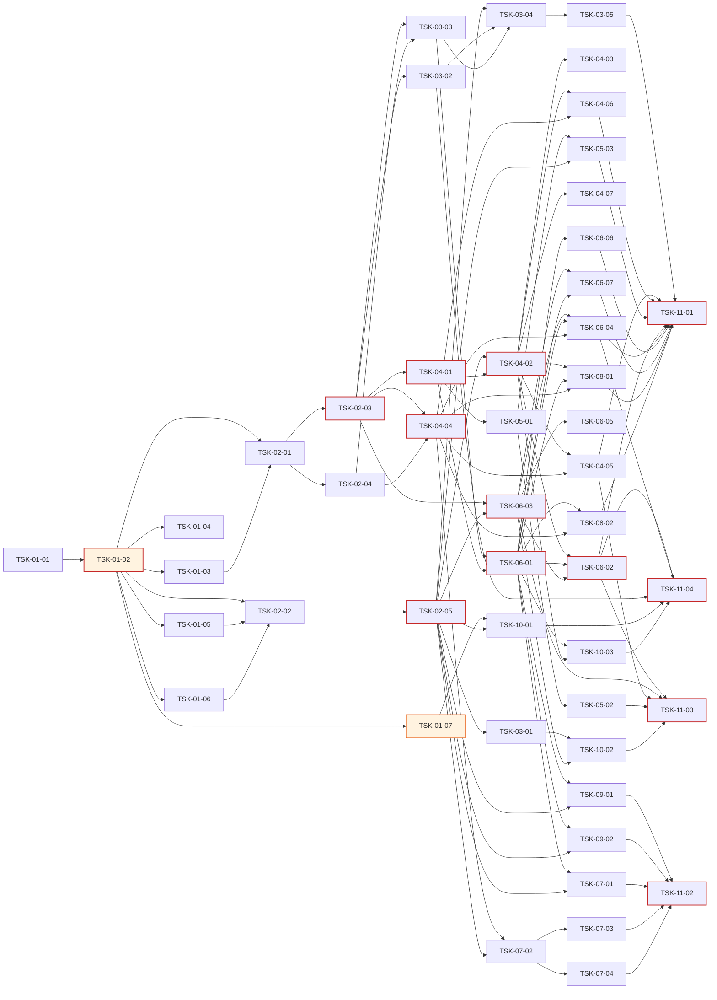

# WBS - Oranda (Oracle 개발·운영 도구)

> version: 1.0
> depth: 3
> start-date: 2026-10-20 / target-date: 2026-12-07 / updated: 2026-10-19
> source: docs/PRD.md, docs/TRD.md

---

## Dev Config

### Domains
| domain | description | unit-test | e2e-test | e2e-server | e2e-url |
|--------|-------------|-----------|----------|------------|---------|
| backend | Core·Language·Oracle·Platform (UI 없는 계층) | `dotnet test tests/Oranda.Core.Tests && dotnet test tests/Oranda.Language.Tests` | `dotnet test tests/Oranda.Oracle.IntegrationTests --filter Category=Integration` | - | - |
| frontend | Avalonia UI 셸·도구 창 틀 (Oranda.App) | `dotnet test tests/Oranda.App.Tests` | - | - | - |
| database | 로컬 데이터 모델·Oracle SQL 카탈로그 | `dotnet test tests/Oranda.Oracle.Tests --filter Category=Catalog` | - | - | - |
| fullstack | 화면 + 서비스 + 카탈로그 수직 슬라이스 | - | - | - | - |
| infra | 솔루션·CI·패키징·기술 검증 | `dotnet build Oranda.sln -warnaserror` | - | - | - |
| test | 통합테스트 | - | `dotnet test Oranda.sln --filter Category=Integration` | - | - |

### Design Guidance
| domain | architecture |
|--------|-------------|
| backend | 서비스 인터페이스는 Oranda.Core 에, 구현은 Oranda.Oracle/Language/Platform 에 둔다. 모든 SQL 실행은 IExecutionService 와 정책 관문을 거친다. 딕셔너리 SQL 은 Catalog/*.sql 파일(머리 주석 필수)로만 추가한다. Core·Language 는 Avalonia·ODP.NET 을 참조하지 않는다. |
| frontend | MVVM(CommunityToolkit.Mvvm), 컴파일 바인딩. 새 도구 창은 같은 Task 에서 IToolPanelRegistry 등록과 ICommandRegistry 명령·메뉴·단축키 연결까지 끝낸다(진입점 없는 화면 금지). UI 스레드에서 DB 호출 금지. |
| fullstack | 화면·서비스·카탈로그 SQL 을 한 Task 에서 끝낸다. 진입점(메뉴·단축키·도구 창)을 같은 Task 에서 등록한다. |

### Quality Commands
| name | command |
|------|---------|
| lint | `dotnet format Oranda.sln --verify-no-changes` |
| typecheck | `dotnet build Oranda.sln -warnaserror` |
| coverage | `dotnet test Oranda.sln --collect:"XPlat Code Coverage"` |

### Cleanup Processes
dotnet, testhost, Oranda.App

## WP-01: 프로젝트 초기화·기술 검증 (M0)
- schedule: 2026-10-20 ~ 2026-11-02

### TSK-01-01: 런타임 결정: .NET 8 지원 종료 대응 (T-D01)
- category: research
- domain: infra
- model: opus
- status: [xx]
- priority: critical
- assignee: -
- schedule: 2026-10-20 ~ 2026-10-21
- tags: m0, decision
- depends: -
- blocked-by: -
- entry-point: -
- note: 2026-10-19 결정·전환 완료 (.NET 10 SDK 10.0.402, Avalonia 12.1.4, .NET 8 SDK 삭제). 상태 전이는 D'Flow 에서 한다

#### PRD 요구사항
- prd-ref: TRD 2.1, 14 T-D01
- requirements:
  - .NET 8 지원 종료(2026-11-10) 대응 안 A/B/C를 비교한다
  - A안(.NET 10 + Avalonia 12) 채택 시 패키지 버전 표를 12 계열로 확정한다
  - 결정을 docs/decisions.md 에 기록한다
- acceptance:
  - 선택한 안과 근거가 decisions.md 에 있다
  - TRD 2.2 버전 표가 결정과 일치한다
- constraints:
  - 사용자 승인 없이 SDK를 설치하지 않는다
- test-criteria: -

#### 기술 스펙 (TRD)
- tech-spec:
  - .NET 8 / .NET 10 SDK
  - Avalonia 11.3.22 / 12.x
- api-spec: -
- data-model: -
- ui-spec: -

### TSK-01-02: 솔루션 재구성·공통 빌드 설정
- category: infra
- domain: infra
- model: sonnet
- status: [xx]
- priority: critical
- assignee: -
- schedule: 2026-10-22 ~ 2026-10-26
- tags: m0, setup
- depends: TSK-01-01
- blocked-by: -
- entry-point: -
- note: -

#### PRD 요구사항
- prd-ref: TRD 3.2, 10
- requirements:
  - 프로젝트를 Oranda.Core / Language / Oracle / Platform / App 과 테스트 5종으로 나눈다
  - 현재 Core/Connection 의 ODP.NET 의존 코드를 Oranda.Oracle 로 옮긴다
  - Directory.Build.props(Nullable, TreatWarningsAsErrors, 분석 수준, 컴파일 바인딩)와 Directory.Packages.props(중앙 버전 관리)를 둔다
  - Core·Language 가 Avalonia·ODP.NET 을 참조하면 실패하는 아키텍처 테스트를 둔다
- acceptance:
  - dotnet build Oranda.sln -warnaserror 가 경고 0으로 통과한다
  - 기존 단위 테스트 10개가 새 위치에서 통과한다
  - 아키텍처 테스트가 위반 참조를 넣으면 실패한다
- constraints:
  - .dflow-gates 의 full 명령(dotnet test)이 계속 동작해야 한다
- test-criteria:
  - dotnet test Oranda.sln

#### 기술 스펙 (TRD)
- tech-spec:
  - .NET SDK (TSK-01-01 결정)
  - xunit
- api-spec: -
- data-model: -
- ui-spec: -

### TSK-01-03: 실제 DB 접속 시험 (26ai 컨테이너·사내 19c·ADB)
- category: research
- domain: infra
- model: sonnet
- status: [xx]
- priority: critical
- assignee: -
- schedule: 2026-10-27 ~ 2026-10-29
- tags: m0, spike, oracle
- depends: TSK-01-02
- blocked-by: -
- entry-point: -
- note: -

#### PRD 요구사항
- prd-ref: PRD 9.1, TRD 11
- requirements:
  - gvenzl/oracle-free:23-slim 컨테이너로 접속·ServerProbe 결과를 확인한다
  - 사내 19c 공유 DB 접속 정보를 받아 같은 시험을 한다
  - ADB 지갑 있음·없음 TLS 접속을 시험한다(인스턴스가 있으면)
  - Windows와 macOS ARM에서 각각 확인한다
- acceptance:
  - 세 대상의 버전·PDB·권한 점검 결과가 실제와 같다
  - 실패 항목은 원인과 대안이 decisions.md 에 있다
- constraints:
  - 19c 공개 컨테이너 이미지는 없으므로 사내 DB를 쓴다
  - 접속 비밀번호를 저장소·로그에 남기지 않는다
- test-criteria:
  - Category=Integration 시험 초안

#### 기술 스펙 (TRD)
- tech-spec:
  - Testcontainers.Oracle 4.16.0
  - Oracle.ManagedDataAccess.Core 23.26.301
- api-spec: -
- data-model: -
- ui-spec: -

### TSK-01-04: 시작 시간·메모리 측정과 단축 방안 결정
- category: research
- domain: infra
- model: sonnet
- status: [xx]
- priority: critical
- assignee: -
- schedule: 2026-10-27 ~ 2026-10-29
- tags: m0, spike, perf
- depends: TSK-01-02
- blocked-by: -
- entry-point: -
- note: -

#### PRD 요구사항
- prd-ref: PRD 7.2, TRD 8
- requirements:
  - 빈 창 시작 2.3 s 를 단계별(프로세스 시작, AppBuilder, 창 생성, 첫 렌더)로 분해해 측정한다
  - ReadyToRun, 트리밍, 지연 로딩, 글꼴 설정의 효과를 측정한다
  - NativeAOT 경고 수를 측정해 T-D07 판단 자료를 남긴다
- acceptance:
  - 메인 창 입력 가능까지 1.5 s 이하를 달성한 설정이 있거나, 불가능하면 대안 목표와 근거가 있다
  - 측정 결과표가 decisions.md 에 있다
- constraints:
  - 측정은 게시본(Release, self-contained)으로 한다
- test-criteria:
  - 5회 측정 중앙값

#### 기술 스펙 (TRD)
- tech-spec:
  - ReadyToRun
  - PublishTrimmed
  - Avalonia compiled bindings
- api-spec: -
- data-model: -
- ui-spec: -

### TSK-01-05: 에디터 컴포넌트·다중 커서·L1 렉서 성능 시험 (D-05, T-D03)
- category: research
- domain: infra
- model: opus
- status: [xx]
- priority: critical
- assignee: -
- schedule: 2026-10-27 ~ 2026-10-29
- tags: m0, spike, editor
- depends: TSK-01-02
- blocked-by: -
- entry-point: -
- note: -

#### PRD 요구사항
- prd-ref: PRD 11.2 D-05, TRD 4.5, 14 T-D03
- requirements:
  - AvaloniaEdit 로 1만 줄 PL/SQL 패키지를 열어 키 입력 반영 시간을 측정한다
  - 다중 커서 확장 가능성을 시험한다
  - L1 렉서 시제품으로 증분 렉싱 시간을 측정한다
  - ANTLR PL/SQL 문법의 첫 파싱·워밍업 시간을 측정한다
- acceptance:
  - 키 입력 반영 16 ms 이하(p95) 측정값이 있다
  - D-05, T-D03 결정이 decisions.md 에 있다
- constraints:
  - 유료 에디터 컴포넌트는 쓰지 않는다
- test-criteria:
  - BenchmarkDotNet 측정

#### 기술 스펙 (TRD)
- tech-spec:
  - Avalonia.AvaloniaEdit 12.0.0
  - Antlr4.Runtime.Standard 4.13.1
- api-spec: -
- data-model: -
- ui-spec: -

### TSK-01-06: 가상 결과 그리드 100만 행 시험 (T-D02)
- category: research
- domain: infra
- model: opus
- status: [xx]
- priority: critical
- assignee: -
- schedule: 2026-10-27 ~ 2026-10-29
- tags: m0, spike, grid
- depends: TSK-01-02
- blocked-by: -
- entry-point: -
- note: -

#### PRD 요구사항
- prd-ref: PRD 7.2, TRD 4.4, 14 T-D02
- requirements:
  - 직접 그리기 가상 그리드 시제품으로 100만 행·50열 합성 데이터를 스크롤한다
  - 페이지 캐시(500행) 메모리 증가량을 측정한다
  - 60 fps 미달이면 TreeDataGrid.Avalonia(MIT 포크)와 비교한다
- acceptance:
  - 60 fps 유지 여부와 행당 메모리 측정값이 있다
  - T-D02 결정이 decisions.md 에 있다
- constraints:
  - 유료 그리드(TreeDataGrid Accelerate 등)는 쓰지 않는다
- test-criteria:
  - 합성 데이터 스크롤 측정

#### 기술 스펙 (TRD)
- tech-spec:
  - Avalonia Control.Render, GlyphRun·TextLayout 캐시 (D-008)
- api-spec: -
- data-model: -
- ui-spec: -

### TSK-01-07: CI·macOS 서명·공증·성능 측정 도구
- category: infra
- domain: infra
- model: sonnet
- status: [xx]
- priority: critical
- assignee: -
- schedule: 2026-10-27 ~ 2026-11-02
- tags: m0, ci, release
- depends: TSK-01-02
- blocked-by: -
- entry-point: -
- note: -

#### PRD 요구사항
- prd-ref: TRD 8, 10, 11
- requirements:
  - Windows x64 러너: 빌드·단위·UI·성능 측정
  - macOS ARM 러너: 빌드·단위·UI·패키징·서명·공증
  - 통합 테스트 단계(Category=Integration, 컨테이너)
  - tests/Oranda.Perf 시작 측정 도구(5회 실행, 창 생성·첫 렌더 시간, 전용 메모리)
- acceptance:
  - main 푸시마다 두 러너가 통과한다
  - macOS .app 이 서명·공증되어 다른 Mac에서 경고 없이 실행된다
  - 성능 측정 결과가 빌드 산출물로 남는다
- constraints:
  - 서명 인증서·Apple 자격 증명은 CI 비밀값으로만 둔다
  - macOS 패키지는 Mac 러너에서만 만든다
- test-criteria:
  - CI 파이프라인 실행

#### 기술 스펙 (TRD)
- tech-spec:
  - Velopack vpk 1.2.161
  - codesign, notarytool
  - BenchmarkDotNet
- api-spec: -
- data-model: -
- ui-spec: -

## WP-02: 기본 설계·공유 계약
- schedule: 2026-10-30 ~ 2026-11-09

### TSK-02-01: 로컬 데이터 모델·설정 스키마 설계 (DB 설계 분리)
- category: design
- domain: database
- model: opus
- status: [xx]
- priority: critical
- assignee: -
- schedule: 2026-10-30 ~ 2026-11-03
- tags: design, data-model
- depends: TSK-01-02, TSK-01-03
- blocked-by: -
- entry-point: -
- note: -

#### PRD 요구사항
- prd-ref: TRD 4.12, 5
- requirements:
  - connections.json, formatter 프로필, 키맵, 레이아웃, 작업 공간 JSON 스키마(schemaVersion 포함)를 확정한다
  - oranda.db SQLite 스키마(history, meta_object, schema_version)와 마이그레이션 규칙을 확정한다
  - 비밀번호가 어떤 파일에도 들어가지 않는 구조를 확정한다
- acceptance:
  - 스키마 문서와 예제 파일이 docs/design 에 있다
  - 각 스키마에 버전 필드와 상향 마이그레이션 규칙이 있다
- constraints:
  - 서버에 객체를 만들지 않는다(PRD C-05)
- test-criteria: -

#### 기술 스펙 (TRD)
- tech-spec:
  - System.Text.Json
  - Microsoft.Data.Sqlite
- api-spec: -
- data-model:
  - ConnectionProfile, FormatterOptions, history, meta_object, Workspace
- ui-spec: -

### TSK-02-02: 화면 구조·명령 체계 설계
- category: design
- domain: infra
- model: sonnet
- status: [xx]
- priority: critical
- assignee: -
- schedule: 2026-10-30 ~ 2026-11-03
- tags: design, ui
- depends: TSK-01-02, TSK-01-05, TSK-01-06
- blocked-by: -
- entry-point: -
- note: -

#### PRD 요구사항
- prd-ref: PRD 6.12, TRD 4.11
- requirements:
  - 도킹 레이아웃(문서 영역·도구 창) 기본 배치를 정한다
  - 명령 ID 체계와 메뉴·툴바·단축키·명령 팔레트 연결 방식을 정한다
  - 키맵 프리셋 4종(기본, Orange 5, PL/SQL Developer, SQL Developer)의 키 표를 정한다
  - 환경 라벨(운영 빨강) 표시 규칙을 정한다
- acceptance:
  - 화면 구조 문서와 명령 ID 목록이 docs/design 에 있다
- constraints:
  - HiDPI 100-250% 에서 잘리지 않는 레이아웃 기준을 둔다
- test-criteria: -

#### 기술 스펙 (TRD)
- tech-spec:
  - Dock.Avalonia
  - Avalonia Fluent 테마
- api-spec: -
- data-model:
  - 키맵 JSON
- ui-spec:
  - 셸, 도구 창, 명령 팔레트

### TSK-02-03: Core 서비스 인터페이스·모델·이벤트 (계약 전용)
- category: infra
- domain: backend
- model: opus
- status: [xx]
- priority: critical
- assignee: -
- schedule: 2026-11-04 ~ 2026-11-09
- tags: contract
- depends: TSK-02-01
- blocked-by: -
- entry-point: -
- note: -

#### PRD 요구사항
- prd-ref: TRD 6, 7
- requirements:
  - TRD 6장 인터페이스(ISessionManager, ISession, IExecutionService, IExecutionPolicy, IResultSet, IRowEditor, IMetadataProvider, IMonitorService, ILanguageService, ISqlFormatter, ISqlCatalog, ICredentialStore)를 Oranda.Core 에 정의한다
  - TRD 7장 이벤트 형식과 IEventBus 를 정의한다
  - AI 확장 지점 인터페이스(IEditorContext, IOutboundConsent)를 정의한다
  - 기능 Task 별 소유 파일·시험 파일 빈 틀을 만들고 design.md 「기능 Task 편집 지점」 표를 쓴다
  - 시험용 가짜 객체(FakeSession, FakeResultSet)을 공용 시험 헬퍼로 둔다
- acceptance:
  - 실행 로직 없음 (contract-only)
  - 공유 시험은 틀의 존재·탑재 순서만 단정한다. 빈 라우터·스텁 목록(`STUBS` 등)을 단정하지 않는다
  - 기능 Task 마다 자기 시험 파일과 소유 파일을 design.md `## 기능 Task 편집 지점` 에 적고, 두 Task 가 한 파일을 나눠 갖지 않는다
  - 등록(라우트·핸들러 목록)은 자동 수집이며 기능 Task 가 공유 진입점에 줄을 더하지 않아도 된다
  - 계약 문서가 지정한 파일(공용 시험 헬퍼 포함)이 모두 있다
- constraints:
  - Core 는 Avalonia·ODP.NET 을 참조하지 않는다(TC-04)
- test-criteria:
  - 인터페이스 존재·시그니처 시험

#### 기술 스펙 (TRD)
- tech-spec:
  - C# 인터페이스, record 모델
- api-spec:
  - TRD 6장 인터페이스 전체
- data-model:
  - TRD 5장 모델의 C# 형식
- ui-spec: -

### TSK-02-04: SQL 카탈로그 형식·로더·빌드 검사 (계약 전용)
- category: infra
- domain: database
- model: sonnet
- status: [xx]
- priority: critical
- assignee: -
- schedule: 2026-11-04 ~ 2026-11-06
- tags: contract, catalog
- depends: TSK-02-01
- blocked-by: -
- entry-point: -
- note: -

#### PRD 요구사항
- prd-ref: TRD 4.2, TC-03, TC-06
- requirements:
  - Catalog/**/*.sql 머리 주석 형식(id, min-version, requires, license, rac)을 정한다
  - 파일을 자동 수집해 id·서버 버전으로 고르는 로더 틀을 만든다
  - 머리 주석 누락·id 중복을 잡는 빌드 검사(Category=Catalog)를 둔다
  - 기능 Task 별 카탈로그 하위 폴더(session/, sql/, meta/, plan/)를 소유 단위로 나눈다
- acceptance:
  - 실행 로직 없음 (contract-only)
  - 공유 시험은 틀의 존재·탑재 순서만 단정한다. 빈 라우터·스텁 목록(`STUBS` 등)을 단정하지 않는다
  - 기능 Task 마다 자기 시험 파일과 소유 파일을 design.md `## 기능 Task 편집 지점` 에 적고, 두 Task 가 한 파일을 나눠 갖지 않는다
  - 등록(라우트·핸들러 목록)은 자동 수집이며 기능 Task 가 공유 진입점에 줄을 더하지 않아도 된다
  - 계약 문서가 지정한 파일(공용 시험 헬퍼 포함)이 모두 있다
- constraints:
  - 지원 서버는 19 이상, 23 전용 항목은 min-version: 23
- test-criteria:
  - 카탈로그 검사 시험

#### 기술 스펙 (TRD)
- tech-spec:
  - 임베디드 리소스, 파일 이름 관례 자동 수집
- api-spec:
  - ISqlCatalog.Get(id, server)
- data-model:
  - 카탈로그 메타데이터 형식
- ui-spec: -

### TSK-02-05: UI 셸 계약: 명령·패널 레지스트리·키맵 (계약 전용)
- category: infra
- domain: frontend
- model: sonnet
- status: [xx]
- priority: critical
- assignee: -
- schedule: 2026-11-04 ~ 2026-11-06
- tags: contract, ui
- depends: TSK-02-02
- blocked-by: -
- entry-point: 메인 창 도구 창 슬롯 (빈 틀만 등록, 실행 로직 없음)
- note: -

#### PRD 요구사항
- prd-ref: TRD 4.10, 4.11
- requirements:
  - ICommandRegistry, IToolPanelRegistry 와 자동 등록 방식(특성 + 어셈블리 스캔)을 정의한다
  - 도구 창마다 ViewModel·View 빈 틀과 시험 파일 빈 틀을 만든다
  - 키맵 JSON 로더 틀을 둔다
- acceptance:
  - 실행 로직 없음 (contract-only)
  - 공유 시험은 틀의 존재·탑재 순서만 단정한다. 빈 라우터·스텁 목록(`STUBS` 등)을 단정하지 않는다
  - 기능 Task 마다 자기 시험 파일과 소유 파일을 design.md `## 기능 Task 편집 지점` 에 적고, 두 Task 가 한 파일을 나눠 갖지 않는다
  - 등록(라우트·핸들러 목록)은 자동 수집이며 기능 Task 가 공유 진입점에 줄을 더하지 않아도 된다
  - 계약 문서가 지정한 파일(공용 시험 헬퍼 포함)이 모두 있다
- constraints:
  - 도구 창 등록은 셸 파일 수정 없이 자동 수집된다
- test-criteria:
  - 레지스트리 존재·자동 수집 시험

#### 기술 스펙 (TRD)
- tech-spec:
  - Avalonia, CommunityToolkit.Mvvm
- api-spec:
  - ICommandRegistry, IToolPanelRegistry
- data-model:
  - 키맵 JSON
- ui-spec:
  - 도구 창 빈 틀

## WP-03: 앱 셸·접속
- schedule: 2026-11-09 ~ 2026-11-26

### TSK-03-01: 앱 셸: 도킹 레이아웃·명령 팔레트·테마·설정 저장
- category: dev
- domain: fullstack
- model: sonnet
- status: [xx]
- priority: high
- assignee: -
- schedule: 2026-11-09 ~ 2026-11-13
- tags: m1, shell
- depends: TSK-02-05
- blocked-by: -
- entry-point: 앱 시작 화면(메인 창)
- note: -

#### PRD 요구사항
- prd-ref: PRD APP-01, APP-02, APP-04
- requirements:
  - 도킹 레이아웃 표시·저장·복원
  - 밝은·어두운 테마와 OS 설정 따르기, 에디터 글꼴 설정
  - HiDPI 100-250% 표시
  - 명령 팔레트(명령 이름 검색·실행)
  - 설정 파일 읽기·쓰기(TSK-02-01 스키마)
  - 계약 Task design.md 「기능 Task 편집 지점」 의 자기 소유 파일만 고친다
- acceptance:
  - 레이아웃을 바꾸고 재시작하면 같은 배치로 열린다
  - 배율 250% 에서 메뉴·대화상자 글자가 잘리지 않는다
  - 명령 팔레트에서 등록된 모든 명령이 검색된다
- constraints:
  - 시작 경로에서 Oracle·ANTLR 어셈블리를 로드하지 않는다(TRD 8)
- test-criteria:
  - Headless UI 시험

#### 기술 스펙 (TRD)
- tech-spec:
  - Dock.Avalonia
  - Avalonia Fluent
- api-spec:
  - ICommandRegistry, IToolPanelRegistry
- data-model:
  - settings.json, layout.json
- ui-spec:
  - 메인 창, 명령 팔레트, 설정 창

### TSK-03-02: 자격 증명 저장소 (DPAPI·macOS 키체인)
- category: dev
- domain: backend
- model: opus
- status: [xx]
- priority: high
- assignee: -
- schedule: 2026-11-10 ~ 2026-11-12
- tags: m1, security
- depends: TSK-02-03
- blocked-by: -
- entry-point: -
- note: -

#### PRD 요구사항
- prd-ref: PRD SAFE-06, TRD 4.12, 9
- requirements:
  - ICredentialStore Windows 판 작성(DPAPI 현재 사용자 범위)
  - ICredentialStore macOS 판 작성(키체인 P/Invoke)
  - "저장 안 함" 선택 지원
  - 계약 Task design.md 「기능 Task 편집 지점」 의 자기 소유 파일만 고친다
- acceptance:
  - 저장한 비밀번호를 다시 읽을 수 있고 설정 폴더 어디에도 평문이 없다
  - macOS 에서 서명된 앱이 키체인 항목을 읽고 쓴다
- constraints:
  - 비밀번호를 로그에 쓰지 않는다
- test-criteria:
  - 플랫폼별 단위 시험, 평문 검색 시험

#### 기술 스펙 (TRD)
- tech-spec:
  - System.Security.Cryptography.ProtectedData
  - Security.framework P/Invoke
- api-spec:
  - ICredentialStore
- data-model:
  - credentialRef 키
- ui-spec: -

### TSK-03-03: 세션 관리·접속 점검·지원 버전 관문
- category: dev
- domain: backend
- model: opus
- status: [xx]
- priority: high
- assignee: -
- schedule: 2026-11-10 ~ 2026-11-16
- tags: m1, connection
- depends: TSK-02-03, TSK-02-04
- blocked-by: -
- entry-point: -
- note: -

#### PRD 요구사항
- prd-ref: PRD CONN-05, CONN-07, CONN-11, CONN-12, SAFE-05, D-06
- requirements:
  - ISessionManager·ISession ODP.NET 판 작성(작업 세션·전용 세션, Pooling=false)
  - ServerProbe 확장: ADB 여부, control_management_pack_access, 에디션
  - 지원 버전 관문: 19.x·23.x 만 허용, 아니면 버전·이유 안내 후 종료
  - module·action·client_identifier 설정
  - Keep Alive, 끊김 감지(ORA-03113 등)와 미커밋 손실 알림
  - 계약 Task design.md 「기능 Task 편집 지점」 의 자기 소유 파일만 고친다
- acceptance:
  - 26ai 컨테이너·사내 19c 에 접속하고 점검 결과가 맞다
  - 버전 문자열 18.x·21.x·12.x 를 넣은 단위 시험에서 접속이 거부된다
  - 서버 v$session 에서 module=Oranda 가 보인다
- constraints:
  - 지원 버전 판별은 설정 한 곳에서만 한다(PRD 11.3)
- test-criteria:
  - 단위 시험 + Category=Integration

#### 기술 스펙 (TRD)
- tech-spec:
  - Oracle.ManagedDataAccess.Core 23.26.301
- api-spec:
  - ISessionManager, ISession
- data-model:
  - ServerInfo, ServerCapabilities
- ui-spec: -

### TSK-03-04: 접속 관리자 화면
- category: dev
- domain: fullstack
- model: sonnet
- status: [ ]
- priority: high
- assignee: -
- schedule: 2026-11-17 ~ 2026-11-23
- tags: m1, connection
- depends: TSK-02-05, TSK-03-01, TSK-03-02, TSK-03-03
- blocked-by: -
- entry-point: 메뉴 > 파일 > 접속 (Ctrl+Shift+O)
- note: -

#### PRD 요구사항
- prd-ref: PRD CONN-01, CONN-02, CONN-03, CONN-04, CONN-06, CONN-08
- requirements:
  - 프로필 목록·추가·수정·삭제
  - EZConnect Plus, TNS 별칭(TNS 디렉터리), 호스트·포트·서비스 입력
  - 인증 모드(SYSDBA 등), 프록시 사용자
  - ADB 지갑 zip 끌어 놓기로 프로필 생성, 지갑 없는 TLS
  - 비밀번호가 만료되면 변경 대화상자 표시
  - 환경 라벨·색, 읽기 전용, 팩 보유 선언, NLS 설정
  - 계약 Task design.md 「기능 Task 편집 지점」 의 자기 소유 파일만 고친다
- acceptance:
  - 세 접속 방식으로 26ai 컨테이너에 접속된다
  - 지갑 zip 을 끌어 놓으면 프로필이 만들어지고 접속된다
  - 미지원 버전에 접속하면 버전·이유가 표시된다
- constraints:
  - 비밀번호는 ICredentialStore 에만 저장한다
- test-criteria:
  - Headless UI 시험 + 통합 시험

#### 기술 스펙 (TRD)
- tech-spec:
  - Avalonia, ODP.NET
- api-spec:
  - ISessionManager, ICredentialStore
- data-model:
  - connections.json
- ui-spec:
  - 접속 대화상자, 프로필 편집기, 접속 트리

### TSK-03-05: 접속 가져오기·명령줄 접속
- category: dev
- domain: fullstack
- model: sonnet
- status: [ ]
- priority: medium
- assignee: -
- schedule: 2026-11-24 ~ 2026-11-26
- tags: m2, connection
- depends: TSK-03-04
- blocked-by: -
- entry-point: 메뉴 > 파일 > 접속 가져오기
- note: -

#### PRD 요구사항
- prd-ref: PRD CONN-09, CONN-13
- requirements:
  - SQL Developer connections.json 가져오기
  - tnsnames.ora 별칭 일괄 가져오기
  - Orange 접속 목록(Data/*.lst) 가져오기
  - 명령줄 `oranda user@alias [as sysdba]` 접속(비밀번호는 대화상자·저장소)
  - 계약 Task design.md 「기능 Task 편집 지점」 의 자기 소유 파일만 고친다
- acceptance:
  - 세 형식 예제 파일을 가져오면 프로필이 만들어진다
  - 명령줄 실행 시 해당 프로필로 접속 대화상자가 열린다
- constraints:
  - 가져온 파일의 비밀번호는 저장하지 않는다
- test-criteria:
  - 파서 단위 시험

#### 기술 스펙 (TRD)
- tech-spec:
  - System.Text.Json
- api-spec: -
- data-model:
  - connections.json
- ui-spec:
  - 가져오기 마법사

## WP-04: SQL 편집기·언어 서비스
- schedule: 2026-11-10 ~ 2026-11-30

### TSK-04-01: L1 렉서·문장 분리·문장 분류
- category: dev
- domain: backend
- model: opus
- status: [xx]
- priority: high
- assignee: -
- schedule: 2026-11-10 ~ 2026-11-16
- tags: m1, language
- depends: TSK-02-03
- blocked-by: -
- entry-point: -
- note: -

#### PRD 요구사항
- prd-ref: PRD EDIT-01, EXEC-01, TRD 4.3, 4.5
- requirements:
  - SQL·PL/SQL 렉서(문자열, 주석, q-quote, 바인드, 23ai 키워드 포함)
  - 문장 분리(;, 단독 /, 빈 줄 규칙 선택, 블록 내부 ; 무시)
  - 문장 분류(질의, DML, DDL, PL/SQL, 트랜잭션, SQL*Plus 명령)
  - 변경된 줄 주변만 다시 렉싱하는 증분 방식
  - 계약 Task design.md 「기능 Task 편집 지점」 의 자기 소유 파일만 고친다
- acceptance:
  - 회귀 예제에서 문장 경계·분류가 기대값과 같다
  - 1만 줄 문서에서 키 입력당 렉싱 16 ms 이하
- constraints:
  - Oranda.Language 는 Avalonia·ODP.NET 을 참조하지 않는다
- test-criteria:
  - 언어 회귀 시험

#### 기술 스펙 (TRD)
- tech-spec:
  - 자체 렉서
- api-spec:
  - ILanguageService.Split, GetStatementAt
- data-model:
  - SqlStatement, Token
- ui-spec: -

### TSK-04-02: SQL 편집기 화면 (강조·접기·찾기·작업 공간 복구)
- category: dev
- domain: fullstack
- model: sonnet
- status: [ ]
- priority: high
- assignee: -
- schedule: 2026-11-17 ~ 2026-11-23
- tags: m1, editor
- depends: TSK-02-05, TSK-04-01
- blocked-by: -
- entry-point: 메뉴 > 파일 > 새 SQL 편집기 (Ctrl+N)
- note: -

#### PRD 요구사항
- prd-ref: PRD EDIT-02, EDIT-06, EDIT-07, EDIT-09, EDIT-11
- requirements:
  - L1 렉서 기반 구문 강조(키워드·함수·바인드·문자열·주석)
  - 접기, 괄호·BEGIN/END 짝 표시, 문서 개요
  - 찾기/바꾸기(정규식), 북마크, 주석 토글, 열 선택(다중 커서는 T-D03 결정에 따름)
  - 대소문자 변환 5종, 블록 들여쓰기
  - 탭 묶음 저장·복원, 10 s 간격 자동 저장과 비정상 종료 복구
  - 계약 Task design.md 「기능 Task 편집 지점」 의 자기 소유 파일만 고친다
- acceptance:
  - 앱을 강제 종료한 후 다시 열면 미저장 탭 내용이 복구된다
  - 1만 줄 파일에서 키 입력 반영 16 ms 이하(p95)
- constraints:
  - IEditorContext 를 이 편집기에 붙여 확장 지점으로 노출한다(APP-09)
- test-criteria:
  - Headless UI 시험 + 성능 측정

#### 기술 스펙 (TRD)
- tech-spec:
  - Avalonia.AvaloniaEdit 11.4.1
- api-spec:
  - ILanguageService, IEditorContext
- data-model:
  - workspaces/*.json, autosave/
- ui-spec:
  - 편집기 탭, 찾기 패널, 개요 창

### TSK-04-03: L2 ANTLR 분석·문법 오류 표시
- category: dev
- domain: fullstack
- model: opus
- status: [ ]
- priority: high
- assignee: -
- schedule: 2026-11-24 ~ 2026-11-30
- tags: m1, language
- depends: TSK-04-02
- blocked-by: -
- entry-point: SQL 편집기 탭(입력 중 오류 밑줄)
- note: -

#### PRD 요구사항
- prd-ref: PRD EDIT-01, EDIT-03, TRD 4.5
- requirements:
  - grammars-v4 PL/SQL 문법을 저장소에 포함해 빌드할 때 생성
  - SLL 우선·실패하면 LL 재파싱, 앱 유휴 시간 워밍업
  - 입력 300 ms 멈춘 뒤 바뀐 문장만 백그라운드 재파싱
  - 오류 위치 밑줄·메시지 표시, 서버 컴파일 오류(user_errors) 표시 경로 제공
  - 23ai/26ai 구문 보강
  - 계약 Task design.md 「기능 Task 편집 지점」 의 자기 소유 파일만 고친다
- acceptance:
  - 문법 오류 SQL 입력 후 300 ms 안에 밑줄이 생긴다
  - 정상 회귀 예제에서 오류 표시 0건
- constraints:
  - UI 스레드에서 파싱하지 않는다
- test-criteria:
  - 언어 회귀 시험 + 성능 측정

#### 기술 스펙 (TRD)
- tech-spec:
  - Antlr4.Runtime.Standard 4.13.1, Antlr4BuildTasks
- api-spec:
  - ILanguageService.AnalyzeAsync
- data-model:
  - Diagnostic
- ui-spec:
  - 오류 밑줄, 오류 목록 창

### TSK-04-04: 메타데이터 제공자·캐시
- category: dev
- domain: backend
- model: sonnet
- status: [xx]
- priority: high
- assignee: -
- schedule: 2026-11-10 ~ 2026-11-13
- tags: m1, metadata
- depends: TSK-02-03, TSK-02-04
- blocked-by: -
- entry-point: -
- note: -

#### PRD 요구사항
- prd-ref: PRD SCH-02, TRD 4.7
- requirements:
  - IMetadataProvider ODP.NET 판 작성(스키마, 객체, 열, 제약, 인덱스, 주석, 패키지 멤버·인자, DDL)
  - 권한에 따라 dba_/all_/user_ 뷰 자동 선택
  - 메모리 + SQLite 캐시, last_ddl_time 변경 감지, MetadataInvalidated 이벤트
  - 카탈로그 meta/ 폴더 SQL 작성
  - 계약 Task design.md 「기능 Task 편집 지점」 의 자기 소유 파일만 고친다
- acceptance:
  - DBA 아닌 계정에서 all_ 뷰로 동작한다
  - 캐시가 있으면 재접속한 후 객체 목록을 서버 조회 없이 보여 준다
- constraints:
  - 23 전용 객체(Domain, Duality View)는 min-version: 23 카탈로그로만
- test-criteria:
  - 단위 시험 + Category=Integration

#### 기술 스펙 (TRD)
- tech-spec:
  - ODP.NET, Microsoft.Data.Sqlite
- api-spec:
  - IMetadataProvider
- data-model:
  - meta_object
- ui-spec: -

### TSK-04-05: 문맥 자동완성
- category: dev
- domain: fullstack
- model: opus
- status: [ ]
- priority: high
- assignee: -
- schedule: 2026-11-24 ~ 2026-11-30
- tags: m1, editor
- depends: TSK-04-02, TSK-04-04
- blocked-by: -
- entry-point: SQL 편집기 탭(Ctrl+Space, `.` 입력)
- note: -

#### PRD 요구사항
- prd-ref: PRD EDIT-04
- requirements:
  - FROM 뒤 테이블·뷰·시노님
  - 별칭 뒤 `.` 입력 시 해당 테이블 열
  - 패키지명 뒤 멤버와 인자
  - 힌트 주석 안 힌트 이름
  - 150 ms 안에 응답 못 하면 캐시 결과 먼저 표시
  - 계약 Task design.md 「기능 Task 편집 지점」 의 자기 소유 파일만 고친다
- acceptance:
  - `SELECT e. FROM emp e` 에서 `e.` 를 입력하면 EMP 열이 150 ms 안에 뜬다
  - 패키지명 뒤에 `.` 를 입력하면 멤버 목록이 뜬다
- constraints:
  - IMetadataProvider 만 사용한다(확장 지점 사용 사례)
- test-criteria:
  - Headless UI 시험 + 통합 시험

#### 기술 스펙 (TRD)
- tech-spec:
  - AvaloniaEdit CompletionWindow
- api-spec:
  - ILanguageService.GetCompletionContext, IMetadataProvider
- data-model: -
- ui-spec:
  - 자동완성 목록, 인자 힌트

### TSK-04-06: 정의로 이동·객체 정보 팝업·참조 찾기
- category: dev
- domain: fullstack
- model: sonnet
- status: [ ]
- priority: medium
- assignee: -
- schedule: 2026-11-24 ~ 2026-11-27
- tags: m2, editor
- depends: TSK-04-02, TSK-04-04
- blocked-by: -
- entry-point: SQL 편집기 탭(Ctrl+클릭, F4)
- note: -

#### PRD 요구사항
- prd-ref: PRD EDIT-05
- requirements:
  - Ctrl+클릭으로 객체 정의(DDL 또는 PL/SQL 소스) 열기
  - 객체 정보 팝업(열·타입·주석)
  - 현재 파일 안 참조 찾기
  - 계약 Task design.md 「기능 Task 편집 지점」 의 자기 소유 파일만 고친다
- acceptance:
  - 테이블 이름을 Ctrl+클릭하면 DDL 이 열린다
  - 패키지 프로시저 호출을 Ctrl+클릭하면 해당 소스 위치로 간다
- constraints: -
- test-criteria:
  - Headless UI 시험

#### 기술 스펙 (TRD)
- tech-spec:
  - AvaloniaEdit
- api-spec:
  - IMetadataProvider, ILanguageService
- data-model: -
- ui-spec:
  - 정보 팝업

### TSK-04-07: 코드 조각·템플릿·키맵 프리셋·단축키 사용자 정의
- category: dev
- domain: fullstack
- model: sonnet
- status: [ ]
- priority: medium
- assignee: -
- schedule: 2026-11-24 ~ 2026-11-27
- tags: m2, editor
- depends: TSK-04-02
- blocked-by: -
- entry-point: 메뉴 > 도구 > 템플릿, 설정 > 단축키
- note: -

#### PRD 요구사항
- prd-ref: PRD EDIT-08, EDIT-10, APP-08
- requirements:
  - 코드 조각 삽입과 사용자 정의 조각
  - 옵티마이저 힌트·내장 함수·의사 컬럼 설명과 예제
  - 키맵 프리셋 4종 전환
  - 단축키 사용자 정의, 설정 내보내기·가져오기
  - 계약 Task design.md 「기능 Task 편집 지점」 의 자기 소유 파일만 고친다
- acceptance:
  - Orange 5 프리셋에서 F5·Ctrl+Enter·F9 등이 Orange 와 같게 동작한다
  - 내보낸 설정을 다른 PC 에서 가져오면 같은 단축키가 된다
- constraints: -
- test-criteria:
  - Headless UI 시험

#### 기술 스펙 (TRD)
- tech-spec:
  - 키맵 JSON
- api-spec:
  - ICommandRegistry
- data-model:
  - keymaps/*.json, snippets/*.json
- ui-spec:
  - 템플릿 창, 단축키 설정

## WP-05: 포매터
- schedule: 2026-11-17 ~ 2026-11-30

### TSK-05-01: 포매터 엔진 기본 (대소문자·들여쓰기·주석 보존·토큰 동일성)
- category: dev
- domain: backend
- model: opus
- status: [ ]
- priority: high
- assignee: -
- schedule: 2026-11-17 ~ 2026-11-23
- tags: m1, formatter
- depends: TSK-04-01
- blocked-by: -
- entry-point: -
- note: -

#### PRD 요구사항
- prd-ref: PRD FMT-01, FMT-02, FMT-03, FMT-07, FMT-11, TRD 4.6
- requirements:
  - 토큰 열 + 부분 구문 트리 기반 포매터, 전체·선택·현재 문장 단위
  - 대소문자(키워드·함수·식별자), 들여쓰기(공백·탭, 폭, 하위 쿼리·CASE·블록)
  - 주석 보존·빈 줄 최대 수·문장 끝 처리
  - 토큰 동일성·멱등성 검사, 위반하면 적용 안 함
  - 회귀 예제 1,000개 이상 구성
  - 계약 Task design.md 「기능 Task 편집 지점」 의 자기 소유 파일만 고친다
- acceptance:
  - 회귀 예제 전체에서 토큰 동일성·멱등성 위반 0건
  - 2,000줄 포맷 500 ms 이하
- constraints:
  - 문법 오류 구간은 토큰 규칙만 적용하고 원문 배치를 유지한다
- test-criteria:
  - 언어 회귀 시험 + 성능 측정

#### 기술 스펙 (TRD)
- tech-spec:
  - Oranda.Language
- api-spec:
  - ISqlFormatter.Format
- data-model:
  - FormatterOptions
- ui-spec: -

### TSK-05-02: 포매터 확장 옵션 (쉼표·줄바꿈·정렬·제외 구간)
- category: dev
- domain: backend
- model: sonnet
- status: [ ]
- priority: medium
- assignee: -
- schedule: 2026-11-24 ~ 2026-11-30
- tags: m2, formatter
- depends: TSK-05-01
- blocked-by: -
- entry-point: -
- note: -

#### PRD 요구사항
- prd-ref: PRD FMT-04, FMT-05, FMT-06, FMT-10
- requirements:
  - 쉼표 앞/뒤, 연산자·괄호 공백
  - 줄바꿈 규칙(SELECT 목록, JOIN, AND/OR 앞, IN 목록 기준, 최대 폭)
  - 정렬(별칭, :=, 열 정의, =)
  - `-- @formatter:off/on` 제외 구간
  - 계약 Task design.md 「기능 Task 편집 지점」 의 자기 소유 파일만 고친다
- acceptance:
  - 옵션마다 회귀 예제 기대값과 같은 결과
  - 옵션 조합 전체에서 토큰 동일성 위반 0건
- constraints: -
- test-criteria:
  - 언어 회귀 시험

#### 기술 스펙 (TRD)
- tech-spec:
  - Oranda.Language
- api-spec:
  - ISqlFormatter
- data-model:
  - FormatterOptions
- ui-spec: -

### TSK-05-03: 포매터 프로필 화면·미리보기·공유
- category: dev
- domain: fullstack
- model: sonnet
- status: [ ]
- priority: medium
- assignee: -
- schedule: 2026-11-24 ~ 2026-11-27
- tags: m2, formatter
- depends: TSK-05-01, TSK-02-05
- blocked-by: -
- entry-point: 설정 > SQL 포매터, 편집기 Ctrl+Shift+F
- note: -

#### PRD 요구사항
- prd-ref: PRD FMT-08, FMT-09
- requirements:
  - 프로필 여러 개 저장·기본 지정·JSON 내보내기/가져오기
  - 기본 제공 프로필 3종
  - 옵션을 바꾸면 예제 SQL 즉시 미리보기
  - 편집기 포맷 명령 연결
  - 계약 Task design.md 「기능 Task 편집 지점」 의 자기 소유 파일만 고친다
- acceptance:
  - 프로필을 다른 PC 에서 가져오면 같은 포맷 결과가 나온다
  - 옵션 변경이 미리보기에 즉시 반영된다
- constraints: -
- test-criteria:
  - Headless UI 시험

#### 기술 스펙 (TRD)
- tech-spec:
  - Avalonia
- api-spec:
  - ISqlFormatter
- data-model:
  - formatter/*.json
- ui-spec:
  - 포매터 설정 창, 미리보기

## WP-06: SQL 실행·결과 그리드
- schedule: 2026-11-10 ~ 2026-11-30

### TSK-06-01: 실행 엔진·정책 관문
- category: dev
- domain: backend
- model: opus
- status: [xx]
- priority: high
- assignee: -
- schedule: 2026-11-17 ~ 2026-11-23
- tags: m1, execution, safety
- depends: TSK-03-03, TSK-04-01
- blocked-by: -
- entry-point: -
- note: -

#### PRD 요구사항
- prd-ref: PRD EXEC-03, EXEC-04, EXEC-06, SAFE-02, SAFE-03, SAFE-04, SAFE-07, TRD 4.3, 4.9
- requirements:
  - IExecutionService: 바인드·치환 변수, 실행, 취소, 스크립트 순차 실행
  - IExecutionPolicy: 읽기 전용, 라이선스 태그, 운영 확인, WHERE 없는 DML, 위험 명령
  - 트랜잭션 추적(LOCAL_TRANSACTION_ID), DBMS_OUTPUT 수거
  - IResultSet 페이지 단위 fetch(FetchSize = RowSize × 500)
  - 실행 클래스는 internal(TC-05)
  - 계약 Task design.md 「기능 Task 편집 지점」 의 자기 소유 파일만 고친다
- acceptance:
  - 팩 선언 없는 접속에서 license 태그 쿼리의 드라이버 호출 0건(가짜 드라이버 시험)
  - 읽기 전용 프로필에서 UPDATE 가 거부된다
  - 실행 중 쿼리 취소가 1 s 안에 반영된다
- constraints:
  - 분류 실패 문장은 DML 로 간주한다
  - ODP.NET 파이프라이닝을 끈다
- test-criteria:
  - 단위 시험 + Category=Integration

#### 기술 스펙 (TRD)
- tech-spec:
  - ODP.NET 23 비동기, OracleCommand.Cancel
- api-spec:
  - IExecutionService, IExecutionPolicy, IResultSet
- data-model:
  - ExecutionResult, PolicyDecision
- ui-spec: -

### TSK-06-02: SQL 실행 화면·운영 안전장치 표시
- category: dev
- domain: fullstack
- model: sonnet
- status: [ ]
- priority: high
- assignee: -
- schedule: 2026-11-24 ~ 2026-11-30
- tags: m1, execution, safety
- depends: TSK-04-02, TSK-06-01, TSK-06-03
- blocked-by: -
- entry-point: SQL 편집기 탭(F5, Ctrl+Enter, Ctrl+Break)
- note: -

#### PRD 요구사항
- prd-ref: PRD EXEC-01, EXEC-02, EXEC-03, EXEC-04, EXEC-06, EXEC-10, EXEC-11, SAFE-01, SAFE-03, SAFE-08
- requirements:
  - 커서 문장·선택·스크립트 실행, 취소
  - 바인드 입력 대화상자(타입, 마지막 값), 치환 변수 입력
  - DBMS_OUTPUT 창, 커밋·롤백, 미커밋 상태바, 종료 시 확인
  - 스크립트 오류 처리(묻기/중지/계속), 새 결과 탭
  - 운영 라벨 표시(빨간 테두리·탭·상태바), DML/DDL 확인, 위험 명령 이름 재입력
  - 계약 Task design.md 「기능 Task 편집 지점」 의 자기 소유 파일만 고친다
- acceptance:
  - 운영 라벨 접속에서 UPDATE 를 실행하면 확인 대화상자가 뜬다
  - 10분짜리 쿼리를 취소하면 1 s 안에 실행 상태가 풀린다
  - 미커밋 상태로 창을 닫으면 커밋/롤백/취소를 묻는다
- constraints:
  - UI 스레드에서 DB 호출을 하지 않는다
- test-criteria:
  - Headless UI 시험 + 통합 시험

#### 기술 스펙 (TRD)
- tech-spec:
  - Avalonia
- api-spec:
  - IExecutionService, IExecutionPolicy
- data-model: -
- ui-spec:
  - 실행 툴바, 바인드 대화상자, 출력 창, 상태바, 확인 대화상자

### TSK-06-03: 가상 결과 그리드 (조회·타입 표시·복사)
- category: dev
- domain: fullstack
- model: opus
- status: [xx]
- priority: high
- assignee: -
- schedule: 2026-11-10 ~ 2026-11-16
- tags: m1, grid
- depends: TSK-02-03, TSK-02-05
- blocked-by: -
- entry-point: SQL 편집기 결과 영역
- note: -

#### PRD 요구사항
- prd-ref: PRD GRID-01, GRID-02, GRID-03, GRID-08, TRD 4.4
- requirements:
  - 직접 그리기 가상 그리드(행·열 가상화), 열 정렬·숨김·고정, 텍스트 모드
  - 페이지 캐시와 메모리 상한, 초과 페이지 임시 파일
  - 타입 표시(NUMBER 정밀도, NLS 날짜, LOB 미리보기, JSON, BOOLEAN, VECTOR 요약, RAW, INTERVAL, XMLType)
  - 복사(TSV/CSV/INSERT/IN 목록), 같은 값 숨김·천 단위·NULL 표시
  - 계약 Task design.md 「기능 Task 편집 지점」 의 자기 소유 파일만 고친다
- acceptance:
  - 100만 행을 처음부터 끝까지 스크롤해도 60 fps 를 유지하고 멈추지 않는다
  - 첫 행 표시가 첫 묶음 수신 후 100 ms 이하
- constraints:
  - 유료 그리드를 쓰지 않는다(TC-08)
- test-criteria:
  - Headless UI 시험 + 그리드 성능 측정

#### 기술 스펙 (TRD)
- tech-spec:
  - Avalonia Control.Render
- api-spec:
  - IResultSet
- data-model:
  - ResultColumn, ResultPage
- ui-spec:
  - 결과 그리드, 텍스트 결과

### TSK-06-04: 그리드 편집 (PK·ROWID 규칙)
- category: dev
- domain: fullstack
- model: opus
- status: [ ]
- priority: medium
- assignee: -
- schedule: 2026-11-24 ~ 2026-11-30
- tags: m2, grid, safety
- depends: TSK-06-03, TSK-06-01, TSK-04-04
- blocked-by: -
- entry-point: 결과 그리드 편집 모드(F9)
- note: -

#### PRD 요구사항
- prd-ref: PRD GRID-04, GRID-05, 6.5.1, C-01, TRD 4.4
- requirements:
  - 결과에 PK(또는 NOT NULL 유니크 키) 전체 열 또는 ROWID 가 없으면 읽기 전용과 이유 표시
  - 단일 테이블은 "ROWID 추가 후 다시 실행" 제공
  - 조인은 대상 테이블 선택, 키 보존 확인, 대상 열만 편집
  - 바인드 변수 WHERE 키 조건 DML, 반영 전 미리보기, 세이브포인트, 영향 행 수 ≠ 1 이면 롤백
  - 낙관적 잠금 옵션, Apply and commit / without commit, 행 단위 Reset
  - 계약 Task design.md 「기능 Task 편집 지점」 의 자기 소유 파일만 고친다
- acceptance:
  - PK 도 ROWID 도 없는 결과는 편집할 수 없고 이유가 표시된다
  - PK 있는 결과의 DML 이 `WHERE pk = :바인드` 형태다
  - 동시 삭제·중복 키 시험에서 변경이 반영되지 않고 알림이 뜬다
  - 집계·DISTINCT 결과는 편집할 수 없다
- constraints:
  - 값을 문자열로 이어 붙이지 않는다
  - 생성 DML 은 정책 관문을 통과해야 한다
- test-criteria:
  - Category=Integration 편집 시나리오

#### 기술 스펙 (TRD)
- tech-spec:
  - Oranda.Language SELECT 분석
- api-spec:
  - IRowEditor
- data-model:
  - RowChange, TableKeyInfo
- ui-spec:
  - 편집 모드 툴바, DML 미리보기

### TSK-06-05: LOB 편집기·행 보기
- category: dev
- domain: fullstack
- model: sonnet
- status: [ ]
- priority: medium
- assignee: -
- schedule: 2026-11-17 ~ 2026-11-19
- tags: m2, grid
- depends: TSK-06-03
- blocked-by: -
- entry-point: 결과 그리드 셀 메뉴 > 값 보기
- note: -

#### PRD 요구사항
- prd-ref: PRD GRID-07
- requirements:
  - 행 보기(한 행을 세로로)
  - CLOB 보기·편집·파일 저장
  - BLOB 파일 저장·불러오기, 이미지 미리보기
  - 계약 Task design.md 「기능 Task 편집 지점」 의 자기 소유 파일만 고친다
- acceptance:
  - 10 MB CLOB 을 열고 파일로 저장한 내용이 원본과 같다
- constraints:
  - LOB 은 스트림으로 읽는다
- test-criteria:
  - 통합 시험

#### 기술 스펙 (TRD)
- tech-spec:
  - OracleClob, OracleBlob 스트림
- api-spec:
  - IResultSet
- data-model: -
- ui-spec:
  - 행 보기 창, LOB 편집기

### TSK-06-06: 실행 이력·이름 붙인 스크립트·SQL*Plus 명령
- category: dev
- domain: fullstack
- model: sonnet
- status: [ ]
- priority: medium
- assignee: -
- schedule: 2026-11-24 ~ 2026-11-30
- tags: m1, execution
- depends: TSK-06-01, TSK-04-04
- blocked-by: -
- entry-point: 도구 창 > 실행 이력 (F8), 도구 창 > 스크립트 (Ctrl+R)
- note: -

#### PRD 요구사항
- prd-ref: PRD EXEC-05, EXEC-07, EXEC-08, EXEC-09
- requirements:
  - 접속별 실행 이력(시간·소요·행 수·결과) 저장·검색·다시 실행
  - 로컬 폴더 연결 스크립트 트리
  - SQL*Plus 명령(SET SERVEROUTPUT, DEFINE, PROMPT, @파일, SPOOL, WHENEVER SQLERROR)
  - 문장별 실행 통계(v$mystat 차이)
  - 계약 Task design.md 「기능 Task 편집 지점」 의 자기 소유 파일만 고친다
- acceptance:
  - 실행한 SQL 이 이력에 남고 검색·다시 실행된다
  - @파일 스크립트가 순서대로 실행된다
- constraints:
  - 바인드 값은 사용자가 설정한 경우에만 저장한다
- test-criteria:
  - 단위 시험 + Headless UI 시험

#### 기술 스펙 (TRD)
- tech-spec:
  - Microsoft.Data.Sqlite
- api-spec:
  - IExecutionService
- data-model:
  - history
- ui-spec:
  - 이력 창, 스크립트 트리

### TSK-06-07: 내보내기·가져오기 (CSV·xlsx·JSON·INSERT)
- category: dev
- domain: fullstack
- model: sonnet
- status: [ ]
- priority: medium
- assignee: -
- schedule: 2026-11-24 ~ 2026-11-30
- tags: m2, export
- depends: TSK-06-03, TSK-06-01
- blocked-by: -
- entry-point: 결과 그리드 메뉴 > 내보내기, 메뉴 > 도구 > 가져오기
- note: -

#### PRD 요구사항
- prd-ref: PRD EXP-01, EXP-02
- requirements:
  - 결과·테이블을 CSV, TSV, xlsx, JSON, INSERT문으로 서버에서 다시 스트리밍해 저장
  - xlsx 가 1,048,576행을 넘으면 시트를 나눈다
  - CSV·xlsx 가져오기(열 매핑, 타입 변환 미리보기, 배치 크기)
  - 계약 Task design.md 「기능 Task 편집 지점」 의 자기 소유 파일만 고친다
- acceptance:
  - 10만 행 xlsx 를 Excel 에서 열면 행 수·값이 원본과 같다
  - 가져오기 오류 행이 따로 보고된다
- constraints:
  - 가져오기 DML 도 정책 관문을 통과한다
- test-criteria:
  - 통합 시험

#### 기술 스펙 (TRD)
- tech-spec:
  - MiniExcel 1.46.0
- api-spec:
  - IExecutionService
- data-model: -
- ui-spec:
  - 내보내기 대화상자, 가져오기 마법사

## WP-07: 실행 계획·스키마 브라우저
- schedule: 2026-11-16 ~ 2026-11-30

### TSK-07-01: 실행 계획 (예상·실제·위험 단계·DISPLAY_CURSOR 옵션)
- category: dev
- domain: fullstack
- model: sonnet
- status: [ ]
- priority: high
- assignee: -
- schedule: 2026-11-24 ~ 2026-11-30
- tags: m1, plan
- depends: TSK-06-01, TSK-02-05
- blocked-by: -
- entry-point: SQL 편집기 (Ctrl+E), 도구 창 > 실행 계획
- note: -

#### PRD 요구사항
- prd-ref: PRD PLAN-01, PLAN-02, PLAN-03, PLAN-05
- requirements:
  - EXPLAIN PLAN + DBMS_XPLAN.DISPLAY 트리·텍스트, DML 지원
  - 실행한 sql_id·child 로 DISPLAY_CURSOR ALLSTATS LAST
  - 위험 단계(Full Scan, Cartesian)와 예상·실제 행 수 차이 강조, predicate 표시
  - DISPLAY_CURSOR 형식 옵션 UI
  - 카탈로그 plan/ 폴더 SQL
  - 계약 Task design.md 「기능 Task 편집 지점」 의 자기 소유 파일만 고친다
- acceptance:
  - SELECT·UPDATE 의 예상 계획이 트리로 보인다
  - 실행 후 실제 계획에서 A-Rows 가 보인다
- constraints:
  - DISPLAY_AWR 같은 라이선스 대상은 쓰지 않는다
- test-criteria:
  - 통합 시험

#### 기술 스펙 (TRD)
- tech-spec:
  - DBMS_XPLAN
- api-spec:
  - IExecutionService, ISqlCatalog
- data-model: -
- ui-spec:
  - 계획 트리, 텍스트 보기, 옵션 패널

### TSK-07-02: 스키마 브라우저 트리·검색·끌어 놓기
- category: dev
- domain: fullstack
- model: sonnet
- status: [xx]
- priority: high
- assignee: -
- schedule: 2026-11-16 ~ 2026-11-20
- tags: m1, schema
- depends: TSK-04-04, TSK-02-05
- blocked-by: -
- entry-point: 도구 창 > 스키마 브라우저
- note: -

#### PRD 요구사항
- prd-ref: PRD SCH-01, SCH-02, SCH-05, SCH-07
- requirements:
  - 스키마별 객체 트리(26ai 객체 포함), 지연 로딩
  - 이름 패턴·유형·INVALID 필터, 접속별 즐겨찾기
  - 끌어 놓기로 이름·SELECT문·열 목록 삽입
  - 계약 Task design.md 「기능 Task 편집 지점」 의 자기 소유 파일만 고친다
- acceptance:
  - 객체 1만 개 스키마에서 트리 펼침이 멈추지 않는다
  - 테이블을 편집기로 끌어 놓으면 SELECT문이 들어간다
- constraints: -
- test-criteria:
  - Headless UI 시험 + 통합 시험

#### 기술 스펙 (TRD)
- tech-spec:
  - Avalonia TreeView 가상화
- api-spec:
  - IMetadataProvider
- data-model: -
- ui-spec:
  - 스키마 트리, 필터 바

### TSK-07-03: 객체 상세·DDL 보기
- category: dev
- domain: fullstack
- model: sonnet
- status: [ ]
- priority: high
- assignee: -
- schedule: 2026-11-23 ~ 2026-11-26
- tags: m1, schema
- depends: TSK-07-02
- blocked-by: -
- entry-point: 스키마 브라우저 > 객체 선택
- note: -

#### PRD 요구사항
- prd-ref: PRD SCH-03, SCH-04
- requirements:
  - 열(도메인·주석·가상·identity·invisible), 제약, 인덱스, 파티션, 권한, 의존, 통계, 크기
  - DBMS_METADATA DDL, 저장 속성 표시 옵션
  - DBMS_DEVELOPER.GET_METADATA 사용 여부 측정
  - 계약 Task design.md 「기능 Task 편집 지점」 의 자기 소유 파일만 고친다
- acceptance:
  - 테이블을 선택하면 상세 탭이 채워지고 DDL 이 표시된다
  - BOOLEAN·VECTOR 열이 있는 26ai 테이블 DDL 이 맞다
- constraints: -
- test-criteria:
  - 통합 시험

#### 기술 스펙 (TRD)
- tech-spec:
  - DBMS_METADATA
- api-spec:
  - IMetadataProvider.GetDdlAsync
- data-model:
  - TableInfo
- ui-spec:
  - 상세 탭, DDL 보기

### TSK-07-04: 객체 관리·검색·DB 정보·DDL 일괄 추출
- category: dev
- domain: fullstack
- model: sonnet
- status: [ ]
- priority: medium
- assignee: -
- schedule: 2026-11-23 ~ 2026-11-27
- tags: m2, schema
- depends: TSK-07-02
- blocked-by: -
- entry-point: 스키마 브라우저 메뉴, 메뉴 > 도구 > DB 정보
- note: -

#### PRD 요구사항
- prd-ref: PRD SCH-06, SCH-09, SCH-10, SCH-11
- requirements:
  - INVALID 객체 일괄 컴파일, 휴지통 Purge·Flashback
  - 객체 검색(이름·유형·크기·생성일·변경일, 참조 관계)
  - DB 정보(인스턴스·버전·옵션·파라미터·NLS), 파라미터 변경 DDL 미리보기
  - DDL 일괄 추출(필터, 이름 바꾸기, 저장 속성)
  - 계약 Task design.md 「기능 Task 편집 지점」 의 자기 소유 파일만 고친다
- acceptance:
  - INVALID 객체 일괄 컴파일 결과가 목록으로 보인다
  - 스키마 DDL 일괄 추출 파일이 만들어진다
- constraints:
  - 변경 명령은 정책 관문을 통과한다
- test-criteria:
  - 통합 시험

#### 기술 스펙 (TRD)
- tech-spec:
  - DBMS_METADATA, DBMS_UTILITY
- api-spec:
  - IMetadataProvider, IExecutionService
- data-model: -
- ui-spec:
  - 검색 창, DB 정보 창, 일괄 추출 마법사

## WP-08: PL/SQL 도구
- schedule: 2026-11-24 ~ 2026-11-30

### TSK-08-01: PL/SQL 소스 편집·컴파일·충돌 확인
- category: dev
- domain: fullstack
- model: sonnet
- status: [ ]
- priority: medium
- assignee: -
- schedule: 2026-11-24 ~ 2026-11-30
- tags: m2, plsql
- depends: TSK-04-02, TSK-06-01, TSK-04-04
- blocked-by: -
- entry-point: 스키마 브라우저 > PL/SQL 객체 열기, 메뉴 > 파일 > 새 PL/SQL
- note: -

#### PRD 요구사항
- prd-ref: PRD PLSQL-01, PLSQL-02, PLSQL-04, PLSQL-05
- requirements:
  - 객체 소스 열기·편집·저장(컴파일), 명세/본문 전환
  - 컴파일 오류·경고 목록과 위치 이동
  - 편집을 시작한 후 서버 소스가 바뀌면(last_ddl_time) 차이 표시
  - 다른 세션이 쓰는 객체 컴파일 경고
  - 계약 Task design.md 「기능 Task 편집 지점」 의 자기 소유 파일만 고친다
- acceptance:
  - 패키지 본문을 고쳐 저장하면 컴파일되고 오류를 누르면 그 오류의 줄로 간다
  - 다른 세션이 먼저 바꾼 경우 저장 전에 차이를 보여 준다
- constraints:
  - 서버에 잠금 테이블을 만들지 않는다(C-05)
- test-criteria:
  - 통합 시험

#### 기술 스펙 (TRD)
- tech-spec:
  - AvaloniaEdit, ODP.NET
- api-spec:
  - IMetadataProvider, IExecutionService
- data-model: -
- ui-spec:
  - PL/SQL 편집기, 오류 목록

### TSK-08-02: PL/SQL 실행 대화상자
- category: dev
- domain: fullstack
- model: sonnet
- status: [ ]
- priority: medium
- assignee: -
- schedule: 2026-11-24 ~ 2026-11-26
- tags: m2, plsql
- depends: TSK-06-01, TSK-04-04
- blocked-by: -
- entry-point: PL/SQL 편집기 > 실행, 스키마 브라우저 > 실행
- note: -

#### PRD 요구사항
- prd-ref: PRD PLSQL-03
- requirements:
  - all_arguments 로 인자 입력 폼 생성
  - OUT 값·반환값·REF CURSOR 결과 표시
  - DBMS_OUTPUT 함께 표시
  - 계약 Task design.md 「기능 Task 편집 지점」 의 자기 소유 파일만 고친다
- acceptance:
  - IN/OUT 인자와 REF CURSOR 를 가진 프로시저를 실행하면 결과가 표시된다
- constraints: -
- test-criteria:
  - 통합 시험

#### 기술 스펙 (TRD)
- tech-spec:
  - ODP.NET OracleParameter, RefCursor
- api-spec:
  - IExecutionService, IMetadataProvider
- data-model: -
- ui-spec:
  - 실행 대화상자

## WP-09: 모니터링
- schedule: 2026-11-24 ~ 2026-11-30

### TSK-09-01: 세션 모니터 (목록·블로킹 트리·상세·Kill·Trace)
- category: dev
- domain: fullstack
- model: opus
- status: [ ]
- priority: medium
- assignee: -
- schedule: 2026-11-24 ~ 2026-11-30
- tags: m2, monitor
- depends: TSK-06-01, TSK-02-05
- blocked-by: -
- entry-point: 메뉴 > 모니터 > 세션 모니터
- note: -

#### PRD 요구사항
- prd-ref: PRD SESS-01, SESS-02, SESS-03, SESS-04, SESS-05, SESS-06
- requirements:
  - IMonitorService 세션 부분(전용 세션, 주기 조회 2-60 s, 델타)
  - 세션 목록·필터·자동 새로고침, RAC gv$
  - 블로킹 트리(blocking_session, final_blocking_session)
  - 세션 상세(현재·직전 SQL, 실제 계획, 트랜잭션, 잠금 객체, 통계)
  - Kill·Disconnect(확인 대화상자), DBMS_MONITOR 트레이스와 v$diag_info 경로
  - 카탈로그 session/ 폴더 SQL
  - 계약 Task design.md 「기능 Task 편집 지점」 의 자기 소유 파일만 고친다
- acceptance:
  - 잠금 경합 시나리오에서 블로킹 트리가 보유자·대기자를 보여 주고 Kill 로 풀린다
  - 권한 없는 계정에서는 메뉴가 비활성이다
- constraints:
  - license 태그 쿼리를 쓰지 않는다
- test-criteria:
  - Category=Integration 잠금 시나리오

#### 기술 스펙 (TRD)
- tech-spec:
  - gv$session, DBMS_MONITOR
- api-spec:
  - IMonitorService
- data-model:
  - SessionRow, BlockingTree
- ui-spec:
  - 세션 목록, 블로킹 트리, 상세 탭

### TSK-09-02: SQL 모니터 (Top SQL)
- category: dev
- domain: fullstack
- model: sonnet
- status: [ ]
- priority: medium
- assignee: -
- schedule: 2026-11-24 ~ 2026-11-27
- tags: m2, monitor
- depends: TSK-06-01, TSK-02-05
- blocked-by: -
- entry-point: 메뉴 > 모니터 > SQL 모니터
- note: -

#### PRD 요구사항
- prd-ref: PRD SQLM-01, SQLM-02
- requirements:
  - IMonitorService Top SQL 부분
  - v$sql 조건 검색(소요 시간·읽은 블록·실행 횟수·텍스트), Orange 사전 정의 구간
  - SQL 전문, 실제 계획, 바인드 캡처 보기
  - 카탈로그 sql/ 폴더 SQL
  - 계약 Task design.md 「기능 Task 편집 지점」 의 자기 소유 파일만 고친다
- acceptance:
  - "1 s 이상, 1만 블록 이상" 조건으로 찾은 SQL 의 실제 계획이 보인다
- constraints:
  - ASH·AWR 는 쓰지 않는다(SQLM-03 은 이후)
- test-criteria:
  - 통합 시험

#### 기술 스펙 (TRD)
- tech-spec:
  - gv$sql, v$sql_bind_capture
- api-spec:
  - IMonitorService
- data-model:
  - TopSqlRow
- ui-spec:
  - 검색 조건 패널, 결과 목록

## WP-10: 배포·품질 마감 (M3)
- schedule: 2026-11-09 ~ 2026-11-26

### TSK-10-01: 설치 파일·자동 업데이트·충돌 보고·사용자 문서
- category: dev
- domain: fullstack
- model: sonnet
- status: [xx]
- priority: low
- assignee: -
- schedule: 2026-11-09 ~ 2026-11-13
- tags: m3, release
- depends: TSK-01-07, TSK-02-05
- blocked-by: -
- entry-point: 메뉴 > 도움말 > 업데이트 확인, 도움말 > 오류 보고서
- note: -

#### PRD 요구사항
- prd-ref: PRD APP-05, APP-06, 7.4
- requirements:
  - Velopack 설치 파일(Windows)·pkg(macOS), 사내 업데이트 서버 피드
  - 업데이트 패키지 서명 확인, 오프라인 설치 파일
  - 충돌 시 로컬 덤프·로그 저장, 동의 후 전송(IOutboundConsent)
  - 사용자 문서(설치, 접속, 단축키)
  - 계약 Task design.md 「기능 Task 편집 지점」 의 자기 소유 파일만 고친다
- acceptance:
  - 서명 확인에 실패한 패키지는 설치되지 않는다
  - 설치 파일이 80 MB 이하다
- constraints:
  - 원격 전송은 동의 후에만
- test-criteria:
  - 패키징 CI 단계

#### 기술 스펙 (TRD)
- tech-spec:
  - Velopack 1.2.161
- api-spec:
  - IOutboundConsent
- data-model: -
- ui-spec:
  - 업데이트 알림, 오류 보고 대화상자

### TSK-10-02: 다국어(한/영)·접근성
- category: dev
- domain: fullstack
- model: sonnet
- status: [ ]
- priority: low
- assignee: -
- schedule: 2026-11-17 ~ 2026-11-23
- tags: m3, i18n, a11y
- depends: TSK-03-01, TSK-06-03
- blocked-by: -
- entry-point: 설정 > 언어
- note: -

#### PRD 요구사항
- prd-ref: PRD APP-03, 7.5
- requirements:
  - UI 문자열 리소스화, 한국어·영어 전환
  - 키보드만으로 모든 기능 접근
  - 화면 낭독기(내레이터, VoiceOver)로 메뉴·대화상자·그리드 셀 읽기
  - 계약 Task design.md 「기능 Task 편집 지점」 의 자기 소유 파일만 고친다
- acceptance:
  - 언어 전환 시 누락 문자열 0개(자동 검사)
  - 화면 낭독기로 접속·실행·결과 읽기를 끝까지 할 수 있다
- constraints: -
- test-criteria:
  - 문자열 검사 + 수동 접근성 점검

#### 기술 스펙 (TRD)
- tech-spec:
  - Avalonia AutomationProperties, resx
- api-spec: -
- data-model: -
- ui-spec:
  - 전체 화면

### TSK-10-03: AI 확장 지점 시험 패널
- category: dev
- domain: fullstack
- model: opus
- status: [ ]
- priority: low
- assignee: -
- schedule: 2026-11-24 ~ 2026-11-26
- tags: m3, extension
- depends: TSK-06-01, TSK-04-02
- blocked-by: -
- entry-point: 도구 창 > 확장 시험 패널 (개발 빌드)
- note: -

#### PRD 요구사항
- prd-ref: PRD APP-09, 9.4, TRD 4.10
- requirements:
  - 확장 지점 인터페이스만 써서 시험 패널을 만든다(선택 SQL 을 바꿔 다시 넣기)
  - 패널이 넣은 SQL 도 정책 관문을 거치는지 확인
  - 확장 지점 사용 안내 문서
  - 계약 Task design.md 「기능 Task 편집 지점」 의 자기 소유 파일만 고친다
- acceptance:
  - 시험 패널이 Core 수정 없이 동작한다
  - 패널이 넣은 UPDATE 도 운영 접속 확인 대화상자를 거친다
- constraints:
  - AI 기능 자체는 만들지 않는다(D-04)
- test-criteria:
  - Headless UI 시험

#### 기술 스펙 (TRD)
- tech-spec:
  - IToolPanelRegistry, IEditorContext, IMetadataProvider
- api-spec:
  - 확장 지점 인터페이스
- data-model: -
- ui-spec:
  - 시험 패널

## WP-11: 통합테스트
- schedule: 2026-12-01 ~ 2026-12-07
- description: 기능 간 시나리오 E2E·성능·권한 교차 검증 (개별 기능 재검증 아님)

### TSK-11-01: 개발자 흐름: 접속→작성→포맷→실행→편집→이력 (19c·26ai, Windows·macOS)
- category: itest
- domain: test
- model: sonnet
- status: [ ]
- priority: high
- assignee: -
- schedule: 2026-12-01 ~ 2026-12-07
- tags: integration, e2e
- depends: TSK-03-05, TSK-04-05, TSK-04-06, TSK-05-03, TSK-06-02, TSK-06-04, TSK-06-06, TSK-06-07, TSK-08-01, TSK-08-02
- blocked-by: -
- entry-point: -
- note: -

#### PRD 요구사항
- prd-ref: PRD 9.2-9.4
- requirements:
  - 접속 가져오기 → 편집기 자동완성 → 포맷 → 실행 → 그리드 편집 → 이력 다시 실행
  - PL/SQL 편집·컴파일·실행 흐름
  - 두 OS·두 서버 버전 조합
- acceptance:
  - 네 조합 모두 시나리오 통과
  - 발견 결함은 해당 기능 WP에 defect Task로 등록됨
- constraints: -
- test-criteria: -

#### 기술 스펙 (TRD)
- tech-spec: -
- api-spec: -
- data-model: -
- ui-spec: -

### TSK-11-02: DBA 흐름: 세션→블로킹→Kill→Top SQL→실행 계획, 라이선스 트레이스 0건
- category: itest
- domain: test
- model: sonnet
- status: [ ]
- priority: high
- assignee: -
- schedule: 2026-12-01 ~ 2026-12-07
- tags: integration, e2e
- depends: TSK-09-01, TSK-09-02, TSK-07-01, TSK-07-03, TSK-07-04
- blocked-by: -
- entry-point: -
- note: -

#### PRD 요구사항
- prd-ref: PRD 9.2-9.4
- requirements:
  - 잠금 경합 → 블로킹 트리 → Kill → Top SQL → 실제 계획
  - 팩 "없음" 접속에서 전체 화면 1시간 순회 중 서버 SQL 트레이스 수집
- acceptance:
  - C-06 객체 호출 0건
  - 시나리오 통과
  - 발견 결함은 해당 기능 WP에 defect Task로 등록됨
- constraints: -
- test-criteria: -

#### 기술 스펙 (TRD)
- tech-spec: -
- api-spec: -
- data-model: -
- ui-spec: -

### TSK-11-03: 성능 예산 전 항목 (Windows·macOS)
- category: itest
- domain: test
- model: sonnet
- status: [ ]
- priority: high
- assignee: -
- schedule: 2026-12-01 ~ 2026-12-04
- tags: integration, e2e
- depends: TSK-06-02, TSK-06-03, TSK-04-05, TSK-05-02, TSK-10-02
- blocked-by: -
- entry-point: -
- note: -

#### PRD 요구사항
- prd-ref: PRD 9.2-9.4
- requirements:
  - PRD 7.2 성능 예산 전 항목을 두 OS 게시본으로 측정
- acceptance:
  - 전 항목 예산 이내, 초과 항목은 원인 분석 첨부
  - 발견 결함은 해당 기능 WP에 defect Task로 등록됨
- constraints: -
- test-criteria: -

#### 기술 스펙 (TRD)
- tech-spec: -
- api-spec: -
- data-model: -
- ui-spec: -

### TSK-11-04: 보안·안전장치 교차·사내 사용자 수용 시험
- category: itest
- domain: test
- model: sonnet
- status: [ ]
- priority: high
- assignee: -
- schedule: 2026-12-01 ~ 2026-12-07
- tags: integration, e2e
- depends: TSK-06-02, TSK-06-04, TSK-03-02, TSK-10-01, TSK-10-03
- blocked-by: -
- entry-point: -
- note: -

#### PRD 요구사항
- prd-ref: PRD 9.2-9.4
- requirements:
  - 운영·읽기 전용·팩 선언 조합별 실행 경로(편집기, 그리드, 스키마 명령, Kill, 확장 패널) 교차 검사
  - 설정·로그·SQLite 평문 비밀번호 검색
  - Orange 사용자 대상 수용 시험
- acceptance:
  - 모든 경로에서 정책 관문이 같은 결과를 낸다
  - 평문 0건
  - 수용 시험 차단 이슈 0건
  - 발견 결함은 해당 기능 WP에 defect Task로 등록됨
- constraints: -
- test-criteria: -

#### 기술 스펙 (TRD)
- tech-spec: -
- api-spec: -
- data-model: -
- ui-spec: -

## 의존 그래프

### 그래프 (Mermaid)

### 통계

| 항목 | 값 | 임계값 |
|------|-----|--------|
| 최장 체인 깊이 | 9 (공정 앞쪽 5 + 기능 구간 3 + 통합테스트 1) | 3 초과 시 검토 (공정 양끝 +2 는 구조 비용 허용) |
| 전체 Task 수 | 49 | — |
| Fan-in ≥ 3 Task 수 | 9 | 계약 추출 후보 (모듈 계약·itest Task 는 구조적 예외) |
| Diamond 패턴 수 | 59 | 자주 발생 시 apex 계약 추출 |

- 최장 경로: TSK-01-01 → TSK-01-02 → TSK-01-03 → TSK-02-01 → TSK-02-03 → TSK-03-02 → TSK-03-04 → TSK-03-05 → TSK-11-01
- 기능 구간 내부 깊이는 3 이하다(예: TSK-02-03 계약 → TSK-03-02 → TSK-03-04 → TSK-03-05).
- 공정 앞쪽 깊이 5 는 예외로 둔다. 근거: 런타임 결정(TSK-01-01)이 솔루션 구성(TSK-01-02)을 정하고, 기술 검증(TSK-01-03·05·06) 결과가 설계(TSK-02-01·02)와 계약(TSK-02-03·04·05)에 들어가야 한다. 검증 없이 계약을 동결하면 컴포넌트 교체 시 계약을 다시 연다.
- 일정은 depends 만으로 계산했다(인원 제약 없음). 실제 종료일은 투입 인원에 따라 늘어난다.

**Fan-in Top 5**

| Task | Fan-in | 계약 추출 가능? |
|------|--------|----------------|
| TSK-02-05 | 10 | 이미 계약 전용 Task (구조적 예외) |
| TSK-06-01 | 10 | 아니오 — 모든 실행이 정책 관문을 지나야 하는 실제 구현 의존 |
| TSK-01-02 | 7 | 아니오 — 솔루션 구성 자체 (공정 앞쪽) |
| TSK-04-02 | 7 | 아니오 — 편집기 컨트롤 위에 기능을 얹는 실제 구현 의존 |
| TSK-04-04 | 6 | 아니오 — 메타데이터 실제 조회가 필요 (인터페이스는 TSK-02-03 에 이미 분리) |

**Diamond 패턴** (apex 별 요약, 전체 59건)

| Apex | 분기 (예) | Merge (예) | 건수 |
|------|-----------|------------|------|
| TSK-06-01 | TSK-06-02, TSK-06-04 | TSK-11-01 | 21 |
| TSK-04-04 | TSK-04-05, TSK-04-06 | TSK-11-01 | 10 |
| TSK-04-02 | TSK-04-05, TSK-04-06 | TSK-11-01 | 8 |
| TSK-02-05 | TSK-03-01, TSK-06-03 | TSK-10-02 | 5 |
| TSK-06-03 | TSK-06-02, TSK-06-04 | TSK-11-01 | 5 |
| TSK-02-03 | TSK-03-02, TSK-03-03 | TSK-03-04 | 3 |
| TSK-04-01 | TSK-04-02, TSK-06-01 | TSK-06-02 | 3 |
| TSK-02-01 | TSK-02-03, TSK-02-04 | TSK-03-03 | 2 |
| TSK-01-02 | TSK-01-05, TSK-01-06 | TSK-02-02 | 1 |
| TSK-07-02 | TSK-07-03, TSK-07-04 | TSK-11-02 | 1 |

대부분의 diamond 는 통합테스트 Task(TSK-11-xx)가 여러 기능 체인 말단을 함께 받는 데서 생긴다. 이는 통합테스트의 정의상 생기는 구조이고, apex 계약 추출 대상이 아니다.

### 리뷰 후보 (review_candidates)

| Task | 신호 | 판정 | 근거 |
|------|------|------|------|
| TSK-01-02 | fan_in=7 | 유지 | 솔루션 구성은 모든 기술 검증·설계의 전제다 |
| TSK-02-03 | fan_in=5 | 유지 | 계약 전용 Task — fan-in 이 높은 것이 목적이다 |
| TSK-02-05 | fan_in=10 | 유지 | 계약 전용 Task — 도구 창이 셸 구현 대신 이 계약에 의존하도록 이미 분리했다 |
| TSK-04-01 | fan_in=3 | 유지 | 렉서·문장 분리는 편집기·포매터·실행 엔진의 실제 구현 의존이다. 인터페이스는 TSK-02-03 에 있다 |
| TSK-04-02 | fan_in=7 | 유지 | 자동완성·오류 표시·PL/SQL 편집이 편집기 컨트롤을 실제로 확장한다 |
| TSK-04-04 | fan_in=6 | 유지 | 메타데이터 실제 조회·캐시가 필요하다. 인터페이스는 이미 계약으로 분리했다 |
| TSK-06-01 | fan_in=10 | 유지 | 정책 관문을 우회하는 실행 경로를 만들지 않기 위한 설계상 필수 의존(TRD 4.9, TC-05) |
| TSK-06-02 | fan_in=3 | 유지 | 통합테스트 3건이 실행 화면을 관통한다 |
| TSK-06-03 | fan_in=6 | 유지 | 그리드 편집·LOB·내보내기가 그리드 컨트롤을 실제로 확장한다 |
| TSK-11-01 | depends=10 | 유지 | 통합테스트 — 개발자 흐름이 관통하는 기능 체인 말단을 모두 받는다 |
| TSK-11-02 | depends=5 | 유지 | 통합테스트 — DBA 흐름 체인 말단 |
| TSK-11-03 | depends=5 | 유지 | 통합테스트 — 성능 예산 측정 대상 기능 |
| TSK-11-04 | depends=5 | 유지 | 통합테스트 — 안전장치 교차 검사 대상 실행 경로 |
