# WBS - Oranda (Oracle 개발·운영 도구)

> version: 1.0
> depth: 3
> start-date: 2026-10-20 / target-date: 2026-12-07 / updated: 2026-10-19
> source: docs/PRD.md, docs/TRD.md

---

## Dev Config

### Domains
| domain | description | unit-test | e2e-test | e2e-server | e2e-url |
|--------|-------------|-----------|----------|------------|---------|
| backend | Core·Language·Oracle·Platform (UI 없는 계층) | `dotnet test tests/Oranda.Core.Tests && dotnet test tests/Oranda.Language.Tests` | `dotnet test tests/Oranda.Oracle.IntegrationTests --filter Category=Integration` | - | - |
| frontend | Avalonia UI 셸·도구 창 틀 (Oranda.App) | `dotnet test tests/Oranda.App.Tests` | - | - | - |
| database | 로컬 데이터 모델·Oracle SQL 카탈로그 | `dotnet test tests/Oranda.Oracle.Tests --filter Category=Catalog` | - | - | - |
| fullstack | 화면 + 서비스 + 카탈로그 수직 슬라이스 | - | - | - | - |
| infra | 솔루션·CI·패키징·기술 검증 | `dotnet build Oranda.sln -warnaserror` | - | - | - |
| test | 통합테스트 | - | `dotnet test Oranda.sln --filter Category=Integration` | - | - |

### Design Guidance
| domain | architecture |
|--------|-------------|
| backend | 서비스 인터페이스는 Oranda.Core 에, 구현은 Oranda.Oracle/Language/Platform 에 둔다. 모든 SQL 실행은 IExecutionService 와 정책 관문을 거친다. 딕셔너리 SQL 은 Catalog/*.sql 파일(머리 주석 필수)로만 추가한다. Core·Language 는 Avalonia·ODP.NET 을 참조하지 않는다. |
| frontend | MVVM(CommunityToolkit.Mvvm), 컴파일 바인딩. 새 도구 창은 같은 Task 에서 IToolPanelRegistry 등록과 ICommandRegistry 명령·메뉴·단축키 연결까지 끝낸다(진입점 없는 화면 금지). UI 스레드에서 DB 호출 금지. |
| fullstack | 화면·서비스·카탈로그 SQL 을 한 Task 에서 끝낸다. 진입점(메뉴·단축키·도구 창)을 같은 Task 에서 등록한다. |

### Quality Commands
| name | command |
|------|---------|
| lint | `dotnet format Oranda.sln --verify-no-changes` |
| typecheck | `dotnet build Oranda.sln -warnaserror` |
| coverage | `dotnet test Oranda.sln --collect:"XPlat Code Coverage"` |

### Cleanup Processes
dotnet, testhost, Oranda.App

## WP-01: 프로젝트 초기화·기술 검증 (M0)
- schedule: 2026-10-20 ~ 2026-11-02

### TSK-01-01: 런타임 결정: .NET 8 지원 종료 대응 (T-D01)
- category: research
- domain: infra
- model: opus
- status: [xx]
- priority: critical
- assignee: -
- schedule: 2026-10-20 ~ 2026-10-21
- tags: m0, decision
- depends: -
- blocked-by: -
- entry-point: -
- note: 2026-10-19 결정·전환 완료 (.NET 10 SDK 10.0.402, Avalonia 12.1.4, .NET 8 SDK 삭제). 상태 전이는 D'Flow 에서 한다

#### PRD 요구사항
- prd-ref: TRD 2.1, 14 T-D01
- requirements:
  - .NET 8 지원 종료(2026-11-10) 대응 안 A/B/C를 비교한다
  - A안(.NET 10 + Avalonia 12) 채택 시 패키지 버전 표를 12 계열로 확정한다
  - 결정을 docs/decisions.md 에 기록한다
- acceptance:
  - 선택한 안과 근거가 decisions.md 에 있다
  - TRD 2.2 버전 표가 결정과 일치한다
- constraints:
  - 사용자 승인 없이 SDK를 설치하지 않는다
- test-criteria: -

#### 기술 스펙 (TRD)
- tech-spec:
  - .NET 8 / .NET 10 SDK
  - Avalonia 11.3.22 / 12.x
- api-spec: -
- data-model: -
- ui-spec: -

### TSK-01-02: 솔루션 재구성·공통 빌드 설정
- category: infra
- domain: infra
- model: sonnet
- status: [xx]
- priority: critical
- assignee: -
- schedule: 2026-10-22 ~ 2026-10-26
- tags: m0, setup
- depends: TSK-01-01
- blocked-by: -
- entry-point: -
- note: -

#### PRD 요구사항
- prd-ref: TRD 3.2, 10
- requirements:
  - 프로젝트를 Oranda.Core / Language / Oracle / Platform / App 과 테스트 5종으로 나눈다
  - 현재 Core/Connection 의 ODP.NET 의존 코드를 Oranda.Oracle 로 옮긴다
  - Directory.Build.props(Nullable, TreatWarningsAsErrors, 분석 수준, 컴파일 바인딩)와 Directory.Packages.props(중앙 버전 관리)를 둔다
  - Core·Language 가 Avalonia·ODP.NET 을 참조하면 실패하는 아키텍처 테스트를 둔다
- acceptance:
  - dotnet build Oranda.sln -warnaserror 가 경고 0으로 통과한다
  - 기존 단위 테스트 10개가 새 위치에서 통과한다
  - 아키텍처 테스트가 위반 참조를 넣으면 실패한다
- constraints:
  - .dflow-gates 의 full 명령(dotnet test)이 계속 동작해야 한다
- test-criteria:
  - dotnet test Oranda.sln

#### 기술 스펙 (TRD)
- tech-spec:
  - .NET SDK (TSK-01-01 결정)
  - xunit
- api-spec: -
- data-model: -
- ui-spec: -

### TSK-01-03: 실제 DB 접속 시험 (26ai 컨테이너·사내 19c·ADB)
- category: research
- domain: infra
- model: sonnet
- status: [xx]
- priority: critical
- assignee: -
- schedule: 2026-10-27 ~ 2026-10-29
- tags: m0, spike, oracle
- depends: TSK-01-02
- blocked-by: -
- entry-point: -
- note: -

#### PRD 요구사항
- prd-ref: PRD 9.1, TRD 11
- requirements:
  - gvenzl/oracle-free:23-slim 컨테이너로 접속·ServerProbe 결과를 확인한다
  - 사내 19c 공유 DB 접속 정보를 받아 같은 시험을 한다
  - ADB 지갑 있음·없음 TLS 접속을 시험한다(인스턴스가 있으면)
  - Windows와 macOS ARM에서 각각 확인한다
- acceptance:
  - 세 대상의 버전·PDB·권한 점검 결과가 실제와 같다
  - 실패 항목은 원인과 대안이 decisions.md 에 있다
- constraints:
  - 19c 공개 컨테이너 이미지는 없으므로 사내 DB를 쓴다
  - 접속 비밀번호를 저장소·로그에 남기지 않는다
- test-criteria:
  - Category=Integration 시험 초안

#### 기술 스펙 (TRD)
- tech-spec:
  - Testcontainers.Oracle 4.16.0
  - Oracle.ManagedDataAccess.Core 23.26.301
- api-spec: -
- data-model: -
- ui-spec: -

### TSK-01-04: 시작 시간·메모리 측정과 단축 방안 결정
- category: research
- domain: infra
- model: sonnet
- status: [xx]
- priority: critical
- assignee: -
- schedule: 2026-10-27 ~ 2026-10-29
- tags: m0, spike, perf
- depends: TSK-01-02
- blocked-by: -
- entry-point: -
- note: -

#### PRD 요구사항
- prd-ref: PRD 7.2, TRD 8
- requirements:
  - 빈 창 시작 2.3 s 를 단계별(프로세스 시작, AppBuilder, 창 생성, 첫 렌더)로 분해해 측정한다
  - ReadyToRun, 트리밍, 지연 로딩, 글꼴 설정의 효과를 측정한다
  - NativeAOT 경고 수를 측정해 T-D07 판단 자료를 남긴다
- acceptance:
  - 메인 창 입력 가능까지 1.5 s 이하를 달성한 설정이 있거나, 불가능하면 대안 목표와 근거가 있다
  - 측정 결과표가 decisions.md 에 있다
- constraints:
  - 측정은 게시본(Release, self-contained)으로 한다
- test-criteria:
  - 5회 측정 중앙값

#### 기술 스펙 (TRD)
- tech-spec:
  - ReadyToRun
  - PublishTrimmed
  - Avalonia compiled bindings
- api-spec: -
- data-model: -
- ui-spec: -

### TSK-01-05: 에디터 컴포넌트·다중 커서·L1 렉서 성능 시험 (D-05, T-D03)
- category: research
- domain: infra
- model: opus
- status: [xx]
- priority: critical
- assignee: -
- schedule: 2026-10-27 ~ 2026-10-29
- tags: m0, spike, editor
- depends: TSK-01-02
- blocked-by: -
- entry-point: -
- note: -

#### PRD 요구사항
- prd-ref: PRD 11.2 D-05, TRD 4.5, 14 T-D03
- requirements:
  - AvaloniaEdit 로 1만 줄 PL/SQL 패키지를 열어 키 입력 반영 시간을 측정한다
  - 다중 커서 확장 가능성을 시험한다
  - L1 렉서 시제품으로 증분 렉싱 시간을 측정한다
  - ANTLR PL/SQL 문법의 첫 파싱·워밍업 시간을 측정한다
- acceptance:
  - 키 입력 반영 16 ms 이하(p95) 측정값이 있다
  - D-05, T-D03 결정이 decisions.md 에 있다
- constraints:
  - 유료 에디터 컴포넌트는 쓰지 않는다
- test-criteria:
  - BenchmarkDotNet 측정

#### 기술 스펙 (TRD)
- tech-spec:
  - Avalonia.AvaloniaEdit 12.0.0
  - Antlr4.Runtime.Standard 4.13.1
- api-spec: -
- data-model: -
- ui-spec: -

### TSK-01-06: 가상 결과 그리드 100만 행 시험 (T-D02)
- category: research
- domain: infra
- model: opus
- status: [xx]
- priority: critical
- assignee: -
- schedule: 2026-10-27 ~ 2026-10-29
- tags: m0, spike, grid
- depends: TSK-01-02
- blocked-by: -
- entry-point: -
- note: -

#### PRD 요구사항
- prd-ref: PRD 7.2, TRD 4.4, 14 T-D02
- requirements:
  - 직접 그리기 가상 그리드 시제품으로 100만 행·50열 합성 데이터를 스크롤한다
  - 페이지 캐시(500행) 메모리 증가량을 측정한다
  - 60 fps 미달이면 TreeDataGrid.Avalonia(MIT 포크)와 비교한다
- acceptance:
  - 60 fps 유지 여부와 행당 메모리 측정값이 있다
  - T-D02 결정이 decisions.md 에 있다
- constraints:
  - 유료 그리드(TreeDataGrid Accelerate 등)는 쓰지 않는다
- test-criteria:
  - 합성 데이터 스크롤 측정

#### 기술 스펙 (TRD)
- tech-spec:
  - Avalonia Control.Render, GlyphRun·TextLayout 캐시 (D-008)
- api-spec: -
- data-model: -
- ui-spec: -

### TSK-01-07: CI·macOS 서명·공증·성능 측정 도구
- category: infra
- domain: infra
- model: sonnet
- status: [xx]
- priority: critical
- assignee: -
- schedule: 2026-10-27 ~ 2026-11-02
- tags: m0, ci, release
- depends: TSK-01-02
- blocked-by: -
- entry-point: -
- note: -

#### PRD 요구사항
- prd-ref: TRD 8, 10, 11
- requirements:
  - Windows x64 러너: 빌드·단위·UI·성능 측정
  - macOS ARM 러너: 빌드·단위·UI·패키징·서명·공증
  - 통합 테스트 단계(Category=Integration, 컨테이너)
  - tests/Oranda.Perf 시작 측정 도구(5회 실행, 창 생성·첫 렌더 시간, 전용 메모리)
- acceptance:
  - main 푸시마다 두 러너가 통과한다
  - macOS .app 이 서명·공증되어 다른 Mac에서 경고 없이 실행된다
  - 성능 측정 결과가 빌드 산출물로 남는다
- constraints:
  - 서명 인증서·Apple 자격 증명은 CI 비밀값으로만 둔다
  - macOS 패키지는 Mac 러너에서만 만든다
- test-criteria:
  - CI 파이프라인 실행

#### 기술 스펙 (TRD)
- tech-spec:
  - Velopack vpk 1.2.161
  - codesign, notarytool
  - BenchmarkDotNet
- api-spec: -
- data-model: -
- ui-spec: -

### TSK-01-08: 시작 시간: 입력 가능까지 2.6 s (목표 1.5 s) · 최초 실행 11 s (목표 4 s)
- category: defect
- domain: fullstack
- model: sonnet
- status: [ ]
- priority: high
- assignee: -
- schedule: 2026-12-08 ~ 2026-12-10
- tags: defect, perf, startup
- depends: TSK-11-03
- blocked-by: -
- entry-point: -
- note: 출처 docs/itest/TSK-11-03.md DEF-01. 원인 분석은 결과서 4장

#### PRD 요구사항
- prd-ref: PRD 7.2 시작
- requirements:
  - 게시본(Release·ReadyToRun composite) 시작 → 입력 가능 중앙값이 Windows 개발 PC 에서 2.6 s (p95 3.1 s) 다. 구간: Main 전 약 0.6 s, Avalonia Win32 플랫폼 초기화 약 1.0 s(첫 창/STA 1회성 약 0.4 s 포함), 셸 조립·창 생성 약 0.2 s, 첫 프레임 약 0.45 s, 시작 작업 약 0.2 s
  - 시간을 줄일 후보를 시도해 효과를 측정한다: ① 첫 프레임 레이아웃 줄이기(Dock 도구 창을 처음 보일 때까지 미루기) ② 시작 때 JIT 되는 약 3,400 메서드(제네릭 값 형식 인스턴스·람다·컴파일된 XAML) 줄이기 또는 R2R 로 미리 만들기 ③ 플랫폼 초기화(렌더러 후보 ANGLE/소프트웨어 선택, 글꼴 열거)와 첫 창 비용 비교 ④ 설치 파일에서 PDB 제외로 디스크 읽기 줄이기
  - 최초 실행(새로 풀린 파일, 백신 검사)이 중앙값 11 s (7~33 s) 다. 설치 파일 크기를 줄이고(TSK-10-06) 실행 파일 수·크기를 줄이는 방안을 본다. 사내 백신 예외 등록 안내는 사용자 문서에 적는다
  - 목표(1.5 s)가 이 PC 환경에서 도달 가능한지 판단한다: 같은 PC 의 빈 Avalonia 창(spikes/TSK-01-04 HelloFloor)이 1.8 s 였다. 도달 불가이면 PRD 7.2 의 기준 장비·목표를 사람이 다시 정한다
- acceptance:
  - Oranda.Perf --discard 2 --runs 12 (고정 데이터 폴더) 입력 가능 중앙값 1.5 s 이하, 또는 도달 불가 근거와 새 목표가 PRD 7.2 에 반영됨
  - 적용 전후 구간별 표(AppBuilder, app-init, window-created, first-render, input-ready)가 결과서에 남음
- constraints:
  - 측정은 docs/perf/README.md 의 방법으로 같은 PC·같은 조건에서 전후 비교한다
- test-criteria:
  - scripts/perf/run-windows.ps1 의 startup-warm 결과

#### 기술 스펙 (TRD)
- tech-spec: -
- api-spec: -
- data-model: -
- ui-spec: -

### TSK-01-09: 유휴 메모리: 접속·탭 없이 159~173 MB, 접속 1·탭 1 에서 194 MB (목표 150 MB)
- category: defect
- domain: fullstack
- model: sonnet
- status: [ ]
- priority: medium
- assignee: -
- schedule: 2026-12-08 ~ 2026-12-10
- tags: defect, perf, memory
- depends: TSK-11-03
- blocked-by: -
- entry-point: -
- note: 출처 docs/itest/TSK-11-03.md DEF-02. macOS 는 접속·탭 없이 131.6 MB (docs/perf/macos-2026-10-20.md)

#### PRD 요구사항
- prd-ref: PRD 7.2 유휴 메모리
- requirements:
  - Windows 전용 작업 집합이 기동 직후(접속 0, 탭 0) 159~173 MB, 접속 1·탭 1 에서 194 MB 로 목표 150 MB 를 넘는다(커밋 메모리는 204~236 MB). 관리 힙은 42 MB(접속 0)~57 MB(접속 1)이라 대부분은 네이티브(Skia/ANGLE, 런타임, R2R 이미지 114 MB 매핑)이다
  - 원인 조사: 렌더러 선택(ANGLE vs 소프트웨어), 글리프/텍스트 캐시, composite R2R 이미지의 전용 페이지, Oracle 드라이버 적재(접속 때 +20 MB), 시작 작업이 만드는 객체. 줄일 수 있는 것부터 고친다
  - 목표의 「전용 메모리」 정의(Windows 전용 작업 집합 vs 커밋)를 PRD 7.2 에 못 박는다
- acceptance:
  - tests/Oranda.Perf.Ui memory 시나리오의 「접속 1, 탭 1」 전용 메모리 중앙값 150 MB 이하(Windows), macOS 도 맥에서 재측정해 150 MB 이하
- constraints:
  - 고친 뒤 시작 시간(TSK-01-08)이 나빠지지 않아야 한다
- test-criteria:
  - scripts/perf/run-windows.ps1 의 memory 시나리오 결과

#### 기술 스펙 (TRD)
- tech-spec: -
- api-spec: -
- data-model: -
- ui-spec: -

### TSK-01-10: 시작 표식 기록 오류가 앱을 죽임 (PerfMarks.Mark)
- category: defect
- domain: infra
- model: sonnet
- status: [xx]
- priority: low
- assignee: -
- schedule: 2026-12-08 ~ 2026-12-10
- tags: defect, perf
- depends: TSK-11-03
- blocked-by: -
- entry-point: -
- note: 출처 docs/itest/TSK-11-03.md DEF-03. 결과(2026-10-20): PerfMarks.Append 가 IOException·UnauthorizedAccessException 을 삼키고 그 표식만 버린다. 시험 PerfMarksTests 2개(다른 스트림이 FileShare.None 으로 연 파일, 없는 폴더)는 고치기 전 IOException 으로 실패했다

#### PRD 요구사항
- prd-ref: PRD 7.2 (측정 자동화)
- requirements:
  - ORANDA_PERF_FILE 로 표식 파일을 덧붙이다가 IOException 이 나면 처리되지 않은 예외로 앱이 종료된다(측정 도구가 같은 파일을 읽는 동안 재현). 표식 기록은 진단용이므로 실패를 삼키고 앱 동작에 영향을 주지 않는다
- acceptance:
  - 표식 파일이 다른 프로세스에 열려 있어도 앱이 종료되지 않는다 (시험으로 증명)
- constraints:
  - 환경 변수가 없을 때의 비용(분기 한 번)은 그대로
- test-criteria:
  - PerfMarks 단위 시험: 쓰기 잠금 파일에서 Mark 가 예외를 던지지 않음

#### 기술 스펙 (TRD)
- tech-spec: -
- api-spec: -
- data-model: -
- ui-spec: -

## WP-02: 기본 설계·공유 계약
- schedule: 2026-10-30 ~ 2026-11-09

### TSK-02-01: 로컬 데이터 모델·설정 스키마 설계 (DB 설계 분리)
- category: design
- domain: database
- model: opus
- status: [xx]
- priority: critical
- assignee: -
- schedule: 2026-10-30 ~ 2026-11-03
- tags: design, data-model
- depends: TSK-01-02, TSK-01-03
- blocked-by: -
- entry-point: -
- note: -

#### PRD 요구사항
- prd-ref: TRD 4.12, 5
- requirements:
  - connections.json, formatter 프로필, 키맵, 레이아웃, 작업 공간 JSON 스키마(schemaVersion 포함)를 확정한다
  - oranda.db SQLite 스키마(history, meta_object, schema_version)와 마이그레이션 규칙을 확정한다
  - 비밀번호가 어떤 파일에도 들어가지 않는 구조를 확정한다
- acceptance:
  - 스키마 문서와 예제 파일이 docs/design 에 있다
  - 각 스키마에 버전 필드와 상향 마이그레이션 규칙이 있다
- constraints:
  - 서버에 객체를 만들지 않는다(PRD C-05)
- test-criteria: -

#### 기술 스펙 (TRD)
- tech-spec:
  - System.Text.Json
  - Microsoft.Data.Sqlite
- api-spec: -
- data-model:
  - ConnectionProfile, FormatterOptions, history, meta_object, Workspace
- ui-spec: -

### TSK-02-02: 화면 구조·명령 체계 설계
- category: design
- domain: infra
- model: sonnet
- status: [xx]
- priority: critical
- assignee: -
- schedule: 2026-10-30 ~ 2026-11-03
- tags: design, ui
- depends: TSK-01-02, TSK-01-05, TSK-01-06
- blocked-by: -
- entry-point: -
- note: -

#### PRD 요구사항
- prd-ref: PRD 6.12, TRD 4.11
- requirements:
  - 도킹 레이아웃(문서 영역·도구 창) 기본 배치를 정한다
  - 명령 ID 체계와 메뉴·툴바·단축키·명령 팔레트 연결 방식을 정한다
  - 키맵 프리셋 4종(기본, Orange 5, PL/SQL Developer, SQL Developer)의 키 표를 정한다
  - 환경 라벨(운영 빨강) 표시 규칙을 정한다
- acceptance:
  - 화면 구조 문서와 명령 ID 목록이 docs/design 에 있다
- constraints:
  - HiDPI 100-250% 에서 잘리지 않는 레이아웃 기준을 둔다
- test-criteria: -

#### 기술 스펙 (TRD)
- tech-spec:
  - Dock.Avalonia
  - Avalonia Fluent 테마
- api-spec: -
- data-model:
  - 키맵 JSON
- ui-spec:
  - 셸, 도구 창, 명령 팔레트

### TSK-02-03: Core 서비스 인터페이스·모델·이벤트 (계약 전용)
- category: infra
- domain: backend
- model: opus
- status: [xx]
- priority: critical
- assignee: -
- schedule: 2026-11-04 ~ 2026-11-09
- tags: contract
- depends: TSK-02-01
- blocked-by: -
- entry-point: -
- note: -

#### PRD 요구사항
- prd-ref: TRD 6, 7
- requirements:
  - TRD 6장 인터페이스(ISessionManager, ISession, IExecutionService, IExecutionPolicy, IResultSet, IRowEditor, IMetadataProvider, IMonitorService, ILanguageService, ISqlFormatter, ISqlCatalog, ICredentialStore)를 Oranda.Core 에 정의한다
  - TRD 7장 이벤트 형식과 IEventBus 를 정의한다
  - AI 확장 지점 인터페이스(IEditorContext, IOutboundConsent)를 정의한다
  - 기능 Task 별 소유 파일·시험 파일 빈 틀을 만들고 design.md 「기능 Task 편집 지점」 표를 쓴다
  - 시험용 가짜 객체(FakeSession, FakeResultSet)을 공용 시험 헬퍼로 둔다
- acceptance:
  - 실행 로직 없음 (contract-only)
  - 공유 시험은 틀의 존재·탑재 순서만 단정한다. 빈 라우터·스텁 목록(`STUBS` 등)을 단정하지 않는다
  - 기능 Task 마다 자기 시험 파일과 소유 파일을 design.md `## 기능 Task 편집 지점` 에 적고, 두 Task 가 한 파일을 나눠 갖지 않는다
  - 등록(라우트·핸들러 목록)은 자동 수집이며 기능 Task 가 공유 진입점에 줄을 더하지 않아도 된다
  - 계약 문서가 지정한 파일(공용 시험 헬퍼 포함)이 모두 있다
- constraints:
  - Core 는 Avalonia·ODP.NET 을 참조하지 않는다(TC-04)
- test-criteria:
  - 인터페이스 존재·시그니처 시험

#### 기술 스펙 (TRD)
- tech-spec:
  - C# 인터페이스, record 모델
- api-spec:
  - TRD 6장 인터페이스 전체
- data-model:
  - TRD 5장 모델의 C# 형식
- ui-spec: -

### TSK-02-04: SQL 카탈로그 형식·로더·빌드 검사 (계약 전용)
- category: infra
- domain: database
- model: sonnet
- status: [xx]
- priority: critical
- assignee: -
- schedule: 2026-11-04 ~ 2026-11-06
- tags: contract, catalog
- depends: TSK-02-01
- blocked-by: -
- entry-point: -
- note: -

#### PRD 요구사항
- prd-ref: TRD 4.2, TC-03, TC-06
- requirements:
  - Catalog/**/*.sql 머리 주석 형식(id, min-version, requires, license, rac)을 정한다
  - 파일을 자동 수집해 id·서버 버전으로 고르는 로더 틀을 만든다
  - 머리 주석 누락·id 중복을 잡는 빌드 검사(Category=Catalog)를 둔다
  - 기능 Task 별 카탈로그 하위 폴더(session/, sql/, meta/, plan/)를 소유 단위로 나눈다
- acceptance:
  - 실행 로직 없음 (contract-only)
  - 공유 시험은 틀의 존재·탑재 순서만 단정한다. 빈 라우터·스텁 목록(`STUBS` 등)을 단정하지 않는다
  - 기능 Task 마다 자기 시험 파일과 소유 파일을 design.md `## 기능 Task 편집 지점` 에 적고, 두 Task 가 한 파일을 나눠 갖지 않는다
  - 등록(라우트·핸들러 목록)은 자동 수집이며 기능 Task 가 공유 진입점에 줄을 더하지 않아도 된다
  - 계약 문서가 지정한 파일(공용 시험 헬퍼 포함)이 모두 있다
- constraints:
  - 지원 서버는 19 이상, 23 전용 항목은 min-version: 23
- test-criteria:
  - 카탈로그 검사 시험

#### 기술 스펙 (TRD)
- tech-spec:
  - 임베디드 리소스, 파일 이름 관례 자동 수집
- api-spec:
  - ISqlCatalog.Get(id, server)
- data-model:
  - 카탈로그 메타데이터 형식
- ui-spec: -

### TSK-02-05: UI 셸 계약: 명령·패널 레지스트리·키맵 (계약 전용)
- category: infra
- domain: frontend
- model: sonnet
- status: [xx]
- priority: critical
- assignee: -
- schedule: 2026-11-04 ~ 2026-11-06
- tags: contract, ui
- depends: TSK-02-02
- blocked-by: -
- entry-point: 메인 창 도구 창 슬롯 (빈 틀만 등록, 실행 로직 없음)
- note: -

#### PRD 요구사항
- prd-ref: TRD 4.10, 4.11
- requirements:
  - ICommandRegistry, IToolPanelRegistry 와 자동 등록 방식(특성 + 어셈블리 스캔)을 정의한다
  - 도구 창마다 ViewModel·View 빈 틀과 시험 파일 빈 틀을 만든다
  - 키맵 JSON 로더 틀을 둔다
- acceptance:
  - 실행 로직 없음 (contract-only)
  - 공유 시험은 틀의 존재·탑재 순서만 단정한다. 빈 라우터·스텁 목록(`STUBS` 등)을 단정하지 않는다
  - 기능 Task 마다 자기 시험 파일과 소유 파일을 design.md `## 기능 Task 편집 지점` 에 적고, 두 Task 가 한 파일을 나눠 갖지 않는다
  - 등록(라우트·핸들러 목록)은 자동 수집이며 기능 Task 가 공유 진입점에 줄을 더하지 않아도 된다
  - 계약 문서가 지정한 파일(공용 시험 헬퍼 포함)이 모두 있다
- constraints:
  - 도구 창 등록은 셸 파일 수정 없이 자동 수집된다
- test-criteria:
  - 레지스트리 존재·자동 수집 시험

#### 기술 스펙 (TRD)
- tech-spec:
  - Avalonia, CommunityToolkit.Mvvm
- api-spec:
  - ICommandRegistry, IToolPanelRegistry
- data-model:
  - 키맵 JSON
- ui-spec:
  - 도구 창 빈 틀

## WP-03: 앱 셸·접속
- schedule: 2026-11-09 ~ 2026-11-26

### TSK-03-01: 앱 셸: 도킹 레이아웃·명령 팔레트·테마·설정 저장
- category: dev
- domain: fullstack
- model: sonnet
- status: [xx]
- priority: high
- assignee: -
- schedule: 2026-11-09 ~ 2026-11-13
- tags: m1, shell
- depends: TSK-02-05
- blocked-by: -
- entry-point: 앱 시작 화면(메인 창)
- note: -

#### PRD 요구사항
- prd-ref: PRD APP-01, APP-02, APP-04
- requirements:
  - 도킹 레이아웃 표시·저장·복원
  - 밝은·어두운 테마와 OS 설정 따르기, 에디터 글꼴 설정
  - 결과 그리드 글꼴·크기 설정(Grid.FontFamily·FontSize, Ctrl+휠·글자 크게/작게가 포커스 영역을 따름), 기본 화면 글자 14/12pt
  - HiDPI 100-250% 표시
  - 명령 팔레트(명령 이름 검색·실행)
  - 설정 파일 읽기·쓰기(TSK-02-01 스키마)
  - 계약 Task design.md 「기능 Task 편집 지점」 의 자기 소유 파일만 고친다
- acceptance:
  - 레이아웃을 바꾸고 재시작하면 같은 배치로 열린다
  - 배율 250% 에서 메뉴·대화상자 글자가 잘리지 않는다
  - 명령 팔레트에서 등록된 모든 명령이 검색된다
- constraints:
  - 시작 경로에서 Oracle·ANTLR 어셈블리를 로드하지 않는다(TRD 8)
- test-criteria:
  - Headless UI 시험

#### 기술 스펙 (TRD)
- tech-spec:
  - Dock.Avalonia
  - Avalonia Fluent
- api-spec:
  - ICommandRegistry, IToolPanelRegistry
- data-model:
  - settings.json, layout.json
- ui-spec:
  - 메인 창, 명령 팔레트, 설정 창

### TSK-03-02: 자격 증명 저장소 (DPAPI·macOS 키체인)
- category: dev
- domain: backend
- model: opus
- status: [xx]
- priority: high
- assignee: -
- schedule: 2026-11-10 ~ 2026-11-12
- tags: m1, security
- depends: TSK-02-03
- blocked-by: -
- entry-point: -
- note: -

#### PRD 요구사항
- prd-ref: PRD SAFE-06, TRD 4.12, 9
- requirements:
  - ICredentialStore Windows 판 작성(DPAPI 현재 사용자 범위)
  - ICredentialStore macOS 판 작성(키체인 P/Invoke)
  - "저장 안 함" 선택 지원
  - 계약 Task design.md 「기능 Task 편집 지점」 의 자기 소유 파일만 고친다
- acceptance:
  - 저장한 비밀번호를 다시 읽을 수 있고 설정 폴더 어디에도 평문이 없다
  - macOS 에서 서명된 앱이 키체인 항목을 읽고 쓴다
- constraints:
  - 비밀번호를 로그에 쓰지 않는다
- test-criteria:
  - 플랫폼별 단위 시험, 평문 검색 시험

#### 기술 스펙 (TRD)
- tech-spec:
  - System.Security.Cryptography.ProtectedData
  - Security.framework P/Invoke
- api-spec:
  - ICredentialStore
- data-model:
  - credentialRef 키
- ui-spec: -

### TSK-03-03: 세션 관리·접속 점검·지원 버전 관문
- category: dev
- domain: backend
- model: opus
- status: [xx]
- priority: high
- assignee: -
- schedule: 2026-11-10 ~ 2026-11-16
- tags: m1, connection
- depends: TSK-02-03, TSK-02-04
- blocked-by: -
- entry-point: -
- note: -

#### PRD 요구사항
- prd-ref: PRD CONN-05, CONN-07, CONN-11, CONN-12, SAFE-05, D-06
- requirements:
  - ISessionManager·ISession ODP.NET 판 작성(작업 세션·전용 세션, Pooling=false)
  - ServerProbe 확장: ADB 여부, control_management_pack_access, 에디션
  - 지원 버전 관문: 19.x·23.x 만 허용, 아니면 버전·이유 안내 후 종료
  - module·action·client_identifier 설정
  - Keep Alive, 끊김 감지(ORA-03113 등)와 미커밋 손실 알림
  - 계약 Task design.md 「기능 Task 편집 지점」 의 자기 소유 파일만 고친다
- acceptance:
  - 26ai 컨테이너·사내 19c 에 접속하고 점검 결과가 맞다
  - 버전 문자열 18.x·21.x·12.x 를 넣은 단위 시험에서 접속이 거부된다
  - 서버 v$session 에서 module=Oranda 가 보인다
- constraints:
  - 지원 버전 판별은 설정 한 곳에서만 한다(PRD 11.3)
- test-criteria:
  - 단위 시험 + Category=Integration

#### 기술 스펙 (TRD)
- tech-spec:
  - Oracle.ManagedDataAccess.Core 23.26.301
- api-spec:
  - ISessionManager, ISession
- data-model:
  - ServerInfo, ServerCapabilities
- ui-spec: -

### TSK-03-04: 접속 관리자 화면
- category: dev
- domain: fullstack
- model: sonnet
- status: [xx]
- priority: high
- assignee: -
- schedule: 2026-11-17 ~ 2026-11-23
- tags: m1, connection
- depends: TSK-02-05, TSK-03-01, TSK-03-02, TSK-03-03
- blocked-by: -
- entry-point: 메뉴 > 파일 > 접속 (Ctrl+Shift+O)
- note: 2026-10-20 접속 폴더(빈 폴더 저장·하위 폴더·끌어 놓기·이름 바꾸기·삭제) 추가, PRD CONN-17

#### PRD 요구사항
- prd-ref: PRD CONN-01, CONN-02, CONN-03, CONN-04, CONN-06, CONN-08
- requirements:
  - 프로필 목록·추가·수정·삭제
  - EZConnect Plus, TNS 별칭(TNS 디렉터리), 호스트·포트·서비스 입력
  - 인증 모드(SYSDBA 등), 프록시 사용자
  - ADB 지갑 zip 끌어 놓기로 프로필 생성, 지갑 없는 TLS
  - 비밀번호가 만료되면 변경 대화상자 표시
  - 환경 라벨·색, 읽기 전용, 팩 보유 선언, NLS 설정
  - 계약 Task design.md 「기능 Task 편집 지점」 의 자기 소유 파일만 고친다
- acceptance:
  - 세 접속 방식으로 26ai 컨테이너에 접속된다
  - 지갑 zip 을 끌어 놓으면 프로필이 만들어지고 접속된다
  - 미지원 버전에 접속하면 버전·이유가 표시된다
- constraints:
  - 비밀번호는 ICredentialStore 에만 저장한다
- test-criteria:
  - Headless UI 시험 + 통합 시험

#### 기술 스펙 (TRD)
- tech-spec:
  - Avalonia, ODP.NET
- api-spec:
  - ISessionManager, ICredentialStore
- data-model:
  - connections.json
- ui-spec:
  - 접속 대화상자, 프로필 편집기, 접속 트리

### TSK-03-05: 접속 가져오기·명령줄 접속
- category: dev
- domain: fullstack
- model: sonnet
- status: [xx]
- priority: medium
- assignee: -
- schedule: 2026-11-24 ~ 2026-11-26
- tags: m2, connection
- depends: TSK-03-04
- blocked-by: -
- entry-point: 메뉴 > 파일 > 접속 가져오기
- note: -

#### PRD 요구사항
- prd-ref: PRD CONN-09, CONN-13
- requirements:
  - SQL Developer connections.json 가져오기
  - tnsnames.ora 별칭 일괄 가져오기
  - Orange 접속 목록(Data/*.lst) 가져오기
  - 명령줄 `oranda user@alias [as sysdba]` 접속(비밀번호는 대화상자·저장소)
  - 계약 Task design.md 「기능 Task 편집 지점」 의 자기 소유 파일만 고친다
- acceptance:
  - 세 형식 예제 파일을 가져오면 프로필이 만들어진다
  - 명령줄 실행 시 해당 프로필로 접속 대화상자가 열린다
- constraints:
  - 가져온 파일의 비밀번호는 저장하지 않는다
- test-criteria:
  - 파서 단위 시험

#### 기술 스펙 (TRD)
- tech-spec:
  - System.Text.Json
- api-spec: -
- data-model:
  - connections.json
- ui-spec:
  - 가져오기 마법사

### TSK-03-06: 접속 보안 결함: 프록시 비밀번호 입력·client_identifier OS 사용자
- category: defect
- domain: fullstack
- model: sonnet
- status: [ ]
- priority: low
- assignee: -
- schedule: 2026-12-08 ~ 2026-12-10
- tags: defect, security
- depends: TSK-11-04
- blocked-by: -
- entry-point: 메뉴 > 파일 > 접속 (Ctrl+Shift+O)
- note: 출처 docs/itest/TSK-11-04.md DEF-07, DEF-09

#### PRD 요구사항
- prd-ref: PRD SAFE-05, SAFE-06
- requirements:
  - 프록시 사용자 칸에 「이름/비밀번호」 형태를 넣으면 저장을 막는다 (DEF-07, TSK-03-04)
  - client_identifier 에 도구 이름과 OS 사용자를 함께 넣는다 (DEF-09, TSK-03-03)
- acceptance:
  - 프록시 칸에 비밀번호를 적으면 오류 안내가 나오고 저장되지 않는다
  - v$session.client_identifier 에 OS 사용자 이름이 보인다
- constraints:
  - 결함을 재현하는 통합 시험이 먼저 실패하고, 고친 뒤 통과해야 한다
- test-criteria:
  - TSK-11-04 SafetyCross 시험의 Observed_ 단정을 기대 동작으로 바꿔 통과

#### 기술 스펙 (TRD)
- tech-spec: -
- api-spec: -
- data-model: -
- ui-spec: -

### TSK-03-07: Oracle 11.2 서버 접속 지원 (버전 관문·11g 카탈로그 변형) [win144]
- category: dev
- domain: backend
- model: opus
- status: [xx]
- priority: high
- assignee: -
- schedule: 2026-12-14 ~ 2026-12-18
- tags: oracle-11g, catalog, compatibility, win144
- depends: TSK-03-03
- blocked-by: -
- entry-point: 접속 관리자에서 11.2 서버로 접속 → SQL 실행·스키마 브라우저·실행 계획·세션 모니터
- note: 담당 PC: win144(Windows 개발 PC) — 맥북 세션은 이 Task 를 하지 않는다. 2026-10-20 사용자 결정(D-026)으로 D-06 의 11.2 「나중 검토」 를 지금 한다. 사전 점검(개발 PC, 사내 시험 DB 11.2.0.3 AL32UTF8): ODP.NET Core 23.26.301 과 19.x 둘 다 접속·조회됨 → 구버전 드라이버 불필요. 카탈로그 57개 중 15개가 11g 에서 실패: FETCH FIRST 8개(meta/objects, dbinfo/object_search·source_search·column_search(하위질의 안), session/open_cursors·sql_text, sql/full_text·top), 12c+ 열 7개 파일(dbinfo/database v$database.cdb, dbinfo/instance v$instance.edition·version_full, dbinfo/version v$version.banner_full, meta/columns·columns.23 all_tab_cols.identity_column·user_generated, meta/constraints search_condition_vc, meta/detail_general all_objects.editionable). 그 시험 DB 의 사용자 스키마에 plan_id 없는 옛 PLAN_TABLE 이 있어 plan/explain_steps 도 실패(버전 무관). 나머지 41개는 통과. 결과(2026-10-20): SupportedServerPolicy 가 11.2 만 더 허용(11.1 이하·12·18·21 거부). 카탈로그 하한 11, 깨지는 14개 id 에 .11.sql 변형 15개(columns.23 은 23 그대로), 나머지 41개는 min-version 11 로 내림, explain_steps 는 p.* 를 열 이름으로 읽음(옛 PLAN_TABLE 허용), 11g 제약은 LONG 조건을 읽어 NOT NULL 을 코드에서 거름. 빌드 검사 규칙 pre12c-feature 추가. ServerInfo.Features(ServerFeatures) 로 12c+ 항목을 끄고 상세의 editionable 은 「이 서버 버전에서는 쓸 수 없음」, 열 구역의 Identity·보이지 않음·도메인 칸은 숨김. 상태 표시줄 11.2 표시. 통합 시험 Oracle11gTests 12개(gvenzl/oracle-xe:11 풀 이미지, slim 은 DBMS_METADATA 스타일시트가 없어 DDL 불가) 통과. 개발 PC podman 포트 중계에서는 OOB 가 사라져 11g 실행 중 취소가 끝나지 않는다(드라이버가 브레이크 응답을 기다림) — 시험 프로세스만 OracleConfiguration.DisableOOB=true 로 돌려 통과(취소 2 s 안). 앱 기본값 변경 여부는 결정 필요

#### PRD 요구사항
- prd-ref: PRD 6.x 지원 서버·C-03·D-06·11.3
- requirements:
  - SupportedServerPolicy 의 허용 주 버전에 11 을 더한다(11.2 만, 11.1 이하·12c·18c·21c 는 계속 막음). 안내 문구·PRD 지원 서버 표·C-03·D-06·11.3 을 같이 고친다
  - SQL 카탈로그에 min-version: 11 변형을 둔다. 위 15개는 11g 에서 도는 문장(FETCH FIRST → ROWNUM 감싸기, 없는 열은 NULL 또는 11g 대체 열)으로 만들고, 선택 규칙이 서버 버전 이하 중 가장 높은 min-version 을 고르는지 확인한다
  - 카탈로그 밖의 C# 안 SQL·ServerCapabilities(CDB/PDB, identity, invisible 열, 23ai 타입 등)도 11g 에서 끄거나 대체한다. 기능이 꺼지면 화면은 숨기거나 「이 서버 버전에서는 쓸 수 없음」 안내
  - constraints 의 search_condition 은 11g 에서 LONG 이므로 LONG 읽기(InitialLONGFetchSize)로 가져온다
  - EXPLAIN PLAN 결과를 읽을 때 PLAN_TABLE 에 plan_id 등 열이 없어도 실패하지 않게 한다(버전 무관, 옛 개인 PLAN_TABLE)
  - 카탈로그 빌드 검사(TSK-02-04)에 11 변형이 FETCH FIRST·12c+ 열을 쓰지 않는지 검사를 더한다
- acceptance:
  - 11.2 서버에 접속하면 막지 않고, 상태 표시줄·DB 정보에 11.2 가 보인다
  - 11.2 에서 SQL 실행·결과 그리드·LOB 보기·실행 취소·스키마 브라우저(트리·상세·DDL)·자동완성 메타·실행 계획(예상·실제)·세션 모니터·Top SQL 이 오류 없이 동작한다
  - 12c·18c·21c·11.1 은 지금처럼 막고 안내한다
  - 19c·23ai/26ai 의 동작과 시험 결과는 바뀌지 않는다
- constraints:
  - 드라이버는 지금 것(ODP.NET Core 23.26.301) 하나만 쓴다. 구버전 드라이버를 싣지 않는다
  - 사내 시험 DB 계정·TNS 주소를 저장소에 넣지 않는다(공개 저장소)
- test-criteria:
  - 11g 컨테이너(gvenzl/oracle-xe:11-slim, 11.2.0.2 XE)로 카탈로그 전 항목·핵심 흐름 통합 시험(Category=Integration, 기존 공유 컨테이너 방식과 같게 시작). 컨테이너를 받을 수 없으면 그 사실을 결과에 남긴다
  - 정책·카탈로그 선택 단위 시험(11.2 허용, 11.1·12·18·21 거부, 11 변형 선택)
  - 사내 시험 DB(11.2.0.3) 수동 확인은 조정 세션이 따로 한다

#### 기술 스펙 (TRD)
- tech-spec: -
- api-spec: -
- data-model: -
- ui-spec: -

### TSK-03-08: 동시 접속 여러 개: 툴바 접속 콤보·문서마다 접속 (CONN-06) [win144]
- category: defect
- domain: fullstack
- model: opus
- status: [xx]
- priority: critical
- assignee: -
- schedule: 2026-12-28 ~ 2027-01-08
- tags: defect, connection, multi-session, orange-parity, win144
- depends: TSK-03-03, TSK-03-04
- blocked-by: -
- entry-point: 툴바 접속 콤보(1 - MESAPUSER@UBMADQ, 2 - …), 접속 관리자 「접속」, 작업 공간·SQL 탭
- note: 담당 PC: win144(Windows 개발 PC) — 맥북 세션은 이 Task 를 하지 않는다. 2026-10-20 사용자 요청(오렌지처럼 여러 세션 연결). PRD CONN-06(P0, M1)·ui-shell.md 34·140·200·202행에 이미 정해진 요구인데 구현이 빠졌다. 2026-10-20 구현: ConnectionService 가 작업 세션을 여러 개(연 순서, 상한 10, 프로필당 1개) 들고 「지금 접속」(ActiveSession)을 따로 둔다 — 새 접속은 기존 세션을 닫지 않고, 이미 열린 프로필이면 그 접속으로 바꾸며, 끊긴 것은 같은 번호 자리에 다시 연다. ExecutionState 는 세션마다 상태(실행·미커밋·경과)를 든다. 세션 고르기는 SessionRouter(Features/ConnectionManager) 한 곳: 탭 → 전용 세션 → ConnectionProfileId 의 열린 세션(없으면 접속 안 됨) → 지금 접속, Sessions.LastOrDefault(Work)·ActiveSession 추측을 걷어냈다. 툴바 맨 왼쪽 접속 콤보(「번호 - 사용자@이름」+환경 칩, 접속 안 됨(이름)), switchSession = 콤보 펼치기, 탭 전환·콤보 선택 → 상태 표시줄·창 테두리·스키마 브라우저가 따른다, 창 제목 [운영] = 운영 접속이 하나라도 열려 있으면. 실행·트랜잭션·전용 세션·PL/SQL 실행·그리드 편집·데이터 이동·이력은 탭 접속 세션으로, 접속 안 됨 탭 실행은 「다시 접속 / 지금 접속으로 / 취소」 묻기, 접속 끊기는 보이는 접속 하나, 앱 종료 미커밋 확인은 접속마다(끊긴 접속은 서버가 되돌렸다고 알림). 작업 공간 복원은 탭 접속 프로필을 기억하고 자동 접속하지 않는다. 시험: 단위·Headless(콤보·탭 동기화·복원) + 26ai 통합 MultiConnectionFlowTests(사용자 2명, 탭별 USER·트랜잭션 분리·끊기 영향 범위). 남김(낮음): 같은 프로필 다시 접속 두 번이면 비밀번호 창 두 번, 대화상자 제목·단추 글 한국어 고정, 객체 탐색이 닫힌 프로필이면 지금 접속으로 메타데이터 조회

#### PRD 요구사항
- prd-ref: PRD CONN-06, CONN-07, EDIT-09, EXEC-13(D-017), ui-shell.md 툴바 접속 콤보·접속 따르는 도구 창·창 테두리
- requirements:
  - 접속을 여러 개 동시에 연다. 새 접속은 기존 작업 세션을 닫지 않고 목록에 더한다. 끊기는 접속 하나만 닫는다(접속 끊기 명령은 「지금 접속」 을 닫는다, 미커밋이면 지금처럼 묻는다)
  - 툴바 접속 콤보: 열린 접속을 「번호 - 사용자@별칭」 과 환경 표시(개발/테스트/운영 색)로 보인다(오렌지 SQL Tool 콤보). 고르면 그 접속이 「지금 접속」 이 된다(oranda.conn.switchSession, 오렌지 F7)
  - 「지금 접속」 은 활성 문서의 접속이다. SQL 탭(작업 공간 탭)은 자기 접속(ConnectionProfileId → 열린 세션)을 갖는다. 새 SQL 탭·새 작업 공간은 그때의 지금 접속을 물려받는다. 탭을 바꾸면 콤보·상태 표시줄·창 환경 테두리가 그 탭의 접속을 따른다. 콤보로 접속을 바꾸면 활성 SQL 탭의 접속이 바뀐다
  - 실행·커밋·롤백·취소·실행 계획·행 수·관련 행·LOB 보기·그리드 편집·PL/SQL 실행·바인드·DBMS 출력·트랜잭션 표시(미커밋)는 그 탭 접속의 세션에서 한다. 전용 세션 탭(D-017)은 그 탭 접속을 복제한다
  - 접속을 따르는 도구 창(스키마 브라우저, 객체 상세, PL/SQL 편집기, DB 정보·도구, 표 정의서, 열 순서, 세션·SQL 모니터 기본값, 자동완성 메타 캐시)은 「지금 접속」 을 따른다. 세션을 고르는 방법을 한 곳(예: IConnectionService.Current / SessionFor(tab))으로 모으고 Sessions.LastOrDefault(Work) 같은 추측을 없앤다
  - 끊긴(broken) 접속, 접속이 닫힌 탭(접속 없음 표시, 실행 때 다시 접속을 묻거나 지금 접속으로 바꿀지 묻는다), 앱 종료 때 미커밋 확인을 접속마다 한다
  - 작업 공간 저장·복원은 탭마다 접속 프로필을 기억한다(이미 있는 <!-- connection: --> 를 쓴다). 복원 때 자동 접속은 하지 않고 탭에 「접속 안 됨(프로필 이름)」 을 보인다
- acceptance:
  - 서로 다른 DB 접속 3개(예: 26ai 개발·테스트·조회 전용)를 열면 콤보에 3개가 보이고, 탭마다 다른 접속으로 실행하면 각 결과가 그 접속에서 나온다(USER·SYS_CONTEXT 로 확인)
  - 한 접속의 미커밋 변경이 다른 접속 탭의 트랜잭션 표시에 나타나지 않는다
  - 콤보·탭 전환 때 상태 표시줄·창 테두리(운영 = 빨강)·스키마 브라우저가 따라간다
  - 접속 하나를 끊어도 다른 접속의 탭은 그대로 실행된다
  - 접속 하나일 때 동작과 기존 시험은 바뀌지 않는다
- constraints:
  - 세션 수 상한(예: 접속 10개)과 접속마다 공유 작업 세션 1개 원칙을 지킨다(CONN-07 도구 세션·D-017 전용 세션은 지금처럼 추가)
  - 결정이 필요한 UX(콤보 위치·번호 규칙·접속 없는 탭 실행 동작)는 decisions.md 에 남긴다
- test-criteria:
  - 26ai 컨테이너에 사용자 2~3개로 다중 접속 통합 시험(탭별 실행 세션, 트랜잭션 분리, 끊기 영향 범위)
  - Headless: 콤보 목록·선택·탭 전환 동기화, 상태 표시줄·테두리
  - 단위: 세션 선택 규칙(탭 → 프로필 → 열린 세션), 복원 때 접속 없음 표시

#### 기술 스펙 (TRD)
- tech-spec: -
- api-spec: -
- data-model: -
- ui-spec: docs/design/ui-shell.md 툴바 접속 콤보(34행), 접속을 따르는 도구 창(140행), 환경 칩(200행), 창 테두리·상태 표시줄(202행)

### TSK-03-09: 접속 폴더 정렬이 문화권에 따라 달라 시험이 한국어 환경에서 실패 [win144]
- category: defect
- domain: frontend
- model: sonnet
- status: [ ]
- priority: low
- assignee: -
- schedule: 2027-01-21 ~ 2027-01-27
- tags: defect, connection, test, win144
- depends: -
- blocked-by: -
- entry-point: 접속 관리자 > 접속 목록
- note: 담당 PC: win144. 출처 TSK-11-05 화면 기능 전체 시험(docs/itest/TSK-11-05.md). ConnectionManagerUxTests.Groups_become_folders_on_top...·ConnectionManagerFolderTests.Folders_sort_by_name_above_connections... 2건이 한국어 문화권에서 실패(폴더 `[고객사]` 가 `[ADB]` 앞). 앱은 CurrentCultureIgnoreCase 로 정렬한다.

#### PRD 요구사항
- prd-ref: PRD CONN-14, CONN-17
- requirements:
  - 접속 폴더·접속의 이름순 정렬 기준을 정한다(문화권 따름 또는 고정). 정한 대로 시험이 문화권과 무관하게 같은 결과를 낸다
- acceptance:
  - 한국어·영어 문화권 어느 쪽에서도 위 시험 2건이 통과한다
- constraints:
  - 결함을 재현하는 시험이 먼저 실패하고, 고친 뒤 통과해야 한다
- test-criteria:
  - 위 시험 2건을 CurrentCulture 를 바꿔 돌려 통과

#### 기술 스펙 (TRD)
- tech-spec: -
- api-spec: -
- data-model: -
- ui-spec: -

### TSK-03-10: 프로필 편집기 TNS 디렉터리·지갑 폴더를 폴더 선택 창으로 고르기 [win144]
- category: dev
- domain: frontend
- model: sonnet
- status: [xx]
- priority: medium
- assignee: -
- schedule: 2027-01-21 ~ 2027-01-22
- tags: connection, tns, win144
- depends: -
- blocked-by: -
- entry-point: 접속 관리자 > 프로필 편집기 > TNS 디렉터리
- note: 담당 PC: win144(Windows 개발 PC) — 맥북 세션은 이 Task 를 하지 않는다. 2026-10-21 사용자 요청: TNS 별칭을 고를 때 TNS 폴더를 폴더 선택 창으로 고를 수 있게 한다.

#### PRD 요구사항
- prd-ref: PRD CONN-01, CONN-03
- requirements:
  - 프로필 편집기(ProfileEditorView.axaml)의 TNS 디렉터리 칸 옆에 「찾아보기…」 단추를 둔다. 단추를 누르면 폴더 선택 창이 열리고, 고른 폴더 경로가 칸에 들어간다
  - 지갑 폴더 칸에도 같은 단추를 둔다
  - 경로가 들어가면 기존 동작대로 tnsnames.ora 별칭 제안·접속 방식 전환이 일어난다
- acceptance:
  - 단추로 폴더를 고르면 칸에 그 경로가 들어가고 TNS 별칭 칸에 그 폴더의 별칭이 제안된다
  - 선택 창을 취소하면 칸 값이 바뀌지 않는다
- constraints:
  - 칸에 직접 입력하는 기존 방법은 그대로 둔다
- test-criteria:
  - Headless 시험: 단추가 있고, 폴더 선택 결과를 넣으면 TnsAdmin 이 바뀐다

#### 기술 스펙 (TRD)
- tech-spec: Avalonia StorageProvider.OpenFolderPickerAsync
- api-spec: -
- data-model: -
- ui-spec: -

## WP-04: SQL 편집기·언어 서비스
- schedule: 2026-11-10 ~ 2026-11-30

### TSK-04-01: L1 렉서·문장 분리·문장 분류
- category: dev
- domain: backend
- model: opus
- status: [xx]
- priority: high
- assignee: -
- schedule: 2026-11-10 ~ 2026-11-16
- tags: m1, language
- depends: TSK-02-03
- blocked-by: -
- entry-point: -
- note: -

#### PRD 요구사항
- prd-ref: PRD EDIT-01, EXEC-01, TRD 4.3, 4.5
- requirements:
  - SQL·PL/SQL 렉서(문자열, 주석, q-quote, 바인드, 23ai 키워드 포함)
  - 문장 분리(;, 단독 /, 빈 줄 규칙 선택, 블록 내부 ; 무시)
  - 문장 분류(질의, DML, DDL, PL/SQL, 트랜잭션, SQL*Plus 명령)
  - 변경된 줄 주변만 다시 렉싱하는 증분 방식
  - 계약 Task design.md 「기능 Task 편집 지점」 의 자기 소유 파일만 고친다
- acceptance:
  - 회귀 예제에서 문장 경계·분류가 기대값과 같다
  - 1만 줄 문서에서 키 입력당 렉싱 16 ms 이하
- constraints:
  - Oranda.Language 는 Avalonia·ODP.NET 을 참조하지 않는다
- test-criteria:
  - 언어 회귀 시험

#### 기술 스펙 (TRD)
- tech-spec:
  - 자체 렉서
- api-spec:
  - ILanguageService.Split, GetStatementAt
- data-model:
  - SqlStatement, Token
- ui-spec: -

### TSK-04-02: SQL 편집기 화면 (강조·접기·찾기·작업 공간 복구)
- category: dev
- domain: fullstack
- model: sonnet
- status: [xx]
- priority: high
- assignee: -
- schedule: 2026-11-17 ~ 2026-11-23
- tags: m1, editor
- depends: TSK-02-05, TSK-04-01
- blocked-by: -
- entry-point: 메뉴 > 파일 > 새 SQL 편집기 (Ctrl+N)
- note: 결정 D-016·D-019(2026-10-20): 고친 SQL 탭 닫기 = 저장 / 저장 안 함 / 취소(작업 공간 닫기·앱 종료는 묻지 않음), 시작 복원 = 커서만(PRD EDIT-09, 닫기 가드 docs/design/ui-contract.md 2.5). 사용자 결정 후보: 작업 공간 파일(.md·MyBatis)에서 연 탭을 닫을 때 「다른 이름으로 저장(.sql)」 을 묻는 동작을 유지할지 탭 머리 이름 바꾸기·순서 바꾸기(2026-10-20): SQL 탭 두 번 누르기·F2·오른쪽 클릭 = 제자리 이름 편집, 끌어서 같은 작업 공간 안 순서 바꾸기, 작업 공간 문서 탭 두 번 누르기 = 이름 바꾸기(떼어 내기 끔). SQL 탭 줄 한 줄 스크롤(2026-10-20, win144): 탭이 넘쳐도 줄을 바꾸지 않고 가로 스크롤(휠), 고른 탭은 보이게 스크롤, 넘칠 때만 탭 목록 단추, 끌기 중 가장자리 자동 스크롤. 작업 공간 파일 이름 규칙(D-028, 2026-10-20, win144): 새로 저장하면 `이름.workspace.md`, 예전 `이름.md` 는 그 자리에 저장, 열기 필터 「Oranda 작업 공간 (*.workspace.md)」.

#### PRD 요구사항
- prd-ref: PRD EDIT-02, EDIT-06, EDIT-07, EDIT-09, EDIT-11
- requirements:
  - L1 렉서 기반 구문 강조(키워드·함수·바인드·문자열·주석)
  - 접기, 괄호·BEGIN/END 짝 표시, 문서 개요
  - 찾기/바꾸기(정규식), 북마크, 주석 토글, 열 선택(다중 커서는 T-D03 결정에 따름)
  - 대소문자 변환 5종, 블록 들여쓰기
  - 탭 묶음 저장·복원, 10 s 간격 자동 저장과 비정상 종료 복구
  - 계약 Task design.md 「기능 Task 편집 지점」 의 자기 소유 파일만 고친다
- acceptance:
  - 앱을 강제 종료한 후 다시 열면 미저장 탭 내용이 복구된다
  - 1만 줄 파일에서 키 입력 반영 16 ms 이하(p95)
- constraints:
  - IEditorContext 를 이 편집기에 붙여 확장 지점으로 노출한다(APP-09)
- test-criteria:
  - Headless UI 시험 + 성능 측정

#### 기술 스펙 (TRD)
- tech-spec:
  - Avalonia.AvaloniaEdit 11.4.1
- api-spec:
  - ILanguageService, IEditorContext
- data-model:
  - workspaces/*.json, autosave/
- ui-spec:
  - 편집기 탭, 찾기 패널, 개요 창

### TSK-04-03: L2 ANTLR 분석·문법 오류 표시
- category: dev
- domain: fullstack
- model: opus
- status: [xx]
- priority: high
- assignee: -
- schedule: 2026-11-24 ~ 2026-11-30
- tags: m1, language
- depends: TSK-04-02
- blocked-by: -
- entry-point: SQL 편집기 탭(입력 중 오류 밑줄)
- note: -

#### PRD 요구사항
- prd-ref: PRD EDIT-01, EDIT-03, TRD 4.5
- requirements:
  - grammars-v4 PL/SQL 문법을 저장소에 포함해 빌드할 때 생성
  - SLL 우선·실패하면 LL 재파싱, 앱 유휴 시간 워밍업
  - 입력 300 ms 멈춘 뒤 바뀐 문장만 백그라운드 재파싱
  - 오류 위치 밑줄·메시지 표시, 서버 컴파일 오류(user_errors) 표시 경로 제공
  - 23ai/26ai 구문 보강
  - 계약 Task design.md 「기능 Task 편집 지점」 의 자기 소유 파일만 고친다
- acceptance:
  - 문법 오류 SQL 입력 후 300 ms 안에 밑줄이 생긴다
  - 정상 회귀 예제에서 오류 표시 0건
- constraints:
  - UI 스레드에서 파싱하지 않는다
- test-criteria:
  - 언어 회귀 시험 + 성능 측정

#### 기술 스펙 (TRD)
- tech-spec:
  - Antlr4.Runtime.Standard 4.13.1, Antlr4BuildTasks
- api-spec:
  - ILanguageService.AnalyzeAsync
- data-model:
  - Diagnostic
- ui-spec:
  - 오류 밑줄, 오류 목록 창

### TSK-04-04: 메타데이터 제공자·캐시
- category: dev
- domain: backend
- model: sonnet
- status: [xx]
- priority: high
- assignee: -
- schedule: 2026-11-10 ~ 2026-11-13
- tags: m1, metadata
- depends: TSK-02-03, TSK-02-04
- blocked-by: -
- entry-point: -
- note: -

#### PRD 요구사항
- prd-ref: PRD SCH-02, TRD 4.7
- requirements:
  - IMetadataProvider ODP.NET 판 작성(스키마, 객체, 열, 제약, 인덱스, 주석, 패키지 멤버·인자, DDL)
  - 권한에 따라 dba_/all_/user_ 뷰 자동 선택
  - 메모리 + SQLite 캐시, last_ddl_time 변경 감지, MetadataInvalidated 이벤트
  - 카탈로그 meta/ 폴더 SQL 작성
  - 계약 Task design.md 「기능 Task 편집 지점」 의 자기 소유 파일만 고친다
- acceptance:
  - DBA 아닌 계정에서 all_ 뷰로 동작한다
  - 캐시가 있으면 재접속한 후 객체 목록을 서버 조회 없이 보여 준다
- constraints:
  - 23 전용 객체(Domain, Duality View)는 min-version: 23 카탈로그로만
- test-criteria:
  - 단위 시험 + Category=Integration

#### 기술 스펙 (TRD)
- tech-spec:
  - ODP.NET, Microsoft.Data.Sqlite
- api-spec:
  - IMetadataProvider
- data-model:
  - meta_object
- ui-spec: -

### TSK-04-05: 문맥 자동완성
- category: dev
- domain: fullstack
- model: opus
- status: [xx]
- priority: high
- assignee: -
- schedule: 2026-11-24 ~ 2026-11-30
- tags: m1, editor
- depends: TSK-04-02, TSK-04-04
- blocked-by: -
- entry-point: SQL 편집기 탭(Ctrl+Space, `.` 입력)
- note: -

#### PRD 요구사항
- prd-ref: PRD EDIT-04
- requirements:
  - FROM 뒤 테이블·뷰·시노님
  - 별칭 뒤 `.` 입력 시 해당 테이블 열
  - 패키지명 뒤 멤버와 인자
  - 힌트 주석 안 힌트 이름
  - 150 ms 안에 응답 못 하면 캐시 결과 먼저 표시
  - 계약 Task design.md 「기능 Task 편집 지점」 의 자기 소유 파일만 고친다
- acceptance:
  - `SELECT e. FROM emp e` 에서 `e.` 를 입력하면 EMP 열이 150 ms 안에 뜬다
  - 패키지명 뒤에 `.` 를 입력하면 멤버 목록이 뜬다
- constraints:
  - IMetadataProvider 만 사용한다(확장 지점 사용 사례)
- test-criteria:
  - Headless UI 시험 + 통합 시험

#### 기술 스펙 (TRD)
- tech-spec:
  - AvaloniaEdit CompletionWindow
- api-spec:
  - ILanguageService.GetCompletionContext, IMetadataProvider
- data-model: -
- ui-spec:
  - 자동완성 목록, 인자 힌트

### TSK-04-06: 정의로 이동·객체 정보 팝업·참조 찾기
- category: dev
- domain: fullstack
- model: sonnet
- status: [xx]
- priority: medium
- assignee: -
- schedule: 2026-11-24 ~ 2026-11-27
- tags: m2, editor
- depends: TSK-04-02, TSK-04-04
- blocked-by: -
- entry-point: SQL 편집기 탭(Ctrl+클릭, F4)
- note: -

#### PRD 요구사항
- prd-ref: PRD EDIT-05
- requirements:
  - Ctrl+클릭으로 객체 정의(DDL 또는 PL/SQL 소스) 열기
  - 객체 정보 팝업(열·타입·주석)
  - 현재 파일 안 참조 찾기
  - 계약 Task design.md 「기능 Task 편집 지점」 의 자기 소유 파일만 고친다
- acceptance:
  - 테이블 이름을 Ctrl+클릭하면 DDL 이 열린다
  - 패키지 프로시저 호출을 Ctrl+클릭하면 해당 소스 위치로 간다
- constraints: -
- test-criteria:
  - Headless UI 시험

#### 기술 스펙 (TRD)
- tech-spec:
  - AvaloniaEdit
- api-spec:
  - IMetadataProvider, ILanguageService
- data-model: -
- ui-spec:
  - 정보 팝업

### TSK-04-07: 코드 조각·템플릿·키맵 프리셋·단축키 사용자 정의
- category: dev
- domain: fullstack
- model: sonnet
- status: [xx]
- priority: medium
- assignee: -
- schedule: 2026-11-24 ~ 2026-11-27
- tags: m2, editor
- depends: TSK-04-02
- blocked-by: -
- entry-point: 메뉴 > 도구 > 템플릿, 설정 > 단축키
- note: -

#### PRD 요구사항
- prd-ref: PRD EDIT-08, EDIT-10, APP-08
- requirements:
  - 코드 조각 삽입과 사용자 정의 조각
  - 옵티마이저 힌트·내장 함수·의사 컬럼 설명과 예제
  - 키맵 프리셋 4종 전환
  - 단축키 사용자 정의, 설정 내보내기·가져오기
  - 계약 Task design.md 「기능 Task 편집 지점」 의 자기 소유 파일만 고친다
- acceptance:
  - Orange 5 프리셋에서 F5·Ctrl+Enter·F9 등이 Orange 와 같게 동작한다
  - 내보낸 설정을 다른 PC 에서 가져오면 같은 단축키가 된다
- constraints: -
- test-criteria:
  - Headless UI 시험

#### 기술 스펙 (TRD)
- tech-spec:
  - 키맵 JSON
- api-spec:
  - ICommandRegistry
- data-model:
  - keymaps/*.json, snippets/*.json
- ui-spec:
  - 템플릿 창, 단축키 설정

### TSK-04-08: 자동완성: 새로 만든 표의 열 후보가 늦게 뜸
- category: defect
- domain: fullstack
- model: sonnet
- status: [ ]
- priority: low
- assignee: -
- schedule: 2026-12-08 ~ 2026-12-10
- tags: defect, completion
- depends: TSK-11-01
- blocked-by: -
- entry-point: SQL 편집기 (Ctrl+Space)
- note: 출처 docs/itest/TSK-11-01.md 관찰 O-1

#### PRD 요구사항
- prd-ref: PRD EDIT 자동완성
- requirements:
  - 방금 만든 표의 열 자동완성이 첫 호출부터 후보를 보이게 한다. DDL 뒤 메타데이터 무효화와 자동완성 캐시를 맞춘다 (TSK-04-05)
- acceptance:
  - CREATE TABLE 직후 「별칭.」 입력에서 첫 호출에 열 후보가 뜬다
- constraints:
  - 결함을 재현하는 통합 시험이 먼저 실패하고, 고친 뒤 통과해야 한다
- test-criteria:
  - DeveloperFlowTests 의 자동완성 단계에서 재시도 없이 단정

#### 기술 스펙 (TRD)
- tech-spec: -
- api-spec: -
- data-model: -
- ui-spec: -

### TSK-04-09: 문법 검사: 1만 줄 문서 반영 422~497 ms (목표 300 ms) + 디바운스 300 ms
- category: defect
- domain: fullstack
- model: sonnet
- status: [ ]
- priority: medium
- assignee: -
- schedule: 2026-12-08 ~ 2026-12-10
- tags: defect, perf, diagnostics
- depends: TSK-11-03
- blocked-by: -
- entry-point: -
- note: 결정 D-020(2026-10-20): PRD 「입력 멈춘 뒤 300 ms」 = 마지막 키 기준, 디바운스 300 → 100 ms. 출처 docs/itest/TSK-11-03.md DEF-04. 2026-10-20 수정(4467728, 4b3a0a5): 원인은 L2 캐시(상한 4,096)가 문장 7,500개 문서에서 분석마다 비워져 편집마다 전체를 다시 파싱한 것. 고친 뒤 편집당 파싱 0~1문장, macOS 헤드리스 디바운스 뒤 → 반영 중앙값 15.3 / p95 56.2 ms(전 240.5 / 1,098.7), 디바운스 값은 그대로이고 분석 시작은 마지막 키 뒤 약 300 ms(헤드리스 300.2, 전 300~375 ms). 기록 docs/perf/diagnostics-macos-2026-10-20.md. 인수조건은 사람 결정(PRD 「입력 멈춘 뒤 300 ms」 를 디바운스 뒤로 읽을지 마지막 키 뒤로 읽을지, 후자면 Debounce 100 ms 안팎)과 Windows Perf.Ui diagnostics 재측정 뒤에 판정

#### PRD 요구사항
- prd-ref: PRD 7.2 문법 검사
- requirements:
  - 1만 줄 문서 끝에서 문장 하나를 고친 뒤 분석이 돌아 밑줄이 반영되기까지(디바운스 제외) 중앙값 422~497 ms, p95 478~621 ms 다. 증분 분석이 문장 하나가 아니라 문서 전체를 다시 훑는지 확인한다(첫 전체 분석 1.6~2.1 s)
  - 디바운스(EditorDiagnostics.Debounce) 300 ms 가 PRD 의 「입력 멈춘 뒤 300 ms」 한도를 이미 다 쓴다. 마지막 키 기준 반영은 중앙값 약 0.8~0.95 s 다. PRD 문구를 「디바운스 이후」 로 읽을지 「마지막 키 이후」 로 읽을지 사람이 정하고, 후자면 디바운스를 100 ms 안팎으로 줄인다
- acceptance:
  - tests/Oranda.Perf.Ui diagnostics 시나리오에서 정한 기준 값의 p95 가 300 ms 이하
- constraints:
  - 타이핑 중 UI 스레드가 막히지 않는다(분석은 백그라운드)
- test-criteria:
  - diagnostics 시나리오 결과

#### 기술 스펙 (TRD)
- tech-spec: -
- api-spec: -
- data-model: -
- ui-spec: -

### TSK-04-10: Orange 작업 공간 파일(.sqd) 열기 [win144]
- category: dev
- domain: fullstack
- model: sonnet
- status: [xx]
- priority: high
- assignee: -
- schedule: 2026-12-14 ~ 2026-12-16
- tags: workspace, orange-migration, import, win144
- depends: TSK-04-02
- blocked-by: -
- entry-point: 파일 > 작업 공간 열기(파일 대화상자 .sqd), 파일 끌어 놓기, 명령줄 인자
- note: 담당 PC: win144(Windows 개발 PC) — 맥북 세션은 이 Task 를 하지 않는다. 2026-10-20 사용자 요청. 오렌지 5.0.12 가 저장한 .sqd 표본 30여 개를 개발 PC 에서 확인한 형식(아래 requirements). 사용자 허가로 실제 표본 1개(01. 작업.sqd)를 시험 자료로 저장소에 둔다
- done: 2026-10-20 WorkspaceFiles.ReadSqd(CP949·BOM·줄 수로 읽기·바인드·알림), Load 가 .sqd 로 분기, 읽기 전용(저장은 Markdown 으로), 파일 대화상자 필터, 창 끌어 놓기·명령줄 인자(DroppedWorkspaceFiles). 사용자 허가로 실제 표본 1개를 시험 자료(TestData)에 넣고 .gitattributes 에 *.sqd -text

#### PRD 요구사항
- prd-ref: PRD EDIT-09 (작업 공간), EXEC-03 (바인드)
- requirements:
  - .sqd 를 MyBatis 매퍼처럼 읽기 전용 작업 공간 원본으로 연다(WorkspaceFiles 에 ReadSqd 추가). 문서 탭 하나 = 작업 공간 하나, .sqd 안의 문장 하나 = SQL 탭 하나, 탭 이름 = NAME
  - 형식: CP949(코드 페이지 949) 텍스트, 줄 끝 CRLF. [HEADER] 구역(VERSION=5.0.12, TOOL=, CHAR=ASCII, DATE=yyyy-MM-dd HH:mm), [WORKSPACE] 구역(COUNT=n) 다음에 탭마다 NAME=이름, STMT=줄 수, 그 줄 수만큼 SQL 본문 줄, VAR=개수, 그 개수만큼 `:바인드이름=타입,값` 줄(표본의 타입은 모두 0 = 문자열, 값은 비어 있을 수 있고 쉼표 뒤 전체가 값)
  - SQL 본문은 줄 수(STMT)로 잘라 읽는다. 본문 줄이 NAME= 처럼 보여도 키로 읽지 않는다
  - CHAR 가 ASCII 가 아니거나 UTF-8 BOM·UTF-16 BOM 이 있으면 그 인코딩으로 읽는다. 줄 수가 모자라거나 COUNT 가 실제와 다르면 읽은 만큼 열고 알림(Notes)에 남긴다
  - 바인드는 탭 바인드(tabs[].binds, EXEC-03 바인드 창)로 채운다. 타입 0 은 문자열, 모르는 타입 코드는 문자열로 읽고 알림에 남긴다. 이름에 pass·pwd·secret·token 이 든 바인드는 값을 버린다(EXEC-03 규칙)
  - 저장은 원본(.sqd)에 쓰지 않는다. MyBatis 와 같게 다른 이름으로 저장(Markdown 작업 공간)으로 간다
  - 파일 열기 대화상자 필터에 「Orange 작업 공간 (*.sqd)」 을 더하고, 끌어 놓기·명령줄 인자로 .sqd 를 주면 작업 공간으로 연다. 같은 파일을 다시 열면 그 작업 공간으로 옮겨 간다(EDIT-09)
- acceptance:
  - 오렌지가 만든 .sqd(한글 탭 이름·한글 주석·여러 줄 SQL·바인드 포함)를 열면 탭 수·탭 이름·SQL 본문·바인드 값이 오렌지와 같다
  - 깨진 .sqd(줄 수 모자람, COUNT 불일치)를 열어도 앱이 죽지 않고 알림이 보인다
  - .sqd 로 연 작업 공간에서 저장하면 .sqd 가 바뀌지 않고 다른 이름으로 저장을 묻는다
- constraints:
  - 실제 표본은 사용자가 허가한 1개(tests/Oranda.App.Tests/Features/SqlEditor/TestData/orange-workspace-sample.sqd)만 둔다. 깨진 파일 등 나머지 시험 자료는 가짜 SQL 을 CP949 로 만들어 쓴다
- test-criteria:
  - ReadSqd 단위 시험: CP949 한글, 본문에 NAME=/STMT= 로 시작하는 줄, 빈 바인드 값, 쉼표가 든 바인드 값, 깨진 파일
  - Headless 시험: .sqd 를 열면 작업 공간 문서 탭과 SQL 탭이 생기고 바인드 창이 채워진다

#### 기술 스펙 (TRD)
- tech-spec: CP949 디코딩은 CodePagesEncodingProvider 등록이 필요하다(System.Text.Encoding.CodePages, .NET 10 에 기본 포함 여부 확인)
- api-spec: -
- data-model: -
- ui-spec: -

### TSK-04-11: 바인드 변수를 SQL 탭마다 따로 (EXEC-03) [win144]
- category: defect
- domain: fullstack
- model: sonnet
- status: [xx]
- priority: high
- assignee: -
- schedule: 2027-01-11 ~ 2027-01-13
- tags: defect, binds, orange-parity, win144
- depends: TSK-04-02, TSK-03-08
- blocked-by: -
- entry-point: 바인드 변수 창(oranda.panel.binds), SQL 탭 전환·실행
- note: 담당 PC: win144(Windows 개발 PC) — 맥북 세션은 이 Task 를 하지 않는다. 2026-10-20 사용자 지적: 바인드 변수 설정은 SQL 탭별로 있어야 한다. 현황: BindVariableStore 가 이벤트 버스(앱)마다 하나(BindVariableStore.For(bus))라 모든 SQL 탭이 같은 목록·같은 값을 쓴다. 저장(작업 공간 tabs[].binds·.sql 끝 바인드 블록)만 탭이 참조하는 이름으로 나눠 저장하고, 다시 열면 공용 목록에 섞여 들어간다(SqlEditorHost.Binds.Restore). 같은 이름 :ID 를 두 탭이 다른 값으로 쓸 수 없다. TSK-03-08(탭마다 접속) 다음에 같은 레인이 한다(SqlEditorHost·Execution 이 겹침) / 2026-10-20 완료(win144): SqlEditorViewModel.Binds(탭마다 BindVariableStore)·BindVariableStore.ForTab(tab, bus). 바인드 창은 활성 탭 목록을 따르고, 실행·하위 쿼리·바인드 창 열기·편집기에 값 붙여 넣기·행 수·그리드 필터·MyBatis 붙여 넣기·작업 공간·.sql 블록·.sqd VAR 이 그 탭의 목록을 쓴다. 객체 상세 데이터 탭·탭 없는 도구 창은 For(bus) 기본 목록 유지. Excel 내보내기(편집기 원본은 바인드 없음)·플래시백·LOB 쓰기·PL/SQL 실행은 BindVariableStore 를 읽지 않아 그대로(각자 문장 바인드)

#### PRD 요구사항
- prd-ref: PRD EXEC-03
- requirements:
  - 바인드 목록·값·형식·방향을 SQL 탭(SqlEditorViewModel)마다 둔다. 바인드 변수 창은 활성 SQL 탭의 목록을 보이고, 탭을 바꾸면 그 탭의 목록으로 바뀐다
  - 실행·그리드 필터·행 수·Excel 내보내기·플래시백·객체 데이터·PL/SQL 실행·MyBatis 로그 붙여 넣기·LOB 쓰기 등 바인드를 읽는 곳은 실행한 탭의 목록을 쓴다(지금 BindVariableStore 를 쓰는 곳 전부)
  - 작업 공간 저장·복원, .sql 바인드 블록, .sqd VAR 줄은 그 탭의 목록으로 들어간다(다른 탭 목록에 섞이지 않음)
  - 비밀 이름(pass·pwd·secret·token) 저장 금지 규칙은 그대로
- acceptance:
  - 두 SQL 탭에서 같은 :ID 에 다른 값을 넣고 각각 실행하면 각자 자기 값으로 실행된다
  - 탭을 바꾸면 바인드 창 목록이 바뀌고, 작업 공간을 닫았다 열어도 탭마다 값이 남는다
  - .sqd 를 열면 탭마다 자기 VAR 값만 보인다
- constraints:
  - 바인드 창이 없는 도구 창(PL/SQL 편집기 등)은 지금 동작 유지(필요하면 그 창 전용 목록)
- test-criteria:
  - 단위: 탭별 목록 분리, 저장·복원, .sqd 탭별 VAR
  - Headless: 탭 전환 때 바인드 창 목록 교체

#### 기술 스펙 (TRD)
- tech-spec: -
- api-spec: -
- data-model: -
- ui-spec: -

### TSK-04-12: 바인드 변수 이름을 자동으로 대문자로 [win144]
- category: dev
- domain: frontend
- model: sonnet
- status: [xx]
- priority: medium
- assignee: -
- schedule: 2027-01-14 ~ 2027-01-14
- tags: binds, win144
- depends: TSK-04-11
- blocked-by: -
- entry-point: 바인드 변수 창(oranda.panel.binds)
- note: 담당 PC: win144(Windows 개발 PC) — 맥북 세션은 이 Task 를 하지 않는다. 2026-10-21 사용자 요청: 바인드 변수는 자동으로 대문자로 변환한다. Oracle 바인드 이름은 대소문자를 가리지 않으므로 목록 이름을 대문자로 맞춘다. SQL 본문은 바꾸지 않는다. 같은 날 사용자 지적(화면 캡처): 글에는 :EMP_NO 하나인데 바인드 창에 emp·emp_no 두 줄이 보인다 — 목록이 늘기만 한다. 함께 고친다. / 2026-10-21 완료(win144): BindVariableRow.Normalize(대문자, 큰따옴표 이름 유지)·BindVariableStore.Prune. 실행·바인드 창 명령 때 탭 글이 참조하지 않는 줄을 지운다.

#### PRD 요구사항
- prd-ref: PRD EXEC-03
- requirements:
  - 바인드 목록 줄 이름(BindVariableRow.Name)을 대문자로 둔다: 실행이 만든 줄, 작업 공간·.sql·.sqd 에서 복원한 줄, 사람이 창에서 입력·고친 이름 모두
  - 큰따옴표로 감싼 이름(:"x")은 그대로 둔다
  - 실행·바인드 창 명령 때 탭 글이 더는 참조하지 않는 이름의 줄을 목록에서 지운다(남은 줄 값은 유지)
- acceptance:
  - select :id from dual 을 실행하면 바인드 창에 ID 로 보이고, 값을 넣고 다시 실행하면 그 값으로 실행된다
  - :EMP 를 :EMP_NO 로 고친 뒤 실행하면 바인드 창에 EMP_NO 한 줄만 남는다
  - 예전에 소문자로 저장한 작업 공간을 열어도 대문자로 보이고 값이 남는다
- constraints:
  - 편집기의 SQL 글자는 바꾸지 않는다
- test-criteria:
  - 단위: Ensure·Add·Restore·이름 편집 뒤 대문자, 따옴표 이름 유지, TryBuild 값 연결

#### 기술 스펙 (TRD)
- tech-spec: -
- api-spec: -
- data-model: -
- ui-spec: -

### TSK-04-13: 바인드 변수 창 열이 줄마다 어긋난다 [win144]
- category: defect
- domain: frontend
- model: sonnet
- status: [xx]
- priority: high
- assignee: -
- schedule: 2027-01-15 ~ 2027-01-15
- tags: defect, binds, ui, win144
- depends: TSK-04-12
- blocked-by: -
- entry-point: 바인드 변수 창(oranda.panel.binds)
- note: 담당 PC: win144(Windows 개발 PC) — 맥북 세션은 이 Task 를 하지 않는다. 2026-10-21 사용자 보고(화면 캡처): 이름 길이가 다른 바인드가 여러 개면 값·자료형·방향 열이 줄마다 다른 자리에서 시작한다. 원인: 줄 Grid 의 * 열이 가로 스크롤(무한 폭) 안에서 글자 폭을 따라간다. / 2026-10-21 완료(win144): 표 폭을 창 폭(최소 290)으로 고정하고, 열 폭을 픽셀로 계산해 머리글과 모든 줄에 같은 값을 넣는다(BindVariablesView.ApplyColumns). Headless 시험 Bind_panel_columns_line_up_across_rows_whatever_the_name_length(폭 200·390·800).

#### PRD 요구사항
- prd-ref: PRD EXEC-03
- requirements:
  - 바인드 변수 창은 표 형태로, 모든 줄의 열(번호·변수·값·자료형·방향)이 머리글과 같은 자리에서 시작한다
- acceptance:
  - 이름 길이가 다른 바인드 24개를 넣어도 값 열의 시작 위치가 모든 줄에서 같다
- constraints:
  - 창이 최소 폭보다 좁으면 가로로 스크롤한다(방향 열을 자르지 않음)
- test-criteria:
  - Headless: 창 폭 200·390·800 에서 값 칸 왼쪽 위치가 모든 줄·머리글에서 같다

#### 기술 스펙 (TRD)
- tech-spec: -
- api-spec: -
- data-model: -
- ui-spec: -

## WP-05: 포매터
- schedule: 2026-11-17 ~ 2026-11-30

### TSK-05-01: 포매터 엔진 기본 (대소문자·들여쓰기·주석 보존·토큰 동일성)
- category: dev
- domain: backend
- model: opus
- status: [xx]
- priority: high
- assignee: -
- schedule: 2026-11-17 ~ 2026-11-23
- tags: m1, formatter
- depends: TSK-04-01
- blocked-by: -
- entry-point: -
- note: -

#### PRD 요구사항
- prd-ref: PRD FMT-01, FMT-02, FMT-03, FMT-07, FMT-11, TRD 4.6
- requirements:
  - 토큰 열 + 부분 구문 트리 기반 포매터, 전체·선택·현재 문장 단위
  - 대소문자(키워드·함수·식별자), 들여쓰기(공백·탭, 폭, 하위 쿼리·CASE·블록)
  - 주석 보존·빈 줄 최대 수·문장 끝 처리
  - 토큰 동일성·멱등성 검사, 위반하면 적용 안 함
  - 회귀 예제 1,000개 이상 구성
  - 계약 Task design.md 「기능 Task 편집 지점」 의 자기 소유 파일만 고친다
- acceptance:
  - 회귀 예제 전체에서 토큰 동일성·멱등성 위반 0건
  - 2,000줄 포맷 500 ms 이하
- constraints:
  - 문법 오류 구간은 토큰 규칙만 적용하고 원문 배치를 유지한다
- test-criteria:
  - 언어 회귀 시험 + 성능 측정

#### 기술 스펙 (TRD)
- tech-spec:
  - Oranda.Language
- api-spec:
  - ISqlFormatter.Format
- data-model:
  - FormatterOptions
- ui-spec: -

### TSK-05-02: 포매터 확장 옵션 (쉼표·줄바꿈·정렬·제외 구간)
- category: dev
- domain: backend
- model: sonnet
- status: [xx]
- priority: medium
- assignee: -
- schedule: 2026-11-24 ~ 2026-11-30
- tags: m2, formatter
- depends: TSK-05-01
- blocked-by: -
- entry-point: -
- note: -

#### PRD 요구사항
- prd-ref: PRD FMT-04, FMT-05, FMT-06, FMT-10
- requirements:
  - 쉼표 앞/뒤, 연산자·괄호 공백
  - 줄바꿈 규칙(SELECT 목록, JOIN, AND/OR 앞, IN 목록 기준, 최대 폭)
  - 정렬(별칭, :=, 열 정의, =)
  - `-- @formatter:off/on` 제외 구간
  - 계약 Task design.md 「기능 Task 편집 지점」 의 자기 소유 파일만 고친다
- acceptance:
  - 옵션마다 회귀 예제 기대값과 같은 결과
  - 옵션 조합 전체에서 토큰 동일성 위반 0건
- constraints: -
- test-criteria:
  - 언어 회귀 시험

#### 기술 스펙 (TRD)
- tech-spec:
  - Oranda.Language
- api-spec:
  - ISqlFormatter
- data-model:
  - FormatterOptions
- ui-spec: -

### TSK-05-03: 포매터 프로필 화면·미리보기·공유
- category: dev
- domain: fullstack
- model: sonnet
- status: [xx]
- priority: medium
- assignee: -
- schedule: 2026-11-24 ~ 2026-11-27
- tags: m2, formatter
- depends: TSK-05-01, TSK-02-05
- blocked-by: -
- entry-point: 설정 > SQL 포매터, 편집기 Ctrl+Shift+F
- note: -

#### PRD 요구사항
- prd-ref: PRD FMT-08, FMT-09
- requirements:
  - 프로필 여러 개 저장·기본 지정·JSON 내보내기/가져오기
  - 기본 제공 프로필 3종
  - 옵션을 바꾸면 예제 SQL 즉시 미리보기
  - 편집기 포맷 명령 연결
  - 계약 Task design.md 「기능 Task 편집 지점」 의 자기 소유 파일만 고친다
- acceptance:
  - 프로필을 다른 PC 에서 가져오면 같은 포맷 결과가 나온다
  - 옵션 변경이 미리보기에 즉시 반영된다
- constraints: -
- test-criteria:
  - Headless UI 시험

#### 기술 스펙 (TRD)
- tech-spec:
  - Avalonia
- api-spec:
  - ISqlFormatter
- data-model:
  - formatter/*.json
- ui-spec:
  - 포매터 설정 창, 미리보기

## WP-06: SQL 실행·결과 그리드
- schedule: 2026-11-10 ~ 2026-11-30

### TSK-06-01: 실행 엔진·정책 관문
- category: dev
- domain: backend
- model: opus
- status: [xx]
- priority: high
- assignee: -
- schedule: 2026-11-17 ~ 2026-11-23
- tags: m1, execution, safety
- depends: TSK-03-03, TSK-04-01
- blocked-by: -
- entry-point: -
- note: -

#### PRD 요구사항
- prd-ref: PRD EXEC-03, EXEC-04, EXEC-06, SAFE-02, SAFE-03, SAFE-04, SAFE-07, TRD 4.3, 4.9
- requirements:
  - IExecutionService: 바인드·치환 변수, 실행, 취소, 스크립트 순차 실행
  - IExecutionPolicy: 읽기 전용, 라이선스 태그, 운영 확인, WHERE 없는 DML, 위험 명령
  - 트랜잭션 추적(LOCAL_TRANSACTION_ID), DBMS_OUTPUT 수거
  - IResultSet 페이지 단위 fetch(FetchSize = RowSize × 500)
  - 실행 클래스는 internal(TC-05)
  - 계약 Task design.md 「기능 Task 편집 지점」 의 자기 소유 파일만 고친다
- acceptance:
  - 팩 선언 없는 접속에서 license 태그 쿼리의 드라이버 호출 0건(가짜 드라이버 시험)
  - 읽기 전용 프로필에서 UPDATE 가 거부된다
  - 실행 중 쿼리 취소가 1 s 안에 반영된다
- constraints:
  - 분류 실패 문장은 DML 로 간주한다
  - ODP.NET 파이프라이닝을 끈다
- test-criteria:
  - 단위 시험 + Category=Integration

#### 기술 스펙 (TRD)
- tech-spec:
  - ODP.NET 23 비동기, OracleCommand.Cancel
- api-spec:
  - IExecutionService, IExecutionPolicy, IResultSet
- data-model:
  - ExecutionResult, PolicyDecision
- ui-spec: -

### TSK-06-02: SQL 실행 화면·운영 안전장치 표시
- category: dev
- domain: fullstack
- model: sonnet
- status: [xx]
- priority: high
- assignee: -
- schedule: 2026-11-24 ~ 2026-11-30
- tags: m1, execution, safety
- depends: TSK-04-02, TSK-06-01, TSK-06-03
- blocked-by: -
- entry-point: SQL 편집기 탭(F5, Ctrl+Enter, Ctrl+Break)
- note: 2026-10-20 D-017 전용 세션 SQL 탭(PRD EXEC-13) 구현: SessionPurpose.Dedicated, 탭 → 세션 등록부(Features/DedicatedSession, 키 = 탭 객체), ExecutionState 세션별 상태·보이는 세션(Shown*)·문맥 키 dedicatedSession, 명령 oranda.file.newDedicatedSqlEditor(기본 키 없음), SQL 탭 닫기 가드로 미커밋 확인(저장 확인 다음, 확인 중 실행 잠금), 문서 탭 × 는 DockWorkspace.CloseConfirm, 앱 종료는 MainWindow.OnClosing 이 확인 → 전용 세션 닫기 → 레이아웃 저장·종료 작업 순(ExecutionController.AttachWindow 대체)

#### PRD 요구사항
- prd-ref: PRD EXEC-01, EXEC-02, EXEC-03, EXEC-04, EXEC-06, EXEC-10, EXEC-11, SAFE-01, SAFE-03, SAFE-08
- requirements:
  - 커서 문장·선택·스크립트 실행, 취소
  - 바인드 입력 대화상자(타입, 마지막 값), 치환 변수 입력
  - DBMS_OUTPUT 창, 커밋·롤백, 미커밋 상태바, 종료 시 확인
  - 스크립트 오류 처리(묻기/중지/계속), 새 결과 탭
  - 운영 라벨 표시(빨간 테두리·탭·상태바), DML/DDL 확인, 위험 명령 이름 재입력
  - 계약 Task design.md 「기능 Task 편집 지점」 의 자기 소유 파일만 고친다
- acceptance:
  - 운영 라벨 접속에서 UPDATE 를 실행하면 확인 대화상자가 뜬다
  - 10분짜리 쿼리를 취소하면 1 s 안에 실행 상태가 풀린다
  - 미커밋 상태로 창을 닫으면 커밋/롤백/취소를 묻는다
- constraints:
  - UI 스레드에서 DB 호출을 하지 않는다
- test-criteria:
  - Headless UI 시험 + 통합 시험

#### 기술 스펙 (TRD)
- tech-spec:
  - Avalonia
- api-spec:
  - IExecutionService, IExecutionPolicy
- data-model: -
- ui-spec:
  - 실행 툴바, 바인드 대화상자, 출력 창, 상태바, 확인 대화상자

### TSK-06-03: 가상 결과 그리드 (조회·타입 표시·복사)
- category: dev
- domain: fullstack
- model: opus
- status: [xx]
- priority: high
- assignee: -
- schedule: 2026-11-10 ~ 2026-11-16
- tags: m1, grid
- depends: TSK-02-03, TSK-02-05
- blocked-by: -
- entry-point: SQL 편집기 결과 영역
- note: -

#### PRD 요구사항
- prd-ref: PRD GRID-01, GRID-02, GRID-03, GRID-08, TRD 4.4
- requirements:
  - 직접 그리기 가상 그리드(행·열 가상화), 열 정렬·숨김·고정, 텍스트 모드
  - 페이지 캐시와 메모리 상한, 초과 페이지 임시 파일
  - 타입 표시(NUMBER 정밀도, NLS 날짜, LOB 미리보기, JSON, BOOLEAN, VECTOR 요약, RAW, INTERVAL, XMLType)
  - 복사(TSV/CSV/INSERT/IN 목록), 같은 값 숨김·천 단위·NULL 표시
  - 계약 Task design.md 「기능 Task 편집 지점」 의 자기 소유 파일만 고친다
- acceptance:
  - 100만 행을 처음부터 끝까지 스크롤해도 60 fps 를 유지하고 멈추지 않는다
  - 첫 행 표시가 첫 묶음 수신 후 100 ms 이하
- constraints:
  - 유료 그리드를 쓰지 않는다(TC-08)
- test-criteria:
  - Headless UI 시험 + 그리드 성능 측정

#### 기술 스펙 (TRD)
- tech-spec:
  - Avalonia Control.Render
- api-spec:
  - IResultSet
- data-model:
  - ResultColumn, ResultPage
- ui-spec:
  - 결과 그리드, 텍스트 결과

### TSK-06-04: 그리드 편집 (PK·ROWID 규칙)
- category: dev
- domain: fullstack
- model: opus
- status: [xx]
- priority: medium
- assignee: -
- schedule: 2026-11-24 ~ 2026-11-30
- tags: m2, grid, safety
- depends: TSK-06-03, TSK-06-01, TSK-04-04
- blocked-by: -
- entry-point: 결과 그리드 편집 모드(F9)
- note: -

#### PRD 요구사항
- prd-ref: PRD GRID-04, GRID-05, 6.5.1, C-01, TRD 4.4
- requirements:
  - 결과에 PK(또는 NOT NULL 유니크 키) 전체 열 또는 ROWID 가 없으면 읽기 전용과 이유 표시
  - 단일 테이블은 "ROWID 추가 후 다시 실행" 제공
  - 조인은 대상 테이블 선택, 키 보존 확인, 대상 열만 편집
  - 바인드 변수 WHERE 키 조건 DML, 반영 전 미리보기, 세이브포인트, 영향 행 수 ≠ 1 이면 롤백
  - 낙관적 잠금 옵션, Apply and commit / without commit, 행 단위 Reset
  - 계약 Task design.md 「기능 Task 편집 지점」 의 자기 소유 파일만 고친다
- acceptance:
  - PK 도 ROWID 도 없는 결과는 편집할 수 없고 이유가 표시된다
  - PK 있는 결과의 DML 이 `WHERE pk = :바인드` 형태다
  - 동시 삭제·중복 키 시험에서 변경이 반영되지 않고 알림이 뜬다
  - 집계·DISTINCT 결과는 편집할 수 없다
- constraints:
  - 값을 문자열로 이어 붙이지 않는다
  - 생성 DML 은 정책 관문을 통과해야 한다
- test-criteria:
  - Category=Integration 편집 시나리오

#### 기술 스펙 (TRD)
- tech-spec:
  - Oranda.Language SELECT 분석
- api-spec:
  - IRowEditor
- data-model:
  - RowChange, TableKeyInfo
- ui-spec:
  - 편집 모드 툴바, DML 미리보기

### TSK-06-05: LOB 편집기·행 보기
- category: dev
- domain: fullstack
- model: sonnet
- status: [xx]
- priority: medium
- assignee: -
- schedule: 2026-11-17 ~ 2026-11-19
- tags: m2, grid
- depends: TSK-06-03
- blocked-by: -
- entry-point: 결과 그리드 셀 메뉴 > 값 보기
- note: 사용자 결정 후보(2026-10-20, row-viewer-table 머지 때 확인): 행 보기는 키 열 수정을 막고 그리드는 허용한다. 두 곳의 동작이 다르므로 맞출지 사용자가 정한다(PRD GRID-07 은 「키가 아닌 열 값 수정」 으로 적음)

#### PRD 요구사항
- prd-ref: PRD GRID-07
- requirements:
  - 행 보기(한 행을 세로로)
  - CLOB 보기·편집·파일 저장
  - BLOB 파일 저장·불러오기, 이미지 미리보기
  - 계약 Task design.md 「기능 Task 편집 지점」 의 자기 소유 파일만 고친다
- acceptance:
  - 10 MB CLOB 을 열고 파일로 저장한 내용이 원본과 같다
- constraints:
  - LOB 은 스트림으로 읽는다
- test-criteria:
  - 통합 시험

#### 기술 스펙 (TRD)
- tech-spec:
  - OracleClob, OracleBlob 스트림
- api-spec:
  - IResultSet
- data-model: -
- ui-spec:
  - 행 보기 창, LOB 편집기

### TSK-06-06: 실행 이력·이름 붙인 스크립트·SQL*Plus 명령
- category: dev
- domain: fullstack
- model: sonnet
- status: [xx]
- priority: medium
- assignee: -
- schedule: 2026-11-24 ~ 2026-11-30
- tags: m1, execution
- depends: TSK-06-01, TSK-04-04
- blocked-by: -
- entry-point: 도구 창 > 실행 이력 (F8), 도구 창 > 스크립트 (Ctrl+R)
- note: -

#### PRD 요구사항
- prd-ref: PRD EXEC-05, EXEC-07, EXEC-08, EXEC-09
- requirements:
  - 접속별 실행 이력(시간·소요·행 수·결과) 저장·검색·다시 실행
  - 로컬 폴더 연결 스크립트 트리
  - SQL*Plus 명령(SET SERVEROUTPUT, DEFINE, PROMPT, @파일, SPOOL, WHENEVER SQLERROR)
  - 문장별 실행 통계(v$mystat 차이)
  - 계약 Task design.md 「기능 Task 편집 지점」 의 자기 소유 파일만 고친다
- acceptance:
  - 실행한 SQL 이 이력에 남고 검색·다시 실행된다
  - @파일 스크립트가 순서대로 실행된다
- constraints:
  - 바인드 값은 사용자가 설정한 경우에만 저장한다
- test-criteria:
  - 단위 시험 + Headless UI 시험

#### 기술 스펙 (TRD)
- tech-spec:
  - Microsoft.Data.Sqlite
- api-spec:
  - IExecutionService
- data-model:
  - history
- ui-spec:
  - 이력 창, 스크립트 트리

### TSK-06-07: 내보내기·가져오기 (CSV·xlsx·JSON·INSERT)
- category: dev
- domain: fullstack
- model: sonnet
- status: [xx]
- priority: medium
- assignee: -
- schedule: 2026-11-24 ~ 2026-11-30
- tags: m2, export
- depends: TSK-06-03, TSK-06-01
- blocked-by: -
- entry-point: 결과 그리드 메뉴 > 내보내기, 결과 > Excel 로 내보내기(Ctrl/Cmd+Shift+E, 결과 창 툴바 단추), 메뉴 > 도구 > 가져오기
- note: 「Excel 로 내보내기」 빠른 경로(oranda.grid.exportExcel, PRD EXP-03) 추가: 범위 3가지·저장 뒤 열기·XlsxWriter 서식 보강. 외부 패키지 없이 기존 XlsxWriter 사용

#### PRD 요구사항
- prd-ref: PRD EXP-01, EXP-02
- requirements:
  - 결과·테이블을 CSV, TSV, xlsx, JSON, INSERT문으로 서버에서 다시 스트리밍해 저장
  - xlsx 가 1,048,576행을 넘으면 시트를 나눈다
  - CSV·xlsx 가져오기(열 매핑, 타입 변환 미리보기, 배치 크기)
  - 계약 Task design.md 「기능 Task 편집 지점」 의 자기 소유 파일만 고친다
- acceptance:
  - 10만 행 xlsx 를 Excel 에서 열면 행 수·값이 원본과 같다
  - 가져오기 오류 행이 따로 보고된다
- constraints:
  - 가져오기 DML 도 정책 관문을 통과한다
- test-criteria:
  - 통합 시험

#### 기술 스펙 (TRD)
- tech-spec:
  - MiniExcel 1.46.0
- api-spec:
  - IExecutionService
- data-model: -
- ui-spec:
  - 내보내기 대화상자, 가져오기 마법사

### TSK-06-08: 그리드 편집: DUAL·공용 동의어·SYS 뷰에서 처리되지 않은 예외
- category: defect
- domain: fullstack
- model: sonnet
- status: [ ]
- priority: medium
- assignee: -
- schedule: 2026-12-08 ~ 2026-12-10
- tags: defect, grid-edit
- depends: TSK-11-01
- blocked-by: -
- entry-point: SQL 편집기 > 편집 모드 실행 (F9)
- note: 출처 docs/itest/TSK-11-01.md D-02

#### PRD 요구사항
- prd-ref: PRD 6.5.1
- requirements:
  - GridEditSession.PlanAsync 가 소유자를 현재 사용자로 가정하지 않고 동의어를 따라간다 (TSK-06-04)
  - 대상 표를 찾지 못하면 예외 대신 「편집 불가」 와 이유를 보인다
- acceptance:
  - select dummy from dual, select … from all_tables 를 F9 로 실행하면 앱이 오류 없이 「편집 불가」 를 보인다
- constraints:
  - 결함을 재현하는 통합 시험이 먼저 실패하고, 고친 뒤 통과해야 한다
- test-criteria:
  - DeveloperFlowTests.S3_4 통과

#### 기술 스펙 (TRD)
- tech-spec: -
- api-spec: -
- data-model: -
- ui-spec: -

### TSK-06-09: 트랜잭션 표시: SAVEPOINT 만으로 미커밋, 읽기 전용 ORA-01466
- category: defect
- domain: backend
- model: sonnet
- status: [ ]
- priority: medium
- assignee: -
- schedule: 2026-12-08 ~ 2026-12-10
- tags: defect, transaction
- depends: TSK-11-04
- blocked-by: -
- entry-point: -
- note: 출처 docs/itest/TSK-11-04.md DEF-04, DEF-08

#### PRD 요구사항
- prd-ref: PRD SAFE-01, SAFE-03
- requirements:
  - SAVEPOINT 만 실행했거나 운영 확인을 거절한 저장 뒤에는 미커밋 표시와 종료 질문을 켜지 않는다 (DEF-04, TSK-06-01)
  - 읽기 전용 프로필에서 방금 만들거나 바뀐 표를 읽을 때 ORA-01466 이 나지 않게 한다 (DEF-08, TSK-06-01)
- acceptance:
  - SAVEPOINT 뒤 상태줄에 미커밋이 표시되지 않는다
  - 읽기 전용 접속이 방금 만든 표를 첫 시도에 읽는다
- constraints:
  - 결함을 재현하는 통합 시험이 먼저 실패하고, 고친 뒤 통과해야 한다
- test-criteria:
  - SafetyCrossDbTests 의 Observed_ 단정을 기대 동작으로 바꿔 통과

#### 기술 스펙 (TRD)
- tech-spec: -
- api-spec: -
- data-model: -
- ui-spec: -

### TSK-06-10: 이력: 비밀 가림 누락·가져오기 기록 누락·시험 파일 서식
- category: defect
- domain: backend
- model: sonnet
- status: [ ]
- priority: low
- assignee: -
- schedule: 2026-12-08 ~ 2026-12-10
- tags: defect, history
- depends: TSK-11-04
- blocked-by: -
- entry-point: -
- note: 출처 docs/itest/TSK-11-04.md DEF-02, DEF-06, TSK-11-01 D-04

#### PRD 요구사항
- prd-ref: PRD SAFE-06
- requirements:
  - 이력 비밀 가림이 문자열 리터럴 안 비밀, DEFINE pw = '…', 줄 중간 CONNECT 를 가린다 (DEF-02, TSK-06-06)
  - 가져오기 INSERT 를 이력에 남긴다 (DEF-06, TSK-06-07)
  - tests/Oranda.Oracle.IntegrationTests/Transfer/DataTransferTests.cs 455행 공백을 고쳐 dotnet format 이 통과한다 (D-04)
- acceptance:
  - 데이터 폴더 평문 검색에서 oranda.db 에 비밀번호가 0건이다
  - 가져오기 뒤 이력 창에 INSERT 가 보인다
  - 솔루션 서식 검사(dotnet format)에서 바뀌는 파일이 0개다
- constraints:
  - 결함을 재현하는 통합 시험이 먼저 실패하고, 고친 뒤 통과해야 한다
- test-criteria:
  - SafetyCrossTests 평문 검색 시험과 이력 시험 통과

#### 기술 스펙 (TRD)
- tech-spec: -
- api-spec: -
- data-model: -
- ui-spec: -

### TSK-06-11: 실행 취소: PL/SQL 대기 중 취소가 끝날 때까지 59 s, CPU 루프는 1.7 s (목표 1 s)
- category: defect
- domain: backend
- model: sonnet
- status: [ ]
- priority: high
- assignee: -
- schedule: 2026-12-08 ~ 2026-12-10
- tags: defect, perf, cancel
- depends: TSK-11-03
- blocked-by: -
- entry-point: -
- note: 결정 D-021(2026-10-20): 측정 조건 = OOB 가 통하는 실제 서버 경로(gvenzl 기본 sqlnet.ora 의 DISABLE_OOB 경로 제외), CI 의 STRICT 는 끈 채로 둠. 출처 docs/itest/TSK-11-03.md DEF-05. 모든 DB 작업은 취소 가능해야 한다(PRD 7.2). 결과(2026-10-20): 원인은 시험 컨테이너 설정이고 앱은 취소 즉시 Break 를 보낸다(토큰 → OracleCommand.Cancel → 드라이버 Break, 단위 시험 CommandCancellationTests). gvenzl 이미지가 서버 sqlnet.ora 에 DISABLE_OOB=ON, BREAK_POLL_SKIP=1000 을 넣어(gvenzl/oci-oracle-xe#43) 서버는 in-band 브레이크만 받고 DBMS_SESSION.SLEEP 중에는 읽지 않는다. oranda-ft 실측(ODP.NET 23.26.301 프로브): 원래 설정은 sleep 이 남은 잠을 다 자고(9.2~10.2 s) CPU 루프 3.1~11.2 s, 큰 SELECT 가져오기 0~1,036 ms(기본값 서버는 0~38 ms). BREAK_POLL_SKIP 만 기본값이면 CPU 11~330 ms, sleep 2~5 s. 서버 OOB 켬 + 브리지 IP 직접 접속은 sleep 116 ms(1회 3.6 s)·CPU 190~753 ms. OOB 켬 + 포트 중계(gvproxy)는 긴급 데이터가 사라져 sleep 9.0 s(잠을 다 잠)·CPU 6.7~10.8 s. 모든 경우 취소 뒤 다음 문장 성공. 개발 PC(Windows)의 59 s 도 같은 이미지를 포트 중계로 붙인 환경이었을 가능성이 높다. 통합 시험 3종(ExecutionServiceTests)은 1 s 를 ORANDA_IT_CANCEL_STRICT=1(OOB 가 통하는 경로)일 때만 단정하고, 평소에는 취소가 먹었는지·다음 문장 실행·취소 뒤 가져온 행 순서를 단정한다. 앱 보강: 「모두 가져오기」 도 실행 상태로 돌려 취소 명령이 끊고(ExecutionController.FetchAsync), 취소로 끊긴 페이지의 행을 버리던 OracleResultSet 을 고쳤다(취소 뒤 커서는 이어진다, 실측 누락 0). B 실험 결론: OOB 켬 + 중계 없는 경로면 1 s 가 대체로 가능하나(4회 중 3회 1 s 미만) 표본이 적고 메모리가 모자란 VM 이라 안정성은 보이지 못했다. 시험 뒤 sqlnet.ora 는 원복했고 원본과 diff 가 같다. 닫으려면 둘 중 하나가 필요하다: (가) CI 에 취소 시험 전용 컨테이너를 두고 시작 때 서버 sqlnet.ora 의 DISABLE_OOB·BREAK_POLL_SKIP 를 지운 뒤 브리지 IP 로 직접 붙어 STRICT 를 켠다, (나) PRD 7.2 의 측정 조건을 실제 서버(OOB 가 통하는 경로) 기준으로 사람이 확정하고 그 환경에서 Perf.Ui cancel 을 다시 잰다

#### PRD 요구사항
- prd-ref: PRD 7.2 실행 취소 반응
- requirements:
  - begin dbms_session.sleep(60); end; 실행 중 취소 명령을 내려도 60 s 가 다 지난 뒤(10회 모두 59.3 s)에야 「취소됨」 이 된다. OracleCommand.Cancel 이 서버 호출을 끊지 못하거나 취소 신호를 보내는 시점이 늦다
  - 서버가 CPU 를 쓰는 PL/SQL 루프는 취소까지 중앙값 1.7~1.8 s, p95 2.4~2.5 s 다
  - (질의가 서버에서 ORA-30009 로 끝나는 경우는 취소 시험 대상이 아니다)
- acceptance:
  - tests/Oranda.Perf.Ui cancel 시나리오의 두 항목 p95 가 1,000 ms 이하
  - 대기(sleep)·CPU 루프·큰 SELECT 가져오기 취소 각각을 통합 시험(Category=Integration)이 단정한다
- constraints:
  - 취소 뒤 세션이 쓸 수 있는 상태로 돌아와야 한다(후속 문장 실행 시험)
- test-criteria:
  - ExecutionServiceTests 취소 시험 확장, cancel 시나리오

#### 기술 스펙 (TRD)
- tech-spec: -
- api-spec: -
- data-model: -
- ui-spec: -

### TSK-06-12: 결과 그리드: 가져온 행당 추가 메모리 204~233 bytes (목표 200 bytes)
- category: defect
- domain: frontend
- model: sonnet
- status: [ ]
- priority: low
- assignee: -
- schedule: 2026-12-08 ~ 2026-12-10
- tags: defect, perf, grid
- depends: TSK-11-03
- blocked-by: -
- entry-point: -
- note: 결정 D-023(2026-10-20): 「행당 200 bytes」 = 데이터 포함, PRD 6열 데이터셋 기준(PRD 7.2 반영). 출처 docs/itest/TSK-11-03.md DEF-06. 진행(2026-10-20): 페이지는 이미 열 지향이라 구조는 그대로 두고 저위험 절감만 넣었다 — PageValueSharer(페이지 안 같은 열의 반복 문자열·NUMBER(값·소수 자릿수 같을 때)·DATE 를 한 객체로 공유, 안 겹치는 열은 64개 보고 포기), 마지막 페이지 버퍼 TrimExcess, EstimateBytes 가 공유 객체를 한 번만 셈. 합성 6열 20만 행(Core.Tests ResultPageMemoryTests, GC.GetTotalMemory) 관리 힙 행당 489.9 → 355.8 bytes(−27%, 값이 많이 겹치는 데이터 기준). 데이터가 모두 고유하면 절감 없음. 안 한 것: object 박싱 제거(ResultPage 공개 계약 변경), 열 형식별 배열(편집 세션 영향) — 위험이 커서 보류. 남은 일: Windows Perf.Ui grid·memory 재측정

#### PRD 요구사항
- prd-ref: PRD 7.2 100만 행 그리드
- requirements:
  - 열 5~6개(NUMBER·VARCHAR2·NUMBER·DATE·NUMBER·VARCHAR2)의 결과를 모두 가져왔을 때 페이지 캐시 추정 204~210 bytes/행, 관리 힙 215 bytes/행, 전용 메모리 증가 233~267 bytes/행이다(데이터 포함)
  - PRD 의 「추가 메모리 행당 200 bytes」 가 데이터를 뺀 그리드 부담을 뜻하는지 정하고(macOS 참고값은 50열에서 행당 2 KB), 데이터 포함이면 object 박싱 줄이기(열 지향 값 배열, 문자열 중복 제거)를 시도한다
- acceptance:
  - tests/Oranda.Perf.Ui grid·memory 시나리오의 행당 메모리가 정한 기준 이하, 기준 정의가 PRD 7.2 에 적힘
- constraints:
  - 스크롤 성능(프레임 간격)이 나빠지지 않는다
- test-criteria:
  - grid·memory 시나리오 결과

#### 기술 스펙 (TRD)
- tech-spec: -
- api-spec: -
- data-model: -
- ui-spec: -

### TSK-06-13: GridRowCounterTests 가 전체 병렬 실행에서 가끔 실패 [win144]
- category: defect
- domain: test
- model: sonnet
- status: [ ]
- priority: low
- assignee: -
- schedule: 2027-01-21 ~ 2027-01-27
- tags: defect, test, flaky, win144
- depends: -
- blocked-by: -
- entry-point: tests/Oranda.App.Tests Features/Execution/GridRowCounterTests
- note: 담당 PC: win144. 출처 TSK-11-05 화면 기능 전체 시험(docs/itest/TSK-11-05.md). Count_runs_through_the_engine_with_current_bind_values_and_skips_history 가 App 단위 전체 실행에서 한 번 실패, 단독 5/5 통과(TSK-11-05, 2026-10-21).

#### PRD 요구사항
- prd-ref: PRD EXEC-11
- requirements:
  - 병렬 실행에서만 실패하는 원인(공유 상태·타이밍)을 찾아 시험 또는 코드를 고친다
- acceptance:
  - App 단위 시험을 3회 연속 전체 실행해도 이 시험이 실패하지 않는다
- constraints:
  - 결함을 재현하는 시험이 먼저 실패하고, 고친 뒤 통과해야 한다
- test-criteria:
  - App 단위 전체 3회 실행

#### 기술 스펙 (TRD)
- tech-spec: -
- api-spec: -
- data-model: -
- ui-spec: -

### TSK-06-14: display_cursor(sql_id=>null) 가 사용자 문장 대신 앱이 몰래 부른 DBMS_OUTPUT.GET_LINES 를 보인다 [win144]
- category: defect
- domain: backend
- model: sonnet
- status: [xx]
- priority: high
- assignee: -
- schedule: 2027-01-28 ~ 2027-01-30
- tags: defect, execution, plan, win144
- depends: -
- blocked-by: -
- entry-point: SQL 편집기 > 스크립트 실행
- note: 담당 PC: win144(Windows 개발 PC) — 맥북 세션은 이 Task 를 하지 않는다. 2026-10-21 사용자 보고: ALTER SESSION SET STATISTICS_LEVEL=ALL → SELECT … → SELECT * FROM table(dbms_xplan.display_cursor(sql_id=>null, format=>'ALLSTATS LAST')) 결과가 「BEGIN DBMS_OUTPUT.GET_LINES(:lines, :n); END;」 의 계획(cannot fetch plan)이다. 원인: OracleExecutionService.RunOnDriverAsync 가 문장마다 실행 뒤 같은 세션에서 DBMS_OUTPUT.GET_LINES(와 DML·FOR UPDATE 뒤 DBMS_TRANSACTION.LOCAL_TRANSACTION_ID)를 불러 세션의 직전 커서(prev_sql_id)를 덮는다. / 2026-10-21 완료(win144): 잠금 없는 질의 뒤에는 GET_LINES·트랜잭션 조회를 보내지 않는다(OracleExecutionService.IsPlainQuery). 질의 안 출력은 버퍼에 남아 다음 질의 아닌 문장 뒤에 나온다. 통합 시험 ExecutionServiceTests.Display_cursor_with_null_sql_id_shows_the_previous_user_query(26ai). DML 뒤 display_cursor(null) 는 트랜잭션 조회 때문에 여전히 가려진다(범위 밖).

#### PRD 요구사항
- prd-ref: PRD EXEC-01, PLAN-02
- requirements:
  - 질의(SELECT·WITH, FOR UPDATE 아님) 실행 뒤에는 같은 세션에 숨은 문장을 보내지 않는다. 그래서 다음 문장의 display_cursor(null) 가 사용자 질의를 가리킨다
  - 질의 안 함수가 낸 DBMS_OUTPUT 은 다음 질의 아닌 문장 실행 뒤 함께 거둔다(유실 없음)
- acceptance:
  - 위 사용자 스크립트를 실행하면 마지막 결과가 tb_m47_coil_cmn 질의의 계획(ALLSTATS)이다
  - PL/SQL 블록의 DBMS_OUTPUT 은 지금처럼 그 실행 뒤 바로 보인다
- constraints:
  - DML 뒤 트랜잭션 표시(커밋 대기)는 지금처럼 유지한다
- test-criteria:
  - 통합(26ai 컨테이너): SELECT 뒤 display_cursor(null) 가 그 SELECT 의 SQL_ID 를 보인다
  - 단위·통합: PL/SQL 출력은 즉시, 질의 안 출력은 다음 PL/SQL 뒤

#### 기술 스펙 (TRD)
- tech-spec: -
- api-spec: -
- data-model: -
- ui-spec: -

## WP-07: 실행 계획·스키마 브라우저
- schedule: 2026-11-16 ~ 2026-11-30

### TSK-07-01: 실행 계획 (예상·실제·위험 단계·DISPLAY_CURSOR 옵션)
- category: dev
- domain: fullstack
- model: sonnet
- status: [xx]
- priority: high
- assignee: -
- schedule: 2026-11-24 ~ 2026-11-30
- tags: m1, plan
- depends: TSK-06-01, TSK-02-05
- blocked-by: -
- entry-point: SQL 편집기 (Ctrl+E), 도구 창 > 실행 계획
- note: -

#### PRD 요구사항
- prd-ref: PRD PLAN-01, PLAN-02, PLAN-03, PLAN-05
- requirements:
  - EXPLAIN PLAN + DBMS_XPLAN.DISPLAY 트리·텍스트, DML 지원
  - 실행한 sql_id·child 로 DISPLAY_CURSOR ALLSTATS LAST
  - 위험 단계(Full Scan, Cartesian)와 예상·실제 행 수 차이 강조, predicate 표시
  - DISPLAY_CURSOR 형식 옵션 UI
  - 카탈로그 plan/ 폴더 SQL
  - 계약 Task design.md 「기능 Task 편집 지점」 의 자기 소유 파일만 고친다
- acceptance:
  - SELECT·UPDATE 의 예상 계획이 트리로 보인다
  - 실행 후 실제 계획에서 A-Rows 가 보인다
- constraints:
  - DISPLAY_AWR 같은 라이선스 대상은 쓰지 않는다
- test-criteria:
  - 통합 시험

#### 기술 스펙 (TRD)
- tech-spec:
  - DBMS_XPLAN
- api-spec:
  - IExecutionService, ISqlCatalog
- data-model: -
- ui-spec:
  - 계획 트리, 텍스트 보기, 옵션 패널

### TSK-07-02: 스키마 브라우저 트리·검색·끌어 놓기
- category: dev
- domain: fullstack
- model: sonnet
- status: [xx]
- priority: high
- assignee: -
- schedule: 2026-11-16 ~ 2026-11-20
- tags: m1, schema
- depends: TSK-04-04, TSK-02-05
- blocked-by: -
- entry-point: 도구 창 > 스키마 브라우저
- note: -

#### PRD 요구사항
- prd-ref: PRD SCH-01, SCH-02, SCH-05, SCH-07
- requirements:
  - 스키마별 객체 트리(26ai 객체 포함), 지연 로딩
  - 이름 패턴·유형·INVALID 필터, 접속별 즐겨찾기
  - 끌어 놓기로 이름·SELECT문·열 목록 삽입
  - 계약 Task design.md 「기능 Task 편집 지점」 의 자기 소유 파일만 고친다
- acceptance:
  - 객체 1만 개 스키마에서 트리 펼침이 멈추지 않는다
  - 테이블을 편집기로 끌어 놓으면 SELECT문이 들어간다
  - 자식이 있는 노드는 줄 어디를 한 번 눌러도 펼침/접힘이 바뀐다(펼침 단추는 한 번만, 두 번 누르기는 첫 번째 누르기 상태 유지, 끌기·오른쪽 클릭·키보드는 펼침 그대로)
- constraints: -
- test-criteria:
  - Headless UI 시험 + 통합 시험

#### 기술 스펙 (TRD)
- tech-spec:
  - Avalonia TreeView 가상화
- api-spec:
  - IMetadataProvider
- data-model: -
- ui-spec:
  - 스키마 트리, 필터 바

### TSK-07-03: 객체 상세·DDL 보기
- category: dev
- domain: fullstack
- model: sonnet
- status: [xx]
- priority: high
- assignee: -
- schedule: 2026-11-23 ~ 2026-11-26
- tags: m1, schema
- depends: TSK-07-02
- blocked-by: -
- entry-point: 스키마 브라우저 > 객체 선택
- note: -

#### PRD 요구사항
- prd-ref: PRD SCH-03, SCH-04
- requirements:
  - 열(도메인·주석·가상·identity·invisible), 제약, 인덱스, 파티션, 권한, 의존, 통계, 크기
  - DBMS_METADATA DDL, 저장 속성 표시 옵션
  - DBMS_DEVELOPER.GET_METADATA 사용 여부 측정
  - 계약 Task design.md 「기능 Task 편집 지점」 의 자기 소유 파일만 고친다
- acceptance:
  - 테이블을 선택하면 상세 탭이 채워지고 DDL 이 표시된다
  - BOOLEAN·VECTOR 열이 있는 26ai 테이블 DDL 이 맞다
- constraints: -
- test-criteria:
  - 통합 시험

#### 기술 스펙 (TRD)
- tech-spec:
  - DBMS_METADATA
- api-spec:
  - IMetadataProvider.GetDdlAsync
- data-model:
  - TableInfo
- ui-spec:
  - 상세 탭, DDL 보기

### TSK-07-04: 객체 관리·검색·DB 정보·DDL 일괄 추출
- category: dev
- domain: fullstack
- model: sonnet
- status: [xx]
- priority: medium
- assignee: -
- schedule: 2026-11-23 ~ 2026-11-27
- tags: m2, schema
- depends: TSK-07-02
- blocked-by: -
- entry-point: 스키마 브라우저 메뉴, 메뉴 > 도구 > DB 정보
- note: -

#### PRD 요구사항
- prd-ref: PRD SCH-06, SCH-09, SCH-10, SCH-11
- requirements:
  - INVALID 객체 일괄 컴파일, 휴지통 Purge·Flashback
  - 객체 검색(이름·유형·크기·생성일·변경일, 참조 관계)
  - DB 정보(인스턴스·버전·옵션·파라미터·NLS), 파라미터 변경 DDL 미리보기
  - DDL 일괄 추출(필터, 이름 바꾸기, 저장 속성)
  - 계약 Task design.md 「기능 Task 편집 지점」 의 자기 소유 파일만 고친다
- acceptance:
  - INVALID 객체 일괄 컴파일 결과가 목록으로 보인다
  - 스키마 DDL 일괄 추출 파일이 만들어진다
- constraints:
  - 변경 명령은 정책 관문을 통과한다
- test-criteria:
  - 통합 시험

#### 기술 스펙 (TRD)
- tech-spec:
  - DBMS_METADATA, DBMS_UTILITY
- api-spec:
  - IMetadataProvider, IExecutionService
- data-model: -
- ui-spec:
  - 검색 창, DB 정보 창, 일괄 추출 마법사

### TSK-07-05: 스키마 브라우저: Windows 에서 트리를 끌면 앱이 죽음 (DoDragDrop COMException)
- category: defect
- domain: frontend
- model: sonnet
- status: [xx]
- priority: critical
- assignee: -
- schedule: 2026-12-08 ~ 2026-12-10
- tags: defect, crash, windows, drag-drop
- depends: TSK-07-02
- blocked-by: -
- entry-point: 스키마 브라우저 트리에서 노드를 누른 채 끌기
- note: 2026-10-20 Windows 11 수동 시험(dev 832fcb7, Debug)에서 발생. 로그 %APPDATA%/Oranda/logs/oranda-20261020.log 07:15:00Z. macOS 에서는 보고 없음. 2026-10-20 개발 PC 수정(de5832f) 위에 합침: DragStart 이음매(COMException 흉내 Headless 시험), 끌기 시작 실패를 세 지점 모두 상태줄 안내·로그로, 스키마 브라우저는 누름 때 열 목록을 미리 불러 이동 이벤트에서 await 없이 끌기 시작

#### PRD 요구사항
- prd-ref: PRD SCH-01 (끌어 놓기)
- requirements:
  - SchemaBrowserView.OnTreeMoved(SchemaBrowserView.axaml.cs 255행)가 `await vm.PrepareDragTextAsync(...)` 뒤에 `DragDrop.DoDragDropAsync(_pressArgs, ...)` 를 부른다. Windows 에서 OLE DoDragDrop 이 HRESULT 0x80004005 로 실패하고 COMException 이 난다
  - catch 가 InvalidOperationException·NotSupportedException 만 잡아서 COMException 이 async void 밖으로 나가 처리되지 않은 예외로 앱이 종료된다
  - 끌기 시작 실패는 앱을 죽이지 않고 상태줄 안내로 끝낸다. Windows 에서 끌어 놓기가 실제로 되도록 끌 문자열 준비를 끌기 시작 전에 끝내거나(동기·캐시) 누름 이벤트가 살아 있는 동안 DoDragDrop 을 부른다
  - 같은 패턴(await 뒤 DoDragDropAsync, 좁은 catch)이 다른 끌기 지점(접속 관리자 폴더 끌기, SQL 탭 끌기 등)에도 있는지 확인하고 같이 막는다
- acceptance:
  - Windows 에서 표·뷰·열 노드를 편집기로 끌면 앱이 죽지 않고 SELECT 문·이름·열 목록이 들어간다
  - 끌기 시작이 실패해도 앱이 살아 있고 상태줄에 이유가 보인다
- constraints:
  - 결함을 재현하는 시험이 먼저 실패하고, 고친 뒤 통과해야 한다
- test-criteria:
  - 끌기 시작 실패(COMException 포함)를 흉내 낸 Headless 시험에서 처리되지 않은 예외가 없다

#### 기술 스펙 (TRD)
- tech-spec: -
- api-spec: -
- data-model: -
- ui-spec: -

### TSK-07-06: 객체 검색: 크기 계산 때문에 사내 DB 에서 한 스키마 검색이 약 45 초 [win144]
- category: defect
- domain: backend
- model: sonnet
- status: [xx]
- priority: high
- assignee: -
- schedule: 2026-12-21 ~ 2026-12-23
- tags: defect, performance, schema, win144
- depends: TSK-07-04
- blocked-by: -
- entry-point: 스키마 브라우저 > 객체 검색
- note: 담당 PC: win144(Windows 개발 PC) — 맥북 세션은 이 Task 를 하지 않는다. 2026-10-20 사내 시험 DB(11.2.0.3, 객체가 많은 운영 복제 스키마)에서 dbinfo.object_search(11 변형)를 owner 1개·max_rows 5 로 돌려 all·dba 각각 약 45 초 걸림(30 초 제한이면 ORA-01013). 원인 후보: 모든 객체마다 @SIZE@ 상관 하위질의(user_segments/dba_segments SUM)를 계산한 뒤에 ROWNUM·FETCH FIRST 로 자른다. 19c 문장도 구조가 같아 버전과 무관할 가능성이 큼 고침(2026-10-20, e4c6014): @SIZE@ 상관 하위질의 → 세그먼트를 (owner, 이름, TABLE·INDEX 계열 유형)으로 한 번 GROUP BY 한 seg 와 LEFT JOIN(@SEGMENTS@ = dba_segments 또는 USER 를 붙인 user_segments). 사내 시험 DB: 한 스키마 45 s → 0.56 s, 전체 DB 1.8~3.6 s, 크기 조건 0.6~3.1 s. 26ai·11g 통합 시험 통과

#### PRD 요구사항
- prd-ref: PRD SCH 객체 검색
- requirements:
  - 크기 조건(min_size·max_size)이 없으면 크기를 계산하지 않거나, 이름·유형·날짜로 먼저 거르고 자른 행에만 크기를 붙인다
  - 크기 조건이 있으면 세그먼트를 먼저 모아(GROUP BY) 붙이는 방식으로 바꿔 객체마다 하위질의를 돌리지 않는다
  - 19 문장과 11 변형을 함께 고친다
- acceptance:
  - 같은 사내 시험 DB 에서 한 스키마 객체 검색(크기 조건 없음)이 5 초 안에 첫 결과를 보인다
  - 크기 조건 검색 결과가 고치기 전과 같다
- constraints:
  - 결함을 재현하는 시험(세그먼트가 많은 스키마)이 먼저 느리고, 고친 뒤 빨라져야 한다
- test-criteria:
  - 26ai·11g 컨테이너 통합 시험에서 결과 동일성, 실행 계획에 상관 하위질의 반복이 없음

#### 기술 스펙 (TRD)
- tech-spec: -
- api-spec: -
- data-model: -
- ui-spec: -

## WP-08: PL/SQL 도구
- schedule: 2026-11-24 ~ 2026-11-30

### TSK-08-01: PL/SQL 소스 편집·컴파일·충돌 확인
- category: dev
- domain: fullstack
- model: sonnet
- status: [xx]
- priority: medium
- assignee: -
- schedule: 2026-11-24 ~ 2026-11-30
- tags: m2, plsql
- depends: TSK-04-02, TSK-06-01, TSK-04-04
- blocked-by: -
- entry-point: 스키마 브라우저 > PL/SQL 객체 열기, 메뉴 > 파일 > 새 PL/SQL
- note: -

#### PRD 요구사항
- prd-ref: PRD PLSQL-01, PLSQL-02, PLSQL-04, PLSQL-05
- requirements:
  - 객체 소스 열기·편집·저장(컴파일), 명세/본문 전환
  - 컴파일 오류·경고 목록과 위치 이동
  - 편집을 시작한 후 서버 소스가 바뀌면(last_ddl_time) 차이 표시
  - 다른 세션이 쓰는 객체 컴파일 경고
  - 계약 Task design.md 「기능 Task 편집 지점」 의 자기 소유 파일만 고친다
- acceptance:
  - 패키지 본문을 고쳐 저장하면 컴파일되고 오류를 누르면 그 오류의 줄로 간다
  - 다른 세션이 먼저 바꾼 경우 저장 전에 차이를 보여 준다
- constraints:
  - 서버에 잠금 테이블을 만들지 않는다(C-05)
- test-criteria:
  - 통합 시험

#### 기술 스펙 (TRD)
- tech-spec:
  - AvaloniaEdit, ODP.NET
- api-spec:
  - IMetadataProvider, IExecutionService
- data-model: -
- ui-spec:
  - PL/SQL 편집기, 오류 목록

### TSK-08-02: PL/SQL 실행 대화상자
- category: dev
- domain: fullstack
- model: sonnet
- status: [xx]
- priority: medium
- assignee: -
- schedule: 2026-11-24 ~ 2026-11-26
- tags: m2, plsql
- depends: TSK-06-01, TSK-04-04
- blocked-by: -
- entry-point: PL/SQL 편집기 > 실행, 스키마 브라우저 > 실행
- note: -

#### PRD 요구사항
- prd-ref: PRD PLSQL-03
- requirements:
  - all_arguments 로 인자 입력 폼 생성
  - OUT 값·반환값·REF CURSOR 결과 표시
  - DBMS_OUTPUT 함께 표시
  - 계약 Task design.md 「기능 Task 편집 지점」 의 자기 소유 파일만 고친다
- acceptance:
  - IN/OUT 인자와 REF CURSOR 를 가진 프로시저를 실행하면 결과가 표시된다
- constraints: -
- test-criteria:
  - 통합 시험

#### 기술 스펙 (TRD)
- tech-spec:
  - ODP.NET OracleParameter, RefCursor
- api-spec:
  - IExecutionService, IMetadataProvider
- data-model: -
- ui-spec:
  - 실행 대화상자

## WP-09: 모니터링
- schedule: 2026-11-24 ~ 2026-11-30

### TSK-09-01: 세션 모니터 (목록·블로킹 트리·상세·Kill·Trace)
- category: dev
- domain: fullstack
- model: opus
- status: [xx]
- priority: medium
- assignee: -
- schedule: 2026-11-24 ~ 2026-11-30
- tags: m2, monitor
- depends: TSK-06-01, TSK-02-05
- blocked-by: -
- entry-point: 메뉴 > 모니터 > 세션 모니터
- note: SESS-07(모니터 접속 선택) 2026-10-20 추가: 메뉴는 늘 켜고, 권한 없음은 안내 띠·다른 접속으로 열기로 처리

#### PRD 요구사항
- prd-ref: PRD SESS-01, SESS-02, SESS-03, SESS-04, SESS-05, SESS-06, SESS-07
- requirements:
  - IMonitorService 세션 부분(전용 세션, 주기 조회 2-60 s, 델타)
  - 세션 목록·필터·자동 새로고침, RAC gv$
  - 블로킹 트리(blocking_session, final_blocking_session)
  - 세션 상세(현재·직전 SQL, 실제 계획, 트랜잭션, 잠금 객체, 통계)
  - Kill·Disconnect(확인 대화상자), DBMS_MONITOR 트레이스와 v$diag_info 경로
  - 카탈로그 session/ 폴더 SQL
  - 계약 Task design.md 「기능 Task 편집 지점」 의 자기 소유 파일만 고친다
- acceptance:
  - 잠금 경합 시나리오에서 블로킹 트리가 보유자·대기자를 보여 주고 Kill 로 풀린다
  - 권한 없는 계정에서는 창 위 안내 띠가 이유와 GRANT 문을 보이고, 「다른 접속으로 열기…」로 권한 있는 프로필의 전용 세션으로 열 수 있다(SESS-07)
- constraints:
  - license 태그 쿼리를 쓰지 않는다
- test-criteria:
  - Category=Integration 잠금 시나리오

#### 기술 스펙 (TRD)
- tech-spec:
  - gv$session, DBMS_MONITOR
- api-spec:
  - IMonitorService
- data-model:
  - SessionRow, BlockingTree
- ui-spec:
  - 세션 목록, 블로킹 트리, 상세 탭

### TSK-09-02: SQL 모니터 (Top SQL)
- category: dev
- domain: fullstack
- model: sonnet
- status: [xx]
- priority: medium
- assignee: -
- schedule: 2026-11-24 ~ 2026-11-27
- tags: m2, monitor
- depends: TSK-06-01, TSK-02-05
- blocked-by: -
- entry-point: 메뉴 > 모니터 > SQL 모니터
- note: SESS-07 공통 적용(2026-10-20): 메뉴는 늘 켜고 권한 없음은 안내 띠·다른 접속으로 열기

#### PRD 요구사항
- prd-ref: PRD SQLM-01, SQLM-02, SESS-07
- requirements:
  - IMonitorService Top SQL 부분
  - v$sql 조건 검색(소요 시간·읽은 블록·실행 횟수·텍스트), Orange 사전 정의 구간
  - SQL 전문, 실제 계획, 바인드 캡처 보기
  - 카탈로그 sql/ 폴더 SQL
  - 계약 Task design.md 「기능 Task 편집 지점」 의 자기 소유 파일만 고친다
- acceptance:
  - "1 s 이상, 1만 블록 이상" 조건으로 찾은 SQL 의 실제 계획이 보인다
- constraints:
  - ASH·AWR 는 쓰지 않는다(SQLM-03 은 이후)
- test-criteria:
  - 통합 시험

#### 기술 스펙 (TRD)
- tech-spec:
  - gv$sql, v$sql_bind_capture
- api-spec:
  - IMonitorService
- data-model:
  - TopSqlRow
- ui-spec:
  - 검색 조건 패널, 결과 목록

### TSK-09-03: 세션 모니터: 읽기 전용 Kill 메뉴·없는 세션 안내
- category: defect
- domain: fullstack
- model: sonnet
- status: [ ]
- priority: low
- assignee: -
- schedule: 2026-12-08 ~ 2026-12-10
- tags: defect, monitor
- depends: TSK-11-04
- blocked-by: -
- entry-point: 메뉴 > 도구 > 세션 모니터
- note: 출처 docs/itest/TSK-11-04.md(코드 확인), TSK-11-02.md 개선 제안

#### PRD 요구사항
- prd-ref: PRD MON
- requirements:
  - 읽기 전용 프로필에서는 Kill·Disconnect 메뉴를 끈다 (TSK-09-01)
  - 없는 세션을 Kill 하면 ORA-00026 대신 「이미 끝난 세션일 수 있습니다」 를 보인다
- acceptance:
  - 읽기 전용 접속에서 Kill 메뉴가 비활성이다
  - 없는 세션 Kill 에 안내 문구가 나온다
- constraints:
  - 결함을 재현하는 통합 시험이 먼저 실패하고, 고친 뒤 통과해야 한다
- test-criteria:
  - DbaFlowTests S4 와 세션 모니터 App 시험

#### 기술 스펙 (TRD)
- tech-spec: -
- api-spec: -
- data-model: -
- ui-spec: -

## WP-10: 배포·품질 마감 (M3)
- schedule: 2026-11-09 ~ 2026-11-26

### TSK-10-01: 설치 파일·자동 업데이트·충돌 보고·사용자 문서
- category: dev
- domain: fullstack
- model: sonnet
- status: [xx]
- priority: low
- assignee: -
- schedule: 2026-11-09 ~ 2026-11-13
- tags: m3, release
- depends: TSK-01-07, TSK-02-05
- blocked-by: -
- entry-point: 메뉴 > 도움말 > 업데이트 확인, 도움말 > 오류 보고서
- note: 자동 업데이트 부분 구현(2026-10-20, lane/auto-update): Velopack UpdateManager 를 IAppUpdater 로 감싸고(Features/Update), 도움말 > 업데이트 확인…·명령 팔레트·macOS 앱 메뉴 항목, 업데이트 창(확인/다운로드/적용), 상태 표시줄 「업데이트 x.y.z 준비됨/있음」, 설정 > 업데이트(시작 확인·자동 다운로드·피드 주소·건너뛴 버전), 시작 20초 뒤 24시간에 한 번 백그라운드 확인. 적용은 종료할 때(기본) 또는 「지금 다시 시작해 적용」이며 둘 다 메인 창의 기존 닫기 흐름(저장 안 한 탭·미커밋 확인·작업 공간 저장)을 모두 통과한 뒤에만 Velopack 갱신기를 예약한다(ApplyUpdatesAndRestart 직접 호출 없음). 무결성 = 릴리스 메타데이터 해시(서명 확인 아님, 서명 빌드는 사람 자원). 피드 주소는 http(s)·폴더(UNC 포함)·GitHub 저장소 주소를 받고 기본값은 빌드 속성 OrandaUpdateFeed(지금 비어 있음). 남은 일: 피드 게시(GitHub Releases 또는 사내 서버)·릴리스 워크플로, 충돌 보고, 사용자 문서, 서명 확인.

#### PRD 요구사항
- prd-ref: PRD APP-05, APP-06, 7.4
- requirements:
  - Velopack 설치 파일(Windows)·pkg(macOS), 사내 업데이트 서버 피드
  - 업데이트 패키지 서명 확인, 오프라인 설치 파일
  - 충돌 시 로컬 덤프·로그 저장, 동의 후 전송(IOutboundConsent)
  - 사용자 문서(설치, 접속, 단축키)
  - 계약 Task design.md 「기능 Task 편집 지점」 의 자기 소유 파일만 고친다
- acceptance:
  - 서명 확인에 실패한 패키지는 설치되지 않는다
  - 설치 파일이 80 MB 이하다
- constraints:
  - 원격 전송은 동의 후에만
- test-criteria:
  - 패키징 CI 단계

#### 기술 스펙 (TRD)
- tech-spec:
  - Velopack 1.2.161
- api-spec:
  - IOutboundConsent
- data-model: -
- ui-spec:
  - 업데이트 알림, 오류 보고 대화상자

### TSK-10-02: 다국어(한/영)·접근성
- category: dev
- domain: fullstack
- model: sonnet
- status: [xx]
- priority: low
- assignee: -
- schedule: 2026-11-17 ~ 2026-11-23
- tags: m3, i18n, a11y
- depends: TSK-03-01, TSK-06-03
- blocked-by: -
- entry-point: 설정 > 언어
- note: -

#### PRD 요구사항
- prd-ref: PRD APP-03, 7.5
- requirements:
  - UI 문자열 리소스화, 한국어·영어 전환
  - 키보드만으로 모든 기능 접근
  - 화면 낭독기(내레이터, VoiceOver)로 메뉴·대화상자·그리드 셀 읽기
  - 계약 Task design.md 「기능 Task 편집 지점」 의 자기 소유 파일만 고친다
- acceptance:
  - 언어 전환 시 누락 문자열 0개(자동 검사)
  - 화면 낭독기로 접속·실행·결과 읽기를 끝까지 할 수 있다
- constraints: -
- test-criteria:
  - 문자열 검사 + 수동 접근성 점검

#### 기술 스펙 (TRD)
- tech-spec:
  - Avalonia AutomationProperties, resx
- api-spec: -
- data-model: -
- ui-spec:
  - 전체 화면

### TSK-10-03: AI 확장 지점 시험 패널
- category: dev
- domain: fullstack
- model: opus
- status: [xx]
- priority: low
- assignee: -
- schedule: 2026-11-24 ~ 2026-11-26
- tags: m3, extension
- depends: TSK-06-01, TSK-04-02
- blocked-by: -
- entry-point: 도구 창 > 확장 시험 패널 (개발 빌드)
- note: -

#### PRD 요구사항
- prd-ref: PRD APP-09, 9.4, TRD 4.10
- requirements:
  - 확장 지점 인터페이스만 써서 시험 패널을 만든다(선택 SQL 을 바꿔 다시 넣기)
  - 패널이 넣은 SQL 도 정책 관문을 거치는지 확인
  - 확장 지점 사용 안내 문서
  - 계약 Task design.md 「기능 Task 편집 지점」 의 자기 소유 파일만 고친다
- acceptance:
  - 시험 패널이 Core 수정 없이 동작한다
  - 패널이 넣은 UPDATE 도 운영 접속 확인 대화상자를 거친다
- constraints:
  - AI 기능 자체는 만들지 않는다(D-04)
- test-criteria:
  - Headless UI 시험

#### 기술 스펙 (TRD)
- tech-spec:
  - IToolPanelRegistry, IEditorContext, IMetadataProvider
- api-spec:
  - 확장 지점 인터페이스
- data-model: -
- ui-spec:
  - 시험 패널

### TSK-10-04: 외부 전송·비밀 가림: 동의 대화상자·충돌 보고 연결·가림 통일
- category: defect
- domain: fullstack
- model: sonnet
- status: [ ]
- priority: medium
- assignee: -
- schedule: 2026-12-08 ~ 2026-12-10
- tags: defect, security
- depends: TSK-11-04
- blocked-by: -
- entry-point: 메뉴 > 도움말 > 오류 보고
- note: 출처 docs/itest/TSK-11-04.md DEF-01, DEF-03, DEF-05

#### PRD 요구사항
- prd-ref: PRD SAFE-06, 배포 충돌 보고
- requirements:
  - App 에 IOutboundConsent 대화상자를 두고, 처리되지 않은 예외 훅에서 충돌 보고를 쓰고 동의 뒤에만 전송한다 (DEF-05, TSK-10-01)
  - 충돌 보고 가림이 따옴표로 감싼 값(Password="a;b")을 가린다 (DEF-01)
  - 확장 패널 전송 본문에도 비밀 가림을 건다 (DEF-03, TSK-10-03)
  - 이력·충돌 보고·전송 본문이 같은 ISecretRedactor 를 쓴다
- acceptance:
  - 동의하지 않으면 아무것도 전송되지 않고, 동의하면 미리보기와 같은 본문이 간다
  - 세 출력 모두 평문 비밀번호 0건이다
- constraints:
  - 결함을 재현하는 통합 시험이 먼저 실패하고, 고친 뒤 통과해야 한다
- test-criteria:
  - SafetyCrossNoDbTests 의 Observed_ 단정을 기대 동작으로 바꿔 통과

#### 기술 스펙 (TRD)
- tech-spec: -
- api-spec: -
- data-model: -
- ui-spec: -

### TSK-10-05: 다국어·접근성 남은 항목: 기능 화면 메시지·낭독기 이름
- category: defect
- domain: frontend
- model: sonnet
- status: [ ]
- priority: low
- assignee: -
- schedule: 2026-12-08 ~ 2026-12-10
- tags: defect, i18n
- depends: TSK-10-02
- blocked-by: -
- entry-point: 메뉴 > 도구 > UI 언어
- note: 출처 TSK-10-02 레인 보고 결함

#### PRD 요구사항
- prd-ref: PRD 다국어·접근성
- requirements:
  - 각 기능 ViewModel 이 만드는 한국어 상태·오류·대화상자 문자열을 UiText 리소스로 옮긴다
  - 도구 창 안쪽 컨트롤(예: SchemaBrowserView TreeView)과 Dock 탭 단추에 낭독기 이름을 단다
- acceptance:
  - 영어로 바꾸면 기능 화면 메시지에 한국어가 남지 않는다
  - 모든 대화형 컨트롤에 두 언어 낭독기 이름이 있다
- constraints:
  - 결함을 재현하는 통합 시험이 먼저 실패하고, 고친 뒤 통과해야 한다
- test-criteria:
  - Localization Headless 시험을 기능 화면까지 넓혀 통과

#### 기술 스펙 (TRD)
- tech-spec: -
- api-spec: -
- data-model: -
- ui-spec: -

### TSK-10-06: 설치 파일: vpk pack 실패(VelopackApp 호출 없음) · 크기 추정 106 MB (목표 80 MB)
- category: defect
- domain: infra
- model: sonnet
- status: [ ]
- priority: high
- assignee: -
- schedule: 2026-12-08 ~ 2026-12-10
- tags: defect, perf, installer
- depends: TSK-11-03
- blocked-by: -
- entry-point: -
- note: 결정 D-022(2026-10-20): macOS 에서 composite 대 어셈블리별 R2R 시작 시간 차가 0.3 s 이하이면 composite 를 끈다(측정으로 확정). 출처 docs/itest/TSK-11-03.md DEF-07. 진행(2026-10-20, 맥): Velopack 1.2.161 을 넣고 Program.Main 첫 줄에서 VelopackApp.Build().Run() 을 부른다. 게시에서 PDB 를 뺐다(win-x64 게시 폴더 301 → 199 MB). vpk 는 원래 *.pdb 를 빼므로 106 MB 추정은 과대였다. 맥 교차 패키징(vpk "[win]" pack, 무서명) Setup.exe 는 composite 에서 92.3 MB(초과), composite 를 끄면 63.4 MB, macOS .pkg 66.3 MB(scripts/release/README.md 크기 표). D-025(2026-10-20): D-022 를 Windows 실측(−0.5~0.6 s > 0.3 s)에 적용해 composite 유지 확정, 80 MB 는 별도 수단으로 줄인다(macOS 측정 안 함). 줄여야 할 양 = 무서명 Setup.exe 92.3 MB → 80 MB 이하, 약 12.3 MB(13%). 다음 후보(효과는 근거 있는 것만): (1) PublishTrimmed — 게시 폴더 −52 MB(235→183 MB, R2R 기준, spikes/TSK-01-04), 시간 효과 없음. composite 와 함께 쓸 때 설치 파일 효과는 미측정. 경고: ViewLocator IL2026 1건·ODP.NET IL2104 1건(고유 메시지 54건), 리플렉션 의존이라 동작 검증 필요 (2) composite 범위를 Oranda·Avalonia 로 좁힘 — Oranda.App.r2r.dll 109 MB 가 composite 증가분의 본체이나 범위를 좁힐 때의 크기·시작 시간은 미측정 (3) 위성 어셈블리·언어 리소스, 미사용 네이티브 라이브러리 정리 — 게시 폴더 구성을 파일별로 뽑아 본 적이 없어 효과 미상(먼저 파일별 크기 표를 만들 것). 소프트웨어 렌더링은 크기와 무관. 남은 일: 위 후보 중 하나를 골라 Windows 에서 pack-windows.ps1·check-installer-size.ps1 로 확인, CI 의 서명 .pkg 크기 확인. 결정 D-034(2026-10-22): 서명 없는 dll 문제(TSK-10-08)로 composite 를 끄고 일반 R2R 로 바꿨다(D-025 대체). 맥 교차 패키징 재측정(무서명, 같은 커밋): composite 99,177,093 bytes, 일반 R2R + 서명 dll 11개 R2R 제외 80,016,283 bytes(76.3 MB, 기준 83,886,080 이하, 여유 3.9 MB), R2R 끔 67,029,913 bytes. 이전 표의 「composite 끔 63.4 MB」는 obj/R2R 의 composite 산출물을 재사용한 게시본(사실상 R2R 없음)을 잰 값으로 보인다. 남은 일: Windows 에서 pack-windows.ps1·check-installer-size.ps1 확인, CI 의 서명 .pkg 크기 확인

#### PRD 요구사항
- prd-ref: PRD 7.2 설치 파일 크기, PRD 업데이트
- requirements:
  - vpk pack 1.2.161 이 「VelopackApp 호출을 확인하지 못함」 단계에서 중단된다. 앱 어디에도 Velopack 참조·VelopackApp.Build().Run() 이 없다(자동 업데이트 TSK-10-01 이 이 커밋에 없거나 빠졌다). 확인해 넣는다
  - 게시 폴더 300 MB 중 libSkiaSharp.pdb 80 MB·libHarfBuzzSharp.pdb 20 MB 가 들어 있다. PDB 를 빼면 압축 크기 추정이 106 MB → 79 MB 다(zip 최대 압축 추정, 실제 Setup.exe 는 부트스트래퍼가 더해진다). 게시에서 *.pdb 를 제외한다(DebugType=none 또는 vpk 제외 옵션)
  - composite R2R(Oranda.App.r2r.dll 109 MB)은 시작 시간 −0.5 s 의 대가로 약 +30 MB 이므로 크기 목표와 맞바꿔 본다
- acceptance:
  - scripts/release/pack-windows.ps1 이 Setup.exe 를 만들고 check-installer-size.ps1 이 80 MB 이하로 통과한다
  - macOS .pkg 도 CI 크기 검사 단계에서 80 MB 이하
- constraints:
  - 서명은 사람 자원(TSK-10-01 보류)이므로 서명 없이 크기만 본다
- test-criteria:
  - pack-windows.ps1 실행 결과와 크기 검사

#### 기술 스펙 (TRD)
- tech-spec: -
- api-spec: -
- data-model: -
- ui-spec: -

### TSK-10-07: 리팩터링: 동시 접속·탭별 바인드 뒤 큰 파일 분할·중복 제거 [win144]
- category: infra
- domain: fullstack
- model: opus
- status: [xx]
- priority: medium
- assignee: -
- schedule: 2027-01-14 ~ 2027-01-20
- tags: refactor, win144
- depends: TSK-03-08, TSK-04-11
- blocked-by: -
- entry-point: -
- note: 담당 PC: win144(Windows 개발 PC) — 맥북 세션은 이 Task 를 하지 않는다. 2026-10-20 사용자 지시: 바인드 변수 처리(TSK-04-11)까지 끝나면 리팩터링한다. 동작은 바꾸지 않는다. 맥북 세션이 같은 dev 에 계속 push 하므로 겹치는 파일은 작게 나눠 커밋한다 2026-10-21 완료(win144). 조사표 요약: 600줄 넘는 파일 25개, 식별자 따옴표 6벌, EscapeLike 3벌, Execution↔SqlEditor 순환, 죽은 코드 3곳 의심. 한 일: ① 식별자 따옴표 6벌→Core.Text.SqlIdentifier ② 바인드 타입을 Features/Binds 로 옮겨 SqlEditor→Execution 참조 0 ③ SqlEditorHost 6개 partial 분할+UnregisterCloseGuard 삭제 ④ SchemaBrowserViewModel 5개 partial 분할 ⑤ EscapeLike 3벌→Core.Text.SqlLike, SessionMonitorViewModel.LoadBlockingTreeAsync 삭제, TransferWriters Json·Xlsx partial 분할, ConnectionTreeNode·접속 시험 도구 별도 파일. 안 한 일: CommandCancellation 은 OracleExecutionService 3곳이 써서 유지(조사표 정정), ExecutionController·ExecutionState·OracleExecutionService·ConnectionManagerViewModel 본체 분할은 위험 대비 효과로 보류, ResultGridControl·ResultGridModel·SqlResultPaneViewModel 등 나머지 600줄 넘는 파일, SchemaBrowserViewModel.SingleClickPreviewProvider(채워지는 곳 없음, 후보)

#### PRD 요구사항
- prd-ref: TRD 코드 구조
- requirements:
  - 먼저 조사: 큰 파일·큰 클래스, 중복 코드, 세션·바인드를 직접 잡는 남은 경로, 쓰지 않는 코드, 기능 폴더 경계를 넘는 참조
  - 조사 결과에서 효과 큰 순서로 파일을 나누고, 중복 코드를 합치고, 죽은 코드를 지우고, 이름을 맞춘다
  - 공개 동작·설정 파일 형식·작업 공간 형식은 바꾸지 않는다
- acceptance:
  - dotnet build -warnaserror 통과, 단위·Headless·통합 시험 결과가 리팩터링 전과 같다(알려진 실패 제외)
  - 조사표와 한 일·안 한 일을 note 에 남긴다
- constraints:
  - 성능 예산(TSK-11-03)을 나쁘게 하지 않는다
- test-criteria:
  - 리팩터링 전후 같은 시험 묶음 결과 비교

#### 기술 스펙 (TRD)
- tech-spec: -
- api-spec: -
- data-model: -
- ui-spec: -

### TSK-10-08: 설치 파일 코드 서명: 모든 exe·dll 서명과 서명 검사 [win144]
- category: infra
- domain: infra
- model: opus
- status: [ ]
- priority: high
- assignee: -
- schedule: 2026-10-22 ~ 2026-10-23
- tags: installer, signing, win144
- depends: TSK-10-01
- blocked-by: -
- entry-point: -
- note: 담당 PC: win144(Windows 개발 PC) — 맥북 세션은 이 Task 를 하지 않는다. 2026-10-22 사용자 보고: 다른 PC 에서 Setup.exe 설치가 「제대로 설치되지 않았을 수 있습니다」로 끝나고 Portable 도 실행되지 않는다. 사용자는 서명 없는 dll 때문으로 보고 「공인 인증서로 전부 서명」을 골랐다. 조사(2026-10-22): Portable zip 의 exe·dll 254개 중 서명 17개(.NET 네이티브 런타임·SkiaSharp·ANGLE), 무서명 237개. ReadyToRun composite 가 Microsoft·Oracle 이 서명한 관리 dll(System.*·mscorlib·Oracle.ManagedDataAccess)을 다시 컴파일해 서명이 사라진다. 스마트 앱 컨트롤·WDAC·AppLocker 는 무서명 dll 로드를 막는다. 인증서(Authenticode OV/EV 또는 Azure Trusted Signing)는 사람 자원. 진행(2026-10-22, win144): pack-windows.ps1 에 -SignParams·-AzureSignFile, 패키징 뒤 check-signatures.ps1(Setup.exe·Portable zip 안 exe·dll 전부) 검사, README 「코드 서명」. 자체 서명 시험 인증서로 무서명 238개 → 0개, 전부 타임스탬프, 서명된 Portable 실행 확인. 남은 일: 공인 인증서 서명본을 스마트 앱 컨트롤 켜진 PC 에서 설치·실행(사람 자원). 2026-10-22 사용자 요청 「DLL 서명이 없어도 자연스럽게 실행되도록」(맥 세션에서 처리, 결정 D-034): composite 를 끄고 원래 서명이 있는 패키지 dll 11개를 R2R 재컴파일에서 뺐다. 맥 win-x64 게시본 PE 보안 디렉터리 측정: 무서명 236 → 51개(Oranda 7개 + 원래 무서명인 Avalonia·Dock·SQLitePCLRaw·Velopack 등 44개). 무서명 Oranda.App.exe 는 남으므로 스마트 앱 컨트롤·WDAC 가 켜진 PC 에서는 여전히 서명이 필요하다. 남은 일: 문제가 난 PC 의 원인 확인(스마트 앱 컨트롤 상태, CodeIntegrity 이벤트, velopack.log), Windows 에서 새 게시본 설치·실행 확인

#### PRD 요구사항
- prd-ref: PRD 배포, TRD 설치·업데이트
- requirements:
  - pack-windows.ps1 이 signtool 매개변수(pfx 또는 인증서 저장소 지문) 또는 Azure Trusted Signing 메타데이터로 서명한다. 타임스탬프를 넣는다
  - 패키징 뒤 Setup.exe 와 Portable zip 안의 exe·dll 서명을 모두 검사해, 서명을 요청했는데 무서명 파일이 있으면 실패한다
  - 서명 방법·인증서 준비를 scripts/release/README.md 에 적는다
- acceptance:
  - 시험 인증서로 pack-windows.ps1 을 돌리면 Setup.exe·Update.exe·Oranda.exe 와 current/ 의 exe·dll 전부가 서명된다(검사 스크립트 통과)
  - 서명 없이 돌리면 검사 스크립트가 무서명 개수를 경고로 알린다
  - 공인 인증서 서명본을 스마트 앱 컨트롤이 켜진 PC 에서 설치·실행(사람 자원)
- constraints:
  - 인증서·암호는 저장소에 넣지 않는다(환경 변수·CI 비밀)
- test-criteria:
  - 자체 서명 시험 인증서로 패키징 → check-signatures.ps1 결과

#### 기술 스펙 (TRD)
- tech-spec: -
- api-spec: -
- data-model: -
- ui-spec: -

## WP-11: 통합테스트
- schedule: 2026-12-01 ~ 2026-12-07
- description: 기능 간 시나리오 E2E·성능·권한 교차 검증 (개별 기능 재검증 아님)

### TSK-11-01: 개발자 흐름: 접속→작성→포맷→실행→편집→이력 (19c·26ai, Windows·macOS)
- category: itest
- domain: test
- model: sonnet
- status: [xx]
- priority: high
- assignee: -
- schedule: 2026-12-01 ~ 2026-12-07
- tags: integration, e2e
- depends: TSK-03-05, TSK-04-05, TSK-04-06, TSK-05-03, TSK-06-02, TSK-06-04, TSK-06-06, TSK-06-07, TSK-08-01, TSK-08-02
- blocked-by: -
- entry-point: -
- note: -

#### PRD 요구사항
- prd-ref: PRD 9.2-9.4
- requirements:
  - 접속 가져오기 → 편집기 자동완성 → 포맷 → 실행 → 그리드 편집 → 이력 다시 실행
  - PL/SQL 편집·컴파일·실행 흐름
  - 두 OS·두 서버 버전 조합
- acceptance:
  - 네 조합 모두 시나리오 통과
  - 발견 결함은 해당 기능 WP에 defect Task로 등록됨
- constraints: -
- test-criteria: -

#### 기술 스펙 (TRD)
- tech-spec: -
- api-spec: -
- data-model: -
- ui-spec: -

### TSK-11-02: DBA 흐름: 세션→블로킹→Kill→Top SQL→실행 계획, 라이선스 트레이스 0건
- category: itest
- domain: test
- model: sonnet
- status: [xx]
- priority: high
- assignee: -
- schedule: 2026-12-01 ~ 2026-12-07
- tags: integration, e2e
- depends: TSK-09-01, TSK-09-02, TSK-07-01, TSK-07-03, TSK-07-04
- blocked-by: -
- entry-point: -
- note: -

#### PRD 요구사항
- prd-ref: PRD 9.2-9.4
- requirements:
  - 잠금 경합 → 블로킹 트리 → Kill → Top SQL → 실제 계획
  - 팩 "없음" 접속에서 전체 화면 1시간 순회 중 서버 SQL 트레이스 수집
- acceptance:
  - C-06 객체 호출 0건
  - 시나리오 통과
  - 발견 결함은 해당 기능 WP에 defect Task로 등록됨
- constraints: -
- test-criteria: -

#### 기술 스펙 (TRD)
- tech-spec: -
- api-spec: -
- data-model: -
- ui-spec: -

### TSK-11-03: 성능 예산 전 항목 (Windows·macOS)
- category: itest
- domain: test
- model: sonnet
- status: [xx]
- priority: high
- assignee: -
- schedule: 2026-12-01 ~ 2026-12-04
- tags: integration, e2e
- depends: TSK-06-02, TSK-06-03, TSK-04-05, TSK-05-02, TSK-10-02
- blocked-by: -
- entry-point: -
- note: -

#### PRD 요구사항
- prd-ref: PRD 9.2-9.4
- requirements:
  - PRD 7.2 성능 예산 전 항목을 두 OS 게시본으로 측정
- acceptance:
  - 전 항목 예산 이내, 초과 항목은 원인 분석 첨부
  - 발견 결함은 해당 기능 WP에 defect Task로 등록됨
- constraints: -
- test-criteria: -

#### 기술 스펙 (TRD)
- tech-spec: -
- api-spec: -
- data-model: -
- ui-spec: -

### TSK-11-04: 보안·안전장치 교차·사내 사용자 수용 시험
- category: itest
- domain: test
- model: sonnet
- status: [xx]
- priority: high
- assignee: -
- schedule: 2026-12-01 ~ 2026-12-07
- tags: integration, e2e
- depends: TSK-06-02, TSK-06-04, TSK-03-02, TSK-10-01, TSK-10-03
- blocked-by: -
- entry-point: -
- note: -

#### PRD 요구사항
- prd-ref: PRD 9.2-9.4
- requirements:
  - 운영·읽기 전용·팩 선언 조합별 실행 경로(편집기, 그리드, 스키마 명령, Kill, 확장 패널) 교차 검사
  - 설정·로그·SQLite 평문 비밀번호 검색
  - Orange 사용자 대상 수용 시험
- acceptance:
  - 모든 경로에서 정책 관문이 같은 결과를 낸다
  - 평문 0건
  - 수용 시험 차단 이슈 0건
  - 발견 결함은 해당 기능 WP에 defect Task로 등록됨
- constraints: -
- test-criteria: -

#### 기술 스펙 (TRD)
- tech-spec: -
- api-spec: -
- data-model: -
- ui-spec: -

### TSK-11-05: 화면 기능 전체 시험: 실제 앱에서 모든 기능을 손으로 확인 [win144]
- category: itest
- domain: test
- model: sonnet
- status: [im]
- priority: high
- assignee: -
- schedule: 2027-01-21 ~ 2027-01-27
- tags: integration, e2e, ui, win144
- depends: TSK-10-07
- blocked-by: -
- entry-point: 실제 앱(Windows) 전체 메뉴·명령·도구 창
- note: Headless·통합 1차 끝(2026-10-21), 실제 앱 눈 확인 6항목 남음(결과서 5장) — 사용자 확인 뒤 [xx]. 담당 PC: win144(Windows 개발 PC) — 맥북 세션은 이 Task 를 하지 않는다. 2026-10-20 사용자 지시: 리팩터링(TSK-10-07)이 끝나면 화면에서 기능을 모두 시험한다. 대상 DB = 26ai 컨테이너·11g 컨테이너·사내 테스트 DB UBMADQ(SELECT 위주, 테스트계) 결과: docs/itest/TSK-11-05.md — 기능 ID 119개 결과표(통과 78·부분 25·눈 확인 대기 6·해당 없음 7·시험 없음 1·결함 2). 시험 PC 화면이 잠겨 실제 앱 손 조작은 못 했고 Headless·Oracle 통합(26ai·11g, UBMADQ 미사용)으로 대체, 눈 확인 목록은 결과서 5장. 결함 TSK-03-09·TSK-06-13 등록, 취소 시험 버그(시간대) 수정.

#### PRD 요구사항
- prd-ref: PRD 전체 기능 목록
- requirements:
  - PRD 기능 ID 마다 실제 앱 화면에서 한 번 이상 실행해 본다(메뉴·단축키·명령 팔레트·도구 창)
  - 여러 접속(TSK-03-08)·탭별 바인드(TSK-04-11)·작업 공간(.workspace.md·.sqd·MyBatis)을 함께 쓰는 흐름을 포함한다
  - 결과를 기능 ID·화면·결과·스크린숏 경로 표로 docs/itest/TSK-11-05.md 에 남긴다
- acceptance:
  - 모든 기능 ID 에 결과(통과·결함·해당 없음)가 있다
  - 발견 결함은 해당 기능 WP 에 defect Task 로 등록됨
- constraints:
  - UBMADQ 는 테스트계라도 쓰기·DDL·Kill 은 하지 않는다(쓰기 시험은 컨테이너에서)
- test-criteria: -

#### 기술 스펙 (TRD)
- tech-spec: -
- api-spec: -
- data-model: -
- ui-spec: -

## WP-12: 백로그 (일정 미정)
- description: 이번 회차에 구현하지 않기로 한 기능. 일정이 잡히면 앞 WP 로 옮긴다

### TSK-12-01: 스키마 비교
- category: feat
- domain: fullstack
- model: sonnet
- status: [ ]
- priority: low
- assignee: -
- schedule: -
- tags: backlog
- depends: -
- blocked-by: -
- entry-point: -
- note: 결정 D-018(2026-10-20): 이번 회차에 구현하지 않고 백로그로만 등록

#### PRD 요구사항
- prd-ref: -
- requirements:
  - 두 스키마(접속)의 객체 차이를 비교하고 변경 스크립트를 만든다
- acceptance:
  - 일정이 잡히면 요구사항과 인수조건을 정한다
- constraints: -
- test-criteria: -

#### 기술 스펙 (TRD)
- tech-spec: -
- api-spec: -
- data-model: -
- ui-spec: -

### TSK-12-02: 보고서
- category: feat
- domain: fullstack
- model: sonnet
- status: [ ]
- priority: low
- assignee: -
- schedule: -
- tags: backlog
- depends: -
- blocked-by: -
- entry-point: -
- note: 결정 D-018(2026-10-20): 이번 회차에 구현하지 않고 백로그로만 등록

#### PRD 요구사항
- prd-ref: -
- requirements:
  - 질의 결과를 보고서 형태로 구성해 내보낸다
- acceptance:
  - 일정이 잡히면 요구사항과 인수조건을 정한다
- constraints: -
- test-criteria: -

#### 기술 스펙 (TRD)
- tech-spec: -
- api-spec: -
- data-model: -
- ui-spec: -

### TSK-12-03: 차트
- category: feat
- domain: fullstack
- model: sonnet
- status: [ ]
- priority: low
- assignee: -
- schedule: -
- tags: backlog
- depends: -
- blocked-by: -
- entry-point: -
- note: 결정 D-018(2026-10-20): 이번 회차에 구현하지 않고 백로그로만 등록

#### PRD 요구사항
- prd-ref: -
- requirements:
  - 질의 결과를 차트로 그린다
- acceptance:
  - 일정이 잡히면 요구사항과 인수조건을 정한다
- constraints: -
- test-criteria: -

#### 기술 스펙 (TRD)
- tech-spec: -
- api-spec: -
- data-model: -
- ui-spec: -

## WP-13: idea 추가 기능 (맥북 담당) [mac]
- schedule: 2026-10-21 ~ 2026-10-30
- description: 담당 PC: mac(맥북) — win144 세션은 이 WP 의 Task 를 하지 않는다. 2026-10-20 사용자 요청으로 고른 추가 기능(D-027)

### TSK-13-01: 컬럼 순서 바꾸기 [mac]
- category: dev
- domain: fullstack
- model: sonnet
- status: [xx]
- priority: medium
- assignee: -
- schedule: 2026-10-21 ~ 2026-10-30
- tags: schema, ddl, mac
- depends: TSK-07-03
- blocked-by: -
- entry-point: 표 상세 > 컬럼 순서 바꾸기(또는 스키마 브라우저 표 문맥 메뉴)
- note: 담당 PC: mac(맥북) — win144 세션은 이 Task 를 하지 않는다. 2026-10-20 사용자 요청(D-027).

#### PRD 요구사항
- prd-ref: PRD SCH-03 (객체 상세), SCH-04 (DDL 보기), SAFE-03 (운영 확인)
- requirements:
  - 표 상세(또는 스키마 브라우저 표 문맥 메뉴)에서 열 순서를 끌기와 위아래 단추로 정한다
  - 방식 ① 12c 이상 INVISIBLE→VISIBLE: 처음 달라지는 위치부터 원하는 순서대로 열마다 INVISIBLE 다음 바로 VISIBLE 로 바꾼다(메타데이터만 바뀌므로 큰 표도 즉시 끝남)
  - 방식 ② 재생성 스크립트: EE 면 DBMS_REDEFINITION, 아니면 CTAS + RENAME 으로 제약·인덱스·트리거·권한·주석을 함께 옮기는 스크립트를 새 편집기 탭에 연다(실행 단추 없음)
  - 열 목록 없이 쓴 `INSERT INTO t VALUES (…)` 와 `SELECT *` 를 쓰는 소스를 소스 검색으로 찾아 경고한다. 한 줄 단위 검색이라는 한계는 화면에 적는다
- acceptance:
  - 방식 ① 을 실행하면 상세 화면이 새 순서로 보인다
  - 방식 ② 는 스크립트만 만든다
  - 외부·임시·클러스터 표와 원래 INVISIBLE 인 열은 이유를 보이고 막는다
- constraints:
  - 실행 전 DDL 미리보기를 보이고 운영 접속은 SAFE-03 확인을 거친다
  - 서버에 보조 객체를 설치하지 않는다
  - 11.2 서버에서는 방식 ① 을 숨긴다
- test-criteria:
  - 스크립트 생성 단위 시험
  - App 헤드리스 시험
  - 조정 세션 실 DB 확인(column_id 순서)

#### 기술 스펙 (TRD)
- tech-spec: -
- api-spec: -
- data-model: -
- ui-spec: -

### TSK-13-02: 내 세션이 남을 막고 있음 알림 [mac]
- category: dev
- domain: fullstack
- model: sonnet
- status: [xx]
- priority: medium
- assignee: -
- schedule: 2026-10-21 ~ 2026-10-30
- tags: monitor, transaction, mac
- depends: TSK-09-01, TSK-03-03
- blocked-by: -
- entry-point: 상태 표시줄 「N 세션 막음」 → 세션 모니터 블로킹 트리
- note: 담당 PC: mac(맥북) — win144 세션은 이 Task 를 하지 않는다. 2026-10-20 사용자 요청(D-027).

#### PRD 요구사항
- prd-ref: PRD SESS-02 (블로킹 트리), CONN-07 (도구별 별도 세션), SESS-07 (모니터 접속·권한 안내), EXEC-06 (트랜잭션)
- requirements:
  - 작업 세션에 미커밋 트랜잭션이 있을 때만 그 프로필의 모니터 연결(CONN-07)로 15초마다 확인한다
  - 내 세션이 막고 있는 세션이 있으면 상태 표시줄을 빨갛게 하고 「N 세션 막음」 을 보인다. 누르면 세션 모니터의 블로킹 트리를 연다
  - 미커밋 상태가 10분을 넘으면 알린다
  - 19c 이상에서 MAX_IDLE_BLOCKER_TIME 이 0 보다 크면 「N분 뒤 서버가 이 세션을 끊음」 을 보인다
  - V$ 권한이 없으면 감시를 끄되, 「권한이 없어 감시 꺼짐」 을 사용자가 한 번은 볼 수 있게 한다(상태 표시줄 툴팁 또는 안내)
- acceptance:
  - 다른 세션을 막으면 15초 안에 표시되고 풀면 사라진다
  - 권한 없는 계정에서 오류 창 없이 꺼지고 이유를 확인할 수 있다
- constraints:
  - 작업 세션을 쓰지 않는다(모니터 세션만 쓴다)
  - 시작 경로에서 Oracle 어셈블리를 올리지 않는다
  - RAC 와 serial# 정밀 구분은 범위 밖이다
- test-criteria:
  - 감시기 단위 시험(가짜 모니터)
  - 카탈로그 시험
  - 조정 세션 실 DB 2세션 잠금 재현(DBA 계정은 표시, 일반 계정은 꺼짐)

#### 기술 스펙 (TRD)
- tech-spec: -
- api-spec: -
- data-model: -
- ui-spec: -

### TSK-13-03: MyBatis 로그 SQL 재현 [mac]
- category: dev
- domain: fullstack
- model: sonnet
- status: [xx]
- priority: medium
- assignee: -
- schedule: 2026-10-21 ~ 2026-10-30
- tags: editor, binds, mybatis, mac
- depends: TSK-06-02
- blocked-by: -
- entry-point: 편집기 명령: MyBatis 로그 붙여넣기
- note: 담당 PC: mac(맥북) — win144 세션은 이 Task 를 하지 않는다. 2026-10-20 사용자 요청(D-027).

#### PRD 요구사항
- prd-ref: PRD EXEC-03 (바인드 변수 창), EDIT-09 (작업 공간·MyBatis 원본)
- requirements:
  - MyBatis 로그(`==>  Preparing: …` 와 `==> Parameters: 1(Integer), abc(String)`)를 붙여 넣는 명령을 둔다
  - `?` 를 `:p1..:pN` 바인드로 바꾸고 바인드 창(EXEC-03)에 값과 타입을 채운다
  - Preparing/Parameters 쌍이 여러 개인 로그, `null`, 쉼표가 든 문자열 값을 처리한다
  - Java 타입(Integer·Long·String·Timestamp·Date·BigDecimal 등)을 바인드 타입으로 대응시킨다
- acceptance:
  - 붙여 넣은 뒤 바로 실행할 수 있다
- constraints:
  - 바인드 저장 형식은 바꾸지 않는다(TSK-04-10 과 공존한다)
  - 매퍼 XML 의 if·foreach 평가는 범위 밖이다(백로그)
- test-criteria:
  - Language 파서 단위 시험
  - App 시험

#### 기술 스펙 (TRD)
- tech-spec: -
- api-spec: -
- data-model: -
- ui-spec: -

### TSK-13-04: SQL 점검(lint) [mac]
- category: dev
- domain: fullstack
- model: sonnet
- status: [xx]
- priority: medium
- assignee: -
- schedule: 2026-10-21 ~ 2026-10-30
- tags: editor, language, lint, mac
- depends: TSK-04-03
- blocked-by: -
- entry-point: 편집기 입력 중 경고 밑줄, 설정 > 편집기 > SQL 점검
- note: 담당 PC: mac(맥북) — win144 세션은 이 Task 를 하지 않는다. 2026-10-20 사용자 요청(D-027).

#### PRD 요구사항
- prd-ref: PRD EDIT-03 (문법 오류 표시), EDIT-01 (파서)
- requirements:
  - 실행 전에 흔한 실수를 문법 오류와 같은 밑줄(경고 색)로 알린다. 규칙은 8개다
  - ① 상관 UPDATE `SET c = (SELECT …)` 에 WHERE 가 없어 짝 없는 행이 NULL 이 됨
  - ② `ROWNUM <= n` 과 `ORDER BY` 가 같은 단계에 있음
  - ③ `NOT IN (하위 질의)` 의 열이 NULL 허용
  - ④ 조인 조건이 빠진 표(카테시안 곱)
  - ⑤ `= NULL`, `!= NULL`
  - ⑥ 문자 열을 숫자와 비교(암시적 변환, ORA-01722)
  - ⑦ 인덱스 열에 함수를 씀(`TO_CHAR(dt,'YYYYMMDD') = …`)
  - ⑧ 바깥 조인 `(+)` 를 일부 조건에만 붙임
  - 설정에서 규칙을 켜고 끌 수 있다
- acceptance:
  - 규칙마다 양성·음성 예제가 맞게 판정된다
- constraints:
  - 문법 검사 지연 예산(TSK-04-09)을 넘지 않는다
  - 분석 중 DB 호출을 하지 않는다(메타데이터 캐시에 있을 때만 ③⑥⑦ 을 판정한다)
- test-criteria:
  - 규칙별 단위 시험
  - 지연 시험(DiagnosticsLatencyTests) 통과

#### 기술 스펙 (TRD)
- tech-spec: -
- api-spec: -
- data-model: -
- ui-spec: -

### TSK-13-05: 플래시백 조회·복구 [mac]
- category: dev
- domain: fullstack
- model: sonnet
- status: [xx]
- priority: medium
- assignee: -
- schedule: 2026-10-21 ~ 2026-10-30
- tags: grid, safety, flashback, mac
- depends: TSK-06-04
- blocked-by: -
- entry-point: 결과 그리드 문맥 메뉴 > N분 전 값 보기 / 변경 이력
- note: 담당 PC: mac(맥북) — win144 세션은 이 Task 를 하지 않는다. 2026-10-20 사용자 요청(D-027).

#### PRD 요구사항
- prd-ref: PRD GRID-04 (셀 편집·행 식별), GRID-05 (편집 미리보기), SAFE-03 (운영 확인)
- requirements:
  - 편집 가능한 단일 표 결과에서 「N분 전 값 보기」 를 둔다. 같은 행을 `AS OF TIMESTAMP` 로 다시 읽어 새 결과 탭에 보이고, 지금 값과 다른 칸을 강조한다
  - 잘못 고친 행을 골라 이전 값으로 되돌리는 UPDATE 를 만든다(미리보기 뒤 실행)
  - `VERSIONS BETWEEN` 으로 한 행의 변경 이력을 보인다
  - undo 보존 시간(undo_retention)이 지났거나 FLASHBACK 권한이 없으면 이유를 안내한다(ORA-01555·08180·01466·01031)
- acceptance:
  - 바꾼 행의 이전 값이 강조된다
  - UPDATE 를 미리 본 뒤 실행한다
- constraints:
  - 운영 접속은 SAFE-03 확인을 거친다
  - 여러 표가 얽힌 결과에서는 끈다
  - FLASHBACK TABLE 은 범위 밖이다
- test-criteria:
  - 질의 생성 단위 시험
  - App 시험
  - 조정 세션 실 DB 확인

#### 기술 스펙 (TRD)
- tech-spec: -
- api-spec: -
- data-model: -
- ui-spec: -

### TSK-13-06: 테이블 정의서 생성 [mac]
- category: dev
- domain: fullstack
- model: sonnet
- status: [xx]
- priority: medium
- assignee: -
- schedule: 2026-10-21 ~ 2026-10-30
- tags: schema, export, document, mac
- depends: TSK-07-03, TSK-06-07
- blocked-by: -
- entry-point: 스키마 브라우저 표 문맥 메뉴 > 테이블 정의서, 이름 패턴 선택
- note: 담당 PC: mac(맥북) — win144 세션은 이 Task 를 하지 않는다. 2026-10-20 사용자 요청(D-027).

#### PRD 요구사항
- prd-ref: PRD SCH-03 (객체 상세), EXP-01 (내보내기), SCH-10 (DDL 일괄 추출)
- requirements:
  - 표 하나(스키마 브라우저 문맥 메뉴) 또는 소유자·이름 패턴으로 고른 여러 표의 정보를 문서로 만든다
  - 담는 내용은 열 이름·타입·NULL·PK·FK·기본값·주석과 인덱스다
  - 형식은 xlsx(표마다 시트 + 목차 시트), Markdown, HTML 이다
- acceptance:
  - 세 형식 파일이 열리고 내용이 DB 정의와 맞다
- constraints:
  - 외부 라이브러리를 더하지 않는다
  - 서식 템플릿과 트리 다중 선택은 범위 밖이다
- test-criteria:
  - 쓰기 단위 시험
  - App 시험

#### 기술 스펙 (TRD)
- tech-spec: -
- api-spec: -
- data-model: -
- ui-spec: -

### TSK-13-07: 변경 전 DDL 자동 보관·PL/SQL 소스 이력 [mac]
- category: dev
- domain: fullstack
- model: sonnet
- status: [xx]
- priority: medium
- assignee: -
- schedule: 2026-10-21 ~ 2026-10-30
- tags: execution, plsql, history, mac
- depends: TSK-06-01, TSK-08-01
- blocked-by: -
- entry-point: 도구 > 변경 일지(객체별 버전 목록·차이 보기·되돌리기)
- note: 담당 PC: mac(맥북) — win144 세션은 이 Task 를 하지 않는다. 2026-10-20 사용자 요청(D-027).

#### PRD 요구사항
- prd-ref: PRD EXEC-07 (실행 이력), PLSQL-01 (객체 소스 저장=컴파일), PLSQL-04 (저장 전 충돌 확인), SCH-04 (DDL 보기)
- requirements:
  - DROP·ALTER·CREATE OR REPLACE·RENAME 을 실행하기 직전에 대상 객체의 DDL 을 로컬 「변경 일지」 에 저장한다
  - PL/SQL 컴파일 직전에 서버 소스를 로컬에 저장한다
  - 객체별 버전 목록, 차이 보기, 되돌리기를 둔다. 되돌리기는 이전 DDL 을 새 편집기 탭에 여는 데까지이고 자동 실행하지 않는다
  - 같은 내용(해시)은 중복 저장하지 않는다
- acceptance:
  - DDL 실행 뒤 일지에 이전 DDL 이 있다
  - 컴파일 2회 뒤 버전 2개와 차이가 보인다
- constraints:
  - 보관 실패가 실행을 막지 않는다(실패 이유는 일지에 남긴다)
  - 비밀을 가린다(IDENTIFIED BY 등)
  - 로컬 DB 마이그레이션 번호 0002 를 이 Task 가 쓴다
  - 서버에 설치하지 않는다
  - 보존은 기본 365일, 객체당 50버전이다
- test-criteria:
  - Core·Platform·Language 단위 시험
  - App 시험
  - 조정 세션 실 DB(DBMS_METADATA) 확인

#### 기술 스펙 (TRD)
- tech-spec: -
- api-spec: -
- data-model: -
- ui-spec: -

### TSK-13-08: 스키마 브라우저 표 하위 폴더 [mac]
- category: dev
- domain: fullstack
- model: sonnet
- status: [xx]
- priority: medium
- assignee: -
- schedule: 2026-10-21 ~ 2026-10-30
- tags: schema, tree, mac
- depends: TSK-07-02
- blocked-by: -
- entry-point: 스키마 브라우저 트리: 표·뷰 노드 펼치기
- note: 담당 PC: mac(맥북) — win144 세션은 이 Task 를 하지 않는다. 2026-10-20 사용자 요청(D-027).

#### PRD 요구사항
- prd-ref: PRD SCH-01 (객체 트리), SCH-03 (객체 상세), SCH-07 (끌어다 놓기)
- requirements:
  - 표 노드 아래에 Columns·Indexes·Constraints·Triggers·Snapshot Log·Recycle Bin 폴더를 둔다(Orange 방식). 뷰 노드 아래에는 Columns·Triggers 를 둔다
  - 폴더는 펼칠 때 읽는다
  - Snapshot Log 는 그 표의 MView log 이고, Recycle Bin 은 그 표 이름이 원래 이름인 휴지통 항목이다
  - 하위 항목을 누르면 기존 열기 규칙을 따른다(트리거는 객체로 열기, 인덱스·제약은 표 상세)
- acceptance:
  - 열 노드 끌어 놓기·넣기(Ctrl·Shift 포함)가 지금과 같다
  - 비어 있는 폴더는 「없음」, 권한이 없으면 「권한 없음」 을 보인다
- constraints:
  - 기존 카탈로그를 재사용한다. 새 카탈로그는 MView log 하나뿐이다
- test-criteria:
  - SchemaBrowser·끌기 시험
  - 카탈로그 시험

#### 기술 스펙 (TRD)
- tech-spec: -
- api-spec: -
- data-model: -
- ui-spec: -

### TSK-13-09: 시작 때 Oranda.Language·Oranda.Oracle 어셈블리 로드(시작 시험 실패) [mac]
- category: defect
- domain: fullstack
- model: sonnet
- status: [xx]
- priority: medium
- assignee: -
- schedule: 2026-10-20 ~ 2026-10-21
- tags: startup, assembly, mac
- depends: -
- blocked-by: -
- entry-point: 앱 시작(AppComposition.Create)
- note: 담당 PC: mac(맥북). ShellHeadlessTests.Startup_does_not_load_oracle_or_antlr_assemblies 실패 수정(크기 S).

#### PRD 요구사항
- prd-ref: PRD NFR (시작 시간)
- requirements:
  - 시작 경로가 지연 어셈블리(Oranda.Language·Oranda.Oracle)를 로드하지 않는다
- acceptance:
  - 시작 시험이 통과하고, 수집한 명령·도구 창·상태 표시줄 결과가 바뀌지 않는다
- test-criteria:
  - ShellHeadlessTests·ShellLogicTests

#### 기술 스펙 (TRD)
- tech-spec: -
- api-spec: -
- data-model: -
- ui-spec: -

### TSK-13-10: 스키마 브라우저 저장 필터·계정 거르기·읽는 중 표시 [mac]
- category: dev
- domain: fullstack
- model: sonnet
- status: [im]
- priority: high
- assignee: -
- schedule: 2026-10-22 ~ 2026-10-24
- tags: schema, filter, ui, mac
- depends: TSK-07-02
- blocked-by: -
- entry-point: 스키마 브라우저 툴바 > 필터 단추(▾ 메뉴) · 「필터 편집…」 대화상자
- note: 담당 PC: mac(맥북) — win144 세션은 이 Task 를 하지 않는다. 2026-10-22 사용자 요청: 오렌지 Schema Browser Filter(docs/orange5-features.md 2.3 Filter, 사용자 화면 캡처 2장)처럼 이름 붙인 필터를 여러 개 저장해 골라 쓰고, 계정(스키마)도 거른다. 필터 목록은 모든 접속 공용, 접속마다 마지막으로 고른 필터를 기억한다. 같은 날 보고 「이름 필터를 쳐도 트리가 그대로」는 다시 해 보니 걸려 재현되지 않았다. 코드에서 찾은 겹친 읽기 경합(노드가 「…」 로 남음, 접속 직후 필터가 오면 트리가 비고 IsBusy 가 풀리지 않음)을 이 Task 에서 함께 고친다. 「데이터 페치 중 표시가 안 난다」 → 스키마 브라우저가 읽는 동안 진행 표시

#### PRD 요구사항
- prd-ref: PRD SCH-01 (객체 트리·필터)
- requirements:
  - 저장 필터: 이름 · 스키마 범위(모든 스키마 / 로그온 스키마만 / 객체를 가진 스키마만 / 고른 스키마) · 객체 유형별 표시 여부와 이름 패턴 · 옵션(`_` 를 한 글자 와일드카드로 볼지, 앞뒤 `%` 자동 부착)
  - 툴바 필터 단추의 ▾ 메뉴: 「필터 없음」, 저장한 필터(지금 것에 체크), 「필터 편집…」. 필터가 걸려 있으면 단추가 눌린 모양이고 도움말에 이름이 보인다
  - 「필터 편집…」 대화상자: 이름 콤보 + 새로 만들기·저장·삭제, 스키마·객체·옵션 탭, 확인·취소. 객체 탭은 모두 선택·모두 해제, 아래 패턴 칸 + 모든 유형에 적용 + 초기화
  - 기존 빠른 필터(이름 칸·유형 콤보·INVALID·즐겨찾기)는 그대로 두고 저장 필터와 함께(AND) 건다
  - 트리를 읽는 동안 패널에 진행 표시(가는 막대)를 보인다
  - 트리에서 찾기(Reveal)가 저장 필터에 가려 못 찾으면 저장 필터도 풀고 다시 찾는다
- acceptance:
  - 고른 스키마 필터를 고르면 트리에 그 스키마만 남고, 펼쳐 둔 스키마는 펼친 채 다시 읽는다
  - 끈 유형은 범주째 사라지고, 유형별 패턴은 그 범주에만 걸린다
  - 필터 이름을 바꿔도 접속별로 고른 필터가 유지되고, 고른 필터를 지우면 「필터 없음」 이 된다
  - 이름 칸에 빠르게 쳐서 읽기가 겹쳐도 트리가 「…」 로 남지 않고, 진행 표시가 꺼진다
- constraints:
  - 필터는 settings.json schemaBrowser 섹션(모든 접속 공용). 접속별 선택은 필터 id 로 기억한다
  - 「객체를 가진 스키마만」 은 그 모드일 때만 UI 스레드 밖에서 계산한다
- test-criteria:
  - 패턴 매칭 단위 시험(`_` 글자/와일드카드, `*`·`%`, 따옴표 대소문자, % 자동 부착 켬/끔)
  - 설정 내용 비교·JSON 왕복·옛 settings.json 기본값
  - SchemaBrowser VM 시험(스키마 범위 4가지, 유형·패턴, 필터 바꾸기, 이름 바꾸기·삭제, Reveal), 문(gate)으로 막은 가짜 메타데이터로 겹친 읽기 3가지
  - Headless: 필터 칸 입력, ▾ 메뉴, 편집 대화상자 확인

#### 기술 스펙 (TRD)
- tech-spec: -
- api-spec: -
- data-model: docs/design/data-model.md `schemaBrowser.filters`·`schemaBrowser.activeFilters`
- ui-spec: -

### TSK-13-11: 접속 관리자 라벨 색 고르기·TNS 별칭 입력 콤보 [mac]
- category: dev
- domain: frontend
- model: sonnet
- status: [xx]
- priority: medium
- assignee: -
- schedule: 2026-10-22 ~ 2026-10-22
- tags: connection, color, tns, ui, mac
- depends: TSK-03-04
- blocked-by: -
- entry-point: 접속 관리자 > 프로필 편집기 > 라벨 색 · TNS 별칭
- note: 담당 PC: mac(맥북) — win144 세션은 이 Task 를 하지 않는다. 2026-10-22 사용자 요청: 「접속 관리자에서 라벨 색은 실제 색을 고를 수 있게 해 줘」, 「TNS 별칭은 콤보 박스로 — 그냥 콤보보다 입력되는 콤보가 낫다」. 지금 라벨 색은 #RRGGBB 글자 칸이고, TNS 별칭은 입력 제안 칸(AutoCompleteBox)이라 ▾ 단추로 전체 별칭을 펼쳐 볼 수 없다. / 2026-10-22 완료(mac): 라벨 색은 DropDownButton(견본 + 값) 펼침 창 — 견본 10개·기본 색·ColorSpectrum + 밝기 막대(ColorView 는 350×338 로 커서 쓰지 않음)·#RRGGBB 칸·빨강 경고 글. 색 고르기 테마는 ProfileEditorView 에서만 StyleInclude. TNS 별칭은 ComboBox IsEditable(Text 양방향). Avalonia.Controls.ColorPicker 12.1.4(MIT) 추가. 같은 날 사용자 지적 「새 접속·새 폴더·복제 아이콘이 계속 2줄로 나와 불편」 → 목록 툴바를 아이콘 한 줄로

#### PRD 요구사항
- prd-ref: PRD CONN-06 (환경 라벨·색), CONN-01 (TNS 별칭)
- requirements:
  - 라벨 색 칸을 작은 단추(색 견본 + #RRGGBB)로 바꾼다. 누르면 펼침 창에 빨강이 아닌 기본 색 견본 여러 개(파랑·초록·청록·보라·주황·회색 등)와 「기본 색」(환경 기본색으로 되돌림), 사용자 지정 색 고르기(Avalonia.Controls.ColorPicker 의 색 스펙트럼 + 밝기 막대), #RRGGBB 입력 칸을 둔다
  - 운영 환경이면 단추를 끈다(운영은 항상 빨강)
  - TNS 별칭 칸을 입력되는 콤보(ComboBox IsEditable)로 바꾼다. ▾ 단추로 tnsnames.ora 의 별칭 전체를 펼쳐 고르고, 목록에 없는 별칭도 직접 입력한다
  - 별칭 칸의 빈 필수 칸 표시(빨간 테두리)와 아래 host:port/service 줄은 그대로 둔다
  - (2026-10-22 추가 요청) 접속 목록 툴바(새 접속·새 폴더·복제·삭제·가져오기)를 한 줄로: 아이콘만 그리는 toolbar 단추(이름은 도움말·낭독기 이름), 간격 2, 줄 바꿈 없음
- acceptance:
  - 견본을 누르면 라벨 색이 그 색이 되고, 단추의 견본·글자가 바뀐다
  - 운영이 아닌 접속에서 빨강 계열을 고르면 입력할 때처럼 저장이 거부된다(빨강은 운영만)
  - 별칭 콤보를 펼치면 입력한 글자와 상관없이 별칭이 모두 보이고, 고르면 별칭·이름·접속 요약이 채워진다
  - 저장된 접속을 열기만 해서는 변경으로 치지 않는다(라벨 색·별칭 칸이 값을 되쓰지 않는다)
  - 접속 관리자 기본 폭(960)과 최소 폭(640)에서 목록 툴바 단추가 모두 같은 줄에 있고 목록 폭 안에 든다
- constraints:
  - 빨강 계열 판정은 기존 LabelColorRules 를 그대로 쓴다. 색 고르기 테마는 편집기 화면에서만 읽는다(앱 시작 경로에 넣지 않는다)
  - XAML 한국어 글자는 literals-en.json 영어 짝을 둔다
- test-criteria:
  - Headless: 견본 고르기로 ColorText 설정, ColorView 로 빨강을 고르면 저장 거부, 운영이면 단추 꺼짐, 기본 견본에 빨강 계열 없음
  - Headless: 별칭 콤보가 TnsAliases 를 보이고, 펼치면 전체 별칭, 글자 입력으로 TnsAlias 설정, 항목 고르기로 TnsAlias 설정
  - 저장된 프로필을 화면에 띄워도 IsDirty 가 false 이고 색·별칭이 그대로
  - Headless: 기본·최소 폭에서 목록 툴바 단추의 Y 가 같다(ConnectionManagerLayoutTests)

#### 기술 스펙 (TRD)
- tech-spec: Avalonia.Controls.ColorPicker 12.1.4(ColorSpectrum·ColorSlider), ComboBox IsEditable
- api-spec: -
- data-model: -
- ui-spec: -

### TSK-13-12: 접속 관리자 접속별 설명(comment) [mac]
- category: dev
- domain: fullstack
- model: sonnet
- status: [xx]
- priority: medium
- assignee: -
- schedule: 2026-10-22 ~ 2026-10-22
- tags: connection, comment, mac
- depends: TSK-03-04
- blocked-by: -
- entry-point: 접속 관리자 > 프로필 편집기 > 설명 · 접속 목록 줄 도움말
- note: 담당 PC: mac(맥북) — win144 세션은 이 Task 를 하지 않는다. 2026-10-22 사용자 요청: 「접속 관리자에 각 접속에 대한 comment 도 넣을 수 있게 해 줘」. 지금 ConnectionProfile 에는 설명 칸이 없다. / 2026-10-22 완료(mac): ConnectionProfile.Comment(끝 매개변수), 편집기 「일반」 의 설명 칸(2~3줄), 목록 줄 도움말(ConnectionTreeNode.Tip)·보조 글 「user@접속 · 첫 줄」, 찾기(Matches), 복제는 record with 로 그대로. 예제 connections.json·data-model 2.2 갱신

#### PRD 요구사항
- prd-ref: PRD CONN-01 (프로필), CONN-17 (접속 목록)
- requirements:
  - ConnectionProfile 에 선택 칸 `Comment`(string?, null = 없음)를 끝에 덧붙이고(D-004) connections.json `comment` 로 저장한다. 키가 없는 옛 파일은 null 로 읽는다
  - 프로필 편집기 「일반」 구역에 여러 줄(2~3줄) 「설명」 칸을 둔다
  - 접속 목록 줄의 풍선 도움말에 설명을 보이고, 흐린 보조 글(user@접속 뒤)에 설명 첫 줄을 붙인다
  - 접속 목록 찾기 칸이 설명 글도 찾는다
  - 복제는 설명을 그대로 옮긴다
- acceptance:
  - 설명을 넣고 저장하면 connections.json 에 남고, 다시 열면 칸에 보인다. 비우면 키가 사라진다
  - 목록 줄에 마우스를 올리면 설명이 보이고, 찾기에 설명 낱말을 치면 그 접속이 남는다
  - 900×640(영어) 접속 관리자에서 고급 설정을 접은 폼이 스크롤 없이 보인다
- constraints:
  - 비밀번호를 설명에 넣지 말라는 안내는 하지 않는다(검증 대상 아님). 설명은 줄바꿈을 그대로 둔다(앞뒤 공백만 뺀다)
  - XAML 한국어 글자는 literals-en.json 영어 짝을 둔다
- test-criteria:
  - Core: 예제 connections.json 왕복(comment 포함), 키 없는 프로필은 null
  - App: 편집기 왕복·변경 여부, 빈 설명은 null, 목록 도움말·보조 글, 찾기, 복제
  - Headless: 설명 칸 여러 줄 입력, 접속 관리자 배치(영어) 시험 통과

#### 기술 스펙 (TRD)
- tech-spec: -
- api-spec: -
- data-model: docs/design/data-model.md 2.2 `profiles[].comment`
- ui-spec: -

### TSK-13-13: 접속 정보 내보내기·가져오기 [mac]
- category: dev
- domain: fullstack
- model: sonnet
- status: [xx]
- priority: medium
- assignee: -
- schedule: 2026-10-22 ~ 2026-10-23
- tags: connection, export, import, mac
- depends: TSK-03-05, TSK-13-12
- blocked-by: -
- entry-point: 메뉴 > 파일 > 접속 내보내기 · 접속 관리자 툴바 「내보내기」 · 파일 > 접속 가져오기(Oranda 접속 파일)
- note: 담당 PC: mac(맥북) — win144 세션은 이 Task 를 하지 않는다. 2026-10-22 사용자 요청: 「접속정보 내보내기, 가져오기를 만들어 줘. 접속정보 내보내기 하면 접속정보 리스트가 나오고 내보내고 싶은 것들을 선택해서 내보낼 수 있도록」. 지금은 Orange·SQL Developer·tnsnames.ora 가져오기(TSK-03-05)만 있고 Oranda 접속을 내보내는 길이 없다. / 2026-10-22 완료(mac): Core ConnectionExport(쓰기·읽기·형식 판정·같은 접속), App ConnectionPickDialog(내보내기·가져오기 공용 체크 목록, 저장할 수 없는 값은 문제 글과 함께 못 고름), ConnectionTransfer, oranda.conn.export(파일 메뉴 @460)·접속 관리자 「내보내기」 아이콘. 가져오기는 .json 본문의 format 으로 SQL Developer 와 가른다. 가져오기 실패 알림에 InvalidDataException·JsonException·ConnectionValidationException 도 넣었다

#### PRD 요구사항
- prd-ref: PRD CONN-09 (접속 가져오기·내보내기)
- requirements:
  - 새 명령 `oranda.conn.export`(파일 메뉴, 접속 가져오기 다음)와 접속 관리자 툴바 「내보내기」 아이콘 단추
  - 내보내기 창: 모든 접속을 체크 목록(폴더·이름·user@접속)으로 보이고 모두 선택·모두 해제, 고른 것만 저장 대화상자에서 고른 파일(기본 이름 oranda-connections.json)로 쓴다
  - 파일은 Oranda 형식 표시(format·schemaVersion)가 있는 JSON 이고 폴더(group)·환경·라벨 색·설명(comment)·NLS 등 프로필 값을 담는다
  - 비밀번호·자격 증명 참조(credentialRef)·마지막 접속 시각은 내보내지 않는다(창에 안내 글)
  - 가져오기: 기존 「접속 가져오기」 의 파일 종류에 「Oranda 접속 파일」 을 더한다. 내용의 형식 표시로 SQL Developer JSON 과 구분한다
  - Oranda 파일을 고르면 같은 체크 목록 창을 보이고, 이미 있는 접속(이름·사용자·접속 문자열이 같음)은 「이미 있음」 으로 표시해 기본으로 끈다. 가져온 접속은 새 Id 를 받고 비밀번호는 처음 접속할 때 묻는다
- acceptance:
  - 접속 셋 중 둘을 골라 내보내고 다른 데이터 폴더에서 가져오면 그 둘이 폴더·환경·색·설명과 함께 생긴다
  - 내보낸 파일에 비밀번호·credentialRef 가 없다
  - 이미 있는 접속을 굳이 골라 가져오면 「이름 (2)」 로 덧붙는다
  - 형식이 틀린 파일·더 새 schemaVersion 은 알림만 보이고 아무것도 바꾸지 않는다
- constraints:
  - 다른 원본(Orange·SQL Developer·tnsnames)의 가져오기 흐름은 그대로 둔다
  - 단축키는 넣지 않는다. 명령 제목은 CommandTitles(한/영)·commands.md 에 둔다
- test-criteria:
  - Core: 쓰기→읽기 왕복, 비밀 없음, 형식·버전 거부, 같은 접속 판정
  - App: 내보내기는 고른 것만, 가져오기 왕복(새 Id·값 유지·이름 (2)), 이미 있음 표시·기본 끔, 모두 선택·해제
  - Headless: 내보내기 창 체크 목록에서 둘을 골라 확인하면 그 둘만 돌려준다, 툴바 한 줄 시험 유지

#### 기술 스펙 (TRD)
- tech-spec: OrandaJsonContext(ConnectionExportDocument), StorageProvider 저장·열기 대화상자
- api-spec: -
- data-model: docs/design/data-model.md 2.2 내보내기 파일
- ui-spec: -

### TSK-13-14: 실행 계획 창 디자인 다듬기 [mac]
- category: design
- domain: frontend
- model: sonnet
- status: [xx]
- priority: medium
- assignee: -
- schedule: 2026-10-22 ~ 2026-10-24
- tags: plan, ui, mac
- depends: TSK-07-01
- blocked-by: -
- entry-point: 실행 계획 창(oranda.panel.plan)
- note: 담당 PC: mac(맥북) — win144 세션은 이 Task 를 하지 않는다. 2026-10-22 사용자 요청: 「실행 계획 창이 너무 보기 싫게 디자인 되어 있어. 보기 좋게 바꿔줘」. 참고: SQL Developer Explain Plan, Orange 실행 계획, DataGrip 계획 트리

#### PRD 요구사항
- prd-ref: PRD EXEC 실행 계획
- requirements:
  - 트리 표: 들여쓰기 안내선과 연산 종류 아이콘이 있는 연산 열, 객체·비용·행 수·바이트·시간 열(숫자 오른쪽 맞춤)
  - 가장 비싼 단계 하나만 또렷하게 강조, 비용 비중은 가는 막대
  - 접근·필터 조건은 고정폭 글꼴로 줄바꿈해 읽기 쉽게
  - 툴바는 다른 창처럼 아이콘 단추 한 줄
- acceptance:
  - 지금 있는 기능(옵션·DISPLAY_CURSOR·비교·복사)이 모두 그대로 동작한다
  - 밝은·어두운 테마 모두에서 글자와 강조가 읽힌다
- constraints:
  - 테마 자원(DynamicResource)만 쓴다
- test-criteria:
  - 기존 실행 계획 시험 통과, 바꾸기 전후 화면 캡처 비교

#### 기술 스펙 (TRD)
- tech-spec: -
- api-spec: -
- data-model: -
- ui-spec: -

### TSK-13-15: 메시지·실행 이력·변경 일지·컴파일 오류 창 디자인 다듬기 [mac]
- category: design
- domain: frontend
- model: sonnet
- status: [xx]
- priority: medium
- assignee: -
- schedule: 2026-10-22 ~ 2026-10-24
- tags: ui, mac
- depends: TSK-13-14
- blocked-by: -
- entry-point: 아래 도구 창(oranda.panel.messages·history·changeJournal·compileErrors)
- note: 담당 PC: mac(맥북) — win144 세션은 이 Task 를 하지 않는다. 2026-10-22 사용자 요청: 「메시지, 실행 이력, 변경 일지, 컴파일 오류 도 마찬가지겠다」(TSK-13-14 와 같은 디자인 언어)

#### PRD 요구사항
- prd-ref: -
- requirements:
  - 네 창이 실행 계획 창과 같은 머리글·줄 모양·아이콘 툴바·심각도 아이콘과 색을 쓴다
- acceptance:
  - 기능은 그대로, 밝은·어두운 테마 모두 읽힌다
- constraints:
  - 공통 스타일은 앱의 공통 스타일 자리에 둔다
- test-criteria:
  - 기존 시험 통과, 창마다 바꾸기 전후 화면 캡처 비교

#### 기술 스펙 (TRD)
- tech-spec: -
- api-spec: -
- data-model: -
- ui-spec: -

### TSK-13-16: 바인드 변수·템플릿 도구 창을 기본으로 연다 [mac]
- category: feat
- domain: frontend
- model: sonnet
- status: [xx]
- priority: medium
- assignee: -
- schedule: 2026-10-22 ~ 2026-10-23
- tags: layout, ui, mac
- depends: TSK-03-01
- blocked-by: -
- entry-point: 앱 시작 직후 오른쪽 도구 창 자리
- note: 담당 PC: mac(맥북) — win144 세션은 이 Task 를 하지 않는다. 2026-10-22 사용자 요청: 바인드 변수 창과 템플릿 창이 처음부터 보이게. 지금은 LayoutPlanner.CreateDefault 가 오른쪽 도구 창을 모두 hiddenTools 로 둔다

#### PRD 요구사항
- prd-ref: PRD UI 셸 도킹 배치
- requirements:
  - 새 기본 배치에서 바인드 변수 창과 템플릿 창은 오른쪽에 열린 상태로 놓인다. 그 밖의 오른쪽 도구 창은 지금처럼 숨긴다
  - 이미 저장된 layout.json 도 한 번만 이주해 두 창을 보이게 한다(배치 문서에 이주 표지를 남긴다)
  - 이주 뒤 사용자가 닫은 창은 다음 실행에도 닫힌 채로 남는다
- acceptance:
  - 새 데이터 폴더로 시작하면 두 창이 보인다
  - 옛 layout.json 으로 시작하면 두 창이 한 번 열리고, 닫은 뒤 다시 시작해도 닫혀 있다
- constraints:
  - 이주는 시작할 때마다 다시 돌지 않는다(Reconcile 의 기본 배치 되돌림 경로 포함)
- test-criteria:
  - LayoutPlanner 시험: 새 기본 배치, 옛 배치 1회 이주, 이주 뒤 닫은 창 유지

#### 기술 스펙 (TRD)
- tech-spec: -
- api-spec: -
- data-model: layout.json 이주 표지
- ui-spec: -

### TSK-13-17: 결과 그리드 머리글 끌어 열 순서 바꾸기와 큰 결과 정렬 보호 [mac]
- category: feat
- domain: frontend
- model: sonnet
- status: [xx]
- priority: high
- assignee: -
- schedule: 2026-10-22 ~ 2026-10-24
- tags: grid, sort, performance, mac
- depends: TSK-06-03
- blocked-by: -
- entry-point: 조회 결과 그리드 열 머리글(끌기·누르기)
- note: 담당 PC: mac(맥북) — win144 세션은 이 Task 를 하지 않는다. 2026-10-22 사용자 보고: 143만 건 결과에서 머리글을 잘못 눌러 CPU 가 치솟고 취소가 안 됨(ResultGridModel.ToggleSortAsync 가 확인 없이 전부 가져와 UI 스레드에서 정렬, 머리글 경로가 CancellationToken 을 넘기지 않음). 사용자 결정: 머리글 끌기와 정렬을 한 Task 로, 끌면 정렬하지 않고 열 순서만 바꿈. 10만 행 이상이면 「서버에서 ORDER BY로 다시 조회」를 기본으로 묻는다

#### PRD 요구사항
- prd-ref: PRD GRID-01
- requirements:
  - 머리글을 문턱 이상 끌면 열 순서만 바뀌고 정렬하지 않는다. 끌기 없는 누르기만 정렬한다
  - 바뀐 열 순서는 복사·내보내기(보이는 순서)에 반영되고, 편집 반영은 열 이름(원래 열)으로 맞춘다
  - 다 가져온 결과가 grid.localSortMaxRows(기본 100000) 미만이면 묻지 않고 그 자리에서 정렬한다
  - 아직 다 안 가져왔으면 문턱까지만 더 가져와 보고, 그 안에 끝나면 그 자리에서 정렬한다. 문턱에 닿으면 묻는 창(기본 = 서버에서 ORDER BY 로 다시 조회, 그 밖 = 전부 가져와 정렬·취소)
  - 정렬과 추가 가져오기는 UI 스레드 밖에서 돌고, 진행 표시·Esc·취소 단추로 멈출 수 있다
- acceptance:
  - 143만 행 같은 큰 결과에서 머리글을 눌러도 앱이 멈추지 않고 취소된다
  - 끌기로 열 순서를 바꾼 뒤 복사한 머리글 순서가 화면 순서와 같다
- constraints:
  - 서버 ORDER BY 다시 조회는 단순 SELECT 에만, 편집 모드에 반영 안 한 변경이 있으면 묻거나 막는다(조용히 버리지 않음)
- test-criteria:
  - 끌기 문턱과 누르기 구분, 문턱 미만·이상 정렬 경로, 취소, 열 순서 반영 복사 시험

#### 기술 스펙 (TRD)
- tech-spec: -
- api-spec: -
- data-model: 설정 grid.localSortMaxRows
- ui-spec: -

### TSK-13-18: 조회 결과를 저장할 때 눈에 보이는 효과 [mac]
- category: feat
- domain: frontend
- model: sonnet
- status: [xx]
- priority: medium
- assignee: -
- schedule: 2026-10-22 ~ 2026-10-23
- tags: grid, ui, mac
- depends: TSK-06-04
- blocked-by: -
- entry-point: 결과 그리드 편집 반영(oranda.grid.edit.apply·applyAndCommit), 결과 내보내기(oranda.grid.export·exportExcel)
- note: 담당 PC: mac(맥북) — win144 세션은 이 Task 를 하지 않는다. 2026-10-22 사용자 요청: 「조회 결과를 저장할때 아무런 이펙트가 없는것 같은데」「있으면 수정 안해도 되고 없으면 이펙트가 들어가면 좋겠어」

#### PRD 요구사항
- prd-ref: PRD GRID-04
- requirements:
  - 저장(편집 반영·커밋, 파일 내보내기)이 끝났을 때 이미 보이는 피드백이 있는지 먼저 확인하고, 있으면 고치지 않는다
  - 없으면 끝난 순간 눈에 띄는 효과를 넣는다(예: 반영된 행 잠깐 강조, 상태 표시줄의 「N행 저장됨」 알림)
- acceptance:
  - 저장이 끝나면 성공·실패가 화면에서 바로 구분된다
- constraints:
  - 테마 자원(DynamicResource)만 쓴다. 효과는 입력을 막지 않는다
- test-criteria:
  - 저장 성공·실패 때 효과가 한 번 나타나는 헤드리스 시험

#### 기술 스펙 (TRD)
- tech-spec: -
- api-spec: -
- data-model: -
- ui-spec: -

### TSK-13-19: 파일 메뉴의 작업 공간 항목 정리 [mac]
- category: feat
- domain: frontend
- model: sonnet
- status: [xx]
- priority: medium
- assignee: -
- schedule: 2026-10-22 ~ 2026-10-23
- tags: workspace, menu, mac
- depends: TSK-04-02
- blocked-by: -
- entry-point: 파일 메뉴 작업 공간 항목(oranda.file.*Workspace*)
- note: 담당 PC: mac(맥북) — win144 세션은 이 Task 를 하지 않는다. 2026-10-22 사용자 승인(「그렇게 해줘」): 내부 저장소용 작업 공간 저장·열기 메뉴를 빼고, 파일 기반을 「작업 공간 열기… / 저장 / 다른 이름으로 저장…」으로

#### PRD 요구사항
- prd-ref: PRD EDIT-09
- requirements:
  - 파일 메뉴에서 내부 저장소용 「작업 공간 저장」(oranda.file.saveWorkspace)·「작업 공간 열기」(oranda.file.openWorkspace)를 뺀다
  - 파일 기반 항목은 「작업 공간 열기…」·「작업 공간 저장」·「작업 공간 다른 이름으로 저장…」 세 개로 둔다. 저장은 묶인 파일이 있으면 그 파일에 바로 쓰고, 없으면 다른 이름으로 저장으로 간다
  - 종료 때 열린 작업 공간 자동 복원·복구는 그대로 둔다
- acceptance:
  - 파일 메뉴와 macOS 시스템 메뉴에 작업 공간 파일 항목 세 개만 보인다
  - 이미 내부 저장소에 저장한 작업 공간을 잃지 않는다(여는 길이 남거나 자동 복원으로 열림)
- constraints:
  - 기존 명령 ID 를 쓰는 키맵·팔레트가 깨지지 않는다
- test-criteria:
  - 메뉴 배치 시험, 저장(파일 있음·없음) 경로 시험

#### 기술 스펙 (TRD)
- tech-spec: -
- api-spec: -
- data-model: -
- ui-spec: -

### TSK-13-20: 행 보기 창에서도 키 열 값 수정 허용 [mac]
- category: feat
- domain: frontend
- model: sonnet
- status: [xx]
- priority: medium
- assignee: -
- schedule: 2026-10-22 ~ 2026-10-23
- tags: grid, rowview, mac
- depends: TSK-06-05
- blocked-by: -
- entry-point: 행 보기 창(oranda.panel.rowView) 편집 모드
- note: 담당 PC: mac(맥북) — win144 세션은 이 Task 를 하지 않는다. 2026-10-22 사용자 결정: 결과 그리드와 행 보기 둘 다 키 열 수정을 허용한다(지금은 그리드만 허용, 행 보기는 막음)

#### PRD 요구사항
- prd-ref: PRD GRID-04
- requirements:
  - 편집 모드 결과의 행 보기 창에서 키(PK·UK) 열 값도 그리드와 같은 규칙으로 고칠 수 있다
- acceptance:
  - 행 보기에서 키 열을 고치면 그리드와 같은 변경으로 반영된다
- constraints:
  - ROWID 는 계속 읽기 전용
- test-criteria:
  - 행 보기 키 열 편집 시험

#### 기술 스펙 (TRD)
- tech-spec: -
- api-spec: -
- data-model: -
- ui-spec: -

### TSK-13-21: 자동 업데이트 피드를 GitHub Releases 로 [mac]
- category: infra
- domain: frontend
- model: sonnet
- status: [xx]
- priority: high
- assignee: -
- schedule: 2026-10-22 ~ 2026-10-23
- tags: update, ci, mac
- depends: TSK-10-01
- blocked-by: -
- entry-point: 업데이트 확인(oranda.help.checkUpdate)·CI 릴리스
- note: 담당 PC: mac(맥북) — win144 세션은 이 Task 를 하지 않는다. 2026-10-22 사용자 결정: 업데이트 피드 = GitHub Releases(저장소 jongik-sv/oranda, 공개)

#### PRD 요구사항
- prd-ref: PRD APP-05
- requirements:
  - CI 가 릴리스 빌드 때 OrandaUpdateFeed 기본값을 이 저장소 GitHub 주소로 박는다
  - 태그(v*) 푸시 또는 수동 실행 때만 vpk 로 GitHub Release 를 만들어 패키지를 올린다(보통 푸시는 올리지 않음)
  - 앱은 설정 주소가 비었으면 그 기본값으로 확인한다
- acceptance:
  - GitHub Release 에 올린 새 버전을 설치본이 찾아 내려받고 종료할 때 적용한다
- constraints:
  - 토큰은 GITHUB_TOKEN 만 쓰고 로그에 남기지 않는다
  - 서명·공증 단계는 그대로 둔다
- test-criteria:
  - UpdateService 의 GitHub 주소 판정 시험, ci.yml 문법 확인(actionlint 가 있으면)

#### 기술 스펙 (TRD)
- tech-spec: -
- api-spec: -
- data-model: -
- ui-spec: -

### TSK-13-22: macOS 메뉴 막대 명령이 다른 작업 공간에서 실행되고, 탭을 닫으면 남은 탭이 활성화되지 않음 [mac]
- category: defect
- domain: frontend
- model: sonnet
- status: [ ]
- priority: critical
- assignee: -
- schedule: 2026-10-22 ~ 2026-10-23
- tags: menu, workspace, focus, mac
- depends: TSK-13-19
- blocked-by: -
- entry-point: macOS 시스템 메뉴 막대 명령, SQL 탭 닫기, PL/SQL 편집기 ⌘A
- note: 담당 PC: mac(맥북) — win144 세션은 이 Task 를 하지 않는다. 2026-10-22 실제 앱 화면 확인(9e62e2d 빌드, 자동 조작)에서 발견. 시스템 메뉴 막대로 「스크립트 전체 실행」「예상 실행 계획」을 보내자 활성 작업 공간이 「EmpMapper (MyBatis)」로 바뀌고 명령이 그 탭에서 실행됨(운영 접속이면 엉뚱한 문장 실행 위험). 탭을 닫으면 남은 탭이 활성화되지 않아 편집기가 빈칸. PL/SQL 편집기에서 ⌘A 전체 선택이 안 됨

#### PRD 요구사항
- prd-ref: PRD EDIT-09
- requirements:
  - macOS 시스템 메뉴 막대에서 고른 명령은 창 안에서 같은 명령을 실행할 때와 같은 대상(지금 보고 있는 작업 공간·탭)에서 실행된다. 메뉴 막대를 누르는 순간 포커스·키 창이 바뀌어도 대상이 바뀌지 않는다
  - SQL 탭을 닫으면 이웃 탭이 활성화되고 편집기에 그 내용이 보인다
  - PL/SQL 편집기에서 ⌘A(Windows Ctrl+A)가 전체 선택이다
- acceptance:
  - 작업 공간 둘 이상을 연 상태에서 메뉴 막대 명령이 보이는 탭에서 실행된다
  - 탭 닫기 뒤 빈 편집기가 보이지 않는다
- constraints:
  - 헤드리스 시험은 앱과 같은 도킹·등록 경로로 화면을 만들어 확인한다
- test-criteria:
  - 메뉴 막대 명령 대상 결정 시험(포커스가 메뉴로 옮겨 간 상태 포함)
  - 탭 닫기 뒤 활성 탭 시험
  - PL/SQL 편집기 전체 선택 시험

#### 기술 스펙 (TRD)
- tech-spec: -
- api-spec: -
- data-model: -
- ui-spec: -

### TSK-13-23: 저장 뒤 강조가 정렬된 결과에서 다른 행에 들어감 [mac]
- category: defect
- domain: frontend
- model: sonnet
- status: [xx]
- priority: high
- assignee: -
- schedule: 2026-10-22 ~ 2026-10-23
- tags: grid, edit, mac
- depends: TSK-13-18
- blocked-by: -
- entry-point: 결과 그리드 편집 반영(oranda.grid.edit.apply·applyAndCommit)
- note: 담당 PC: mac(맥북) — win144 세션은 이 Task 를 하지 않는다. 2026-10-22 실제 앱 화면 확인(9e62e2d 빌드, 자동 조작)에서 발견. V 열 내림차순으로 정렬한 편집 모드 결과에서 ID 3 을 고쳐 반영하자, 다시 조회되며 정렬이 풀리고 맨 위 ID 1 행이 강조됨

#### PRD 요구사항
- prd-ref: PRD GRID-04
- requirements:
  - 반영 뒤 강조는 표시 위치가 아니라 키·ROWID 로 찾은 바로 그 행에 들어간다(다시 읽은 그리드, 정렬·열 순서와 무관)
- acceptance:
  - 정렬한 결과에서 반영해도 고친 행이 강조된다
- constraints:
  - 헤드리스 시험은 앱과 같은 도킹·등록 경로로 화면을 만들어 확인한다
- test-criteria:
  - 정렬·열 순서를 바꾼 결과에서 반영 뒤 강조 행 시험

#### 기술 스펙 (TRD)
- tech-spec: -
- api-spec: -
- data-model: -
- ui-spec: -

### TSK-13-24: 접속 관리자를 열면 메인 창이 밀려 내려감 외 화면 다듬기 [mac]
- category: defect
- domain: frontend
- model: sonnet
- status: [xx]
- priority: low
- assignee: -
- schedule: 2026-10-22 ~ 2026-10-23
- tags: ui, connection, mac
- depends: TSK-13-11
- blocked-by: -
- entry-point: 접속 관리자, 접속 목록 둘째 줄, 바인드 변수 표
- note: 담당 PC: mac(맥북) — win144 세션은 이 Task 를 하지 않는다. 2026-10-22 실제 앱 화면 확인(9e62e2d 빌드, 자동 조작)에서 발견. 접속 관리자를 연 뒤 메인 창이 아래로 내려가 하단이 화면 밖으로 나감. 접속 목록 둘째 줄이 기본 폭에서 「…FREEPDB1 ·…」로 잘려 메모가 안 보임. 바인드 변수 표 아래에 가로 스크롤 막대

#### PRD 요구사항
- prd-ref: PRD UI 셸
- requirements:
  - 접속 관리자를 열고 닫아도 메인 창 위치·크기가 그대로다
  - 접속 목록 둘째 줄에서 메모가 보이도록 접속 문자열보다 메모를 먼저 줄이거나 셋째 줄로 둔다
  - 바인드 변수 표가 기본 폭에서 가로 스크롤 없이 들어간다
- acceptance:
  - 세 증상이 기본 창 크기에서 재현되지 않는다
- constraints:
  - 헤드리스 시험은 앱과 같은 도킹·등록 경로로 화면을 만들어 확인한다
- test-criteria:
  - 창 위치 유지 시험, 둘째 줄 구성 시험, 바인드 표 폭 PNG

#### 기술 스펙 (TRD)
- tech-spec: -
- api-spec: -
- data-model: -
- ui-spec: -

### TSK-13-25: 스키마 브라우저 저장 필터에 스키마 정규식 패턴 [mac]
- category: feat
- domain: frontend
- model: sonnet
- status: [xx]
- priority: medium
- assignee: -
- schedule: 2026-10-22 ~ 2026-10-23
- tags: schema, filter, mac
- depends: TSK-13-10
- blocked-by: -
- entry-point: 스키마 브라우저 ▾ 「필터 편집…」 대화상자의 스키마 고르기
- note: 담당 PC: mac(맥북) — win144 세션은 이 Task 를 하지 않는다. 2026-10-22 사용자 요청: 「스키마도 정규식 패턴이 들어가면 좋겠어」

#### PRD 요구사항
- prd-ref: PRD 스키마 브라우저 필터(TSK-13-10)
- requirements:
  - 스키마 고르기 방식에 「정규식으로 고르기」를 더한다(저장 필터 scope `Pattern`, 값 `schemaPattern`)
  - 대소문자 무시, 일부 일치(전체 일치는 `^…$`). 패턴을 바꾸면 대화상자에 맞는 스키마 목록을 바로 보인다
  - 잘못된 정규식은 칸을 오류로 표시하고 이유를 보이며 저장을 막는다. 정규식 평가에는 시간 제한을 둔다
- acceptance:
  - `APUSER$` 패턴 저장 필터를 고르면 그 패턴에 맞는 스키마만 트리에 남고, 다시 접속해도 유지된다
- constraints:
  - 서버 SQL 은 바꾸지 않는다(가져온 스키마 목록을 앱에서 거른다). 옛 settings.json 은 그대로 읽힌다
- test-criteria:
  - SavedFilterMatcher 정규식 시험(맞음·대소문자·잘못된 패턴·시간 제한), 대화상자 저장 막기 시험, 앱과 같은 경로의 스키마 트리 거르기 시험

#### 기술 스펙 (TRD)
- tech-spec: -
- api-spec: -
- data-model: schemaBrowser.filters 항목 scope Pattern·schemaPattern
- ui-spec: -

### TSK-13-26: 조회 결과 안에서 거르기(빠른 거르기 칸·열 머리글 자동 필터) [mac]
- category: feat
- domain: frontend
- model: sonnet
- status: [xx]
- priority: high
- assignee: -
- schedule: 2026-10-22 ~ 2026-10-24
- tags: grid, filter, mac
- depends: TSK-13-17
- blocked-by: -
- entry-point: 결과 그리드 「결과 안에서 거르기」 칸, 열 머리글 ▾ 자동 필터
- note: 담당 PC: mac(맥북) — win144 세션은 이 Task 를 하지 않는다. 2026-10-22 사용자 요청: 「조회 결과 자체에 필터를 거는 기능은 어떨까?」 → 서버 다시 조회 방식(GRID-10 거르기 줄)은 이미 있으므로, 가져온 행만 앱에서 거르는 기능 두 가지를 모두 넣기로 결정

#### PRD 요구사항
- prd-ref: PRD GRID-10
- requirements:
  - 빠른 거르기 칸: 글자를 치면 그 글자가 든 행만 바로 남는다(모든 열 또는 고른 열, 대소문자 무시, 화면에 보이는 값 기준). Esc 로 지움
  - 열 머리글 자동 필터: 머리글 ▾ 에서 가져온 행의 값 목록(개수 포함)을 체크하거나 조건(포함·같음·시작·범위·NULL)을 고른다. 여러 열 조건은 AND. 걸린 열은 머리글에 표시
  - 서버에 다시 조회하지 않는다. 다 가져오지 않은 결과면 「가져온 N행 중에서 거름」을 보이고, 모두 가져오기는 13-17 의 문턱 규칙을 따른다
  - 상태 표시: 「거름: 보이는 행 / 가져온 행」. 모든 거르기 지우기 명령
  - 걸러진 상태에서 정렬·열 순서·편집·행 보기는 원래 행 기준으로 맞게 동작한다. 복사는 보이는 행, 내보내기는 보이는 행이 기본(전체 선택 가능)
- acceptance:
  - 10만 행 결과에서 빠른 거르기 입력이 UI 를 멈추지 않는다
  - 편집 모드에서 거른 뒤 고쳐 반영하면 고친 행이 반영·강조된다
- constraints:
  - 서버 거르기 줄(GRID-10)과 함께 쓸 수 있다. 서버 다시 조회 뒤에는 앱 거르기를 새 결과에 다시 적용한다
- test-criteria:
  - 빠른 거르기(모든 열·한 열·대소문자·지우기), 자동 필터(값 체크·조건·여러 열 AND·NULL), 정렬·열 순서·편집 반영과의 조합, 복사·내보내기 대상, 큰 결과 응답성 시험

#### 기술 스펙 (TRD)
- tech-spec: -
- api-spec: -
- data-model: -
- ui-spec: -

### TSK-13-27: 고친 PL/SQL 편집기 탭을 닫을 때 저장 확인 [mac]
- category: feat
- domain: frontend
- model: sonnet
- status: [xx]
- priority: medium
- assignee: -
- schedule: 2026-10-22 ~ 2026-10-23
- tags: plsql, editor, mac
- depends: TSK-08-01
- blocked-by: -
- entry-point: PL/SQL 편집기 탭 닫기
- note: 담당 PC: mac(맥북) — win144 세션은 이 Task 를 하지 않는다. 2026-10-22 실제 앱 확인에서 고친 「새 PL/SQL」 탭이 묻지 않고 닫힘(EDIT-09 가 PL/SQL 편집기를 저장 확인 대상에서 뺐음) → 사용자 결정 「yes」(PL/SQL 편집기도 저장 확인)

#### PRD 요구사항
- prd-ref: PRD EDIT-09, PLSQL-01
- requirements:
  - 고친 PL/SQL 편집기 탭(서버 소스와 다르거나 파일에 묶여 바뀌었거나 내용이 있는 새 탭)을 닫으면 저장 / 저장 안 함 / 취소를 묻는다(SQL 탭 규칙과 같음, Enter = 저장, Esc = 취소)
  - 저장 = 파일에 묶였으면 파일 저장, 서버 객체면 「컴파일해서 서버에 저장」이 아니라 로컬 파일 다른 이름으로 저장(서버 반영은 명시적 컴파일만)
  - 앱 종료·작업 공간 닫기 때 규칙은 SQL 탭과 같게 정리하고 PRD EDIT-09 문구를 고친다
- acceptance:
  - 고친 PL/SQL 탭을 닫으면 확인 창이 뜨고, 취소하면 탭이 남는다
- constraints:
  - 서버에 몰래 컴파일하지 않는다
- test-criteria:
  - PL/SQL 탭 닫기 저장 확인 시험(새 탭·파일 탭·서버 객체 탭·안 고친 탭)

#### 기술 스펙 (TRD)
- tech-spec: -
- api-spec: -
- data-model: -
- ui-spec: -

### TSK-13-28: SQL 편집기에서 만든 PL/SQL 객체의 오류를 컴파일 오류 창에 [mac]
- category: feat
- domain: frontend
- model: sonnet
- status: [xx]
- priority: medium
- assignee: -
- schedule: 2026-10-22 ~ 2026-10-23
- tags: plsql, execution, mac
- depends: TSK-08-01
- blocked-by: -
- entry-point: SQL 편집기 실행(CREATE PROCEDURE·FUNCTION·PACKAGE·TRIGGER·TYPE)
- note: 담당 PC: mac(맥북) — win144 세션은 이 Task 를 하지 않는다. 2026-10-22 실제 앱 확인에서 SQL 편집기로 만든 잘못된 프로시저의 오류가 컴파일 오류 창에 안 들어감(지금은 PL/SQL 편집기 컴파일만 채움) → 사용자 결정 「yes」

#### PRD 요구사항
- prd-ref: PRD EDIT-03, PLSQL-02
- requirements:
  - SQL 편집기에서 PL/SQL 객체를 만드는 문장을 실행해 「오류가 있는 채로 컴파일됨」(ORA-24344 등)이 오면 그 객체의 오류(ALL_ERRORS)를 읽어 컴파일 오류 창에 채우고 창을 보인다
  - 오류 줄을 누르면 SQL 편집기의 그 문장 안 위치로 간다(문장 시작 줄 기준으로 줄 번호를 옮김)
  - 오류 없이 컴파일되면 그 객체의 이전 오류 항목을 지운다
- acceptance:
  - SQL 편집기에서 틀린 프로시저를 만들면 컴파일 오류 창에 줄·열·메시지가 보이고 눌러서 그 위치로 간다
- constraints:
  - ALL_ERRORS 를 읽는 SQL 은 11.2 에서도 도는 형식
- test-criteria:
  - 문장 종류 판정·줄 번호 옮기기 단위 시험, 오류 채우기 시험(가짜 세션)

#### 기술 스펙 (TRD)
- tech-spec: -
- api-spec: -
- data-model: -
- ui-spec: -

### TSK-13-29: 스키마 브라우저 표·뷰 우클릭 「새 SQL」로 SELECT 가 채워진 새 SQL 탭 [mac]
- category: feat
- domain: frontend
- model: sonnet
- status: [ ]
- priority: medium
- assignee: -
- schedule: 2026-10-22 ~ 2026-10-23
- tags: schema, mac
- depends: TSK-07-02
- blocked-by: -
- entry-point: 스키마 브라우저 표·뷰 노드 우클릭 「새 SQL」
- note: 담당 PC: mac(맥북) — win144 세션은 이 Task 를 하지 않는다. 2026-10-22 실제 앱 사용 중 사용자 요청

#### PRD 요구사항
- prd-ref: PRD SCHEMA-03
- requirements:
  - 표·뷰 노드(또는 그 하위 노드)의 문맥 메뉴 「새 SQL」은 새 SQL 탭을 열고 「편집기에 SELECT 문 넣기」와 같은 SELECT 문을 채운다(캐럿은 문장 끝, 실행하지 않음)
  - 열려 있는 SQL 문서가 없어도 쓸 수 있고, 탭의 접속은 지금 스키마 브라우저의 접속이다
- acceptance:
  - 표 노드에서 「새 SQL」을 고르면 SELECT 가 채워진 새 탭이 열리고, 표·뷰가 아닌 노드에서는 활성이 아니다
- constraints:
  - 서버에 보조 객체를 설치하지 않는다
- test-criteria:
  - 새 탭·SELECT 내용·접속 지정·비표 노드 거부 단위 시험

#### 기술 스펙 (TRD)
- tech-spec: -
- api-spec: -
- data-model: -
- ui-spec: -

### TSK-13-30: 참조 행(부모/자식)·플래시백 결과 탭 닫기 [mac]
- category: feat
- domain: frontend
- model: sonnet
- status: [ ]
- priority: medium
- assignee: -
- schedule: 2026-10-22 ~ 2026-10-23
- tags: schema, mac
- depends: TSK-06-03
- blocked-by: -
- entry-point: 참조 행·플래시백으로 연 결과 탭의 닫기(×) 단추
- note: 담당 PC: mac(맥북) — win144 세션은 이 Task 를 하지 않는다. 2026-10-22 실제 앱 사용 중 사용자 요청(부모/자식을 열면 닫을 수도 있게)

#### PRD 요구사항
- prd-ref: PRD GRID-11, GRID-06
- requirements:
  - 외래키 따라가기(부모/자식)·플래시백으로 연 결과 탭에 닫기(×) 단추를 둔다(원래 질의 결과 탭은 바꾸지 않음)
  - 닫은 뒤 활성 탭은 왼쪽 이웃이고, 결과의 편집 세션이 있으면 기존 결과 닫기 규칙을 따른다
- acceptance:
  - 부모/자식 결과 탭의 × 를 누르면 그 탭만 닫히고 왼쪽 탭이 활성이 된다
- constraints:
  - 서버에 보조 객체를 설치하지 않는다
- test-criteria:
  - 닫기 가능 여부·활성 탭 이동 단위 시험

#### 기술 스펙 (TRD)
- tech-spec: -
- api-spec: -
- data-model: -
- ui-spec: -

### TSK-13-31: 플래시백 「변경 추적하기」: 행의 전체 변경 이력 질의를 새 SQL 탭에서 실행 [mac]
- category: feat
- domain: frontend
- model: sonnet
- status: [ ]
- priority: medium
- assignee: -
- schedule: 2026-10-22 ~ 2026-10-23
- tags: flashback, mac
- depends: TSK-13-05, TSK-13-29
- blocked-by: -
- entry-point: 결과 그리드 행 문맥 메뉴 「플래시백」 > 「변경 추적하기」
- note: 담당 PC: mac(맥북) — win144 세션은 이 Task 를 하지 않는다. 2026-10-22 실제 앱 사용 중 사용자 요청(N분 전 보기처럼 플래시백을 쓰는 「변경 추적하기」)

#### PRD 요구사항
- prd-ref: PRD GRID-11
- requirements:
  - 활성 행(편집 모드로 연 단일 표 결과, 키 PK·ROWID)의 변경 이력을 VERSIONS BETWEEN SCN MINVALUE AND MAXVALUE 로 읽는 질의를 만들어 새 SQL 탭에 넣고 바로 실행한다(최신이 위)
  - 키 값은 리터럴로 넣어 사람이 읽고 고쳐 다시 돌릴 수 있게 하고, 질의 위에 대상 표·키·한계를 적은 한 줄 주석을 둔다
  - 새 탭의 접속은 원래 결과를 만든 탭의 접속이다. 기존 「이 행 변경 이력」은 바꾸지 않는다
- acceptance:
  - 「변경 추적하기」를 누르면 새 SQL 탭에 이력 질의가 들어가 실행되고 결과가 보인다. 쓸 수 없는 결과에서는 이유를 안내한다
- constraints:
  - 서버에 보조 객체를 설치하지 않는다
- test-criteria:
  - 질의 글 생성(PK 하나·복합 PK·ROWID·문자 따옴표·날짜 키), 새 탭이 열리고 실행이 불리는지(가짜 실행기)

#### 기술 스펙 (TRD)
- tech-spec: -
- api-spec: -
- data-model: -
- ui-spec: -

### TSK-13-32: 테이블 레이아웃 팝업: 편집기의 표·뷰 이름에서 Alt+C, 컬럼 이름을 두 번 눌러 편집기에 붙여 넣기 [mac]
- category: feat
- domain: frontend
- model: sonnet
- status: [ ]
- priority: medium
- assignee: -
- schedule: 2026-10-22 ~ 2026-10-23
- tags: navigation, mac
- depends: TSK-04-06
- blocked-by: -
- entry-point: 편집기 표·뷰 이름 위 Alt+C·F4(oranda.nav.describeObject), 메뉴 「탐색」 > 「객체 정보 보기」
- note: 담당 PC: mac(맥북) — win144 세션은 이 Task 를 하지 않는다. 2026-10-22 실제 앱 사용 중 사용자 요청(Orange 의 테이블 레이아웃 팝업)

#### PRD 요구사항
- prd-ref: PRD EDIT-05
- requirements:
  - 편집기 커서가 표·뷰(동의어면 대상) 이름 위일 때 Alt+C·F4 로 별도 작은 창을 연다. 제목은 「소유자.표」, 위에 별칭 칸과 확인란 4개(쉼표 넣기·소문자·PK 표시·주석 넣기), 아래에 열 표(번호·이름·형식·NULL·기본값·주석)
  - 열 이름 행을 두 번 누르면 그 열을, 여러 행을 고르고 Enter 를 누르면 고른 순서대로 편집기 커서 자리에 넣는다. 옵션(별칭·쉼표·소문자·주석)을 반영하고, 확인란 4개는 설정에 저장한다
  - 표·뷰가 아닌 이름에서는 기존 「객체 정보 보기」 내용 그대로, 툴팁 대신 같은 창 틀(고정폭 글꼴·스크롤·선택 복사·Esc)로 보인다
- acceptance:
  - 표 이름에서 Alt+C 를 누르면 창이 뜨고, 열 이름을 두 번 누르면 편집기 커서 자리에 들어가며 실행 취소 한 번으로 되돌아간다
- constraints:
  - 새 SQL 을 만들지 않고 기존 메타데이터 경로(IMetadataProvider.GetTableAsync)를 쓴다
- test-criteria:
  - 팝업 모델(열 목록·NOT NULL·기본값·주석·PK), 표 아닌 이름의 기존 동작, 옵션 조합별 붙여 넣기 글(별칭·쉼표·소문자·주석·따옴표 이름), 키맵 겹침 없음

#### 기술 스펙 (TRD)
- tech-spec: -
- api-spec: -
- data-model: -
- ui-spec: -

### TSK-13-33: 플래시백 메뉴를 일반 실행 결과에서도 쓰기, 「이 행 변경 이력」과 「변경 추적하기」 합치기 [mac]
- category: feat
- domain: frontend
- model: sonnet
- status: [ ]
- priority: medium
- assignee: -
- schedule: 2026-10-22 ~ 2026-10-23
- tags: flashback, mac
- depends: TSK-13-31
- blocked-by: -
- entry-point: 결과 그리드 행 문맥 메뉴 「플래시백」 > 「N분 전 값 보기」·「이 행 변경 이력」
- note: 담당 PC: mac(맥북) — win144 세션은 이 Task 를 하지 않는다. 2026-10-22 실제 앱 사용 중 사용자 요청(「조회 결과에서 이 행 변경이력, 변경 추적하기가 제대로 동작을 안해」). 13-31 의 동작을 「이 행 변경 이력」으로 합침

#### PRD 요구사항
- prd-ref: PRD GRID-11
- requirements:
  - 편집 모드가 아닌 일반 실행 결과도 단일 표 SELECT 이고 PK 열이 결과에 모두 있으면 「N분 전 값 보기」·「이 행 변경 이력」이 동작한다(편집 세션·ROWID 재실행 없이, 편집 모드와 같은 표·키 판정을 재사용하고 메타데이터는 결과 탭의 접속으로 조회). 편집 모드 결과는 지금처럼 편집 세션의 키(ROWID 포함)를 쓴다
  - 「이 행 변경 이력」 하나만 남기고 동작은 13-31 의 「변경 추적하기」로 한다(분을 묻지 않음, 전체 기간 VERSIONS BETWEEN SCN MINVALUE AND MAXVALUE 질의를 새 SQL 탭에 쓰고 실행). `oranda.grid.flashback.track` 명령과 쓰지 않게 된 분 묻기 경로를 지운다
  - 「이전 값으로 되돌리기」(쓰기)는 편집 모드 결과에서만 한다. 일반 결과에서는 편집 모드로 다시 실행하라고 안내한다
  - 쓸 수 없을 때(여러 표·PK 없음·결과에 PK 열 없음) 이유를 결과 요약 줄뿐 아니라 메시지 창 경고로도 보인다(새 대화상자 없음)
- acceptance:
  - 일반 실행(⌘↵) 결과에서 「이 행 변경 이력」이 새 SQL 탭을 열어 실행한다. 메뉴에 「변경 추적하기」가 없다
  - 쓸 수 없는 결과에서는 이유가 메시지 창에 경고로 남는다
- constraints:
  - 서버에 보조 객체를 설치하지 않는다
- test-criteria:
  - 일반 결과 + 단일 표 + PK → 대상 생성, PK 열 없음·여러 표 → 이유, 편집 모드 결과 → 기존과 같음, 되돌리기는 일반 결과에서 안내, track 명령이 없어짐

#### 기술 스펙 (TRD)
- tech-spec: -
- api-spec: -
- data-model: -
- ui-spec: -

## 의존 그래프

### 그래프 (Mermaid)

```mermaid
graph LR
  TSK-01-01 --> TSK-01-02
  TSK-01-02 --> TSK-01-03
  TSK-01-02 --> TSK-01-04
  TSK-01-02 --> TSK-01-05
  TSK-01-02 --> TSK-01-06
  TSK-01-02 --> TSK-01-07
  TSK-01-02 --> TSK-02-01
  TSK-01-03 --> TSK-02-01
  TSK-01-02 --> TSK-02-02
  TSK-01-05 --> TSK-02-02
  TSK-01-06 --> TSK-02-02
  TSK-02-01 --> TSK-02-03
  TSK-02-01 --> TSK-02-04
  TSK-02-02 --> TSK-02-05
  TSK-02-05 --> TSK-03-01
  TSK-02-03 --> TSK-03-02
  TSK-02-03 --> TSK-03-03
  TSK-02-04 --> TSK-03-03
  TSK-02-05 --> TSK-03-04
  TSK-03-02 --> TSK-03-04
  TSK-03-03 --> TSK-03-04
  TSK-03-04 --> TSK-03-05
  TSK-02-03 --> TSK-04-01
  TSK-02-05 --> TSK-04-02
  TSK-04-01 --> TSK-04-02
  TSK-04-02 --> TSK-04-03
  TSK-02-03 --> TSK-04-04
  TSK-02-04 --> TSK-04-04
  TSK-04-02 --> TSK-04-05
  TSK-04-04 --> TSK-04-05
  TSK-04-02 --> TSK-04-06
  TSK-04-04 --> TSK-04-06
  TSK-04-02 --> TSK-04-07
  TSK-04-01 --> TSK-05-01
  TSK-05-01 --> TSK-05-02
  TSK-05-01 --> TSK-05-03
  TSK-02-05 --> TSK-05-03
  TSK-03-03 --> TSK-06-01
  TSK-04-01 --> TSK-06-01
  TSK-04-02 --> TSK-06-02
  TSK-06-01 --> TSK-06-02
  TSK-06-03 --> TSK-06-02
  TSK-02-03 --> TSK-06-03
  TSK-02-05 --> TSK-06-03
  TSK-06-03 --> TSK-06-04
  TSK-06-01 --> TSK-06-04
  TSK-04-04 --> TSK-06-04
  TSK-06-03 --> TSK-06-05
  TSK-06-01 --> TSK-06-06
  TSK-06-03 --> TSK-06-07
  TSK-06-01 --> TSK-06-07
  TSK-06-01 --> TSK-07-01
  TSK-02-05 --> TSK-07-01
  TSK-04-04 --> TSK-07-02
  TSK-02-05 --> TSK-07-02
  TSK-07-02 --> TSK-07-03
  TSK-07-02 --> TSK-07-04
  TSK-04-02 --> TSK-08-01
  TSK-06-01 --> TSK-08-01
  TSK-04-04 --> TSK-08-01
  TSK-06-01 --> TSK-08-02
  TSK-04-04 --> TSK-08-02
  TSK-06-01 --> TSK-09-01
  TSK-02-05 --> TSK-09-01
  TSK-06-01 --> TSK-09-02
  TSK-02-05 --> TSK-09-02
  TSK-01-07 --> TSK-10-01
  TSK-02-05 --> TSK-10-01
  TSK-03-01 --> TSK-10-02
  TSK-06-03 --> TSK-10-02
  TSK-06-01 --> TSK-10-03
  TSK-04-02 --> TSK-10-03
  TSK-03-05 --> TSK-11-01
  TSK-04-05 --> TSK-11-01
  TSK-04-06 --> TSK-11-01
  TSK-05-03 --> TSK-11-01
  TSK-06-02 --> TSK-11-01
  TSK-06-04 --> TSK-11-01
  TSK-06-06 --> TSK-11-01
  TSK-06-07 --> TSK-11-01
  TSK-08-01 --> TSK-11-01
  TSK-08-02 --> TSK-11-01
  TSK-09-01 --> TSK-11-02
  TSK-09-02 --> TSK-11-02
  TSK-07-01 --> TSK-11-02
  TSK-07-03 --> TSK-11-02
  TSK-07-04 --> TSK-11-02
  TSK-06-02 --> TSK-11-03
  TSK-06-03 --> TSK-11-03
  TSK-04-05 --> TSK-11-03
  TSK-05-02 --> TSK-11-03
  TSK-10-02 --> TSK-11-03
  TSK-06-02 --> TSK-11-04
  TSK-06-04 --> TSK-11-04
  TSK-03-02 --> TSK-11-04
  TSK-10-01 --> TSK-11-04
  TSK-10-03 --> TSK-11-04
  %% 통합테스트 결함 (2026-10-20 등록)
  TSK-11-04 --> TSK-03-06
  TSK-11-01 --> TSK-04-08
  TSK-11-01 --> TSK-06-08
  TSK-11-04 --> TSK-06-09
  TSK-11-04 --> TSK-06-10
  TSK-11-04 --> TSK-09-03
  TSK-11-04 --> TSK-10-04
  TSK-10-02 --> TSK-10-05
  %% 성능 예산 측정 결함 (2026-10-20 등록, TSK-11-03)
  TSK-11-03 --> TSK-01-08
  TSK-11-03 --> TSK-01-09
  TSK-11-03 --> TSK-01-10
  TSK-11-03 --> TSK-04-09
  TSK-11-03 --> TSK-06-11
  TSK-11-03 --> TSK-06-12
  TSK-11-03 --> TSK-10-06
  TSK-10-01 --> TSK-10-08
  TSK-07-02 --> TSK-07-05
  TSK-03-04 --> TSK-03-08
  TSK-03-08 --> TSK-04-11
  TSK-07-04 --> TSK-07-06
  %% 2026-10-20 사용자 요청
  TSK-03-03 --> TSK-03-07
  TSK-04-02 --> TSK-04-10
  %% 2026-10-20 mac 추가 기능
  TSK-07-03 --> TSK-13-01
  TSK-09-01 --> TSK-13-02
  TSK-06-02 --> TSK-13-03
  TSK-04-03 --> TSK-13-04
  TSK-06-04 --> TSK-13-05
  TSK-07-03 --> TSK-13-06
  TSK-06-07 --> TSK-13-06
  TSK-06-01 --> TSK-13-07
  TSK-08-01 --> TSK-13-07
  TSK-07-02 --> TSK-13-08
  TSK-07-02 --> TSK-13-10
  TSK-03-04 --> TSK-13-11
  TSK-03-04 --> TSK-13-12
  TSK-03-05 --> TSK-13-13
  TSK-13-12 --> TSK-13-13
  TSK-07-01 --> TSK-13-14
  TSK-13-14 --> TSK-13-15
  TSK-03-01 --> TSK-13-16
  TSK-06-03 --> TSK-13-17
  TSK-06-04 --> TSK-13-18
  TSK-04-02 --> TSK-13-19
  TSK-06-05 --> TSK-13-20
  TSK-10-01 --> TSK-13-21
  TSK-13-19 --> TSK-13-22
  TSK-13-18 --> TSK-13-23
  TSK-13-11 --> TSK-13-24
  TSK-13-10 --> TSK-13-25
  TSK-13-17 --> TSK-13-26
  TSK-08-01 --> TSK-13-27
  TSK-08-01 --> TSK-13-28
  TSK-07-02 --> TSK-13-29
  TSK-06-03 --> TSK-13-30
  TSK-13-05 --> TSK-13-31
  TSK-13-29 --> TSK-13-31
  TSK-04-06 --> TSK-13-32
  TSK-13-31 --> TSK-13-33
  style TSK-01-02 fill:#fff3e0,stroke:#e65100
  style TSK-01-07 fill:#fff3e0,stroke:#e65100
  style TSK-01-02 stroke:#c62828,stroke-width:2px
  style TSK-02-03 stroke:#c62828,stroke-width:2px
  style TSK-02-05 stroke:#c62828,stroke-width:2px
  style TSK-04-01 stroke:#c62828,stroke-width:2px
  style TSK-04-02 stroke:#c62828,stroke-width:2px
  style TSK-04-04 stroke:#c62828,stroke-width:2px
  style TSK-06-01 stroke:#c62828,stroke-width:2px
  style TSK-06-02 stroke:#c62828,stroke-width:2px
  style TSK-06-03 stroke:#c62828,stroke-width:2px
  style TSK-11-01 stroke:#c62828,stroke-width:2px
  style TSK-11-02 stroke:#c62828,stroke-width:2px
  style TSK-11-03 stroke:#c62828,stroke-width:2px
  style TSK-11-04 stroke:#c62828,stroke-width:2px
```

### 통계

| 항목 | 값 | 임계값 |
|------|-----|--------|
| 최장 체인 깊이 | 9 (공정 앞쪽 5 + 기능 구간 3 + 통합테스트 1) | 3 초과 시 검토 (공정 양끝 +2 는 구조 비용 허용) |
| 전체 Task 수 | 49 | — |
| Fan-in ≥ 3 Task 수 | 9 | 계약 추출 후보 (모듈 계약·itest Task 는 구조적 예외) |
| Diamond 패턴 수 | 59 | 자주 발생 시 apex 계약 추출 |

- 최장 경로: TSK-01-01 → TSK-01-02 → TSK-01-03 → TSK-02-01 → TSK-02-03 → TSK-03-02 → TSK-03-04 → TSK-03-05 → TSK-11-01
- 기능 구간 내부 깊이는 3 이하다(예: TSK-02-03 계약 → TSK-03-02 → TSK-03-04 → TSK-03-05).
- 공정 앞쪽 깊이 5 는 예외로 둔다. 근거: 런타임 결정(TSK-01-01)이 솔루션 구성(TSK-01-02)을 정하고, 기술 검증(TSK-01-03·05·06) 결과가 설계(TSK-02-01·02)와 계약(TSK-02-03·04·05)에 들어가야 한다. 검증 없이 계약을 동결하면 컴포넌트 교체 시 계약을 다시 연다.
- 일정은 depends 만으로 계산했다(인원 제약 없음). 실제 종료일은 투입 인원에 따라 늘어난다.

**Fan-in Top 5**

| Task | Fan-in | 계약 추출 가능? |
|------|--------|----------------|
| TSK-02-05 | 10 | 이미 계약 전용 Task (구조적 예외) |
| TSK-06-01 | 10 | 아니오 — 모든 실행이 정책 관문을 지나야 하는 실제 구현 의존 |
| TSK-01-02 | 7 | 아니오 — 솔루션 구성 자체 (공정 앞쪽) |
| TSK-04-02 | 7 | 아니오 — 편집기 컨트롤 위에 기능을 얹는 실제 구현 의존 |
| TSK-04-04 | 6 | 아니오 — 메타데이터 실제 조회가 필요 (인터페이스는 TSK-02-03 에 이미 분리) |

**Diamond 패턴** (apex 별 요약, 전체 59건)

| Apex | 분기 (예) | Merge (예) | 건수 |
|------|-----------|------------|------|
| TSK-06-01 | TSK-06-02, TSK-06-04 | TSK-11-01 | 21 |
| TSK-04-04 | TSK-04-05, TSK-04-06 | TSK-11-01 | 10 |
| TSK-04-02 | TSK-04-05, TSK-04-06 | TSK-11-01 | 8 |
| TSK-02-05 | TSK-03-01, TSK-06-03 | TSK-10-02 | 5 |
| TSK-06-03 | TSK-06-02, TSK-06-04 | TSK-11-01 | 5 |
| TSK-02-03 | TSK-03-02, TSK-03-03 | TSK-03-04 | 3 |
| TSK-04-01 | TSK-04-02, TSK-06-01 | TSK-06-02 | 3 |
| TSK-02-01 | TSK-02-03, TSK-02-04 | TSK-03-03 | 2 |
| TSK-01-02 | TSK-01-05, TSK-01-06 | TSK-02-02 | 1 |
| TSK-07-02 | TSK-07-03, TSK-07-04 | TSK-11-02 | 1 |

대부분의 diamond 는 통합테스트 Task(TSK-11-xx)가 여러 기능 체인 말단을 함께 받는 데서 생긴다. 이는 통합테스트의 정의상 생기는 구조이고, apex 계약 추출 대상이 아니다.

### 리뷰 후보 (review_candidates)

| Task | 신호 | 판정 | 근거 |
|------|------|------|------|
| TSK-01-02 | fan_in=7 | 유지 | 솔루션 구성은 모든 기술 검증·설계의 전제다 |
| TSK-02-03 | fan_in=5 | 유지 | 계약 전용 Task — fan-in 이 높은 것이 목적이다 |
| TSK-02-05 | fan_in=10 | 유지 | 계약 전용 Task — 도구 창이 셸 구현 대신 이 계약에 의존하도록 이미 분리했다 |
| TSK-04-01 | fan_in=3 | 유지 | 렉서·문장 분리는 편집기·포매터·실행 엔진의 실제 구현 의존이다. 인터페이스는 TSK-02-03 에 있다 |
| TSK-04-02 | fan_in=7 | 유지 | 자동완성·오류 표시·PL/SQL 편집이 편집기 컨트롤을 실제로 확장한다 |
| TSK-04-04 | fan_in=6 | 유지 | 메타데이터 실제 조회·캐시가 필요하다. 인터페이스는 이미 계약으로 분리했다 |
| TSK-06-01 | fan_in=10 | 유지 | 정책 관문을 우회하는 실행 경로를 만들지 않기 위한 설계상 필수 의존(TRD 4.9, TC-05) |
| TSK-06-02 | fan_in=3 | 유지 | 통합테스트 3건이 실행 화면을 관통한다 |
| TSK-06-03 | fan_in=6 | 유지 | 그리드 편집·LOB·내보내기가 그리드 컨트롤을 실제로 확장한다 |
| TSK-11-01 | depends=10 | 유지 | 통합테스트 — 개발자 흐름이 관통하는 기능 체인 말단을 모두 받는다 |
| TSK-11-02 | depends=5 | 유지 | 통합테스트 — DBA 흐름 체인 말단 |
| TSK-11-03 | depends=5 | 유지 | 통합테스트 — 성능 예산 측정 대상 기능 |
| TSK-11-04 | depends=5 | 유지 | 통합테스트 — 안전장치 교차 검사 대상 실행 경로 |
