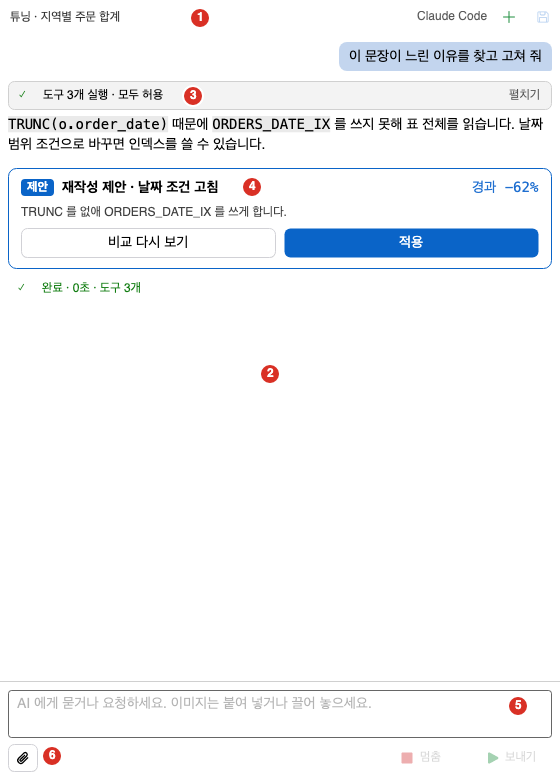
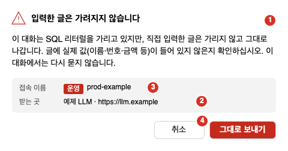
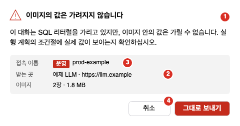

AI 대화 창은 AI와 글을 주고받는 곳입니다. 튜닝을 시작하지 않아도 처음부터 쓸 수 있습니다. 이 쪽에서는 대화 창을 여는 방법, 보내는 방법, 대화 창으로 가는 일과 화면에서 바로 하는 일(AI 띠), 이미지 첨부, 대화 창에 보이는 카드, 글 선택과 복사, 레포트 저장, 보내기 전 확인 창을 설명합니다. 모델은 먼저 [AI 모델 설정](../models/)에서 골라야 합니다.

## 대화 창 열기

- **보기 > 도구 창 > AI 대화**를 고릅니다. 처음에는 오른쪽에 붙고 닫혀 있습니다.
- AI 튜닝, 실행 계획 해설, SQL 설명을 실행하면 대화 창이 자동으로 열립니다. 오류 고치기는 편집기 아래 AI 띠에 나옵니다. [AI 명령](../commands/)을 보세요.
- SQL 모니터의 「AI로 원인 보기」, AI 띠의 「채팅에서 이어 보기」와 「더 깊게」도 대화 창에 새 대화를 엽니다.
- 도구 창 배치는 [창 배치와 도구 창](../../settings/layout/)을 보세요.

## 대화 창의 구성

1. 제목 줄: 대화 제목과 지금 쓰는 모델 이름입니다.
2. 대화 목록: 글과 카드가 차례로 쌓입니다.
3. 도구 카드 묶음: 아래 「도구 카드」를 보세요.
4. 제안 카드: 아래 「제안 카드」를 보세요.
5. 입력칸: 보낼 글을 씁니다.
6. 아래 줄: 왼쪽에 이미지 첨부 단추, 오른쪽에 「멈춤」과 「보내기」 단추가 있습니다.

그림의 대화와 수치는 설명을 위해 지어낸 예시이며 실제 모델의 답이 아닙니다.

| 영역 | 설명 |
|---|---|
| 제목 줄 | 대화의 제목과, 지금 대화가 쓰는 모델(프로필 이름이나 Claude Code)이 보입니다. 오른쪽에 「새 대화」와 「튜닝 결과 레포트 저장」 아이콘 단추가 있습니다. 마우스를 올리면 이름이 나옵니다. |
| 대화 목록 | 사용자 글, AI 글, 도구 카드, 제안 카드가 차례로 쌓입니다. |
| 안내 줄 | 대화가 비어 있으면 「무엇이든 물어보세요. 문장 튜닝은 편집기에서 「AI 튜닝」 으로 시작합니다.」가 보입니다. AI를 쓸 수 없는 원인이 있으면 이 자리에 그 원인이 대신 보입니다. |
| 붙인 이미지 | 입력칸 위에 축소 이미지가 보이고 ✕ 단추로 뺍니다. |
| 입력칸 | 「AI 에게 묻거나 요청하세요. 이미지는 붙여 넣거나 끌어 놓으세요.」 |
| 아래 줄 | 왼쪽에 이미지 첨부 단추(클립 모양)와 이미지 개수 안내, 오른쪽에 「멈춤」과 「보내기」 단추가 있습니다. |

## 묻고 요청하기

1. 입력칸에 글을 씁니다.
2. `Enter`를 누르거나 **보내기**를 누릅니다.
3. AI가 답하는 동안 도구 카드와 답 글이 대화 목록에 쌓입니다.
4. 중간에 끝내려면 **멈춤**을 누릅니다.

- 입력은 AI가 일하는 동안 막히고, 끝나면 다시 열립니다.
- AI 연결이 아직 준비되지 않았으면 「AI 연결이 아직 준비되지 않아 보내지 못했습니다. 잠시 뒤 다시 보내세요.」가 나오고 입력한 글은 지워지지 않습니다.
- **새 대화** 단추는 처음부터 다시 시작합니다. 앞의 줄과 이어 말하기 정보와 레포트 재료를 지웁니다. AI가 일하는 동안에는 꺼집니다.
- 같은 대화에서 이어 말하면 앞 대화를 이어서 보냅니다. 모델이나 주소, 접속, 값 가림 상태가 바뀌면 앞 대화를 이어 보내지 않고 새 대화로 시작합니다. 앞 대화의 내용이 다른 곳으로 가지 않게 하려는 규칙입니다.

### DB 도구를 쓰는 조건

AI가 DB 도구를 쓸 수 있는지는 활성 문서와 접속으로 정해집니다.

| 조건 | 결과 |
|---|---|
| 활성 문서가 지금 접속의 SQL 탭이고 커서 아래에 문장이 있습니다. 접속의 AI 허용 수준이 「끔」이 아닙니다. | 그 문장 범위에서 DB 도구를 씁니다. 문장도 함께 보냅니다. 값을 가리는 대화는 값을 가려서 보냅니다. |
| 활성 문서가 SQL 탭이 아닙니다(PL/SQL 편집기, 객체 상세). | 문장과 DB 도구를 쓰지 않고 답합니다. |
| 활성 문서가 다른 접속의 SQL 탭입니다. | 문장과 DB 도구를 쓰지 않고 답합니다. |
| 접속의 AI 허용 수준이 「끔」입니다. | DB 도구를 쓰지 않습니다. |
| 활성 SQL 탭에 문장이 없습니다. | DB 도구를 열지 않고 답합니다. |
| 문장의 값을 가릴 수 없습니다. | DB 도구 없이 답합니다. |

AI 허용 수준은 [AI 기능 개요](../overview/#접속의-ai-허용-수준)를 보세요. 기타 CLI는 DB 도구를 쓰지 않고 문장과 DB 정보도 보내지 않으며, 일반 대화를 시작할 때 이 사실을 한 번 알립니다.

## 대화 창으로 가는 일과 화면에서 바로 하는 일

AI 기능은 두 곳에서 답합니다. 답을 그 화면에서 바로 쓰고 이어 물을 일이 드물면 그 화면의 **AI 띠**에서 답합니다. 도구로 여러 번 조사하거나 답을 두고 이야기를 나눌 일이 많으면 **대화 창**에서 답합니다.

### 대화 창에서 하는 일

| 기능 | 여는 곳 | 모델 |
|---|---|---|
| AI 튜닝, 이 문장 튜닝 | SQL 탭 도구 모음의 「AI 튜닝」 | 주 모델 |
| 실행 계획 해설 | 「AI 튜닝」 옆 ▾ 목록 | 주 모델 |
| SQL 설명 | 「AI 튜닝」 옆 ▾ 목록 | 가벼운 일 모델 |
| 계획이 바뀐 원인 | SQL 모니터 AWR 탭의 「AI로 원인 보기」. 같은 sql_id에 계획이 둘 이상일 때 켜집니다. [SQL 튜닝](../../plan/tuning/)을 보세요. | 주 모델 |
| PL/SQL 코드 설명 | PL/SQL 편집기의 「코드 설명」 | 가벼운 일 모델 |
| MyBatis 펼친 SQL의 튜닝과 설명 | MyBatis 작업 공간. 지금 조합으로 펼친 SQL이 대상입니다. 재작성 제안은 XML에 되돌려 넣지 않습니다. | 튜닝은 주 모델, 설명은 가벼운 일 모델 |
| 일반 대화 | 대화 창 입력칸 | 주 모델 |

### 화면에서 바로 하는 일

| 기능 | 화면과 입구 | 모델 |
|---|---|---|
| 락 풀이 | Lock 모니터 도구 모음의 「✨ AI 풀이」. 고른 줄이 든 차단 사슬 전체를 보냅니다. [Lock 모니터](../../tools/monitor/#ai-풀이와-대기-풀이)를 보세요. | 가벼운 일 모델 |
| 대기 풀이 | 세션 모니터 도구 모음의 「✨ 대기 풀이」. 고른 세션 한 줄을 보냅니다. | 가벼운 일 모델 |
| 오류 고치기 | SQL 탭의 「오류 고치기」. 편집기 아래 띠에 「받아들이기」, 「버리기」가 있습니다. [AI 명령](../commands/#오류-고치기)을 보세요. | 가벼운 일 모델 |
| PL/SQL 오류 고치기 | PL/SQL 편집기의 「오류 고치기」. 컴파일 오류 주변 소스를 보내고, 고친 소스를 편집기 제안으로 넣습니다. 컴파일은 사람이 합니다. | 가벼운 일 모델 |
| DDL·반영 묶음 실행 전 검토 | 반영 묶음 실행 창과 테이블 편집 DDL 미리 보기의 「AI 검토」. 위험도와 점검 항목을 보입니다. 실행 단추를 막지 않습니다. | 주 모델 |
| 이 기간 요약 | 변경 일지 도구 모음의 「✨ 이 기간 요약」. [변경 일지](../../tools/db-tools/#변경-일지)를 보세요. | 가벼운 일 모델 |
| 차이 요약 | 「이 행 변경 이력」 같은 VERSIONS 결과 위의 「✨ 차이 요약」. [되돌리기 안내](../../run/undo-guide/)를 보세요. | 가벼운 일 모델 |
| AI 점검 | 원복 스크립트 탭의 「✨ AI 점검」. [되돌리기 지점](../../run/rollback/#원복-스크립트-ai-점검)을 보세요. | 주 모델 |

- 행 값은 접속의 AI 허용 수준이 「조회+행 값」이고 값을 가리지 않는 접속일 때만 보냅니다. 그보다 낮으면 테이블·열 이름과 건수만 보내고 띠 아래에 「값 없이 요약했습니다.」(원복 점검은 「값 없이 점검했습니다.」)가 나옵니다.
- 락·대기 풀이는 허용 수준이 「계획」 이상이어야 켜집니다. 「계획」이면 사용자명, 머신 이름, 프로그램, 모듈을 `USER1`, `HOST1` 같은 자리표시로 바꿔 보내고, 띠에는 원래 이름으로 되돌려 보입니다. 「조회」 이상이거나 「로컬 AI」 프로필로 보내면 이름을 그대로 보냅니다.
- AI는 어떤 화면에서도 실행하지 않습니다(KILL, DDL, DML, 컴파일). 제안 글과 스크립트 초안만 만들고, 실행은 사람이 확인 창을 거쳐 합니다.

### AI 띠

AI 띠는 화면 안에 붙는 작은 결과 영역입니다. 띠 하나가 요청 하나입니다. 묻기 전에는 숨어 있습니다.

| 부분 | 설명 |
|---|---|
| 머리 줄 | 「✨ AI · 기능 이름」과 오른쪽에 답한 모델 이름이 작게 보입니다. |
| 본문 | 정해진 틀(예: 상황, 원인 추정, 권하는 행동, 결론)의 칸입니다. 답이 틀에 맞지 않으면 받은 글을 그대로 보이고 다시 묻지 않습니다. |
| 상태 줄 | 「답을 받는 중 · n초」, 오류, 「멈춤」, 「보내지 않았습니다.」 같은 상태와, 입력이 커서 주 모델로 보냈으면 「입력이 커서 주 모델로 보냈습니다.」가 나옵니다. |
| 멈춤 | 진행 중에만 보입니다. |
| 다시 | 화면의 지금 상태로 다시 모아 다시 보냅니다. |
| 복사 | 받은 글을 복사합니다. |
| 채팅에서 이어 보기 | 아래 「채팅에서 이어 보기」를 보세요. |
| 주 모델로 다시 보내기 | 가벼운 일 모델이 실패했을 때만 보입니다. [AI 모델 설정](../models/#가벼운-일-모델이-실패할-때)을 보세요. |

- 화면의 AI 띠도 보내기 전에 받는 곳과 보낼 정보를 보이는 확인 창을 거칩니다. 오류 고치기 띠는 대화 창의 오류 고치기와 같은 대상 확인을 거친 뒤 바로 보냅니다.
- 가림, 받는 곳 확인, 감사 기록은 대화 창과 같은 규칙입니다.

### 채팅에서 이어 보기

AI 띠의 **채팅에서 이어 보기**는 띠가 보낸 정보와 받은 답을 대화 창의 새 대화 첫 턴으로 옮깁니다. 다시 보내지 않습니다. 이어 물으면 띠와 같은 모델로 갑니다. 대화 창이 다른 작업 중이면 멈추고 새 대화를 열지 먼저 묻습니다.

### 더 깊게

락·대기 풀이 띠에는 **더 깊게**, 대화 창의 기능 카드에는 **더 깊게 (주 모델)**이 있습니다. 누르면 주 모델로 대화 창에 **새 대화**를 엽니다. 띠의 대화는 넘기지 않고, 화면의 지금 정보를 주 모델 기준으로 다시 모아(받는 곳과 가림을 다시 계산) 보냅니다. 락·대기 풀이의 「더 깊게」는 보내기 전 확인 창을 다시 거칩니다.

### 답 머리의 모델 이름

대화 창은 차례마다 답한 모델 이름을 답 머리에 작게 적습니다(예: `haiku`, `Ollama · qwen3:8b`). 제목 줄의 모델 이름은 주 모델입니다. 가벼운 일 모델이 답했거나 크기 때문에 주 모델로 올렸으면 그 차례의 줄에서 알 수 있습니다.

## 이미지 첨부

이미지는 세 가지 방법으로 붙입니다.

- 입력칸에 붙여 넣습니다. `Ctrl+V`(macOS `Cmd+V`)입니다. Windows에서는 `Shift+Insert`도 됩니다. 클립보드에 이미지만 있어도 붙습니다.
- 이미지 파일을 대화 창에 끌어 놓습니다.
- 이미지 첨부 단추(클립 모양)를 눌러 파일을 고릅니다.

| 규칙 | 설명 |
|---|---|
| 장수 | 한 번에 5장까지입니다. 아래 줄에 「이미지 N장 · 최대 5장」이 보입니다. 넘치면 「이미지는 한 번에 5장까지 붙일 수 있습니다.」가 나옵니다. |
| 형식 | PNG, JPEG, WebP, GIF입니다. 파일 확장자가 아니라 파일 내용으로 알아봅니다. BMP는 PNG로 바꿉니다. |
| 크기 | 긴 변이 4000픽셀을 넘으면 줄입니다. 한 장이 5 MB를 넘으면 JPEG로 다시 만들고, 그래도 넘으면 거절합니다. 입력 파일은 40 MB 이하만 읽습니다. |
| 빼기 | 붙인 이미지의 ✕ 단추로 뺍니다. |

- 이미지를 지원하지 않는 모델에서는 첨부 단추가 꺼지고 마우스를 올리면 「이 모델은 이미지 입력을 지원하지 않습니다. 설정에서 다른 프로필을 고르십시오.」가 나옵니다. 입구가 닫혀서 붙여 넣기와 끌어 놓기도 되지 않습니다.
- 이미지를 보낼 수 있는 모델은 Claude Code, Codex CLI, 이미지 지원이 켜진 프로필입니다. Antigravity CLI와 기타 CLI는 보낼 수 없습니다.
- AI가 이어 말하는 동안에는 이미지를 붙일 수 없습니다. 끝난 뒤 다시 붙이세요.
- 이미지 안의 값은 가려지지 않습니다. 아래 「가려지지 않는 글과 이미지」를 보세요.

## 대화 창에 보이는 카드

### 도구 카드

AI가 DB 도구를 쓰면 카드가 생깁니다. 도구 이름은 사람이 읽는 말로 바뀌어 보입니다.

| 보이는 이름 | 하는 일 |
|---|---|
| 객체 구조 조회 | 객체의 구성을 읽습니다. |
| 인덱스 정보 조회 | 테이블의 인덱스를 읽습니다. |
| 테이블 통계 | 테이블과 열 통계를 읽습니다. |
| 컬럼 히스토그램 | 열의 히스토그램을 읽습니다. |
| 실제 실행 계획(커서) | 커서의 실제 계획을 읽습니다. |
| 실행 계획(EXPLAIN) | 예상 계획을 만듭니다. |
| SQL 수행 통계 | `sql_id`의 수행 통계를 읽습니다. |
| 튜닝 정보 묶음 | 튜닝에 필요한 정보를 한 번에 읽습니다. |
| 변형 성능 비교 | 변형 SQL의 성능을 벤치마크로 비교합니다. |

- 한 차례에 도구가 여럿이면 하나로 묶여 「도구 N개 실행」이 보입니다. 실행 중에는 펼쳐 있고 끝나면 접힙니다. **펼치기**와 **접기**로 바꿉니다.
- 카드마다 결과가 「허용」, 「가림」, 「거부」, 「실패」, 「중단」 중 하나로 보입니다. 「가림」은 값을 가려서 돌려주었다는 뜻이고 「거부」는 접속의 AI 허용 수준 같은 규칙 때문에 막혔다는 뜻입니다. 묶음에 거부나 실패가 있으면 묶음에 문제 표시가 붙습니다.
- 카드의 인자 글은 AI가 보낸 글 그대로입니다. 값을 가리는 대화에서는 자리표시(`:v1` 등)가 그대로 보입니다.

### 진행 줄과 결과 줄

- AI가 일하는 동안 「AI 응답을 기다리는 중」, 「AI 작업 중 · 도구 이름」, 「답변 작성 중」 중 하나가 보입니다.
- 새 소식이 1분 넘게 없으면(도구를 쓰는 중이면 5분) 「AI 작업 중 · n분 넘게 새 소식 없음」과 「계속 기다리거나 아래 「멈춤」 으로 끝낼 수 있습니다.」가 보입니다.
- 한 차례가 끝나면 결과 줄이 보입니다. 「✓ 완료 · 시간 · 도구 N개」, 「■ 멈춤 · …」, 「! 오류로 끝남 · …」입니다.
- 오류는 「오류: 이유」로 AI 글 자리에 남습니다.

### 제안 카드

AI 튜닝이나 오류 고치기가 재작성 제안을 내면 제안 카드가 생깁니다. 카드에는 「재작성 제안 · 이름」과 요약이 보이고 상태가 「제안」이나 「적용함」입니다.

| 단추 | 하는 일 |
|---|---|
| 적용 | 비교 창에서 원본과 제안을 보고 받아들이면 새 탭에 넣습니다. 원래 탭은 바뀌지 않습니다. |
| 비교 보기 | 적용한 제안을 원본과 비교 창으로 봅니다. |
| 비교 다시 보기 | 닫은 비교 창을 다시 엽니다. |

- 새 탭의 이름은 원래 탭 이름 뒤에 「 (수정)」(오류 고치기)이나 「 (튜닝)」(AI 튜닝)이 붙습니다.
- 원래 문장의 주석이 제안에 없으면 「주석 N개 빠짐」 안내가 나옵니다.
- 오류가 난 탭이 닫혔거나 문장이 바뀌었거나 비교 창을 쓸 수 없으면 제안을 새 탭에 넣지 않고 이유를 알립니다.

## 글 선택과 복사

대화 창의 글은 여러 문단에 걸쳐 드래그로 고르고 한꺼번에 복사할 수 있습니다.

1. 복사할 글의 시작에서 마우스를 눌러 끝까지 끕니다. 문단, 제목, 코드, 표, 목록을 가로질러 고를 수 있습니다.
2. `Ctrl+C`(macOS `Cmd+C`)를 누르거나, 선택한 글을 오른쪽 클릭해 「복사」를 고릅니다.

- 끌 때 포인터가 대화 영역의 위나 아래 끝에 가까우면 자동으로 스크롤합니다.
- 복사한 글은 화면 순서로 이어집니다. 문단과 제목과 코드 사이는 빈 줄이고, 목록 항목과 표의 행 사이는 줄바꿈이며, 표의 칸 사이는 탭입니다. 코드는 줄바꿈을 그대로 둡니다.
- 코드 상자의 언어 이름과 복사 단추의 글은 복사에 들어가지 않습니다.
- 한 칸 안에서는 두 번 눌러 낱말을 고를 수 있습니다.
- 사용자 글도 AI 글처럼 고르고 복사할 수 있습니다.
- 선택한 뒤 접히거나 화면에서 사라진 칸의 글은 복사하지 않습니다.
- 대화 창이 복사 키를 스스로 처리하므로 편집기 복사로 가지 않습니다.

## 튜닝 결과 레포트 저장

AI 튜닝이 끝나면 결과를 파일로 저장합니다.

1. 제목 줄의 「튜닝 결과 레포트 저장」 단추를 누릅니다. 튜닝 결과가 있고 AI가 일하는 중이 아닐 때만 켜집니다.
2. 저장 창에서 파일 이름을 정합니다. 확장자가 `.md`이면 Markdown, `.html`이면 HTML 레포트입니다. 다른 확장자는 거부합니다.
3. 저장하면 대화 창에 「레포트를 저장했습니다: 경로」가 남습니다. 저장하지 못하면 「레포트를 저장하지 못했습니다: 이유」가 남습니다.

- 값을 가리는 대화의 레포트에는 가려서 보낸 자리표시(`:v1` 등)가 그대로 남습니다.
- AI가 이어 말하는 중에는 저장할 수 없습니다. 끝난 뒤 다시 저장하세요.
- 새 대화를 열면 앞 대화의 레포트 재료는 지웁니다.

## 가려지지 않는 글과 이미지

값을 가리는 대화(운영 접속이거나 설정에서 값 가림을 켠 경우)는 SQL 문장과 도구 결과의 값만 가립니다. 사용자가 입력한 글과 붙인 이미지는 가려지지 않으므로 보내기 전에 확인 창이 나옵니다. 「로컬 AI」로 지정한 프로필로 보내는 대화는 값을 가리지 않으므로 이 확인 창이 나오지 않습니다.

| 창 | 언제 | 내용 |
|---|---|---|
| 글 보내기 확인 | 글을 보낼 때. 대화당 한 번입니다. | 「입력한 글은 가려지지 않습니다」. 이 대화에서는 다시 묻지 않습니다. 글에 이름, 번호, 금액 같은 실제 값이 없는지 확인하라고 안내합니다. |
| 이미지 보내기 확인 | 이미지를 새로 보낼 때마다 | 「이미지의 값은 가려지지 않습니다」. 실행 계획의 조건절에 실제 값이 보이는지 확인하라고 안내합니다. |

1. 안내 글: 무엇이 가려지지 않는지 알려 줍니다.
2. 받는 곳: 글이나 이미지를 받을 모델과 주소입니다.
3. 접속 이름: 운영 접속이면 「운영」 표시가 붙습니다.
4. 「그대로 보내기」와 「취소」 단추입니다. 번호는 「그대로 보내기」에 있습니다.

그림의 접속과 받는 곳은 설명을 위해 지어낸 예시입니다. 이미지 보내기 확인 창에는 이미지 장수와 크기도 보입니다.

- 두 창 모두 「받는 곳」과 「접속 이름」을 보여 줍니다.
- 단추는 「그대로 보내기」와 「취소」입니다. 취소하면 아무것도 보내지 않습니다.
- 확인 창을 열 수 없으면 확인 없이는 보내지 않습니다.

## 문제가 생길 때

| 증상 | 원인 | 해결 |
|---|---|---|
| 입력칸 위에 AI를 쓸 수 없는 이유가 나옵니다 | 「선택 안 함」을 골랐거나 선택한 모델을 쓸 수 없습니다. | **설정 > AI 모델**을 확인하세요. [AI 모델 설정](../models/)을 보세요. |
| 이미지 첨부 단추가 꺼져 있습니다 | 고른 모델이 이미지를 지원하지 않습니다. | 이미지를 지원하는 프로필이나 Claude Code, Codex CLI를 고르세요. |
| 「이미지는 한 번에 5장까지 붙일 수 있습니다」가 나옵니다 | 5장을 넘겼습니다. | 이미지를 빼거나 나누어 보내세요. |
| 「이어 말하는 중이라 이미지를 붙이지 못했습니다」가 나옵니다 | AI가 일하는 중입니다. | 끝난 뒤 다시 붙이세요. |
| 답이 DB 정보를 쓰지 않습니다 | 활성 문서가 지금 접속의 SQL 탭이 아니거나 접속의 허용 수준이 「끔」입니다. | 위 「DB 도구를 쓰는 조건」을 확인하세요. |
| 「AI 작업 중 · n분 넘게 새 소식 없음」이 보입니다 | AI나 CLI가 오래 응답하지 않습니다. | 기다리거나 **멈춤**을 누르세요. |
| 레포트 저장 단추가 꺼져 있습니다 | 튜닝 결과가 없거나 AI가 일하는 중입니다. | 튜닝을 끝낸 뒤 저장하세요. |
| AI 띠에 칸 대신 긴 글이 그대로 나옵니다 | 답이 정해진 틀에 맞지 않았습니다. | 글을 그대로 읽거나 「다시」를 누르세요. 이어 물으려면 「채팅에서 이어 보기」를 쓰세요. |
| 띠 아래에 「값 없이 요약했습니다.」가 나옵니다 | 접속의 허용 수준이 「조회+행 값」이 아니거나 값을 가리는 접속입니다. | 행 값이 필요하면 접속 편집에서 허용 수준을 확인하세요. |
| 모델을 바꿨더니 앞 대화를 이어 말하지 못합니다 | 모델이나 주소를 바꾸면 앞 대화를 이어 갈 수 없습니다. | **새 대화**로 시작하세요. |
