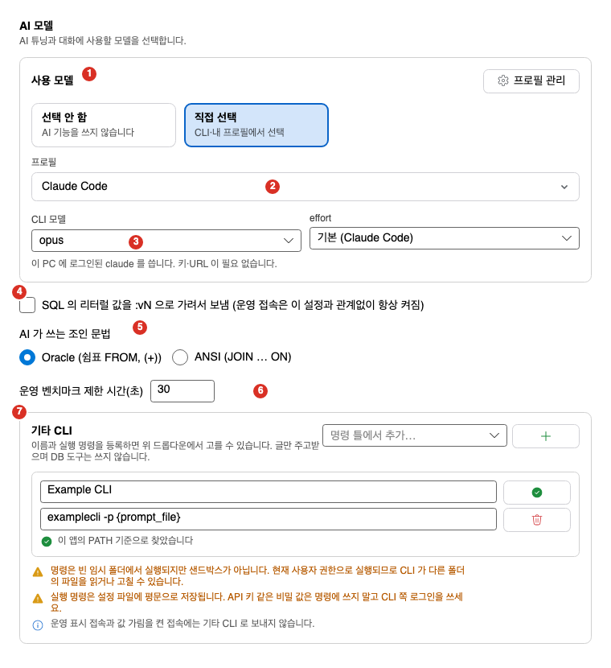
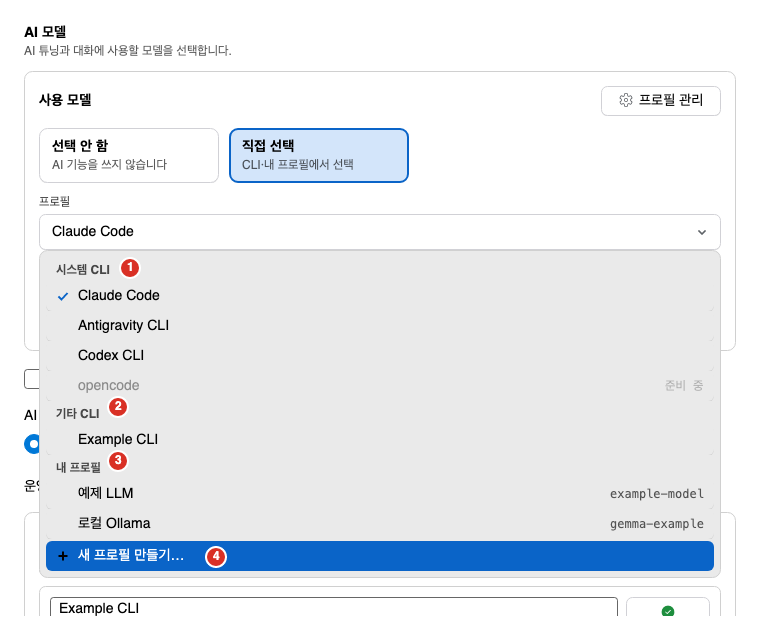
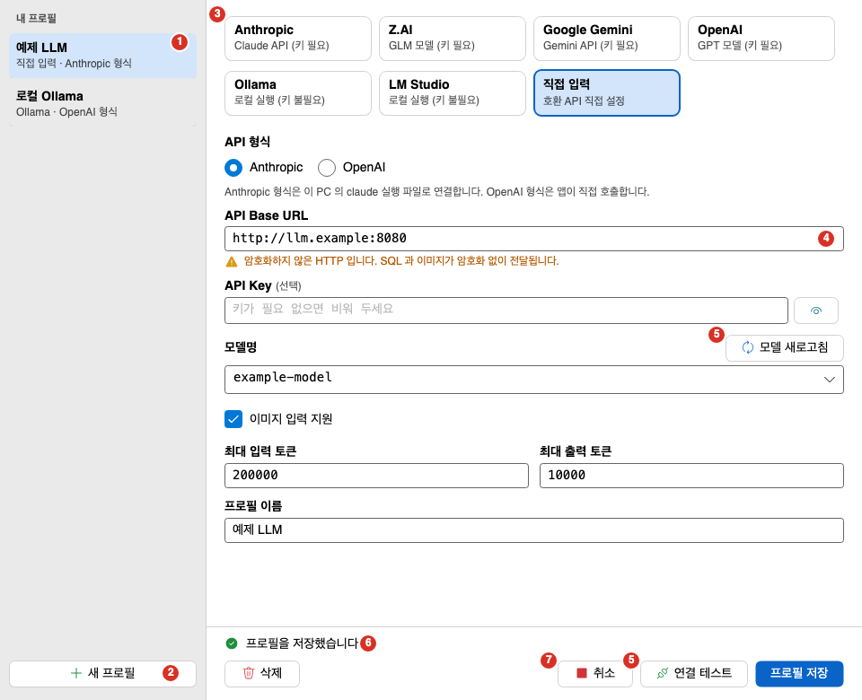
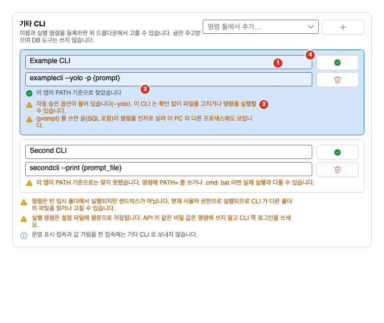

AI 기능은 처음에 Claude Code로 설정되어 있습니다. 다른 모델을 쓰려면 여기서 고릅니다. 이 쪽에서는 설정 창의 「AI 모델」 탭, LLM 프로필 관리 창, 시스템 CLI, 기타 CLI, 조인 문법, 운영 벤치마크 제한 시간을 설명합니다. AI 기능의 전체 구성과 위험은 [AI 기능 개요](../overview/)를 보세요.

## 설정 창의 AI 모델 탭

**도구 > 설정**을 열고 「AI 모델」 탭으로 갑니다. 이 탭은 AI 튜닝 기능이 켜져 있을 때만 보입니다. [설정](../../settings/options/#기능)을 보세요.

1. 사용 모델 카드: 「선택 안 함」과 「직접 선택」입니다.
2. 프로필 드롭다운: 쓸 모델을 고릅니다. 고르는 줄은 아래 「프로필」 표를 보세요.
3. CLI 모델과 effort: Claude Code를 고르면 보입니다.
4. 값 가림 확인란: 「SQL 의 리터럴 값을 :vN 으로 가려서 보냄」입니다.
5. 조인 문법: 아래 「조인 문법」을 보세요.
6. 운영 벤치마크 제한 시간: 아래 「운영 벤치마크 제한 시간」을 보세요.
7. 기타 CLI 영역: 아래 「기타 CLI」를 보세요.

그림의 프로필과 기타 CLI는 설명을 위해 지어낸 예시입니다.

탭 맨 위의 「사용 모델」에서 먼저 다음 둘 중 하나를 고릅니다.

| 선택 | 설명 |
|---|---|
| 선택 안 함 | AI 기능을 쓰지 않습니다. |
| 직접 선택 | CLI나 내 프로필 중에서 고릅니다. |

「직접 선택」을 고르면 「프로필」 목록이 나옵니다. 목록을 열면 세 묶음이 있습니다.

| 묶음 | 줄 | 설명 |
|---|---|---|
| 시스템 CLI | Claude Code, Antigravity CLI, Codex CLI, opencode | 이 PC에 설치하고 로그인한 CLI입니다. opencode 줄은 「준비 중」이라 고를 수 없습니다. |
| 기타 CLI | 등록한 CLI | 등록한 줄입니다. 실행 명령이 없으면 「명령 없음」이 보입니다. |
| 내 프로필 | 만든 프로필 | 프로필마다 한 줄입니다. |

1. 시스템 CLI 묶음: opencode 줄은 「준비 중」이라 고를 수 없습니다.
2. 기타 CLI 묶음: 등록한 줄입니다.
3. 내 프로필 묶음: 만든 프로필입니다. 오른쪽에 모델이 보입니다.
4. 「새 프로필 만들기…」: 프로필 관리 창을 엽니다.

- 목록 맨 아래의 「새 프로필 만들기…」로 프로필 관리 창을 엽니다.
- 위의 「프로필 관리」 단추도 같은 창을 엽니다.
- 현재 고른 줄에 체크 표시가 있습니다.

### 고른 모델에 따라 보이는 항목

| 고른 모델 | 탭에 나오는 것 |
|---|---|
| Claude Code | 「CLI 모델」과 「effort」 목록. 「이 PC 에 로그인된 claude 를 씁니다. 키·URL 이 필요 없습니다.」가 나옵니다. |
| 내 프로필 | 모델, 주소, API 형식, 이미지 지원 여부를 읽기 전용으로 보여 줍니다. 프로필의 수정은 프로필 관리 창에서 합니다. |
| Codex CLI, Antigravity CLI | 그 CLI의 안내 글. 아래 「시스템 CLI」를 보세요. |
| 기타 CLI | 기타 CLI의 안내 글. 아래 「기타 CLI」를 보세요. |

- 「effort」는 추론 노력의 기본 값입니다. 「기본 (Claude Code)」(처음 값), `low`, `medium`, `high`, `xhigh`, `max` 중에서 고릅니다. AI 튜닝 시작 창에서 대화마다 바꿀 수 있습니다.
- 내 프로필의 API 형식은 「Anthropic (claude 실행 파일 사용)」이나 「OpenAI (앱이 직접 호출)」로 보입니다. 이미지는 「지원」, 「지원 안 함」, 「모름 (보내 보고 서버 오류를 확인)」 중 하나로 보입니다.
- 주소가 `http://`이고 localhost가 아니면 「이 주소는 암호화하지 않은 HTTP 입니다. SQL 과 이미지가 암호화 없이 전달됩니다.」 경고가 나옵니다.

### 쓸 수 없는 모델을 가리킬 때

설정 파일이 바뀌어 고른 모델을 쓸 수 없게 되면 탭에 이유가 나옵니다. 말없이 Claude Code로 되돌리지 않고 선택지에 그대로 보입니다.

| 상태 | 안내 |
|---|---|
| 삭제된 프로필 | 선택한 프로필을 찾을 수 없습니다. 지워졌거나 설정 파일이 바뀌었습니다. 다른 프로필이나 Claude Code를 고르세요. |
| 이 버전이 모르는 프로필 | 프리셋이나 API 형식을 이 버전이 모릅니다. 다음 버전이 만든 프로필일 수 있습니다. 다른 프로필을 고르세요. 프로필은 지워지지 않습니다. |
| 쓸 수 없는 시스템 CLI | 아직 준비 중이거나 이 컴퓨터에서 지원하지 않습니다. 다른 줄을 고르세요. |
| 쓸 수 없는 기타 CLI | 목록에서 지워졌거나 실행 명령이 비어 있습니다. 다른 줄을 고르거나 다시 등록하세요. |

- 이대로 두면 AI를 실행할 때 오류가 납니다.

### 그 밖의 항목

| 항목 | 설명 |
|---|---|
| SQL 의 리터럴 값을 :vN 으로 가려서 보냄 | 켜면 SQL 문장의 값을 자리표시로 가려서 보냅니다. 운영 접속은 이 설정과 관계없이 항상 가립니다. [AI 기능 개요](../overview/#값-가림)를 보세요. |
| AI 가 쓰는 조인 문법 | 아래 「조인 문법」을 보세요. |
| 운영 벤치마크 제한 시간(초) | 아래 「운영 벤치마크 제한 시간」을 보세요. |

## LLM 프로필

프로필은 모델 서버 연결 정보입니다. 주소, 모델, API 키를 묶어 이름을 붙입니다. 프로필 관리 창에서 만들고 고치고 지웁니다.

1. 내 프로필 목록: 만든 프로필입니다.
2. 새 프로필: 「직접 입력」 초안을 만듭니다.
3. 프리셋 카드: 쓸 서버를 고르면 주소와 형식이 채워집니다.
4. 입력 칸: 아래 「입력 항목」을 보세요. 번호는 첫 칸인 API Base URL에 있습니다.
5. 모델 새로고침과 연결 테스트: 서버에 묻는 단추입니다.
6. 결과 띠: 저장, 모델 새로고침, 연결 테스트의 결과가 나옵니다. 그림은 저장한 뒤의 모습입니다.
7. 삭제, 취소, 프로필 저장 단추 줄입니다. 번호는 「취소」에 있습니다.

그림의 프로필과 주소는 설명을 위해 지어낸 예시입니다. 연결 테스트는 하지 않았습니다.

### 프로필 만들기

1. 설정의 AI 모델 탭에서 **프로필 관리**를 누릅니다. 또는 프로필 목록의 「새 프로필 만들기…」를 고릅니다. 「LLM 프로필 관리」 창이 열립니다.
2. 왼쪽 「내 프로필」 목록 아래의 **새 프로필**을 누릅니다. 「직접 입력」 초안이 만들어집니다.
3. 오른쪽의 프리셋 카드 일곱 개 중에서 쓸 서버를 고르면 주소와 형식이 채워집니다. 나머지 항목을 채웁니다. 아래 표를 보세요.
4. **모델 새로고침**으로 서버의 모델 목록을 받아 모델명을 고릅니다.
5. **연결 테스트**로 연결을 확인합니다.
6. **프로필 저장**을 누릅니다.

- 저장은 설정 창의 확인과 별개로 바로 기록됩니다.
- 저장하지 않은 변경이 있는 채로 다른 줄로 옮기면 「저장하지 않은 변경이 있습니다. 버리고 계속할까요?」를 묻습니다. 확인하면 버립니다.

### 프리셋

| 프리셋 | API 형식 | 처음 주소 | API 키 |
|---|---|---|---|
| Anthropic | Anthropic | `https://api.anthropic.com` | 필요 |
| Z.AI | Anthropic | `https://api.z.ai/api/anthropic` | 필요 |
| Google Gemini | OpenAI | `https://generativelanguage.googleapis.com/v1beta/openai` | 필요 |
| OpenAI | OpenAI | `https://api.openai.com/v1` | 필요 |
| Ollama | OpenAI | `http://localhost:11434/v1` | 필요 없음 |
| LM Studio | OpenAI | `http://localhost:1234/v1` | 필요 없음 |
| 직접 입력 | 고름 | 비어 있음 | 선택 |

- 「직접 입력」만 API 형식을 고를 수 있습니다. 나머지는 프리셋의 형식을 씁니다.
- Anthropic 형식은 이 PC의 `claude` 실행 파일로 연결합니다. `claude`가 설치되어 있어야 합니다.
- OpenAI 형식은 앱이 직접 호출합니다. `claude`가 필요 없습니다.

### 입력 항목

| 항목 | 설명 |
|---|---|
| 프로필 이름 | 목록에 보이는 이름입니다. 비우면 저장할 수 없습니다. |
| API 형식 | 「Anthropic」이나 「OpenAI」입니다. |
| API Base URL | 서버 주소입니다. `http://`나 `https://`로 시작해야 하고 사용자 정보와 쿼리는 쓸 수 없습니다. |
| API Key | 서버 키입니다. 서버에 따라 필요, 필요 없음, 선택입니다. **키 보기**로 입력한 글을 확인합니다. |
| 모델명 | 쓸 모델입니다. **모델 새로고침** 뒤 목록에서 고르거나 직접 씁니다. |
| 최대 입력 토큰 | 처음 값 200000입니다. 1 이상의 정수입니다. |
| 최대 출력 토큰 | 처음 값 10000입니다. 1 이상의 정수입니다. |
| 이미지 입력 지원 | 이 모델이 이미지를 받는지 정합니다. 서버가 알려 주면 **모델 새로고침**이 채웁니다. 모르면 보내 보고 서버 오류를 보여 줍니다. |

### 단추

| 단추 | 하는 일 |
|---|---|
| 모델 새로고침 | 서버에서 모델 목록을 읽습니다. 15초 안에 응답이 없으면 「서버가 제때 응답하지 않았습니다.」가 나옵니다. |
| 연결 테스트 | 저장하기 전에도 고른 모델로 작은 요청을 한 번 보내 연결을 시험합니다. 결과는 「연결 성공 · n 초」나 「연결 실패 · n 초」입니다. 60초 안에 응답이 없으면 중단합니다. |
| 중지 | 진행 중인 모델 새로고침이나 연결 테스트를 멈춥니다. |
| 프로필 저장 | 지금 저장합니다. |
| 저장된 키 지우기 | 이 프로필의 저장된 키를 지웁니다. |
| 삭제 | 이 프로필과 저장된 키를 지웁니다. 확인 창이 나옵니다. |
| 취소 | 저장하지 않고 닫습니다. |

### API 키 보관

- API 키는 설정 파일, 로그, 감사 기록, 명령줄 인자에 두지 않습니다. Windows는 DPAPI, macOS는 키체인에 보관합니다.
- 프로필을 지우면 키도 지웁니다.
- 주소를 저장된 프로필과 다른 서버로 바꾸면 저장된 키를 보내지 않습니다. 새 API Key를 입력하거나 「저장된 키 지우기」를 누르세요.
- 키 저장소를 쓸 수 없으면 키가 필요한 프로필은 저장할 수 없습니다.

### 삭제와 확인 창

프로필 삭제나 변경 버림처럼 되돌릴 수 없는 일은 작은 확인 창이 먼저 나옵니다.

- 삭제 확인 글은 「프로필 「이름」 과(와) 저장된 키를 지웁니다. 계속할까요?」입니다. 쓰고 있던 프로필이면 「이 프로필은 지금 사용 중이라 지우면 Claude Code 로 되돌아갑니다.」가 붙습니다.
- 확인 창의 단추는 「확인」과 「취소」입니다. `Enter`는 확인이고 `Esc`는 취소입니다.
- 사용 중이던 프로필을 지우면 설정 탭에 「사용 중이던 프로필을 지워 Claude Code 로 되돌렸습니다.」가 나옵니다.

### 연결 방식과 제한

- 프로필 경로는 프록시 설정을 따르지 않고 입력한 주소로 직접 연결합니다. 프록시로만 외부에 나갈 수 있는 PC에서는 클라우드 프로필이 연결되지 않을 수 있습니다.
- OpenAI 형식 프로필의 실행, 연결 테스트, 모델 새로고침은 HTTP 리다이렉트를 따르지 않습니다.
- Anthropic 형식 프로필의 실행은 `claude` 실행 파일이 연결하므로 Oranda가 연결 방식을 정하지 않습니다.
- 모델이나 주소를 바꾸면 앞 대화를 이어 말할 수 없습니다. 새 대화로 시작합니다.
- 설정 파일이 이 버전보다 새로우면 「설정 파일이 이 버전보다 새로워 읽기 전용입니다. 저장하지 않았습니다.」가 나옵니다.

## 시스템 CLI

시스템 CLI는 이 PC에 설치하고 로그인한 CLI를 그대로 쓰는 방식입니다. 키와 주소를 Oranda에 넣지 않습니다.

| CLI | 상태 | 이미지 |
|---|---|---|
| Claude Code | 쓸 수 있음 | 보낼 수 있음 |
| Codex CLI | 쓸 수 있음 | 보낼 수 있음 |
| Antigravity CLI | 쓸 수 있음 | 보낼 수 없음 |
| opencode | 준비 중. 고를 수 없습니다. | 보낼 수 없음 |

Codex CLI와 Antigravity CLI는 사용자의 결정으로 켠 기능입니다. 아래를 알아 두세요.

- **실제 로그인으로 끝까지 시험하지 못한 상태로 켰습니다.** Windows의 잠금(토큰과 파일 권한)도 확인하지 못했습니다.
- 운영 접속에서도 쓸 수 있습니다. 접속의 AI 허용 수준과 운영 값 가림은 다른 모델과 같게 적용됩니다.
- **대화가 CLI의 폴더에 남습니다.** Codex CLI는 기본으로 `~/.codex`(환경 변수 `CODEX_HOME`을 쓰면 그 폴더), Antigravity CLI는 `~/.gemini/antigravity-cli`입니다. Oranda가 지울 수 없고, 값을 가린 뒤의 내용도 남습니다.
- **한 차례 실행은 최대 6시간입니다.** 벤치마크 제한 시간을 0으로 두어도 적용됩니다.
- Antigravity CLI는 사용자 전역 MCP 설정에 서버가 있으면 실행하지 않습니다.
- opencode는 실제 왕복 시험을 통과하기 전이라 시스템 CLI로는 쓸 수 없습니다. 같은 CLI를 기타 CLI의 명령 틀(「OpenCode」)로 등록해 글만 주고받는 방식은 쓸 수 있습니다.

## 기타 CLI

기타 CLI는 이름과 실행 명령을 등록해 쓰는 방식입니다. 글만 주고받으며 DB 도구는 쓰지 않습니다. AI 튜닝에는 쓸 수 없습니다. 일반 대화와 SQL 설명, 실행 계획 해설, 오류 고치기에 쓸 수 있습니다.

1. 이름과 실행 명령: 줄마다 두 칸입니다.
2. PATH 확인 표시: 실행 파일을 PATH에서 찾았는지 보입니다. 찾기만 하고 실행하지는 않습니다.
3. 경고 줄: 아래 「줄 아래에 나오는 확인과 경고」를 보세요.
4. 「이 CLI 사용」과 「기타 CLI 삭제」 단추: 줄 오른쪽에 위아래로 있습니다. 번호는 「이 CLI 사용」에 있습니다.

그림의 CLI는 설명을 위해 지어낸 예시이고 실행하지 않았습니다.

### 등록하는 방법

1. AI 모델 탭 아래의 「기타 CLI」 영역에서 **기타 CLI 추가**를 누릅니다. 빈 줄이 하나 생깁니다.
   - 많이 쓰는 CLI는 「명령 틀에서 추가…」 목록에서 고르면 이름과 명령이 채워진 줄이 생깁니다. 채운 뒤 고칠 수 있습니다.
2. 「이름」 칸에 이름을 씁니다.
3. 「실행 명령」 칸에 한 줄 명령을 씁니다. 예: `실행파일 --옵션 {prompt}`.
4. 줄 오른쪽의 **이 CLI 사용**을 누르면 AI 대화가 이 CLI를 씁니다.
5. 줄을 지우려면 **기타 CLI 삭제**를 누릅니다. 확인 창이 나옵니다.

### 명령 쓰는 규칙

- 명령은 셸 없이 실행합니다. 파이프, 세미콜론, `&`, 리디렉션, 백틱, `$(` 같은 셸 기호는 쓸 수 없습니다.
- 따옴표로 묶어 인자를 나눕니다. 작은따옴표 안은 그대로이고 큰따옴표 안은 `\"`만 따옴표 하나가 됩니다.
- 앞쪽의 `NAME=value`는 환경 변수이고, 그 뒤 첫 낱말이 실행 파일입니다. `ORANDA_`로 시작하는 환경 변수는 쓸 수 없습니다.
- 실행 파일은 이름만 쓰거나 절대 경로로 씁니다. 폴더 구분자가 든 상대 경로는 쓸 수 없습니다.
- 글을 받는 자리는 두 가지입니다. 인자에서만 쓸 수 있습니다.
  - `{prompt}`: 글 자체가 명령줄 인자로 들어갑니다.
  - `{prompt_file}`: 글을 담은 임시 파일의 경로가 들어갑니다.
- `{prompt}`와 `{prompt_file}`이 모두 없으면 글을 표준 입력으로 보냅니다.
- 한 줄만 쓸 수 있고 길이는 8192자 이하입니다. 줄바꿈이나 보이지 않는 공백이 있으면 거부합니다.
- 규칙에 맞지 않으면 줄 아래에 이유가 나옵니다.

### 줄 아래에 나오는 확인과 경고

| 표시 | 뜻 |
|---|---|
| 이 앱의 PATH 기준으로 찾았습니다 | 실행 파일을 PATH에서 찾았습니다. 찾기만 하고 실행하지는 않습니다. |
| 이 앱의 PATH 기준으로는 찾지 못했습니다 | 명령에 `PATH=`를 쓰거나 `.cmd`·`.bat`이면 실제 실행과 다를 수 있습니다. |
| 자동 승인 옵션이 들어 있습니다 | `--yolo`, `-y`, `--dangerously-skip-permissions` 같은 옵션입니다. 이 CLI는 확인 없이 파일을 고치거나 명령을 실행할 수 있습니다. 막지는 않고 알리기만 합니다. 앱을 닫아도 실행 중인 CLI가 바로 멈추지 않을 수 있습니다. |
| 환경 변수 … 의 값이 설정 파일에 평문으로 남습니다 | 비밀로 보이는 이름의 환경 변수입니다. 비밀 값은 명령에 쓰지 마세요. |
| 환경 변수 … 는 프로그램을 불러오는 방식이나 실행 환경을 바꿉니다 | 꼭 필요한 경우에만 쓰세요. |
| `{prompt}` 를 쓰면 글(SQL 포함)이 명령줄 인자로 실려 이 PC 의 다른 프로세스에도 보입니다 | 민감한 글이면 `{prompt_file}`이나 표준 입력을 쓰세요. |

「명령 틀」의 CLI에는 「확인됨」과 「미확인(문서 기준)」이 붙어 있습니다. 「미확인(문서 기준)」은 공식 문서나 도움말에 적힌 형태만 따랐고 왕복하지 않았거나 응답까지 가지 못한 것입니다. 이 표시는 앱에 고정된 표에 개발할 때 남긴 기록이며, 내 PC에서 앱이 검사한 결과가 아닙니다. 「확인됨」은 빈 임시 폴더에 짧은 글을 보내 응답을 받은 것만입니다. 지금 「확인됨」은 Codex CLI와 OpenCode입니다. Codex CLI는 Mac과 Windows에서 모두 왕복을 확인했습니다. OpenCode는 Mac에서 왕복한 기록만 있습니다(원본 출력은 남아 있지 않습니다). Windows에서는 시도했지만 실패했습니다. 같은 CLI도 PC의 설치 상태와 로그인에 따라 결과가 다를 수 있으니, 처음에는 짧은 질문으로 직접 시험해 보세요. 현재 틀은 Codex CLI(exec), OpenCode, Gemini CLI, ZCode, Aider, Goose, Kilo Code, GitHub Copilot CLI, Kiro CLI, Qoder CLI, pi입니다. ZCode는 `-p`로 실행하면 기본이 자동 승인이라 명령에 옵션이 없어도 안내가 계속 보입니다. Kiro CLI는 `KIRO_API_KEY` 환경 변수를 명령에 쓰지 말고 앱을 띄운 환경에 설정해야 합니다.

### 항상 보이는 안내

- 명령은 빈 임시 폴더에서 실행되지만 **샌드박스가 아닙니다.** 현재 사용자 권한으로 실행되므로 CLI가 다른 폴더의 파일을 읽거나 고칠 수 있습니다.
- 실행 명령은 설정 파일에 평문으로 저장됩니다. API 키 같은 비밀 값은 명령에 쓰지 말고 CLI 쪽 로그인을 쓰세요.
- 운영 표시 접속과 값 가림을 켠 접속에는 기타 CLI로 보내지 않습니다.

### 제한

- 값 가림 설정이 켜져 있으면 기타 CLI로 보내지 않습니다. 설정의 「SQL 의 리터럴 값을 :vN 으로 가려서 보냄」을 끄거나 다른 모델을 고르세요.
- DB 도구와 실행 토큰을 쓰지 않습니다. 일반 대화에서는 접속 이름, 환경, 대상 문장, `sql_id` 같은 맥락을 보내지 않고 사용자가 쓴 글과 앞 대화만 보냅니다. SQL 설명, 실행 계획 해설, 오류 고치기는 문장 글과 앱이 미리 읽은 계획·객체 정보를 글로 함께 보냅니다. 자세한 내용은 [AI 명령](../commands/)을 보세요.
- AI 튜닝은 시작되지 않고, 이미지는 보낼 수 없습니다.
- 이어 말하기는 Oranda가 앞 대화를 글로 붙여 보내는 방식입니다. 명령을 바꾸면 다른 대화입니다.
- 한 차례 실행은 최대 30분입니다. 취소하거나 시간이 지나면 프로세스 트리를 끝냅니다.
- 출력은 ANSI 문자를 지우고 크기를 제한합니다. 넘치면 앞부분을 버리고 뒤를 남깁니다. 0이 아닌 종료 코드는 오류입니다.
- **가림의 한계**: 오류 글과 답에서 환경 변수 값을 가리는 규칙이 있습니다. 비밀로 보이는 이름의 환경 변수 값만 가립니다. 5글자 미만인 값, `true`·`false`·`yes`·`none`·`null` 같은 흔한 낱말, 숫자만으로 된 값은 가리지 않습니다. 그보다 짧은 진짜 비밀은 답에 그대로 보일 수 있습니다. 가려지는 것은 명령에 설정된 환경 변수 값과 글자 그대로 같은 글뿐입니다. 명령 인자에 직접 쓴 비밀이나 바뀐 모양의 값은 가려지지 않습니다.

## 조인 문법

「AI 가 쓰는 조인 문법」에서 「Oracle (쉼표 FROM, (+))」(기본)이나 「ANSI (JOIN … ON)」를 고릅니다.

- AI 튜닝의 재작성 제안과 오류 고치기에 적용됩니다. 대화 중에 바꾸면 다음 요청부터 따릅니다.
- 재작성 제안은 고른 문법으로 씁니다. 원래 문장이 다른 문법이어도 바꾸며 결과 집합은 같아야 합니다. FULL OUTER JOIN처럼 고른 문법으로 쓸 수 없는 조인은 다른 문법으로 두고 이유를 적습니다. 한 쿼리 블록에 ANSI와 `(+)`를 섞지 않습니다.
- 오류 고치기는 조인 안의 오타처럼 작은 오류는 그 조인의 문법을 유지하고 그 자리만 고칩니다. 조인을 새로 넣거나 구조를 다시 써야 할 때만 고른 문법으로 씁니다.
- 이 규칙은 AI에 주는 지시입니다. 결과가 규칙대로인지 Oranda가 검사하거나 바꾸지는 않습니다. 적용 전에 비교 창에서 확인하세요.

## 운영 벤치마크 제한 시간

「운영 벤치마크 제한 시간(초)」은 운영 접속에서 AI 벤치마크가 문장 하나(반복 전체)에 쓸 수 있는 시간입니다.

- 처음 값은 30초입니다. 5에서 3600 사이의 초 또는 0을 씁니다. 범위를 벗어나면 「5~3600초 또는 0(제한 없음)으로 입력하세요.」가 나옵니다.
- 0은 제한 없음입니다. 사용자가 중지할 때까지 운영 DB에서 실행하므로 「사용자가 중지할 때까지 운영 DB 에서 실행합니다」 경고가 나옵니다.
- AI 튜닝 시작 창에서 이번 실행만 바꿀 수 있습니다. 시작 창의 값은 설정에 저장하지 않습니다. [SQL 튜닝](../../plan/tuning/#ai-튜닝-시작-창)을 보세요.
- 개발과 테스트 접속은 항상 제한이 없습니다.
- 일반 대화는 시작 창 경고가 없으므로 설정이 0이어도 30초를 씁니다.
- 호출 1건은 「제한 × 변형 5개」까지 걸릴 수 있습니다. 그동안 다른 호출은 2분 기다린 뒤 `busy`를 받습니다.

## 문제가 생길 때

| 증상 | 원인 | 해결 |
|---|---|---|
| 설정에 「AI 모델」 탭이 없습니다 | AI 튜닝 기능이 꺼져 있습니다. | **설정 > 기능**에서 기능을 확인하세요. |
| 「이 버전에서 쓸 수 없음」이나 「찾을 수 없음」이 보입니다 | 프로필이 지워졌거나 새 버전이 만든 프로필입니다. | 다른 프로필이나 Claude Code를 고르세요. |
| 시스템 CLI 줄이 「준비 중」이라 고를 수 없습니다 | 아직 켜지지 않은 CLI입니다. | 다른 줄을 고르세요. |
| 「키 저장소를 쓸 수 없어 키를 저장하거나 지울 수 없습니다」가 나옵니다 | 이 PC의 키 저장소를 읽지 못했습니다. | 키가 필요 없는 프로필을 쓰거나 키 저장소를 확인하세요. |
| 「주소가 저장된 프로필과 다른 서버입니다」가 나옵니다 | 주소를 바꿔 저장된 키를 보내지 않습니다. | 새 API Key를 입력하거나 「저장된 키 지우기」를 누르세요. |
| 「모델 목록을 불러오지 못했습니다」가 나옵니다 | 서버가 모델 목록을 주지 않거나 연결되지 않습니다. | 주소와 키를 확인하고 모델명을 직접 쓰세요. |
| 프록시를 거쳐야 나갈 수 있는 PC에서 연결되지 않습니다 | 프로필 경로는 프록시를 따르지 않습니다. | 프록시가 필요 없는 서버나 Claude Code를 쓰세요. |
| 「값 가림 설정이 켜져 있어 기타 CLI 로 보내지 않습니다」가 보입니다 | 기타 CLI는 값을 가려 보낼 수단이 없습니다. | 가림 확인란을 끄거나 다른 모델을 고르세요. |
| 기타 CLI의 줄에 「찾지 못했습니다」가 나옵니다 | 이 앱의 PATH에 실행 파일이 없습니다. | 절대 경로로 쓰거나 PATH를 확인하세요. |
