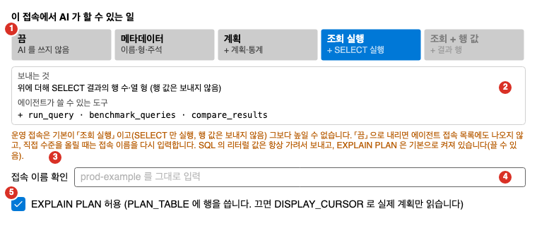

Oranda의 AI 기능은 SQL 튜닝, SQL 설명, 오류 수정, 자유로운 질문을 돕습니다. 이 쪽에서는 AI 기능의 구성, 보내는 정보의 범위, 접속마다 정하는 AI 허용 수준, 값 가림, 운영 접속의 제한, 알아 둘 위험을 설명합니다.

- 모델을 고르고 프로필을 만드는 방법은 [AI 모델 설정](../models/)을 보세요.
- 대화 창 사용법은 [AI 대화](../chat/)를 보세요.
- AI 튜닝, 실행 계획 해설, SQL 설명, 오류 고치기 명령은 [AI 명령](../commands/)을 보세요.

## AI 기능이 하는 일

| 기능 | 설명 |
|---|---|
| AI 튜닝 | 편집기의 문장을 분석해 인덱스 후보와 재작성 제안을 받습니다. 제안은 비교 창에서 확인한 뒤 새 탭에 넣습니다. 자세한 내용은 [SQL 튜닝](../../plan/tuning/#ai-튜닝-시작-창)을 보세요. |
| 실행 계획 해설 | 커서 아래 문장의 실행 계획을 풀어서 설명합니다. |
| SQL 설명 | 커서 아래 문장이 하는 일을 설명합니다. |
| 오류 고치기 | 마지막 실행 오류가 난 문장을 고친 문장을 제안합니다. |
| 일반 대화 | 튜닝을 시작하지 않고 AI 대화 창에서 자유롭게 묻고 요청합니다. 이미지를 붙일 수 있는 모델도 있습니다. |

- 처음 값은 Claude Code입니다. **도구 > 설정 > AI 모델**에서 다른 모델을 고를 수 있습니다. 「선택 안 함」을 고르면 AI 기능을 쓰지 않습니다.
- AI 모델 탭과 접속 편집의 「AI 허용 수준」은 AI 튜닝 기능이 켜져 있을 때만 보입니다. 기능은 **설정 > 기능**에서 켜고 끕니다. [설정](../../settings/options/#기능)을 보세요.
- 이 기능들은 실험 기능입니다. 결과는 적용하기 전에 직접 확인하세요.

## 쓸 수 있는 모델

설정의 모델 목록에는 다음이 있습니다. 자세한 설정은 [AI 모델 설정](../models/)에서 설명합니다.

| 종류 | 설명 | 상태 |
|---|---|---|
| Claude Code | 이 PC에 로그인된 `claude`를 씁니다. 키와 주소가 필요 없습니다. | 쓸 수 있음 |
| Codex CLI | 이 PC에 로그인된 Codex CLI를 씁니다. | 쓸 수 있음 |
| Antigravity CLI | 이 PC에 로그인된 Antigravity CLI를 씁니다. | 쓸 수 있음 |
| opencode | 시스템 CLI 목록에 줄이 있습니다. | 준비 중입니다. 고를 수 없습니다. |
| 내 프로필 | 주소, 모델, 필요하면 API 키를 넣어 만듭니다. Anthropic, Z.AI, OpenAI, Google Gemini, Ollama, LM Studio, 직접 입력 중에서 고릅니다. | 쓸 수 있음 |
| 기타 CLI | 이름과 실행 명령을 등록해 글만 주고받습니다. DB 도구는 쓰지 않습니다. | 쓸 수 있음. 제한이 많습니다. |

## AI가 받는 정보

AI가 받는 정보는 두 가지입니다. 하나는 Oranda가 요청에 실어 보내는 글이고, 다른 하나는 AI가 도구로 직접 읽는 DB 정보입니다.

- 요청에 싣는 글은 문장 글, 접속 별칭, 환경 라벨, AI 허용 수준, 사용자가 대화 창에 쓴 글입니다.
- 도구로 읽는 정보는 객체 구성, 실행 계획, 통계 같은 것입니다. 도구는 접속의 AI 허용 수준 안에서만 쓸 수 있습니다.
- 비밀번호와 호스트는 AI에 보내지 않습니다. 행 값과 히스토그램 끝값은 접속의 AI 허용 수준이 「조회 + 행 값」일 때만 보냅니다. 운영 접속과 값 가림 대화에서는 보내지 않습니다. 이때도 민감 컬럼의 값은 가립니다. 「로컬 AI」로 지정한 프로필은 예외입니다. 아래 「로컬 AI」를 보세요.
- 사용자가 대화 창에 입력한 글과 붙인 이미지는 Oranda가 가리지 않습니다. 글과 이미지 안의 값을 직접 확인하세요.

## 접속의 AI 허용 수준

접속마다 AI가 그 접속에서 할 수 있는 일의 한도를 정합니다. 접속 관리자에서 접속을 편집하고 접속 편집 창의 「AI 허용 수준」 영역을 펼칩니다. 접속 편집은 [접속 관리](../../connect/manage/)를 보세요.

1. 수준 5칸: 지금 수준을 고릅니다. 운영 접속은 「조회 + 행 값」을 고를 수 없습니다.
2. 보내는 것과 도구: 고른 수준이 보내는 것과 쓸 수 있는 도구입니다.
3. 운영 안내: 운영 접속일 때 보입니다.
4. 접속 이름 확인: 운영 접속의 수준을 올릴 때 접속 이름을 다시 입력합니다.
5. EXPLAIN PLAN 허용: 아래에서 설명합니다.

그림은 「끔」으로 저장된 운영 접속의 수준을 올린 모습이며, 접속은 설명을 위해 지어낸 예시입니다.

수준은 아래로 갈수록 많은 일을 허용합니다. 높은 수준은 낮은 수준이 허용하는 것을 모두 허용합니다.

| 수준 | 보내는 것 | 쓸 수 있는 도구 |
|---|---|---|
| 끔 | 아무것도 보내지 않습니다. | 없음 |
| 메타데이터 | 객체 이름, 형, 주석, PK/FK, 인덱스, PL/SQL 원문, 편집기 SQL 글 | `describe_object` |
| 계획 | 위에 더해 실행 계획, 표와 열 통계, 자식 커서. 바인드 값은 가립니다. | 위에 더해 `get_index_info`, `get_table_stats`, `get_histogram`, `get_cursor_plan`, `explain_plan`, `get_sql_stats`, `get_tuning_context` |
| 조회 실행 | 위에 더해 SELECT를 실행해 잰 시간, 읽기량, 행 수. 행 값은 보내지 않습니다. | 위에 더해 `benchmark_queries` |
| 조회 + 행 값 | 위에 더해 행 값과 히스토그램 끝값. 민감 컬럼은 가린 뒤에 보냅니다. | 새 도구는 없습니다. 위 도구의 결과에 행 값이 들어갑니다. |

접속 편집 창의 「AI 허용 수준」 설명에는 위 표와 다른 도구 이름이 나옵니다. 현재 앱의 도구는 위 9개입니다.

환경에 따라 처음 값과 최대 수준이 다릅니다.

| 환경 | 처음 값 | 최대 수준 |
|---|---|---|
| 개발, 테스트 | 계획 | 조회 + 행 값 |
| 운영 | 조회 실행 | 조회 실행 |

- 운영 접속은 「조회 + 행 값」을 고를 수 없습니다. 운영 접속에 저장된 「조회 + 행 값」은 「계획」으로 줄여서 읽습니다.
- 운영 접속에서 직접 수준을 올려 저장하려면 접속 이름을 그대로 다시 입력해야 합니다. 「접속 이름 확인」 칸에 접속 이름을 씁니다.
- **EXPLAIN PLAN 허용** 확인란이 있습니다. 켜면 AI가 `EXPLAIN PLAN`을 쓸 수 있고 이때 `PLAN_TABLE`에 행을 씁니다. 끄면 `DISPLAY_CURSOR`로 실제 계획만 읽습니다. 운영 접속에서도 처음에는 켜져 있고 접속별로 끌 수 있습니다.
- 수준이 「끔」이면 이 접속에서는 AI 명령이 꺼지고 AI 튜닝을 시작할 수 없습니다.
- AI 명령마다 필요한 수준이 다릅니다. [AI 명령](../commands/)을 보세요.

## 값 가림

AI에 보내는 SQL 문장은 값을 가려서 보낼 수 있습니다. 문자열과 숫자 리터럴을 `:v1`, `:v2` 같은 자리표시로 바꾸고, 주석 본문은 `--c1`이나 `/*c1*/` 같은 자리표시로 바꿉니다. 제안을 편집기에 넣을 때 원래 값과 주석으로 되돌립니다.

| 접속 | 값 가림 |
|---|---|
| 운영 | 항상 켜짐. 끌 수 없습니다. 「로컬 AI」로 지정한 프로필로 보낼 때만 가리지 않습니다. |
| 개발, 테스트 | **설정 > AI 모델**의 「SQL 의 리터럴 값을 :vN 으로 가려서 보냄」 확인란을 따릅니다. 「로컬 AI」로 지정한 프로필로 보낼 때는 가리지 않습니다. |

- 값 가림은 SQL 문장과 도구 결과의 값에만 적용됩니다. 대화 창에 직접 쓴 글과 붙인 이미지는 가려지지 않습니다. 이때 보내기 전에 확인 창이 나옵니다. [AI 대화](../chat/#가려지지-않는-글과-이미지)를 보세요.
- 가림 대화에서는 오류 문구의 본문을 보내지 않고 ORA 번호와 위치만 보냅니다.
- 닫히지 않은 문자열처럼 값을 가릴 수 없는 문장은 가림 대화에서 보내지 않습니다. 일반 대화에서는 그 문장을 범위로 쓰지 않고 DB 도구 없이 답합니다.
- 도구가 읽는 열 이름에 민감한 조각이 들어 있으면 그 열의 히스토그램 끝값, 최솟값, 최댓값을 내지 않습니다. 조각은 `PASSWORD`, `SECRET`, `TOKEN`, `PHONE`, `EMAIL`, `ACCOUNT`, `CARD`, `BIRTH`, `ADDR`, 「주민」, 「전화」, 「카드」, 「계좌」 같은 것입니다. 이름으로 판단하므로 이름에 드러나지 않는 민감한 열은 가려지지 않을 수 있습니다.
- 가림은 오류 글에 섞인 값을 다시 가릴 때 짧은 값을 건드리지 않습니다. 따옴표 안의 글은 3글자 이상, 숫자는 4자리 이상일 때만 다시 가립니다. 짧은 값이 오류 글에 그대로 보일 수 있습니다.

## 로컬 AI

직접 관리하는 서버의 모델은 프로필마다 「로컬 AI」로 지정할 수 있습니다. **LLM 프로필 관리**의 「로컬 AI (값을 가리지 않고 보냄)」 확인란을 켭니다. [AI 모델 설정](../models/#로컬-ai)을 보세요.

- 운영 접속을 포함해 SQL 문장의 값과 주석, 오류 문구의 본문, 히스토그램 끝값을 가리지 않고 보냅니다. 값 가림 설정이 켜져 있어도 가리지 않습니다.
- AI가 결과 행을 읽는 도구는 없습니다. 지정해도 조회 결과의 행이 나가지는 않습니다.
- 비밀번호, 주민번호, 카드, 계좌, 주소 열과 내용을 알 수 없는 가상 열, 숨은 열의 히스토그램 끝값은 계속 내지 않습니다. 열 이름으로 판단하므로 이름에 드러나지 않는 열은 가려지지 않을 수 있습니다. 조각은 `PASS`, `PW`, `RRN`, `JUMIN`, `RSDT`, `CARD`, `ACCOUNT`, `ACCT`, `ADDR`, 「비밀번호」, 「패스워드」, 「주민」, 「카드」, 「계좌」, 「주소」 같은 것입니다.
- 위 열의 값이라도 SQL 문장이나 주석에 직접 쓴 값은 그대로 갑니다. 예를 들어 `WHERE card_no = '1234'`의 `'1234'`는 가리지 않습니다. 대화 창에 입력한 글도 같습니다.
- 전화번호, 이메일, 생년월일, 고객 이름 같은 그 밖의 민감 열은 히스토그램 끝값을 보냅니다.
- 도구가 실패한 오류 문구의 본문도 보냅니다. 바인드 값은 가립니다. 튜닝 문맥의 일부를 읽지 못한 이유는 오류 번호만 보냅니다.
- API 형식이 Anthropic이면 claude 실행 파일로 연결하므로 가리지 않은 값이 이 PC의 claude 대화 기록에 남을 수 있습니다. 저장한 튜닝 레포트에도 문장의 값이 그대로 들어갑니다.
- 접속의 AI 허용 수준이 「끔」이면 아무것도 보내지 않습니다. 쓸 수 있는 도구도 늘지 않습니다. 허용 수준이 「계획」인 접속에서 벤치마크를 쓸 수 없는 것은 그대로입니다.
- 바인드 값은 지금처럼 AI에 보내지 않습니다.
- 값을 가린 대화와 가리지 않은 대화는 이어지지 않습니다. 대화 중에 지정을 바꾸면 앞 대화를 이어 보내지 않고 새 대화로 시작합니다. 실행 중에 지정을 풀거나 주소를 고치면 그 실행을 멈춥니다.
- 감사 기록의 인자 요약에 `data=local_ai`가 남습니다.

## 운영 접속에서의 제한

- 값 가림이 항상 켜집니다. 「로컬 AI」로 지정한 프로필로 보낼 때는 가리지 않습니다.
- AI 허용 수준의 최대는 「조회 실행」입니다. 행 값은 보내지 않습니다. 「로컬 AI」로 지정한 프로필로 보낼 때는 히스토그램 끝값을 보냅니다.
- AI 튜닝의 벤치마크 반복은 5회 이하이고, 처음에는 꺼져 있습니다. 시작 창에서 켤 수 있습니다. 문장 하나(반복 전체)가 쓸 수 있는 시간은 설정의 「운영 벤치마크 제한 시간(초)」입니다. [AI 모델 설정](../models/#운영-벤치마크-제한-시간)을 보세요.
- Codex CLI와 Antigravity CLI는 운영 접속에서도 쓸 수 있습니다. 이때도 값 가림이 켜져 있고, 가린 뒤의 대화 내용은 그 CLI의 폴더에 남습니다.
- 기타 CLI는 운영 접속과 값 가림이 켜진 접속에는 보내지 않습니다.

## 알아 둘 위험

- **시스템 CLI는 실제 로그인으로 끝까지 시험하지 못했습니다.** Codex CLI와 Antigravity CLI는 실제 왕복 시험을 마치기 전에 켠 기능입니다. Windows의 잠금(토큰과 파일 권한)도 확인하지 못했습니다. 중요한 접속에서 쓰기 전에 개발 접속에서 먼저 시험하세요.
- **대화 기록이 CLI 폴더에 남습니다.** Codex CLI의 대화는 기본으로 `~/.codex`에(환경 변수 `CODEX_HOME`을 쓰면 그 폴더에), Antigravity CLI의 대화는 `~/.gemini/antigravity-cli`에 남습니다. Oranda가 지울 수 없습니다. 가린 뒤의 내용도 남습니다.
- **Codex CLI와 Antigravity CLI의 한 차례 실행은 최대 6시간입니다.** 벤치마크 제한 시간을 0으로 두어도 이 제한은 적용됩니다. Claude Code에는 이 제한이 없습니다.
- **기타 CLI는 샌드박스가 아닙니다.** 명령은 빈 임시 폴더에서 실행하지만 현재 사용자 권한으로 실행됩니다. CLI는 다른 폴더의 파일을 읽거나 고칠 수 있습니다. 자세한 내용은 [AI 모델 설정](../models/#기타-cli)을 보세요.
- **API 주소가 `http://`이고 localhost가 아니면** SQL과 이미지가 암호화 없이 전달됩니다. 설정 창에 경고가 나옵니다.
- **AI가 낸 SQL은 틀릴 수 있습니다.** 제안은 비교 창에서 확인하세요. 조인 문법 같은 규칙은 AI에 주는 지시이며 Oranda가 결과를 검사하거나 바꾸지 않습니다.

## 문제가 생길 때

| 증상 | 원인 | 확인할 것 |
|---|---|---|
| AI 튜닝이나 AI 명령이 회색입니다 | 모델을 「선택 안 함」으로 두었거나, 접속의 AI 허용 수준이 「끔」이거나, 접속이 없거나, MyBatis 문서가 활성입니다. | **설정 > AI 모델**에서 모델을 고르고 접속 편집에서 허용 수준을 확인하세요. |
| 「오류 고치기」가 회색입니다 | 고칠 실행 오류가 없습니다. | 오류가 난 문장을 먼저 실행하세요. |
| 「실행 계획 해설」이 회색입니다 | 접속의 AI 허용 수준이 「계획」 미만입니다. | 접속 편집에서 수준을 「계획」 이상으로 올리세요. |
| 설정 창에 「AI 모델」 탭이 없습니다 | AI 튜닝 기능이 꺼져 있습니다. | **설정 > 기능**에서 주 업무와 기능을 확인하세요. |
| 운영 접속에서 수준을 올리지 못합니다 | 운영 접속의 최대 수준은 「조회 실행」입니다. | 행 값이 필요하면 개발이나 테스트 접속을 쓰세요. |
