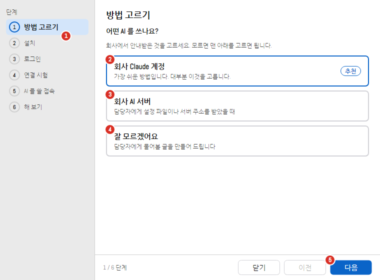
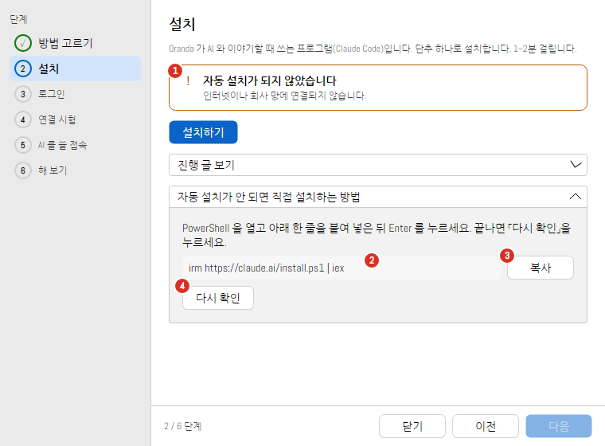
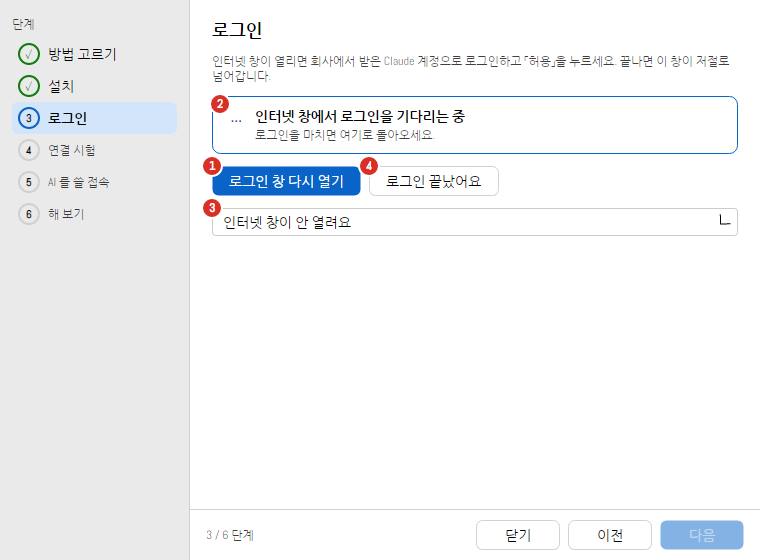
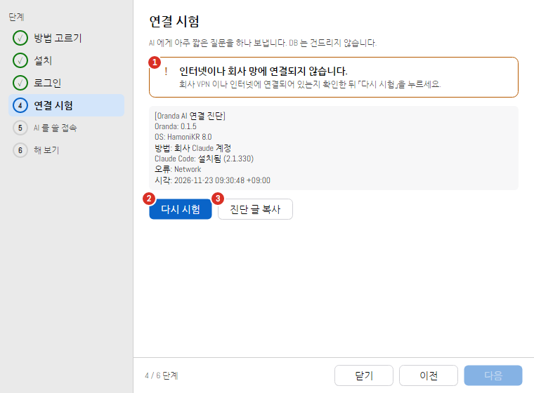
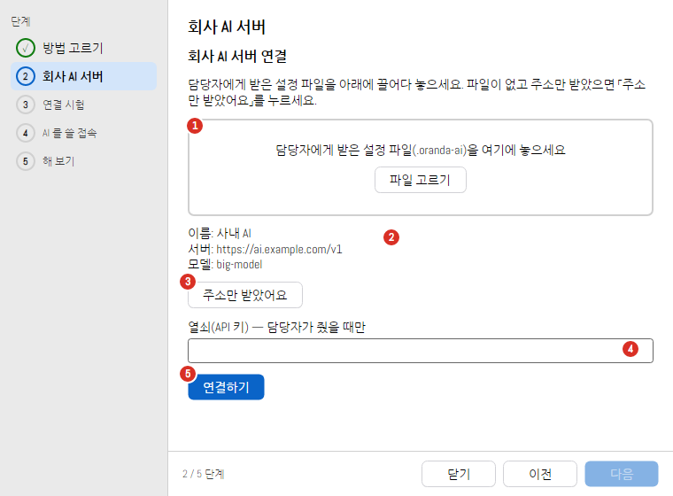
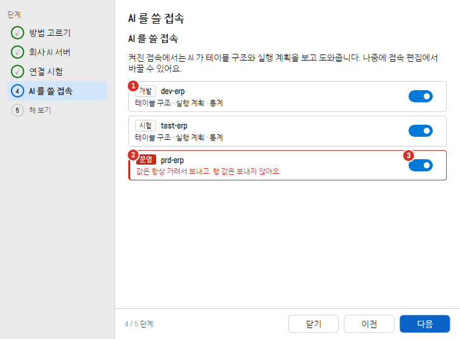
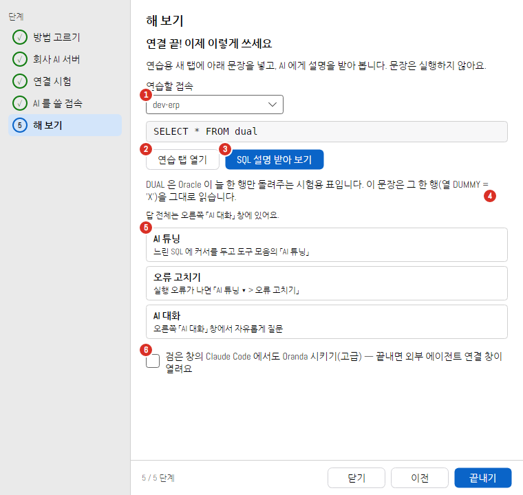
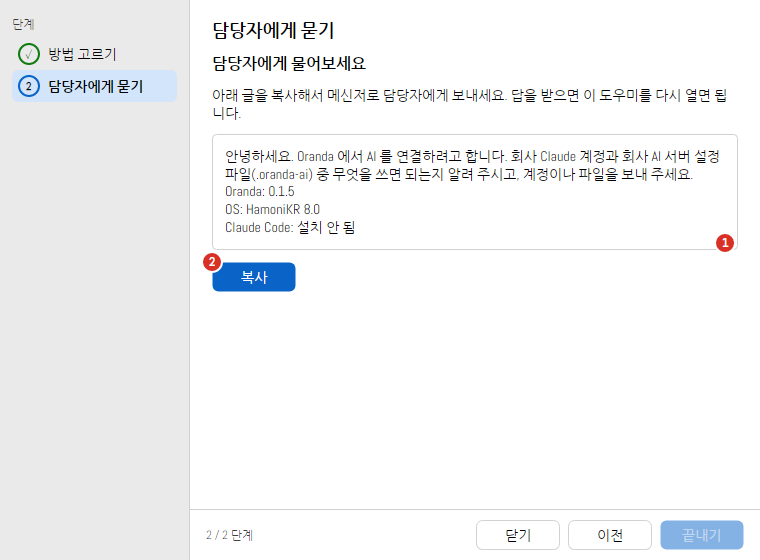

AI 연결 도우미는 AI 를 처음 연결하는 사람을 위한 따라 하기 창입니다. 단계마다 화면의 안내대로 단추를 누르면 됩니다. 어려운 설정은 도우미가 대신 합니다.

- 왼쪽에 단계 목록이 있고, 아래에 「이전」·「다음」 단추가 있습니다. 한 단계가 끝나야 「다음」이 켜집니다.
- 언제든 「닫기」로 닫을 수 있습니다. 다음에 열면 닫은 곳부터 이어 합니다.
- 다 끝난 뒤에 모델을 바꾸거나 더 자세히 설정하려면 [AI 모델 설정](../models/)을 보세요.

## 여는 곳

도우미는 세 곳에서 엽니다.

1. 메뉴 **도구 > AI 연결 도우미…**: 언제든 엽니다.
2. 처음 실행할 때 한 번 묻기: AI 가 아직 연결되지 않았으면 Oranda 를 켠 뒤 「AI 를 연결할까요?」 를 한 번 묻습니다. **AI 연결**을 누르면 도우미가 열리고, **나중에**를 누르면 다시 묻지 않습니다. 나중에는 도구 메뉴에서 엽니다.
3. AI 명령이 실패했을 때: AI 튜닝이나 AI 대화가 「AI 가 아직 연결되지 않았습니다」 로 멈추면 그 자리에 **AI 연결 도우미 열기** 단추가 나옵니다.

## 방법 고르기



1. 단계 목록: 지금 단계가 파랗게, 끝난 단계는 ✓ 로 보입니다. 고른 방법에 따라 단계가 바뀝니다.
2. 회사 Claude 계정: 회사에서 Claude 계정을 받았을 때 고릅니다. 가장 쉬운 방법이라 「추천」 표시가 붙습니다. 이 PC 에 이미 설치되어 있으면 「이 PC 에 설치됨」 이 함께 보입니다.
3. 회사 AI 서버: 담당자에게 설정 파일(`.oranda-ai`)이나 서버 주소를 받았을 때 고릅니다.
4. 잘 모르겠어요: 무엇을 골라야 할지 모를 때 고릅니다. 담당자에게 보낼 글을 만들어 드립니다.
5. 다음: 방법을 고르면 켜집니다.

- 주 업무가 「조회만」이면 AI 를 쓸 수 없다는 안내와 **주 업무를 SQL 개발로 바꾸기** 단추가 대신 나옵니다.
- AI 기능이 꺼져 있으면 **기능 설정 열기** 단추가 나옵니다. 기능 설정에서 「AI 튜닝」을 켜세요.

## 회사 Claude 계정으로 연결하기

단계: 방법 고르기 → 설치 → 로그인 → 연결 시험 → [AI 를 쓸 접속](#ai-를-쓸-접속) → [해 보기](#해-보기).

### 설치

Oranda 가 AI 와 이야기할 때 쓰는 프로그램(Claude Code)을 설치합니다. 이미 설치되어 있으면 「설치되어 있습니다」 가 나오고 바로 「다음」을 누르면 됩니다.

1. **설치하기**를 누릅니다. 1~2분 걸립니다. 창을 닫지 말고 기다리세요.
2. 「설치되어 있습니다」 가 나오면 **다음**을 누릅니다.

자동 설치가 되지 않으면 아래처럼 보입니다.



1. 원인: 쉬운 말로 무엇이 안 됐는지 알려 줍니다. 「인터넷이나 회사 망에 연결되지 않습니다」 면 회사 VPN 이나 인터넷 연결을 확인하세요.
2. 직접 설치하는 한 줄: Windows 는 PowerShell, Mac·Linux 는 터미널(검은 창)에 붙여 넣을 한 줄입니다.
3. 복사: 그 한 줄을 복사합니다. PowerShell 이나 터미널을 열고 붙여 넣은 뒤 Enter 를 누르세요.
4. 다시 확인: 직접 설치가 끝나면 누릅니다. 설치를 찾으면 「다음」이 켜집니다.

| PC | 직접 설치하는 한 줄 |
|---|---|
| Windows (PowerShell) | `irm https://claude.ai/install.ps1 \| iex` |
| Mac·Linux (터미널) | `curl -fsSL https://claude.ai/install.sh \| bash` |

### 로그인



1. 로그인 창 열기: 누르면 인터넷 창이 열립니다. 회사에서 받은 Claude 계정으로 로그인하고 「허용」을 누르세요. 창이 닫혔으면 **로그인 창 다시 열기**를 누릅니다.
2. 상태: 몇 초마다 로그인했는지 확인합니다. 로그인이 끝나면 「로그인했습니다」 가 나오고 저절로 다음 단계로 넘어갑니다.
3. 인터넷 창이 안 열려요: 펼치면 로그인 주소와 **주소 복사** 단추가 나옵니다. 주소를 복사해 인터넷 창 주소 칸에 붙여 넣으세요.
4. 로그인 끝났어요: 로그인을 마쳤는데 넘어가지 않으면 누릅니다. 아직 끝나지 않았으면 「허용」까지 눌렀는지 확인하라는 안내가 나옵니다.

### 연결 시험

AI 에게 아주 짧은 질문을 하나 보내 잘 연결됐는지 봅니다. 데이터베이스는 건드리지 않습니다. 이 단계에 들어오면 저절로 시험합니다.

- 잘 되면 「AI 가 답했습니다 · 2.8초」 처럼 걸린 시간이 나오고 「다음」이 켜집니다.
- 안 되면 아래처럼 보입니다.



1. 원인과 할 일: 무엇이 안 됐는지와 해 볼 일을 한 줄씩 알려 줍니다.
2. 다시 시험: 할 일을 해 본 뒤 누릅니다.
3. 진단 글 복사: 그래도 안 되면 진단 글을 복사해 담당자에게 보내세요.

| 원인 | 해 볼 일 |
|---|---|
| 이 PC 에 Claude Code 가 설치되어 있지 않습니다 | 「이전」으로 돌아가 설치를 다시 합니다. |
| 아직 Claude 에 로그인하지 않았습니다 | 「이전」으로 돌아가 로그인을 다시 합니다. |
| 인터넷이나 회사 망에 연결되지 않습니다 | 회사 VPN 이나 인터넷에 연결되어 있는지 확인하고 「다시 시험」을 누릅니다. |
| AI 가 제시간에 답하지 않았습니다 | 잠시 뒤 「다시 시험」을 누릅니다. |
| AI 서버가 요청을 거절했습니다 | 회사 계정으로 Claude Code 를 쓸 수 있는지 담당자에게 묻습니다. |
| 알 수 없는 문제가 생겼습니다 | 진단 글을 복사해 담당자에게 보냅니다. |

진단 글에는 Oranda 판, 운영체제, 고른 방법, Claude Code 설치 여부와 판, 오류 종류, 시각만 들어갑니다. 비밀번호·열쇠·접속 주소·계정 이름은 넣지 않습니다.

## 회사 AI 서버로 연결하기

단계: 방법 고르기 → 회사 AI 서버 → 연결 시험 → [AI 를 쓸 접속](#ai-를-쓸-접속) → [해 보기](#해-보기).

### 회사 AI 서버



1. 설정 파일 놓는 곳: 담당자에게 받은 설정 파일(`.oranda-ai`)을 여기에 끌어다 놓습니다. 끌어다 놓기가 어려우면 **파일 고르기**를 누릅니다.
2. 읽은 내용: 파일에서 읽은 이름·서버·모델입니다. 맞는지 봅니다.
3. 주소만 받았어요: 파일이 없고 서버 주소만 받았으면 누릅니다. 서버 주소 칸이 나옵니다. 주소를 붙여 넣고 **모델 새로고침**을 누르면 서버에 물어 모델을 고릅니다.
4. 열쇠(API 키): 담당자가 열쇠를 줬을 때만 넣습니다. 열쇠는 설정 파일이 아니라 이 PC 의 열쇠 저장소에 따로 둡니다.
5. 연결하기: 누르면 「연결했어요. 「다음」을 눌러 연결을 시험해 보세요.」 가 나오고 「다음」이 켜집니다.

| 안내 글 | 해 볼 일 |
|---|---|
| 주소가 올바르지 않아요 | `https://` 로 시작하는 주소를 그대로 붙여 넣습니다. |
| 이 서버는 열쇠(API 키)가 필요해요 | 담당자에게 받은 열쇠를 넣습니다. |
| 서버에서 모델 목록을 받지 못했어요 | 주소와 열쇠를 확인하고 다시 누릅니다. |
| 쓸 모델을 정하지 못했어요 | **모델 새로고침**을 누르거나 담당자에게 모델 이름을 묻습니다. |

설정 파일은 담당자가 만들어 나눠 줍니다. 모양은 아래와 같습니다. 열쇠는 파일에 넣지 않습니다. 열쇠 같은 칸이 들어 있는 파일은 도우미가 읽지 않습니다.

```json
{
  "format": "oranda-ai",
  "version": 1,
  "name": "사내 AI",
  "baseUrl": "https://ai.example.com/v1",
  "apiFormat": "openai",
  "model": "big-model",
  "localAi": false
}
```

| 칸 | 뜻 |
|---|---|
| `format`·`version` | 이 파일이 Oranda AI 설정 파일임을 나타냅니다. `oranda-ai`, `1` 그대로 둡니다. |
| `name` | 화면에 보일 이름입니다. 없으면 주소의 서버 이름을 씁니다. |
| `baseUrl` | 서버 주소입니다. `http://` 나 `https://` 로 시작합니다. |
| `apiFormat` | `openai` 또는 `anthropic` 입니다. |
| `model` | 쓸 모델입니다. 없으면 서버에 물어 고릅니다. |
| `localAi` | 회사 안에서만 도는 서버면 `true` 입니다. |

### 연결 시험

회사 Claude 계정의 [연결 시험](#연결-시험)과 같습니다. 회사 AI 서버 단계에서 만든 연결로 짧은 질문을 하나 보냅니다. 「AI 서버가 요청을 거절했습니다」 가 나오면 「이전」으로 돌아가 열쇠와 모델을 확인하거나 담당자에게 물어보세요.

## AI 를 쓸 접속

두 방법(회사 Claude 계정·회사 AI 서버) 모두 연결 시험 뒤에 이 단계가 나옵니다. 내 접속 목록이 나오고, 접속마다 켬·끔 스위치가 있습니다.



1. 개발·시험 접속: 켜면 AI 가 테이블 구조·실행 계획·통계를 보고 도와줍니다(AI 허용 수준 「계획」).
2. 운영 접속: 빨간 테두리와 빨간 「운영」 표가 붙습니다. 켜 두면 지금 기본값 그대로 쓰고, 값은 항상 가려서 보내며 행 값은 보내지 않습니다.
3. 켬·끔 스위치: 끄면 「AI 를 쓰지 않아요」 로 바뀌고 AI 가 그 접속을 보지 않습니다(AI 허용 수준 「끔」). 바꾸면 바로 저장합니다.

- 모두 끄면 「해 보기」 단계를 건너뜁니다. 아직 만든 접속이 없어도 건너뜁니다.
- 나중에 접속 편집의 「AI 허용 수준」에서 바꿀 수 있습니다. [AI 기능 개요](../overview/)를 보세요.

## 해 보기

마지막 단계입니다. 연습용 새 탭에 `SELECT * FROM dual` 을 넣고 AI 에게 설명을 받아 봅니다. 문장은 실행하지 않습니다.



1. 연습할 접속: 앞 단계에서 AI 를 켠 접속 가운데 하나를 고릅니다.
2. 연습 탭 열기: 연습용 새 탭을 열고 문장을 넣습니다.
3. SQL 설명 받아 보기: AI 에게 문장 설명을 받습니다. 연습 탭을 아직 안 열었으면 함께 엽니다.
4. AI 의 답: 답의 앞부분이 보입니다. 답 전체는 오른쪽 「AI 대화」 창에 있습니다.
5. 자주 쓰는 세 기능: AI 튜닝, 오류 고치기, AI 대화를 어디서 쓰는지 알려 줍니다.
6. 고급 확인란: 「검은 창의 Claude Code 에서도 Oranda 시키기(고급)」 를 켜고 **끝내기**를 누르면 외부 에이전트 연결 창이 열리고 스킬을 설치할 수 있습니다. [외부 에이전트](../external-agents/)를 보세요.

- 답이 오면 **끝내기**가 켜집니다. 답을 받지 못하면 그 접속에 연결돼 있는지 확인하고, 오른쪽 「AI 대화」 창에서 이유를 본 뒤 다시 누릅니다.

## 잘 모르겠으면

**잘 모르겠어요**를 고르면 「담당자에게 묻기」 단계로 갑니다. 담당자에게 보낼 글을 만들어 드립니다.



1. 보낼 글: 무엇을 받으면 되는지(회사 Claude 계정 또는 설정 파일) 한 줄과 Oranda 판, 운영체제, Claude Code 설치 여부만 들어갑니다. 비밀번호·열쇠·접속 정보는 넣지 않습니다.
2. 복사: 누르면 「복사했어요. 메신저에 붙여 넣어 보내세요.」 가 나옵니다. 메신저에 붙여 넣어 담당자에게 보냅니다. 복사가 안 되면 글을 직접 골라 복사합니다.
- 담당자에게 계정이나 설정 파일을 받으면 도우미를 다시 열고 그 방법을 고르세요.
