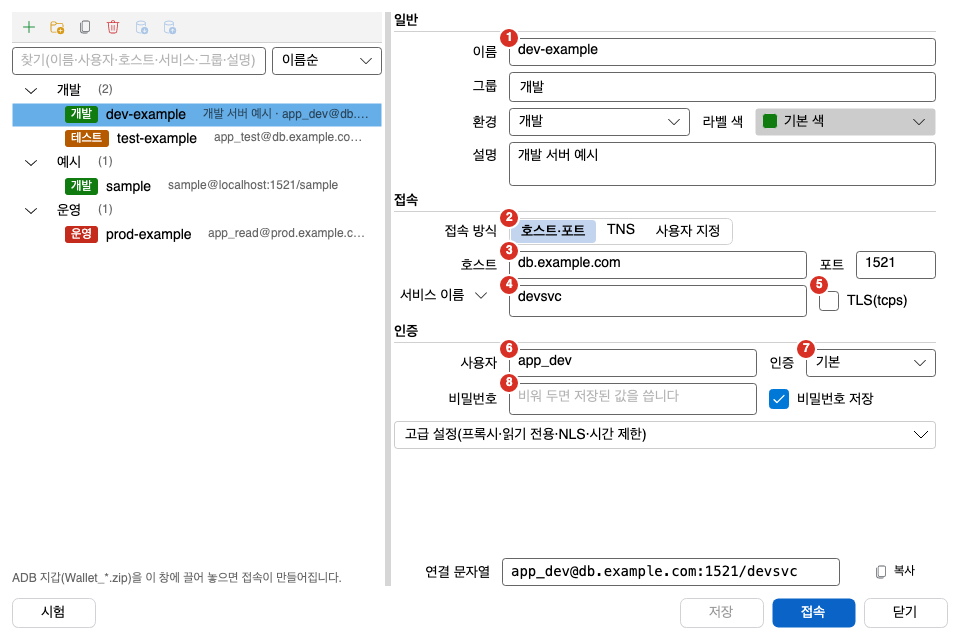
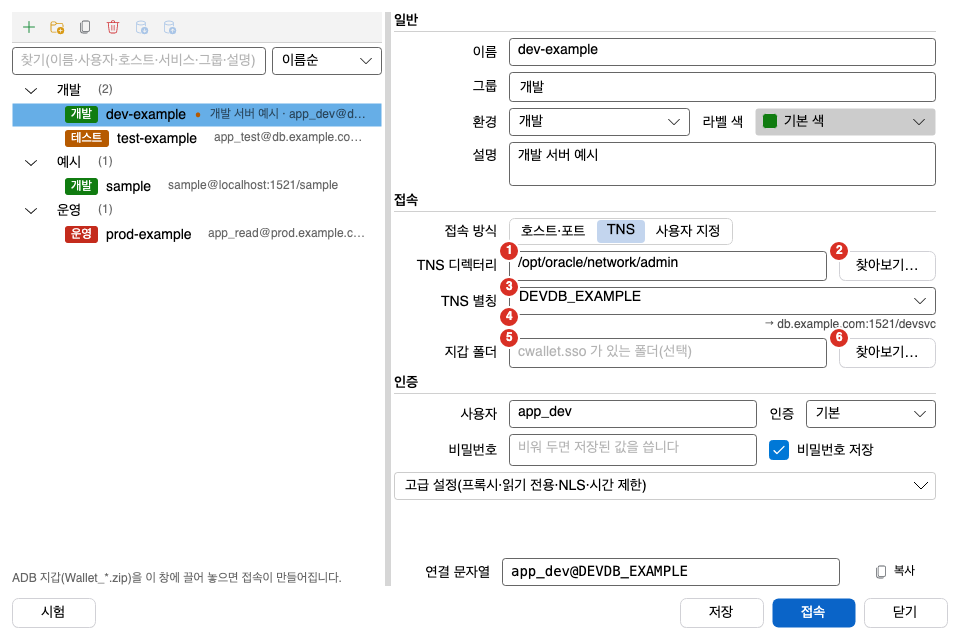

처음 쓸 때는 접속을 하나 만들고 데이터베이스에 연결합니다. 이 쪽은 필요한 값, 접속 편집 영역의 칸, 첫 접속 절차를 설명합니다. 접속 목록 정리, 가져오기, 비밀번호 변경은 [접속 관리](../manage/)에서 설명합니다.

## 준비할 값

호스트 방식으로 접속하려면 아래 값이 필요합니다. 값은 데이터베이스 관리자에게 받으세요. 설치 조건은 [사전 조건](../../install/prerequisites/)에 있습니다.

| 칸 | 넣을 값 | 이 설명서의 예 |
|---|---|---|
| 이름 | 목록에 보일 접속 이름 | `dev-example` |
| 호스트 | 서버 주소 | `db.example.com` |
| 포트 | 리스너 포트. 처음 값은 `1521` | `1521` |
| 서비스 | 서비스 이름 또는 SID | `example_svc` |
| 사용자 | 데이터베이스 사용자 | `app_dev` |
| 비밀번호 | 사용자의 비밀번호 | 예를 들지 않음 |

내 PC에 샘플 DB를 만들었다면 이름에 `sample`, 호스트에 `localhost`를 넣으세요.

## 접속 편집 영역

접속 관리자 창의 오른쪽에 있는 영역입니다. 처음 열면 접속 방식이 「호스트·포트」로 정해져 있습니다.



1. 이름: 접속 목록에 보이는 이름입니다. 같은 이름의 접속이 이미 있으면 저장되지 않습니다. 대소문자는 구분하지 않습니다.
2. 접속 방식: 「호스트·포트」, 「TNS」, 「사용자 지정」 중 하나를 고릅니다.
3. 호스트와 포트: 호스트 칸에 서버 주소를 입력합니다. 오른쪽의 포트 칸은 처음 값이 `1521`입니다. 포트를 비워 두면 포트를 지정하지 않습니다. 포트에는 1-65535 사이 숫자만 쓸 수 있습니다.
4. 서비스: 서비스 이름을 입력합니다. 칸 왼쪽의 상자에서 「서비스 이름」 또는 「SID」를 고릅니다.
5. TLS(tcps): 켜면 `tcps://` 방식으로 접속합니다. 켜면 「지갑 폴더」 칸이 나타납니다.
6. 사용자: 데이터베이스 사용자 이름을 입력합니다.
7. 인증: 처음 값은 「기본」입니다. 「SYSDBA」, 「SYSOPER」, 「SYSBACKUP」, 「SYSDG」, 「SYSKM」도 고를 수 있습니다.
8. 비밀번호: 비밀번호를 입력합니다. 칸에는 「비워 두면 저장된 값을 씁니다」라고 적혀 있습니다. 칸 오른쪽의 「비밀번호 저장」은 처음에 켜져 있습니다. 끄면 접속할 때마다 비밀번호를 묻습니다.

필수 칸은 이름, 사용자, 그리고 접속 방식에 따른 칸입니다. 「호스트·포트」에서는 호스트와 서비스, 「TNS」에서는 TNS 별칭, 「사용자 지정」에서는 접속 문자열입니다. 필수 칸이 비어 있으면 칸 테두리가 빨갛게 바뀌고, 라벨이 있는 칸은 라벨 글자도 빨갛게 바뀝니다. 이때 「시험」과 「접속」 단추를 누를 수 없습니다. 새 접속은 아무것도 입력하기 전에는 빨간 표시를 보이지 않습니다.

칸 아래에는 읽기 전용 「연결 문자열」 칸이 있습니다. 입력한 값으로 만든 `사용자@접속 문자열`을 보여 줍니다. 비밀번호는 넣지 않습니다.

### TNS 방식

「접속 방식」에서 「TNS」를 고르면 tnsnames.ora의 별칭으로 접속합니다. ADB 지갑으로 접속할 때도 이 방식을 씁니다.



1. TNS 디렉터리: `tnsnames.ora`가 있는 폴더입니다. 선택 칸입니다.
2. 찾아보기…: 폴더 선택 창을 엽니다.
3. TNS 별칭: ▾를 누르면 `tnsnames.ora`의 별칭이 모두 나옵니다. 목록에 없는 별칭도 직접 입력할 수 있습니다.
4. 별칭 요약: 고른 별칭의 `host:port/service`를 `→` 뒤에 보여 줍니다. 폴더에 파일이나 별칭이 없으면 안내 글이 나옵니다.
5. 지갑 폴더: `cwallet.sso`가 있는 폴더입니다. 선택 칸입니다.
6. 찾아보기…: 지갑 폴더 선택 창을 엽니다.

TNS 디렉터리를 입력하면 별칭 목록을 읽습니다. 호스트와 접속 문자열이 비어 있으면 접속 방식이 「TNS」로 바뀝니다. 별칭이 하나뿐이고 별칭 칸이 비어 있으면 그 별칭이 들어갑니다. 이름 칸이 비어 있으면 고른 별칭이 이름이 됩니다.

### 사용자 지정 방식

「접속 방식」에서 「사용자 지정」을 고르면 접속 문자열 칸이 나옵니다. 아래 형식을 쓸 수 있습니다.

- `host:1521/service`
- `tcps://…`
- tnsnames.ora 형식의 `(DESCRIPTION = …)`. 여러 줄과 주석을 그대로 붙여 넣을 수 있습니다.

Enter 키는 줄을 바꿉니다. 다음 칸으로 가려면 Tab 키를 누르세요. 별칭이 붙은 항목(`별칭 = (DESCRIPTION = …)`)을 붙여 넣으면, 이름 칸이 비어 있을 때 별칭이 이름으로 들어갑니다. 저장하고 접속할 때는 별칭을 뗀 기술자를 씁니다. 여는 괄호와 닫는 괄호의 수가 다르면 칸 아래에 오류 글이 나옵니다.

접속 문자열에는 비밀번호를 넣을 수 없습니다. `password=`나 `user/비밀번호@` 형태가 있으면 저장되지 않습니다.

## 비밀번호는 어디에 저장되나요

「비밀번호 저장」을 켜면 비밀번호는 운영체제의 안전 저장소에 보관합니다.

- Windows: DPAPI(현재 사용자 범위)로 암호화한 파일에 저장합니다.
- macOS: 키체인에 저장합니다.

접속 목록 파일(`connections.json`)에는 비밀번호 대신 저장소를 가리키는 참조 문자열만 남습니다. 접속 목록을 내보낸 파일에도 비밀번호는 들어가지 않습니다.

## 처음 접속하기

1. 저장된 접속이 없으면 시작 화면의 「접속 추가…」를 누르세요. 접속이 이미 있으면 파일 > 접속 > 접속 관리자를 고르세요. 단축키는 Windows에서 `Ctrl+Shift+O`, macOS에서 `Cmd+Shift+O`입니다.
2. 저장된 접속이 없으면 접속 관리자가 새 접속 입력 상태로 열립니다. 아래 상태 글에 「새 접속을 입력하세요.」가 보입니다. 접속이 이미 있으면 목록 위의 「새 접속」 단추를 누르세요.
3. 이름 칸에 접속 이름을 입력하세요.
4. 「접속 방식」은 「호스트·포트」로 두세요.
5. 호스트 칸에 서버 주소를 입력하세요.
6. 포트가 `1521`이 아니면 포트 칸을 고치세요.
7. 서비스 칸에 서비스 이름을 입력하세요. SID로 접속하려면 칸 왼쪽 상자에서 「SID」를 고르세요.
8. 사용자 칸에 사용자 이름을 입력하세요.
9. 비밀번호 칸에 비밀번호를 입력하세요.
10. 「시험」 단추를 누르세요.
11. 시험이 성공하면 「접속」 단추를 누르세요.

「시험」은 지금 칸의 값으로 임시 연결을 열어 서버 버전과 걸린 시간을 보여 주고 바로 닫습니다. 아직 저장하지 않은 값도 시험할 수 있습니다. 시험은 활성 접속, 열린 세션 목록, 마지막 접속 시각을 바꾸지 않고 비밀번호도 저장하지 않습니다. 성공하면 아래 상태 글에 다음과 같은 문장이 나옵니다. 버전과 시간은 접속마다 다릅니다.

```text
접속 시험 성공: 서버 19.0.0.0.0(19c), 120 ms 걸림.
```

「접속」을 누르면 저장하지 않은 값을 먼저 저장하고 접속합니다. 비밀번호 칸이 비어 있고 저장된 비밀번호도 없으면 「`이름` 비밀번호」 창이 열립니다. 비밀번호를 입력하고 「접속」을 누르세요. 비밀번호 창에서 「취소」를 누르면 접속하지 않고, 상태 글에 「접속을 취소했습니다.」가 나옵니다.

## 접속한 뒤

접속에 성공하면 접속 관리자가 닫힙니다. 접속은 아래처럼 보입니다.

- 상태 표시줄 왼쪽에 환경 칩과 `사용자@접속 이름` 및 서버 버전이 나옵니다. 상태 표시줄은 [접속 관리](../manage/#상태-표시줄의-접속-표시)에서 설명합니다.
- 열린 문서가 하나도 없으면 새 SQL 편집기가 자동으로 열립니다. 지난번에 열었던 탭이 복원되어 있으면 자동으로 열지 않습니다.
- 다음에 쓸 때는 접속 관리자의 목록에서 접속을 고르고 「접속」을 누르면 됩니다.

## 문제가 생길 때

| 증상 | 원인 | 해결 |
|---|---|---|
| 「시험」과 「접속」 단추를 누를 수 없습니다. | 필수 칸이 비어 있습니다. | 빨간 표시가 있는 칸을 채우세요. |
| `호스트와 서비스 이름을 입력하세요.` | 호스트 칸이나 서비스 칸이 비어 있습니다. | 두 칸을 모두 입력하세요. |
| `포트는 1~65535 사이 숫자입니다.` | 포트 칸에 숫자가 아닌 값이 있거나 범위를 벗어났습니다. | 1-65535 사이 숫자를 입력하거나 칸을 비우세요. |
| `접속 시험이 제한 시간(15초)을 넘겨 멈췄습니다.` | 시간 안에 서버가 응답하지 않았습니다. | 호스트와 포트를 확인하세요. 네트워크가 느리면 「고급 설정」의 「접속 제한(초)」을 늘리세요. |
| `접속 시험 실패: ORA-…` | 서버나 드라이버가 접속을 거부했습니다. 상태 글에는 오류 첫 줄이 그대로 나옵니다. | 오류 번호와 메시지를 보고 서비스 이름, 사용자, 비밀번호를 확인하세요. |
| `지원하지 않는 서버 버전 …` | 서버가 Oracle 11.2보다 낮습니다. | Oranda는 Oracle 11.2 이상을 지원합니다. 지원하는 서버에 접속하세요. |
| `비밀번호가 만료되었습니다(ORA-28001). 새 비밀번호를 입력하세요.` | 사용자의 비밀번호가 만료되었습니다. | 이어서 나오는 비밀번호 변경 창에 새 비밀번호를 입력하세요. 자세한 내용은 [접속 관리](../manage/#비밀번호-바꾸기)에 있습니다. |
| `'…': 접속 문자열에 비밀번호를 넣을 수 없다. 비밀번호는 안전 저장소에만 저장한다.` | 접속 문자열에 `password=`나 `user/비밀번호@`가 있습니다. | 접속 문자열에서 비밀번호를 지우고 비밀번호 칸에 입력하세요. |
| `'…': 사용자에 '/' 를 쓸 수 없다(비밀번호가 섞인 것으로 본다).` | 사용자 칸에 `사용자/비밀번호`를 입력했습니다. | 사용자 칸에는 사용자 이름만 입력하세요. |
| `접속 이름 '…' 이(가) 중복된다.` | 같은 이름의 접속이 이미 있습니다. | 이름을 바꾸세요. |
| `접속 문자열의 괄호 짝이 맞지 않습니다. 여는 괄호와 닫는 괄호 수를 확인하세요.` | 사용자 지정 접속 문자열의 괄호 수가 맞지 않습니다. | 괄호를 맞추세요. |
