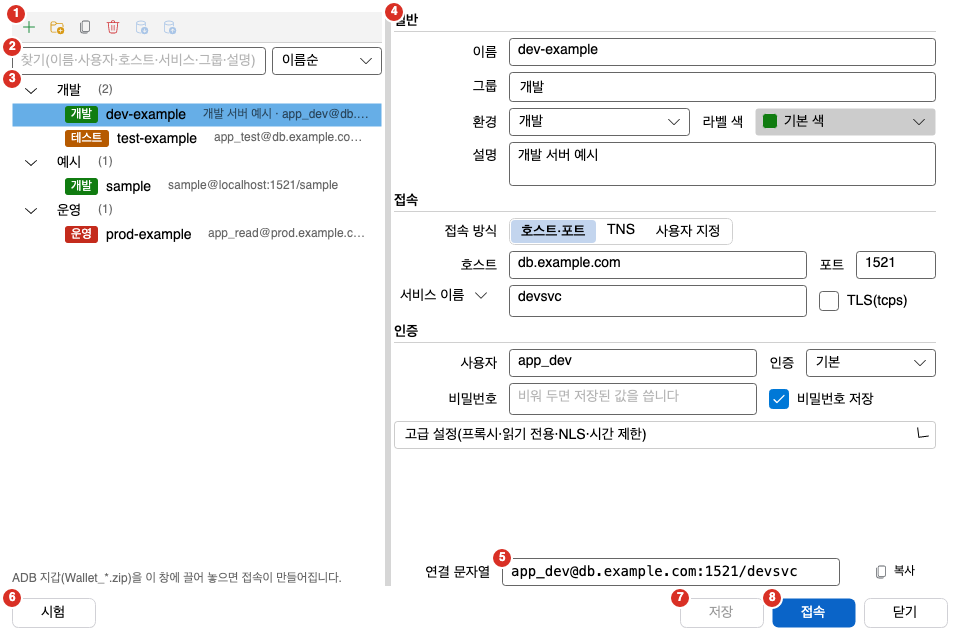
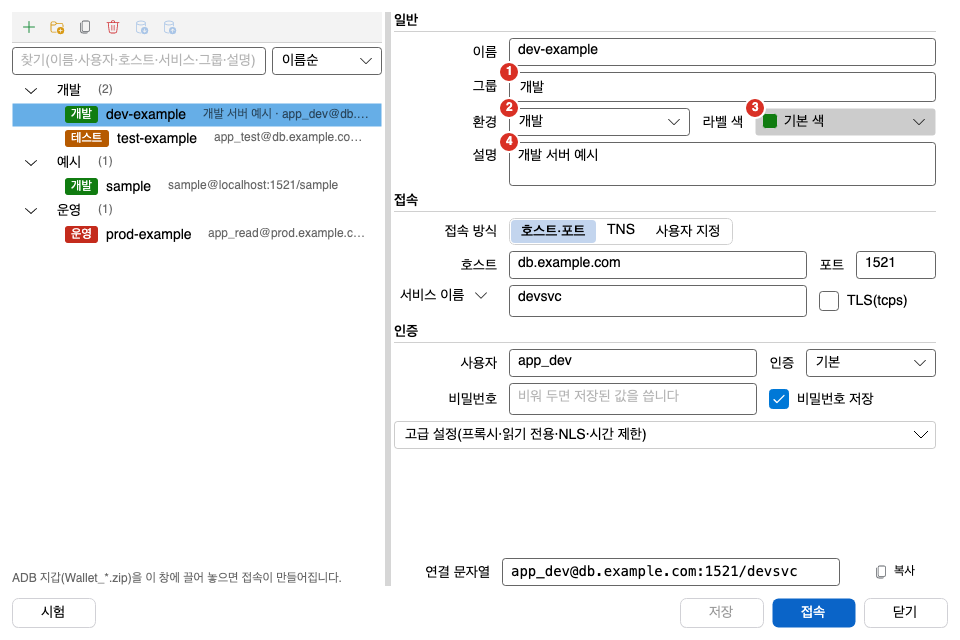
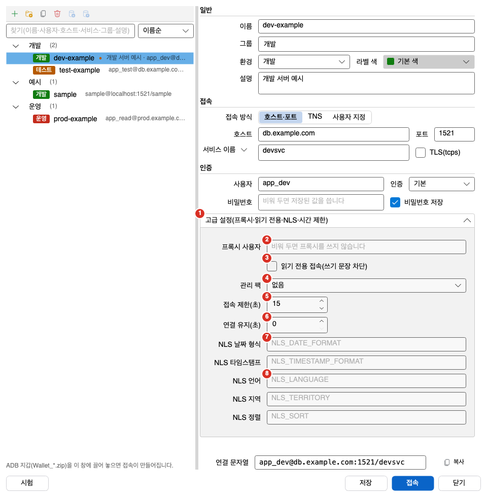

접속 관리자는 접속 정보를 저장하고, 폴더로 정리하고, 가져오거나 내보내고, 접속하는 창입니다. 이 쪽은 접속 관리자 창과 접속 메뉴의 명령, 열린 세션을 보는 「세션」 도구 창, 상태 표시줄의 접속 표시를 설명합니다. 처음 접속하는 방법은 [첫 접속](../first-connection/)에 있습니다.

## 접속 관리자 창

1. 새 접속: 빈 접속 편집 영역을 엽니다. 저장하지 않은 변경이 있으면 먼저 저장 여부를 묻습니다.
2. 찾기 칸: 입력한 글자가 들어 있는 접속만 목록에 남깁니다. 이름, 사용자, 접속 문자열(호스트, 포트, 서비스, TNS 별칭), 그룹, 프록시 사용자, 설명에서 찾습니다. 대소문자는 구분하지 않습니다. 찾는 동안에는 맞는 접속이 있는 폴더만 보이고 모두 펼쳐집니다.
3. 접속 목록: 폴더와 접속이 트리로 나옵니다. 접속 줄의 구성은 아래 표와 같습니다.
4. 접속 편집 영역: 목록에서 고른 접속의 값을 고칩니다. 목록에서 아무것도 고르지 않았으면 `왼쪽 목록에서 접속을 고르거나 「새 접속」을 누르세요.`가 나옵니다. 칸은 [첫 접속](../first-connection/#접속-편집-영역)과 이 쪽의 [접속 편집 영역의 나머지 칸](#접속-편집-영역의-나머지-칸)에서 설명합니다.
5. 연결 문자열 미리보기: 편집 영역 아래의 읽기 전용 칸입니다. `사용자@접속 문자열`을 보여 주며, 프록시 사용자를 쓰면 `프록시[사용자]@접속 문자열`로 보입니다. 인증이 「기본」이 아니면 뒤에 `AS SYSDBA` 같은 역할이 붙습니다. 비밀번호는 넣지 않습니다.
6. 시험: 지금 칸의 값으로 임시 연결을 열어 서버 버전과 걸린 시간을 보여 주고 바로 닫습니다. 시험하는 동안에는 「시험 취소」로 바뀝니다. 시간 제한은 「접속 제한(초)」입니다.
7. 저장: 편집 영역의 변경을 저장합니다. 변경이 있을 때만 누를 수 있습니다.
8. 접속: 저장하지 않은 값이 있으면 먼저 저장한 뒤 접속합니다. 접속에 성공하면 창이 닫힙니다. Enter 키를 눌러도 같습니다.

번호가 없는 단추와 칸도 있습니다.

- 목록 위의 아이콘 단추: 「새 접속」 오른쪽에 「새 폴더」, 「복제」, 「삭제」, 「가져오기」, 「내보내기」 단추가 차례로 있습니다. 글자가 없는 아이콘 단추여서 이름은 풍선 도움말과 화면 낭독기 이름에 있습니다.
  - 새 폴더: 폴더를 만듭니다. 폴더를 고른 상태면 그 폴더 안에, 접속을 고른 상태면 그 접속의 폴더 안에 만듭니다. 아무것도 고르지 않았으면 맨 위에 만듭니다.
  - 복제: 고른 접속을 복제합니다. 비밀번호는 복사하지 않습니다.
  - 삭제: 고른 접속이나 폴더를 지웁니다. 지우기 전에 확인 창이 나옵니다.
  - 가져오기: SQL Developer, tnsnames.ora, Orange 접속 목록, Oranda 접속 파일에서 접속을 가져옵니다.
  - 내보내기: 접속을 Oranda 접속 파일로 내보냅니다. 비밀번호는 넣지 않습니다.
- 정렬 상자: 찾기 칸 오른쪽에 있습니다. 「이름순」, 「최근 접속순」, 「직접 정렬」 중에서 고릅니다.
- 복사 단추: 연결 문자열 미리보기 오른쪽의 「복사」 단추는 미리보기 문자열을 클립보드에 복사합니다.
- 닫기: 창을 닫습니다. Esc 키를 눌러도 같습니다. 저장하지 않은 변경이 있으면 먼저 저장 여부를 묻습니다.
- 상태 글: 단추 줄 가운데에 있습니다. 저장, 시험, 접속의 결과와 오류를 보여 줍니다. 오류는 빨간 글자입니다.

목록 아래에는 `ADB 지갑(Wallet_*.zip)을 이 창에 끌어 놓으면 접속이 만들어집니다.`라는 안내가 있습니다. 접속 목록 파일에 문제가 있으면 단추 줄 위에 안내 글이 나옵니다.

### 접속 줄과 폴더 줄

| 표시 | 뜻 |
|---|---|
| 색 칩 「개발」, 「테스트」, 「운영」 | 접속의 환경입니다. 칩 색은 [환경 구분과 색](#환경-구분과-색)에서 설명합니다. |
| 이름 뒤의 ● | 이 접속에 저장하지 않은 변경이 있습니다. 풍선 도움말은 「저장하지 않은 변경」입니다. |
| 흐린 글 `사용자@접속 문자열` | 접속 대상입니다. 설명이 있으면 설명의 첫 줄과 `·`이 앞에 붙습니다. 설명 전체는 풍선 도움말에 나옵니다. |
| 오른쪽 끝의 시각 | 마지막으로 접속한 시각입니다. 오늘이면 `HH:mm`, 올해면 `MM-dd`, 그 전이면 `yyyy-MM-dd`입니다. 풍선 도움말에 전체 시각이 나옵니다. 접속한 적이 없으면 비어 있습니다. |
| 폴더 줄의 `(n)` | 하위 폴더까지 합친 접속 수입니다. |

### 목록의 키와 오른쪽 클릭 메뉴

접속 목록에는 아래 조작이 있습니다. 이 키는 접속 관리자 창이 직접 처리하며 단축키 설정과는 별개입니다.

| 조작 | 동작 |
|---|---|
| 접속 줄을 한 번 누르기 | 편집 영역에 그 접속을 불러옵니다. |
| 접속 줄을 두 번 누르기, `Enter` | 그 접속으로 접속합니다. |
| 폴더 줄에서 `Enter` | 폴더를 펼치거나 접습니다. |
| `Delete` | 고른 줄을 지웁니다. |
| `F2` | 접속이면 이름 칸으로, 폴더면 폴더 이름 편집으로 갑니다. |
| 오른쪽 클릭 | 누른 줄을 고르고 메뉴를 엽니다. |

오른쪽 클릭 메뉴에는 「접속」, 「복제」, 「삭제」, 「새 폴더」, 「폴더 이름 바꾸기」, 「폴더로 이동…」, 「연결 문자열 복사」가 있습니다. 「연결 문자열 복사」는 저장된 접속의 `사용자@접속 문자열`을 복사하며 비밀번호는 넣지 않습니다.

### 접속 관리자와 접속 메뉴의 명령

접속 관리자는 파일 > 접속 메뉴의 명령으로 엽니다. 같은 메뉴에 접속과 관련된 다른 명령도 있습니다. 기본 단축키가 있는 명령은 접속 관리자뿐입니다. 단축키의 `Primary`는 Windows에서 `Ctrl`, macOS에서 `Cmd`입니다.

| 명령 | 메뉴 | 기본 단축키 | 쓸 수 있는 때 |
|---|---|---|---|
| 접속 관리자 | 파일 > 접속 > 접속 관리자, 도구 모음의 접속 관리자 단추 | Windows `Ctrl+Shift+O`, macOS `Cmd+Shift+O` | 항상 |
| 편집기 접속 바꾸기 | 파일 > 접속 > 편집기 접속 바꾸기 | 없음 | SQL 문서나 PL/SQL 문서가 활성일 때 |
| 접속 끊기 | 파일 > 접속 > 접속 끊기, 도구 모음의 접속 끊기 단추 | 없음 | 연결된 접속이 있을 때 |
| 다시 접속 | 파일 > 접속 > 다시 접속 | 없음 | 접속이 끊겼을 때 |
| 비밀번호 변경 | 파일 > 접속 > 비밀번호 변경 | 없음 | 연결된 접속이 있을 때 |
| 접속 가져오기 | 파일 > 접속 > 접속 가져오기 | 없음 | 항상 |
| 접속 내보내기 | 파일 > 접속 > 접속 내보내기 | 없음 | 항상 |

상태 표시줄의 접속 구간을 눌러도 접속 관리자가 열립니다. 접속 관리자는 한 번에 하나만 열립니다. 이미 열려 있으면 그 창을 앞으로 가져옵니다.

## 접속 편집 영역의 나머지 칸

[첫 접속](../first-connection/#접속-편집-영역)에서 설명하지 않은 칸입니다. 「일반」 구역의 그룹, 환경, 라벨 색, 설명을 먼저 설명합니다.

1. 그룹: 접속이 들어갈 폴더 경로입니다. 기존 폴더를 목록에서 고르거나 직접 입력합니다. 하위 폴더는 `부모/자식`으로 씁니다. 칸을 비우면 폴더 없이 맨 위에 둡니다.
2. 환경: 「개발」, 「테스트」, 「운영」 중 하나입니다. 처음 값은 「개발」입니다.
3. 라벨 색: 접속 목록의 환경 칩 색을 정합니다. 누르면 색 고르기 창이 열립니다. 환경이 「운영」이면 이 단추는 꺼지고 색은 항상 빨강입니다.
4. 설명: 이 접속에 대한 메모입니다. 여러 줄을 쓸 수 있고 선택 칸입니다. 접속 목록 줄의 풍선 도움말에 나오며, 찾기 칸에서도 찾습니다.

:::caution[운영 DB와 테스트 DB는 환경을 꼭 정하세요]
환경의 처음 값은 「개발」이고, 환경을 따로 정하지 않은 접속도 개발 접속입니다. 개발 접속에서는 `DROP`, `TRUNCATE`, `ALTER SYSTEM`, WHERE가 없는 `UPDATE`와 `DELETE` 같은 위험한 문장도 「실행 확인」 창 없이 바로 실행됩니다. 운영 DB나 테스트 DB에 접속할 때는 환경을 반드시 「운영」이나 「테스트」로 정하세요. 이미 접속해 있는 동안 환경을 바꾸면 다시 접속한 뒤부터 바뀐 환경을 따릅니다. 묻는 경우는 [SQL 실행](../../run/execute/#실행-확인-창)에서 설명합니다.
:::

### 색 고르기 창

라벨 색 단추를 누르면 색 고르기 창이 열립니다.

| 부분 | 설명 |
|---|---|
| 견본 | 파랑, 남색, 청록, 초록, 올리브, 주황, 갈색, 보라, 자주, 회색의 10가지 색입니다. 빨강 계열은 없습니다. |
| 기본 색 | 환경의 기본 색으로 되돌립니다. |
| 스펙트럼 | 색상과 채도를 마우스로 고릅니다. |
| 밝기 막대 | 스펙트럼에서 고른 색의 밝기를 고릅니다. |
| 색 코드 | `#RRGGBB` 형식으로 직접 입력합니다. |
| 경고 글 | 개발이나 테스트 접속에 빨강 계열 색을 넣으면 `빨강 계열 색은 운영 접속만 씁니다. 다른 색을 고르세요.`가 나옵니다. 이 상태로는 저장되지 않습니다. |

### 고급 설정

「고급 설정(프록시·읽기 전용·NLS·시간 제한)」 머리글을 누르면 펼쳐집니다. 처음에는 접혀 있습니다.

1. 고급 설정 머리글: 이 영역을 펼치거나 접습니다.
2. 프록시 사용자: 프록시 인증에 쓸 사용자입니다. 비워 두면 프록시를 쓰지 않습니다.
3. 읽기 전용 접속(쓰기 문장 차단): 켜면 이 접속에서 쓰기 문장을 실행할 수 없습니다. 자세한 내용은 [운영 접속 보호 표시](#운영-접속-보호-표시)에 있습니다.
4. 관리 팩: 가지고 있는 Oracle 관리 팩을 선언합니다. 「없음」, 「Diagnostics Pack」, 「Diagnostics + Tuning Pack」 중에서 고릅니다. 필요한 팩이 선언에 없으면 그 팩이 필요한 쿼리는 서버로 보내지 않습니다. 서버의 설정이 선언보다 낮으면 서버 설정을 따릅니다.
5. 접속 제한(초): 접속과 시험의 제한 시간입니다. 처음 값은 15이며 1-3600 사이로 입력합니다.
6. 연결 유지(초): 0이면 끕니다. 0이 아니면 설정한 간격마다 연결에 `SELECT 1 FROM dual`을 보내 연결을 유지합니다. 쿼리를 실행하는 중에는 건너뜁니다. 1부터 59 사이로 입력하면 60초로 저장됩니다.
7. NLS 날짜 형식: 접속한 직후에 적용할 `NLS_DATE_FORMAT`입니다.
8. NLS 언어: 접속한 직후에 적용할 `NLS_LANGUAGE`입니다.

나머지 NLS 칸도 접속한 직후에 적용할 값을 정합니다.

| 칸 | 정하는 값 |
|---|---|
| NLS 타임스탬프 | `NLS_TIMESTAMP_FORMAT` |
| NLS 지역 | `NLS_TERRITORY` |
| NLS 정렬 | `NLS_SORT` |

NLS 칸을 비워 두면 서버의 기본값을 씁니다. AI 기능이 켜져 있으면 「AI 허용 수준」 영역이 하나 더 보입니다. 이 영역은 AI 쪽에서 설명합니다.

## 환경 구분과 색

접속마다 환경을 정하면 지금 어느 데이터베이스에 연결되어 있는지 색과 글자로 알 수 있습니다. 환경은 색만으로 구분하지 않고 칩에 「개발」, 「테스트」, 「운영」 글자를 함께 씁니다.

| 환경 | 목록 칩의 기본 색 | 라벨 색 |
|---|---|---|
| 개발 | 초록 `#107C10` | 바꿀 수 있습니다. |
| 테스트 | 주황 `#B65A00` | 바꿀 수 있습니다. |
| 운영 | 빨강 `#C42B1C` | 바꿀 수 없습니다. 항상 빨강입니다. |

라벨 색은 접속 목록의 칩과, 가져오기와 내보내기 고르기 창의 색 칸에 쓰입니다. 상태 표시줄과 도구 모음 「접속」 상자의 환경 칩, 「실행 확인」 창과 Lock 모니터 「세션 종료」 확인 창의 머리 띠, 주 창의 테두리도 같은 규칙을 따릅니다. 라벨 색을 정했으면 그 색을 쓰고, 정하지 않았으면 위 표의 기본 색을 씁니다. 운영 접속은 어디서나 항상 빨강입니다.

## 운영 접속 보호 표시

환경이 「운영」인 접속은 여러 곳에서 눈에 띄게 표시됩니다.

- 접속 목록: 빨간 칩 「운영」이 보입니다. 화면 낭독기는 접속 이름 뒤에 「운영 접속」이라고 읽습니다.
- 상태 표시줄: 접속 구간에 「운영」 칩이 보입니다. 활성 문서의 접속이 운영이면 상태 표시줄 배경도 운영 색으로 바뀝니다.
- 창 테두리: 활성 문서의 접속 환경에 맞는 색의 테두리가 창을 둘러쌉니다. 접속이 없는 문서에서는 테두리가 없습니다.
- 창 제목: 활성 문서의 접속이 운영이거나 운영 접속이 하나라도 열려 있으면, 앱 이름 뒤에 「[운영]」이 붙습니다.
- 실행 확인: 운영 접속에서 DML, DDL, PL/SQL을 실행하기 전에 「실행 확인」 창이 나옵니다. 머리 띠가 빨갛고 접속 이름이 크게 보입니다. `ALTER SESSION`은 묻지 않습니다. 테스트 접속도 WHERE가 없는 `UPDATE`, `DELETE`와 `DROP` 같은 위험 명령은 묻습니다. 개발 접속은 이런 문장도 묻지 않고 바로 실행합니다. 자세한 내용은 [SQL 실행](../../run/execute/#실행-확인-창)에서 설명합니다.

읽기 전용 접속은 쓰기 문장을 막습니다. 읽기 전용 접속에서 실행할 수 있는 문장은 조회, 트랜잭션 제어, SQL*Plus 명령, `EXPLAIN`입니다. 그 밖의 문장을 실행하면 `읽기 전용 접속 '…' 에서는 … 을(를) 실행할 수 없습니다.`라는 안내가 나옵니다. 읽기 전용 표시는 상태 표시줄의 보호 구간에 나옵니다.

## 상태 표시줄의 접속 표시

상태 표시줄에는 활성 문서의 접속을 보여 주는 구간이 있습니다.

상태 표시줄의 왼쪽부터 접속 구간, 세션 구간이 있고, 쓰기가 막힌 접속일 때만 보호 구간이 더 나옵니다.

| 구간 | 보여 주는 것 |
|---|---|
| 접속 구간 | 환경 칩, `사용자@접속 이름`, 서버 버전을 보여 줍니다. 서버 버전은 `19c`, `26ai`처럼 줄여서 보이고, 11.2 서버는 `11.2`로 보입니다. 접속이 끊겼으면 뒤에 `(끊김)`이 붙고 오른쪽에 **새로 고침** 단추가 나옵니다([끊긴 접속에 다시 접속하기](#끊긴-접속에-다시-접속하기)). 접속이 없으면 「접속 안 됨」이 보입니다. 활성 탭에 묶인 접속이 닫혀 있으면 「접속 안 됨(접속 이름)」이 보입니다. 이 구간을 누르면(새로 고침 단추 밖) 접속 관리자가 열립니다. 풍선 도움말에는 사용자, 접속 문자열, Oracle 버전, 세션 번호(SID)가 나옵니다. |
| 세션 구간 | 세션의 상태를 보여 줍니다. 「연결됨」, 「실행 중」 뒤에 경과 시간, 「취소 중」, 「끊김」 중 하나입니다. 끊김이면 빨간 점이 붙습니다. 전용 세션 탭이면 앞에 「전용 세션 · 」이 붙습니다. 같은 데이터베이스에 세션이 둘 이상이면 앞에 「워크스페이스 세션」 또는 「공유 세션 · 다른 워크스페이스 n개와 함께」가 붙습니다. 활성 작업 공간이 첫 실행 때 새 세션을 여는 경우에는 「새 세션 · 첫 실행 때 연결」이 보입니다. |
| 보호 구간 | 쓰기가 막힌 이유를 주황 점과 함께 보여 줍니다. 읽기 전용 접속이면 「읽기 전용」, 조회 전용 Role 때문이면 「조회 전용 Role」입니다. 둘 다이면 「읽기 전용」을 보여 줍니다. 조회 전용 Role의 풍선 도움말은 `조회 전용 Role 이라 쓰기 문장이 막혀 있습니다. 설정 > 기능에서 다른 Role 을 함께 고르면 풀립니다.`입니다. 쓰기가 막혀 있지 않으면 이 구간은 보이지 않습니다. |

## 세션 도구 창

접속 하나는 기본 세션 하나를 엽니다. 작업 공간이 같은 데이터베이스에 세션을 더 열 수 있습니다. 「세션」 도구 창은 열린 세션을 한 줄씩 보여 줍니다. 목록에는 세션마다 점, 이름, 세션 번호, 둘째 줄이 있습니다.

- 점: 대기는 초록, 실행 중은 주황, 끊김은 빨강입니다.
- 이름: `번호 - 사용자@이름`입니다. 같은 데이터베이스에 더 연 세션은 뒤에 ` (2)`처럼 순번이 붙습니다. 활성 작업 공간이 쓰는 세션에는 「◀ 이 워크스페이스」가 붙습니다.
- 세션 번호: `SID 241`처럼 보이며 세션 모니터와 같은 번호입니다.
- 둘째 줄: `쓰는 방식 · 워크스페이스 n개 · 상태` 순서입니다. 쓰는 방식은 「전용」, 「공유」, 「사용 예정」, 「미사용」 중 하나이고, 상태는 「대기」, 「실행 중」, 「끊김」입니다. 커밋하지 않은 변경이 있으면 상태 뒤에 「 · 미커밋」이 붙습니다.

목록 아래의 상태 글에는 「열린 세션 n」이 보입니다. 열린 세션이 없으면 목록 자리에 `열린 세션이 없습니다. 접속하면 여기에 세션이 보입니다.`가 나옵니다. 줄을 오른쪽 클릭하면 그 줄을 고르고 메뉴를 엽니다. 메뉴에는 「이 세션 쓰기」, 「커밋」, 「롤백」, 「세션 닫기」가 있습니다.

메뉴 항목은 쓸 수 있을 때만 켜집니다.

| 항목 | 쓸 수 있는 때 |
|---|---|
| 이 세션 쓰기 | SQL 작업 공간이 활성이고, 그 작업 공간이 아직 이 세션을 쓰지 않으며, 세션이 끊기지 않았을 때 |
| 커밋, 롤백 | 세션에 커밋하지 않은 변경이 있고, 실행 중이 아니며, 끊기지 않았을 때 |
| 세션 닫기 | 줄을 골랐을 때 |

줄을 두 번 누르거나 줄을 고르고 `Enter` 키를 누르면 「이 세션 쓰기」와 같습니다. 이 도구 창은 처음에는 숨겨져 있습니다. 열린 세션이 두 개 이상이 되는 순간 한 번 자동으로 나타납니다. 세션이 다시 하나 이하가 되면, 자동으로 나타난 창만 다시 숨겨집니다. 세션이 둘 이상인 채로 창을 직접 닫으면 앱을 다시 켜기 전까지 자동으로 열리지 않습니다. 직접 열려면 보기 > 도구 창 > 세션을 고르세요.

## 가져오기와 내보내기 고르기 창

접속 내보내기와 Oranda 접속 파일 가져오기는 접속을 체크해서 고르는 창을 거칩니다.

고르기 창의 구성은 아래와 같습니다.

| 부분 | 설명 |
|---|---|
| 안내 글 | 내보내기 창은 `내보낼 접속을 고르세요. 비밀번호·저장된 자격 증명은 파일에 넣지 않습니다(가져간 곳에서 처음 접속할 때 묻습니다).`, 가져오기 창은 `가져올 접속을 고르세요. 이미 있는 접속(이름·사용자·접속 문자열이 같음)은 꺼 두었습니다. 비밀번호는 처음 접속할 때 묻습니다.`를 보여 줍니다. |
| 모두 선택 | 고를 수 있는 접속을 모두 체크합니다. |
| 모두 해제 | 모든 체크를 끕니다. |
| 접속 목록 | 줄마다 체크 상자, 환경 색 칸, 이름, 폴더, `사용자@접속 문자열`이 있습니다. 오른쪽 끝에는 「이미 있음」이나 저장할 수 없는 이유가 나옵니다. 저장할 수 없는 접속은 체크할 수 없습니다. |
| 개수 글 | 「n개 고름 / 전체 m개」입니다. |
| 확인 단추 | 내보내기 창에서는 「내보내기…」, 가져오기 창에서는 「가져오기」입니다. 체크한 접속이 없으면 누를 수 없습니다. |
| 취소 | 창을 닫습니다. |

내보내기 창은 모든 접속을 체크한 채로 열립니다. 가져오기 창은 이미 있는 접속과 저장할 수 없는 접속을 끈 채로 열립니다.

## 비밀번호 변경 창

창 제목은 「`접속 이름` 비밀번호 변경」입니다. 본문에는 `사용자 의 비밀번호를 바꿉니다.`가 나옵니다.

| 부분 | 설명 |
|---|---|
| 현재 비밀번호 | 지금 비밀번호입니다. 비워 두면 저장된 비밀번호를 씁니다. |
| 새 비밀번호 | 바꿀 비밀번호입니다. |
| 새 비밀번호 확인 | 새 비밀번호를 한 번 더 입력합니다. |
| 오류 글 | 입력이 잘못되면 칸 아래에 빨간 글자로 나옵니다. |
| 변경 | 비밀번호를 바꿉니다. |
| 취소 | 창을 닫습니다. |

## 자주 하는 작업

### 저장하지 않은 변경 처리하기

저장하지 않은 변경이 있는 채로 새 접속을 만들거나, 다른 접속을 고르거나, 복제하거나, 창을 닫으면 「저장하지 않은 변경」 창이 나옵니다. 본문은 `'이름' 의 바뀐 내용을 저장할까요?`입니다. 새 접속에 이름이 없으면 이름 자리에 「새 접속」이 들어갑니다.

1. 「저장」을 누르면 저장하고 하던 일을 계속합니다. 저장에 실패하면 계속하지 않습니다.
2. 「버리기」를 누르면 변경을 버리고 하던 일을 계속합니다.
3. 「취소」를 누르면 하던 일을 멈추고 편집 영역을 그대로 둡니다.

### 접속 찾기와 정렬

1. 찾기 칸에 찾을 글자를 입력하세요.
2. 목록을 다시 정렬하려면 정렬 상자에서 「이름순」, 「최근 접속순」, 「직접 정렬」 중 하나를 고르세요.
3. 찾기를 끝내려면 찾기 칸을 비우세요.

「이름순」은 이름의 대소문자를 가리지 않고 정렬합니다. 「최근 접속순」은 접속한 적이 있는 접속을 최근 접속한 순서로 먼저 보이고, 그 아래에 접속한 적이 없는 접속을 이름순으로 보입니다. 두 경우 모두 같은 단계에서 폴더가 접속보다 위에 있고 폴더는 이름순입니다.

「직접 정렬」은 같은 폴더 안에서 접속(또는 폴더)을 끌어 순서를 정합니다. 접속 줄의 위쪽 반이나 아래쪽 반에 놓으면 그 줄 앞이나 뒤로 옮겨지고 선이 보입니다. 폴더 줄 한가운데에 놓으면 지금처럼 그 폴더 안으로 들어갑니다. 정한 순서는 접속 파일에 저장되어 다시 열어도 남습니다. 처음에는 이름순으로 시작하고, 찾는 중에는 순서를 바꿀 수 없습니다. 접속과 폴더는 서로 자리를 바꾸지 않습니다(폴더는 항상 접속 위).

### 접속 복제하기

1. 목록에서 복제할 접속을 고르세요.
2. 「복제」 단추를 누르세요.

사본의 이름은 `원래 이름 (사본)`입니다. 이미 있으면 `원래 이름 (사본) (2)`처럼 순번이 붙습니다. 비밀번호와 마지막 접속 시각은 복사하지 않습니다. 상태 글에 `'A' 을(를) 'A (사본)' (으)로 복제했습니다. 비밀번호는 복사하지 않았습니다.`라고 나옵니다. 사본을 쓰려면 비밀번호를 다시 입력하세요.

### 접속 지우기

1. 목록에서 지울 접속을 고르세요.
2. 「삭제」 단추를 누르거나 `Delete` 키를 누르세요.
3. 확인 창에서 「예」를 누르세요.

확인 창의 문구는 `'이름' 접속을 지울까요? 저장된 비밀번호도 함께 지웁니다.`입니다. 접속을 지우면 저장된 비밀번호도 지워집니다. 지갑 zip을 끌어 놓아 만든 접속이면 Oranda가 풀어 놓은 지갑 파일도 함께 지웁니다.

### 폴더로 접속 정리하기

폴더 이름의 구분자는 `/`입니다. 폴더 이름은 비어 있거나 `/`를 포함할 수 없습니다. 접속이 하나도 없는 빈 폴더도 목록에 남습니다.

**폴더 만들기**

1. 「새 폴더」 단추를 누르세요. 폴더 안에 하위 폴더를 만들려면 먼저 그 폴더를 고르세요.
2. 이름 입력칸에 폴더 이름을 입력하세요. 처음 이름은 「새 폴더」이고, 같은 이름이 있으면 「새 폴더 (2)」입니다.
3. `Enter` 키를 눌러 이름을 확정하세요. 취소하려면 `Esc` 키를 누르세요.

**접속이나 폴더 옮기기**

1. 옮길 줄을 폴더 줄 위로 끌어 놓으세요. 폴더가 없는 맨 위로 옮기려면 목록의 빈 곳이나 맨 위에 있는 접속 줄 위에 놓으세요.
2. 끌기가 어려우면 줄을 고르고 오른쪽 클릭 메뉴에서 「폴더로 이동…」을 고르세요.
3. 「폴더로 이동」 창에서 폴더를 고르고 「이동」을 누르세요. 맨 위로 옮기려면 「(폴더 없음)」을 고르세요.

끌어 놓기에서 접속은 지금 있는 폴더가 아닌 곳으로만 옮길 수 있습니다. 폴더는 자기 자신, 자기 하위 폴더, 지금 부모 폴더로 끌어 놓을 수 없습니다. 폴더를 자기 자신이나 하위로 옮기려 하면 상태 글에 `폴더를 자기 자신이나 그 하위로 옮길 수 없습니다.`가 나옵니다. 편집 영역의 「그룹」 칸에 경로를 직접 쓰고 저장해도 옮겨집니다.

**폴더 이름 바꾸기**

1. 폴더를 고르고 `F2` 키를 누르거나 오른쪽 클릭 메뉴에서 「폴더 이름 바꾸기」를 고르세요.
2. 새 이름을 입력하고 `Enter` 키를 누르세요.

안에 있는 접속과 하위 폴더의 경로도 함께 바뀝니다.

**폴더 지우기**

1. 폴더를 고르고 「삭제」 단추를 누르거나 `Delete` 키를 누르세요.
2. 폴더 안에 접속이나 하위 폴더가 있으면 확인 창이 나옵니다. 「예」를 누르세요.

폴더를 지워도 안의 접속과 하위 폴더는 지워지지 않습니다. 한 단계 위 폴더로, 맨 위 폴더였으면 맨 위로 옮겨집니다.

### 접속 가져오기

1. 「가져오기」 단추를 누르거나 파일 > 접속 > 접속 가져오기를 고르세요.
2. 「접속 가져오기」 파일 선택 창에서 파일을 고르세요. 형식은 「Oranda 접속 파일」(`*.json`), SQL Developer(`*.json`), tnsnames.ora(`*.ora`), Orange(`*.lst`)입니다.
3. 파일이 Oranda 접속 파일이면 [접속 고르기 창](#가져오기와-내보내기-고르기-창)이 나옵니다. 가져올 접속을 체크하고 「가져오기」를 누르세요.
4. 알림 창의 결과를 확인하고 「확인」을 누르세요.

`.json` 파일이 Oranda 접속 파일인지는 파일 안의 형식 표시로 가립니다. Oranda 접속 파일이 아니면 SQL Developer 파일로 읽고, 고르기 창 없이 바로 모두 저장합니다. tnsnames.ora 파일과 Orange 파일도 고르기 창 없이 바로 저장합니다.

가져오기의 규칙은 아래와 같습니다.

- 비밀번호는 가져오지 않습니다. 가져온 접속은 처음 접속할 때 비밀번호를 묻습니다.
- 이름이 이미 있으면 `이름 (2)`, `이름 (3)`처럼 순번을 붙여 저장합니다.
- 파일에 사용자 이름이 없으면 `USERNAME`을 넣고 경고를 보여 줍니다. 가져온 뒤 사용자 칸을 고치세요.
- tnsnames.ora 파일은 별칭 하나가 접속 하나가 됩니다. TNS 디렉터리는 그 파일이 있는 폴더로 정해집니다.
- 결과 알림은 `접속 n개를 가져왔다.` 뒤에 경고가 이어집니다. 가져올 접속이 없으면 `가져올 접속이 없다.`입니다.

### 접속 내보내기

1. 「내보내기」 단추를 누르거나 파일 > 접속 > 접속 내보내기를 고르세요.
2. [접속 고르기 창](#가져오기와-내보내기-고르기-창)에서 내보낼 접속을 체크하고 「내보내기…」를 누르세요.
3. 저장 창에서 파일 이름과 위치를 정하고 저장하세요. 기본 파일 이름은 `oranda-connections.json`입니다.
4. 알림 창의 `접속 n개를 내보냈다: 파일 경로`를 확인하고 「확인」을 누르세요.

파일에는 비밀번호, 저장된 비밀번호를 가리키는 참조, 마지막 접속 시각, AI 허용 수준이 들어가지 않습니다. 접속이 하나도 없으면 고르기 창을 열지 않고 `내보낼 접속이 없다.`라는 알림만 나옵니다.

### ADB 지갑으로 접속 만들기

1. ADB에서 받은 지갑 `Wallet_*.zip` 파일을 접속 관리자 창으로 끌어 놓으세요.
2. 「`접속 이름` 비밀번호」 창이 나오면 `ADMIN` 사용자의 비밀번호를 입력하고 「접속」을 누르세요.
3. 다른 사용자로 접속하려면 비밀번호 창에서 「취소」를 누르세요. 접속 편집 영역에서 사용자를 고치고 「접속」을 누르세요.

지갑 zip 안에 `tnsnames.ora`와 `cwallet.sso`가 있어야 합니다. 접속은 아래 값으로 만들어집니다.

- 이름: zip 파일 이름에서 뽑습니다. `Wallet_MYDB.zip`이면 `MYDB`입니다. 같은 이름이 있으면 순번을 붙입니다.
- 접속 방식: 「TNS」입니다.
- 별칭: 이름이 `_high`로 끝나는 별칭이 있으면 그 별칭, 없으면 첫 별칭입니다.
- 사용자: `ADMIN`입니다.
- 그룹: `ADB`입니다.
- TNS 디렉터리와 지갑 폴더: Oranda의 데이터 폴더 아래에 풀어 놓은 지갑 폴더입니다.

상태 글에는 `지갑으로 접속 '…' 을(를) 만들었습니다. 사용자와 비밀번호를 확인하세요.`가 나옵니다. 비밀번호 창에서 「취소」를 눌러도 접속은 만들어져 있습니다.

### 접속하고 접속 바꾸기

한 번에 열 수 있는 접속은 10개입니다. 같은 접속을 다시 접속하면 새로 열지 않고 열려 있는 접속을 지금 접속으로 바꿉니다. 이때 상태 글에 `이름 은(는) 이미 접속되어 있어 지금 접속으로 바꿨습니다.`가 나옵니다.

활성 SQL 탭이 쓰는 접속을 바꾸는 방법은 두 가지입니다.

1. 도구 모음의 「접속」 상자를 펼치고 줄을 고르세요. 줄은 `번호 - 사용자@이름` 형식이고 환경 칩이 붙어 있습니다. 끊긴 접속은 뒤에 「 (끊김)」이 붙습니다.
2. 파일 > 접속 > 편집기 접속 바꾸기를 고르세요. 열린 접속이 있으면 「접속」 상자가 펼쳐집니다. 열린 접속이 없으면 접속 관리자가 열립니다.

접속을 바꾸면 그 문서의 다음 실행부터 고른 데이터베이스로 실행됩니다. 이전 접속에 커밋하지 않은 변경이 있으면 「미커밋 트랜잭션」 창이 나옵니다. 본문은 `이전 접속 「…」 에 커밋하지 않은 변경이 있습니다. 접속을 바꾸기 전에 어떻게 할까요?`입니다. 「커밋」, 「롤백」, 「그대로 두고 바꾸기」, 「취소」 중에서 고르세요. 그대로 둔 변경은 그 접속에 남고, 접속을 끊거나 앱을 끝낼 때 다시 묻습니다.

접속을 바꿀 수 없는 경우에는 이유가 메시지 창에 남습니다.

| 경우 | 메시지 |
|---|---|
| 전용 세션 탭 | `전용 세션 탭은 자기 세션을 쓰므로 접속을 바꾸지 않습니다. 다른 접속은 새 SQL 탭에서 고르세요.` |
| 실행 중이거나 커밋하지 않은 변경이 있는 탭 | `이 탭은 실행 중이거나 커밋하지 않은 변경이 있어 접속을 바꾸지 않습니다. 커밋·롤백하거나 실행이 끝난 뒤 고르세요.` |
| 실행(컴파일) 중 | `실행(컴파일) 중이라 접속을 바꾸지 않습니다. 끝나거나 취소한 뒤 고르세요.` |
| 고른 접속이 닫힘 | `고른 접속이 닫혔습니다.` |

SQL 작업 공간이 활성일 때 「접속」 상자에 「새 세션」으로 시작하는 줄이 더 나옵니다. 이 줄을 고르면 이 워크스페이스 전용으로 같은 데이터베이스에 세션을 하나 더 엽니다. 한 데이터베이스에 열 수 있는 세션은 8개까지입니다.

### 접속 끊기

1. 파일 > 접속 > 접속 끊기를 고르거나 도구 모음의 접속 끊기 단추를 누르세요.
2. 커밋하지 않은 변경이 있으면 「미커밋 트랜잭션」 창에서 「커밋」, 「롤백」, 「취소」 중 하나를 고르세요.

접속 끊기는 활성 문서에 보이는 접속을 끊습니다. 기본 세션을 끊으면 같은 데이터베이스에 더 연 세션도 모두 끊깁니다. 이때 로그에 `「사용자@이름」 의 세션 n개를 모두 끊었습니다.`가 남습니다. 더 연 세션을 하나만 끊으면 그 세션만 끊깁니다. 어느 세션이든 실행 중이면 끊지 않고 이유를 알립니다. 취소를 고르면 아무것도 끊지 않습니다. 끊긴 접속을 쓰던 작업 공간은 「접속 안 됨」이 됩니다.

「세션」 도구 창의 「세션 닫기」는 고른 세션 하나만 닫습니다. 기본 세션을 닫았는데 더 연 세션이 남아 있으면, 처음 연 세션이 그 자리의 접속이 됩니다.

### 끊긴 접속에 다시 접속하기

접속이 끊기면 상태 표시줄의 세션 구간에 「끊김」이 나오고, 접속 구간의 `사용자@접속 이름` 뒤에 `(끊김)`과 **새로 고침** 단추가 나옵니다. 「접속」 상자의 줄에도 「 (끊김)」이 붙습니다.

1. 상태 표시줄의 **새로 고침** 단추를 누르거나 파일 > 접속 > 다시 접속을 고르세요. 둘은 같은 일을 합니다.
2. 비밀번호 창이 나오면 비밀번호를 입력하고 「접속」을 누르세요.

지금 보이는 접속(활성 탭의 접속)이 끊겼으면 그 접속에, 탭의 접속이 닫혀 「접속 안 됨(접속 이름)」이 보이면 그 접속에 최신 설정으로 다시 접속합니다. 접속을 여러 개 열어 두었어도 마지막으로 연 접속이 아니라 보이는 접속에 다시 붙습니다. 다시 연 세션이 끊긴 세션 자리를 이어받으므로 지금 탭과 작업 공간은 그대로 새 세션을 씁니다. 저장된 비밀번호가 있으면 비밀번호 창은 나오지 않습니다. 보이는 접속이 끊기지 않았고 닫힌 탭 접속도 없으면 메뉴의 다시 접속은 마지막으로 쓴 접속에 다시 접속합니다.

- 다시 접속하면 새 세션이므로 끊기기 전의 트랜잭션, 패키지 변수, 임시 테이블 내용은 남지 않습니다. 커밋하지 않은 변경은 데이터베이스가 이미 되돌렸습니다.

접속이 닫힌 탭에서 실행을 누르면 「접속 안 됨」 창이 나옵니다. 본문은 `이 탭의 접속 「…」 이(가) 열려 있지 않습니다. 어떻게 할까요?`입니다. 「다시 접속」, `「…」 로 바꾸기`, 「취소」 중에서 고르세요. 「…」 로 바꾸기는 지금 접속이 있을 때만 나옵니다. 다른 데이터베이스로 몰래 실행하지 않습니다.

### 비밀번호 바꾸기

1. 비밀번호를 바꿀 접속으로 접속하세요.
2. 파일 > 접속 > 비밀번호 변경을 고르세요.
3. 비밀번호 변경 창에서 현재 비밀번호, 새 비밀번호, 새 비밀번호 확인을 입력하세요. 저장된 비밀번호를 쓰려면 현재 비밀번호를 비워 두세요.
4. 「변경」을 누르세요.
5. 알림 창의 결과를 확인하고 「확인」을 누르세요.

성공하면 `비밀번호를 바꿨습니다.`가 나옵니다. 「비밀번호 저장」을 켠 접속이면 저장소의 비밀번호도 새 값으로 바뀝니다. 이 명령은 지금 접속에 적용됩니다.

접속할 때 비밀번호가 만료되었으면 상태 글에 `비밀번호가 만료되었습니다(ORA-28001). 새 비밀번호를 입력하세요.`가 나오고 비밀번호 변경 창이 열립니다. 새 비밀번호를 입력하면 비밀번호를 바꾸고 새 비밀번호로 이어서 접속합니다. 창에서 「취소」를 누르면 접속하지 않습니다.

## 문제가 생길 때

### 접속과 비밀번호

| 증상 | 원인 | 해결 |
|---|---|---|
| `접속은 10개까지 열 수 있습니다. 쓰지 않는 접속을 끊고 다시 하세요.` | 열린 접속이 10개입니다. | 쓰지 않는 접속을 끊으세요. |
| `같은 DB 에는 세션을 8개까지 열 수 있습니다. 쓰지 않는 워크스페이스를 닫거나 세션을 함께 쓰세요.` | 한 데이터베이스에 세션이 8개 열려 있습니다. | 쓰지 않는 작업 공간이나 세션을 닫으세요. |
| `저장된 비밀번호를 읽지 못했습니다(…).` | 안전 저장소에서 비밀번호를 읽지 못했습니다. 괄호 안에 이유가 나옵니다. | 이어서 나오는 비밀번호 창에 비밀번호를 입력하세요. |
| `비밀번호가 만료되었습니다(ORA-28001). 새 비밀번호를 입력하세요.` | 비밀번호가 만료되었습니다. | 비밀번호 변경 창에 새 비밀번호를 입력하세요. |
| `현재 비밀번호를 입력하세요.` | 현재 비밀번호 칸이 비어 있고 저장된 비밀번호도 없습니다. | 현재 비밀번호를 입력하세요. |
| `새 비밀번호를 입력하세요.` | 새 비밀번호 칸이 비어 있습니다. | 새 비밀번호를 입력하세요. |
| `새 비밀번호가 서로 다릅니다.` | 새 비밀번호와 확인 칸이 다릅니다. | 두 칸에 같은 비밀번호를 입력하세요. |
| `다시 접속할 접속 정보가 없습니다.` | 다시 접속할 마지막 접속이 없습니다. | 접속 관리자에서 접속을 고르고 접속하세요. |
| `이 탭의 접속은 이미 닫혀 있습니다.` | 활성 탭의 접속이 이미 닫혀 있습니다. 메시지 창에 남습니다. | 끊을 필요가 없습니다. 다시 접속하려면 접속을 고르세요. |
| `「…」 에서 실행 중입니다. 실행을 취소하거나 끝난 뒤 접속을 끊으세요.` | 끊으려는 세션에서 실행 중인 문장이 있습니다. | 실행을 취소하거나 끝난 뒤 다시 끊으세요. |
| `「…」 에서 실행 중입니다. 실행을 취소하거나 끝난 뒤 세션을 닫으세요.` | 닫으려는 세션에서 실행 중인 문장이 있습니다. | 실행을 취소하거나 끝난 뒤 다시 닫으세요. |

### 저장, 폴더, 가져오기

| 증상 | 원인 | 해결 |
|---|---|---|
| `connections.json 이(가) 읽기 전용이라 저장하지 않는다.` | 접속 목록 파일이 읽기 전용으로 열렸습니다. 뒤에 이유가 이어집니다. | 단추 줄 위 안내 글의 이유를 확인하세요. |
| `규칙에 맞지 않는 접속이 있다(접속 문자열에 비밀번호 등): …` | 목록에 규칙을 어긴 접속이 있습니다. 안내 글에 접속 이름이 나옵니다. | 그 접속의 접속 문자열에서 비밀번호를 지우세요. |
| `색은 #RRGGBB 형식으로 입력하세요(예: #3366CC).` | 라벨 색이 `#RRGGBB` 형식이 아닙니다. | `#` 뒤에 16진수 6자리를 입력하세요. |
| `접속 제한 시간은 1~3600 초입니다.` | 「접속 제한(초)」가 범위를 벗어났습니다. | 1-3600 사이로 입력하세요. |
| `연결 유지 간격은 0(끔) 또는 60 초 이상입니다.` | 「연결 유지(초)」가 범위를 벗어났습니다. | 0이나 60 이상의 값을 입력하세요. |
| `복사할 연결 문자열이 없습니다.` | 연결 문자열 미리보기가 비어 있습니다. | 필수 칸을 채우세요. |
| `폴더 이름은 비어 있거나 '/' 를 포함할 수 없습니다.` | 폴더 이름이 비었거나 `/`를 포함합니다. | `/`가 없는 이름을 입력하세요. |
| `지원하지 않는 파일 형식이다: …` | 고른 파일의 확장자가 `.json`, `.ora`, `.lst`가 아닙니다. | 지원하는 확장자의 파일을 고르세요. |
| `SQL Developer 파일을 가져오지 못했다: …` | 파일 형식이 맞지 않거나 파일을 읽지 못했습니다. 앞의 이름은 고른 파일의 종류에 따라 `tnsnames.ora`나 `Orange`로 바뀝니다. | 뒤에 이어지는 이유를 확인하세요. |
| `Oranda 접속 파일을 가져오지 못했다: …` | Oranda 접속 파일의 형식이 틀렸거나 더 새로운 판입니다. | 뒤에 이어지는 이유를 확인하세요. 새로운 판이면 Oranda를 업데이트하세요. |
| `가져올 접속이 없다.` | 파일에서 가져올 접속을 찾지 못했습니다. | 파일의 내용을 확인하세요. |
| `내보낼 접속이 없다.` | 저장된 접속이 하나도 없습니다. | 접속을 먼저 만드세요. |
| `접속 파일을 쓰지 못했다: …` | 내보낼 위치에 쓰지 못했습니다. | 다른 위치에 저장하세요. |
| `지갑 zip 에 tnsnames.ora 가 없다. ADB 에서 받은 Wallet_*.zip 이 맞는지 확인하세요.` | 끌어 놓은 zip에 `tnsnames.ora`가 없습니다. | ADB에서 받은 지갑 파일인지 확인하세요. |
| `자동 로그인 지갑(cwallet.sso)이 없는 지갑은 지원하지 않는다.` | zip에 `cwallet.sso`가 없습니다. | 자동 로그인 지갑을 받으세요. |
| `zip 파일을 읽을 수 없다: …` | zip 파일이 손상됐습니다. | 지갑을 다시 받으세요. |
