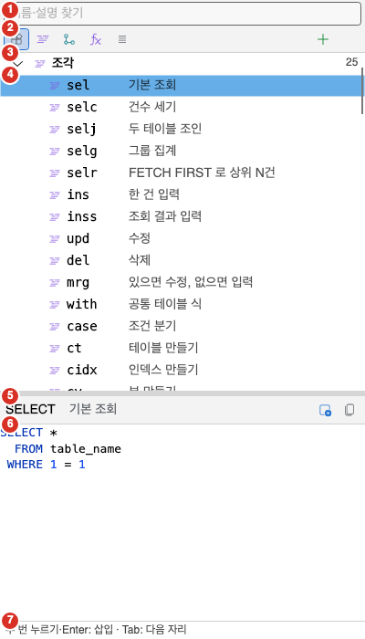
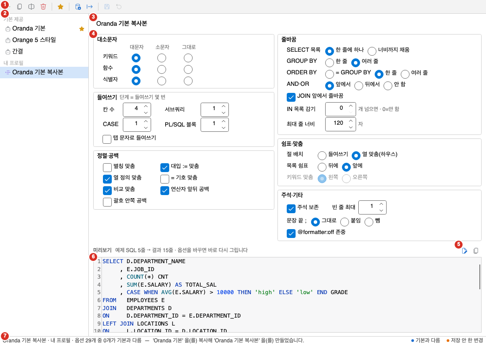
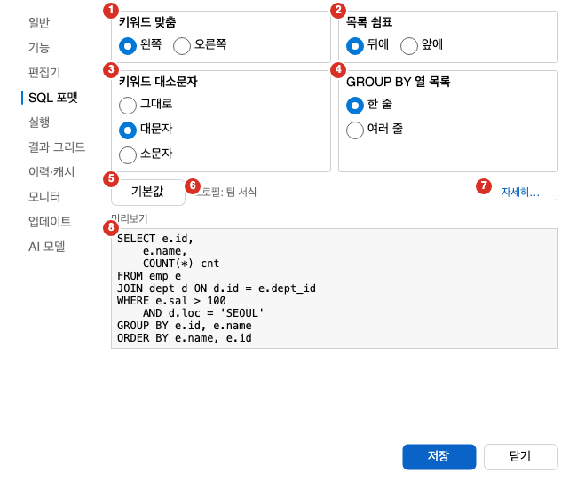

입력 도우미는 SQL을 빨리 쓰고 읽기 좋게 정리하는 기능입니다. 이 쪽에서는 자동 완성, 인자 도움말, 코드 조각과 템플릿 창, SQL 포맷, 포매터 프로필을 설명하며, 편집기 자체는 [SQL 편집기](../sql-editor/)를 보세요.

## 메뉴와 단축키

| 기능 | 메뉴 | Windows | macOS |
|---|---|---|---|
| 자동완성 열기 | **편집 > 입력 도우미 > 자동완성 열기** | `Ctrl+Space` | `Option+Esc` |
| 인자 도움말 | **편집 > 입력 도우미 > 인자 도움말** | `Ctrl+Shift+Space` | `Cmd+Shift+Space` |
| 코드 조각 삽입 | **편집 > 입력 도우미 > 코드 조각 삽입** | `Ctrl+Shift+J` | `Cmd+Shift+J` |
| 포맷(선택 영역 또는 문서) | **편집 > 포맷 > 포맷(선택 영역 또는 문서)** | `Ctrl+Shift+F` | `Cmd+Shift+F` |
| 현재 문장 포맷 | **편집 > 포맷 > 현재 문장 포맷** | 없음 | 없음 |
| 포매터 프로필 | **도구 > 포매터 프로필** | 없음 | 없음 |
| 템플릿 창 | **보기 > 도구 창 > 템플릿** | 없음 | 없음 |

키는 기본 키맵 기준입니다. macOS 열에는 macOS에서 쓰는 키를 적었고, `Option`은 Windows의 `Alt`에 해당하는 키입니다. 키는 [단축키와 명령 팔레트](../../settings/shortcuts/)에서 바꿀 수 있습니다.

## 자동 완성

자동 완성은 커서 위치에 맞는 후보를 목록으로 보여 줍니다. 후보를 고르면 이름이 편집기에 들어갑니다. PL/SQL 편집기와 MyBatis 문장 탭에서도 같은 명령을 씁니다.

목록은 커서 아래에 열리고 첫 후보가 미리 선택돼 있습니다. 목록의 한 줄은 종류 아이콘, 이름, 상세로 이루어집니다.

- 종류 아이콘은 스키마, 테이블, 뷰, 열, 패키지 같은 후보 종류를 보입니다. 키워드는 아이콘이 없습니다.
- 이름은 편집기에 들어갈 이름입니다.
- 상세는 이름 오른쪽의 흐린 글씨입니다. 열은 데이터 형식과 `NOT NULL`, 열 주석을 보입니다. 객체는 종류와 소유자를 보입니다.
- 상세가 길어서 잘리면 목록 옆에 설명 창이 하나 더 열립니다.

### 여는 방법

- `.`을 입력하면 목록이 자동으로 열립니다. DB에 접속한 상태에서만 자동으로 열립니다.
- **편집 > 입력 도우미 > 자동완성 열기**를 고르거나 단축키를 누르면 접속이 없어도 열립니다. 이때는 DB 객체 후보가 없고 키워드, 내장 함수, 옵티마이저 힌트만 나옵니다.
- 후보가 하나도 없으면 목록이 열리지 않습니다.
- 주석과 문자열 안에서는 열리지 않습니다.

목록이 열린 뒤 방향키로 후보를 옮기고 `Enter`나 `Tab`으로 넣습니다.

### 문맥별 후보

| 커서 위치 | 후보 |
|---|---|
| 문장 첫머리, 절 키워드 자리 | `SELECT`, `INSERT`, `FROM`, `WHERE` 같은 키워드 |
| `FROM`이나 `JOIN` 뒤 | 내 스키마의 테이블, 뷰, 시노님과 스키마 이름. 글자를 입력하면 PUBLIC 시노님과 다른 스키마의 테이블, 뷰도 함께 나옵니다. |
| `스키마.` 뒤 | 그 스키마의 테이블, 뷰, 시노님 |
| `별칭.` 뒤 | 별칭이 가리키는 테이블이나 뷰의 열. 시노님이면 시노님이 가리키는 테이블의 열 |
| 열을 쓰는 자리(`SELECT` 목록, `WHERE` 등) | 문장의 `FROM` 절에 쓴 테이블의 열, 내장 함수, 키워드 |
| `패키지.` 뒤 | 패키지 안의 프로시저와 함수 |
| `/*+` 뒤의 힌트 주석 안 | 옵티마이저 힌트 이름 |

- 다른 스키마의 테이블이나 뷰를 고르면 `HR.JOBS`처럼 스키마 이름까지 함께 들어갑니다. 상세에서 소유자를 확인할 수 있습니다. PUBLIC 시노님은 이름만 들어갑니다.
- 스키마를 쓰지 않으면 후보를 내 스키마, PUBLIC 시노님, 다른 스키마 순서로 보입니다. `SYS` 같은 오라클 내부 스키마의 객체는 나오지 않으므로 `스키마.`를 입력해서 찾습니다.
- 대소문자를 구분해 만든 이름(`"Emp"`)은 내 스키마가 아니면 스키마 없이 찾지 못합니다. 이때도 `스키마.`를 입력해서 찾습니다.
- 스키마 이름 없이 목록을 연 뒤 글자를 입력하면 그 글자로 후보를 다시 찾아 목록을 채웁니다.
- 처음 접속한 DB는 객체 목록을 다 읽은 뒤부터 다른 스키마 후보가 나옵니다.
- 별칭은 커서 뒤의 `FROM` 절까지 포함한 문장 전체에서 찾습니다. 그래서 `SELECT`와 `FROM` 사이에서 `e.`를 입력해도 `FROM employees e`의 열이 나옵니다.
- 문장의 경계는 `;`와 단독 `/` 줄입니다. 커서가 속한 문장만 봅니다.
- 열을 쓰는 자리에서 한정자가 없으면 상세 앞에 테이블 이름이 붙습니다.
- 입력해 둔 글자로 시작하는 후보만 남습니다. 대소문자는 가리지 않습니다.
- 후보는 한 번에 1000개까지 보입니다.
- 종류 이름은 키워드, 스키마, 테이블, 뷰, 시노님, 열, 패키지, 프로시저, 함수, 힌트입니다.

### 넣을 글자의 대소문자

- 소문자로 입력하고 있으면 키워드와 대문자 이름을 소문자로 넣습니다.
- 이름에 소문자나 특수 문자가 들어 있으면 큰따옴표로 감싸서 넣습니다.

### DB 정보가 늦을 때

DB에서 객체 정보를 가져오는 데 0.15초가 넘게 걸리면, 이미 기억해 둔 정보로 만든 후보를 먼저 보입니다. 이때는 후보가 적을 수 있습니다. 늦게 끝난 조회는 뒤에서 마저 끝나고, 다음에 목록을 열면 바로 쓰입니다. 후보를 계산하는 사이에 커서를 다른 곳으로 옮기면 목록이 열리지 않습니다.

접속이 끊겼거나 닫힌 세션이면 DB 객체 후보는 나오지 않습니다.

## 인자 도움말

인자 도움말은 커서가 들어 있는 프로시저와 함수 호출의 인자 목록을 보여 줍니다. DB에 접속한 상태에서만 쓸 수 있습니다.

인자 도움말 창에는 세 가지가 나옵니다.

- 시그니처: `이름(P1 IN NUMBER, …) RETURN 형식` 모양의 한 줄입니다. 기본값이 있는 인자에는 `:= …`가 붙고, 출력 인자는 `OUT`이나 `IN OUT`이 붙습니다.
- 오버로드 표시: 같은 이름의 정의가 여럿이면 `1/2`처럼 몇 번째인지 보입니다.
- 현재 인자: 커서가 있는 위치의 인자 이름, 방향, 형식입니다. 기본값이 있으면 「(기본값 있음)」이 붙습니다.

- 호출 괄호 안에 커서를 두고 **인자 도움말**을 실행합니다.
- `이름(`, `패키지.이름(`, `스키마.패키지.이름(` 형태를 인식합니다. 이름만 있으면 내 스키마의 프로시저나 함수로 봅니다.
- 몇 번째 인자인지는 커서 앞의 쉼표 개수로 정합니다. 괄호 안의 쉼표는 세지 않습니다.
- 오버로드가 여럿이면 인자 수가 지금 위치를 담는 첫 번째 정의를 먼저 보입니다.
- 호출을 찾지 못하거나 DB에서 정의를 찾지 못하면 창이 열리지 않습니다.
- 세션이 다른 실행으로 바쁘면 기다리지 않고 정의를 찾지 못한 것으로 봅니다. 실행이 끝난 뒤 다시 시도하세요.

## 코드 조각

코드 조각은 줄임말 하나로 자주 쓰는 SQL 틀을 넣는 기능입니다. 기본으로 25개가 들어 있습니다.

| 줄임말 | 이름 | 줄임말 | 이름 |
|---|---|---|---|
| `sel` | SELECT | `ct` | CREATE TABLE |
| `selc` | SELECT COUNT | `cidx` | CREATE INDEX |
| `selj` | SELECT JOIN | `cv` | CREATE VIEW |
| `selg` | SELECT GROUP BY | `cseq` | CREATE SEQUENCE |
| `selr` | SELECT 상위 N건 | `alt` | ALTER TABLE ADD |
| `ins` | INSERT | `expl` | EXPLAIN PLAN |
| `inss` | INSERT SELECT | `anon` | 익명 블록 |
| `upd` | UPDATE | `proc` | PROCEDURE |
| `del` | DELETE | `func` | FUNCTION |
| `mrg` | MERGE | `cur` | FOR 루프 |
| `with` | WITH | `ifb` | IF |
| `case` | CASE | `exc` | EXCEPTION |
| `trg` | TRIGGER |  |  |

### 편집기에 삽입하기

**편집 > 입력 도우미 > 코드 조각 삽입**은 상황에 따라 다르게 동작합니다. 읽기 전용 문서에서는 쓸 수 없습니다.

- 선택이 없고 커서 앞 낱말이 코드 조각의 줄임말이면 그 낱말을 바로 조각으로 바꿉니다. 줄임말은 대소문자를 가리지 않습니다. 예를 들어 `sel` 뒤에서 실행하면 다음 글이 들어갑니다.

  ```sql
  SELECT *
    FROM table_name
   WHERE 1 = 1
  ```

- 글자를 선택했거나 커서 앞 낱말이 줄임말이 아니면 「코드 조각」 창이 열립니다. 목록에는 「줄임말  이름」이 한 줄씩 나오고, 고르면 삽입합니다. 글자를 선택했다면 고른 조각이 선택한 글을 대신합니다.
- 조각을 넣은 줄의 앞 공백을 조각의 다음 줄에도 그대로 붙입니다.
- 조각을 넣고 나면 첫 번째 자리 표시자의 글이 선택된 상태가 됩니다. 이 글을 바로 덮어써서 고칩니다.
- 사용자 조각의 줄임말이 기본 조각과 같으면 사용자 조각이 먼저 쓰입니다.

### 자리 표시자

조각 본문은 자리 표시자를 쓸 수 있습니다.

| 표기 | 뜻 |
|---|---|
| `$1`, `$2` | 번호가 붙은 자리입니다. |
| `${1:기본값}` | 기본 글이 들어 있는 자리입니다. |
| `$0` | 마지막 커서 자리입니다. 본문에 없으면 글 끝이 마지막 자리입니다. |
| `\$` | `$` 글자 그대로입니다. |

같은 번호의 자리가 여럿이면 첫 기본값을 모든 자리에 넣습니다.

## 템플릿 창

템플릿 창은 코드 조각, 옵티마이저 힌트, 내장 함수, 의사 열을 한곳에서 찾아 넣는 도구 창입니다. **보기 > 도구 창 > 템플릿**으로 엽니다. 기본 위치는 화면 오른쪽입니다. MyBatis 문서에서는 이 창이 숨습니다.



1. 찾기 칸: 이름과 설명을 찾습니다.
2. 종류 단추 줄: 「전체 보기」, 「코드 조각만」, 「옵티마이저 힌트만」, 「내장 함수만」, 「의사 열만」을 고릅니다. 오른쪽 끝의 「새 조각」 단추는 사용자 조각을 만듭니다.
3. 종류 묶음 머리: 「조각」, 「힌트」, 「함수」, 「의사 열」 묶음의 이름과 항목 수입니다. 두 번 누르면 묶음을 접고 폅니다.
4. 항목 줄: 아이콘, 줄임말, 흐린 글씨의 짧은 설명입니다. 마우스를 올리면 이름과 설명이 나옵니다.
5. 미리보기 도구 줄: 고른 항목의 이름과 설명, 그리고 「편집기에 삽입」, 「사용자 조각으로 복제」, 「사용자 조각 편집」, 「사용자 조각 지우기」 단추입니다. 편집과 지우기는 사용자 조각을 골랐을 때만 보입니다.
6. 미리보기: 삽입될 글자를 편집기와 같은 색으로 보입니다.
7. 상태 줄: 사용법이나 방금 한 일의 결과를 보입니다.

### 찾고 넣기

- 찾기 칸은 줄임말, 이름, 설명을 모두 봅니다. 공백으로 나눈 낱말이 모두 들어 있어야 찾아집니다. 대소문자는 가리지 않습니다.
- 한국어 화면에서도 영어 이름과 영어 설명으로 찾을 수 있습니다.
- 찾을 때는 접어 둔 묶음이 펴지고, 찾은 첫 항목이 선택됩니다.
- 항목을 두 번 누르거나 「편집기에 삽입」 단추를 누르면 현재 SQL 탭에 넣습니다. 상태 줄에 고른 항목의 사용법이 안내됩니다.
- 항목을 편집기로 끌어 놓아도 넣을 수 있습니다. 이때는 자리 표시자가 기본값으로 풀린 글이 들어갑니다.
- 힌트, 함수, 의사 열은 사용 예 글자를 그대로 넣습니다.
- 항목을 오른쪽 클릭하면 「삽입」, 「본문 복사」, 「사용자 조각으로 복제」, 「편집」, 「지우기」가 나옵니다.
- 넣을 SQL 탭이 없으면 상태 줄에 「넣을 SQL 편집기가 없다.」가 나옵니다. 읽기 전용 문서이면 「읽기 전용 문서다.」가 나옵니다.

### 사용자 조각

기본으로 들어 있는 항목은 고치거나 지울 수 없습니다. 고치려면 「사용자 조각으로 복제」로 복사한 뒤 고칩니다. 기본 항목을 고치거나 지우려 하면 상태 줄에 「기본 제공 항목은 고치거나 지울 수 없다. 사용자 조각으로 복제해서 고친다.」가 나옵니다.

사용자 조각은 앱 데이터 폴더의 `snippets.json` 파일에 저장됩니다. 찾기를 비워 두면 사용자 조각이 묶음의 맨 위에 보입니다.

사용자 조각은 「새 조각」 단추나 「사용자 조각 편집」 단추로 여는 조각 편집 창에서 만들고 고칩니다. 창의 제목은 새로 만들 때 「새 조각」, 고칠 때 「조각 편집」입니다. 입력 칸은 다음과 같습니다.

| 칸 | 설명 |
|---|---|
| 줄임말 | 코드 조각을 부르는 짧은 이름입니다. |
| 이름 | 목록에 보일 이름입니다. 비워 두면 줄임말을 씁니다. |
| 설명 | 목록에 보일 한 줄 설명입니다. |
| 본문 | 삽입될 SQL입니다. 자리 표시자를 쓸 수 있습니다. |

창 아래쪽에 저장할 수 없는 이유가 나오고, 「저장」과 「취소」 단추가 있습니다.

- 줄임말은 공백 없이 영문, 숫자, 밑줄로 씁니다. 지키지 않으면 「줄임말은 공백 없이 영문·숫자·밑줄로 쓴다.」가 나옵니다.
- 본문이 비어 있으면 「본문을 입력한다.」가 나옵니다.
- 다른 사용자 조각과 줄임말이 같으면 「같은 줄임말의 사용자 조각이 이미 있다: 줄임말」이 나옵니다.
- 줄임말이 기본 조각과 같으면 입력 칸 아래에 알림이 나옵니다. 이때 사용자 조각이 기본 조각보다 먼저 쓰입니다.
- 「본문」 칸 아래에 자리 표시자 표기가 안내됩니다.
- 저장하면 상태 줄에 「조각을 저장했다: 줄임말」이 나옵니다.
- 사용자 조각을 지울 때는 「사용자 조각 줄임말 을(를) 지울까요?」를 묻고, 지우면 「조각을 지웠다: 줄임말」이 나옵니다.

## SQL 포맷

SQL 포맷은 SQL의 대소문자, 줄바꿈, 들여쓰기, 정렬을 정해진 규칙으로 정리합니다.

- **편집 > 포맷 > 포맷(선택 영역 또는 문서)**은 글자를 선택했으면 선택한 범위를, 선택하지 않았으면 문서 전체를 포맷합니다.
- **편집 > 포맷 > 현재 문장 포맷**은 커서가 있는 문장 하나만 포맷합니다.
- 도구 모음의 포맷 단추와 편집기의 오른쪽 클릭 메뉴에서도 「포맷(선택 영역 또는 문서)」를 쓸 수 있습니다.
- 읽기 전용 문서와 MyBatis 문서에서는 두 명령이 회색입니다. MyBatis 문서는 [MyBatis 작업 공간](../mybatis/)을 보세요.
- 포맷에는 기본 프로필(★)의 옵션을 씁니다. 기본 프로필은 [포매터 프로필 화면](#포매터-프로필-화면)에서 정합니다.
- 포맷은 바뀐 부분만 한 번의 편집으로 바꿉니다. 실행 취소 한 번으로 되돌릴 수 있습니다.

### 안전 장치

포맷 결과가 원문과 같은 뜻인지 확인하고, 확인되지 않으면 문서를 건드리지 않습니다. 그때는 알림 창에 「포맷을 적용하지 않았습니다(원문 유지): 이유」가 나옵니다.

| 이유 | 뜻 |
|---|---|
| 포맷 전후 토큰이 달라졌습니다 | 포맷 결과의 낱말 구성이 원문과 다릅니다. |
| 포맷 전후 주석 수가 달라졌습니다 | 포맷 결과의 주석 개수가 원문과 다릅니다. |
| 두 번 포맷한 결과가 달라 안전하지 않습니다 | 포맷한 결과를 다시 포맷하면 결과가 달라집니다. |
| 포매터 내부 오류가 났습니다 | 포매터에서 예기치 않은 오류가 났습니다. |

그 밖의 메시지는 다음과 같습니다.

- 「이미 포맷되어 있습니다.」: 포맷해도 바뀌는 글이 없습니다.
- 「캐럿 위치에 포맷할 문장이 없습니다.」: **현재 문장 포맷**을 했는데 커서가 있는 곳에 문장이 없습니다.

SQL 안에 `-- @formatter:off` 주석을 넣으면 `-- @formatter:on`까지는 포맷하지 않습니다. 이 동작은 프로필의 「@formatter:off 존중」이 켜져 있을 때 적용됩니다.

## 포매터 프로필 화면

포매터 프로필은 포맷 규칙의 묶음입니다. **도구 > 포매터 프로필**을 고르면 문서 탭으로 열립니다.



1. 도구 막대: 왼쪽부터 「새 프로필」, 「복사」, 「이름 바꾸기」, 「삭제」, 「기본으로 지정」, 「가져오기…」, 「내보내기…」, 「저장」, 「되돌리기」입니다.
2. 프로필 목록: 「기본 제공」 묶음과 「내 프로필」 묶음으로 나뉩니다. 기본 프로필에는 별 모양이 붙습니다.
3. 안내 띠 또는 이름 줄: 기본 제공 프로필을 고르면 안내 띠가, 내 프로필을 고르면 이름 칸이 보입니다.
4. 옵션 묶음: 포맷 옵션을 여섯 묶음으로 보입니다.
5. 미리보기 단추: 「예제 SQL 고치기」와 「결과 복사」입니다.
6. 미리보기: 예제 SQL을 지금 옵션으로 포맷한 결과입니다.
7. 상태 줄: 왼쪽에 요약과 마지막 알림이 나오고, 오른쪽에 점의 뜻이 나옵니다.

### 프로필의 종류

- 기본 제공 프로필은 「Oranda 기본」, 「Orange 5 스타일」, 「간결」 셋입니다. 고치거나 지울 수 없습니다.
- 기본 제공 프로필을 고르면 안내 띠에 「기본 제공 프로필은 고칠 수 없습니다 — 복사해서 고치세요」가 나옵니다. 띠의 「복사해서 고치기」 단추를 누르면 복사본이 내 프로필로 만들어집니다.
- 내 프로필은 이름과 옵션을 고칠 수 있습니다.
- 「Oranda 기본」은 키워드와 이름을 대문자로 쓰고, 절 키워드를 맨 앞에 맞추며, 본문을 맨 앞에서 7칸 떨어진 자리에 맞춥니다. 목록 쉼표는 줄 앞에 두고, `GROUP BY`는 여러 줄, `ORDER BY`는 한 줄로 쓰며, 줄 너비는 최대 120자입니다.

### 옵션

옵션의 이름은 화면에 보이는 그대로 적었습니다. 선택지는 괄호에 적었습니다.

| 묶음 | 옵션 |
|---|---|
| 대소문자 | 키워드, 함수, 식별자 (대문자, 소문자, 그대로) |
| 들여쓰기 | 탭 문자로 들여쓰기 (켬/끔), 칸 수 (1-16), 서브쿼리 (0-4단계), CASE (0-4단계), PL/SQL 블록 (0-4단계) |
| 줄바꿈 | SELECT 목록 (한 줄에 하나, 너비까지 채움), GROUP BY (한 줄, 여러 줄), ORDER BY (= GROUP BY, 한 줄, 여러 줄), AND·OR (앞에서, 뒤에서, 안 함), JOIN 앞에서 줄바꿈 (켬/끔), IN 목록 감기 (개 넘으면, 0은 안 함), 최대 줄 너비 (40-400자) |
| 쉼표·맞춤 | 절 배치 (들여쓰기, 열 맞춤(하우스)), 목록 쉼표 (뒤에, 앞에), 키워드 맞춤 (왼쪽, 오른쪽) |
| 정렬·공백 | 별칭 맞춤, 대입 := 맞춤, 열 정의 맞춤, = 기호 맞춤, 비교 맞춤, 연산자 앞뒤 공백, 괄호 안쪽 공백 (모두 켬/끔) |
| 주석·기타 | 주석 보존 (켬/끔), 빈 줄 최대 (0-5), 문장 끝 ; (그대로, 붙임, 뺌), @formatter:off 존중 (켬/끔) |

- 「들여쓰기」 묶음에는 「단계 = 들여쓰기 몇 번」이라는 설명이 붙어 있습니다.
- 파란 점은 「Oranda 기본」과 값이 다른 옵션입니다. 주황 점은 저장하지 않은 변경입니다.
- 다른 옵션 때문에 효과가 없는 옵션은 흐리게 보입니다. 흐린 옵션도 고칠 수는 있습니다.
- 「절 배치」가 「열 맞춤(하우스)」이면 「키워드 맞춤」은 쓰이지 않습니다.
- 상태 줄 왼쪽에는 프로필 이름, 종류, 기본과 다른 옵션 수, 저장하지 않은 변경 수가 나옵니다.

### 미리보기

- 미리보기는 옵션을 바꿀 때마다 다시 포맷합니다.
- 「예제 SQL 고치기」를 켜면 예제 SQL 입력 칸이 나타납니다. 내 SQL을 붙여 넣으면 그 SQL로 미리보기가 바뀝니다.
- 「결과 복사」는 미리보기 결과를 클립보드에 복사합니다.

### 프로필 관리

- 「새 프로필」은 「Oranda 기본」 값에서 시작하는 「새 프로필」을 만듭니다. 이름이 겹치면 번호가 붙습니다.
- 「복사」는 고른 프로필을 「이름 복사본」으로 복사합니다.
- 「저장」은 내 프로필을 저장합니다. 이름이 비어 있으면 「프로필 이름을 입력해 주세요.」가 나옵니다. 고친 것이 있을 때만 켜집니다.
- 「되돌리기」는 저장하지 않은 변경을 버리고 저장한 값으로 돌립니다.
- 「이름 바꾸기」와 「삭제」는 내 프로필에서만 켜집니다.
- 「기본으로 지정」은 고른 프로필을 편집기 포맷이 쓰는 기본 프로필로 정합니다.
- 「내보내기…」는 고른 프로필을 `.json` 파일로 저장합니다. 창의 제목은 「포매터 프로필 내보내기」이고, 제안 이름은 프로필 ID에 `.json`을 붙인 것입니다.
- 「가져오기…」는 `.json` 파일을 프로필로 읽습니다. 창의 제목은 「포매터 프로필 가져오기」입니다. 기존 프로필을 덮어쓰지 않고, ID나 이름이 겹치면 새 ID와 새 이름을 붙여 저장합니다. 읽지 못하면 상태 줄에 「가져오지 못했습니다: 이유」가 나옵니다.
- 프로필 목록을 오른쪽 클릭하면 「복사해서 새 프로필」, 「이름 바꾸기」, 「삭제」, 「기본으로 지정」, 「내보내기…」가 나옵니다.

## 설정 창의 SQL 포맷 탭

설정 창의 「SQL 포맷」 탭은 자주 바꾸는 옵션 네 개만 모아 둔 곳입니다. **도구 > 설정**을 고르면 설정 창이 열립니다. 설정 창은 [설정](../../settings/options/)을 보세요.



1. 키워드 맞춤: 「왼쪽」이나 「오른쪽」을 고릅니다.
2. 목록 쉼표: 「뒤에」나 「앞에」를 고릅니다.
3. 키워드 대소문자: 「그대로」, 「대문자」, 「소문자」 중에서 고릅니다.
4. GROUP BY 열 목록: 「한 줄」이나 「여러 줄」을 고릅니다.
5. 「기본값」 단추: 네 옵션을 「Oranda 기본」 값으로 되돌립니다.
6. 프로필 줄: 「프로필: 이름」으로 지금 기본 프로필의 이름을 보입니다.
7. 「자세히…」 단추: 설정을 저장하고 포매터 프로필 화면을 엽니다.
8. 미리보기: 짧은 조회 하나를 지금 고른 값으로 포맷한 결과입니다.

- 이 탭의 값은 지금 기본 프로필의 옵션에서 읽고, 설정 창의 「저장」을 누를 때 그 프로필에 씁니다. 「닫기」를 누르면 아무것도 쓰지 않습니다.
- 기본 프로필이 기본 제공 프로필이면 고칠 수 없으므로, 값을 바꾸고 저장할 때 「SQL 포맷(설정 창)」이라는 내 프로필로 복사해 저장하고 그 프로필을 기본으로 바꿉니다. 이름이 이미 있으면 「SQL 포맷(설정 창) 2」처럼 번호를 붙입니다.
- 프로필 줄에 기본 제공 프로필이 보이면 「기본 제공(저장하면 복사본)」이 함께 나옵니다.
- 프로필의 「절 배치」가 「열 맞춤(하우스)」이면 「키워드 맞춤」 묶음이 회색이 되고, 마우스를 올리면 「하우스 서식(열 맞춤)에서는 쓰지 않습니다」가 나옵니다.

## 자주 하는 작업

### 별칭의 열을 자동 완성으로 넣기

1. DB에 접속하세요.
2. 새 SQL 탭에 `SELECT x FROM employees e`를 입력하세요.
3. `x`를 지우고 그 자리에 커서를 두세요.
4. `e.`를 입력하세요.
5. 목록이 열리면 원하는 열을 고르세요.

### 패키지 함수의 인자 확인하기

1. DB에 접속하세요.
2. 새 SQL 탭에 `SELECT sample_pkg.customer_total(`을 입력하세요.
3. `Ctrl+Shift+Space`를 누르세요. macOS에서는 `Cmd+Shift+Space`를 누르세요.
4. 시그니처를 읽고 인자를 입력하세요.

`sample_pkg`는 이 설명서의 샘플 DB에 만든 패키지입니다.

### 코드 조각으로 조회문 틀 넣기

1. 새 SQL 탭에서 `sel`을 입력하세요.
2. `Ctrl+Shift+J`를 누르세요. macOS에서는 `Cmd+Shift+J`를 누르세요.
3. 선택된 `*`를 필요한 열 이름으로 덮어쓰세요.
4. `table_name`을 선택하고 `employees`를 입력하세요.

### 내 코드 조각 만들기

1. **보기 > 도구 창 > 템플릿**을 고르세요.
2. 「새 조각」 단추를 누르세요.
3. 줄임말에 `ordlist`를 입력하세요.
4. 이름에 `고객 주문 목록`을 입력하세요.
5. 본문에 다음 SQL을 입력하세요.

   ```sql
   SELECT order_id, order_date, status
     FROM orders
    WHERE customer_id = ${1:1001}
    ORDER BY order_date DESC$0
   ```

6. 「저장」을 누르세요.
7. 편집기에서 `ordlist`를 입력하고 `Ctrl+Shift+J`를 누르세요.

### 선택한 문장만 포맷하기

1. 포맷할 문장 안에 커서를 두세요.
2. **편집 > 포맷 > 현재 문장 포맷**을 고르세요.
3. 결과가 마음에 들지 않으면 `Ctrl+Z`를 누르세요.

### 내 포맷 규칙 만들기

1. **도구 > 포매터 프로필**을 고르세요.
2. 목록에서 「Oranda 기본」을 고르세요.
3. 「복사해서 고치기」를 누르세요.
4. 이름 칸에 새 이름을 입력하세요.
5. 옵션을 고치면서 미리보기를 확인하세요.
6. 「저장」을 누르세요.
7. 「기본으로 지정」을 누르세요.
8. 편집기로 돌아가 `Ctrl+Shift+F`를 누르세요.

### 포맷 규칙을 다른 PC로 옮기기

1. 옮길 내 프로필을 고르세요.
2. 「내보내기…」를 누르고 `.json` 파일로 저장하세요.
3. 다른 PC의 Oranda에서 **도구 > 포매터 프로필**을 여세요.
4. 「가져오기…」를 누르고 그 `.json` 파일을 고르세요.

### 쉼표 위치만 빨리 바꾸기

1. **도구 > 설정**을 고르세요.
2. 「SQL 포맷」 탭을 고르세요.
3. 「목록 쉼표」에서 「앞에」나 「뒤에」를 고르세요.
4. 미리보기를 확인하세요.
5. 설정 창의 「저장」을 누르세요.

## 문제가 생길 때

| 증상 | 원인 | 해결 |
|---|---|---|
| `.`을 입력해도 목록이 열리지 않습니다 | DB에 접속하지 않았거나, 접속이 끊겼거나, 후보가 없습니다. 커서가 주석이나 문자열 안일 수도 있습니다. | 접속을 확인하세요. 접속 없이 쓰려면 **자동완성 열기**를 쓰세요. |
| 자동완성 열기를 했는데 키워드만 나옵니다 | 접속이 없으면 DB 객체 후보를 만들 수 없습니다. | DB에 접속한 뒤 다시 여세요. |
| 목록에 테이블이 일부만 나옵니다 | DB에서 정보를 가져오는 데 0.15초가 넘게 걸려 기억해 둔 정보로만 만들었습니다. | 목록을 닫고 잠시 뒤 다시 여세요. |
| 큰따옴표가 붙은 이름이 들어갑니다 | 이름에 소문자나 특수 문자가 들어 있는 객체입니다. | 그대로 쓰세요. 대소문자를 구분하는 이름입니다. |
| 「인자 도움말」이 회색입니다 | DB에 접속하지 않았습니다. | 접속한 뒤 다시 시도하세요. |
| 인자 도움말 창이 열리지 않습니다 | 커서가 호출 괄호 안이 아니거나, 이름을 DB에서 찾지 못했습니다. 세션이 바쁠 수도 있습니다. | 커서를 `이름(` 뒤에 두세요. 이름과 스키마를 확인하고, 실행이 끝난 뒤 다시 시도하세요. |
| 「코드 조각 삽입」이 회색입니다 | 읽기 전용 문서입니다. | 새 SQL 탭에 복사한 뒤 쓰세요. |
| 줄임말을 입력하고 코드 조각 삽입을 했는데 「코드 조각」 창이 뜹니다 | 커서 앞 낱말이 줄임말과 맞지 않습니다. 줄임말 뒤에 공백이나 다른 글자가 붙어 있을 수 있습니다. | 줄임말 바로 뒤에 커서를 두고 다시 실행하거나, 창에서 조각을 고르세요. |
| 템플릿 창에서 삽입했더니 「넣을 SQL 편집기가 없다.」가 나옵니다 | 열린 SQL 탭이 없습니다. | SQL 탭을 연 뒤 다시 삽입하세요. |
| 템플릿 창이 보이지 않습니다 | MyBatis 문서가 활성이어서 창이 숨었습니다. | SQL 탭을 활성으로 하세요. |
| 기본 조각을 편집하려는데 안 됩니다 | 기본 제공 항목은 고칠 수 없습니다. | 「사용자 조각으로 복제」로 복사한 뒤 고치세요. |
| 포맷이 회색입니다 | 읽기 전용 문서이거나 MyBatis 문서입니다. | 일반 SQL 탭에서 쓰세요. |
| 「이미 포맷되어 있습니다.」가 나옵니다 | 지금 옵션으로 포맷해도 달라지는 글이 없습니다. | 옵션을 바꾸고 싶으면 포매터 프로필 화면에서 고치세요. |
| 「포맷을 적용하지 않았습니다(원문 유지): …」가 나옵니다 | 포맷 결과가 원문과 같은 뜻인지 확인하지 못했습니다. | 원문은 바뀌지 않았습니다. 같은 문장이 계속 실패하면 그 문장은 직접 정리하세요. |
| 기본 제공 프로필의 옵션이 고쳐지지 않습니다 | 기본 제공 프로필은 고칠 수 없습니다. | 「복사해서 고치기」로 복사한 뒤 고치세요. |
| 프로필에서 고쳤는데 포맷 결과가 그대로입니다 | 고친 프로필이 기본 프로필이 아닙니다. | 「저장」한 뒤 「기본으로 지정」을 누르세요. |
| 「가져오지 못했습니다: …」가 나옵니다 | 선택한 파일이 포매터 프로필 파일이 아닙니다. | 내보내기로 만든 `.json` 파일을 고르세요. |
