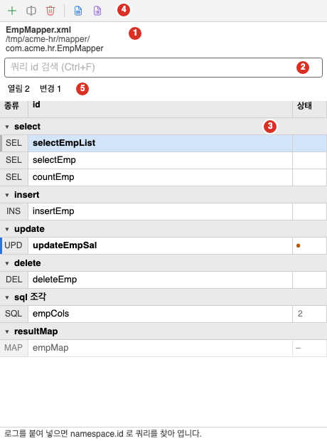
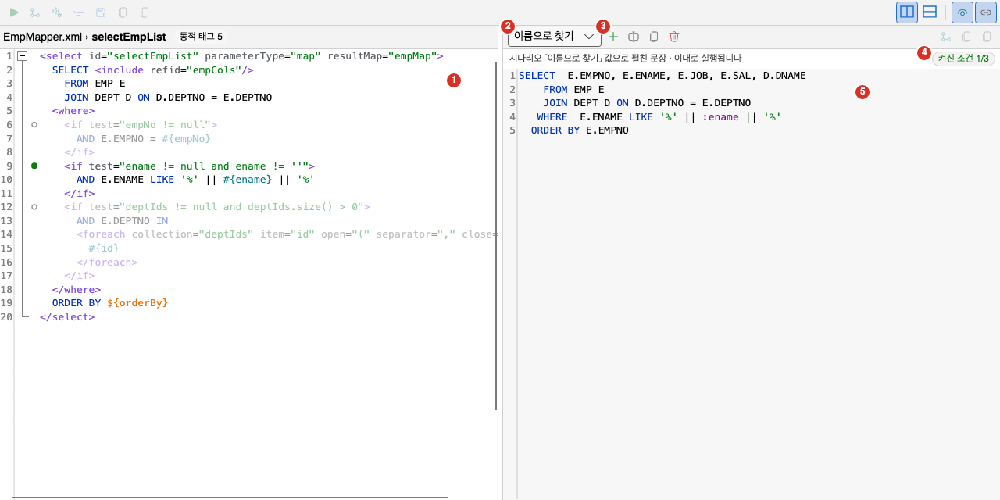
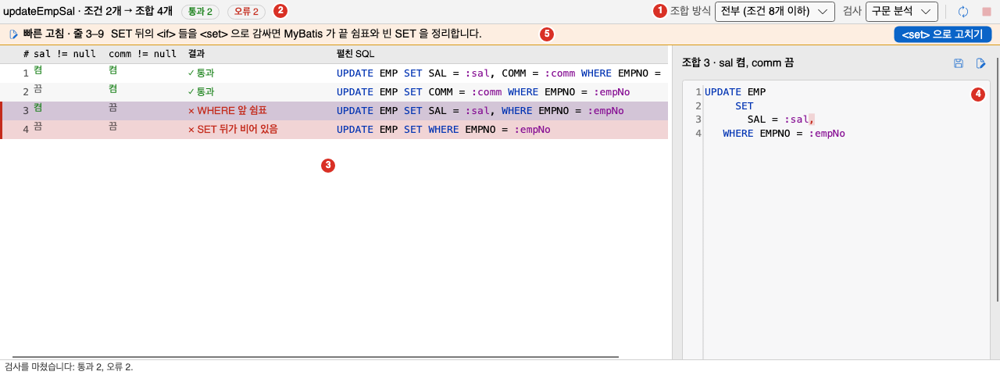
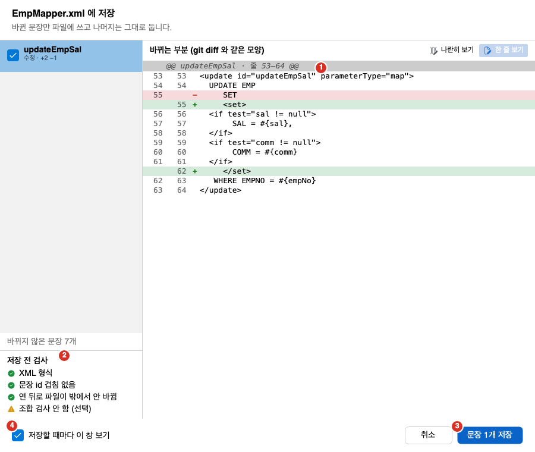
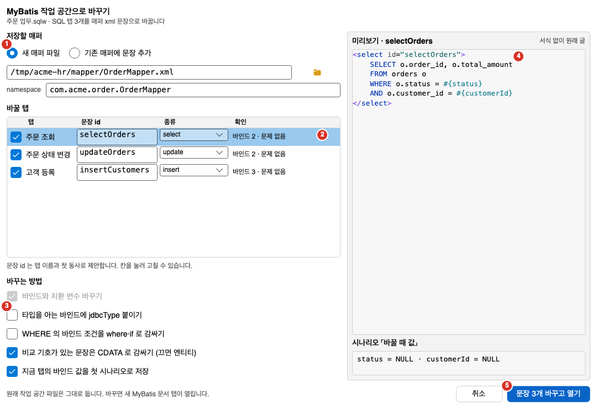

MyBatis 기능은 매퍼 xml의 쿼리를 SQL 편집기처럼 고치고 실행하게 해 줍니다. 쿼리 하나가 탭 하나입니다. 동적 태그(`<if>`, `<where>` 등)는 값을 넣어 펼친 SQL로 확인하고 그대로 실행합니다. 이 쪽에서는 매퍼 열기, 쿼리 목록, 펼친 SQL과 시나리오, 실행, 조합 검사, 저장, 포맷, MyBatis 로그 붙여 넣기, SQL 탭을 매퍼로 바꾸는 방법을 설명합니다.

- MyBatis 기능은 설정 창의 「기능」 탭에서 켭니다. 「함께 하는 일」의 「MyBatis 매퍼를 쓴다」를 체크하거나 주 업무를 「모든 기능」으로 고릅니다. 자세한 내용은 [설정](../../settings/options/)을 보세요.
- 기능이 꺼져 있으면 매퍼를 열 때 「MyBatis 기능이 꺼져 있어 매퍼를 일반 SQL 탭으로 펼쳐 열었습니다(매퍼 파일에는 저장하지 않습니다)」가 나옵니다.

## 매퍼 열기

- 매퍼 파일 하나: 파일 메뉴의 열기로 `.xml` 파일을 엽니다. 파일을 끌어 놓아도 됩니다. 이미 같은 파일의 MyBatis 작업 공간이 열려 있으면 그 작업 공간으로 이동합니다.
- 매퍼 폴더: **파일 > MyBatis > 매퍼 폴더 열기…**를 고릅니다. 최근에 연 폴더가 있으면 목록과 「다른 폴더…」 중에서 고르고, 없으면 폴더 고르기 창이 바로 나옵니다.
- 깨진 xml, 루트가 `mapper`가 아닌 파일, 읽을 수 없는 인코딩은 알리고 작업 공간을 만들지 않습니다.
- 매퍼는 원래 인코딩을 지켜 읽고 씁니다.
- 탭은 고른 쿼리만 열립니다. 쿼리를 열지 않은 매퍼는 파일에서 그대로 남습니다.

## 매퍼 쿼리 창

**보기 > 도구 창**에서 「매퍼 쿼리」 창을 엽니다. MyBatis 문서가 없으면 「MyBatis 문서를 열면 쿼리 목록이 여기에 보입니다.」가 보입니다.

1. 파일 이름과 namespace: 매퍼 파일 이름, 폴더, namespace입니다. namespace가 없으면 「namespace 없음」이 보입니다.
2. 쿼리 검색: 쿼리 id로 목록을 거릅니다.
3. 쿼리 목록과 표시: 쿼리와 종류 배지, 상태 표시입니다.
4. 단추: 아래 표의 단추입니다. 창 위쪽에 있습니다.
5. 열림·변경 필터: 「열림 n」과 「변경 n」 단추입니다.

목록에는 쿼리가 종류별 배지와 함께 나옵니다. 배지의 뜻은 「조회 문장(select)」, 「추가 문장(insert)」, 「수정 문장(update)」, 「삭제 문장(delete)」, 「SQL 조각(sql)」입니다. `sql` 조각은 「sql 조각」 묶음에 모이고, 그 밖의 요소는 「그 밖」 묶음에 모입니다.

| 단추 | 하는 일 |
|---|---|
| 새 쿼리 | 새 쿼리를 만듭니다. |
| id 바꾸기 | 고른 쿼리의 id를 바꿉니다. |
| 쿼리 지우기 | 고른 쿼리를 지웁니다. |
| 새 SQL 탭으로 펼치기 | 고른 쿼리를 펼친 SQL로 새 SQL 탭에 엽니다. |
| 매퍼 전체 포맷 | 매퍼의 쿼리 전부를 포맷합니다. |
| 검색 지우기 | 검색 칸을 비웁니다. |

- 검색 칸의 안내는 「쿼리 id 검색 (Ctrl+F)」입니다. 쿼리 id로 목록을 거릅니다.
- 쿼리 오른쪽의 표시는 다음과 같습니다.

| 표시 | 뜻 |
|---|---|
| ● 수정 | 저장하지 않은 고침이 있습니다. |
| ○ 저장함 | xml에 저장했습니다. 매퍼를 연 때와 다릅니다. |
| + 새 쿼리 | 아직 저장하지 않은 새 쿼리입니다. |
| · {n}곳에서 씀 | 이 `sql` 조각을 `include`하는 쿼리가 n곳입니다. |
| · 쓰는 곳 없음 | 이 `sql` 조각을 `include`하는 쿼리가 없습니다. |
| 편집 불가 | `databaseId`만 다른 같은 id가 여럿이라 편집할 수 없습니다. |
| (그대로 둠) | 이 요소는 편집하지 않고 저장할 때 그대로 둡니다. |
| 조합 오류 {n} | 조합 검사 결과 오류가 n개입니다. |

- 목록 위의 「열림 n」과 「변경 n」 단추는 각각 탭으로 열린 쿼리만, 변경된 쿼리만 보여 줍니다.
- 쿼리를 오른쪽 클릭하면 새 쿼리, 쿼리 id 바꾸기, 쿼리 지우기, 펼친 SQL을 새 SQL 탭으로, 매퍼 전체를 SQL 탭으로 펼치기가 나옵니다.
- **매퍼 전체를 SQL 탭으로 펼치기**는 매퍼의 모든 쿼리를 일반 SQL 탭으로 펼칩니다.

### 매퍼 폴더 보기

매퍼 폴더를 열면 폴더 안의 모든 매퍼를 훑어 쿼리를 한 곳에 보여 줍니다. 창 위쪽에는 폴더 경로와 「다시 훑기」, 「폴더 닫기」 단추가 있습니다. 상태 줄에는 「매퍼 {n}개」가 나옵니다. 읽지 못해 거른 xml이 있으면 「매퍼 {n}개 · 거른 xml {m}개」가 나옵니다. 쿼리 id로 검색하면 맞는 쿼리가 없을 때 「일치하는 쿼리 없음」이 보입니다. `sql` 조각을 고르면 그 조각을 쓰는 곳 목록이 나오고 「닫기」로 닫습니다.

### 쿼리 찾기

**편집 > 이동 > MyBatis 쿼리 찾기…**는 `namespace.id`나 id의 일부를 받습니다. 열린 매퍼와 매퍼 폴더에서 찾고, 하나면 바로 열고 여럿이면 고르게 합니다. 열린 MyBatis 문서나 매퍼 폴더가 있을 때만 켜집니다.

## 쿼리 고치기와 펼친 SQL

쿼리 탭은 쿼리의 원문을 보여 줍니다. 동적 태그는 색으로 구분되고, 동적 태그가 있으면 「동적 태그 {n}」이 보입니다. 탭 안은 원문과 「펼친 SQL」로 나뉩니다.

1. 원문 편집기: 쿼리의 원문을 고칩니다. 줄 왼쪽의 표시는 지금 값에서 켜진 조건과 꺼진 조건입니다.
2. 시나리오 목록: 값 묶음을 고릅니다.
3. 시나리오 단추: 「시나리오 추가」, 「이름 바꾸기」, 「시나리오 복제」, 「시나리오 지우기」입니다.
4. 켜진 조건 n/m: 동적 조건 m개 중 지금 값에서 켜진 조건 수입니다.
5. 펼친 SQL: 지금 값으로 펼친 문장입니다. 이대로 실행됩니다.

펼친 SQL 영역의 머리 줄에는 다음이 있습니다.

1. 시나리오 목록: 값 묶음을 고릅니다.
2. 「시나리오 추가」, 「이름 바꾸기」, 「시나리오 복제」, 「시나리오 지우기」 단추: 값 묶음을 관리합니다.
3. 머리 글: 「시나리오 「이름」 값으로 펼친 문장 · 이대로 실행됩니다」입니다. 시나리오가 없으면 「지금 값으로 펼친 문장 · 이대로 실행됩니다」입니다.
4. 「켜진 조건 n/m」: 동적 조건 m개 중 지금 값에서 켜진 조건 수입니다. 조건이 없으면 나타나지 않습니다.
5. 실행 계획 단추와 복사 단추 둘: 아래 「실행」과 「복사」를 보세요.

- 값은 **바인드 변수** 창의 행에서 고칩니다. 값을 바꾸면 펼친 SQL이 바로 다시 그려집니다. `${}` 치환 변수는 같은 창에서 이름 앞에 `$`가 붙은 행으로 나옵니다.
- 시나리오는 앱 안에 xml 경로 기준으로 저장합니다. 매퍼 파일은 건드리지 않습니다.
- 시나리오가 없는 쿼리에 값을 입력하면 「자동 저장」 시나리오를 만들어 값을 저장합니다. 고른 시나리오의 값은 고칠 때마다 저장되므로, 매퍼를 다시 열면 입력한 값이 그대로 나옵니다. 「자동 저장」도 다른 시나리오처럼 이름을 바꾸거나 지울 수 있습니다.
- **바인드 변수** 창의 「값 비우기」 단추는 행을 두고 값만 모두 비웁니다. 고른 시나리오가 있으면 그 시나리오에도 빈 값이 저장되고, 되돌릴 수 없습니다. 값을 남겨 두려면 먼저 「시나리오 복제」로 사본을 만드세요. 고르지 않은 시나리오는 바뀌지 않고, 시나리오가 없는 쿼리에는 새 시나리오를 만들지 않습니다.
- 시나리오에는 값만 저장합니다. 이름에 `pass`, `pwd`, `secret`, `token`이 든 변수의 값은 저장하지 않습니다. 고른 형식도 저장하지 않으므로, 다시 열면 형식은 추정한 값으로 돌아갑니다.
- 펼친 SQL 위의 분할 단추로 펼친 SQL을 편집기 오른쪽(세로 분할)이나 아래(가로 분할)에 둡니다. 「펼친 SQL 보이기 · 숨기기」와 「원문 · 펼친 SQL 스크롤 맞춤」 단추도 있습니다.
- 계산하지 못한 식이 있으면 머리 줄 아래에 「계산하지 못했습니다: …」나 「계산하지 못한 곳 n개」가 나옵니다.
- 값 종류는 글자, 숫자, 참거짓, 목록입니다.

## 실행과 복사

MyBatis 문서의 도구 막대와 명령 팔레트에서 다음 명령을 씁니다. 쿼리를 고르고 접속이 있어야 켜집니다. 실행 중에는 꺼집니다.

| 명령 | 하는 일 |
|---|---|
| 시나리오 값으로 실행 | 지금 시나리오 값으로 펼친 SQL을 실행합니다. 결과는 결과 그리드에 나옵니다. |
| 펼친 SQL 실행 계획 | 펼친 SQL의 실행 계획을 봅니다. |
| 펼친 SQL 복사 | 펼친 SQL을 복사합니다. 바인드는 `:이름`으로 남습니다. |
| 펼친 SQL 복사(값 넣은 글) | 바인드에 값을 넣은 글로 복사합니다. |

## 조합 검사

`<if>`가 여러 개인 쿼리는 값에 따라 SQL이 달라집니다. 조합 검사는 조건을 켜고 끄는 모든 조합을 만들어 오류가 나는지 봅니다.

1. 쿼리 탭에서 **SQL > 조합 검사**나 도구 막대의 「조합 검사」를 누릅니다.
2. **보기 > 도구 창**의 「조합 검사」 창에 결과가 나옵니다. 아직 결과가 없으면 「조합 검사 결과가 없습니다」가 보입니다.

1. 조합 방식·검사 선택: 아래 표의 값을 고릅니다.
2. 요약: 쿼리 이름, 조건 수와 조합 수, 통과와 오류 수입니다.
3. 조합 표: 조합마다 한 줄입니다.
4. 오른쪽 상세: 고른 조합의 펼친 SQL입니다. 오류 자리가 강조됩니다.
5. 빠른 고침: 아래 「자동 고침」을 보세요.

창 위쪽의 선택은 다음과 같습니다.

| 선택 | 값 |
|---|---|
| 조합 방식 | 「전부 (조건 8개 이하)」, 「줄이기 (하나씩 끄기)」 |
| 검사 | 「구문 분석」, 「구문 분석 + 실행 계획」 |

- 「줄이기」는 「하나씩 끄기 + 모두 켬 + 모두 끔」으로 조합을 줄입니다. 조건이 10개이면 1024개 조합이 12개로 줄어듭니다. 시나리오가 있으면 그 값 묶음도 함께 검사합니다.
- 접속이 없으면 「접속이 없어 구문 분석만 했습니다.」가 나옵니다.
- 표에는 조합 번호, 조건별 켬·끔, 결과, 펼친 SQL이 줄마다 나옵니다. 결과는 「통과」, 「구문 오류」, 「계산 오류」, 「실행 계획 오류」 같은 말로 나옵니다.
- 조건이 모두 꺼져 SET 뒤가 비거나, WHERE 바로 뒤에 `AND`·`OR`가 오거나, 끝에 쉼표가 남는 경우를 알려 줍니다. 값이 모두 비면 `<set>`이 SET 절을 만들지 않는 경우는 「통과(주의: 값이 모두 비면 SET 절 없음)」로 나옵니다.
- 검사를 마치면 「검사를 마쳤습니다: 통과 {n}, 오류 {m}.」가 나오고, 쿼리 목록에는 「조합 오류 {m}」 표시가 붙습니다.
- 줄을 고르면 오른쪽에 이 조합의 자세한 내용이 나옵니다. 이 조합을 시나리오로 저장해 값을 넣어 다시 확인할 수 있습니다.

### 자동 고침

SET이나 WHERE 바로 뒤에 `<if>`가 이어지는 모양에서 오류가 나면 「빠른 고침」이 나옵니다.

- 「<set> 으로 고치기」: SET 뒤의 `<if>`들을 `<set>`으로 감싸 끝 쉼표와 빈 SET을 MyBatis가 정리하게 합니다.
- 「<where> 로 고치기」: WHERE 뒤의 `<if>`들을 `<where>`로 감싸 앞 `AND`·`OR`와 빈 WHERE를 정리하게 합니다.
- 고침 단추를 누르면 미리보기가 나옵니다. 「고친 뒤: 조합 {n}개가 모두 통과합니다.」처럼 고친 뒤의 검사 결과도 함께 보입니다. 미리 본 뒤 적용합니다.
- 쿼리의 편집기에서 오른쪽 클릭 메뉴의 「자동 고침(<set>·<where> 로 감싸기)」로도 적용합니다.
- 그 밖의 모양은 「자동으로 고칠 자리가 없습니다(SET·WHERE 바로 뒤에 <if> 가 이어지는 모양만 고칩니다).」가 나옵니다. 읽기 전용 쿼리는 고치지 못합니다.

## 포맷

- **편집 > 포맷 > 쿼리 포맷**: 고른 쿼리 하나를 포맷합니다.
- **편집 > 포맷 > 매퍼 전체 포맷**: 매퍼의 모든 쿼리를 포맷합니다. 끝나면 「매퍼 전체 포맷을 마쳤습니다: {a}개 정리, {b}개는 이미 정리됨, {c}개는 원문 유지.」가 나옵니다. 원문을 유지한 쿼리의 목록이 함께 나옵니다.
- **매퍼 전체 포맷 되돌리기**: 전체 포맷을 되돌립니다. 그 사이 고친 쿼리는 건너뜁니다. 되돌릴 것이 없으면 「되돌릴 전체 포맷이 없습니다.」가 나옵니다.
- 같은 id가 여럿인 쿼리는 읽기 전용이라 포맷하지 않습니다.
- 매퍼 전체 포맷이 끝나기 전에는 저장하지 못합니다. 저장하면 「매퍼 전체 포맷 중이라 저장을 미뤘습니다. 포맷이 끝난 뒤 다시 저장하십시오.」가 나옵니다.

## xml에 저장

쿼리를 고쳐도 매퍼 파일은 바뀌지 않습니다. **파일 > MyBatis > xml 에 저장**이나 도구 막대의 저장 단추를 눌러야 파일에 씁니다. 저장하지 않은 고침이 있을 때만 켜집니다.

저장하면 「{파일} 에 저장」 창이 나옵니다. 이 창에서는 바뀌는 부분만 파일에 씁니다. 나머지는 그대로 둡니다.

1. 「바뀌는 부분 (git diff 와 같은 모양)」: 쿼리마다 바뀌는 줄을 보여 줍니다. 쿼리 표시는 「새 문장」, 「수정」, 「id 바꿈」, 「지움」입니다. 「나란히 보기」와 「한 줄 보기」로 모양을 바꿉니다.
2. 「저장 전 검사」: 「XML 형식」, 「문장 id 겹침 없음」, 「연 뒤로 파일이 밖에서 안 바뀜」, 조합 검사 결과를 확인합니다. 검사를 통과하지 못하면 쓰지 않고 이유를 알립니다.
3. 「문장 {n}개 저장」: 누르면 씁니다. 「바뀌지 않은 문장 {n}개」는 그대로 둡니다.
4. 「저장할 때마다 이 창 보기」: 끄면 다음부터 이 창 없이 바로 저장합니다.

### 파일이 밖에서 바뀔 때

Oranda는 연 매퍼 파일을 감시합니다. 파일이 밖에서 바뀌면 문서 위에 알림 띠가 나타납니다.

| 띠 | 뜻과 선택 |
|---|---|
| 「{파일} 이(가) 밖에서 바뀌어 다시 읽었습니다.」 | 내 고침이 없어 파일 것으로 다시 읽었습니다. |
| 「… 내가 안 고친 문장 {n}개는 파일 것으로 반영하고 내 고침은 남겼습니다.」 | 안 겹치는 변경은 합쳤습니다. |
| 「… {문장} 은(는) 양쪽 다 고쳤고, …」 | 양쪽이 같은 쿼리를 고쳤습니다. 「차이 보고 고르기」로 쿼리마다 「파일 것」과 「내 것」을 고르거나, 「파일 것으로」, 「내 것으로」로 한꺼번에 고릅니다. 고르지 않은 쿼리는 내 것이 남습니다. |
| 「… 이(가) 지워졌거나 옮겨졌습니다. 고침은 남아 있습니다. 저장하면 다시 쓸 경로를 묻습니다.」 | 파일이 없습니다. 저장할 때 「같은 경로에 다시 쓰기」나 「경로 골라 쓰기」를 고릅니다. |
| 「… 을(를) 매퍼로 읽지 못했습니다: …」 | 파일 형식이 깨졌습니다. |

- 양쪽이 고친 쿼리가 있는데 고르지 않고 저장하면 「파일이 밖에서 바뀌어 양쪽이 고친 문장이 있습니다. 알림 띠에서 먼저 고르십시오.」가 나옵니다.
- 새 쿼리 id가 파일의 쿼리와 겹치면 「새 문장 id 가 파일과 겹칩니다: …」가 나옵니다. id를 바꾼 뒤 저장합니다.
- 저장하는 동안 파일이 또 바뀌면 쓰지 않고 「저장하는 동안 파일이 밖에서 바뀌어 쓰지 않았습니다. …」가 나옵니다.
- 파일에 쓰지 못하면 고침은 남아 있습니다.

상태 표시줄의 MyBatis 항목은 MyBatis 작업 공간이 활성일 때만 보입니다. 「EmpMapper.xml · 저장 안 한 문장 2개 · 파일 감시 중 · UTF-8 BOM · CRLF」처럼 파일 이름, 저장 안 한 문장 수(없으면 「저장 안 한 문장 없음」), 파일 감시 상태, 인코딩, 줄바꿈을 보여 줍니다. 밖에서 바뀐 띠가 있으면 앞에 「밖에서 바뀜」, 「파일 없음」, 「읽지 못함」이 붙고, 항목을 누르면 충돌이면 고르기 창을 엽니다.

## MyBatis 로그 붙여 넣기

MyBatis가 남긴 로그의 `Preparing:`과 `Parameters:` 줄을 SQL로 되돌립니다. 로그를 복사한 뒤 **편집 > MyBatis 로그 붙여 넣기**를 고릅니다. 기본 단축키는 없습니다. 명령 팔레트에서도 쓸 수 있습니다. SQL 문서가 있어야 켜집니다.

- 일반 SQL 탭: 로그의 SQL을 넣고 바인드 변수 창을 채웁니다. 「MyBatis 로그의 SQL {n}개를 넣고 바인드 {m}개를 채웠습니다.」가 메시지에 나옵니다.
- MyBatis 문서: 로그의 logger로 쿼리를 찾아 열고 값을 시나리오로 저장합니다. 「MyBatis 로그로 문장 {id} 을 열고 시나리오 「이름」 을 저장했습니다.」가 나옵니다. 후보가 여럿이면 고르게 하고, 고르기를 취소하면 멈춥니다. 쿼리를 찾거나 값을 맞추지 못한 로그는 일반 SQL 탭으로 붙여 넣습니다.
- 클립보드가 비어 있으면 「클립보드에 MyBatis 로그가 없습니다.」가 나옵니다. `Preparing`/`Parameters` 줄이 없으면 「클립보드에서 MyBatis 로그(Preparing/Parameters)를 찾지 못했…」가 나옵니다.

## SQL 탭을 매퍼로 바꾸기

작업 공간의 SQL 탭을 매퍼 xml 쿼리로 바꿉니다. 일반 SQL 작업 공간이 활성일 때 **파일 > 작업 공간 > MyBatis 작업 공간으로 바꾸기…**를 고릅니다. 문서 탭의 오른쪽 클릭 메뉴에도 있습니다. 바꿀 탭이 없으면 「바꿀 SQL 탭이 없습니다.」가 나옵니다. 원래 작업 공간 파일은 그대로 두고, 바꾸면 새 MyBatis 문서 탭이 열립니다.

1. 저장할 매퍼: 「새 매퍼 파일」이나 「기존 매퍼에 문장 추가」를 고르고, 경로를 넣습니다. 「찾아보기」 단추로 파일을 고릅니다. 새 파일은 namespace를 직접 입력합니다. namespace는 점으로 이은 Java 식별자여야 합니다(예: `com.acme.OrderMapper`). 빈 namespace는 받지 않습니다.
2. 바꿀 탭 표: 탭마다 포함 체크, 탭 이름, 문장 id, 종류, 확인 메모가 있습니다. 종류는 select, insert, update, delete, CALLABLE입니다. 문장 id는 탭 이름과 첫 동사로 제안하며 고칠 수 있습니다. id는 영문자·숫자·밑줄이고 영문자로 시작해야 합니다. 다른 줄이나 기존 매퍼와 겹치면 알려 줍니다.
3. 바꾸는 방법: 바인드와 치환 변수 바꾸기(항상 켜짐), 「타입을 아는 바인드에 jdbcType 붙이기」, 「WHERE 의 바인드 조건을 where·if 로 감싸기」, 「비교 기호가 있는 문장은 CDATA 로 감싸기 (끄면 엔티티)」, 「지금 탭의 바인드 값을 첫 시나리오로 저장」.
4. 미리보기: 고른 줄이 만들어질 xml을 보여 줍니다. 서식을 적용하지 못한 문장은 「서식을 적용하지 못함」으로 알립니다.
5. 「문장 {n}개 바꾸고 열기」 단추: 매퍼를 쓰고 새 MyBatis 문서를 엽니다.

- PL/SQL 블록은 기본으로 뺍니다. 종류를 CALLABLE로 고르면 포함합니다.
- 위치 바인드는 이름 바인드로 바뀝니다. REF CURSOR OUT은 바꾸지 못합니다. `${}` 치환 값은 확인이 필요하다고 표시합니다.
- 이미 열려 있고 저장하지 않은 고침이 있는 매퍼에는 문장을 추가할 수 없습니다. 먼저 저장합니다.
- 같은 이름의 파일이 이미 있으면 「기존 매퍼에 문장 추가」를 고르라고 알려 줍니다.
