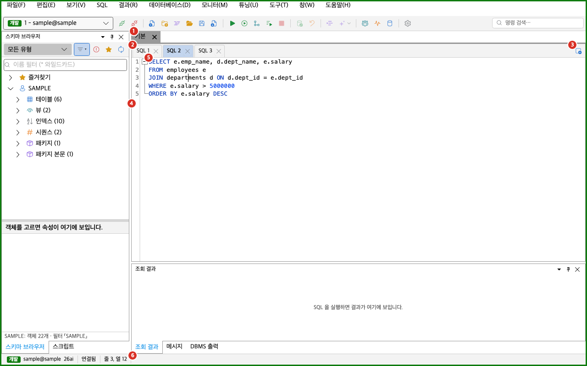
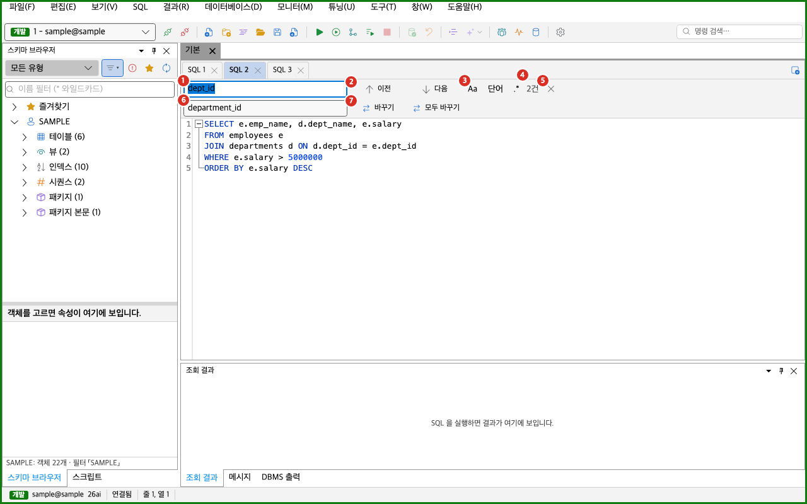

SQL 편집기는 SQL을 쓰고 고치고 저장하는 화면입니다. SQL 탭, 파일, 편집 명령, 찾기, 이동을 이 쪽에서 설명합니다.

## SQL 편집기 화면

Oranda는 SQL 탭을 작업 공간 안에 둡니다. 작업 공간 하나가 문서 영역의 문서 탭 하나이고, 그 안에 SQL 탭이 여러 개 있습니다.

1. 작업 공간 문서 탭: 작업 공간 이름을 보입니다. 고친 SQL 탭이 있으면 이름 앞에 `* `가 붙습니다. 파일에서 연 작업 공간이면 이름 뒤에 `(md)`, `(sqd)`, `(MyBatis)` 같은 파일 종류가 붙습니다.
2. SQL 탭 줄: 작업 공간의 SQL 탭을 보입니다. 저장하지 않은 변경이 있는 탭은 이름 앞에 `* `가 붙습니다. 파일에 묶인 탭은 마우스를 올리면 파일 경로가 나옵니다. 이 탭에서 시작한 실행이 도는 동안은 탭에 회전 표시가 보입니다.
3. 새 SQL 탭 단추: 현재 작업 공간에 빈 SQL 탭을 더합니다. 단추의 이름은 「새 SQL 탭」입니다.
4. 줄 번호와 접기 표시: 줄 번호와 접기 표시를 보입니다.
5. 편집기: SQL을 쓰는 곳입니다. SQL 구문을 색으로 구분하고, 커서가 괄호나 `BEGIN`/`END`에 닿으면 짝을 같이 칠합니다.
6. 상태 표시줄의 편집기 구간: 「줄 3, 열 12」처럼 커서 위치를 보입니다. 글자를 선택하면 「 (선택 5자)」가 붙고, 커서가 둘 이상이면 「 · 커서 2개」가 붙습니다.

SQL 탭이 한 줄에 다 들어가지 않으면 탭 줄 오른쪽에 「SQL 탭 목록」 단추가 나타납니다. 이 단추를 누르면 모든 SQL 탭이 목록으로 나오고, 고르면 그 탭으로 옮겨 갑니다. 탭 줄 위에서 마우스 휠을 돌리면 탭 줄이 옆으로 움직입니다. SQL 탭이 하나도 없으면 편집기 자리에 「SQL 탭이 없습니다. 「새 SQL」이나 탭 줄의 + 로 SQL 탭을 엽니다.」가 보입니다.

### SQL 탭을 다루는 방법

- 새 탭의 이름은 `SQL 1`, `SQL 2`처럼 쓰고 있지 않은 번호를 붙입니다.
- 탭 머리를 두 번 누르면 이름을 그 자리에서 고칩니다. 확정하면 이름이 바뀌고, 빈 이름은 받지 않습니다. 파일에 묶인 탭도 화면에 보이는 이름만 바뀝니다.
- 탭 머리를 끌어 놓으면 같은 작업 공간 안에서 순서가 바뀝니다. 끌 때 놓일 자리가 굵은 선으로 보입니다.
- 탭 머리를 오른쪽 클릭하면 「이름 바꾸기」, 「탭 복사(새 탭에)」, 「닫기」, 「다른 탭 닫기」, 「오른쪽 탭 닫기」가 나옵니다.
- 탭 머리의 「SQL 탭 닫기」(×) 단추로 탭을 닫습니다.

SQL을 실행하는 방법은 [SQL 실행](../../run/execute/)을 보세요.

## 저장 확인 창

고친 SQL 탭을 닫으면 저장 여부를 묻는 창이 뜹니다.

창 제목은 「저장하지 않은 변경」입니다. 창에는 닫으려는 탭의 이름과 「변경 내용을 저장할까요?」가 나옵니다. 단추는 세 개입니다.

| 단추 | 하는 일 |
|---|---|
| 저장 | 탭을 저장하고 닫습니다. 기본 단추입니다. |
| 저장 안 함 | 저장하지 않고 닫습니다. |
| 취소 | 탭을 닫지 않습니다. |

묻는 경우는 다음과 같습니다.

- 파일에 묶인 탭을 고쳤을 때 묻습니다.
- 파일에 묶이지 않은 탭은 사용자가 글을 직접 바꿨을 때 묻습니다. 처음 글에서 바뀌지 않았거나 공백뿐이면 묻지 않습니다.
- 읽기 전용 탭은 묻지 않습니다.

파일에 묶이지 않은 탭에서 「저장」을 고르면 저장 위치를 고르는 창이 이어서 뜹니다. 그 창을 취소하면 탭 닫기도 취소됩니다. 저장에 실패하면 「저장」 창에 「'이름' 을(를) 저장하지 못했다: 이유」가 나오고 탭은 닫히지 않습니다.

작업 공간을 닫거나 앱을 끝낼 때는 이 창이 뜨지 않습니다. 작업 공간 내용이 앱에 남기 때문입니다. 자세한 내용은 [작업 공간](../workspaces/)을 보세요.

## 문서 개요 창

문서 개요 창은 현재 SQL 탭의 문장 목록입니다. 긴 스크립트에서 원하는 문장으로 빨리 옮겨 갈 때 씁니다.

- 이 창은 **보기 > 도구 창 > 문서 개요**로 엽니다. 기본 위치는 화면 오른쪽입니다.
- 목록은 현재 SQL 탭의 문장을 위에서부터 차례로 보입니다. 한 줄에 문장이 시작하는 줄 번호와 문장 제목이 나옵니다.
- 제목은 주석 줄과 빈 줄을 건너뛴 첫 줄입니다. 공백은 하나로 줄이고, 60자를 넘으면 뒤를 `…`로 줄입니다. 문장에 글이 없으면 「(빈 문장)」이 보입니다.
- 목록에서 항목을 고르면 커서가 그 문장 앞으로 옮겨 가고 포커스가 편집기로 돌아갑니다.
- 글을 고친 뒤 0.3초가 지나면 목록이 다시 만들어집니다.
- MyBatis 문서에서는 이 창이 숨습니다.

## 새 스크립트 창

새 스크립트 창은 스크립트 폴더에 `.sql` 파일을 새로 만듭니다. [스크립트 창](../../run/execute/)의 「새 스크립트」 단추를 누르거나, 스크립트 트리를 오른쪽 클릭해 「새 스크립트…」를 고르면 열립니다. 스크립트 창에서 연결한 폴더에만 만들 수 있습니다. 로컬 파일만 만들고 DB에는 아무것도 쓰지 않습니다.

창 제목은 「새 스크립트」입니다. 창에는 다음 항목이 있습니다.

| 항목 | 설명 |
|---|---|
| 폴더 | 파일을 만들 폴더입니다. 고칠 수 없습니다. |
| 이름 | 파일 이름을 입력합니다. 처음에는 「새 스크립트.sql」이 들어 있습니다. 같은 이름이 있으면 「새 스크립트 2.sql」, 「새 스크립트 3.sql」 순으로 비어 있는 이름을 보입니다. |
| 활성 편집기 내용으로 채우기 | 켜면 지금 보고 있는 SQL 탭의 글이 새 파일에 들어갑니다. 편집기에 글이 없으면 꺼져 있고, 마우스를 올리면 「편집기에 복사할 글이 없습니다」가 보입니다. |
| 안내와 오류 줄 | 이름에 문제가 있으면 오류가 나옵니다. `.sql`을 붙여 만들 때는 「점검.sql 로 만듭니다」처럼 실제 이름이 보입니다. |
| 만들기 | 파일을 만듭니다. 오류가 있으면 눌러지지 않습니다. |
| 취소 | 창을 닫습니다. |

파일을 만들면 스크립트 창의 트리에서 새 파일이 선택되고 편집기에서 열립니다. 이름에 스크립트 확장자가 없으면 `.sql`이 붙습니다. 같은 이름의 파일이 있으면 덮어쓰지 않고 오류를 보입니다.

| 오류 줄 | 뜻 |
|---|---|
| 쓸 수 없는 글자가 있습니다: 글자 | 이름에 `\ / : * ? " < > \|` 같은 글자나 제어 문자가 있습니다. |
| 이름 끝에 점을 쓸 수 없습니다 | 이름이 `.`으로 끝납니다. |
| 이름이 너무 깁니다(255자까지) | 이름이 255자를 넘습니다. |
| Windows 예약 이름은 쓸 수 없습니다: 이름 | Windows에서 `CON`, `NUL` 같은 이름을 썼습니다. |
| 같은 이름의 파일이 이미 있습니다 | 폴더에 같은 이름의 파일이 있습니다. |
| 폴더를 찾을 수 없습니다 | 폴더가 없어졌습니다. |
| 이 폴더에 쓸 권한이 없습니다 | 폴더에 파일을 만들 권한이 없습니다. |
| 만들지 못했습니다: 이유 | 만드는 중에 다른 문제가 생겼습니다. 이유는 운영체제가 알려 준 글입니다. |

스크립트 창의 「새 스크립트」 단추가 눌러지지 않으면 단추에 마우스를 올려 이유를 읽으세요. 「스크립트 폴더를 먼저 연결하세요」는 연결한 폴더가 없다는 뜻이고, 「폴더를 먼저 고르세요」는 트리에서 폴더를 골라야 한다는 뜻입니다.

## 상태 표시줄 알림

상태 표시줄에는 저장 결과 같은 알림이 잠깐 나타납니다. 알림이 없으면 이 구간은 접혀 보이지 않습니다. 성공 알림은 6초 뒤에, 실패 알림은 12초 뒤에 저절로 사라집니다. 새 알림이 오면 이전 알림을 바꾸고 시간을 다시 잽니다. 실패 알림은 오류 색 칩으로 보입니다.

| 알림 | 언제 나옵니다 |
|---|---|
| 「이름 을(를) 찾을 수 없어 최근 목록에서 뺐습니다.」 | 최근 파일이나 최근 작업 공간에서 고른 파일이 없을 때 나옵니다. 실패 알림입니다. |
| 「MyBatis 기능이 꺼져 있어 매퍼를 일반 SQL 탭으로 펼쳐 열었습니다(매퍼 파일에는 저장하지 않습니다)」 | MyBatis 기능이 꺼진 상태에서 매퍼 파일을 처음 열 때 나옵니다. |
| 「5행 저장됨」, 「5행 저장·커밋됨」, 「5행 저장됨, 2행 저장하지 못함」 | 결과 그리드의 편집을 DB에 반영한 뒤 나옵니다. [그리드 편집과 플래시백](../../run/grid-edit/)을 보세요. |
| 「1,200행 내보냄: 파일 이름」 | 결과를 파일로 내보낸 뒤 나옵니다. 알림 오른쪽에 「열기」와 「폴더 열기」 링크가 붙습니다. |

## 파일 메뉴

메뉴 이름은 화면에 보이는 그대로 적었습니다. 표의 단축키는 기본 키맵 기준입니다. macOS 열에는 macOS에서 쓰는 키를 적었습니다. 대부분 Windows의 `Ctrl`이 `Cmd`로 바뀌고, `Alt`는 `Option` 키입니다. 키는 [단축키와 명령 팔레트](../../settings/shortcuts/)에서 바꿀 수 있습니다.

| 메뉴 | 하는 일 | Windows | macOS |
|---|---|---|---|
| 새 SQL 편집기 | 현재 작업 공간에 빈 SQL 탭을 엽니다. | `Ctrl+N` | `Cmd+N` |
| 새 SQL 탭(전용 세션) | 이 탭만 쓰는 DB 세션을 열고 새 SQL 탭에 붙입니다. | 없음 | 없음 |
| 파일 열기 | 파일을 고르는 창을 엽니다. | `Ctrl+O` | `Cmd+O` |
| 최근 파일 | 최근에 열거나 저장한 파일 10개를 보입니다. 고르면 엽니다. | 없음 | 없음 |
| 최근 파일 > 목록 지우기 | 최근 파일 목록을 비웁니다. | 없음 | 없음 |
| 저장 | 현재 SQL 탭을 저장합니다. | `Ctrl+S` | `Cmd+S` |
| 다른 이름으로 저장 | 새 이름이나 새 위치로 저장합니다. | 없음 | 없음 |
| 모두 저장 | 고친 SQL 탭을 모두 저장합니다. | `Ctrl+Shift+S` | `Cmd+Shift+S` |
| 탭 > 닫은 탭 다시 열기 | 마지막으로 닫은 SQL 탭을 되살립니다. | `Ctrl+Shift+T` | `Cmd+Shift+T` |
| 탭 > 탭 복사(새 탭에) | 현재 탭을 새 탭에 복사합니다. | 없음 | 없음 |
| 탭 > 탭 이름 바꾸기 | 현재 탭의 이름을 바꿉니다. | 없음 | 없음 |
| 탭 닫기 | 현재 SQL 탭을 닫습니다. | `Ctrl+W` | `Cmd+W` |
| 모든 탭 닫기 | 문서 영역의 모든 문서를 닫습니다. | 없음 | 없음 |
| 끝내기 | Oranda를 끝냅니다. | 없음 | 없음 |

도구 모음에도 「새 SQL 편집기」, 「파일 열기」, 「저장」 단추가 있습니다. 작업 공간 메뉴(**파일 > 작업 공간**)는 [작업 공간](../workspaces/)에서 설명합니다.

### 파일 열기

**파일 열기**를 고르면 「파일 열기」 창이 뜹니다. 창의 파일 종류 목록은 다음과 같습니다.

- SQL 파일: `*.sql`, `*.pls`, `*.pks`, `*.pkb`, `*.plb`, `*.prc`, `*.fnc`, `*.trg`, `*.txt`
- Oranda 작업 공간 (*.workspace.md)
- Orange 작업 공간 (*.sqd)
- 모든 파일

고른 파일은 확장자에 따라 다르게 열립니다.

| 파일 | 열리는 방식 |
|---|---|
| `.sql`, `.txt`, 그 밖의 확장자 | SQL 탭 하나로 엽니다. 탭 이름은 파일 이름입니다. |
| `.workspace.md`, `.sqd` | 작업 공간으로 엽니다. |
| `.pks`, `.pkb`, `.pls`, `.plb`, `.prc`, `.fnc`, `.trg` | PL/SQL 편집기 탭으로 엽니다. 자세한 내용은 [PL/SQL](../../schema/plsql/)을 보세요. |
| MyBatis 매퍼 `.xml` | MyBatis 기능이 켜져 있으면 MyBatis 작업 공간으로 엽니다. [MyBatis 작업 공간](../mybatis/)을 보세요. |

- 같은 경로의 파일이 이미 열려 있으면 새 탭을 만들지 않고 그 탭으로 옮겨 갑니다.
- 파일 인코딩은 자동으로 판별합니다. 앞머리 표시(BOM)가 있으면 그 인코딩을 쓰고, 없으면 UTF-8로 읽어 보고, 읽히지 않으면 CP949로 읽습니다.
- 저장할 때는 열 때의 인코딩을 그대로 씁니다.
- 열거나 저장한 파일은 최근 파일 목록 맨 위로 올라갑니다. 목록은 종류마다 10개까지 남습니다.
- 최근 파일 목록은 문서가 하나도 없을 때 보이는 시작 화면에도 같은 모양으로 나옵니다.
- 최근 목록에서 고른 파일이 없어졌으면 목록에서 빼고 상태 표시줄에 「이름 을(를) 찾을 수 없어 최근 목록에서 뺐습니다.」를 보입니다. 이 알림은 12초 뒤에 저절로 사라집니다.
- 창에 `.sqd` 파일이나 MyBatis 매퍼 `.xml` 파일을 끌어 놓아도 작업 공간으로 열립니다.

### 저장

- 파일에 묶이지 않은 탭을 **저장**하면 저장 위치를 고르는 창이 뜹니다. 제안하는 이름은 탭 이름에 `.sql`을 붙인 것입니다. 탭 이름이 이미 `.sql`, `.pls`, `.pks` 같은 SQL 확장자로 끝나면 그대로 씁니다. 이름의 `/ \ : * ? " < > |`는 `_`로 바꿉니다.
- 파일에 묶인 탭을 **저장**하면 같은 파일에 바로 씁니다.
- **다른 이름으로 저장**을 고르면 항상 저장 위치를 묻습니다. 저장한 뒤에는 탭이 새 파일에 묶이고 탭 이름이 파일 이름으로 바뀝니다.
- **모두 저장**은 고친 SQL 탭을 차례로 저장합니다. 저장 위치를 고르는 창을 취소하면 거기서 멈춥니다.
- 파일은 임시 파일에 먼저 쓴 뒤 원래 파일 자리로 옮깁니다.

:::caution[바인드 값도 파일에 저장됩니다]
탭에 바인드 변수 값이 있으면 `.sql` 파일을 저장할 때 SQL 끝에 `-- @oranda-binds v1`로 시작하는 주석 줄이 붙습니다. 편집기에는 이 줄이 보이지 않습니다. 이름에 `pass`, `pwd`, `secret`, `token`이 들어 있는 바인드도 값이 그대로 저장됩니다. 파일을 다른 사람에게 보내기 전에 바인드 값을 확인하세요.
:::

### 탭 닫기와 되살리기

- **탭 닫기**는 현재 SQL 탭을 닫습니다. 작업 공간에 SQL 탭이 하나도 없으면 작업 공간을 닫습니다.
- **모든 탭 닫기**는 SQL 작업 공간뿐 아니라 문서 영역의 모든 문서를 닫습니다. PL/SQL 편집기 탭 같은 다른 문서도 포함합니다.
- **닫은 탭 다시 열기**는 닫을 때의 내용 그대로 탭을 되살립니다. 마지막 20개까지 기억하고, 현재 작업 공간에 되살립니다. MyBatis 문장 탭은 기억하지 않습니다.
- **탭 복사(새 탭에)**는 SQL, 접속, 선택 영역, 바인드 변수 줄을 새 탭에 옮깁니다. 새 탭은 파일에 묶이지 않습니다.

### 전용 세션 탭

**새 SQL 탭(전용 세션)**은 현재 SQL 탭과 같은 접속으로 새 DB 세션을 열고, 그 세션만 쓰는 SQL 탭을 만듭니다. 다른 탭과 트랜잭션이 따로입니다. DB에 접속한 상태에서만 쓸 수 있습니다.

- 접속 비밀번호는 안전 저장소에서 꺼냅니다. 저장돼 있지 않으면 비밀번호를 묻습니다.
- 세션을 열지 못하면 탭을 만들지 않고 메시지 창에 「전용 세션을 열지 못했습니다: 이유」를 남깁니다. 비밀번호 입력을 취소한 경우에는 「전용 세션을 열지 않았습니다(접속이 없거나 비밀번호 입력을 취소했습니다).」를 남깁니다.
- 탭에서 실행이 도는 중에 탭을 닫으려 하면 「「탭 이름」 탭이 실행 중입니다. 실행을 취소하거나 끝난 뒤 닫으세요.」가 나오고 탭은 닫히지 않습니다.
- 커밋하지 않은 변경이 있는 채로 탭을 닫으려 하면 커밋, 롤백, 취소를 묻습니다.
- 이 기능의 이름은 「전용 세션 SQL 탭」입니다. 이 기능이 꺼져 있으면 메뉴에 나타나지 않습니다. **설정 > 기능**에서 켜고 끌 수 있습니다. 자세한 내용은 [설정](../../settings/options/)을 보세요.

## 편집 메뉴

편집 메뉴의 명령은 편집기에 포커스가 있을 때 쓸 수 있습니다. 글을 바꾸는 명령은 읽기 전용 문서에서 회색이 됩니다. 회색 항목에 마우스를 올리면 이유가 나옵니다. 읽기 전용 문서에서는 「읽기 전용 문서에서는 쓸 수 없습니다」가 보입니다.

편집기 안을 오른쪽 클릭해도 실행 취소, 다시 실행, 잘라내기, 복사, 붙여넣기, 모두 선택, 찾기, 바꾸기, 줄 주석 토글, 대문자로, 소문자로, 줄 복제, 줄 삭제, 북마크 토글, 포맷, 정의로 이동, 참조 찾기(현재 파일), 탭 이름 바꾸기를 쓸 수 있습니다.

### 기본 편집

| 메뉴 | Windows | macOS |
|---|---|---|
| 실행 취소 | `Ctrl+Z` | `Cmd+Z` |
| 다시 실행 | `Ctrl+Y` | `Cmd+Shift+Z` |
| 잘라내기 | `Ctrl+X` | `Cmd+X` |
| 복사 | `Ctrl+C` | `Cmd+C` |
| 붙여넣기 | `Ctrl+V` | `Cmd+V` |
| 모두 선택 | `Ctrl+A` | `Cmd+A` |

- 「실행 취소」와 「다시 실행」은 되돌릴 작업이 없으면 회색입니다. 이유는 「되돌릴 작업이 없습니다」, 「다시 할 작업이 없습니다」입니다.
- 「잘라내기」와 「복사」는 글자를 선택해야 켜집니다.

### 줄과 주석

**편집 > 줄·주석**에 있는 명령입니다. 글자를 선택하지 않으면 커서가 있는 줄에 적용합니다. 글자를 선택하면 선택이 닿는 모든 줄에 적용합니다. 선택이 다음 줄 맨 앞에서 끝나면 그 줄은 빼고 적용합니다.

| 메뉴 | 하는 일 | Windows | macOS |
|---|---|---|---|
| 줄 주석 토글 | 글이 있는 줄이 모두 `--`로 시작하면 주석을 풀고, 아니면 주석을 답니다. | `Ctrl+/` | `Cmd+/` |
| 블록 주석 토글 | 선택(없으면 커서 줄의 글)을 `/* */`로 감쌉니다. 이미 감싸져 있으면 벗깁니다. | `Ctrl+Shift+/` | `Cmd+Shift+/` |
| 줄 주석 달기 | 글이 있는 줄의 들여쓰기 뒤에 `-- `를 붙입니다. 빈 줄은 건드리지 않습니다. | 없음 | 없음 |
| 줄 주석 풀기 | 줄의 `--`와 그 뒤 공백 하나를 지웁니다. | 없음 | 없음 |
| 들여쓰기 | 글이 있는 줄 앞에 공백 4칸을 넣습니다. | 없음 | 없음 |
| 내어쓰기 | 줄 앞의 탭 하나 또는 공백 최대 4칸을 지웁니다. | 없음 | 없음 |
| 줄 복제 | 줄을 바로 아래에 복사합니다. 복사본이 선택됩니다. | `Ctrl+D` | `Cmd+D` |
| 줄 삭제 | 줄을 줄바꿈과 함께 지웁니다. | `Ctrl+Shift+K` | `Cmd+Shift+K` |

### 대소문자

**편집 > 대소문자**에 있는 명령입니다. 글자를 선택하지 않으면 커서가 닿은 낱말(영문, 숫자, `_`, `$`, `#`)을 바꿉니다.

| 메뉴 | 하는 일 | Windows | macOS |
|---|---|---|---|
| 대문자로 | 모두 대문자로 바꿉니다. | `Ctrl+Shift+U` | `Cmd+Shift+U` |
| 소문자로 | 모두 소문자로 바꿉니다. | `Ctrl+U` | `Cmd+U` |
| 단어 첫 글자 대문자 | 낱말마다 첫 글자만 대문자로 하고 나머지는 소문자로 바꿉니다. | 없음 | 없음 |
| 문장 첫 글자 대문자 | `.`, `!`, `?`, 줄바꿈 뒤의 첫 글자만 대문자로 하고 나머지는 소문자로 바꿉니다. | 없음 | 없음 |
| 대소문자 반전 | 대문자는 소문자로, 소문자는 대문자로 바꿉니다. | 없음 | 없음 |
| 대소문자 순환 | 모두 대문자면 소문자로, 모두 소문자면 단어 첫 글자 대문자로, 그 밖에는 모두 대문자로 바꿉니다. 같은 명령을 거듭 실행하면 이 순서로 돕니다. | 없음 | 없음 |

### 이동

**편집 > 이동**에 있는 명령입니다.

| 메뉴 | 하는 일 | Windows | macOS |
|---|---|---|---|
| 다음 찾기 | 찾을 글의 다음 일치로 갑니다. | `F3` | `Cmd+G` |
| 이전 찾기 | 찾을 글의 이전 일치로 갑니다. | `Shift+F3` | `Cmd+Shift+G` |
| 줄로 이동 | 줄 번호를 묻는 창을 엽니다. | `Ctrl+G` | `Cmd+L` |
| 짝 괄호·BEGIN/END 로 이동 | 커서가 닿은 괄호나 `BEGIN`/`END`의 짝으로 갑니다. | `Ctrl+]` | `Cmd+]` |
| 정의로 이동 | 커서 아래 이름의 정의로 갑니다. | `F12` | `F12` |
| 참조 찾기(현재 파일) | 같은 이름이 나오는 곳을 찾습니다. | `Shift+F12` | `Shift+F12` |
| 뒤로 이동 | 이동하기 전 위치로 돌아갑니다. | `Alt+Left` | `Cmd+Ctrl+Left` |
| 앞으로 이동 | 돌아오기 전 위치로 다시 갑니다. | `Alt+Right` | `Cmd+Ctrl+Right` |

- 「다음 찾기」와 「이전 찾기」는 찾을 글을 입력한 뒤에 켜집니다. 이유는 「찾을 글자를 먼저 입력하세요」입니다.
- 「줄로 이동」은 「줄로 이동」 창에 줄 번호를 입력해 확인하면 그 줄의 맨 앞으로 갑니다. 줄 번호가 문서 줄 수를 벗어나거나 숫자가 아니면 아무 일도 일어나지 않습니다.
- 「정의로 이동」과 「참조 찾기(현재 파일)」, 「뒤로 이동」, 「앞으로 이동」은 아래 [이름으로 이동하기](#이름으로-이동하기)에서 설명합니다.
- 짝 괄호 이동은 커서가 닫는 쪽에 닿아 있으면 여는 쪽 앞으로 가고, 여는 쪽에 닿아 있으면 닫는 쪽 끝으로 갑니다.
- 짝은 괄호와 `BEGIN`/`END`, `IF`/`END IF`, `LOOP`/`END LOOP`, `CASE`/`END CASE`입니다. 문자열과 주석 안의 글자는 보지 않습니다.

### 북마크와 접기

**편집 > 북마크·접기**에 있는 명령입니다.

| 메뉴 | 하는 일 | Windows | macOS |
|---|---|---|---|
| 북마크 토글 | 커서 줄의 북마크를 걸거나 풉니다. | `Ctrl+F2` | `Cmd+F2` |
| 다음 북마크 | 다음 북마크 줄로 갑니다. | `F2` | `F2` |
| 이전 북마크 | 이전 북마크 줄로 갑니다. | `Shift+F2` | `Shift+F2` |
| 접기 | 커서를 품은 구간 가운데 가장 안쪽을 접습니다. | `Ctrl+Shift+[` | `Cmd+Shift+[` |
| 펼치기 | 커서를 품은 접힌 구간 가운데 가장 안쪽을 펼칩니다. | `Ctrl+Shift+]` | `Cmd+Shift+]` |
| 모두 접기 | 모든 구간을 접습니다. | 없음 | 없음 |
| 모두 펼치기 | 모든 구간을 펼칩니다. | 없음 | 없음 |
| 위에 커서 추가 | 가장 위 커서의 바로 윗줄 같은 열에 커서를 더합니다. | `Ctrl+Alt+Up` | `Cmd+Option+Up` |
| 아래에 커서 추가 | 가장 아래 커서의 바로 아랫줄 같은 열에 커서를 더합니다. | `Ctrl+Alt+Down` | `Cmd+Option+Down` |

### 입력 도우미와 포맷

**편집 > 입력 도우미**와 **편집 > 포맷**은 [자동 완성, 포맷, 템플릿](../assist/)에서 설명합니다.

## 찾기와 바꾸기 패널

**편집 > 찾기**(`Ctrl+F`, macOS는 `Cmd+F`)를 고르면 편집기 위에 찾기 패널이 열립니다. **편집 > 바꾸기**(`Ctrl+H`, macOS는 `Cmd+Option+F`)를 고르면 바꿀 글 줄까지 열립니다. 글자를 한 줄로 선택하고 열면 선택한 글이 찾을 글에 들어갑니다. 선택이 200자 이상이거나 여러 줄이면 들어가지 않습니다.

1. 찾을 글 상자: 찾을 글을 입력합니다. 입력하는 대로 결과 건수가 바뀝니다.
2. 이전과 다음 단추: 이전 일치와 다음 일치를 고릅니다.
3. 옵션 단추 셋: `Aa`는 대소문자 구분, `단어`는 단어 단위, `.*`는 정규식입니다.
4. 결과 표시: 일치 건수를 「3건」처럼 보입니다. 일치가 없으면 「없음」, 정규식이 잘못되면 「정규식 오류」를 보입니다.
5. 찾기 닫기 단추: 패널을 닫고 포커스를 편집기로 돌립니다.
6. 바꿀 글 상자: 바꿀 글을 입력합니다. 바꾸기 줄은 읽기 전용 문서에서는 나타나지 않습니다.
7. 바꾸기 단추와 모두 바꾸기 단추: 한 곳만 바꾸거나 전부 바꿉니다.

- 끝까지 찾고 나면 처음부터 다시 찾습니다.
- 대소문자 구분을 끄면 대소문자를 가리지 않습니다.
- 단어 단위를 켜면 앞뒤에 글자, 숫자, `_`, `$`, `#`가 붙어 있는 일치는 건너뜁니다.
- 정규식을 켜면 찾을 글을 정규식으로 읽습니다. 바꿀 글에 `$1` 같은 그룹 참조를 쓸 수 있습니다. 정규식 검색이 2초 안에 끝나지 않으면 일치가 없는 것으로 봅니다.
- 「바꾸기」는 선택이 찾을 글과 일치하면 바꾼 뒤 다음 일치로 갑니다. 일치하지 않으면 다음 일치만 고릅니다.
- 「모두 바꾸기」는 탭 전체 글에 적용합니다. 한 번에 실행 취소할 수 있고, 결과 표시에 「5건 바꿈」처럼 횟수가 나옵니다.

## 다중 커서

한 번에 여러 곳에 같은 글을 넣을 때 다중 커서를 씁니다.

- **위에 커서 추가**나 **아래에 커서 추가**를 쓰면 줄마다 커서가 하나씩 늘어납니다. 줄이 짧으면 그 줄 끝에 놓입니다.
- `Alt`를 누른 채 원하는 자리를 눌렀다 떼면 그 자리에 커서가 늘어납니다. macOS에서는 `Option`을 누릅니다.
- 방향키, `Home`, `End`, 단어 단위 이동은 모든 커서를 함께 옮깁니다. `Shift`를 함께 누르면 커서마다 따로 선택합니다. 위아래로 옮길 때는 짧은 줄을 지나도 처음 열을 기억합니다.
- 겹치거나 맞닿은 커서와 선택은 하나로 합쳐집니다.
- 글자 입력, `Backspace`, `Delete`, `Enter`, `Tab`은 모든 커서에 한 번에 적용되고, 한 번의 실행 취소로 되돌립니다. 선택이 있는 커서는 선택한 글을 바꿉니다. `Shift+Tab`은 커서가 있는 줄의 들여쓰기를 한 단계 줄입니다.
- 복사와 잘라내기는 선택이 있는 커서의 글을 위에서 아래 순서로 줄바꿈으로 이어 클립보드에 담습니다. 선택이 없는 커서만 있으면 복사할 글이 없습니다.
- 붙여넣을 글의 줄 수가 커서 수와 같으면 커서마다 한 줄씩 들어갑니다. 줄 수가 다르면 글 전체가 모든 커서에 들어갑니다.
- 일반 클릭, `Esc`, `PageUp`, `PageDown`을 누르거나 찾기·줄 이동으로 커서가 움직이면 추가한 커서가 사라집니다.
- 커서 개수는 상태 표시줄에 「 · 커서 3개」처럼 나옵니다.

## 열 선택

글을 줄마다 같은 열 범위로 네모나게 고를 때 열 선택을 씁니다.

- `Alt`를 누른 채 끌면 네모난 블록이 선택됩니다. macOS에서는 `Option`을 누릅니다. 끌지 않고 제자리에서 눌렀다 떼면 열 선택이 아니라 커서가 하나 늘어납니다.
- 열 선택과 추가 커서는 함께 둘 수 없습니다. 끌기를 시작하면 추가 커서가 사라지고, 커서를 더하면 블록 선택이 풀립니다.
- 선택 실행(**SQL > 선택 영역 실행**)은 블록 안의 글만 줄 순서로 이어 실행합니다. 블록 밖의 SQL은 실행되지 않고, 실행 범위 강조도 블록 안만 칠합니다.
- 대소문자 변환 같은 글자 연산은 줄마다 선택된 글자에만 적용됩니다. 주석 처리, 들여쓰기, 줄 복제처럼 줄 단위로 동작하는 명령은 블록이 걸친 줄 전체에 적용됩니다.
- 복사하면 블록 모양이 기억됩니다. 이 글을 붙여넣으면 줄이 이어서 들어가지 않고 블록 모양 그대로 각 줄의 같은 열에 들어갑니다. 블록 모양으로 붙일 때 문서 끝에 줄이 모자라면 줄을 더해 모두 붙이고, 일반 선택이 있으면 그 선택을 대체합니다. 다른 프로그램에서 복사한 글은 일반 글로 붙습니다.
- `Tab`은 줄 전체를 들여쓰지 않고 블록의 왼쪽 열 위치에 들여쓰기 글자를 넣습니다.
- 선택을 한 덩어리로 바꾸는 기능은 열 블록에서 동작하지 않고 「열 블록·여러 커서 선택에서는 쓸 수 없습니다」라고 알립니다. 선택 영역 포맷, 코드 조각 삽입, MyBatis 로그 붙여 넣기, 스키마 브라우저의 이름·SELECT 넣기, 표 배치 넣기가 그렇습니다. 선택을 하나로 줄인 뒤 다시 하세요.
- 블록으로 실행한 `CREATE` 문의 컴파일 오류는 블록 안의 해당 글자로 이동합니다.
- 순차 실행, 결과 편집 모드로 실행(`F9`), 예상·실제 실행 계획은 블록이 있어도 블록 안의 글이 아니라 커서가 놓인 문장 전체를 대상으로 합니다. 일반 선택이 있을 때와 같은 동작입니다.

## 접기

여러 줄에 걸친 구간 왼쪽에 접기 표시가 나타납니다. 접기 표시를 누르거나 **편집 > 북마크·접기**의 접기 명령을 쓰면 구간이 한 줄로 줄어듭니다.

- 접을 수 있는 구간은 여러 줄 괄호, `BEGIN`/`END`, `IF`/`END IF`, `LOOP`/`END LOOP`, `CASE`/`END CASE`, `/* */` 주석, 여러 줄 문장입니다.
- 접힌 줄에는 구간의 첫 줄과 `…`와 닫는 말이 보입니다. 여러 줄 문장은 첫 줄 앞 48자와 `…`가 보입니다. 주석은 `/* … */`가 보입니다.
- 접기 구간은 글을 고치고 0.4초가 지난 뒤에 다시 계산합니다. 입력 중에는 구간이 바로 갱신되지 않을 수 있습니다.

## 북마크

북마크는 줄에 거는 표시입니다. 북마크가 걸린 줄은 줄 전체가 옅은 파란색으로 칠해집니다.

- **다음 북마크**와 **이전 북마크**는 끝에 닿으면 반대쪽 끝으로 돕니다.
- 북마크가 하나도 없으면 두 메뉴는 회색이고, 이유는 「책갈피가 없습니다」입니다.
- 북마크는 작업 공간에 저장하는 내용에 들어 있지 않습니다. 다시 열면 북마크를 다시 거세요.

## 이름으로 이동하기

### 정의로 이동

**편집 > 이동 > 정의로 이동**은 커서 아래 이름의 정의로 갑니다. DB에 접속한 상태에서만 켜집니다. 접속이 없으면 회색이고 이유는 「DB 에 접속해야 쓸 수 있습니다」입니다.

1. 먼저 같은 문서 안에서 정의를 찾습니다. 테이블 별칭, 파생 테이블 별칭, `WITH` 절, 변수, 커서, 로컬 프로시저·함수, 매개변수, 형식, 반복 변수가 대상입니다. 찾으면 그 이름을 선택합니다.
2. 문서 안에 없으면 DB에서 객체를 찾습니다. 패키지, 타입, 프로시저, 함수, 트리거는 소스를 읽기 전용 SQL 탭으로 엽니다. 패키지와 타입은 본문을 먼저 찾고, 없으면 명세를 엽니다. 탭 이름은 `소유자.이름` 형식이고, 본문이면 `BODY`가 붙습니다.
3. 표, 뷰 같은 그 밖의 객체는 객체 상세에서 DDL을 엽니다.

이름을 찾지 못하거나 객체가 없으면 화면에 아무 변화가 없습니다. 이름 위에 커서가 있는지, 객체 이름이 맞는지 확인하세요.

### 참조 찾기

**참조 찾기(현재 파일)**는 현재 탭에서 커서 아래 이름과 같은 이름이 나오는 곳을 모두 찾습니다. 접속이 없어도 쓸 수 있습니다.

- 커서 다음 참조를 편집기에서 선택합니다.
- 작은 창이 열리고 첫 줄에 「5개 참조」처럼 개수가 나옵니다. 그 아래에 「12줄: 그 줄의 글」처럼 한 줄씩 나옵니다.
- 창의 「복사」 단추로 목록을 복사합니다. 창 아래쪽에 「Esc = 닫기」가 안내됩니다.

### 뒤로와 앞으로

**정의로 이동**으로 옮겨 가기 전의 위치를 기억합니다. 최대 100곳까지 기억합니다. **뒤로 이동**은 기억한 위치로 돌아가고, **앞으로 이동**은 돌아오기 전 위치로 다시 갑니다. 닫은 탭의 기록은 건너뜁니다. 기록이 없으면 두 메뉴는 회색이고, 이유는 「뒤로 갈 위치가 없습니다」, 「앞으로 갈 위치가 없습니다」입니다.

## 자주 하는 작업

### SQL을 새로 쓰고 파일로 저장하기

1. `Ctrl+N`을 누르세요. macOS에서는 `Cmd+N`을 누르세요.
2. 편집기에 SQL을 입력하세요. 예를 들면 `SELECT * FROM employees WHERE dept_id = 40`입니다.
3. `Ctrl+S`를 누르세요.
4. 저장 위치를 고르는 창에서 폴더와 이름을 정하세요.
5. 「저장」을 누르세요.

탭 이름이 파일 이름으로 바뀌고, 이름 앞의 `* `가 사라집니다.

### 파일을 열어 고치기

1. `Ctrl+O`를 누르세요.
2. 파일을 고르세요.
3. 파일을 고치세요. 탭 이름 앞에 `* `가 붙습니다.
4. `Ctrl+S`를 누르세요.

최근에 쓴 파일이면 **파일 > 최근 파일**에서 고르세요.

### 단어를 찾아 모두 바꾸기

1. 바꿀 단어를 선택하세요.
2. 바꾸기 패널을 열려면 `Ctrl+H`를 누르세요. macOS에서는 `Cmd+Option+F`를 누르세요.
3. 「바꿀 글」 상자에 새 글을 입력하세요.
4. 결과 표시의 건수를 확인하세요.
5. 「모두 바꾸기」를 누르세요.
6. 잘못 바꿨으면 편집기에서 `Ctrl+Z`를 누르세요.

### 여러 줄을 한꺼번에 주석으로 만들기

1. 주석으로 만들 줄을 선택하세요.
2. `Ctrl+/`를 누르세요.
3. 주석을 풀려면 같은 줄을 선택한 채 `Ctrl+/`를 한 번 더 누르세요.

### 같은 열에 한꺼번에 글 넣기

1. 첫 줄의 글을 넣을 자리에 커서를 두세요.
2. `Ctrl+Alt+Down`을 줄 수만큼 누르세요. macOS에서는 `Cmd+Option+Down`을 누르세요.
3. 글을 입력하세요.

### 긴 스크립트에서 원하는 문장으로 가기

1. **보기 > 도구 창 > 문서 개요**를 고르세요.
2. 목록에서 원하는 문장을 고르세요.

### 북마크로 두 곳을 오가기

1. 표시할 줄에 커서를 두고 `Ctrl+F2`를 누르세요.
2. 다른 줄에서도 `Ctrl+F2`를 누르세요.
3. 북마크 줄로 옮겨 가려면 `F2`를 누르세요.
4. 반대 방향으로 가려면 `Shift+F2`를 누르세요.

### 패키지 소스를 보고 돌아오기

1. DB에 접속하세요.
2. 편집기에 `SELECT sample_pkg.customer_total(1001) FROM dual`을 입력하세요.
3. 커서를 `sample_pkg` 위에 두세요.
4. `F12`를 누르세요.
5. 열린 읽기 전용 탭에서 소스를 보세요.
6. 원래 위치로 돌아오려면 **편집 > 이동 > 뒤로 이동**을 고르세요. 단축키는 `Alt+Left`입니다. macOS에서는 `Cmd+Ctrl+Left`입니다.

`sample_pkg`는 이 설명서의 샘플 DB에 만든 패키지입니다.

### 닫은 탭 되살리기

1. `Ctrl+Shift+T`를 누르세요. macOS에서는 `Cmd+Shift+T`를 누르세요.

## 문제가 생길 때

| 증상 | 원인 | 해결 |
|---|---|---|
| 같은 파일을 열었는데 새 탭이 생기지 않습니다 | 같은 경로의 파일이 이미 열려 있으면 그 탭으로 옮겨 갑니다. | 열려 있는 탭을 확인하세요. |
| 상태 표시줄에 「이름 을(를) 찾을 수 없어 최근 목록에서 뺐습니다.」가 나옵니다 | 최근 목록의 파일이 옮겨졌거나 지워졌습니다. | 파일 위치를 확인한 뒤 **파일 열기**로 다시 여세요. |
| 한글이 깨져 보입니다 | Oranda가 파일 인코딩을 잘못 판별했습니다. 판별 순서는 앞머리 표시(BOM), UTF-8, CP949입니다. | 파일을 UTF-8로 저장한 뒤 다시 여세요. |
| 메뉴가 회색이고 이유가 「읽기 전용 문서에서는 쓸 수 없습니다」입니다 | 정의로 이동으로 연 소스 탭처럼 읽기 전용 탭입니다. | 내용을 새 SQL 탭에 복사해서 고치세요. |
| 「다음 찾기」가 회색입니다 | 찾을 글이 비어 있습니다. | 찾기 패널에 찾을 글을 입력하세요. |
| 결과 표시가 「정규식 오류」입니다 | 정규식 단추가 켜져 있고 찾을 글이 올바른 정규식이 아닙니다. | 정규식 단추를 끄거나 찾을 글을 고치세요. |
| 결과 표시가 「없음」입니다 | 찾을 글과 맞는 곳이 없습니다. | 대소문자 구분과 단어 단위 단추를 끄고 다시 찾으세요. |
| 바꿀 글 줄이 보이지 않습니다 | 읽기 전용 문서입니다. | 새 SQL 탭에 복사한 뒤 바꾸세요. |
| 「다음 북마크」가 회색입니다 | 북마크가 하나도 없습니다. | 줄에 북마크를 먼저 거세요. |
| 「정의로 이동」과 「인자 도움말」이 회색입니다 | DB에 접속하지 않았습니다. | 접속한 뒤 다시 시도하세요. |
| 「정의로 이동」을 눌러도 변화가 없습니다 | 커서가 이름 위에 있지 않거나 객체를 찾지 못했습니다. | 커서를 이름 위에 두고, 객체 이름과 접속한 스키마를 확인하세요. |
| 「줄로 이동」을 눌러도 커서가 가지 않습니다 | 줄 번호가 숫자가 아니거나 문서 줄 수를 벗어납니다. | 문서 안의 줄 번호를 입력하세요. |
| 「새 SQL 탭(전용 세션)」이 메뉴에 없습니다 | 「전용 세션 SQL 탭」 기능이 꺼져 있습니다. | **설정 > 기능**에서 켜세요. |
| 「새 SQL 탭(전용 세션)」이 회색입니다 | DB에 접속하지 않았습니다. | 접속한 뒤 다시 시도하세요. |
