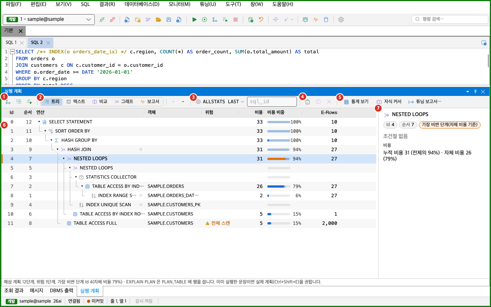
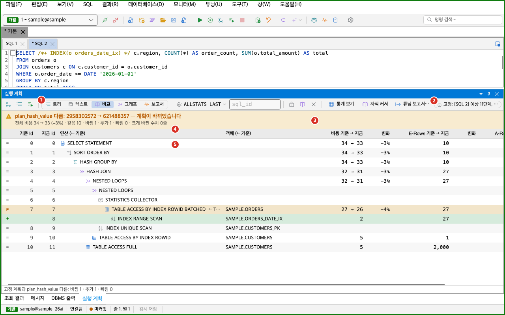

실행 계획은 Oracle이 SQL을 어떤 순서와 방법으로 실행하는지 보여 줍니다. 이 쪽에서는 계획을 만드는 방법, 계획 창을 읽는 방법, 계획을 고정해 비교하는 방법을 설명합니다. 통계, 자식 커서, 인덱스 후보 같은 튜닝 도구는 [SQL 튜닝](../tuning/)을 보세요. SQL을 실행하는 방법은 [SQL 실행](../../run/execute/)을 보세요.

계획에는 두 종류가 있습니다.

| 항목 | 예상 계획 | 실제 계획 |
|---|---|---|
| 만드는 방법 | `EXPLAIN PLAN` | `DBMS_XPLAN.DISPLAY_CURSOR` |
| 읽는 곳 | 편집기에서 커서가 있는 문장 | 공유 풀에 있는 커서. 마지막으로 실행한 문장이나 입력한 sql_id의 커서입니다. |
| SQL 실행 | 실행하지 않습니다. | 이미 실행한 커서의 계획을 읽습니다. |
| DB에 쓰기 | `PLAN_TABLE`에 행을 씁니다. | 계획을 읽을 때는 쓰지 않습니다. |
| 행 수 | 예상 행 수(E-Rows)만 있습니다. | E-Rows와 함께 실제 행 수(A-Rows), Starts, 시간이 있습니다. |
| 관리 팩 | 필요 없습니다. | 필요 없습니다. |

실제 계획의 A-Rows, Starts, 시간은 마지막 실행의 값입니다. 서버가 통계를 수집하지 않으면 A-Rows가 비어 있습니다. 이때는 [A-Rows가 없을 때](#a-rows가-없을-때)를 보세요.

기본 설정에서는 계획의 비교, 그래프, 보고서 보기와 형식 단추가 보입니다. 이 기능들은 「계획 고급」 기능에 속합니다. 「계획 고급」이 꺼져 있으면 보이지 않습니다. 자세한 내용은 [문제가 생길 때](#문제가-생길-때)를 보세요.

## 계획 만들기

계획을 만들면 계획 창이 열립니다. 계획 창은 하나이고, SQL 탭마다 자기 계획을 따로 보관합니다. SQL 탭을 바꾸면 그 탭의 계획이 보입니다.

명령은 **튜닝** 메뉴의 위쪽 묶음에 있습니다. 단축키는 기본 키맵 기준입니다. 단축키는 [단축키와 명령 팔레트](../../settings/shortcuts/)에서 바꿉니다. macOS에서 `Alt`는 `Option` 키입니다.

| 메뉴 항목 | 하는 일 | Windows | macOS |
|---|---|---|---|
| 예상 실행 계획 | 커서가 있는 문장의 예상 계획을 만듭니다. | `Ctrl+E` | `Cmd+E` |
| 실제 실행 계획(마지막 실행) | 이 탭이 마지막으로 실행한 문장의 실제 계획을 읽습니다. 계획 창의 sql_id 칸에 값이 있으면 그 sql_id의 계획을 읽습니다. | `Ctrl+Shift+E` | `Cmd+Shift+E` |
| 실행하고 실제 계획(A-Rows) | 커서가 있는 문장을 실행하고 A-Rows가 있는 실제 계획을 엽니다. | `Ctrl+Alt+Shift+E` | `Cmd+Option+Shift+E` |
| DISPLAY_CURSOR 형식 옵션 | 계획 창을 엽니다. 형식은 계획 창의 형식 단추에서 고릅니다. | 없음 | 없음 |
| 이 계획 고정(비교 기준) | 지금 보이는 계획을 비교 기준으로 고정합니다. | 없음 | 없음 |
| 고정한 계획과 비교 | 고정한 계획과 지금 계획을 비교합니다. | 없음 | 없음 |

- 「예상 실행 계획」과 「실제 실행 계획(마지막 실행)」은 **SQL** 메뉴에도 있습니다.
- 「예상 실행 계획」은 도구 모음과 편집기를 오른쪽 클릭한 메뉴에도 있습니다.
- 「실행하고 실제 계획(A-Rows)」은 도구 모음에도 있습니다.
- 「이 계획 고정(비교 기준)」과 「고정한 계획과 비교」는 계획 트리를 오른쪽 클릭한 메뉴에도 있습니다.
- 계획 창은 **보기 > 도구 창 > 실행 계획**으로 엽니다. 단축키는 `Alt+4`입니다. macOS에서는 `Ctrl+4`입니다. 기본 위치는 화면 아래쪽입니다.
- 「예상 실행 계획」, 「실제 실행 계획(마지막 실행)」, 「실행하고 실제 계획(A-Rows)」은 접속이 있고 MyBatis 문서가 아닐 때 켜집니다. 세션이 다른 문장을 실행하는 중이면 「예상 실행 계획」과 「실행하고 실제 계획(A-Rows)」은 꺼집니다.
- 「DISPLAY_CURSOR 형식 옵션」, 「이 계획 고정(비교 기준)」, 「고정한 계획과 비교」는 「계획 고급」 기능이 켜져 있어야 보입니다.

### 예상 계획

- 편집기에서 커서가 문장 안에 있어야 합니다. 문장이 없으면 상태 줄에 「예상 계획을 볼 문장이 없습니다(커서를 문장 안에 두세요).」가 나옵니다.
- PL/SQL 블록, SQL*Plus 명령, 트랜잭션 제어 문장은 예상 계획을 만들 수 없습니다.
- 문장에 바인드 변수가 있으면 값 없이 분석합니다.
- 접속의 실행 정책이 `EXPLAIN PLAN`을 막으면 계획이 만들어지지 않습니다.
- 계획 창 아래의 상태 줄에 「EXPLAIN PLAN 은 PLAN_TABLE 에 행을 씁니다. 이미 실행한 문장이면 실제 계획(Ctrl+Shift+E)을 권합니다.」가 함께 보입니다.

### 실제 계획

- sql_id 칸이 비어 있으면 이 탭이 마지막으로 실행한 문장의 계획을 읽습니다. 먼저 SQL을 실행하세요.
- sql_id 칸에 값이 있으면 그 sql_id의 계획을 읽습니다. 값이 있는 동안에는 마지막 실행의 계획을 읽지 않습니다. 마지막 실행의 계획을 읽으려면 칸을 비우세요.
- 같은 세션에서 다른 탭이나 다른 기능이 더 나중에 SQL을 실행했으면, 다른 문장의 계획이 열리지 않도록 계획을 읽지 않고 안내를 보입니다.
- 공유 풀에서 밀려난 커서는 읽을 수 없습니다.

### 실행하고 실제 계획

문장을 실행하고 A-Rows까지 있는 계획을 한 번에 엽니다.

- 조회(SELECT)만 실행합니다. DML, DDL, PL/SQL, `FOR UPDATE` 문장은 실행하지 않고 상태 줄에 「질의(SELECT)만 실행해 실제 계획을 봅니다. DML·DDL·PL/SQL·FOR UPDATE 는 실행하지 않았습니다 — 직접 실행한 뒤 「실제 계획」(Ctrl+Shift+E)을 보세요.」가 나옵니다.
- 문장에 `/*+ GATHER_PLAN_STATISTICS */` 힌트를 넣은 사본을 실행합니다. 편집기의 글은 바뀌지 않습니다.
- 모든 행을 끝까지 읽습니다. 행이 많은 SQL은 오래 걸릴 수 있습니다.
- 「바인드 변수」 창의 현재 값을 바인드 값으로 씁니다.
- 접속의 실행 정책을 그대로 거칩니다. 앱이 대신 보내는 문장이라 실행 이력에는 남기지 않습니다.
- 실행하는 동안에는 도구 모음에 「실행 중단」 단추가 나옵니다.

## 계획 창

1. 계획 만들기 단추: 왼쪽부터 「예상 계획」, 「실제 계획」, 「실행하고 실제 계획(A-Rows)」입니다. 단축키와 같은 명령을 부릅니다. 활성 SQL 탭이나 접속이 없으면 꺼집니다.
2. 보기 전환: 「트리」, 「텍스트」, 「비교」, 「그래프」, 「보고서」 중에서 고릅니다. 「비교」, 「그래프」, 「보고서」는 「계획 고급」이 켜져 있을 때만 보입니다.
3. 형식 단추와 sql_id 칸: 형식 단추에는 지금 형식이 보입니다. sql_id 칸은 실제 계획을 읽을 sql_id를 넣는 곳입니다. 트리, 텍스트, 비교 보기에서 보입니다.
4. 고정 단추: 「이 계획 고정」, 「비교」, 「고정 해제」입니다. 「계획 고급」이 켜져 있을 때만 보입니다.
5. 튜닝 단추: 「통계 보기」, 「자식 커서」, 「튜닝 보고서…」입니다. 해당 기능이 켜져 있을 때만 보입니다. [SQL 튜닝](../tuning/)을 보세요.
6. 계획 트리: 계획의 단계를 표로 보입니다. 열 머리글 오른쪽 경계를 끌어 열 폭을 바꿉니다.
7. 단계 상세: 고른 단계의 연산, 객체, 조건절, 비용을 보입니다. 새 계획이 열리면 가장 비싼 단계가 자동으로 골라집니다.

- 계획 창 아래의 상태 줄에는 마지막 작업의 결과가 나옵니다. 계획을 만들면 「{종류} 계획 {n}단계, 위험 {n}단계, 가장 비싼 단계 Id {n}(자체 시간 또는 자체 비용 {비율})」과 sql_id, child 번호가 나옵니다.
- 계획이 없으면 트리에 「실행 계획이 없습니다」와 「SQL 편집기에서 Ctrl+E 는 예상 계획, Ctrl+Shift+E 는 실제 계획」이 보입니다.
- 트리 보기에서는 도구 모음에 「＋」(모두 펼치기)와 「－」(모두 접기) 단추가 있습니다.

### 트리의 열

| 열 | 뜻 |
|---|---|
| Id | 단계 번호입니다. |
| 순서 | 실행 순서입니다. 자식이 부모보다 먼저이고, 같은 부모의 자식은 Id 순입니다. |
| 연산 | 연산 이름과 옵션입니다. 예를 들면 `TABLE ACCESS FULL`입니다. 자식이 있는 단계에는 접기와 펼치기 단추가 있습니다. 접으면 숨은 단계 수가 「+3」처럼 보입니다. 조건절이 있는 단계에는 필터 아이콘이 보이고, 마우스를 올리면 조건절이 나옵니다. |
| 객체 | 테이블이나 인덱스 이름입니다. 소유자가 있으면 `소유자.이름`으로 보입니다. |
| 위험 | 위험 표시입니다. 아래 표를 보세요. |
| 비용 | 누적 비용입니다. 자식의 비용을 포함합니다. |
| 비용 비중 | 막대와 비율입니다. 옅은 막대는 누적 비용의 비중이고, 진한 막대는 자체 비용의 비중입니다. |
| E-Rows | 예상 행 수입니다. |
| A-Rows | 실제 행 수입니다. 실제 계획에 실제 통계가 있을 때만 보입니다. |
| Starts | 단계를 시작한 횟수입니다. 실제 통계가 있을 때만 보입니다. |
| 시간(s) | 누적 A-Time입니다. 단위는 초입니다. 실제 통계가 있을 때만 보입니다. |
| 실제 비중 | 누적과 자체 A-Time의 비중 막대입니다. 시간 통계가 없으면 A-Rows 기준입니다. 실제 통계가 있을 때만 보입니다. |

- 자체 비용은 누적 비용에서 바로 아래 자식들의 누적 비용 합을 뺀 값입니다. 자체 시간도 같은 방식입니다.
- 「가장 비싼 단계」는 자체 시간이 가장 큰 단계입니다. 실제 시간이 없으면 자체 비용이 가장 큰 단계입니다. 이 줄은 왼쪽에 주황색 띠가 붙고 글자가 굵게 보입니다. 단계가 하나뿐이면 표시하지 않습니다.

| 위험 | 표시되는 조건 |
|---|---|
| 전체 스캔 | 연산이 `TABLE ACCESS`이고 옵션에 `FULL`이 있습니다. |
| 카테시안 | 옵션에 `CARTESIAN`이 있습니다. |
| 행 수 차이 | 실제 계획입니다. 시작 횟수당 실제 행 수와 예상 행 수 중 큰 쪽이 10 이상이고, 두 값이 10배 이상 차이 납니다. |

### 단계 상세

단계를 고르면 오른쪽 상세 칸에 다음이 보입니다. 단계를 고르지 않았으면 「단계를 고르면 조건절과 비용이 여기에 보입니다.」가 보입니다.

- 연산, 객체, Id, 순서
- 가장 비싼 단계이면 「가장 비싼 단계(자체 시간 기준)」나 「가장 비싼 단계(자체 비용 기준)」
- 위험이 있으면 위험 문구
- 「액세스 조건 (access)」과 「필터 조건 (filter)」. 조건절이 없으면 「조건절 없음」
- 「비용」과 「실제」 설명. 누적 값과 자체 값, 전체에서 차지하는 비중이 나옵니다.

### 텍스트 보기

「텍스트」는 `DBMS_XPLAN` 출력 그대로입니다. 읽기 전용이고 복사할 수 있습니다. 형식 옵션은 이 텍스트의 내용을 정합니다. 트리는 형식 옵션과 관계없이 같은 단계를 보입니다.

## 계획 표시 옵션

형식 단추를 누르면 「DBMS_XPLAN 형식」 상자가 열립니다. 이 옵션은 실제 계획의 텍스트를 읽을 때 씁니다. 안내 문구는 「실제 계획(Ctrl+Shift+E)을 읽을 때 씁니다.」입니다.

| 항목 | 설명 |
|---|---|
| 기본 형식 | `BASIC`, `TYPICAL`, `SERIAL`, `ALL`, `ALLSTATS` 중에서 고릅니다. 처음 값은 `ALLSTATS`입니다. |
| LAST (마지막 실행만) | 처음에는 켜져 있습니다. 기본 형식이 `ALLSTATS`일 때만 형식에 `LAST`를 붙입니다. |
| 바인드 엿보기 (+PEEKED_BINDS) | 형식에 `+PEEKED_BINDS`를 붙입니다. |
| 별칭 (+ALIAS) | 형식에 `+ALIAS`를 붙입니다. |
| 아웃라인 (+OUTLINE) | 형식에 `+OUTLINE`을 붙입니다. |

- 형식 단추에는 위 옵션을 합친 형식이 보입니다. 예를 들면 `ALLSTATS LAST`입니다.
- 이 옵션은 모든 SQL 탭이 함께 씁니다.
- 형식 단추는 「계획 고급」이 켜져 있을 때만 보입니다.

## A-Rows가 없을 때

실제 계획인데 모든 단계의 A-Rows가 비어 있으면 도구 모음 아래에 안내 막대가 나옵니다. 서버가 단계별 실제 통계를 수집하지 않았다는 뜻입니다. 상태 줄에도 「A-Rows 없음(statistics_level = TYPICAL)」이 붙습니다.

안내 막대의 글은 「통계 수집이 꺼져 있어 실제 행 수(A-Rows)가 없습니다.」와 「아래 하나로 다시 실행하면 단계별 실제 행 수·시간이 채워집니다.」입니다. 막대에는 다음 단추가 있습니다.

| 단추 | 하는 일 |
|---|---|
| 힌트 넣은 사본 실행 | `/*+ GATHER_PLAN_STATISTICS */`를 넣은 사본을 실행합니다. 편집기의 글은 바뀌지 않습니다. 모든 행을 끝까지 읽습니다. |
| STATISTICS_LEVEL=ALL 로 다시 실행 | `ALTER SESSION SET STATISTICS_LEVEL = ALL`을 보낸 뒤 같은 문장을 다시 실행합니다. 이 세션에만 적용되고 DB에 쓰지 않습니다. 운영 접속에서도 묻지 않습니다. 끝난 뒤에도 이 세션의 `STATISTICS_LEVEL`은 `ALL`로 남습니다. |
| 늘 힌트 넣기… | 「실제 계획 때 늘 힌트 넣은 사본으로 다시 실행」 확인란이 있는 상자를 엽니다. |
| 다시 실행 취소 | 다시 실행하는 동안에만 나옵니다. 실행 중인 사본을 멈춥니다. |

- 다시 실행하는 문장은 이 탭이 마지막으로 실행한 문장입니다. 없으면 편집기에서 커서가 있는 문장입니다.
- 질의(SELECT)만 다시 실행합니다. DML은 사본도 데이터를 바꾸므로 다시 실행하지 않습니다. 이때 상태 줄에 「다시 실행 실패: 질의(SELECT)만 다시 실행합니다. DML 은 사본도 데이터를 바꾸므로 직접 실행한 뒤 실제 계획을 보세요.」가 나옵니다.
- 바인드 값은 「바인드 변수」 창의 현재 값을 씁니다.
- 다시 실행이 끝나면 새 커서의 실제 계획이 열리고, 상태 줄에 「실제 행 수를 받았습니다」와 읽은 행 수가 나옵니다. 그래도 A-Rows가 없으면 「다시 실행했지만 A-Rows 가 아직 없습니다.」가 나옵니다.
- 같은 두 가지 다시 실행 명령이 **튜닝 > 실제 행 수 받으며 다시 실행**에도 있습니다. [SQL 튜닝](../tuning/#실제-행-수-받으며-다시-실행)을 보세요.

### 늘 힌트 넣기

「늘 힌트 넣기」를 켜면 실제 계획에 A-Rows가 없을 때 묻지 않고 힌트 넣은 사본으로 한 번 자동으로 다시 실행합니다. 처음 값은 켜짐입니다. 설정 창의 「실행」 탭에 같은 항목이 「A-Rows 가 없으면 힌트 사본으로 자동 다시 실행 (기본값)」으로 있습니다. 설정은 [설정 창](../../settings/options/)을 보세요.

- 자동 다시 실행은 `FOR UPDATE`가 없는 질의(SELECT)만 합니다. 그 밖의 문장은 자동으로 다시 실행하지 않고 상태 줄에 「질의(SELECT)가 아니거나 FOR UPDATE 라 자동으로 다시 실행하지 않았습니다」를 붙입니다.
- `FOR UPDATE`가 있는 질의는 안내 막대의 단추를 직접 누르면 다시 실행합니다. DML, DDL, PL/SQL은 단추로도 다시 실행하지 않습니다.
- 다시 실행하는 동안 읽은 계획의 SQL 본문이 보낸 사본과 다르면 계획을 열지 않고 「읽은 계획이 실행한 문장의 것이 아닙니다(행을 읽는 사이 다른 조회가 끼어들었을 수 있습니다). 계획을 열지 않았습니다. 다시 실행하세요.」를 보입니다.

## 계획 고정과 비교

SQL이나 인덱스를 바꾸기 전과 후의 계획을 비교할 수 있습니다.

- 「이 계획 고정」은 지금 보이는 계획을 비교 기준으로 고정합니다. 도구 모음에 고정한 계획의 설명이 칩으로 나옵니다. 칩의 글은 「고정: [탭 이름] {종류} {n}단계, plan hash {값}, sql_id {값} (시:분:초)」 형식입니다. 종류는 「예상」이나 「실제(형식)」입니다.
- 고정한 계획은 모든 SQL 탭이 함께 씁니다. 탭 A에서 고정하고 탭 B의 계획과 비교할 수 있습니다. 고정한 계획은 만든 탭을 닫아도 남습니다.
- 「비교」 단추는 비교 보기로 바꿉니다. 고정한 계획과 지금 계획이 모두 있어야 합니다.
- 「고정 해제」는 고정을 풉니다.
- 이 단추들은 「계획 고급」이 켜져 있을 때만 보입니다.

1. 보기 전환: 「비교」가 골라져 있습니다.
2. 고정한 계획 칩: 비교 기준으로 고정한 계획을 설명합니다.
3. 비교 요약: 첫 줄은 plan_hash_value 비교이고, 둘째 줄은 전체 비용 변화와 단계 수입니다.
4. 비교 표 머리글: 「기준 Id」, 「지금 Id」, 「연산 (← 기준)」, 「객체 (← 기준)」, 비용, E-Rows, A-Rows의 「기준 → 지금」과 「변화」 열입니다.
5. 비교 표 줄: 맞춘 단계마다 한 줄입니다.

- 요약 첫 줄은 「plan_hash_value 다름: 기준 → 지금 — 계획이 바뀌었습니다」, 「plan_hash_value 같음: 기준 → 지금」, 「plan_hash_value 알 수 없음: 기준 → 지금」 중 하나입니다.
- 요약 둘째 줄은 「전체 비용 기준 → 지금」과 「같음 · 바뀜 · 추가 · 빠짐」 단계 수, 「크게 바뀐 수치」 줄 수입니다. 단계가 너무 많으면 「(단계가 많아 자리 순서로만 맞춤)」이 붙습니다.
- 줄의 첫 칸 표시는 다음과 같습니다.

| 표시 | 뜻 |
|---|---|
| `=` | 같음. 연산과 객체가 같습니다. 수치는 다를 수 있습니다. |
| `≠` | 바뀜. 같은 자리의 연산이나 객체가 바뀌었습니다. |
| `+` | 추가. 지금 계획에만 있습니다. |
| `−` | 빠짐. 고정한 계획에만 있습니다. |

- 연산, 옵션, 객체가 모두 같은 단계끼리 짝을 짓습니다. 위에 단계가 끼어 깊이가 달라져도 짝을 지을 수 있습니다.
- 비용, E-Rows, A-Rows는 짝을 지은 줄마다 비교합니다. 큰 쪽이 10 이상이고 두 값이 2배 이상 차이 나면 크게 바뀐 수치로 강조합니다.
- 고정한 계획이 없으면 「비교할 계획이 없습니다. 트리에서 「이 계획 고정」 뒤 새 계획을 만드세요.」가 나옵니다.
- 지금 보는 계획이 고정한 계획 자신이면 「고정한 계획을 보고 있습니다. 새 계획을 만들면 여기서 비교합니다.」가 나옵니다.

## 그래프 보기

그래프 보기는 다음 요소로 구성됩니다.

- 색 기준: 「시간」은 자체 A-Time 비중으로, 「비용」은 자체 비용 비중으로 색 진하기를 정합니다. 실제 시간이 없는 계획에서는 「시간」을 고를 수 없습니다.
- 보기 조절 단추: 「맞춤」, 「＋」(확대), 「－」(축소), 「모두 펼치기」입니다. 마우스 휠로도 확대하고 축소합니다. 「모두 펼치기」는 접어 둔 단계가 있을 때만 보입니다.
- 그래프: 단계를 노드로 그린 트리입니다. 노드를 누르면 트리 보기의 같은 단계가 골라집니다.
- 범례: 「너비 = 비용 비중」, 색 진하기의 뜻, 「가장 비싼 단계」(주황), 「⚠ 위험」을 설명합니다.
- 단계 상세: 고른 단계의 연산, 비용, E-Rows, A-Rows, 시간, 위험, 조건절을 보입니다.
- 연결 단추: 「이 테이블 통계」와 「튜닝 도우미」입니다. 해당 기능이 켜져 있을 때만 보입니다.

- 노드의 너비는 비용 비중이고, 색 진하기는 시간 비중이나 비용 비중입니다.
- 단계가 60개를 넘으면 처음에는 깊은 하위 트리를 접어 둡니다. 접은 노드는 「+n」으로 보이고 범례에 「접힌 단계 +n · 노드를 누르면 펼침」이 나옵니다. 접은 노드를 누르면 펼쳐집니다.
- 그래프 보기는 「계획 고급」이 켜져 있을 때만 보입니다.

## 보고서 보기

「보고서」는 실제 계획의 SQL 모니터 보고서를 보입니다. `DBMS_SQLTUNE.REPORT_SQL_MONITOR`를 `TEXT` 형식으로 읽습니다. 이 보고서는 Tuning Pack이 필요합니다.

| 상태 | 화면 | 하는 일 |
|---|---|---|
| 실제 계획이 없음 | 「SQL 모니터 보고서」와 「예상 계획에는 모니터 기록이 없습니다. 실제 계획(Ctrl+Shift+E)을 여세요.」 | 실제 계획을 먼저 여세요. |
| 팩 선언이 없음 | 「SQL 모니터 보고서는 Tuning Pack 이 필요합니다」 | 보고서를 서버로 보내지 않습니다. 「접속 관리자 열기」와 「실제 계획 보기 (팩 없음)」 단추가 있습니다. |
| 읽는 중 | 「SQL 모니터 보고서를 읽는 중…」 | 기다리세요. |
| 기록 없음 | 「모니터 기록 없음」과 「이 sql_id 의 모니터 기록이 없습니다 — 5 초 넘게 돌았거나 MONITOR 힌트가 있어야 남습니다.」 | SQL을 오래 실행하거나 `MONITOR` 힌트를 넣어 다시 실행하세요. |
| 읽지 못함 | 「보고서를 읽지 못했습니다」와 이유 | 「다시 시도」를 누르세요. |
| 보고서 있음 | 보고서 글 | 읽기 전용입니다. |

- 팩 선언이 없을 때의 안내는 「이 접속 프로필에 Tuning Pack 보유가 선언되어 있지 않아 DBMS_SQLTUNE.REPORT_SQL_MONITOR 를 보내지 않았습니다.」와 「조직이 이 팩을 갖고 있다면 접속 관리자 › 이 접속 › 라이선스 에서 「Diagnostics + Tuning」 을 고르세요.」입니다. 접속 편집 창에서는 이 항목이 「관리 팩」입니다. [접속 관리](../../connect/manage/)를 보세요.
- 서버의 `control_management_pack_access` 설정이 접속 프로필의 선언보다 낮으면 서버 설정을 따릅니다. 조직이 Tuning Pack을 가지고 있을 때만 선언하세요.
- 보고서 보기의 도구 모음에는 「보고서 새로 고침」, 「브라우저로 열기」, 「복사」가 있습니다.
- 「브라우저로 열기」는 HTML 보고서를 임시 폴더의 `oranda-sqlmonitor-<sql_id>.html` 파일로 만들고 기본 브라우저로 엽니다.
- 보고서 보기는 「계획 고급」이 켜져 있을 때만 보입니다.

## 인덱스를 썼는지 읽는 방법

로컬 샘플 DB의 `orders` 테이블에는 `customer_id` 열의 인덱스 `orders_customer_ix`가 있습니다. `status` 열에는 인덱스가 없습니다. 두 SQL의 계획을 비교하면 인덱스 사용 여부를 읽는 법을 익힐 수 있습니다.

1. 편집기에 `SELECT * FROM orders WHERE customer_id = 100`을 입력하세요.
2. 문장 안에 커서를 두고 `Ctrl+E`를 누르세요. macOS에서는 `Cmd+E`를 누르세요.
3. 계획 트리의 「연산」 열과 「객체」 열을 읽으세요.
4. 편집기의 문장을 `SELECT * FROM orders WHERE status = 'CANCELLED'`로 바꾸세요.
5. `Ctrl+E`를 다시 누르세요. macOS에서는 `Cmd+E`를 누르세요.
6. 두 계획의 「연산」 열을 비교하세요.

이 샘플에서는 다음과 같이 나올 수 있습니다.

- 인덱스가 있는 `customer_id` 조건은 `INDEX RANGE SCAN`이 나올 수 있습니다. 「객체」 열에 `orders_customer_ix`가 보입니다.
- 인덱스가 없는 `status` 조건은 `TABLE ACCESS FULL`이 나올 수 있습니다. 「위험」 열에 「전체 스캔」이 보입니다.
- 인덱스가 있어도 통계와 조건에 따라 옵티마이저가 `TABLE ACCESS FULL`을 고를 수 있습니다. 계획은 실제 DB의 통계로 정해집니다.

계획을 읽는 순서는 다음과 같습니다.

- 「연산」 열에서 `INDEX`로 시작하는 단계를 찾으세요. 인덱스를 읽는 단계입니다.
- 「객체」 열의 이름이 인덱스 이름인지 테이블 이름인지 확인하세요.
- 그 단계를 눌러 상세 칸의 「액세스 조건 (access)」을 보세요. 인덱스를 찾는 데 쓴 조건이 나옵니다.
- 테이블을 읽는 단계의 「필터 조건 (filter)」을 보세요. 행을 읽은 뒤에 거르는 조건이 나옵니다.
- 「E-Rows」와 「A-Rows」가 크게 다르면 「위험」 열에 「행 수 차이」가 나옵니다. 통계가 현재 데이터와 맞지 않을 수 있습니다. [SQL 튜닝](../tuning/)의 통계 보기를 보세요.

## 자주 하는 작업

### SQL의 예상 계획 보기

1. 편집기에서 문장 안에 커서를 두세요.
2. `Ctrl+E`를 누르세요. macOS에서는 `Cmd+E`를 누르세요.
3. 계획 트리에서 「위험」 열과 주황색 띠가 붙은 줄을 보세요.

### 방금 실행한 SQL의 실제 계획 보기

1. SQL을 실행하세요.
2. 같은 탭에서 `Ctrl+Shift+E`를 누르세요. macOS에서는 `Cmd+Shift+E`를 누르세요.
3. 계획 창의 sql_id 칸이 비어 있는지 확인하세요.
4. A-Rows 열이 비어 있으면 안내 막대의 「힌트 넣은 사본 실행」을 누르세요.

### SQL을 실행하면서 A-Rows까지 보기

1. 편집기에서 조회(SELECT) 문장 안에 커서를 두세요.
2. `Ctrl+Alt+Shift+E`를 누르세요. macOS에서는 `Cmd+Option+Shift+E`를 누르세요.
3. 실행이 끝날 때까지 기다리세요. 중단하려면 「실행 중단」을 누르세요.
4. 계획 트리의 「A-Rows」, 「Starts」, 「시간(s)」 열을 보세요.

### sql_id로 실제 계획 읽기

1. 계획 창의 sql_id 칸에 13자리 sql_id를 입력하세요.
2. `Ctrl+Shift+E`를 누르세요. 또는 도구 모음의 「실제 계획」 단추를 누르세요.

sql_id는 [SQL 모니터](../../tools/monitor/)나 [자식 커서](../tuning/#자식-커서)에서 확인합니다.

### SQL을 고치기 전후의 계획 비교하기

1. 고치기 전 SQL의 계획을 만드세요.
2. 도구 모음의 「이 계획 고정」을 누르세요.
3. SQL이나 인덱스를 고치세요.
4. 같은 방법으로 새 계획을 만드세요.
5. 도구 모음의 「비교」를 누르세요.
6. 요약 첫 줄에서 plan_hash_value가 달라졌는지 확인하세요.
7. 비교 표에서 `≠`, `+`, `−` 표시가 붙은 줄과 강조된 수치를 보세요.

### 계획의 일부만 보기

1. 계획 트리에서 접을 단계의 `▾` 단추를 누르세요.
2. 모두 접으려면 도구 모음의 「－」를 누르세요.
3. 다시 펼치려면 `▸` 단추나 「＋」를 누르세요.

## 문제가 생길 때

| 증상 | 원인 | 해결 |
|---|---|---|
| 「예상 계획」, 「실제 계획」, 「실행하고 실제 계획(A-Rows)」 단추가 회색입니다 | 활성 SQL 탭이 없거나 접속이 없습니다. MyBatis 문서일 수도 있습니다. 세션이 다른 문장을 실행하는 중이면 「예상 계획」과 「실행하고 실제 계획(A-Rows)」이 회색입니다. | 접속한 일반 SQL 탭을 활성으로 하고, 실행이 끝난 뒤 다시 누르세요. |
| 「예상 계획을 볼 문장이 없습니다(커서를 문장 안에 두세요).」가 나옵니다 | 커서가 빈 줄이나 문장 밖에 있습니다. | 커서를 문장 안에 두세요. |
| 「예상 계획 실패:」 뒤에 PL/SQL, SQL*Plus, 트랜잭션 제어 문장이라는 안내가 나옵니다 | 이 종류의 문장은 예상 계획을 만들 수 없습니다. | 계획을 볼 SELECT, DML 문장 안에 커서를 두세요. |
| 「읽기 전용 접속은 서버가 EXPLAIN PLAN 의 PLAN_TABLE 기록을 막습니다. 실제 계획(DISPLAY_CURSOR)을 쓰세요.」가 나옵니다 | 읽기 전용 접속(ORA-01456)에서는 `EXPLAIN PLAN`을 쓸 수 없습니다. | SQL을 실행한 뒤 실제 계획을 보세요. |
| 「이 세션에서 다른 문장이 실행 중입니다. 끝난 뒤 실제 계획을 보세요.」가 나옵니다 | 같은 세션이 다른 문장을 실행하는 중입니다. | 실행이 끝난 뒤 다시 누르세요. |
| 「이 탭의 실행이 세션의 마지막 실행이 아닙니다. sql_id 를 직접 넣거나 문장을 다시 실행하세요.」가 나옵니다 | 같은 세션에서 다른 탭이나 기능이 더 나중에 SQL을 실행했습니다. | 이 탭에서 SQL을 다시 실행하거나 sql_id를 입력하세요. |
| 「마지막 실행의 sql_id 를 알 수 없습니다. 창의 sql_id 칸에 직접 넣으세요.」가 나옵니다 | 마지막 실행의 커서를 읽지 못했습니다. | sql_id 칸에 sql_id를 입력하세요. |
| 「실제 계획 실패: 공유 풀에서 계획을 찾을 수 없습니다(밀려났을 수 있습니다): {sql_id}」가 나옵니다 | 커서가 공유 풀에서 밀려났습니다. | SQL을 다시 실행한 뒤 실제 계획을 읽으세요. |
| 「sql_id 를 입력하세요.」가 나옵니다 | 실제 계획을 읽는 경로에서 sql_id 칸이 비어 있습니다. | sql_id를 입력하세요. |
| A-Rows, Starts, 시간 열이 없습니다 | 예상 계획이거나, 서버가 실제 통계를 수집하지 않았습니다. | 안내 막대의 「힌트 넣은 사본 실행」이나 「STATISTICS_LEVEL=ALL 로 다시 실행」을 누르세요. |
| 안내 막대의 단추를 눌렀더니 「다시 실행할 문장이 없습니다. 편집기에서 문장을 실행한 뒤 다시 누르세요.」가 나옵니다 | 다시 실행할 문장이 없습니다. | 편집기에서 문장을 실행한 뒤 다시 누르세요. |
| 「비교」, 「그래프」, 「보고서」 보기와 형식 단추, 고정 단추가 없습니다 | 「계획 고급」 기능이 꺼져 있습니다. 주 업무가 「조회만」이면 꺼집니다. | **설정 > 기능**에서 「계획 고급(비교·고정·커서 옵션·그래프 탭·SQL Monitor 보고서 탭)」을 켜세요. |
| 「통계 보기」, 「자식 커서」, 「튜닝 보고서…」 단추가 없습니다 | 해당 기능이 꺼져 있습니다. | **설정 > 기능**에서 주 업무를 「튜닝」이나 「모든 기능」으로 고르세요. [SQL 튜닝](../tuning/#튜닝-메뉴)을 보세요. |
| 보고서 보기에 「SQL 모니터 보고서는 Tuning Pack 이 필요합니다」가 나옵니다 | 접속 프로필에 Tuning Pack 보유 선언이 없거나, 서버 설정이 더 낮습니다. | 실제로 Tuning Pack을 가지고 있을 때만 접속 편집 창에서 「관리 팩」을 선언하세요. 없으면 「실제 계획 보기 (팩 없음)」를 누르세요. |
| 보고서 보기에 「모니터 기록 없음」이 나옵니다 | SQL이 5초를 넘기지 않았고 `MONITOR` 힌트도 없었습니다. | 오래 걸리는 SQL을 실행하거나 `MONITOR` 힌트를 넣으세요. |
| 비교 보기에 「비교할 계획이 없습니다.」가 나옵니다 | 고정한 계획이 없습니다. | 계획을 만든 뒤 「이 계획 고정」을 누르세요. |
