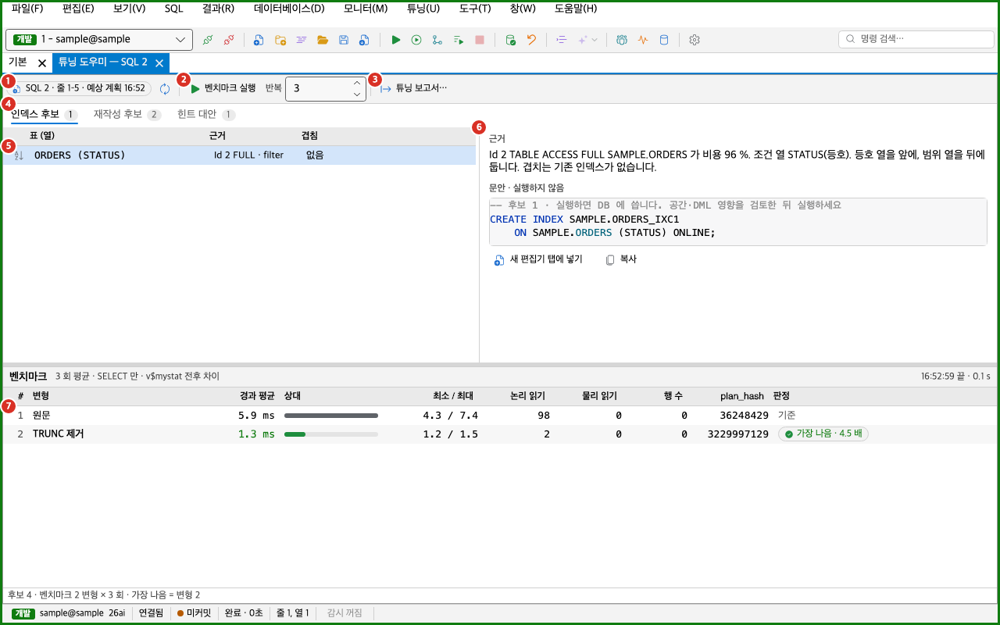
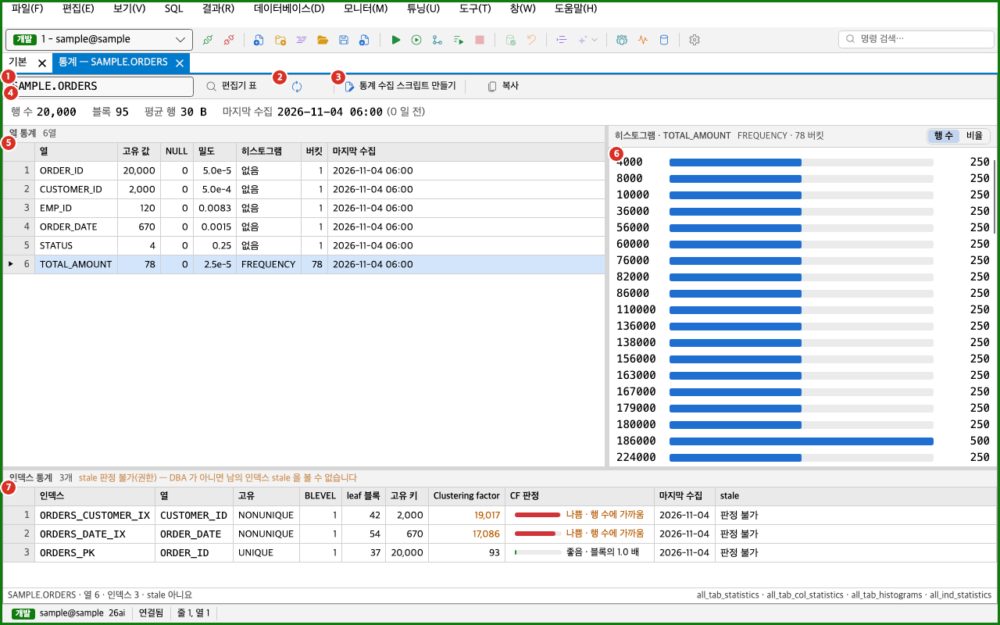

SQL 튜닝 도구는 **튜닝** 메뉴에 모여 있습니다. 이 도구들로 테이블 통계와 자식 커서를 살피고, 인덱스와 재작성 후보를 얻고, 변형 SQL을 벤치마크하고, 결과를 HTML 보고서로 남길 수 있습니다. 계획을 만들고 읽는 방법은 [실행 계획](../execution-plan/)을 보세요. AI로 튜닝하는 방법은 [AI 명령](../../ai/commands/)을 보세요. SQL 모니터 창 자체는 [모니터](../../tools/monitor/)를 보세요.

- 이 쪽의 도구는 대부분 SELECT로 조회만 합니다.
- DB에 쓰는 스크립트(통계 수집, Tuning Advisor, baseline 고정, 인덱스 생성)는 새 편집기 탭에 글만 넣습니다. 실행은 직접 해야 합니다.
- 예외가 둘 있습니다. [옵티마이저 트레이스](#옵티마이저-트레이스와-트레이스-보기)와 [실제 행 수 받으며 다시 실행](#실제-행-수-받으며-다시-실행)은 이 세션에 `ALTER SESSION`을 보냅니다.
- Diagnostics Pack이나 Tuning Pack이 필요한 기능에는 아래에 따로 적었습니다. 필요한 팩이 접속에 선언되어 있지 않으면 Oranda는 그 기능의 쿼리를 서버로 보내지 않습니다.

## 튜닝 메뉴

처음 설치한 상태의 주 업무는 「SQL 개발」입니다. 이 주 업무에서는 튜닝 메뉴에 계획 묶음, 「실제 행 수 받으며 다시 실행」, 「AI 튜닝」만 있습니다. 나머지 도구는 기능이 꺼져 있어 메뉴에 없습니다. 도구를 쓰려면 **설정 > 기능**에서 「주 업무」를 「튜닝」이나 「모든 기능」으로 고르세요. 「운영 DBA」는 튜닝 도우미와 튜닝 보고서를 뺀 나머지 튜닝 기능을 켭니다. 기능은 [설정 창](../../settings/options/)에서 하나씩 켜고 끌 수도 있습니다.

튜닝 메뉴는 다음 묶음으로 나뉩니다.

- 계획 묶음: 예상 실행 계획, 실제 실행 계획(마지막 실행), 실행하고 실제 계획(A-Rows), DISPLAY_CURSOR 형식 옵션, 이 계획 고정(비교 기준), 고정한 계획과 비교입니다. [실행 계획](../execution-plan/)을 보세요.
- SQL 모니터 묶음: SQL 모니터(Top SQL), Top SQL 검색, 선택 SQL 실제 계획, 선택 SQL 바인드 캡처입니다. [모니터](../../tools/monitor/)를 보세요.
- 통계와 자식 커서 묶음: 테이블 통계 보기…, 자식 커서…입니다.
- 계획 보강 묶음: 실제 행 수 받으며 다시 실행(하위 메뉴), 옵티마이저 트레이스(10053), 트레이스 보기입니다.
- 도우미 묶음: 튜닝 도우미, 변형 SQL 벤치마크, 튜닝 보고서 만들기…입니다.
- 대기와 이력 묶음: SQL 대기 분해, 튜닝 추천 (규칙 기반), AWR 계획 이력, 계획 관리 보기 (Profile·Baseline·Patch), 스크립트 만들기(하위 메뉴)입니다.
- AI 묶음: AI 튜닝입니다.

| 메뉴 항목 | 하는 일 | 켜지는 조건 | 필요한 기능 |
|---|---|---|---|
| 테이블 통계 보기… | 테이블 하나의 통계를 보입니다. | 접속이 있을 때 | 테이블 통계·통계 수집 스크립트 |
| 자식 커서… | sql_id 하나의 자식 커서를 보입니다. | 접속이 있을 때 | 자식 커서 |
| 힌트 넣은 사본으로 실행 | 힌트를 넣은 사본을 실행해 A-Rows가 있는 실제 계획을 엽니다. | 접속이나 전용 세션이 있고, 세션이 바쁘지 않고, MyBatis 문서가 아닐 때 | 공통 |
| STATISTICS_LEVEL=ALL 로 다시 실행 | 이 세션의 `STATISTICS_LEVEL`을 `ALL`로 바꾸고 같은 문장을 다시 실행합니다. | 위와 같음 | 공통 |
| 옵티마이저 트레이스(10053) | 편집기 문장의 옵티마이저 트레이스를 남기고 엽니다. | 접속이 있고 세션이 바쁘지 않을 때. 편집기 문장에 커서가 있어야 합니다. | 트레이스 뷰어·10053 |
| 트레이스 보기 | 세션의 트레이스 파일을 읽습니다. | 접속이 있을 때 | 트레이스 뷰어·10053 |
| 튜닝 도우미 | 편집기 문장의 인덱스 후보, 재작성 후보, 힌트 대안을 만듭니다. | 접속이나 전용 세션이 있을 때 | 튜닝 도우미·벤치마크 |
| 변형 SQL 벤치마크 | 튜닝 도우미에서 체크한 변형을 실행해 잽니다. | 튜닝 도우미 탭이 열려 있을 때 | 튜닝 도우미·벤치마크 |
| 튜닝 보고서 만들기… | 계획, 통계, 커서, 후보를 HTML 파일 하나로 만듭니다. | 접속이나 전용 세션이 있을 때 | 튜닝 HTML 보고서 |
| SQL 대기 분해 | SQL 모니터를 열고 「대기 분해」 탭을 보입니다. | 항상 | SQL 모니터 |
| 튜닝 추천 (규칙 기반) | SQL 모니터를 열고 「튜닝 추천」 탭을 보입니다. | 항상 | SQL 모니터 |
| AWR 계획 이력 | SQL 모니터를 열고 「AWR 계획 이력」 탭을 보입니다. | 항상 | SQL 모니터 |
| 계획 관리 보기 (Profile·Baseline·Patch) | SQL 모니터를 열고 「계획 관리」 탭을 보입니다. | 항상 | SQL 모니터 |
| 스크립트 만들기 > Tuning Advisor 스크립트 | 고른 SQL의 Tuning Advisor 스크립트를 새 편집기 탭에 넣습니다. | SQL 모니터에서 SQL을 골랐을 때 | SQL 모니터 |
| 스크립트 만들기 > baseline 고정 스크립트 (DBMS_SPM) | 고른 SQL의 baseline 고정 스크립트를 새 편집기 탭에 넣습니다. | SQL 모니터에서 SQL을 골랐을 때 | SQL 모니터 |
| 스크립트 만들기 > 테이블 통계 수집 스크립트 (DBMS_STATS) | 통계 수집 스크립트를 새 편집기 탭에 넣습니다. | 「통계」 탭이 앞에 있고 테이블이 정해졌을 때 | 테이블 통계·통계 수집 스크립트 |
| AI 튜닝 | AI에게 튜닝을 맡깁니다. | [AI 명령](../../ai/commands/)을 보세요. | AI 튜닝(실험) |

- 「인덱스 후보」와 「재작성 후보」 명령은 메뉴에 없습니다. 명령 팔레트(`Ctrl+Shift+P`, macOS에서는 `Cmd+Shift+P`)에서 찾아 실행합니다. 튜닝 도우미 탭이 열려 있을 때 켜지고, 도우미의 해당 탭으로 옮겨 갑니다.
- 편집기를 오른쪽 클릭하면 「튜닝 도우미」와 「테이블 통계 보기…」가 나옵니다.
- 튜닝 메뉴의 명령 중 기본 단축키가 있는 것은 계획 묶음의 세 명령뿐입니다. 나머지 명령에는 단축키를 직접 지정할 수 있습니다. [단축키와 명령 팔레트](../../settings/shortcuts/)를 보세요.

## 튜닝 도우미

튜닝 도우미는 SQL 하나의 인덱스 후보, 재작성 후보, 힌트 대안을 한 화면에 모읍니다. 후보를 벤치마크로 재 볼 수도 있습니다. 모두 규칙으로 만든 제안입니다. 제안을 적용하기 전에 결과가 같은지 직접 확인하세요.

도우미를 여는 방법은 다음과 같습니다.

- 편집기에서 문장 안에 커서를 두고 **튜닝 > 튜닝 도우미**를 고릅니다.
- 편집기를 오른쪽 클릭하고 「튜닝 도우미」를 고릅니다.
- 계획 그래프의 단계 상세에서 「튜닝 도우미」를 누릅니다.



1. 문장 출처와 「다시 분석」 단추: 칩에는 분석 대상의 출처가 보입니다. 마우스를 올리면 전체 글이 나옵니다. 「다시 분석」은 같은 문장과 계획으로 후보를 다시 만듭니다.
2. 벤치마크 조절: 「벤치마크 실행」, 「반복」 칸, 실행 중에 나오는 「취소」 단추입니다. 「반복」은 1 이상 20 이하의 횟수입니다. 처음 값은 3입니다.
3. 「튜닝 보고서…」 단추: 이 문장의 [튜닝 보고서](#튜닝-보고서)를 만듭니다. 접속이 있어야 켜집니다.
4. 후보 탭: 「인덱스 후보」, 「재작성 후보」, 「힌트 대안」입니다. 탭 이름 옆의 숫자는 후보 개수입니다.
5. 후보 목록: 고른 탭의 후보를 줄로 보입니다.
6. 후보 상세: 고른 후보의 근거와 문안을 보입니다.
7. 벤치마크 결과: 원문과 체크한 변형의 측정값을 보입니다.

도우미는 편집기 문장을 분석합니다. 같은 세션에서 이 문장을 마지막으로 실행한 커서가 있으면 그 실제 계획(`ALLSTATS LAST +ALIAS` 형식)을 함께 읽습니다. 문장을 실행한 적이 없으면 후보 목록 자리에 계획 없음 안내와 두 단추가 나옵니다.

| 단추 | 하는 일 |
|---|---|
| 실제 계획 받기 | 이 문장을 마지막으로 실행한 커서의 실제 계획을 읽습니다. 먼저 문장을 실행하세요. |
| 예상 계획으로 분석 | `EXPLAIN PLAN`으로 예상 계획을 받아 분석합니다. 실행 시간 비중은 비용으로 대신합니다. |

접속이 없으면 「접속이 없습니다. 재작성 후보만 보입니다 — 인덱스 후보·힌트·벤치마크는 접속한 뒤 도우미를 다시 여세요.」가 나옵니다.

### 인덱스 후보

계획의 테이블 읽기 단계에서 조건 열을 찾아 인덱스 후보를 만듭니다. 등호 조건 열을 앞에 두고 범위 조건 열을 뒤에 둡니다. 한 후보는 최대 4개 열입니다. 조인 열도 후보가 됩니다.

| 열 | 뜻 |
|---|---|
| 테이블 (열) | 후보를 만들 테이블과 열입니다. |
| 근거 | 후보를 만든 계획 단계입니다. 「Id 4 TABLE ACCESS FULL · filter」처럼 단계 번호, 연산, 조건 종류가 나옵니다. 조인 열이면 「Id {번호} 조인 열」입니다. |
| 겹침 | 기존 인덱스와 앞 열이 겹치는지입니다. 「이미 있음 ({인덱스 이름})」, 「{인덱스 이름} 앞 열」, 「{인덱스 이름} 첫 열」, 「확인 못함」, 「없음」 중 하나입니다. |

- 상세 칸에는 「근거」와 「문안 · 실행하지 않음」이 나옵니다. 문안은 `CREATE INDEX` 문입니다.
- 「새 편집기 탭에 넣기」는 문안을 새 SQL 탭에 글만 넣습니다. 그 탭에서 실행하면 DB에 씁니다. 공간과 DML 영향을 검토한 뒤 실행하세요.
- 「복사」는 문안을 클립보드에 복사합니다.
- 기존 인덱스가 이미 같은 열을 덮으면(「이미 있음」) 새로 만들 필요가 없고 「새 편집기 탭에 넣기」는 꺼집니다.
- 후보가 없으면 「규칙에 걸린 곳이 없습니다 — 전체 읽기 단계가 없거나 조건 열이 없습니다」가 나옵니다. 계획이 없으면 「실제 계획이 있어야 후보를 고릅니다」가 나옵니다.

### 재작성 후보

SQL 글을 읽고 바꿀 수 있는 곳을 찾습니다. 규칙은 다음과 같습니다.

| 규칙 | 설명 |
|---|---|
| NOT IN → NOT EXISTS | `NOT IN (하위 질의)`를 `NOT EXISTS`로 바꿉니다. 하위 질의 열에 NULL이 있으면 결과가 달라질 수 있어 경고가 붙습니다. |
| OR → UNION ALL | `OR`로 묶인 조건을 가지마다 따로 읽어 `UNION ALL`로 합칩니다. |
| 열에 씌운 함수 | 조건의 열에 함수가 씌워져 인덱스를 못 쓰는 경우를 찾습니다. 바꿀 수 있으면 맨 열 조건으로 바꾼 SQL을 줍니다. |
| 암시적 형 변환 의심 | 계획이 열을 `TO_NUMBER` 같은 변환으로 감싼 경우를 찾습니다. |
| 스칼라 하위 질의 → 조인 | SELECT 목록의 스칼라 하위 질의를 바깥 조인으로 바꿉니다. |
| SELECT * 경고 | `SELECT *`를 경고만 합니다. 열 목록을 펼치기만 해서는 계획이 같아 바꾼 SQL이 없습니다. |

- 목록의 열은 「벤치」, 「규칙」, 「위치」입니다. 위치는 「줄 7」처럼 문장 안의 줄이거나 「Id 4」처럼 계획 단계입니다.
- 바꾼 SQL이 있는 규칙만 「벤치」 칸에 체크할 수 있습니다. 바꾼 SQL이 없는 규칙은 「경고만」으로 보이고 오른쪽 설명을 보고 직접 고쳐야 합니다.
- 결과가 달라질 수 있는 재작성은 처음에 체크가 꺼져 있습니다.
- 상세 칸에는 제목, 주의 상자, 설명, 바꾼 SQL이 나옵니다. 「원문과 차이」를 누르면 바꾼 SQL 대신 줄 차이(`−` 원문, `+` 바꾼 것)를 보입니다.
- 「새 편집기 탭에 넣기」는 바꾼 SQL을 새 SQL 탭에 글만 넣습니다. 「복사」는 클립보드에 복사합니다.
- 접속이 없어도 재작성 후보는 만들 수 있습니다.

### 힌트 대안

계획의 테이블 접근 순서, 조인 방법, 테이블 별칭으로 힌트 조합을 만듭니다. `INDEX`, `FULL`, `LEADING`, `USE_NL`, `USE_HASH`, `PARALLEL` 힌트가 나올 수 있습니다.

- 목록의 열은 「벤치」, 「힌트」, 「뜻」입니다. 힌트는 `/*+ … */` 모양으로 보입니다.
- 체크한 힌트는 원문에 넣어 벤치마크합니다.
- 별칭은 계획의 Query Block과 별칭(`+ALIAS`)에서 가져옵니다. 없으면 SQL의 `FROM` 절에서 가져옵니다.
- 아래쪽의 「병렬 힌트 쓰기」를 켜야 `PARALLEL` 힌트를 벤치마크에 넣을 수 있습니다. 서버 자원을 많이 씁니다.
- 쓸 수 없는 힌트는 흐리게 보이고, 「뜻」 칸에 이유가 나옵니다.

### 벤치마크

체크한 변형과 원문을 같은 방법으로 여러 번 실행해 경과 시간과 읽기 수를 잽니다.

1. 인덱스 후보, 재작성 후보, 힌트 대안 중 재 볼 변형의 「벤치」 칸을 체크하세요.
2. 「반복」 칸에 반복 횟수를 입력하세요.
3. 「벤치마크 실행」을 누르세요. 또는 **튜닝 > 변형 SQL 벤치마크**를 고르세요.
4. 운영 접속이면 확인 창에서 계속할지 정하세요.
5. 벤치마크 결과 표를 읽으세요.

- 원문은 늘 첫 줄입니다. 변형은 그 아래에 번호를 붙여 나옵니다.
- SELECT와 `WITH … SELECT`만 벤치마크합니다. DB에 쓰지 않습니다. 변형마다 반복 횟수만큼 실행하고 `v$mystat`의 전후 차이로 읽기 수를 셉니다.
- 운영 접속에서는 실행하기 전에 「운영 접속({이름})에서 SELECT {개수}개를 {반복 횟수}회씩 실행합니다. DB 에 쓰지 않지만 서버 자원을 씁니다. 계속할까요?」를 묻습니다.
- 다음 문장은 벤치마크하지 않고 이유를 보입니다.
  - 문장이 여러 개입니다. 「문장 하나만 벤치마크합니다.」
  - SELECT가 아닙니다. 「SELECT 문만 벤치마크합니다」
  - `WITH FUNCTION`이나 `WITH PROCEDURE`가 있습니다.
  - `FOR UPDATE`가 있습니다. 「FOR UPDATE 는 행을 잠가서 벤치마크하지 않습니다.」
  - 바인드 변수나 치환 변수가 있습니다. 「변수 {이름} 가 있습니다. 값을 써 넣은 사본으로 벤치마크하세요.」
- 결과 표의 열은 「#」, 「변형」, 「경과 평균」, 「상대」, 「최소 / 최대」, 「논리 읽기」, 「물리 읽기」, 「행 수」, 「plan_hash」, 「판정」입니다. 「상대」 막대는 가장 느린 변형에 대한 경과 시간입니다.
- 「판정」은 「기준」(원문), 「가장 나음 · n 배」, 「n 배」, 「느림 · n 배」, 「행 수 다름 (…)」 중 하나입니다. 「가장 나음」은 행 수가 원문과 같은 변형 중 경과 평균이 가장 작고 원문보다 빠른 변형입니다. 경과 평균이 같으면 논리 읽기가 적은 쪽입니다.
- 행 수가 원문과 다른 변형은 그 변형이 끝나는 즉시 경고하고 「가장 나음」에서 뺍니다.
- 실행 중에는 「취소」를 눌러 멈춥니다. 지금 실행 중인 문장도 취소합니다.

## 통계 보기

테이블 하나의 테이블 통계, 열 통계, 히스토그램, 인덱스 통계를 보입니다. 통계가 오래됐는지, 클러스터링이 나쁜지 확인할 때 씁니다. `all_tab_statistics`, `all_tab_col_statistics`, `all_tab_histograms`, `all_ind_statistics`를 SELECT로 읽습니다. 관리 팩은 필요 없습니다.

통계 보기를 여는 방법은 다음과 같습니다.

- 편집기에서 테이블 이름 위에 커서를 두고 **튜닝 > 테이블 통계 보기…**를 고릅니다. 별칭 위에 커서를 두면 `FROM` 절의 테이블을 찾습니다.
- 편집기를 오른쪽 클릭하고 「테이블 통계 보기…」를 고릅니다.
- 스키마 브라우저에서 테이블을 오른쪽 클릭하고 「테이블 통계 보기…」를 고릅니다. [스키마 브라우저](../../schema/browser/)를 보세요.
- 계획 창의 「통계 보기」, 계획 그래프의 「이 테이블 통계」, 자식 커서 창의 「통계 보기」를 누릅니다.



1. 테이블 입력칸과 「편집기 테이블」 단추: 입력칸에 `owner.table`이나 `table`을 입력하고 `Enter`를 누르면 읽습니다. 소유자를 생략하면 접속 계정의 테이블입니다. 「편집기 테이블」은 편집기 커서 아래의 테이블을 읽습니다.
2. 「새로 고침」 단추: 통계를 다시 읽습니다.
3. 「통계 수집 스크립트 만들기」 단추: [통계 수집 스크립트](#통계-수집-스크립트)를 새 편집기 탭에 넣습니다.
4. 요약 줄: 행 수, 블록, 평균 행, 마지막 수집 날짜와 지난 일수가 나옵니다.
5. 열 통계 표: 열마다 통계를 보입니다. 열을 고르면 오른쪽에 그 열의 히스토그램이 나옵니다.
6. 히스토그램: 버킷마다 가로 막대로 보입니다. 「행 수」와 「비율」 단추로 막대의 값을 바꿉니다.
7. 인덱스 통계 표: 테이블의 인덱스마다 통계와 클러스터링 판정을 보입니다.

도구 모음 오른쪽 끝의 「복사」는 요약, 열 통계, 인덱스 통계를 탭으로 나눈 글로 복사합니다.

- 요약 줄에 「stale · 통계가 오래됨」 칩이 나오면 `all_tab_statistics.stale_stats`가 `YES`입니다. 마지막 수집 뒤 바뀐 행이 많다는 뜻입니다.
- 「통계 없음」 칩이 나오면 한 번도 통계를 모으지 않은 테이블입니다.
- stale이거나 통계가 없으면 「통계 수집 스크립트 만들기」 단추가 경고 색으로 강조됩니다.
- 열 통계 표의 열은 「열」, 「고유 값」, 「NULL」, 「밀도」, 「히스토그램」, 「버킷」, 「마지막 수집」입니다.
- 히스토그램이 없는 열에는 「히스토그램이 없습니다 (SIZE 1)」가 나옵니다. 통계가 stale이면 히스토그램 아래에 「통계 뒤 {일} 일 동안 들어온 값은 히스토그램에 없습니다. 최근 값을 거르는 조건의 예상 행이 실제보다 작게 나올 수 있습니다.」가 붙습니다.
- 인덱스 통계 표의 열은 「인덱스」, 「열」, 「고유」, 「BLEVEL」, 「leaf 블록」, 「고유 키」, 「Clustering factor」, 「CF 판정」, 「마지막 수집」, 「stale」입니다.
- 「CF 판정」은 clustering factor를 테이블의 블록 수와 행 수에 견줍니다. 블록 수의 2배 이하이면 「좋음」, 행 수의 50% 이상이면 「나쁨」, 그 사이이면 「보통」입니다. 블록 수나 행 수를 모르면 판정하지 않습니다.
- 계정이 다른 스키마의 인덱스 stale을 볼 권한이 없으면 「stale 판정 불가(권한) — DBA 가 아니면 남의 인덱스 stale 을 볼 수 없습니다」가 나옵니다.
- 같은 테이블의 통계 탭이 이미 열려 있으면 새 탭을 만들지 않고 그 탭에서 다시 읽습니다.
- 테이블을 읽을 수 없으면 「이 계정으로 볼 수 없는 테이블」이 나옵니다. 테이블 이름을 확인하거나 소유자 접속으로 여세요.

### 통계 수집 스크립트

「통계 수집 스크립트 만들기」 단추나 **튜닝 > 스크립트 만들기 > 테이블 통계 수집 스크립트 (DBMS_STATS)**를 고르면 `DBMS_STATS.GATHER_TABLE_STATS` 문안을 새 편집기 탭에 넣습니다. 탭 이름은 `gather_{테이블 이름}.sql`입니다.

- 스크립트는 실행하지 않습니다. 검토한 뒤 직접 실행하세요. 실행하면 DB에 씁니다.
- 첫 줄에 대상 테이블과 지금 상태(「통계 없음」, 「stale」, 「마지막 수집 날짜」)가 주석으로 붙습니다.
- 머리 주석에 「DB 에 씁니다: 딕셔너리 통계를 새로 수집하고, 이 테이블을 쓰는 커서가 다시 파싱될 수 있습니다.」와 「라이선스: 필요 없음(DBMS_STATS).」이 적혀 있습니다.
- 문안은 `estimate_percent => DBMS_STATS.AUTO_SAMPLE_SIZE`, `method_opt => 'FOR ALL COLUMNS SIZE AUTO'`, `cascade => TRUE`로 테이블과 인덱스의 통계를 모읍니다.
- 이 명령은 「통계」 탭이 앞에 있고 테이블이 정해졌을 때만 켜집니다.

## 자식 커서

같은 sql_id의 자식 커서를 나란히 보입니다. 같은 SQL인데 계획이나 성능이 다를 때 왜 자식이 따로 생겼는지 알아볼 수 있습니다. `gv$sql`과 `gv$sql_shared_cursor`를 SELECT로 읽습니다. 관리 팩은 필요 없습니다.

자식 커서 창을 여는 방법은 다음과 같습니다.

- **튜닝 > 자식 커서…**를 고릅니다. SQL 모니터 탭이 앞에 있고 SQL을 골라 두었으면 그 SQL로 열립니다. 아니면 계획 창의 마지막 실제 계획의 sql_id로 열립니다.
- 계획 창의 「자식 커서」를 누릅니다. 지금 실제 계획의 sql_id로 열립니다.
- SQL 모니터의 「자식 커서」, AWR 탭의 「자식 커서 보기」, 튜닝 추천 탭의 「자식 커서」를 누릅니다.

같은 sql_id의 창이 이미 열려 있으면 새 창을 만들지 않고 그 창에서 다시 읽습니다.

자식 커서 창의 구성은 다음과 같습니다.

- sql_id 칸과 인스턴스 상자: sql_id를 입력하고 `Enter`를 누르면 읽습니다. 인스턴스 상자는 인스턴스가 둘 이상일 때만 보이고 「인스턴스: 전체」나 특정 인스턴스를 고릅니다.
- 도구 단추: 「새로 고침」, 「두 자식 비교」, 「실제 계획」, 「통계 보기」, 「복사」입니다.
- 요약 줄: 고른 SQL의 글과 「자식 n」, 「plan_hash n」, 「바인드 인식 예/아니요」 칩이 나옵니다. plan_hash가 둘 이상이면 칩이 경고 색입니다.
- 자식 커서 표: 자식마다 한 줄입니다. 첫 칸의 체크 상자로 비교할 자식을 고릅니다.
- 불일치 사유 표: 자식이 따로 생긴 이유입니다.
- 비교 배너: 두 자식을 체크하면 나옵니다. 「두 계획이 다릅니다」나 「두 계획이 같습니다」와 요약이 보입니다.
- 두 자식 계획 비교 표: 두 자식의 계획을 단계마다 맞춰 보입니다.

- 자식 커서 표의 열은 「비교」, 「인스턴스」, 「child」, 「plan_hash」, 「바인드 민감」, 「바인드 인식」, 「공유 가능」, 「실행」, 「gets/실행」, 「경과/실행」입니다.
- 실행당 읽기나 경과가 가장 좋은 자식보다 5배를 넘게 나쁘면 그 칸이 강조됩니다.
- 체크를 두 개로 맞추면 자동으로 비교합니다. 「두 자식 비교」는 두 자식의 계획을 다시 읽어 비교합니다.
- 비교 표는 [계획 비교](../execution-plan/#계획-고정과-비교)와 같은 표입니다. 열은 「Id」, 「연산」, 「객체」, 비용, 행 수의 「→」와 「Δ」입니다.
- 자식 커서 표의 행을 두 번 누르거나 「실제 계획」을 누르면 계획 창에서 그 자식의 계획을 엽니다.
- 「통계 보기」는 비교한 계획의 첫 테이블 통계를 엽니다.
- 불일치 사유 표의 열은 「child」, 「사유」, 「뜻」입니다. 사유는 `gv$sql_shared_cursor`에서 `Y`인 열의 이름이고, 「뜻」은 그 사유를 풀어 쓴 글입니다. 예를 들면 `LITERAL_MISMATCH`는 「리터럴 처리(cursor_sharing)가 다름」입니다.
- 공유할 수 없는 자식이 있으면 사유 표 아래에 「child 0 은 공유 불가(N) — 새 실행은 1·2·3 으로 갑니다」 같은 안내가 나옵니다.
- 불일치가 없으면 「불일치 없음」이 나옵니다. 자식이 하나이면 「자식이 하나라 비교할 계획이 없습니다」가 나옵니다.
- 커서가 공유 풀에 없으면 「공유 풀에서 사라졌습니다」와 「…의 커서가 공유 풀에 없습니다(aged out). 문장을 다시 실행한 뒤 보세요.」가 나옵니다.
- `gv$sql` 등을 읽을 권한이 없으면 「V$ 뷰를 읽을 권한이 없습니다」가 나오고 도구 모음 아래에 권한 안내 띠가 나옵니다.

## 실제 행 수 받으며 다시 실행

실제 계획에 A-Rows가 없을 때 쓰는 두 명령입니다. 계획 창의 안내 막대 단추와 같은 동작입니다. 안내 막대는 [실행 계획](../execution-plan/#a-rows가-없을-때)을 보세요.

| 메뉴 항목 | 하는 일 |
|---|---|
| 힌트 넣은 사본으로 실행 | 문장에 `/*+ GATHER_PLAN_STATISTICS */`를 넣은 사본을 실행합니다. |
| STATISTICS_LEVEL=ALL 로 다시 실행 | `ALTER SESSION SET STATISTICS_LEVEL = ALL`을 보낸 뒤 같은 문장을 다시 실행합니다. |

두 명령은 **튜닝 > 실제 행 수 받으며 다시 실행**의 하위 메뉴에 있습니다.

1. 접속하세요.
2. 편집기에서 조회(SELECT) 문장 안에 커서를 두세요. 이 탭이 마지막으로 실행한 문장이 있으면 그 문장을 다시 실행하고, 없으면 커서가 있는 문장을 실행합니다.
3. **튜닝 > 실제 행 수 받으며 다시 실행 > 힌트 넣은 사본으로 실행**을 고르세요.
4. 계획 창에서 A-Rows, Starts, 시간 열을 보세요.

- 질의(SELECT)만 다시 실행합니다. DML 사본은 데이터를 또 바꾸므로 다시 실행하지 않습니다.
- 모든 행을 끝까지 읽습니다. 편집기의 글은 바뀌지 않습니다.
- 서버에 보내기 전에 탭의 접속을 확인합니다. 접속이 없으면 「접속을 확인하지 못해 실행하지 않았습니다. 접속한 뒤 다시 실행하세요.」가 나옵니다.
- `STATISTICS_LEVEL=ALL`은 이 세션에만 적용됩니다. 다시 실행이 끝나도 이 세션의 값은 `ALL`로 남습니다. `ALTER SESSION`은 운영 접속에서도 묻지 않습니다.
- 이 명령들은 접속이나 전용 세션이 있고, 세션이 바쁘지 않고, MyBatis 문서가 아닐 때 켜집니다.

## 옵티마이저 트레이스와 트레이스 보기

「트레이스 보기」는 세션의 트레이스 파일을 읽어 문장별 요약과 본문으로 보입니다. 「옵티마이저 트레이스(10053)」는 SQL 하나의 옵티마이저 결정 과정을 트레이스 파일에 남기고 이 창에서 엽니다.

트레이스 보기를 여는 방법은 다음과 같습니다.

- **튜닝 > 트레이스 보기**를 고릅니다. 내 세션의 파일을 읽습니다.
- **튜닝 > 옵티마이저 트레이스(10053)**를 고릅니다. 10053 트레이스를 남긴 뒤 그 파일을 엽니다.

트레이스 보기의 구성은 다음과 같습니다.

- 세션 칩과 「새로 고침」: 칩에는 트레이스를 읽는 세션이 나옵니다. 처음에는 「내 세션」입니다. 「새로 고침」은 트레이스 파일을 다시 읽습니다.
- 보기 전환과 정렬: 「요약」은 TKPROF처럼 문장별 요약이고, 「본문」은 트레이스 본문입니다. 「정렬」은 요약 표의 정렬 기준입니다. `elapsed`, `cpu`, `disk`, `query`, `current`, `rows`, `실행` 중에서 고릅니다.
- 파일 단추: 「복사」, 「저장」, 「옵티마이저 트레이스(10053)」입니다. 복사와 저장은 요약 표나 보이는 본문 줄을 대상으로 합니다.
- 파일 목록: 읽은 트레이스 파일의 「파일」, 「크기」, 「읽음」입니다.
- 문장 요약 표: 문장마다 한 줄입니다.
- 호출 표: 고른 문장의 `call`별 횟수입니다.
- 대기 합계: 파일 전체의 대기 이벤트별 횟수와 시간입니다.

- 요약 표의 열은 「#」, 「sql_id」, 「문장」, 「실행」, 「cpu(s)」, 「elapsed(s)」, 「비중」, 「disk」, 「query」, 「current」, 「rows」입니다. 「비중」은 파일 전체 경과 대비 이 문장의 경과입니다.
- 호출 표의 열은 `call`, `count`, `cpu(s)`, `elapsed(s)`, `disk`, `query`, `current`, `rows`입니다. 호출별로는 횟수만 기록됩니다. cpu, elapsed, 블록, 행은 문장 합계입니다.
- 대기 합계 표의 열은 「#」, 「이벤트」, 「횟수」, 「평균(ms)」, 「합계(s)」입니다. `SQL*Net message from client` 같은 idle 대기는 흐리게 보이고 합계에서 뺍니다.
- 본문 보기에는 찾기 칸(sql_id, 이벤트), 「WAIT 줄」 확인란, 「STAT 줄」 확인란이 있습니다.
- 파일이 5 MB보다 크면 앞 5 MB만 보입니다. 「모두 읽기」를 누르면 받은 줄 전부를 보입니다. 큰 파일은 느릴 수 있습니다.
- 트레이스 파일은 `v$diag_info`와 `v$diag_trace_file_contents`로 읽습니다. 후자는 12.2 이상에서 읽을 수 있습니다.
- 파일을 SQL로 읽을 수 없는 DB이면 「이 DB 에서는 트레이스 파일을 SQL 로 읽을 수 없습니다」와 서버의 파일 경로가 나옵니다. 「경로 복사」로 경로를 복사합니다.
- 트레이스 파일이 없으면 「트레이스가 비어 있습니다」와 「이 세션에 트레이스 파일이 없습니다 — 세션 모니터 「트레이스 켜기」 또는 「옵티마이저 트레이스(10053)」로 남기세요.」가 나옵니다.
- 읽을 권한이 없으면 「트레이스를 읽을 권한이 없습니다」가 나오고 다음 문장이 함께 나옵니다. 「SQL 복사」로 복사해 DBA에게 요청하세요.

```sql
GRANT SELECT ON v_$diag_info TO <user>;
GRANT SELECT ON v_$diag_trace_file_contents TO <user>;
```

### 옵티마이저 트레이스(10053)

1. 편집기에서 트레이스를 남길 SELECT나 DML 문장 안에 커서를 두세요.
2. **튜닝 > 옵티마이저 트레이스(10053)**를 고르세요.
3. 트레이스 보기 창에서 본문을 확인하세요.

- 다음 순서로 진행합니다. 10053 이벤트를 켜고(`ALTER SESSION SET EVENTS '10053 trace name context forever, level 1'`), 표시 주석을 붙인 문장 사본을 `DBMS_SQL.PARSE`로 파싱만 하고, 이벤트를 끕니다(`ALTER SESSION SET EVENTS '10053 trace name context off'`). 이벤트는 파싱이 실패하거나 취소돼도 끕니다.
- 문장은 실행하지 않습니다. 파싱만 하므로 DML도 데이터를 바꾸지 않습니다. `PLAN_TABLE`에도 쓰지 않습니다.
- 사본 앞에 `/* ORANDA_10053_{yyyyMMddHHmmssfff} */` 표시를 붙입니다. 공유 풀의 커서와 겹치지 않도록 늘 하드 파스가 됩니다. 트레이스 본문에서 이 표시를 찾아 그 자리로 이동합니다.
- 파싱은 PL/SQL 블록으로 보냅니다. 운영 접속에서는 접속의 실행 정책이 확인을 물을 수 있습니다.
- SELECT와 DML만 됩니다. DDL과 PL/SQL은 안 됩니다. 이유는 「10053 은 질의(SELECT)·DML 만 됩니다. DDL·PL/SQL 은 파싱만으로도 실행되거나 옵티마이저를 거치지 않습니다.」입니다.
- 치환 변수(`&`)가 있는 문장은 사본을 만들 수 없습니다. 값을 넣은 문장으로 다시 하세요.
- 세션이 다른 문장을 실행하는 중이면 「다른 문장을 실행하는 중입니다. 끝난 뒤 다시 하세요.」가 나옵니다.
- 문장이 없으면 상태 줄에 「편집기에서 문장에 커서를 둔 뒤 「옵티마이저 트레이스(10053)」를 누르세요.」가 나옵니다.
- 10053 파일은 요약할 문장이 없어 「본문」 보기로 먼저 열립니다.

## SQL 모니터의 튜닝 탭

**튜닝** 메뉴의 대기와 이력 묶음은 SQL 모니터를 열고 아래쪽의 해당 탭으로 옮겨 갑니다. SQL 모니터가 이미 열려 있으면 그 창의 탭으로 옮겨 갑니다. 먼저 SQL 모니터의 목록에서 SQL을 고르세요. 목록과 검색 조건은 [모니터](../../tools/monitor/)를 보세요.

SQL 모니터 창의 구성은 다음과 같습니다.

- 도구 모음: 「검색」, 「실제 계획」, 「전문·바인드」, 「자식 커서」, 「튜닝 보고서…」, 「Tuning Advisor 스크립트」, 「baseline 고정 스크립트」, 「다른 접속…」입니다.
- SQL 목록: 고른 행이 아래 탭의 대상입니다.
- 아래 탭: 「전문·바인드」, 「실제 계획」, 「대기 분해」, 「AWR 계획 이력」, 「계획 관리」, 「튜닝 추천」입니다.
- 방식 전환: 「지금 표본 (팩 없음)」과 「ASH 과거 구간」입니다.
- 표본 설정과 시작 단추: 표본 시간(초)과 「표본 모으기」, 또는 구간(분)과 「ASH 불러오기」입니다.
- 대기 분류 막대: 대기 분류별 비율을 색으로 보입니다.
- 대기 이벤트 표: 이벤트마다 한 줄입니다.

### 대기 분해

고른 SQL이 무엇을 기다리는지 센 결과입니다. 방식이 둘입니다.

| 방식 | 읽는 곳 | 관리 팩 | 설명 |
|---|---|---|---|
| 지금 표본 (팩 없음) | `gv$session` | 필요 없음 | 정한 시간 동안 1초마다 읽어, 이 sql_id를 실행 중인 세션의 대기를 셉니다. 표본 시간은 5초 이상 300초 이하이고 처음 값은 30초입니다. |
| ASH 과거 구간 | `gv$active_session_history` | Diagnostics Pack | 최근 구간의 대기를 읽습니다. 구간은 1분 이상 1440분 이하이고 처음 값은 60분입니다. |

- 「지금 표본」은 SQL이 실행 중일 때만 표본이 모입니다. 표본이 없으면 「이 sql_id 가 {초} 초 동안 실행되지 않았습니다」와 「실행 중일 때 다시 모으거나, 표본 시간을 늘리세요. 이미 끝난 실행은 ASH(Diagnostics Pack)로 볼 수 있습니다.」가 나옵니다.
- 표본을 모으는 동안 「취소」를 누르면 모은 데까지의 결과가 남습니다. 모으는 중에 목록에서 다른 SQL을 고르면 표본 모으기를 멈춥니다.
- ASH에 표본이 없으면 「ASH 에 이 sql_id 의 표본이 최근 {분} 분 동안 없습니다」와 「구간을 늘리거나 「지금 표본」 으로 실행 중인 대기를 모으세요.」가 나옵니다.
- 이벤트 표의 열은 「이벤트」, 「대기 분류」, 「표본」, 「비율」, 「세션」입니다. ASH 방식에서는 「세션」 칸에 세션 수가 없습니다.
- 행 잠금 대기 줄에는 「Lock 모니터」 단추가 나옵니다. 누르면 막고 있는 세션을 볼 수 있습니다.
- ASH 방식에서 Diagnostics Pack 선언이 없으면 「ASH 과거 구간은 Diagnostics Pack 이 필요합니다」가 나오고, 서버로 보내지 않습니다. 「접속 관리자 열기」와 「지금 표본으로」 단추가 있습니다.
- 팩 선언이 없을 때의 안내는 「접속 '{이름}' 에 Diagnostics Pack 보유가 선언되어 있지 않아 dba_hist_*·ASH 를 읽지 않았습니다.」와 「보유한 경우에만: 접속 관리자 › 접속 편집 › 고급 설정 › 「관리 팩」 에서 Diagnostics Pack 을 고르세요.」입니다. 서버의 `control_management_pack_access`가 선언보다 낮으면 「서버 설정 control_management_pack_access = {값} 이라 팩 조회를 보내지 않았습니다.」와 「DBA 가 서버 값을 DIAGNOSTIC 이상으로 바꿔야 쓸 수 있습니다.」가 나옵니다. [접속 관리](../../connect/manage/)를 보세요.

### AWR 계획 이력

고른 SQL이 AWR 스냅샷 구간마다 어떤 계획(plan_hash)으로 얼마나 걸렸는지 보입니다. `dba_hist_sqlstat`과 `dba_hist_snapshot`을 읽습니다. 이 탭은 Diagnostics Pack이 필요합니다. 탭 이름 옆에 「Diagnostics」 칩이 있습니다.

- 위쪽 그래프는 「경과/실행 · snap 구간별 · 점 색 = plan_hash」입니다. 점 색이 같으면 같은 계획입니다.
- 아래 표의 열은 「snap」, 「plan_hash」, 「실행」, 「경과/실행(ms)」, 「gets/실행」입니다.
- 「두 plan_hash 비교」는 고른 줄의 plan_hash를 가장 빠른 다른 plan_hash와 비교합니다. `dba_hist_sql_plan`을 읽기만 합니다. 결과는 「두 plan_hash 비교: … — 계획이 다릅니다」나 「… — 단계가 같습니다(수치만 다름)」로 시작하고, 아래에 [계획 비교](../execution-plan/#계획-고정과-비교)와 같은 방식의 표가 나옵니다. 「닫기」로 비교를 닫습니다.
- 팩 선언이 없으면 「AWR 계획 이력은 Diagnostics Pack 이 필요합니다」가 나옵니다. 안내 끝에 「팩 없이 보려면 「대기 분해」 의 지금 표본이나 「자식 커서」 를 쓰세요.」가 붙습니다. 「접속 관리자 열기」와 「자식 커서 보기」 단추가 있습니다.
- AWR에 이력이 없으면 「AWR 에 이 sql_id 의 이력이 없습니다」와 「snap 사이에 상위 SQL 로 잡히지 않았거나 AWR 보존 기간이 지났습니다. 지금 계획은 「실제 계획」·「자식 커서」 로 보세요.」가 나옵니다. 「다시 읽기」로 다시 읽습니다.

### 계획 관리

고른 SQL에 걸린 SQL Profile, SQL Plan Baseline, SQL Patch를 보입니다. `dba_sql_plan_baselines`, `dba_sql_profiles`, `dba_sql_patches`를 읽기만 합니다. 관리 팩은 필요 없습니다.

- 표의 열은 「종류」, 「이름」, 「상태」, 「만든 때」, 「SQL」입니다.
- 걸린 것이 없으면 「이 SQL 에 걸린 Profile·Baseline·Patch 가 없습니다」가 나옵니다.
- 계정이 `dba_sql_*`를 읽을 권한이 없으면 「dba_sql_* 를 읽을 권한이 없습니다」가 나오고 권한을 요청하는 `GRANT SELECT_CATALOG_ROLE TO {사용자};` 문이 함께 보입니다. 「SQL 복사」로 복사해 DBA에게 요청하세요.

### 튜닝 추천

공유 풀의 상위 SQL을 규칙으로 살펴 튜닝할 SQL을 점수가 높은 순으로 보입니다. `v$sqlstats`와 계획을 SELECT로 읽습니다. 새로 고침은 수동입니다. 처음 상태 줄에는 「「새로 고침」을 누르면 공유 풀(v$sqlstats) 상위 SQL 을 규칙으로 살펴 튜닝할 SQL 을 점수순으로 보입니다(자동 새로 고침 없음).」가 나옵니다.

- 도구 모음은 「새로 고침」, 「내부 스키마 제외」, 「튜닝 도우미로 열기」, 「자식 커서」, 「편집기로 열기」입니다.
- 「내부 스키마 제외」는 `SYS`, `SYSTEM` 같은 Oracle 내부 스키마와 옵티마이저 재귀 SQL을 뺍니다.
- 목록의 열은 「점수」, 「이유」, 「SQL ID」, 「스키마」, 「실행」, 「실행당 경과(s)」, 「실행당 읽기」, 「SQL」입니다. 머리글을 눌러 다시 정렬합니다.
- 오른쪽 칸에 「추천 이유」와 근거, SQL이 나옵니다.
- 「편집기로 열기」는 고른 SQL을 새 편집기 탭에 넣습니다. 실행하지 않습니다.
- 「튜닝 도우미로 열기」는 고른 SQL을 튜닝 도우미로 엽니다. 튜닝 도우미 기능이 켜져 있을 때만 보입니다.
- 점수를 매기는 이유는 다음과 같습니다. 이유마다 점수가 있고, 합이 점수입니다.
  - 실행당 오래 걸림
  - 전체 경과 시간 비중 큼
  - 실행당 논리 읽기 많음
  - 처리 행 대비 읽기 많음
  - 실행당 물리 읽기 많음
  - 자식 커서 많음
  - 리터럴 SQL 반복(바인드 변수 권장)
  - 실행마다 파싱(커서 재사용 안 됨)
  - 대기 비중 큼
  - CPU 위주
  - 큰 테이블 전체 스캔
  - INDEX FULL SCAN
  - MERGE JOIN CARTESIAN
- 걸린 규칙이 없으면 「(걸린 규칙 없음 — 지금 통계로는 튜닝 우선순위가 낮습니다)」가 나옵니다.
- 읽지 못하면 「튜닝 추천을 읽지 못했습니다」와 이유가 나옵니다. 모니터 접속 계정에 `gv$sqlstats`와 `gv$sql_plan`을 읽을 권한(`SELECT_CATALOG_ROLE` 등)이 필요합니다.

### Tuning Advisor 스크립트와 baseline 고정 스크립트

SQL 모니터에서 SQL을 고른 뒤 도구 모음의 단추나 **튜닝 > 스크립트 만들기** 하위 메뉴를 쓰면 스크립트를 새 편집기 탭에 넣습니다. 두 스크립트 모두 실행하지 않습니다. 검토한 뒤 직접 실행하세요. 실행하면 DB에 씁니다.

| 스크립트 | 탭 이름 | 내용 |
|---|---|---|
| Tuning Advisor 스크립트 | `tuning_advisor_{sql_id}.sql` | `DBMS_SQLTUNE.CREATE_TUNING_TASK`와 `EXECUTE_TUNING_TASK`로 튜닝 태스크를 만들고 실행합니다. 범위는 `SCOPE_COMPREHENSIVE`이고 제한 시간은 60초입니다. 결과를 보는 `REPORT_TUNING_TASK` 문과, 주석 처리된 `DROP_TUNING_TASK` 문이 따라옵니다. |
| baseline 고정 스크립트 (DBMS_SPM) | `baseline_{sql_id}.sql` | `DBMS_SPM.LOAD_PLANS_FROM_CURSOR_CACHE`로 공유 풀의 계획을 baseline으로 올립니다. 고른 자식 커서의 plan_hash를 쓰고 `fixed => 'YES'`입니다. plan_hash를 읽지 못하면 그 sql_id의 모든 계획을 대상으로 합니다. |

- Tuning Advisor 스크립트의 머리 주석에 「DB 에 씁니다: 튜닝 태스크를 만들고 실행해 결과를 딕셔너리(DBA_ADVISOR_*)에 남깁니다.」와 「라이선스: Oracle Tuning Pack 필요(Diagnostics Pack 포함). 보유하지 않았으면 실행하지 마세요.」가 적혀 있습니다. 팩이 없어도 스크립트는 만들 수 있습니다.
- baseline 스크립트의 머리 주석에 「DB 에 씁니다: 공유 풀의 계획을 SQL Management Base 에 baseline 으로 올립니다.」와 「라이선스: Tuning Pack 필요 여부를 확인하세요(SPM 자체는 Enterprise Edition 기능, 튜닝 태스크와 함께 쓰면 Tuning Pack).」가 적혀 있습니다.
- SQL 목록에서 행을 고르지 않았으면 상태 줄에 「SQL 목록에서 행을 고르세요.」가 나옵니다.

## 튜닝 보고서

튜닝 보고서는 SQL 하나의 계획, 통계, 커서, 후보를 HTML 파일 하나로 모읍니다. 모든 자료는 SELECT로만 읽습니다. DB에 쓰지 않습니다. 파일에는 스크립트나 외부 자원이 들어 있지 않습니다. 파일을 팀에 전달하거나 튜닝 전후를 남길 때 씁니다.

대화 상자를 여는 방법은 다음과 같습니다.

- **튜닝 > 튜닝 보고서 만들기…**를 고릅니다.
- 튜닝 도우미, 계획 창, SQL 모니터의 「튜닝 보고서…」 단추를 누릅니다.

대상 SQL은 다음 순서로 정합니다. 이 쪽의 다른 창이 대상을 넘겼으면 그것이 먼저입니다.

1. SQL 모니터 탭이 앞에 있으면 거기서 고른 SQL
2. 튜닝 도우미 탭이 앞에 있으면 그 문장
3. 편집기의 현재 문장. 같은 세션에서 이 문장을 마지막으로 실행한 커서가 있으면 그 sql_id를 쓰고, 없으면 글로 셈한 sql_id를 씁니다.
4. 계획 창의 마지막 커서

대화 상자 위쪽에 대상의 출처가 작은 글씨로 나옵니다. 예를 들면 「SQL 모니터에서 고른 SQL」, 「편집기 문장 · 마지막 실행」, 「편집기 문장 · 글로 셈한 sql_id(못 찾으면 한 번 실행하세요)」입니다.

대화 상자의 항목은 다음과 같습니다.

| 항목 | 설명 |
|---|---|
| 대상 sql_id | 13글자입니다. 바꾸면 자식 커서 목록을 다시 읽습니다. |
| 자식 커서 | 「전체」는 실행 수가 많은 상위 4개 자식의 계획을 담습니다. 자식 하나를 고를 수도 있습니다. |
| 접속 | 환경 칩(운영, 테스트, 개발)과 `계정@접속 이름`이 나옵니다. |
| 담을 절 | 보고서에 넣을 절을 확인란으로 고릅니다. 아래 표를 보세요. |
| 저장 위치 | 저장할 HTML 파일의 전체 경로입니다. 「찾아보기…」로 고릅니다. 처음 값은 `tuning_{sql_id}_{yyyyMMdd}_{HHmm}.html`입니다. 폴더는 마지막으로 쓴 폴더이고, 처음에는 문서 폴더 아래의 `Oranda` 폴더입니다. |
| 만든 뒤 브라우저로 열기 | 처음에는 켜져 있습니다. |

담을 절은 다음과 같습니다. 별도 표기가 없으면 처음에 켜져 있습니다.

| 절 | 설명 |
|---|---|
| 요약 진단 | 보고서의 요약입니다. |
| SQL 전문 | SQL 글 전체입니다. |
| 바인드 값 (캡처) | 처음에는 꺼져 있습니다. 「SQL 전문」이 켜져 있을 때만 켤 수 있습니다. 「고객·업무 값이 들어갈 수 있습니다. 기본 끔」이라는 경고가 붙어 있습니다. |
| 자식 커서별 실제 계획 | 자식 커서마다의 실제 계획입니다. |
| 계획 그래프 (SVG) | 계획을 그래프로 그려 넣습니다. |
| 실행 통계 | `gv$sql`의 누적 실행 통계입니다. |
| 테이블·인덱스·열 통계·히스토그램 | 계획에 나온 테이블의 통계입니다. |
| 불일치 사유 | 자식 커서가 따로 생긴 이유입니다. |
| 대기 분해 | Diagnostics Pack 선언이 있으면 ASH에서 지난 1시간을 읽습니다. 없으면 지금 30초 동안 표본을 모읍니다. 이때 만들기가 30초 늘어납니다. |
| AWR 계획 이력 | Diagnostics Pack 선언이 있을 때만 켤 수 있고, 선언이 있으면 처음에 켜져 있습니다. 선언이 없으면 이유만 적힙니다. |
| 인덱스·재작성 후보 | [튜닝 도우미](#튜닝-도우미)와 같은 규칙으로 만든 후보입니다. |
| 환경 (버전·optimizer·NLS) | DB 버전, 옵티마이저 설정, NLS 설정입니다. |

- 화면 아래에 「예상 {초} 초 · 질의 약 {개수}개」가 나옵니다. 선택한 절에 따라 바뀝니다.
- 「만들기」를 누르면 같은 창에서 진행 상황이 나옵니다. 「절 n / m」과 「끝난 절: …」이 보입니다. 「취소」를 누르면 멈추고 파일은 만들지 않습니다.
- 운영 접속이면 「운영 접속입니다. 조회는 SELECT 뿐이지만 gv$ 뷰·딕셔너리를 여러 번 읽습니다. 바쁜 시간에는 대기 분해를 꺼 두세요.」가 나옵니다.
- 공유 풀에 이 sql_id의 커서가 없으면 「공유 풀에 이 sql_id 의 커서가 없습니다 — 계획·통계 절은 「수집 실패」 로 남습니다. 문장을 한 번 실행한 뒤 만드세요.」가 나옵니다.
- 보고서를 저장하면 상태 표시줄에 저장 알림 「보고서 저장: {파일 이름}」이 나옵니다. 「만든 뒤 브라우저로 열기」를 켰는데 브라우저를 열지 못하면 「보고서 저장: {파일 이름} (브라우저를 열지 못했습니다)」가 나옵니다. 저장 알림은 [SQL 편집기](../../editor/sql-editor/#상태-표시줄-알림)를 보세요.
- 「만들기」가 켜지지 않으면 이유가 아래 줄에 나옵니다. 「접속이 없습니다. 접속한 뒤 다시 여세요.」, 「sql_id 가 아닙니다(13 글자, 영문 소문자·숫자).」, 「담을 절을 하나 이상 고르세요.」, 「저장 위치를 고르세요(전체 경로).」 중 하나입니다.

## AI 튜닝 시작 창

**튜닝 > AI 튜닝**, 도구 모음의 「AI 튜닝」, 「이 문장 튜닝」을 실행하면 「AI 튜닝 시작」 창이 먼저 나옵니다. 이미 진행 중인 AI 튜닝이 있으면 창을 띄우지 않고 대화 창만 보입니다. 활성 문서가 지금 접속의 SQL 탭이 아니면 창 대신 안내가 나옵니다. 이 창은 AI에게 무엇을 보내고 무엇을 보내지 않는지 보여 주고, 벤치마크와 모델을 정하게 합니다. AI 튜닝의 흐름과 설정은 [AI 명령](../../ai/commands/)과 [AI 모델](../../ai/models/)을 보세요.

- 창 위쪽에 「AI 튜닝 — 커서 위치 문장」과 대상 문장의 요약이 나옵니다.
- 접속의 AI 허용 수준이 「끔」이면 「이 접속은 AI 허용 수준이 「끔」 입니다. 접속 편집에서 허용 수준을 바꾼 뒤 다시 시도하세요.」가 나오고 「튜닝 시작」을 누를 수 없습니다.
- 「먼저 보낼 것」은 「문장 글 · 접속 별칭 · 환경 라벨 · AI 허용 수준」입니다.
- 「요청 시 줄 것」은 「실제 계획 · 인덱스(열 순서·clustering factor) · 테이블·열 통계 · 히스토그램 개수」입니다.
- 「보내지 않음」은 「행 값 · 히스토그램 끝값 · 바인드 값(로컬 실행에만 씀) · 비밀번호·호스트」입니다.
- 「리터럴 :vN 가림」 줄이 나오면 문자열과 숫자 값을 `:v1`, `:v2` 같은 자리표시로 바꿔 보냅니다. 제안을 편집기에 넣을 때 원래 값으로 되돌립니다.
- 운영 접속이면 「운영 접속: 조회(SELECT)만 실행하고 벤치마크 반복은 5회 이하이며, 리터럴 값은 항상 가려서 보냅니다.」가 나옵니다.

| 항목 | 설명 |
|---|---|
| 후보를 벤치마크로 비교 (SELECT 3회, 결과 동일성 확인) | 접속의 AI 허용 수준이 「조회 실행」 이상일 때만 켤 수 있습니다. 개발이나 테스트 접속에서는 처음에 켜져 있고, 운영 접속에서는 처음에 꺼져 있습니다. |
| 위험 함수도 실행 (자치 트랜잭션·외부 접근 함수가 든 후보도 읽기 전용으로 실측) | 벤치마크가 켜져 있을 때만 켤 수 있습니다. 끄면 그런 후보는 실행하지 않고 운영 커서 실측을 씁니다. 켜도 자치 트랜잭션의 커밋은 막지 못합니다. |
| 운영 제한 시간(초) | 운영 접속에서 벤치마크를 켰을 때만 나옵니다. 문장 하나(반복 전체)가 이 시간을 넘기면 중단합니다. 이번 실행에만 적용하고 설정에는 저장하지 않습니다. `0`은 제한 없음입니다. |
| 인덱스 후보 CREATE 문안도 받기 (새 탭에만 넣고 실행하지 않음) | 처음에는 켜져 있습니다. |
| 모델 | 쓸 모델을 고릅니다. |
| effort | 추론 노력입니다. 높을수록 오래 생각하고 느립니다. API 경로의 프로필이나 시스템 CLI를 쓰면 이 줄이 나오지 않습니다. 기본 값은 설정 창의 AI 쪽에서 바꿉니다. |

- 운영 제한 시간은 `0`이거나 5 이상 3600 이하여야 합니다. 범위를 벗어나면 `제한 시간은 5~3600초 또는 0(제한 없음)으로 입력하세요.`가 나오고 「튜닝 시작」을 누를 수 없습니다.
- 운영 제한 시간에 `0`을 입력하면 「사용자가 중지할 때까지 운영 DB 에서 실행합니다」 경고가 나옵니다.
- 「튜닝 시작」을 누르면 선택을 적용하고 AI 튜닝을 시작합니다. 「취소」를 누르면 아무것도 보내지 않습니다.

## 자주 하는 작업

### 인덱스가 없는 조건의 후보 얻기

1. **설정 > 기능**에서 「주 업무」가 「튜닝」이나 「모든 기능」인지 확인하세요.
2. 편집기에 `SELECT * FROM orders WHERE status = 'CANCELLED'`를 입력하세요.
3. `Ctrl+Enter`를 눌러 문장을 실행하세요. macOS에서는 `Cmd+Enter`를 누르세요.
4. 같은 문장 안에 커서를 둔 채 **튜닝 > 튜닝 도우미**를 고르세요.
5. 「인덱스 후보」 탭에서 후보를 고르세요.
6. 상세 칸의 「근거」와 「겹침」을 읽으세요.

샘플 DB의 `orders.status`에는 인덱스가 없습니다. 계획이 전체 테이블 읽기이고 조건 열이 있으면 `orders`의 `status` 열이 후보로 나올 수 있습니다. 「SELECT * 경고」는 「재작성 후보」 탭에 나올 수 있습니다.

### 인덱스 후보를 만들어 보고 효과 확인하기

1. 편집기에서 원래 문장의 예상 계획을 만드세요. `Ctrl+E`를 누르세요. macOS에서는 `Cmd+E`를 누르세요.
2. 계획 창의 「이 계획 고정」을 누르세요.
3. **튜닝 > 튜닝 도우미**를 고르세요.
4. 「인덱스 후보」 탭에서 후보를 고르세요.
5. 「새 편집기 탭에 넣기」를 누르세요.
6. 새 탭의 `CREATE INDEX` 문을 검토하세요.
7. 개발 DB에서 문을 실행하세요. 실행하면 DB에 씁니다.
8. 원래 문장의 예상 계획을 다시 만드세요.
9. 계획 창의 「비교」를 누르세요.

비교 화면은 [계획 고정과 비교](../execution-plan/#계획-고정과-비교)를 보세요.

### 두 SQL의 속도 비교하기

1. 편집기에 원문 SQL을 입력하세요. 바인드 변수나 치환 변수 대신 값을 직접 쓰세요.
2. **튜닝 > 튜닝 도우미**를 고르세요.
3. 「재작성 후보」나 「힌트 대안」 탭에서 비교할 변형의 「벤치」 칸을 체크하세요.
4. 「반복」 칸에 횟수를 입력하세요.
5. 「벤치마크 실행」을 누르세요.
6. 「판정」 열에서 「가장 나음」과 「행 수 다름」을 확인하세요.

### 통계가 오래됐는지 확인하기

1. 편집기에서 테이블 이름 위에 커서를 두세요. 예를 들면 `orders`입니다.
2. **튜닝 > 테이블 통계 보기…**를 고르세요.
3. 요약 줄에서 「stale」과 「통계 없음」 칩, 「마지막 수집」을 보세요.
4. 필요하면 「통계 수집 스크립트 만들기」를 누르세요.
5. 새 탭의 스크립트를 검토한 뒤 직접 실행하세요.

### 같은 SQL의 계획이 달라진 이유 찾기

1. 계획 창이나 SQL 모니터에서 sql_id를 확인하세요.
2. **튜닝 > 자식 커서…**를 고르세요.
3. 「plan_hash」 칩이 둘 이상이면 자식 커서 표에서 비교할 두 자식을 체크하세요.
4. 비교 배너와 비교 표에서 바뀐 단계를 보세요.
5. 불일치 사유 표에서 자식이 따로 생긴 이유를 확인하세요.

### 과거 계획과 지금 계획 비교하기

1. **튜닝 > AWR 계획 이력**을 고르세요.
2. SQL 모니터 목록에서 SQL을 고르세요.
3. 표에서 느린 구간의 줄을 고르세요.
4. 「두 plan_hash 비교」를 누르세요.

이 작업은 접속에 Diagnostics Pack이 선언되어 있어야 합니다.

### 보고서 만들어 전달하기

1. 대상 SQL을 고르세요. 편집기 문장이나 SQL 모니터의 행을 고릅니다.
2. **튜닝 > 튜닝 보고서 만들기…**를 고르세요.
3. 「담을 절」을 정하세요. 고객 값이 들어갈 수 있는 「바인드 값 (캡처)」은 필요할 때만 켜세요.
4. 「저장 위치」를 정하세요.
5. 「만들기」를 누르세요.
6. 저장 알림에서 파일을 열어 확인하세요.

## 문제가 생길 때

| 증상 | 원인 | 해결 |
|---|---|---|
| 튜닝 메뉴에 튜닝 도우미, 테이블 통계, 자식 커서, 트레이스, 튜닝 보고서, SQL 모니터 항목이 없습니다 | 해당 기능이 꺼져 있습니다. 처음 설치한 상태의 주 업무인 「SQL 개발」에서는 꺼져 있습니다. | **설정 > 기능**에서 「주 업무」를 「튜닝」이나 「모든 기능」으로 고르세요. |
| 튜닝 메뉴 항목이 회색입니다 | 접속이 없거나, 세션이 바쁘거나, 켜지는 조건이 맞지 않습니다. | 위 [튜닝 메뉴](#튜닝-메뉴) 표의 「켜지는 조건」을 확인하세요. 회색 항목에 마우스를 올리면 이유가 나옵니다. |
| 「변형 SQL 벤치마크」가 회색입니다 | 튜닝 도우미 탭이 열려 있지 않습니다. | 튜닝 도우미를 먼저 여세요. |
| 튜닝 도우미에 「분석할 문장이 없습니다」가 나옵니다 | 편집기에서 커서가 문장 밖에 있었습니다. | 커서를 문장 안에 두고 다시 여세요. |
| 인덱스 후보에 「실제 계획이 있어야 후보를 고릅니다」가 나옵니다 | 이 문장의 계획이 없습니다. | 「실제 계획 받기」나 「예상 계획으로 분석」을 누르세요. 실제 계획을 받으려면 먼저 문장을 실행하세요. |
| 인덱스 후보에 「규칙에 걸린 곳이 없습니다」가 나옵니다 | 계획에 전체 읽기 단계가 없거나 조건 열이 없습니다. | 계획과 조건절을 확인하세요. |
| 「벤치마크 실행」이 회색이고 이유가 나옵니다 | 문장이 SELECT가 아니거나, 바인드 변수나 치환 변수가 있거나, `FOR UPDATE`가 있거나, 여러 문장입니다. 접속이 없을 수도 있습니다. | 값을 직접 쓴 SELECT 문 하나로 바꾸세요. 마우스를 올리면 이유가 나옵니다. |
| 벤치마크 결과의 「판정」이 「행 수 다름」입니다 | 변형이 원문과 다른 행 수를 돌려줍니다. 결과가 달라지는 변형입니다. | 그 변형은 쓰지 마세요. 「가장 나음」 판정에서도 빠집니다. |
| 통계 보기에 「통계를 볼 테이블을 고르세요」가 나옵니다 | 테이블이 정해지지 않았습니다. | 입력칸에 `owner.table`을 입력하고 `Enter`를 누르거나, 편집기에서 테이블 이름 위에 커서를 두고 「편집기 테이블」을 누르세요. |
| 「이 계정으로 볼 수 없는 테이블」이 나옵니다 | 테이블이 없거나 접속 계정에 보이지 않습니다. | 테이블 이름을 확인하거나 소유자 접속으로 여세요. |
| 「편집기 커서 아래에 테이블 이름이 없습니다.」가 나옵니다 | 커서가 테이블 이름 위에 있지 않습니다. | 커서를 테이블 이름이나 테이블 별칭 위에 두세요. |
| 「통계 수집 스크립트 만들기」가 회색입니다 | 테이블이 정해지지 않았거나 통계를 읽는 중입니다. | 테이블을 정하고 읽기가 끝날 때까지 기다리세요. |
| 자식 커서에 「sql_id 를 넣으세요」가 나옵니다 | 대상 sql_id가 없습니다. | sql_id를 입력하고 `Enter`를 누르거나, SQL 모니터나 계획 창에서 「자식 커서」를 누르세요. |
| 상태 줄에 「sql_id 는 13자리 영숫자입니다.」가 나옵니다 | 입력한 sql_id의 형식이 맞지 않습니다. | sql_id를 다시 확인하세요. |
| 자식 커서에 「공유 풀에서 사라졌습니다」가 나옵니다 | 커서가 공유 풀에서 밀려났습니다. | SQL을 다시 실행한 뒤 보세요. |
| 자식 커서에 「V$ 뷰를 읽을 권한이 없습니다」가 나옵니다 | 접속 계정이 `gv$sql`과 `gv$sql_shared_cursor`를 읽을 수 없습니다. | 권한 안내 띠에서 다른 접속으로 열거나 권한을 받으세요. |
| 「두 자식 비교」가 회색입니다 | 체크한 자식이 둘이 아닙니다. 자식이 하나일 수도 있습니다. | 자식 커서 표의 첫 칸에서 정확히 두 자식을 체크하세요. |
| 트레이스 보기에 「트레이스를 읽을 권한이 없습니다」가 나옵니다 | 접속 계정이 `v$diag_info`와 `v$diag_trace_file_contents`를 읽을 수 없습니다. | 「SQL 복사」로 `GRANT` 문을 복사해 DBA에게 요청하세요. |
| 트레이스 보기에 「이 DB 에서는 트레이스 파일을 SQL 로 읽을 수 없습니다」가 나옵니다 | 이 DB는 트레이스 본문을 SQL로 읽을 수 없습니다. | 「경로 복사」로 서버의 파일 경로를 복사해 서버에서 직접 여세요. |
| 「옵티마이저 트레이스(10053)」가 실패합니다 | 문장이 SELECT나 DML이 아니거나, 치환 변수가 있거나, 세션이 바쁩니다. | 상태 줄의 「10053 실패:」 뒤 이유를 읽고, 값을 넣은 SELECT나 DML 문으로 다시 하세요. |
| 「실제 행 수 받으며 다시 실행」이 회색입니다 | 접속이 없거나, 세션이 바쁘거나, MyBatis 문서입니다. | 접속한 일반 SQL 탭에서 실행이 끝난 뒤 다시 하세요. |
| SQL 모니터의 「대기 분해」에 「SQL 을 고르세요」가 나옵니다 | SQL 목록에서 행을 고르지 않았습니다. | 목록에서 행을 고르세요. |
| 「대기 분해」에 「이 sql_id 가 {초} 초 동안 실행되지 않았습니다」가 나옵니다 | 표본을 모으는 동안 그 SQL이 실행 중이 아니었습니다. | SQL이 실행 중일 때 다시 모으거나 표본 시간을 늘리세요. 끝난 실행은 ASH로 보세요. |
| 「ASH 과거 구간은 Diagnostics Pack 이 필요합니다」가 나옵니다 | 접속에 Diagnostics Pack 보유 선언이 없거나, 서버 설정이 더 낮습니다. | 조직이 팩을 가지고 있을 때만 접속 편집 창에서 「관리 팩」을 선언하세요. 팩이 없으면 「지금 표본으로」를 누르세요. |
| 「AWR 계획 이력은 Diagnostics Pack 이 필요합니다」가 나옵니다 | 위와 같습니다. | 위와 같습니다. 팩이 없으면 「자식 커서 보기」를 쓰세요. |
| 「dba_sql_* 를 읽을 권한이 없습니다」가 나옵니다 | 접속 계정에 딕셔너리 조회 권한이 없습니다. | 화면에 나온 `GRANT SELECT_CATALOG_ROLE TO {사용자};`를 복사해 DBA에게 요청하세요. |
| 「튜닝 추천을 읽지 못했습니다」가 나옵니다 | 모니터 접속 계정이 `gv$sqlstats`, `gv$sql_plan`을 읽을 수 없습니다. | 계정에 `SELECT_CATALOG_ROLE` 등의 권한을 받으세요. |
| 튜닝 보고서의 「만들기」가 회색입니다 | 접속, sql_id, 담을 절, 저장 위치 중 하나가 비어 있거나 틀렸습니다. | 단추 아래에 나오는 이유를 확인하세요. |
| 튜닝 보고서의 「AWR 계획 이력」 확인란이 회색입니다 | 접속에 Diagnostics Pack 보유 선언이 없습니다. | 선언이 없으면 이유만 보고서에 적힙니다. 팩을 가지고 있을 때만 선언하세요. |
| 「AI 튜닝 시작」 창의 「튜닝 시작」이 회색입니다 | 접속의 AI 허용 수준이 「끔」이거나, 운영 제한 시간 값이 범위를 벗어났습니다. | 접속 편집에서 허용 수준을 바꾸거나 제한 시간을 `0`이나 5 이상 3600 이하로 입력하세요. |
