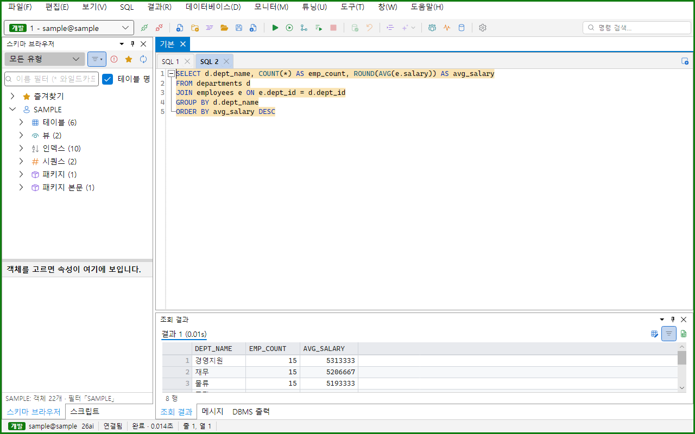
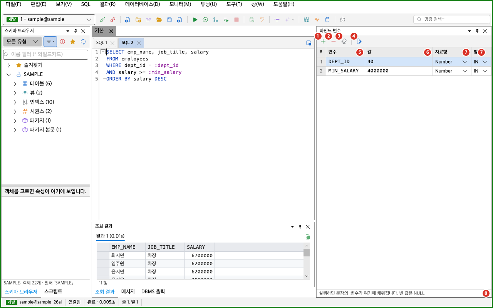
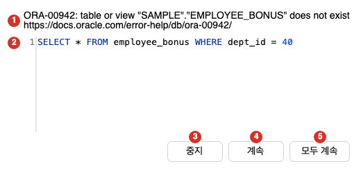
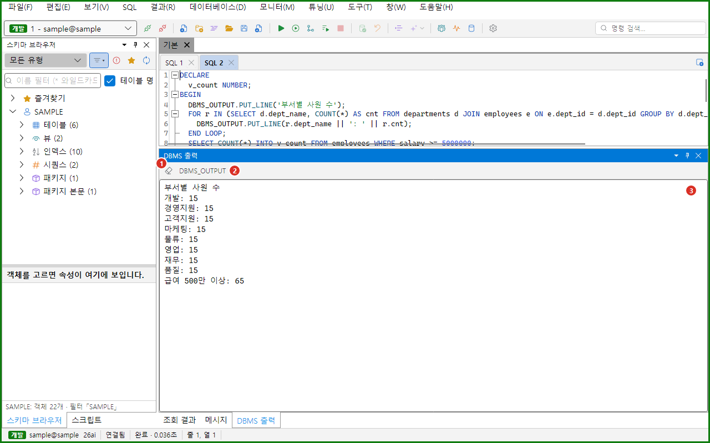

SQL 실행은 편집기에 쓴 SQL을 DB로 보내고 결과를 받는 기능입니다. 이 쪽에서는 실행 범위를 고르는 방법, 취소, 바인드 변수, 스크립트 오류 처리, 트랜잭션, DBMS 출력, 실행 이력, 스크립트 창, 실행 통계를 설명합니다. 결과를 읽는 방법은 [결과 그리드](../result-grid/)를 보세요. 결과를 고쳐서 반영하는 방법은 [그리드 편집과 플래시백](../grid-edit/)을 보세요.



주 화면에서 SQL 편집기는 가운데에 있고, 실행 결과는 편집기 아래의 「조회 결과」 창에 보입니다. 메시지, DBMS 출력, 실행 이력 창도 같은 자리에 탭으로 묶여 있습니다. 바인드 변수 창은 오른쪽에, 스크립트 창은 왼쪽에 있습니다. 창은 **보기 > 도구 창**에서 엽니다.

## SQL 메뉴

실행에 관한 명령은 모두 **SQL** 메뉴에 있습니다. 이 표는 메뉴의 위에서 아래 순서입니다. 단축키는 기본 키맵 기준입니다. 단축키는 [단축키와 명령 팔레트](../../settings/shortcuts/)에서 바꿉니다. macOS에서 `Alt`는 `Option` 키입니다.

| 메뉴 항목 | 하는 일 | Windows | macOS |
|---|---|---|---|
| 현재 문장 실행(선택 시 선택 영역) | 커서가 있는 문장을 실행합니다. 글자를 선택했으면 선택한 글자를 실행합니다. | `Ctrl+Enter` | `Cmd+Enter` |
| 커서의 하위 쿼리 실행 | 커서를 감싼 가장 안쪽 괄호 쿼리를 실행합니다. | `Alt+Shift+Enter` | `Option+Shift+Enter` |
| 선택 영역 실행 | 선택한 글자를 실행합니다. 글자를 선택해야 켜집니다. | 없음 | 없음 |
| 스크립트 전체 실행 | 편집기의 모든 문장을 차례로 실행합니다. | `F5` | `F5` |
| 커서 문장부터 끝까지 실행 | 커서가 있는 문장부터 마지막 문장까지 실행합니다. | `Alt+F5` | `Option+F5` |
| 순차 실행(실행 후 다음 문장으로) | 커서 문장 하나를 실행하고 커서를 다음 문장으로 옮깁니다. | `Ctrl+Shift+Enter` | `Cmd+Shift+Enter` |
| 새 결과 탭으로 실행 | 커서 문장을 실행하고 결과를 새 탭에 더합니다. | `F11` | `Cmd+Option+Enter` |
| 모든 탭 실행 | 열려 있는 SQL 탭을 차례로 스크립트로 실행합니다. | 없음 | 없음 |
| 결과 편집 모드로 실행 | 커서 문장을 실행하고 결과를 편집 모드로 엽니다. | `F9` | `Ctrl+Enter`, `F9` |
| 실행 중지 | 실행 중인 문장을 서버에서 멈춥니다. | `Ctrl+Break` | `Cmd+.` |
| 실행 통계 수집 켜기/끄기 | `@파일` 실행의 통계를 켜고 끕니다. | 없음 | 없음 |
| 바인드 변수 창 | 바인드 변수 창을 열고 커서 문장의 변수를 채웁니다. | 없음 | 없음 |
| 바인드 값을 편집기에 붙여 넣기 | 편집기의 `:변수`를 목록의 값으로 바꿉니다. | 없음 | 없음 |
| @파일 실행 | 스크립트 창에서 고른 파일을 `@파일`로 실행합니다. | 없음 | 없음 |
| DBMS_OUTPUT 수집 켜기/끄기 (이번 실행) | DBMS 출력 창에 글을 모을지 정합니다. | 없음 | 없음 |
| 스크립트 오류 시 (이번 실행) > 스크립트 오류 시: 묻기, 중지, 계속 | 스크립트 오류 처리 방식을 고릅니다. | 없음 | 없음 |
| 오류 문장으로 이동 | 마지막 오류가 난 자리로 커서를 옮깁니다. | 없음 | 없음 |
| 빈 줄로 문장 나누기 켜기/끄기 (이번 실행) | 빈 줄을 문장의 끝으로 볼지 정합니다. | 없음 | 없음 |
| 커밋 | 커밋하지 않은 변경을 확정합니다. | 없음 | 없음 |
| 롤백 | 커밋하지 않은 변경을 되돌립니다. | 없음 | 없음 |
| 자동 커밋 켜기/끄기 (이번 실행) | 문장이 성공할 때마다 바로 커밋할지 정합니다. | 없음 | 없음 |

- 도구 모음에도 「현재 문장 실행」, 「스크립트 전체 실행」, 「실행 중지」, 「커밋」, 「롤백」 단추가 있습니다.
- 편집기를 오른쪽 클릭해도 「현재 문장 실행」, 「커서의 하위 쿼리 실행」, 「스크립트 전체 실행」이 나옵니다.
- 실행 명령은 접속이 있고 다른 문장이 실행 중이 아닐 때 켜집니다. 접속이 없거나 실행 중이면 메뉴 항목이 회색이 됩니다. 회색 항목에 마우스를 올리면 이유가 나옵니다.
- 이름에 「(이번 실행)」이 붙은 항목은 Oranda 전체에 적용됩니다. 탭마다 따로 정하지 않습니다.
- 처음 값은 자동 커밋 꺼짐, DBMS_OUTPUT 수집 켜짐, 스크립트 오류 시 묻기, 빈 줄로 문장 나누기 꺼짐입니다.
- 이 항목들은 체크 표시가 없습니다. 자동 커밋은 상태 표시줄의 「자동 커밋」으로, DBMS_OUTPUT은 DBMS 출력 창의 머리글로 확인합니다.
- MyBatis 문서에서는 대부분의 실행 명령이 꺼집니다. MyBatis 문서의 실행은 [MyBatis 작업 공간](../../editor/mybatis/)을 보세요.

## 실행 범위

Oranda는 SQL 글을 문장으로 나눈 뒤 실행 범위에 맞는 문장을 보냅니다.

| 명령 | 실행하는 범위 |
|---|---|
| 현재 문장 실행 | 글자를 선택하지 않았으면 커서가 있는 문장 하나입니다. 글자를 선택했으면 선택한 글자의 모든 문장입니다. |
| 커서의 하위 쿼리 실행 | 커서나 선택을 감싼 가장 안쪽의 괄호 쿼리입니다. 현재 문장 안에서만 찾습니다. 괄호 쿼리 밖이면 현재 문장 실행과 같습니다. |
| 선택 영역 실행 | 선택한 글자의 모든 문장입니다. |
| 스크립트 전체 실행 | 문서의 모든 문장입니다. |
| 커서 문장부터 끝까지 실행 | 커서가 있는 문장과 그 뒤의 모든 문장입니다. |
| 순차 실행 | 커서 문장 하나입니다. 끝나면 커서가 다음 문장의 처음으로 갑니다. 문장이 실패해도 커서는 넘어갑니다. 취소하면 넘어가지 않습니다. |
| 새 결과 탭으로 실행 | 현재 문장 실행과 같습니다. 기존 결과 탭을 지우지 않습니다. |
| 모든 탭 실행 | 열려 있는 SQL 탭을 차례로 스크립트로 실행합니다. 접속이 닫힌 탭에서 취소하거나 한 탭을 취소하면 거기서 멈춥니다. 끝나면 시작한 탭으로 돌아옵니다. |

- 문장이 둘 이상이면 스크립트로 실행합니다. 스크립트는 [스크립트 실행과 오류 처리](#스크립트-실행과-오류-처리)를 보세요.
- 문장이 하나여도 「스크립트 전체 실행」과 「커서 문장부터 끝까지 실행」은 스크립트 방식으로 실행합니다.
- 실행할 문장이 없으면 메시지 창에 「실행할 문장이 없습니다.」가 나옵니다.
- 실행을 시작하면 실행한 범위가 편집기에서 잠깐 칠해집니다.
- 실행이 끝나기 전에 같은 접속으로 또 실행하면 두 번째 실행은 무시됩니다.
- 실행하면 「조회 결과」 창이 앞으로 나옵니다. 포커스는 편집기에 남습니다.

### 문장을 나누는 규칙

- 문장의 끝은 `;`입니다.
- 한 줄에 `/`만 있는 줄도 문장의 끝입니다.
- 빈 줄은 기본으로 문장의 끝이 아닙니다. 「빈 줄로 문장 나누기 켜기/끄기 (이번 실행)」를 켜면 빈 줄도 문장의 끝이 됩니다.
- PL/SQL 블록(`DECLARE`, `BEGIN`, `CREATE PROCEDURE`, `CREATE FUNCTION`, `CREATE PACKAGE`, `CREATE TRIGGER`)은 블록 안의 `;`에서 끝나지 않습니다. 블록은 마지막 `END;`나 `/` 줄에서 끝납니다.
- 문자열과 주석 안의 `;`는 문장의 끝이 아닙니다.
- 커서는 문장의 첫 단어부터 끝 표시가 있는 줄의 끝까지 그 문장에 속합니다.
- 커서가 빈 줄이나 문장 앞에 있으면 실행할 문장이 없습니다.
- `CREATE … JAVA SOURCE`의 Java 코드는 `/`만 있는 줄까지 한 문장입니다.

## 실행 결과

실행 결과는 「조회 결과」 창의 탭에 나옵니다.

| 문장 | 나오는 결과 |
|---|---|
| SELECT | 「결과 1」 같은 탭에 결과 그리드가 나옵니다. 탭 이름에 실행 시간이 붙습니다. |
| INSERT, UPDATE, DELETE | 「메시지」 탭에 「1,234행 처리됨 (0.012초)」처럼 나옵니다. |
| DDL, PL/SQL, 그 밖의 문장 | 「메시지」 탭에 「완료 (0.012초)」처럼 나옵니다. |
| 실패한 문장 | 「오류」 탭에 `ORA-00942: …` 같은 오류와 「위치: 문장 안 줄 3, 열 12」가 나옵니다. |
| 정책이 막은 문장 | 「거부됨」 탭에 이유가 나옵니다. |
| 취소한 문장 | 「메시지」 탭에 「취소되었습니다.」가 나옵니다. |
| 접속이 없을 때 | 「메시지」 탭에 「접속이 없습니다. 접속한 뒤 실행하세요.」가 나옵니다. |

- 결과 탭의 이름과 규칙은 [결과 그리드](../result-grid/#결과-탭)를 보세요.
- 같은 내용이 메시지 창에도 한 줄 남습니다. 모양은 「SELECT * FROM departments — 조회 완료 (0.012초)」입니다.
- 일반 실행은 고정하지 않은 결과 탭을 지우고 새 결과를 보입니다. 「새 결과 탭으로 실행」은 기존 탭을 남깁니다.
- 새 문장을 실행하기 시작하면 고정하지 않은 오류 탭이 바로 사라집니다.
- PL/SQL의 OUT 변수가 REF CURSOR이면 `:ORDERS`처럼 변수 이름이 붙은 결과 탭이 열립니다. 다른 OUT 변수는 메시지 창에 「:CHANGED = 5」처럼 나옵니다.
- SQL*Plus 명령이 낸 글은 메시지 창에 나옵니다.
- 서버 오류가 아니라 Oranda 안에서 예외가 나면 메시지 창에 「실행 중 오류: 메시지」가 남고 세션이 풀립니다.

### 실행하는 동안

- 상태 표시줄의 세션 구간이 「실행 중 00:05」처럼 경과 시간을 보입니다.
- 실행한 SQL 탭의 이름과 작업 공간 탭에 회전 표시가 보입니다.
- 결과 영역 위에 얇은 진행 막대가 나타납니다. 실행이 0.15초보다 길어지면 「실행 중 · 경과 n초」 띠도 나타납니다.
- 한 번에 가져오는 행 수는 **설정 > 결과 그리드**의 「한 번에 가져올 행」으로 정합니다. 기본값은 500입니다. 바꾼 값은 다음 실행부터 적용됩니다. [설정](../../settings/options/)을 보세요.

## 실행 취소

실행 중인 문장을 멈추려면 **SQL > 실행 중지**를 고르거나 `Ctrl+Break`를 누릅니다. macOS에서는 `Cmd+.`를 누릅니다. 도구 모음의 「실행 중지」 단추도 같습니다.

- 지금 보고 있는 SQL 탭의 세션에서 도는 실행만 멈춥니다. 전용 세션 탭의 실행은 따로 돕니다.
- 취소를 요청하면 메시지 창에 「실행 취소를 요청했습니다.」가 남고 상태 표시줄이 「취소 중」으로 바뀝니다.
- 서버가 멈추면 「메시지」 탭에 「취소되었습니다.」가 나옵니다. 상태 표시줄의 마지막 실행 구간은 「취소됨」이 됩니다.
- 스크립트를 취소하면 거기서 멈추고 요약의 끝에 「, 취소됨」이 붙습니다.
- 다른 작업 공간이 시작한 실행은 여기서 취소할 수 없습니다. 이때 메뉴에 「다른 워크스페이스가 시작한 실행이라 여기서 취소하지 않습니다」가 나옵니다.
- 결과 그리드의 「모두 가져오기」도 같은 명령으로 멈춥니다.

## 바인드 변수

SQL의 `:이름`은 바인드 변수입니다. 바인드 변수의 값은 「바인드 변수」 창에 넣습니다. 실행할 때 Oranda는 값을 묻는 창을 띄우지 않고 이 창의 값을 씁니다.



1. 바인드 변수 더하기: 빈 줄을 하나 더합니다.
2. 고른 변수 지우기: 고른 줄을 지웁니다.
3. 목록 비우기: 모든 줄을 지웁니다. 확인 창은 나오지 않습니다.
4. 편집기에 값 붙여 넣기: 편집기의 `:변수`를 목록의 값으로 바꿉니다.
5. 변수 칸: 변수 이름입니다. 대문자로 바뀝니다.
6. 값 칸: 변수의 값입니다. 비워 두면 NULL입니다.
7. 자료형 칸과 방향 칸: 자료형과 방향을 고릅니다.
8. 상태 줄: 「실행하면 문장의 :변수가 여기에 채워집니다. 빈 값은 NULL.」이 보입니다. 복사나 붙여 넣기 결과도 여기에 나옵니다.

- 「목록 비우기」 오른쪽의 「값 비우기」 단추는 줄을 지우지 않고 값만 모두 비웁니다. 변수 이름, 자료형, 방향은 그대로 남고, 빈 값은 NULL로 실행됩니다. 확인 창은 나오지 않습니다. MyBatis 쿼리에서는 고른 시나리오의 값도 함께 비웁니다([MyBatis 작업 공간](../../editor/mybatis/)을 보세요).

- 이 창은 **보기 > 도구 창 > 바인드 변수**로 엽니다. **SQL > 바인드 변수 창**을 고르면 창을 열고, 커서 문장의 변수 이름을 목록에 채우고, 첫 값 칸으로 갑니다. 이 명령은 SQL을 실행하지 않습니다.
- 목록은 SQL 탭마다 따로 있습니다. 탭의 글에서 사라진 이름은 실행할 때 목록에서 빠집니다.
- 목록의 값은 작업 공간과 같이 저장됩니다. `.sql` 파일로 저장하면 파일 끝에 `-- @oranda-binds v1`로 시작하는 주석 줄이 붙습니다. 이름에 `pass`, `pwd`, `secret`, `token`이 들어 있는 변수도 값이 그대로 저장됩니다.
- 자료형은 Varchar2, Number, Date, Char, NVarchar2, Timestamp, Timestamp With Time Zone, Binary_Double, Clob, Blob, Raw, Boolean, Json, Ref Cursor 중에서 고릅니다. 처음 값은 Varchar2입니다.
- 방향은 `IN`, `OUT`, `IN OUT` 중에서 고릅니다. 처음 값은 `IN`입니다. `OUT`은 값을 무시합니다.
- 값 칸을 떠나면 형식을 정리합니다. 숫자는 쉼표와 공백을 지웁니다. 날짜는 `2026-10-23`, `20261023`, `2026/10/23`, `2026.10.23` 같은 입력을 받아 `yyyy-MM-dd HH:mm:ss`로 맞춥니다.
- 자료형에 맞지 않는 값은 칸에 빨간 테두리가 생깁니다. 마우스를 올리면 「숫자가 아닙니다: '값'」이나 「날짜를 읽을 수 없습니다: '값' (예: 2026-10-23, 20261023, 2026/10/23 13:05)」가 나옵니다.
- Boolean은 `TRUE`, `1`, `Y`, `T`와 `FALSE`, `0`, `N`, `F`를 받습니다. Raw는 16진수 글자를 받습니다.
- 줄을 오른쪽 클릭하면 「복사」, 「전체 복사」, 「머리글 포함 복사」, 「붙여 넣기」가 나옵니다. 복사한 글은 탭으로 나눈 표(변수, 값, 자료형, 방향)입니다. 붙여 넣으면 이름이 같은 줄에 값, 자료형, 방향을 채웁니다. 목록에 없는 이름은 건너뜁니다. 단, 활성 SQL 탭의 SQL에 있는 이름은 줄이 없어도 만듭니다.

### 처음 보는 변수가 있을 때

문장에 처음 보는 바인드 변수가 있으면 Oranda는 실행하지 않습니다. 값이 없이 INSERT나 UPDATE가 NULL로 실행되는 일을 막기 위해서입니다.

1. 변수가 있는 문장을 실행하세요.
2. 「바인드 변수」 창이 나타나고 새 줄이 생기는 것을 확인하세요.
3. 값 칸에 값을 입력하세요.
4. 다시 실행하세요.

- 이때 메시지 창에 「바인드 변수 :DEPT_ID 의 값을 「바인드 변수」 창에 넣은 뒤 다시 실행하세요. (빈 값은 NULL)」이 남고, 「바인드 변수」 탭이 나옵니다.
- 값을 자료형으로 읽을 수 없으면 「바인드 변수」 탭에 「:이름 값 '값' 을(를) 자료형 로 읽을 수 없습니다.」가 나옵니다.

### 편집기에 값 붙여 넣기

**SQL > 바인드 값을 편집기에 붙여 넣기**는 편집기의 `:변수`를 목록의 값으로 바꿉니다. 문자열과 주석 안은 바꾸지 않습니다. 목록에 없는 변수나 값을 읽을 수 없는 변수는 그대로 둡니다. 한 번에 실행 취소됩니다.

- 문자는 작은따옴표로 감쌉니다. 숫자는 그대로 넣습니다. 빈 값은 `NULL`입니다.
- Date는 `TO_DATE('2026-10-23 00:00:00', 'YYYY-MM-DD HH24:MI:SS')`로 바뀝니다. Timestamp는 `TO_TIMESTAMP(…)`로 바뀝니다.
- 바꾼 뒤 메시지 창에 「바인드 변수 2곳을 값으로 바꿨습니다.」가 남습니다. 바꿀 변수가 없으면 「바꿀 바인드 변수가 없습니다(목록에 값이 있는 변수만 바꿉니다).」가 남습니다.

### 치환 변수

SQL에 `&이름`이 있으면 Oranda는 실행하기 전에 값을 묻습니다. 이것을 치환 변수라고 부릅니다. 치환 변수는 SQL 글에 값을 직접 넣습니다. 바인드 변수와 다릅니다.

치환 변수 입력 창은 다음과 같이 구성됩니다.

- 변수 칸: `&DEPT_ID`처럼 변수마다 입력 칸이 하나씩 있습니다. 지난번에 입력한 값이 들어 있습니다.
- 확인: 입력한 값으로 실행합니다.
- 취소: 실행하지 않습니다.

- `&&이름`으로 쓰면 값을 세션 동안 기억해서 다시 묻지 않습니다.
- `DEFINE 이름 = 값`으로 미리 정해 둔 이름은 묻지 않습니다.
- 이름 바로 뒤의 `.`은 이름의 끝 표시로 보고 지웁니다.
- 마지막으로 입력한 값은 메모리에만 있고 디스크에 저장하지 않습니다.

## 스크립트 실행과 오류 처리

문장이 둘 이상이면 Oranda는 문장을 차례로 실행합니다. 스크립트를 실행하면 다음과 같이 나옵니다.

- SELECT 문마다 「결과 1」, 「결과 2」 탭이 생깁니다.
- 실패한 문장마다 「오류 3」 같은 탭이 생깁니다.
- INSERT, UPDATE, DDL 같은 문장은 탭을 만들지 않습니다.
- 마지막에 「스크립트」 탭이 하나 더 생깁니다. 첫 줄은 「스크립트: 5개 중 5개 실행, 성공 4, 실패 1」 모양입니다. 이어서 문장마다 한 줄씩 「[성공] 첫 줄 — 완료 (0.012초)」, 「[실패]」, 「[거부]」, 「[취소]」로 나옵니다.
- 첫 번째 결과 탭이 선택된 채로 끝납니다.
- 같은 요약이 메시지 창에도 남습니다. 실패가 있으면 경고로 보입니다.

### 오류가 났을 때

스크립트의 문장이 실패하면 처리 방식에 따라 다르게 움직입니다. 처리 방식은 **SQL > 스크립트 오류 시 (이번 실행)**에서 고릅니다.

| 처리 방식 | 동작 |
|---|---|
| 스크립트 오류 시: 묻기 | 「스크립트 오류」 창을 띄워서 묻습니다. 처음 값입니다. |
| 스크립트 오류 시: 중지 | 첫 오류에서 스크립트를 멈춥니다. |
| 스크립트 오류 시: 계속 | 오류를 건너뛰고 다음 문장을 실행합니다. |

정책이 문장을 막은 경우도 오류와 같게 처리합니다. 사용자가 취소한 문장은 처리 방식과 관계없이 스크립트를 멈춥니다.



1. 오류 글: `ORA-00942: table or view does not exist` 같은 오류입니다.
2. 실패한 문장: 오류가 난 SQL입니다.
3. 중지: 스크립트를 멈춥니다. 기본 단추입니다. 창을 닫아도 「중지」로 처리합니다.
4. 계속: 이 문장만 건너뛰고 다음 문장을 실행합니다.
5. 모두 계속: 이번 스크립트의 나머지 오류를 묻지 않고 계속합니다.

- `WHENEVER SQLERROR EXIT`를 실행한 세션은 처리 방식과 관계없이 오류에서 멈춥니다.
- `@파일` 안의 문장에는 이 처리 방식을 적용하지 않습니다. `WHENEVER SQLERROR EXIT`를 쓰지 않았으면 오류가 나도 계속합니다.
- 오류 처리 방식 항목에는 체크 표시가 없습니다. 지금 방식을 알려 주는 표시도 없습니다.

### 오류 문장으로 이동

**SQL > 오류 문장으로 이동**은 마지막 오류가 난 SQL 탭으로 가서 오류가 난 자리에 커서를 둡니다. 서버가 알려 준 오류 위치가 있으면 문장 시작에서 그만큼 떨어진 자리입니다. 실행 오류가 없으면 메뉴 항목이 회색이고 「실행 오류가 있을 때 쓸 수 있습니다」가 나옵니다. 다음 실행을 시작하면 오류 표시가 지워집니다.

## 트랜잭션

Oranda는 연결을 자동 커밋 없이 엽니다. INSERT, UPDATE, DELETE처럼 데이터를 바꾸는 문장은 커밋하거나 롤백할 때까지 같은 세션의 트랜잭션에 남습니다. 커밋하지 않은 변경이 있으면 상태 표시줄에 「미커밋」이 보입니다.

상태 표시줄의 실행 구간은 다음 네 구간으로 나뉩니다.

- 세션 구간: 「연결됨」, 「실행 중 00:05」, 「취소 중」, 「끊김」 중 하나를 보입니다. 전용 세션 탭이면 앞에 「전용 세션 · 」이 붙습니다. 끊기면 빨간 점이 붙습니다.
- 트랜잭션 구간: 커밋하지 않은 변경이 있으면 주황색 점과 「미커밋」을 보입니다. 변경이 없고 자동 커밋이 켜져 있으면 「자동 커밋」을 보입니다. 둘 다 아니면 비어 있습니다.
- 마지막 실행 구간: 마지막으로 실행한 문장의 결과를 보입니다. INSERT, UPDATE, DELETE는 「1,234행 · 0.012초」, 그 밖의 성공은 「완료 · 0.012초」, 실패는 「ORA-00942 · 0.012초」, 취소는 「취소됨」, 정책이 막으면 「거부됨」입니다.
- 보호 구간: 읽기 전용 접속이면 「읽기 전용」, 조회 전용 역할이면 「조회 전용 Role」을 보입니다. 아니면 비어 있습니다.

### 커밋과 롤백

- **SQL > 커밋**이나 도구 모음의 「커밋」을 누르면 변경을 확정합니다. 메시지 창에 「커밋했습니다.」가 남습니다.
- **SQL > 롤백**이나 도구 모음의 「롤백」을 누르면 변경을 되돌립니다. 메시지 창에 「롤백했습니다.」가 남습니다.
- 두 명령은 커밋하지 않은 변경이 있을 때만 켜집니다. 켜지지 않을 때 메뉴에 「커밋하지 않은 변경이 있을 때 쓸 수 있습니다」가 나옵니다.
- 커밋이나 롤백이 실패하면 「커밋 실패: 이유」나 「롤백 실패: 이유」가 남습니다.
- 지금 세션에서 다른 문장이 실행 중이면 쓸 수 없습니다.
- 둘 이상의 작업 공간이 같은 세션을 함께 쓰면 커밋이나 롤백하기 전에 「공유 세션」 창이 나옵니다. 창은 접속 이름과 함께 쓰는 작업 공간의 이름을 알려 주고 「커밋할까요?」 또는 「롤백할까요?」라고 묻습니다. 커밋하면 그 작업 공간들의 변경이 모두 확정되고, 롤백하면 모두 되돌려집니다. 「커밋」이나 「롤백」을 누르면 진행하고 「취소」를 누르면 아무것도 하지 않습니다. 기본 단추는 「취소」입니다.

### 자동 커밋

**SQL > 자동 커밋 켜기/끄기 (이번 실행)**를 켜면 성공한 문장이 데이터를 바꿀 때마다 Oranda가 바로 커밋합니다. 스크립트는 문장마다 커밋합니다. 읽기 전용 접속에서는 쓸 수 없습니다.

:::caution[자동 커밋은 되돌릴 수 없습니다]
자동 커밋을 켜면 실행한 변경이 바로 확정됩니다. 롤백으로 되돌릴 수 없습니다. 운영 DB에서는 켜기 전에 한 번 더 생각하세요.
:::

### 실행 확인 창

Oranda는 위험한 문장을 실행하기 전에 「실행 확인」 창으로 묻습니다. 묻는 경우는 다음과 같습니다.

| 경우 | 안내 글 |
|---|---|
| 운영 접속에서 DML, DDL, PL/SQL을 실행합니다. | 운영 접속 '이름' 에서 UPDATE 을(를) 실행합니다. |
| WHERE가 없는 UPDATE나 DELETE를 실행합니다. 모든 접속에서 묻습니다. | WHERE 절이 없는 DELETE 입니다. 테이블의 모든 행이 바뀝니다. |
| `DROP`, `TRUNCATE`, `ALTER SYSTEM`을 실행합니다. 모든 접속에서 묻습니다. | 위험 명령 DROP 입니다. 계속하려면 대상 이름 '이름' 을(를) 다시 입력하세요. |

- 운영 접속에서도 `ALTER SESSION`과 `ALTER INDEX … MONITORING USAGE`는 묻지 않습니다.
- 한 문장이 여러 경우에 걸리면 안내 글이 줄마다 나옵니다.

「실행 확인」 창은 다음과 같이 구성됩니다.

- 머리 띠: 접속 이름과 「사용자@서비스」를 보입니다. 운영 접속이면 빨간색이고 이름 앞에 「[운영]」이 붙습니다.
- 안내 글: 묻는 이유입니다.
- 실행할 문장: 실행할 SQL입니다.
- 이름 다시 입력 칸: 위험 명령일 때만 나옵니다. 칸 위에 「계속하려면 '이름' 을(를) 입력하세요.」가 보입니다.
- 실행: 문장을 실행합니다. 이름 다시 입력 칸이 있으면 이름을 똑같이 입력해야 켜집니다. 대소문자는 가리지 않습니다.
- 취소: 문장을 실행하지 않습니다. 기본 단추이므로 `Enter`를 누르면 취소됩니다.

취소하면 「메시지」 탭에 「취소되었습니다.」가 나옵니다. 스크립트 안의 문장을 취소하면 스크립트가 멈춥니다.

### 쓰기가 막힌 접속

읽기 전용 접속은 조회, 트랜잭션 제어, SQL*Plus 명령, `EXPLAIN`만 실행합니다. 그 밖의 문장은 「거부됨」 탭에 「읽기 전용 접속 '이름' 에서는 UPDATE 을(를) 실행할 수 없습니다.」가 나옵니다. 조회 전용 역할도 쓰기 문장을 막습니다. 이때는 「조회 전용 Role 에서는 UPDATE 을(를) 실행할 수 없습니다. 설정 > 기능에서 다른 Role 을 함께 고르면 풀립니다.」가 나옵니다.

### 커밋하지 않은 변경이 있을 때의 확인

커밋하지 않은 변경이 있는 채로 다음을 하면 「미커밋 트랜잭션」 창이 나옵니다.

창의 구성은 다음과 같습니다.

- 안내 글: 어느 접속이나 탭의 변경인지 알려 줍니다.
- 커밋: 변경을 확정하고 계속합니다.
- 롤백: 변경을 되돌리고 계속합니다.
- 취소: 하려던 일을 멈춥니다. 기본 단추입니다.

| 하려는 일 | 안내 글 |
|---|---|
| Oranda를 끝냅니다. 접속마다 한 번씩 묻습니다. | 접속 「1 - 사용자@이름」 에 커밋하지 않은 변경이 있습니다. 어떻게 할까요? |
| 접속을 끊습니다. | 같은 글입니다. |
| 전용 세션 SQL 탭을 닫습니다. | 「탭 이름」 탭의 전용 세션에 커밋하지 않은 변경이 있습니다. 어떻게 할까요? |
| 탭의 접속을 다른 접속으로 바꿉니다. | 이전 접속 「이름」 에 커밋하지 않은 변경이 있습니다. 접속을 바꾸기 전에 어떻게 할까요? |

- 접속을 바꿀 때는 버튼이 하나 더 있습니다. 「그대로 두고 바꾸기」를 누르면 변경을 그 접속에 남긴 채 바꿉니다. 남긴 변경은 앱을 끝내거나 접속을 끊을 때 다시 묻습니다.
- 끊어진 세션은 묻지 않습니다. 메시지 창에 「「사용자@이름」 접속이 끊겨 커밋하지 않은 변경은 서버에서 되돌려졌습니다.」가 남습니다.
- 앱을 끝내기 전의 확인이 실패하면 「종료」 창에 「종료하기 전 미커밋 확인에 실패했습니다. 커밋하지 않은 변경이 있을 수 있습니다. 다시 닫으면 확인 없이 종료하며, 커밋하지 않은 변경은 롤백됩니다.」가 나옵니다.

## 다른 작업 공간이 세션을 쓰고 있을 때

여러 작업 공간이 같은 세션을 쓰는데 다른 작업 공간이 실행 중이면, 실행하려는 작업 공간 위에 안내 막대가 나타납니다.

안내 막대의 구성은 다음과 같습니다.

- 안내 글: 「이 세션은 「작업 공간」 워크스페이스에서 실행 중입니다. 같은 세션이라 끝날 때까지 기다립니다. 바로 실행하려면 새 세션으로 옮기세요. 트랜잭션은 옮겨지지 않습니다.」가 보입니다.
- 새 세션에서 실행: 이 작업 공간을 같은 DB의 새 세션으로 옮기고 바로 실행합니다. 지금 세션의 트랜잭션은 옮겨지지 않습니다.
- 기다리기: 안내를 닫습니다. 앞 실행이 끝나면 다시 실행하세요.

새 세션으로 옮기지 못하면 「「작업 공간」 을(를) 새 세션으로 옮기지 못했습니다.」가 나옵니다.

탭에 묶인 접속이 열려 있지 않은 채 실행하면 「접속 안 됨」 창이 나옵니다. 다른 DB로 몰래 실행하지 않습니다.

창의 구성은 다음과 같습니다.

- 안내 글: 「이 탭의 접속 「이름」 이(가) 열려 있지 않습니다. 어떻게 할까요?」가 보입니다.
- 다시 접속: 탭의 접속에 다시 접속한 뒤 실행합니다.
- 지금 접속으로 바꾸기: 「이름」 로 바꾸기 단추입니다. 다른 접속이 열려 있을 때만 보입니다. 누르면 탭을 그 접속으로 옮깁니다.
- 취소: 실행하지 않습니다. 기본 단추입니다.

## SQL*Plus 명령

편집기에서 문장의 첫 단어가 SQL*Plus 명령이면 Oranda가 그 줄을 명령으로 실행합니다. 명령은 줄의 끝까지입니다. `;`는 있어도 되고 없어도 됩니다.

| 명령 | 동작 |
|---|---|
| `@파일`, `@@파일`, `START 파일` | 파일의 SQL을 실행합니다. 경로가 상대 경로이면 실행 중인 스크립트의 폴더를 먼저 봅니다. 확장자가 없으면 `.sql`을 붙여 찾습니다. 파일 뒤에 쓴 값은 `&1`, `&2`로 쓸 수 있습니다. 파일 안에서 파일을 부르는 깊이는 20단계까지입니다. |
| `SET SERVEROUTPUT ON [SIZE n]`, `OFF` | DBMS_OUTPUT을 켜거나 끕니다. SIZE는 2000에서 1,000,000 사이로 맞춥니다. |
| `SET STATISTICS ON`, `OFF` | `@파일` 실행의 통계를 켜거나 끕니다. |
| `DEFINE`, `DEFINE 이름 = 값`, `UNDEFINE` | 치환 변수의 값을 정하고, 보고, 지웁니다. |
| `DESC`, `DESCRIBE 이름` | 표의 열을 「이름 / NULL? / 형식」 표로 보입니다. 메시지 창에 나옵니다. |
| `PROMPT 글` | 글을 메시지 창에 보입니다. 글 안의 `&이름`은 DEFINE 값으로 바꿉니다. |
| `SPOOL 파일`, `SPOOL OFF` | DBMS_OUTPUT, 오류, 처리 행 수를 파일에 이어 씁니다. 확장자가 없으면 `.lst`를 붙입니다. |
| `WHENEVER SQLERROR EXIT [COMMIT, ROLLBACK]`, `CONTINUE` | 오류가 났을 때 스크립트를 멈출지 정합니다. |
| `EXEC`, `EXECUTE 프로시저` | PL/SQL 호출을 실행합니다. |
| `EXIT`, `QUIT` | `@파일`로 실행하는 파일 안에서 그 파일의 나머지 실행을 멈춥니다. |

- `SET` 명령은 `SERVEROUTPUT`과 `STATISTICS`만 처리합니다. `LINESIZE`, `PAGESIZE` 같은 나머지 `SET` 옵션은 받고 무시합니다.
- `COLUMN`, `TTITLE`, `BTITLE`, `TIMING`, `PAUSE`, `CLEAR`, `STORE`, `BREAK`, `COMPUTE`, `REPHEADER`, `REPFOOTER`, `REM`은 받고 무시합니다.
- `ACCEPT`, `VARIABLE`, `PRINT`, `SHOW`, `CONNECT`, `DISCONNECT`, `HOST`는 지원하지 않습니다. 이 명령을 실행하면 「SQL*Plus 명령 'ACCEPT' 는 지원하지 않습니다.」가 나옵니다.
- `SET TRANSACTION`, `SET CONSTRAINT`, `SET ROLE`은 SQL 문으로 실행합니다.
- 파일 안의 문장도 정책 관문과 실행 확인을 모두 거칩니다.
- 파일 안에 `WHENEVER SQLERROR EXIT`가 없으면 문장이 실패해도 파일의 나머지를 실행합니다. 오류가 났으면 마지막에 「(오류 2건)」처럼 건수가 붙습니다.

### @파일 실행 명령

**SQL > @파일 실행**은 스크립트 창에서 고른 파일을 `@파일`로 실행합니다. 스크립트 창의 「실행」 단추도 같습니다.

- 스크립트 창에서 파일을 고르지 않았으면 아무 일도 하지 않습니다.
- 이 방법으로 실행하면 결과 그리드와 메시지를 보이지 않습니다. 스크립트 창의 상태 줄에 「이름 실행 완료」나 「이름 실행 중 오류: 이유」만 나옵니다.
- 결과를 보려면 편집기에 `@"파일 경로"`를 쓰고 실행하세요. 파일 마지막의 SELECT 결과가 결과 탭에 나오고 안내 글이 메시지 창에 나옵니다.

## DBMS 출력 창

PL/SQL이 `DBMS_OUTPUT.PUT_LINE`으로 쓴 글을 보는 창입니다. **보기 > 도구 창 > DBMS 출력**으로 엽니다. 단축키는 `Alt+2`입니다. macOS에서는 `Ctrl+2`입니다.



1. 출력 지우기: 창의 글을 모두 지웁니다.
2. 머리글: 「DBMS_OUTPUT」입니다. 수집을 껐으면 「DBMS_OUTPUT (수집 꺼짐)」입니다.
3. 출력 글: 읽기 전용입니다. 한 줄이 한 번의 `PUT_LINE`입니다. 줄바꿈은 하지 않습니다.

- Oranda는 데이터를 바꾸는 문장이나 PL/SQL을 실행할 때마다 서버의 출력 버퍼를 읽어 옵니다. 단순 SELECT 뒤에는 읽지 않습니다. SELECT 안의 함수가 쓴 글은 다음 SELECT가 아닌 문장 뒤에 나옵니다.
- 실패한 문장이 쓴 글도 가져옵니다.
- **SQL > DBMS_OUTPUT 수집 켜기/끄기 (이번 실행)**로 수집을 끄면 새 글이 창에 쌓이지 않고 버려집니다. 처음 값은 켜짐입니다.
- 글자 수가 4,000,000자를 넘으면 오래된 글부터 지워서 4분의 3만 남깁니다.
- `SET SERVEROUTPUT ON`이나 `OFF`를 실행하면 서버의 출력 버퍼를 켜거나 끕니다.

## 메시지 창

메시지 창은 실행 기록을 한 줄씩 보여 줍니다. **보기 > 도구 창 > 메시지**로 엽니다. 단축키는 `Alt+3`입니다. macOS에서는 `Ctrl+3`입니다.

메시지 창의 구성은 다음과 같습니다.

- 메시지 지우기: 모든 줄을 지웁니다.
- 아이콘: 정보는 파란 i, 경고는 노란 삼각형, 오류는 빨간 원입니다.
- 시각: `14:05:32`처럼 시, 분, 초입니다.
- 내용: 글을 드래그해서 복사할 수 있습니다. 오류는 빨간 글자, 경고는 주황 글자입니다.

- 줄은 5000개까지 남고 넘으면 오래된 줄부터 사라집니다.
- 실행한 문장마다 「문장 첫 줄 — 결과」 한 줄이 남습니다. 이 줄은 60자까지만 보입니다.
- 커밋, 롤백, 바인드 변수 안내, 취소 요청, 스크립트 요약, SQL*Plus 명령이 낸 글, OUT 변수 값이 이 창에 남습니다.
- 복사 단추와 수준별 거르기는 없습니다.

## 실행 이력 창

실행 이력은 실행한 SQL의 기록입니다. **보기 > 도구 창 > 실행 이력**으로 엽니다. 단축키는 `F8`과 `Alt+5`입니다. macOS에서는 `F8`과 `Ctrl+5`입니다.

실행 이력 창의 구성은 다음과 같습니다.

- 검색 칸: 「SQL 검색 (3자 이상 부분 일치)」입니다. 입력을 멈추고 0.25초가 지나면 찾습니다.
- 상태 거르기: 「모두」, 「성공」, 「실패」, 「취소」, 「거부」 중에서 고릅니다.
- 이 접속만: 켜면 지금 접속의 이력만 보입니다. 처음 값은 켜짐입니다.
- 다시 실행: 고른 문장을 다시 실행합니다. `Enter`도 같습니다.
- 편집기로: 고른 문장을 편집기에 넣습니다. 이력 줄을 두 번 눌러도 같습니다.
- 지우기: 고른 이력을 지웁니다. `Delete`도 같습니다.
- 모두 비우기: 이력을 모두 지웁니다. 확인 창은 나오지 않습니다.
- 이력 표: 「시간」, 「상태」, 「접속」, 「경과」, 「행」, 「SQL」 열이 있습니다. 오류가 있으면 오른쪽에 빨간 글자로 보입니다.

- 표 아래의 상자는 고른 문장 전체를 보여 줍니다. 상자와 표 사이의 선을 끌어 높이를 바꿉니다. 높이는 앱을 켜 둔 동안만 기억합니다.
- 시간은 `10-23 14:05:32`처럼 월-일 시:분:초입니다. 경과는 1초보다 짧으면 `120 ms`, 길면 `1.5 s`입니다.
- 한 번에 200건을 읽습니다. 더 있으면 표 아래에 「더 보기」 단추가 나타납니다. 상태 줄에는 「200건 이상」처럼 나옵니다. 이력이 없으면 「이력이 없다」가 나옵니다.
- 이력 줄을 오른쪽 클릭하면 「SQL 복사」, 「오류 복사」, 「줄 전체 복사」가 나옵니다. 여러 줄을 골라서 복사할 수 있습니다. 복사하면 「n건 복사」가 나옵니다.

### 이력에서 다시 실행

- 이력 줄의 접속에서 실행합니다. 지금 보고 있는 SQL 탭이 같은 접속이면 그 탭의 작업 공간 세션에서 실행합니다.
- 정책 관문과 실행 확인은 그대로 거칩니다. 오류가 나면 거기서 멈춥니다.
- 결과 그리드는 나오지 않습니다. 메시지 창에 「다시 실행 완료(2문장)」나 「다시 실행 중 오류 1건」이 남습니다. 이력 창 상태 줄에는 「다시 실행했다」나 「다시 실행하지 못했다(연결된 세션이 없거나 오류)」가 나옵니다.
- 세션이 이미 실행 중이면 「그 세션은 지금 실행 중입니다. 실행이 끝난 뒤 다시 실행하세요.」가 나옵니다.
- 다시 실행한 문장도 이력에 남습니다.
- 결과를 보려면 「편집기로」를 눌러 편집기에 넣고 실행하세요.

### 이력에 남는 내용

- 실행한 문장은 모두 이력에 남습니다. 단, 실행 통계를 켜고 끄는 `SET STATISTICS`와 Oranda가 내부에서 보낸 조회는 남지 않습니다.
- 저장하는 내용은 시간, 접속, SQL, 종류, 상태, 경과, 처리 행 수, 오류 번호와 오류 첫 줄입니다.
- 바인드 값은 설정에서 켠 경우에만 저장합니다. 이름에 `pass`, `pwd`, `secret`, `token`이 들어 있는 바인드는 `***`로 저장합니다.
- 이력은 **설정 > 이력·캐시**에서 정합니다.

| 설정 | 기본값 |
|---|---|
| 실행 이력 > 실행한 SQL 을 기록 | 켜짐 |
| 바인드 값 > 바인드 값도 함께 기록 | 꺼짐 |
| 최대 개수 | 50000 (100에서 1,000,000) |
| 보관 일수 | 180 (1에서 3650) |

- 오래된 이력은 Oranda를 시작할 때와 1000건을 기록할 때마다 정리합니다.

## 스크립트 창

스크립트 창은 폴더에 있는 SQL 파일을 모아 보여 주고, 열고, 실행합니다. **보기 > 도구 창 > 스크립트**로 엽니다. 단축키는 `Ctrl+R`입니다. macOS에서는 `Cmd+R`입니다. 명령 이름은 「이름 붙인 스크립트」입니다.

스크립트 창의 구성은 다음과 같습니다.

- 폴더 연결: 스크립트가 있는 폴더를 고릅니다.
- 연결 끊기: 고른 폴더의 연결을 끊습니다. 폴더 자체는 지우지 않습니다.
- 새로 고침: 폴더 목록을 다시 읽습니다.
- 실행: 고른 파일을 `@파일`로 실행합니다.
- 새 스크립트: 고른 폴더에 `.sql` 파일을 새로 만듭니다.
- 검색 칸: 「이름 또는 내용 검색 (Ctrl+F)」입니다. 입력하면 트리 대신 결과 목록이 나옵니다. `Esc`로 지우면 트리로 돌아갑니다.
- 내용: 켜면 파일 이름뿐 아니라 파일 안의 글까지 찾습니다. 대소문자를 가리지 않고 정규식은 아닙니다.
- 트리: 연결한 폴더와 그 안의 폴더와 파일입니다.

- 트리는 폴더를 먼저, 파일을 나중에 보입니다. 숨김 속성이 있는 폴더는 보이지 않습니다.
- 파일은 `.sql`, `.pls`, `.pks`, `.pkb`, `.plb`, `.prc`, `.fnc`, `.trg`, `.vw`, `.txt`, `.workspace.md`, `.plsql-workspace.md`, `.xml`만 보입니다.
- 파일을 두 번 누르거나 `Enter`를 누르면 새 편집기 탭으로 엽니다.
- 연결한 폴더의 목록만 저장합니다. 파일은 그 자리에 있습니다.
- 「실행」은 SQL 파일만 실행합니다. 작업 공간 파일과 `.xml`은 실행할 수 없습니다. 이때 상태 줄에 「이름 은(는) 실행할 수 없다. 열기로 연다」가 나옵니다.
- 상태 줄은 「폴더를 연결하세요」나 「폴더 2개 연결됨」을 보입니다. 실행 뒤에는 「이름 실행 완료」, 「이름 실행 중 오류: 이유」, 「연결된 세션이 없다」가 나옵니다.
- 트리를 오른쪽 클릭하면 「새 스크립트…」가 나옵니다. 새 스크립트 창은 [SQL 편집기](../../editor/sql-editor/#새-스크립트-창)를 보세요.
- 검색 결과는 최대 1000곳입니다. 내용을 찾을 때 2 MB가 넘는 파일은 건너뜁니다. 결과 위치에 따라 「3개 파일」, 「3개 파일에서 5곳」, 「 (한도 도달)」, 「2 MB 넘는 파일 1개 건너뜀」, 「읽지 못한 항목 1개」, 「검색 중…」이 나옵니다.
- 찾은 것이 없으면 이유에 따라 안내가 나옵니다. 「일치하는 스크립트가 없습니다. 파일 안의 글까지 찾으려면 「내용」을 켜세요.」, 「연결한 폴더가 없습니다. 위의 「폴더 연결」 단추로 폴더를 연결하세요.」 같은 글입니다.

## 실행 통계

**SQL > 실행 통계 수집 켜기/끄기**는 `@파일`로 파일을 실행할 때 문장마다 세션 통계의 변화를 남깁니다. 켜면 Oranda가 세션에 `SET STATISTICS ON`을 보내고, 끄면 `SET STATISTICS OFF`를 보냅니다.

- 편집기에서 `F5`나 `Ctrl+Enter`로 실행하는 일반 SQL은 측정하지 않습니다. `@파일`로 부른 파일 안의 문장만 측정합니다.
- 문장 실행 전후의 `v$mystat` 값 차이를 구합니다. `v$mystat`과 `v$statname`을 읽을 수 있어야 합니다. 라이선스 팩은 필요 없습니다. 읽지 못하면 아무 글도 더하지 않습니다.
- 늘어난 값만 이 순서로 보입니다. `session logical reads`, `db block gets`, `consistent gets`, `physical reads`, `redo size`, `user commits`, `parse count (total)`, `parse count (hard)`, `execute count`, `sorts (memory)`, `sorts (disk)`, `bytes sent via SQL*Net to client`, `bytes received via SQL*Net from client`, `SQL*Net roundtrips to/from client`.
- 결과는 「통계: session logical reads=10, physical reads=2」처럼 문장마다 한 줄입니다.
- 편집기에 `@"파일 경로"`를 쓰고 실행하면 이 줄이 메시지 창에 나옵니다.
- **SQL > @파일 실행**이나 스크립트 창의 「실행」으로 실행하면 이 줄을 보이지 않습니다.
- 켜고 끈 상태를 알려 주는 표시는 없습니다.

## 자주 하는 작업

### 문장 하나 실행하기

1. 편집기에 `SELECT * FROM departments`를 입력하세요.
2. 커서를 문장 안에 두세요.
3. `Ctrl+Enter`를 누르세요. macOS에서는 `Cmd+Enter`를 누르세요.
4. 「조회 결과」 창의 「결과 1」 탭에서 결과를 확인하세요.

### 선택한 부분만 실행하기

1. 편집기에서 실행할 글을 드래그해서 선택하세요.
2. **SQL > 선택 영역 실행**을 고르세요.

선택한 글에 문장이 하나뿐이면 문장 하나로, 둘 이상이면 스크립트로 실행합니다. `Ctrl+Enter`도 선택한 글을 실행합니다. [열 선택](../../editor/sql-editor/#열-선택)으로 네모난 블록을 골라 실행하면 블록 안의 글만 실행하고, 블록 밖의 SQL은 실행하지 않습니다.

### 괄호 안의 쿼리만 실행하기

1. 편집기에 `SELECT * FROM employees WHERE dept_id IN (SELECT dept_id FROM departments WHERE location = '서울')`를 입력하세요.
2. 커서를 괄호 안의 `SELECT dept_id FROM departments …` 위에 두세요.
3. `Alt+Shift+Enter`를 누르세요. macOS에서는 `Option+Shift+Enter`를 누르세요.

### 문장을 하나씩 실행하며 따라가기

1. 편집기에 문장 세 개를 입력하세요. 문장마다 `;`로 끝내세요.
2. 첫 문장에 커서를 두세요.
3. `Ctrl+Shift+Enter`를 누르세요. macOS에서는 `Cmd+Shift+Enter`를 누르세요.
4. 커서가 다음 문장으로 넘어간 것을 확인하세요.
5. 같은 키를 다시 눌러 다음 문장을 실행하세요.

### 이전 결과를 남기고 새 결과 보기

1. 첫 번째 문장을 실행하세요.
2. 두 번째 문장에 커서를 두세요.
3. `F11`을 누르세요. macOS에서는 `Cmd+Option+Enter`를 누르세요.
4. 「결과 1」과 「결과 2」 탭이 함께 있는 것을 확인하세요.

### 바인드 변수로 실행하기

1. 편집기에 `SELECT * FROM employees WHERE dept_id = :dept_id`를 입력하세요.
2. `Ctrl+Enter`를 누르세요.
3. 「바인드 변수」 창에 `DEPT_ID` 줄이 생긴 것을 확인하세요.
4. 자료형을 `Number`로 고르세요.
5. 값 칸에 `40`을 입력하세요.
6. 다시 `Ctrl+Enter`를 누르세요.

### OUT 변수와 DBMS 출력 보기

1. 편집기에 `BEGIN sample_pkg.raise_salary(40, 5, :changed); END;`를 입력하세요.
2. `Ctrl+Enter`를 누르세요.
3. 「바인드 변수」 창의 `CHANGED` 줄에서 자료형을 `Number`, 방향을 `OUT`으로 고르세요.
4. 다시 실행하세요.
5. 메시지 창에서 「:CHANGED = …」 줄을 확인하세요.
6. DBMS 출력 창에서 「급여를 올린 사원 수: …」를 확인하세요.
7. 상태 표시줄의 「미커밋」을 확인하세요.
8. 샘플 데이터를 그대로 두려면 **SQL > 롤백**을 고르세요.

이 프로시저는 부서 사원의 급여를 올립니다. 연습이 끝나면 반드시 롤백하세요.

### REF CURSOR 결과 보기

1. 편집기에 `BEGIN sample_pkg.recent_orders(1, :orders); END;`를 입력하세요.
2. 실행한 뒤 「바인드 변수」 창의 `ORDERS` 줄에서 자료형을 `Ref Cursor`, 방향을 `OUT`으로 고르세요.
3. 다시 실행하세요.
4. `:ORDERS` 탭에서 결과를 확인하세요.

### 스크립트를 오류 처리 방식에 따라 실행하기

1. 편집기에 다음 세 문장을 입력하세요.

   ```sql
   SELECT * FROM departments;
   SELECT * FROM no_such_table;
   SELECT * FROM products;
   ```

2. `F5`를 누르세요.
3. 「스크립트 오류」 창에서 「계속」을 누르세요.
4. 「스크립트」 탭에서 요약을 확인하세요.
5. 오류 문장으로 가려면 **SQL > 오류 문장으로 이동**을 고르세요.

### 위험한 문장 실행 전에 확인받기

1. 편집기에 `UPDATE departments SET location = location`을 입력하세요.
2. `Ctrl+Enter`를 누르세요.
3. 「실행 확인」 창의 안내 글 「WHERE 절이 없는 UPDATE 입니다. 테이블의 모든 행이 바뀝니다.」를 읽으세요.
4. 실행하지 않으려면 「취소」를 누르세요.
5. 대상 이름을 다시 입력하는 창을 보려면 `DROP TABLE no_such_table`을 같은 방법으로 실행하세요. 이 표는 없으므로 실행해도 오류만 납니다.

### 실행을 멈추기

1. 오래 걸리는 문장을 실행하세요.
2. 상태 표시줄의 「실행 중」을 확인하세요.
3. `Ctrl+Break`를 누르세요. macOS에서는 `Cmd+.`를 누르세요.
4. 「메시지」 탭의 「취소되었습니다.」를 확인하세요.

### 이력에서 문장을 찾아 다시 쓰기

1. **보기 > 도구 창 > 실행 이력**을 고르세요.
2. 검색 칸에 찾을 글자를 3자 이상 입력하세요.
3. 이력 줄을 두 번 누르세요.
4. 편집기 커서 자리에 문장이 들어간 것을 확인하세요.

## 문제가 생길 때

| 증상 | 원인 | 해결 |
|---|---|---|
| 실행 메뉴가 회색입니다 | 접속이 없거나, 다른 문장이 실행 중이거나, MyBatis 문서입니다. | 메뉴 항목에 마우스를 올려 이유를 읽으세요. 접속하거나 실행이 끝나기를 기다리세요. |
| 「실행할 문장이 없습니다.」가 나옵니다 | 커서가 빈 줄이나 문장 앞에 있습니다. | 커서를 문장 안에 두세요. |
| 실행 키를 눌러도 아무 일도 없습니다 | 같은 접속에서 다른 문장이 실행 중입니다. | 실행이 끝나기를 기다리거나 `Ctrl+Break`로 멈추세요. |
| 「바인드 변수 :A 의 값을 「바인드 변수」 창에 넣은 뒤 다시 실행하세요.」가 나옵니다 | 처음 보는 바인드 변수입니다. | 값을 넣고 다시 실행하세요. |
| 값 칸에 빨간 테두리가 있습니다 | 값이 자료형과 맞지 않습니다. | 칸에 마우스를 올려 안내를 읽고 값을 고치세요. |
| `&` 때문에 값을 묻는 창이 나옵니다 | SQL에 `&이름`이 있습니다. 문자열 안의 `&`도 치환 변수로 봅니다. | 값을 입력하세요. 값을 묻지 않으려면 `&`를 지우거나 `DEFINE`으로 값을 정하세요. |
| 「SQL*Plus 명령 '…' 는 지원하지 않습니다.」가 나옵니다 | `ACCEPT`, `VARIABLE`, `PRINT`, `SHOW`, `CONNECT`, `HOST` 같은 명령입니다. | 바인드 변수 창이나 SQL 문으로 바꿔 쓰세요. |
| 거부됨 탭에 「읽기 전용 접속 …」이 나옵니다 | 읽기 전용 접속에서 쓰기 문장을 실행했습니다. | 읽기 전용이 아닌 접속에서 실행하세요. |
| 거부됨 탭에 「조회 전용 Role …」이 나옵니다 | 조회 전용 역할이 쓰기 문장을 막고 있습니다. | **설정 > 기능**에서 「주 업무」를 「조회만」이 아닌 것으로 고르세요. |
| 상태 표시줄에 「미커밋」이 계속 보입니다 | 커밋하지 않은 변경이 남아 있습니다. | **SQL > 커밋**이나 **SQL > 롤백**을 고르세요. |
| 커밋이 회색입니다 | 커밋할 변경이 없거나 실행 중입니다. | 상태 표시줄의 「미커밋」을 확인하세요. |
| 자동 커밋을 켰는데 롤백할 수 없습니다 | 자동 커밋이 문장마다 확정했습니다. | 이미 확정한 변경은 롤백으로 되돌릴 수 없습니다. |
| DBMS 출력 창이 비어 있습니다 | 수집을 껐거나, PL/SQL 안에서 `DBMS_OUTPUT.PUT_LINE`을 쓰지 않았거나, 아직 SELECT가 아닌 문장을 실행하지 않았습니다. | 창 머리글이 「수집 꺼짐」이면 **SQL > DBMS_OUTPUT 수집 켜기/끄기**로 켜세요. |
| 실행 통계가 나오지 않습니다 | 일반 SQL은 측정하지 않습니다. 또는 `v$mystat`을 읽을 권한이 없습니다. | `@"파일 경로"`로 실행하고 메시지 창을 확인하세요. 권한을 확인하세요. |
| 이력에서 다시 실행했는데 결과가 안 보입니다 | 이력의 다시 실행은 결과 그리드를 열지 않습니다. | 「편집기로」를 눌러 편집기에서 실행하세요. |
| 이력이 보이지 않습니다 | 「이 접속만」이 켜져 있거나 검색어가 맞지 않습니다. | 「이 접속만」을 끄고 상태 거르기를 「모두」로 바꾸세요. |
| 스크립트 창의 「실행」이 아무 결과도 보이지 않습니다 | 이 방법은 결과와 메시지를 보이지 않습니다. | 편집기에 `@"파일 경로"`를 쓰고 실행하세요. |
