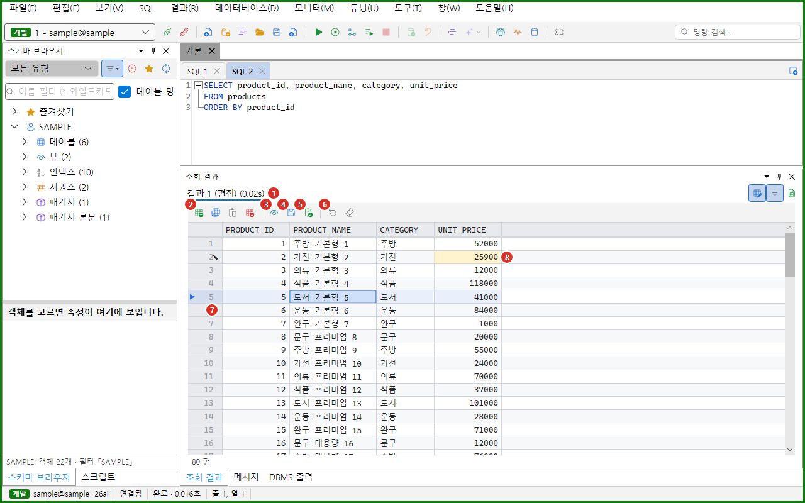
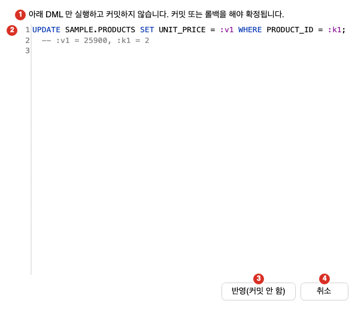

그리드 편집은 조회 결과의 값을 그 자리에서 고쳐 DB에 반영하는 기능입니다. 행을 더하고, 복제하고, 지우고, 붙여 넣을 수 있습니다. 반영하기 전에 항상 Oranda가 만든 DML을 미리 보여 줍니다. 플래시백은 행의 과거 값을 보고, 변경 이력을 보고, 이전 값으로 되돌리는 기능입니다. 결과 그리드 자체의 사용법은 [결과 그리드](../result-grid/)를 보세요.

:::caution[DB 데이터가 바뀝니다]
이 쪽의 반영과 되돌리기 기능은 DB의 INSERT, UPDATE, DELETE를 실행합니다. 운영 DB에서는 먼저 개발 DB에서 연습하세요. 반영하면 커밋하기 전까지 같은 세션의 트랜잭션에 남습니다.
:::

## 편집 모드로 열기

결과를 고치려면 결과를 편집 모드로 열어야 합니다. 일반 실행(`F5`, `Ctrl+Enter`)의 결과는 읽기 전용입니다.

1. 편집기에서 `SELECT * FROM departments`를 입력하세요.
2. 커서를 문장 안에 두세요.
3. `F9`를 누르세요. macOS에서는 `Ctrl+Enter`나 `F9`를 누르세요. 메뉴는 **SQL > 결과 편집 모드로 실행**입니다.

편집 모드로 열면 결과 탭 이름 뒤에 「(편집)」이 붙고 결과 그리드 위에 편집 도구 줄이 나타납니다.

결과 탭 줄의 「결과 편집 모드」 단추로도 같은 일을 합니다. 읽기 결과에서 누르면 그 결과를 만든 문장(커서 문장이 아닙니다)을 편집 모드로 다시 실행합니다. 편집 모드에서는 단추가 켜진 모양이고, 다시 누르면 같은 문장을 일반 실행해 읽기 결과로 돌아갑니다. 반영하지 않은 변경이 있으면 먼저 「반영하지 않은 변경이 있습니다. 변경을 버리고 읽기 결과로 돌아갈까요?」를 묻고, 아니라고 하면 편집 모드 그대로 둡니다. 편집할 수 없는 결과이면 아래 「안내 줄」이 나옵니다. 거른 결과, 외래키로 연 결과, 실행 중, 읽기 전용 접속에서는 단추가 꺼져 있습니다. 문장을 다시 실행하는 단추이므로 PL/SQL 블록의 REF CURSOR 결과, 스크립트의 결과, 분류가 불확실한 문장처럼 조회(SELECT) 문장 하나라고 확실하지 않은 결과에서도 꺼져 있습니다(편집 모드로 열었다가 편집할 수 없는 결과로 열린 탭은 읽기 결과로 돌아가는 데 쓸 수 있습니다). 셀 편집기에 값을 입력하던 중에 누르면 입력한 값이 먼저 확정되어 위의 변경 확인에 포함됩니다.

- 메뉴 항목은 읽기 전용 접속이나 조회 전용 Role에서 회색이 됩니다. 접속이 없거나 다른 문장이 실행 중일 때도 회색입니다.
- 편집할 수 없는 결과이면 메시지 창에 「결과를 편집할 수 없습니다: 이유」가 남습니다.
- 반영하지 않은 편집이 있는 탭은 다시 실행하면 사라집니다. 이 경우 확인 창이 나오지 않습니다.

### 편집할 수 있는 결과

다음 조건을 모두 만족해야 합니다.

- 결과가 SELECT 문 하나의 결과입니다.
- 편집할 표가 하나입니다. 조인 결과에서는 FROM 절에서 처음 나오는 표(서브쿼리가 아닌 표)가 편집 대상입니다. 다른 표의 열은 읽기 전용입니다.
- 결과에 그 표의 키가 있습니다. 키는 기본 키 열 전체이거나 ROWID 열입니다. 기본 키가 없으면 NOT NULL 열로만 이루어진 유니크 키를 씁니다.
- 접속이 읽기 전용이 아닙니다.

편집할 수 있는 열은 그 표의 열이면서 종류가 글자, 숫자, 이진 실수(BINARY_FLOAT, BINARY_DOUBLE), 날짜, 타임스탬프, 시간대 타임스탬프, RAW, BOOLEAN인 열입니다. ROWID 열, 식으로 만든 열, 다른 표의 열, LOB 열은 고칠 수 없습니다. LOB는 [값 보기와 LOB 편집기](../result-grid/#값-보기와-lob-편집기)에서 고칩니다.

편집할 수 없을 때 보이는 이유는 다음과 같습니다.

| 안내 | 원인 |
|---|---|
| 집계 함수 결과는 편집할 수 없습니다. | 선택 목록에 집계 함수가 있습니다. |
| GROUP BY 결과는 편집할 수 없습니다. | `GROUP BY`나 `HAVING`이 있습니다. |
| DISTINCT 결과는 편집할 수 없습니다. | `DISTINCT`나 `UNIQUE`가 있습니다. |
| 집합 연산(UNION·INTERSECT·MINUS) 결과는 편집할 수 없습니다. | 집합 연산자가 있습니다. |
| WITH 절 질의는 편집할 수 없습니다. | `WITH`로 시작합니다. |
| DB 링크 테이블은 편집할 수 없습니다. | 대상 표가 DB 링크로 읽는 표입니다. |
| 편집할 테이블이 없습니다. | FROM 절에 서브쿼리만 있습니다. |
| 행을 하나로 특정할 키가 결과에 없습니다. ROWID 를 SELECT 에 추가하거나 PK 열을 모두 포함하세요. | 결과에 키 열이 없습니다. |
| 읽기 전용 접속 '이름' 에서는 결과를 편집할 수 없습니다. | 읽기 전용 접속입니다. |
| 대상 테이블이 키 보존이 아닙니다(같은 키가 n 번째 행에 또 나옵니다). 다른 대상 테이블을 고르세요. | 조인 결과에서 대상 표의 키가 반복됩니다. |

### 안내 줄

읽기 전용 결과의 셀을 고치려 하면 결과 그리드 위에 안내 줄이 나타납니다. 셀을 두 번 누르거나, `F2`를 누르거나, 글자를 입력하거나, 「행 붙여넣기」를 실행할 때입니다. `F9`로 연 결과를 고칠 수 없을 때도 이 줄이 나타나며, 안내 글은 「이 결과는 편집할 수 없습니다: 이유」입니다.

안내 줄의 구성은 다음과 같습니다.

- 안내 글: 「읽기 전용 결과입니다. 값을 고치려면 결과 편집 모드로 다시 실행하세요(F9).」처럼 이유와 방법을 보입니다. 거른 결과와 외래키로 연 결과에는 다른 글이 나옵니다.
- 편집 모드로 다시 실행: 같은 문장을 편집 모드로 다시 실행합니다. 읽기 전용 결과일 때 보입니다.
- ROWID 추가 후 다시 실행: 선택 목록 끝에 `표.ROWID`를 더해서 편집 모드로 실행합니다. 키가 없는 단일 표 결과일 때 보입니다.
- 안내 닫기: 안내 줄을 닫습니다.

「ROWID 추가 후 다시 실행」은 편집기의 SQL 글을 바꾸지 않고, 바뀐 문장만 실행합니다. `SELECT dept_name FROM departments`는 `SELECT dept_name, departments.ROWID FROM departments`로 실행됩니다. 선택 목록에 `*`가 있으면 `별칭.*, 별칭.ROWID`가 됩니다. FROM 절에 표가 둘 이상이면 이 단추는 나타나지 않습니다.

## 편집 모드 화면



1. 결과 탭: 이름 뒤에 「(편집)」이 붙습니다.
2. 행 추가, 행 복제, 행 붙여넣기, 행 삭제 단추: 행을 다루는 단추 네 개입니다.
3. 반영할 DML 미리보기: 만들어질 DML을 보고 반영합니다.
4. 반영(커밋 안 함): DML을 미리 본 뒤 반영합니다. 커밋하지 않습니다.
5. 반영 후 커밋: DML을 미리 본 뒤 반영하고 바로 커밋합니다.
6. 행 되돌리기, 모두 되돌리기 단추: 고친 내용을 버립니다.
7. 행 머리 칸의 표시: 새 행은 `*`, 고친 행은 `✎`, 지울 행은 `✕`, 반영하지 못한 행은 `!`로 보입니다.
8. 바뀐 셀: 고친 셀은 노란색입니다.

- 도구 줄의 단추는 아이콘만 있습니다. 마우스를 올리면 이름이 나옵니다.
- 3번에서 6번 단추는 고친 내용이 있을 때만 켜집니다.
- 새 행은 연한 초록색, 지울 행은 연한 빨간색이고 글자에 취소선이 그어집니다. 반영하지 못한 행도 빨간색입니다.
- 복제해서 만든 새 행에서 키 열의 값이 복제한 그대로이면 그 셀은 주황색입니다. 값을 바꾸면 색이 사라집니다.
- 색은 테마에 따라 조금 다를 수 있습니다.

같은 명령이 결과 그리드의 오른쪽 클릭 메뉴 **행 편집** 아래에도 있습니다. 메뉴 막대의 **결과 > 행 편집**에도 같은 항목이 있습니다.

| 명령 | 하는 일 | Windows | macOS |
|---|---|---|---|
| 행 추가 | 맨 끝에 빈 새 행을 더합니다. | `Alt+Insert` | `Cmd+Option+N` |
| 행 복제 | 고른 행을 새 행으로 복제합니다. | `Ctrl+Shift+D`, `Ctrl+D` | `Cmd+Shift+D`, `Cmd+D` |
| 행 붙여넣기 | 클립보드의 행을 새 행으로 붙여 넣습니다. | `Ctrl+Shift+V` | `Cmd+Shift+V` |
| 행 삭제 | 고른 행을 지울 행으로 표시합니다. | `Alt+Delete`, `Ctrl+Delete` | `Cmd+Option+Backspace`, `Cmd+Backspace`, `Cmd+Delete` |
| 반영할 DML 미리보기 | 만들어질 DML을 미리 봅니다. | 없음 | 없음 |
| 반영 후 커밋 | 반영하고 커밋합니다. | 없음 | 없음 |
| 반영(커밋 안 함) | 반영하고 커밋하지 않습니다. | 없음 | 없음 |
| 행 되돌리기 | 고른 행의 고친 내용을 버립니다. | 없음 | 없음 |
| 모두 되돌리기 | 고친 내용을 모두 버립니다. | 없음 | 없음 |

단축키는 결과 그리드에 포커스가 있을 때만 동작합니다. 기본 키맵 기준이며 [단축키와 명령 팔레트](../../settings/shortcuts/)에서 바꿉니다.

## 셀 고치기

1. 고칠 셀을 두 번 누르거나 셀을 고른 뒤 `F2`를 누르세요. 글자를 바로 입력해도 됩니다. 이때는 입력한 글자가 기존 값을 대신합니다.
2. 새 값을 입력하세요.
3. `Enter`를 누르세요.

- `Enter`는 값을 확정하고 한 행 아래로 갑니다.
- `Tab`은 값을 확정하고 오른쪽 셀 편집으로 이어 갑니다. `Shift+Tab`은 왼쪽 셀로 갑니다. 줄 끝에서는 다음 줄이나 앞 줄로 넘어갑니다.
- `↑`, `↓`는 값을 확정하고 같은 열의 위 행, 아래 행의 셀 편집으로 이어 갑니다. 가져온 마지막 행에서 `↓`를 누르면 더 가져올 행이 있을 때 다음 페이지를 가져와 이어 갑니다. 보이는 글이 그대로면 값은 바뀌지 않습니다(지나가기만 해도 여러 줄 값이나 「같은 값 숨김」으로 빈 글자인 칸이 바뀌지 않습니다). 첫 행에서 `↑`를 누르거나 마지막 행에서 `↓`를 누르면 값만 확정하고 편집을 끝냅니다. 값에 줄바꿈이 있어도 행 이동입니다. 옮겨 갈 셀을 고칠 수 없으면(지울 행 등) `Tab`과 같게 셀 편집을 열지 않습니다.
- `Esc`는 입력을 버리고 편집을 끝냅니다.
- 다른 곳을 눌러서 포커스를 옮기면 값이 확정됩니다.
- 값을 지워서 빈 칸으로 확정하면 NULL이 됩니다. 빈 글자와 NULL을 구별하지 않습니다.
- 확정한 값이 원래 값과 같으면 그 셀의 변경은 사라지고, 그 행에 변경이 없으면 행 표시도 사라집니다.
- 지울 행의 셀은 고칠 수 없습니다. 먼저 「행 되돌리기」를 하세요.

값은 열의 종류에 맞춰 읽습니다.

| 열의 종류 | 입력 규칙 |
|---|---|
| 숫자 | 소수점은 `.`입니다. 천 단위 쉼표는 읽습니다. 지수 표기는 쓸 수 없습니다. |
| DATE, TIMESTAMP | `2026-01-15 10:30:00`처럼 날짜와 시각을 입력합니다. |
| 글자 | 입력한 그대로입니다. |
| 그 밖의 종류 | 글자로 보냅니다. |

값을 읽을 수 없으면 입력한 글자를 그대로 서버에 보냅니다. 서버가 거부하면 반영할 때 그 행이 실패합니다.

## 행 다루기

### 행 추가

「행 추가」는 결과의 맨 끝에 빈 행을 더하고 첫 셀을 고릅니다. 값을 입력한 셀만 INSERT 문에 들어갑니다. 값을 하나도 입력하지 않은 새 행은 DML을 만들지 않습니다. 셀을 입력했다가 비운 경우에는 그 열에 NULL을 명시해서 보냅니다. 이 경우 열의 기본값은 쓰이지 않습니다.

### 행 복제

「행 복제」는 고른 모든 행을 새 행으로 맨 끝에 더합니다. 고른 모든 행은 셀 범위가 걸친 행과 `Ctrl`을 누른 채 더한 행입니다.

- 편집할 수 있는 열의 NULL이 아닌 값만 복사합니다. ROWID, 대상 표 밖의 열, LOB는 비워 둡니다.
- 복사하지 않은 열은 INSERT 문에서 빠지므로 열의 기본값이 쓰입니다.
- 키 열은 주황색으로 표시됩니다. 반영하기 전에 키 값을 바꾸세요. 상태 줄에 「n행을 복제해 끝에 더했습니다 · 키 열(…) 값을 바꾼 뒤 반영하세요.」가 나옵니다.
- 편집 모드가 아닌 결과에서 실행하면 같은 문장을 편집 모드로 먼저 다시 실행하고 복제합니다.

### 행 삭제

「행 삭제」는 기존 행을 지울 행으로 표시합니다. 반영할 때 DELETE 문이 실행됩니다. 아직 반영하지 않은 새 행은 바로 없어집니다.

- 행을 둘 이상 지우면 「n행을 삭제 표시했습니다(반영하면 DELETE n건이 실행됩니다)」처럼 건수를 알려 줍니다.
- 편집 모드가 아닌 결과에서 실행하면 같은 문장을 편집 모드로 먼저 다시 실행합니다. 다시 읽은 행이 고른 행과 달라지면 「편집 모드로 다시 실행했더니 결과의 행이 달라졌습니다. 행을 다시 골라 실행하세요.」가 나오고 멈춥니다.
- 고친 뒤에 지우면 고친 내용은 버려집니다.

### 행 붙여넣기

「행 붙여넣기」는 클립보드의 내용을 새 행으로 맨 끝에 붙입니다.

- 이 앱에서 「행 복사」로 복사한 행이면 NULL, 날짜, 숫자 형식이 그대로 붙습니다.
- 다른 곳에서 복사한 글은 탭으로 칸을 나누고 줄바꿈으로 행을 나눕니다. 값이 큰따옴표로 감싸져 있으면 그 안의 탭과 줄바꿈은 값의 일부입니다. 큰따옴표 안의 `""`는 `"` 하나입니다.
- 첫 행이 보이는 열 이름과 같은 순서로 같으면 머리글로 보고 건너뜁니다.
- 열 이름이 아니라 위치로 짝을 지웁니다. 숨긴 열은 빼고 화면에 보이는 열 순서대로 채웁니다.
- 붙인 값이 열보다 많으면 남는 값을 버리고, 적으면 나머지 열을 비웁니다. 편집할 수 없는 열(ROWID, 대상 표 밖의 열, LOB)은 비웁니다.
- 상태 줄에 「n행을 새 행으로 끝에 붙여 넣었습니다」와 함께 버리거나 비운 열의 수를 알려 줍니다.
- 클립보드가 비어 있으면 「클립보드에 붙여 넣을 행이 없습니다.」가 나옵니다.
- 읽기 전용 결과에서 실행하면 안내 줄이 나타납니다.

### 되돌리기

- 「행 되돌리기」는 고른 행의 고친 내용, 지울 행 표시, 새 행을 버립니다.
- 「모두 되돌리기」는 모든 변경과 반영 실패 표시와 반영 결과 안내를 버립니다.

## DML 미리보기와 반영

반영하기 전에 항상 「DML 미리보기」 창이 나옵니다. 이 창에서 확인하지 않으면 반영되지 않습니다.

1. 값을 고치세요.
2. 도구 줄의 「반영(커밋 안 함)」이나 「반영 후 커밋」을 누르세요.
3. 미리보기 창에서 DML을 확인하세요.
4. 창의 단추를 누르세요.

「반영할 DML 미리보기」를 누르면 같은 창이 나오고, 창의 단추는 커밋 없이 반영합니다.



1. 안내 글: 「반영 후 커밋」이면 「아래 DML 을 실행한 뒤 바로 커밋합니다.」가 보입니다. 「반영(커밋 안 함)」이면 「아래 DML 만 실행하고 커밋하지 않습니다. 커밋 또는 롤백을 해야 확정됩니다.」가 보입니다.
2. DML 본문: 반영할 DML과 바인드 값을 보입니다.
3. 반영 단추: 이름은 「반영(커밋 안 함)」 또는 「반영 후 커밋」입니다. 누르면 실행합니다.
4. 취소: 반영하지 않고 창을 닫습니다. 기본 단추이므로 `Enter`를 누르면 취소됩니다.

창 제목은 「DML 미리보기 · 반영(커밋 안 함)」 또는 「DML 미리보기 · 반영 후 커밋」입니다.

미리보기의 DML은 다음 모양입니다. 문장마다 줄 하나에 `;`로 끝나고, 바인드가 있으면 다음 줄에 주석으로 값을 보입니다.

```sql
UPDATE 소유자.PRODUCTS SET UNIT_PRICE = :v1 WHERE PRODUCT_ID = :k1;
  -- :v1 = 새 값, :k1 = 키 값
```

DML을 만드는 규칙은 다음과 같습니다.

- 문장 형태는 `INSERT INTO 표 (열…) VALUES (:v1, …)`, `UPDATE 표 SET 열 = :v1 … WHERE 키 = :k1`, `DELETE FROM 표 WHERE 키 = :k1`입니다.
- 값은 항상 바인드 변수로 보냅니다. 값을 SQL 글에 이어 붙이지 않습니다.
- UPDATE의 SET에는 고친 열만 들어갑니다.
- WHERE에는 키만 씁니다. 기본 키나 유니크 키는 열마다 `열 = :k`를 쓰고, ROWID 키는 `ROWID = :rid`를 씁니다. 키 열을 고쳤더라도 WHERE에는 원래 값을 씁니다.
- 실행 순서는 DELETE, UPDATE, INSERT입니다.

반영할 때 Oranda가 하는 일은 다음과 같습니다.

1. 세이브포인트를 만듭니다.
2. 행마다 세이브포인트를 만들고 DML을 실행합니다.
3. 영향받은 행이 정확히 1이 아니면 그 행만 되돌리고 실패로 표시합니다.
4. 서버 오류가 나도 그 행만 되돌리고 나머지 행을 계속 반영합니다.
5. 「반영 후 커밋」이고 실패한 행이 하나도 없으면 커밋합니다.

- 한 행이라도 실패하면 「반영 후 커밋」도 커밋하지 않습니다. 반영된 행은 트랜잭션에 남습니다. 메시지 창에 「커밋하지 않았습니다.」가 붙습니다.
- DML을 실행하다가 정책 관문이 거부하거나 사용자가 취소하면 이번 반영 전체를 되돌립니다. 모든 행이 실패로 표시되고, 원인이 아닌 행에는 「반영이 중단되어 되돌렸습니다.」가 붙습니다.
- DML은 실행 엔진을 거치므로 접속의 안전장치가 그대로 적용됩니다. 읽기 전용 접속에서는 반영할 수 없습니다. 운영 접속에서는 DML이 실행 확인 창을 거칩니다.
- 반영한 DML은 실행 이력에 남습니다.
- 결과를 만든 세션이 지금 탭의 세션과 다르면 반영하지 않고 「이 결과를 만든 세션과 지금 탭의 세션이 다릅니다. 다른 세션의 트랜잭션에 반영하지 않도록 멈췄습니다 — 다시 조회한 뒤 편집하세요.」를 보입니다. 그 세션이 다른 문장을 실행 중이면 「이 결과의 세션은 지금 실행 중입니다. 실행이 끝난 뒤 다시 반영하세요.」를 보입니다.

### 반영 결과

반영하면 결과 그리드의 상태 줄과 메시지 창에 안내가 나옵니다.

| 상황 | 안내 |
|---|---|
| 모두 반영하고 커밋했습니다. | 「n 행 반영, 커밋함.」 |
| 모두 반영하고 커밋하지 않았습니다. | 「n 행 반영(커밋 안 함). 커밋하려면 커밋 단추, 되돌리려면 롤백.」 |
| 일부가 실패했습니다. | 「n 행 반영, m 행은 반영하지 않았습니다: 첫 오류 메시지」 |

- 같은 내용이 창 아래 상태 표시줄에도 잠깐 나옵니다. 「5행 저장됨」, 「5행 저장·커밋됨」, 「5행 저장됨, 2행 저장하지 못함」, 「2행 저장하지 못함」 중 하나입니다. 성공 알림은 6초 뒤에, 실패 알림은 12초 뒤에 사라집니다.
- 영향받은 행이 0이면 「바뀐 행이 없습니다. 다른 세션이 행을 지웠거나 값을 바꿨습니다. 반영하지 않았습니다.」가 나옵니다.
- 영향받은 행이 둘 이상이면 「n 행이 바뀌어 반영하지 않았습니다(1 행이어야 함).」가 나옵니다.
- 모두 반영했으면 같은 질의를 편집 모드로 다시 실행해서 반영된 값을 보입니다. 반영한 행은 0.8초 동안 초록색으로 깜박입니다.
- 실패한 행이 있으면 다시 읽지 않습니다. 성공한 행은 변경 목록에서 빠지고, 실패한 행은 `!` 표시로 남습니다. 실패한 행에서 고친 값을 다시 고쳐 반영할 수 있습니다.
- 반영(커밋 안 함) 뒤에는 상태 표시줄에 「미커밋」이 나타납니다. 툴바의 「커밋」이나 「롤백」으로 끝냅니다. 자세한 내용은 [SQL 실행](../execute/)의 트랜잭션 절을 보세요.

### 낙관적 잠금

낙관적 잠금은 다른 사람이 같은 행을 먼저 고쳤는지 확인하는 옵션입니다. 기본값은 꺼짐입니다.

- 켜면 UPDATE와 DELETE의 WHERE에 고칠 수 있는 키가 아닌 열의 원래 값 비교가 더해집니다. 고친 열만이 아니라 결과의 편집할 수 있는 키가 아닌 열 전체입니다. 원래 값이 NULL이면 `열 IS NULL`을 씁니다.
- 원래 값이 달라졌으면 영향받은 행이 0이 되어 그 행은 「바뀐 행이 없습니다…」로 실패합니다.
- 이 옵션은 편집 세션마다 따로 켭니다. 결과를 다시 읽으면 꺼집니다.
- 켜고 끄는 명령은 「낙관적 잠금 켜기/끄기」입니다. 메뉴와 단축키에는 없고 명령 팔레트(`Ctrl+Shift+P`, macOS는 `Cmd+Shift+P`)에서 실행합니다. 켜져 있는지 보여 주는 표시는 없습니다.

## 반영하지 않은 편집이 있을 때

| 상황 | 동작 |
|---|---|
| 반영하지 않은 편집이 있는데 같은 결과를 정렬합니다. | 정렬하지 않고 「반영하지 않은 편집이 있어 정렬하지 않았습니다. 반영하거나 되돌린 뒤 정렬할 수 있습니다.」를 보입니다. |
| 반영하지 않은 편집이 있는데 거릅니다. | 거르지 않고 안내를 보입니다. |
| 반영하지 않은 편집이 있는데 다시 실행하거나 결과 탭을 닫습니다. | 확인 없이 편집 내용이 사라집니다. |
| 반영하지 않은 편집이 있는데 결과 탭 줄의 「결과 편집 모드」 단추를 눌러 읽기 결과로 돌아갑니다. | 변경을 버릴지 먼저 묻습니다. 아니라고 하면 돌아가지 않습니다. |
| 거른 결과를 편집하려 합니다. | 편집할 수 없습니다. 거르기를 지우고 다시 실행하세요. |

결과 탭을 고정(「결과 탭 고정」)하면 다음 실행이 그 탭을 지우지 않으므로 고친 내용도 남습니다.

반영하지 않은 편집은 앱을 끄거나 SQL 탭을 닫을 때의 미커밋 확인에는 포함되지 않습니다. 그 확인은 DB 트랜잭션만 봅니다.

## 편집 대상 표

조인 결과의 편집 대상은 FROM 절에서 처음 나오는 표입니다. 서브쿼리는 대상이 되지 않습니다. 대상 표가 아닌 표의 열은 읽기 전용입니다. 다른 표를 고치려면 그 표를 조회하는 문장을 따로 실행하세요.

## 플래시백

플래시백은 Oracle의 과거 데이터 조회 기능을 쓰는 세 가지 명령입니다. 결과 그리드를 오른쪽 클릭하면 나오는 **플래시백** 메뉴에 있습니다. 메뉴 막대의 **결과 > 플래시백**에도 있습니다. 단축키는 없습니다.

| 명령 | 하는 일 |
|---|---|
| N분 전 값 보기… | 불러온 행의 N분 전 값을 새 결과 탭에 보입니다. 지금 값과 다른 칸을 강조합니다. |
| 이 행 변경 이력 | 고른 행의 변경 이력을 조회하는 SQL을 새 SQL 탭에 넣고 실행합니다. |
| 이전 값으로 되돌리기… | 고른 행을 N분 전 값으로 되돌리는 UPDATE를 만들어 반영합니다. |

### 쓸 수 있는 결과

- 「N분 전 값 보기」와 「이 행 변경 이력」은 편집 모드로 연 결과에서 쓸 수 있습니다. 일반 실행 결과도 단일 표 SELECT이고 그 표의 기본 키 열이 모두 결과에 있으면 쓸 수 있습니다.
- 「이전 값으로 되돌리기」는 편집 모드로 연 결과에서만 쓸 수 있습니다.
- 반영하지 않은 편집이 있으면 「반영하지 않은 편집이 있습니다. 반영하거나 되돌린 뒤 플래시백을 쓰세요.」가 나오고 실행하지 않습니다.
- 쓸 수 없을 때는 이유가 결과 그리드 상태 줄과 메시지 창에 나옵니다. 예를 들어 「키(PK) 열이 결과에 없어 플래시백을 쓸 수 없습니다…」, 「여러 표가 얽힌 결과에서는 쓸 수 없습니다.」, 「플래시백은 편집기 결과 탭에서 쓸 수 있습니다.」입니다.
- 「이 행 변경 이력」은 **설정 > 결과 그리드**의 「변경 추적하기」를 끄면 메뉴에서 사라집니다. 기본값은 켜짐입니다.
- 다른 스키마의 표는 그 표에 대한 FLASHBACK 권한이 필요합니다. 자기 표는 따로 권한이 필요 없습니다.
- 어디까지 과거로 갈 수 있는지는 DB의 undo 보관 기간에 달려 있습니다.

### N분 전 값 보기

1. 편집 모드로 연 결과에서 행이 있는 셀을 고르세요.
2. 결과 그리드를 오른쪽 클릭해서 **플래시백 > N분 전 값 보기…**를 고르세요.
3. 입력 창에 분을 입력하세요. 처음 값은 10입니다.
4. 「확인」을 누르세요.

몇 분 전인지 묻는 창의 구성은 다음과 같습니다.

- 창 제목: 「N분 전 값 보기 — 몇 분 전? (undo_retention: 900초(약 15분). 이보다 오래된 값은 읽지 못할 수 있음)」처럼 DB의 undo 보관 기간을 알려 줍니다. 읽을 권한이 없으면 「undo_retention: 알 수 없음(v$parameter 를 읽을 권한이 없을 수 있음)」이 나옵니다.
- 분 입력 칸: 1에서 525600 사이의 정수를 입력합니다.
- 확인: 조회합니다.
- 취소: 창을 닫습니다.

- 입력이 정수가 아니거나 범위를 벗어나면 「플래시백을 하지 못했습니다: 분은 1~525600 사이의 정수로 입력하세요.」가 나옵니다.
- 이미 불러온 행의 키로 `SELECT 열… FROM 표 AS OF TIMESTAMP (SYSTIMESTAMP - NUMTODSINTERVAL(:mins, 'MINUTE')) WHERE 키 IN (…)`를 실행합니다. 불러온 행이 1000개를 넘으면 앞쪽 1000개만 읽고 안내가 붙습니다.
- LOB, JSON, XML, VECTOR 같은 열은 읽지 않습니다.
- 결과는 「10분 전: PRODUCTS」처럼 이름 붙은 새 결과 탭에 열립니다. 원래 결과는 그대로 남습니다. 탭의 × 단추로 닫습니다.
- 지금 값과 다른 칸은 노란색으로 강조되고, 그 행의 행 머리 칸에 `✎`가 붙습니다. 정렬해도 키로 짝을 짓기 때문에 어긋나지 않습니다.
- 상태 줄에 「10분 전 값입니다. 지금 값과 다른 칸은 강조됩니다. 그때 없던 행(그 뒤 INSERT)은 이 탭에 나오지 않습니다.」가 나옵니다.

결과 탭은 다음과 같이 보입니다.

- 결과 탭: 이름이 「10분 전: 표 이름」입니다.
- 강조된 셀: 지금 값과 다른 셀입니다.
- 행 머리 칸의 `✎`: 다른 값이 있는 행입니다.
- 상태 줄: 「10분 전 값입니다…」 안내입니다.

### 이 행 변경 이력

1. 이력을 볼 행의 셀을 고르세요.
2. 결과 그리드를 오른쪽 클릭해서 **플래시백 > 이 행 변경 이력**을 고르세요.

묻는 창은 없습니다. 새 SQL 탭이 열리고, 같은 접속으로 다음 모양의 SQL이 바로 실행됩니다.

```sql
-- 소유자.표 의 변경 이력(키: ID = 4). 기간: 최근 1.5일(SYSDATE - 1.5)은 고쳐 다시 돌리거나 설정 > 결과 그리드 「변경 추적 기간」에서 바꿀 수 있습니다. …
SELECT VERSIONS_STARTTIME, VERSIONS_ENDTIME, VERSIONS_OPERATION, RAWTOHEX(VERSIONS_XID) AS VERSIONS_XID, 표의 열…
FROM 소유자.표 VERSIONS BETWEEN TIMESTAMP SYSDATE - 1.5 AND MAXVALUE
WHERE 키 열 = 키 값
ORDER BY VERSIONS_STARTSCN DESC NULLS LAST
```

열린 SQL 탭은 다음과 같이 구성됩니다.

- 새 SQL 탭: 변경 이력 질의가 들어 있습니다.
- 주석 줄: 대상 표, 키, 기간을 알려 줍니다.
- 질의: 키 값이 글자 그대로 들어 있어서 고쳐서 다시 실행할 수 있습니다.
- 결과: 최신 변경이 맨 위입니다. `VERSIONS_OPERATION`은 변경 종류입니다.

- 기간은 **설정 > 결과 그리드**의 「변경 추적 기간」을 따릅니다. 기본은 「최근 N일 (SYSDATE - N)」이고 N의 처음 값은 1.5입니다. N은 0.01에서 365 사이입니다. 「가능한 전체 기간 (DB 에 따라 ORA-08180 이 날 수 있음)」을 고르면 `VERSIONS BETWEEN SCN MINVALUE AND MAXVALUE`를 씁니다.
- 표 정의가 마지막으로 바뀐 시각을 알면 기간의 시작이 그 시각의 10초 뒤보다 앞서지 않게 합니다. 그 앞은 ORA-01466이 나기 때문입니다.
- 키 값이 NULL이면 「이 행의 키 값을 읽을 수 없어 변경 이력을 볼 수 없습니다.」가 나옵니다.
- 이 SQL은 undo 보관 기간과 표 정의 변경 시점까지만 보입니다.

### 이전 값으로 되돌리기

1. 편집 모드로 연 결과에서 되돌릴 행을 고르세요. 여러 행을 골라도 됩니다.
2. 결과 그리드를 오른쪽 클릭해서 **플래시백 > 이전 값으로 되돌리기…**를 고르세요.
3. 입력 창에 분을 입력하세요. 창 제목은 「이전 값으로 되돌리기 — 몇 분 전? (…)」입니다.
4. 「DML 미리보기」 창에서 UPDATE를 확인하고 「반영(커밋 안 함)」을 누르세요.
5. 결과를 확인한 뒤 툴바의 「커밋」이나 「롤백」을 누르세요.

- 고른 행 가운데 최대 200행까지 처리합니다. 넘으면 앞쪽만 처리하고 안내합니다.
- UPDATE만 만듭니다. INSERT나 DELETE는 만들지 않습니다.
- 지금 값과 N분 전 값이 다른, 키가 아닌 편집 가능 열만 SET에 넣습니다. WHERE에는 키와 그 열들의 지금 값을 넣습니다. 그 사이에 다른 세션이 값을 바꾸었으면 그 행은 반영되지 않습니다.
- N분 전에 없던 행은 건너뜁니다. 건너뛸 행만 있으면 「되돌릴 행이 없습니다: 고른 행 n개는 N분 전에 없었습니다.」가 나옵니다. 값이 모두 같으면 「N분 전과 값이 같아 되돌릴 칸이 없습니다.」가 나옵니다.
- 항상 커밋하지 않고 반영합니다. 미리보기 창에 「반영 후 커밋」 단추는 없습니다.
- 반영하면 「n 행을 N분 전 값으로 되돌렸습니다(커밋 안 함). 커밋하려면 커밋 단추, 되돌리려면 롤백.」이 나오고 결과를 다시 읽습니다. 건너뛴 행이 있으면 「(건너뜀: 그때 없던 행 a, 같은 값 b)」가 붙습니다.
- 이 반영은 결과 그리드의 편집 목록을 거치지 않습니다. 그래서 상태 표시줄의 「n행 저장됨」 알림은 나오지 않습니다.
- 취소하면 「되돌리기를 취소했습니다.」가 나옵니다.

### 플래시백 오류

| 안내 | 원인과 해결 |
|---|---|
| undo 보관 기간(undo_retention)이 지나 그 시점의 값을 undo 에서 읽을 수 없습니다(ORA-01555). 더 짧은 시간을 넣어 보세요. | 요청한 시점이 undo 보관 기간보다 오래되었습니다. 더 짧은 시간을 입력하세요. |
| 요청한 시각이 너무 오래전이라 그 시각에 맞는 SCN 을 찾을 수 없습니다(ORA-08180). | 시간이나 변경 추적 기간을 줄이세요. |
| 그 시각 뒤에 표 정의가 바뀌어(DDL, 표 생성 포함) 그 시점의 값을 읽을 수 없습니다(ORA-01466). | 표 정의를 바꾼 시각 이후의 시점만 조회할 수 있습니다. 안내에 그 시각이 함께 나옵니다. |
| FLASHBACK 권한이 부족합니다(ORA-01031). | 표 소유자에게 FLASHBACK 또는 FLASHBACK ANY TABLE 권한을 받으세요. |
| 이 표의 FLASHBACK 권한이 없습니다. … (ORA-41900) | 소유자나 DBA에게 `GRANT FLASHBACK ON 소유자.표 TO 접속 사용자`를 요청하세요. |
| VERSIONS 의 시작 시각이 undo 보관 범위를 벗어났습니다(ORA-30052). | 더 짧은 기간을 쓰세요. |
| 표나 뷰가 없거나 읽을 권한이 없습니다(ORA-00942). | 표 이름과 SELECT 권한을 확인하세요. |

## 자주 하는 작업

### 상품 가격을 고쳐 반영하기

1. 편집기에 `SELECT * FROM products WHERE product_id <= 5`를 입력하세요.
2. `F9`를 누르세요.
3. 가격이 들어 있는 `unit_price` 셀을 두 번 누르세요.
4. 새 값을 입력하고 `Enter`를 누르세요.
5. 고친 셀이 노란색인지 확인하세요.
6. 도구 줄의 「반영할 DML 미리보기」를 누르세요.
7. 창의 `UPDATE` 문을 확인하세요.
8. 「반영(커밋 안 함)」을 누르세요.
9. 상태 표시줄에 「미커밋」이 나타나는지 확인하세요.
10. 샘플 데이터를 그대로 두려면 툴바의 「롤백」을 누르세요. 값을 확정하려면 「커밋」을 누르세요.

### 새 부서 행 추가하기

1. 편집기에 `SELECT * FROM departments`를 입력하세요.
2. `F9`를 누르세요.
3. `Alt+Insert`를 누르세요. macOS에서는 `Cmd+Option+N`을 누르세요.
4. 새 행의 `dept_id`, `dept_name`, `location` 셀에 값을 입력하세요. `Tab`으로 옆 셀로 갑니다.
5. 도구 줄의 「반영(커밋 안 함)」을 누르세요.
6. 미리보기 창에서 `INSERT` 문을 확인하고 「반영(커밋 안 함)」을 누르세요.
7. 샘플 데이터를 그대로 두려면 툴바의 「롤백」을 누르세요. 행을 확정하려면 「커밋」을 누르세요.

### 행을 복제해서 새 행 만들기

1. `SELECT * FROM products`를 `F9`로 실행하세요.
2. 복제할 행의 행 머리 칸을 누르세요.
3. `Ctrl+D`를 누르세요. macOS에서는 `Cmd+D`를 누르세요.
4. 주황색 `product_id` 셀에 새 번호를 입력하세요.
5. 도구 줄의 「반영(커밋 안 함)」을 누르세요.
6. 샘플 데이터를 그대로 두려면 툴바의 「롤백」을 누르세요.

### 실수로 바꾼 값을 이전 값으로 되돌리기

값을 고쳐 커밋한 행이 있을 때 쓰는 절차입니다.

1. 그 행을 찾는 `SELECT * FROM products WHERE product_id = 1`을 `F9`로 실행하세요.
2. 행의 셀을 고르세요.
3. 결과 그리드를 오른쪽 클릭해서 **플래시백 > N분 전 값 보기…**를 고르세요.
4. 분을 입력하고 「확인」을 누르세요.
5. 강조된 셀로 값이 달라진 것을 확인하세요.
6. 원래 탭의 같은 행을 고르세요.
7. **플래시백 > 이전 값으로 되돌리기…**를 고르세요.
8. 같은 분을 입력하세요.
9. 미리보기의 `UPDATE`를 확인하고 「반영(커밋 안 함)」을 누르세요.
10. 결과를 확인한 뒤 툴바의 「커밋」이나 「롤백」을 누르세요.

### 키가 없는 결과를 고치기

1. `SELECT dept_name FROM departments`를 `F9`로 실행하세요.
2. 안내 줄의 「ROWID 추가 후 다시 실행」을 누르세요.
3. 편집 모드 결과에서 값을 고치세요.

## 문제가 생길 때

| 증상 | 원인 | 해결 |
|---|---|---|
| `F9`가 회색입니다 | 접속이 없거나, 읽기 전용 접속이거나, 조회 전용 Role이거나, 다른 문장이 실행 중입니다. | 접속을 확인하고 실행이 끝난 뒤 다시 시도하세요. 메뉴 항목에 마우스를 올리면 이유가 나옵니다. |
| 셀을 두 번 눌러도 편집기가 열리지 않고 안내 줄이 나옵니다 | 읽기 전용 결과입니다. | `F9`로 편집 모드로 다시 실행하세요. |
| 「이 결과는 편집할 수 없습니다: …」가 나옵니다 | 집계, `GROUP BY`, `DISTINCT`, 집합 연산, `WITH`, 서브쿼리만 있는 `FROM` 절 중 하나입니다. | 단순한 `SELECT`로 바꿔 다시 실행하세요. |
| 「행을 하나로 특정할 키가 결과에 없습니다…」가 나옵니다 | 결과에 기본 키 열이나 ROWID가 없습니다. | 「ROWID 추가 후 다시 실행」을 누르거나 기본 키 열을 선택 목록에 넣으세요. |
| 일부 셀만 고쳐지지 않습니다 | 대상 표의 열이 아니거나, ROWID이거나, LOB 열입니다. | 대상 표의 열을 직접 조회하세요. LOB는 값 보기에서 고치세요. |
| 뷰를 조회한 결과를 고칠 수 없습니다 | 뷰에는 대개 키가 없고 `ROWID`를 선택 목록에 넣을 수 없습니다. | 뷰 대신 원래 표를 조회하세요. |
| 「바뀐 행이 없습니다. 다른 세션이 행을 지웠거나 값을 바꿨습니다. 반영하지 않았습니다.」가 나옵니다 | 그 행이 이미 지워졌거나, 낙관적 잠금이 켜져 있고 원래 값이 달라졌습니다. | 결과를 다시 조회한 뒤 고치세요. |
| 「n 행이 바뀌어 반영하지 않았습니다(1 행이어야 함).」가 나옵니다 | WHERE 조건이 여러 행에 맞았습니다. 키가 유일하지 않습니다. | 기본 키나 ROWID가 결과에 있는지 확인하세요. |
| 지운 행이 `!`로 남고 반영하지 못합니다 | 자식 행이 있는 부서처럼 제약 조건 때문에 서버가 거부했습니다. | 행 머리 칸의 `!`를 확인하고 메시지 창의 오류를 읽으세요. 「행 되돌리기」로 버리거나 오류를 고쳐 다시 반영하세요. |
| 「반영 후 커밋」을 눌렀는데 커밋되지 않았습니다 | 일부 행이 실패했습니다. 실패가 있으면 커밋하지 않습니다. | 실패한 행을 고쳐 다시 반영하거나, 툴바의 「커밋」으로 반영된 행만 확정하세요. |
| 반영했는데 상태 표시줄에 「미커밋」이 보입니다 | 「반영(커밋 안 함)」을 썼습니다. | 툴바의 「커밋」이나 「롤백」을 누르세요. |
| 「이 결과를 만든 세션과 지금 탭의 세션이 다릅니다…」가 나옵니다 | 결과를 만든 뒤 탭의 세션이 바뀌었습니다. | 결과를 다시 조회한 뒤 고치세요. |
| 플래시백 메뉴가 회색입니다 | 셀을 고르지 않았거나, 「이전 값으로 되돌리기」인데 다른 문장이 실행 중입니다. | 셀을 고르고 실행이 끝난 뒤 다시 하세요. |
| 「이 행 변경 이력」이 메뉴에 없습니다 | **설정 > 결과 그리드**의 「변경 추적하기」가 꺼져 있습니다. | 설정에서 켜세요. |
| 플래시백에서 ORA 오류가 납니다 | 권한이나 undo 보관 기간 문제입니다. | 이 쪽의 「플래시백 오류」 표를 보세요. |
