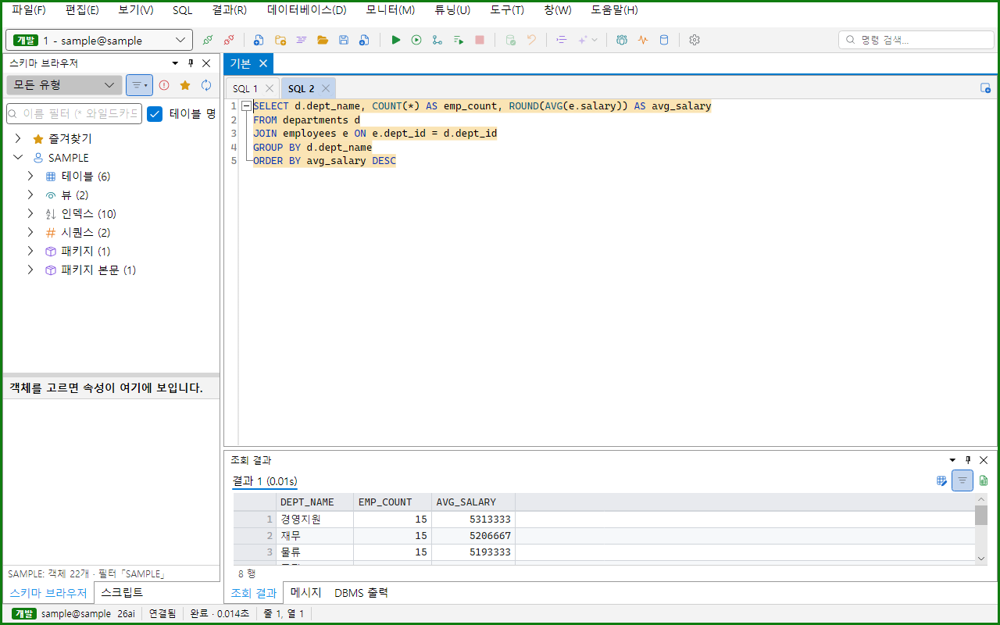
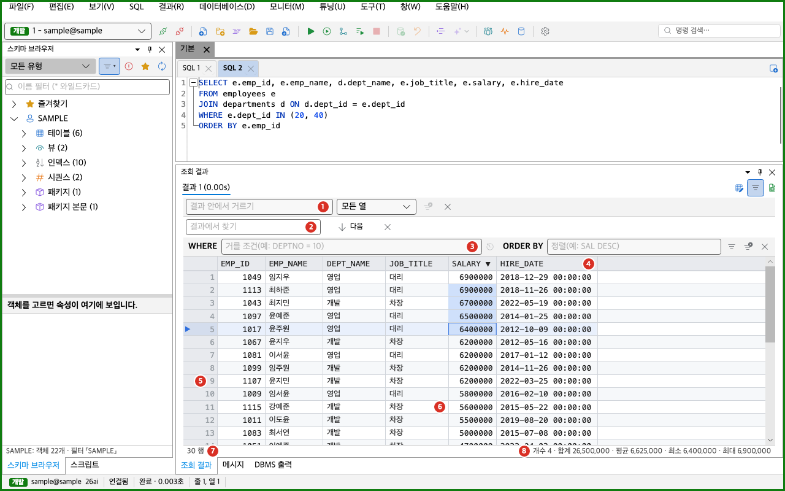
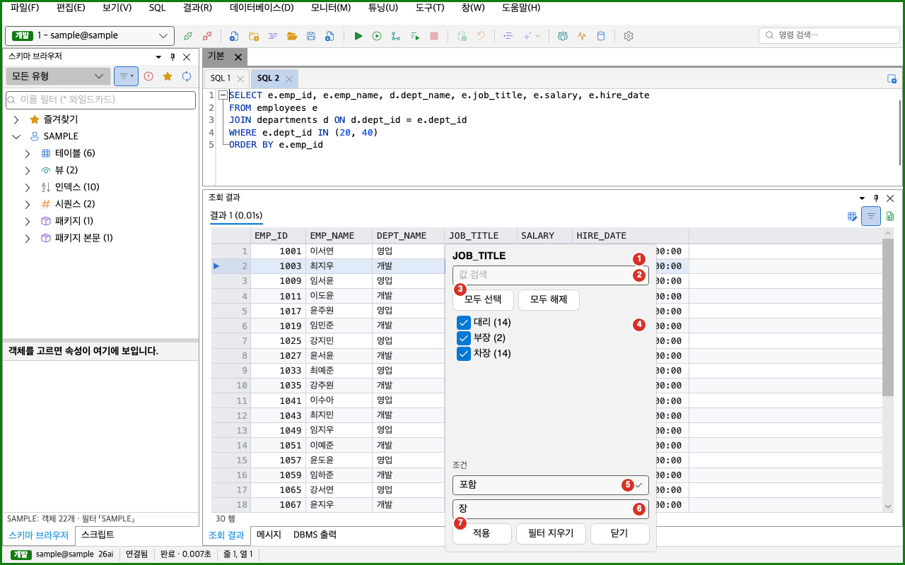

결과 그리드는 SELECT 문의 결과를 표로 보여 주는 화면입니다. 이 쪽에서는 결과 탭, 그리드 조작, 복사, 정렬, 거르기, 찾기, 행 가져오기, 열 다루기, 외래키 따라가기, 행 보기, 값 보기를 설명합니다. 결과를 고쳐서 DB에 반영하는 방법은 [그리드 편집과 플래시백](../grid-edit/)을 보세요. 결과를 파일로 내보내는 방법은 [데이터 내보내기와 가져오기](../../transfer/data-transfer/)를 보세요.

주 화면에서 결과 그리드는 SQL 편집기 아래에 있습니다. 이 영역의 이름은 「조회 결과」 창입니다. SQL을 실행하기 전에는 「SQL 을 실행하면 결과가 여기에 보입니다.」가 보입니다. **보기 > 도구 창 > 조회 결과**로 창을 열고 닫습니다.

## 결과 탭

문장 하나의 결과가 결과 탭 하나입니다. 탭 줄은 결과 그리드 위에 있습니다.

탭 줄은 다음 요소로 이루어집니다.

- 접속 라벨 띠: 접속의 환경과 이름을 보입니다. 운영 접속이나 테스트 접속이거나 읽기 전용 접속일 때만 보입니다. 「운영 · 접속 이름 · 읽기 전용」처럼 환경, 접속 이름, 읽기 전용 표시를 ` · `로 이어서 보입니다.
- 결과 탭: 탭 이름은 「결과 1 (0.85s)」처럼 번호와 실행 시간입니다. 실행 시간은 1초 미만이면 `0.85s`, 1분 미만이면 `3.2s`, 그 이상이면 `1m 05s`로 보입니다. 결과 그리드가 없는 탭은 글만 보입니다. 이런 탭의 이름은 「메시지」, 「오류」, 「거부됨」, 「스크립트」입니다.
- 결과 탭 고정 풀기: 고정한 탭에만 보이는 핀 단추입니다. 누르면 고정이 풀립니다.
- 결과 탭 닫기: 외래키 따라가기나 플래시백으로 연 탭에만 보이는 ×  단추입니다.
- Excel 로 내보내기: 선택한 탭의 결과를 Excel로 내보냅니다. 결과 그리드가 없는 탭에서는 꺼져 있습니다.

실행 중에는 결과 영역 위에 얇은 진행 막대가 나타납니다. 실행이 0.15초보다 길어지면 「실행 중 · 경과 n초」 띠도 나타납니다. 실행이 끝나거나 오류가 나거나 취소하면 둘 다 사라집니다.

### 결과 탭이 바뀌는 규칙

- 일반 실행은 고정하지 않은 결과 탭을 모두 지우고 새 결과를 보입니다.
- 「새 결과 탭으로 실행」은 기존 탭을 지우지 않고 새 탭을 더합니다. 자세한 내용은 [SQL 실행](../execute/)을 보세요.
- 고정한 탭은 다음 실행이 지우지 않습니다. 새 탭의 번호는 고정한 탭이 쓰는 번호를 건너뜁니다.
- 새 실행을 시작하면 고정하지 않은 오류 탭이 바로 지워집니다.
- 탭을 바꿔도 각 탭의 스크롤 위치, 열 너비, 찾기 상태는 그대로 남습니다.
- 결과 탭의 개수에는 제한이 없습니다.
- 결과를 고정하려면 결과 그리드를 오른쪽 클릭해서 「결과 탭 고정」을 고릅니다. 한 번 더 고르면 고정이 풀립니다.
- 결과 탭을 닫으려면 명령 팔레트(`Ctrl+Shift+P`, macOS는 `Cmd+Shift+P`)에서 「결과 탭 닫기」를 실행합니다. 이 명령은 질의 결과 탭을 닫습니다. 외래키 따라가기나 플래시백으로 연 탭은 탭의 × 단추나 탭의 오른쪽 클릭 메뉴 「결과 탭 닫기」로도 닫습니다. × 단추나 탭 메뉴로 닫으면 왼쪽 탭이 선택됩니다.

## 결과 그리드 화면

1. 결과 안에서 거르기 줄: 이미 가져온 행만 거릅니다. 「결과 안에서 거르기」 명령을 실행하면 나타납니다.
2. 찾기 줄: 결과에서 글을 찾습니다. `Ctrl+F`를 누르면 나타납니다.
3. 결과 거르기 줄: `WHERE` 칸과 `ORDER BY` 칸으로 서버에 다시 조회합니다. 「결과 거르기 줄」 명령을 실행하면 나타납니다.
4. 열 머리글: 열 이름을 보입니다. 정렬한 열에는 ▲ 또는 ▼가 붙습니다. 마우스를 올리면 오른쪽에 ▾ 단추가 나타납니다.
5. 행 머리 칸: 현재 행에 ▶ 표시가 붙습니다. 이 칸에는 행 번호가 없습니다.
6. 셀 영역: 값을 보이는 표입니다.
7. 상태 줄: 가져온 행 수를 보입니다. 행이 더 있으면 「모두 가져오기」 단추도 보입니다.
8. 선택 집계: 셀을 둘 이상 고르면 개수, 합계, 평균, 최소, 최대를 보입니다.

### 셀 값이 보이는 모양

| 값의 종류 | 보이는 모양 |
|---|---|
| NULL | `(null)`을 흐린 글씨로 보입니다. |
| NUMBER | 값 그대로 보입니다. 천 단위 구분은 없습니다. |
| DATE | `yyyy-MM-dd HH:mm:ss` 형식입니다. 시각이 항상 붙습니다. |
| TIMESTAMP | `yyyy-MM-dd HH:mm:ss.ffffff` 형식입니다. |
| TIMESTAMP WITH TIME ZONE | `yyyy-MM-dd HH:mm:ss.ffffff +09:00`처럼 시간대가 붙습니다. |
| RAW | 16진수 글자입니다. |
| BOOLEAN | ✓ 또는 ✗입니다. |
| CLOB | 미리 읽은 글을 보입니다. 앞부분만 읽었으면 끝에 `…`가 붙습니다. |
| BLOB | `(BLOB 1,000 B) 0102…`처럼 크기와 앞 16바이트를 보입니다. |

- 줄바꿈은 `↵`로, 탭 문자는 공백으로 보입니다. 셀 하나는 항상 한 줄입니다.
- NUMBER와 BINARY_FLOAT, BINARY_DOUBLE 열은 오른쪽으로 맞춥니다. 나머지는 왼쪽으로 맞춥니다.
- 긴 글은 셀 폭에서 잘립니다. 전체 글은 [행 보기](#행-보기-창)나 [값 보기](#값-보기와-lob-편집기)에서 읽습니다.
- 열 너비는 열 이름과 처음 200행으로 정해집니다. 너비는 56에서 360 사이입니다.
- 결과 그리드 위에서 `Ctrl`을 누른 채 마우스 휠을 돌리면 글자 크기가 1씩 바뀝니다. 글자 크기는 설정에 저장됩니다.
- `Shift`를 누른 채 마우스 휠을 돌리면 옆으로 움직입니다.

### 셀과 행 고르기

| 조작 | 결과 |
|---|---|
| 셀을 누릅니다. | 셀 하나를 고릅니다. |
| `Shift`를 누른 채 다른 셀을 누릅니다. | 사각형 범위를 고릅니다. |
| 셀에서 끌어서 놓습니다. | 사각형 범위를 고릅니다. 가장자리에 닿으면 저절로 스크롤합니다. |
| 행 머리 칸을 누릅니다. | 행 전체를 고릅니다. |
| 행 머리 칸을 `Ctrl`(macOS는 `Cmd`)을 누른 채 누릅니다. | 떨어진 행을 더하거나 뺍니다. |
| 열 머리글을 `Ctrl`을 누른 채 누릅니다. | 열 전체를 고릅니다. |
| 왼쪽 위 모서리 칸을 누릅니다. | 모두 고릅니다. |
| `Ctrl+A`를 누릅니다. | 모두 고릅니다. macOS에서도 `Cmd`가 아니라 `Ctrl` 키입니다. |
| 화살표 키를 누릅니다. | 현재 셀을 옮깁니다. `Shift`를 함께 누르면 범위를 넓힙니다. |
| `Page Up`, `Page Down`을 누릅니다. | 한 화면만큼 옮깁니다. |
| `Home`, `End`를 누릅니다. | 행의 처음 열과 마지막 열로 옮깁니다. |
| `Ctrl+Home`, `Ctrl+End`를 누릅니다. | 첫 셀과 마지막 셀로 옮깁니다. |

선택한 범위 안에서 오른쪽 클릭하면 선택이 그대로 남습니다.

선택한 셀이 둘 이상이면 상태 줄 오른쪽에 집계가 나옵니다. 모양은 「개수 5 · 합계 1,234.5 · 평균 246.9 · 최소 1 · 최대 999」입니다.

- 개수는 NULL이 아닌 셀의 수입니다.
- 합계, 평균, 최소, 최대는 NUMBER와 BINARY_FLOAT, BINARY_DOUBLE 셀만 셉니다.
- 숫자 셀이 없으면 「개수」만 보입니다.
- 이미 가져온 행만 셉니다. 셀이 많아 일부만 셌으면 「(일부)」가 붙습니다.
- 집계 글을 누르면 클립보드에 복사됩니다. 마우스를 올리면 「눌러서 집계 복사」가 나옵니다.

## 결과 그리드의 메뉴

결과 그리드를 오른쪽 클릭하면 메뉴가 나옵니다. 같은 항목이 메뉴 막대의 **결과** 메뉴에도 있습니다. 항목은 선택한 셀이나 결과의 상태에 따라 회색이 됩니다. 회색 항목에 마우스를 올리면 이유가 나옵니다.

| 묶음 | 메뉴 항목 | Windows | macOS |
|---|---|---|---|
| 복사 | 복사(TSV) | `Ctrl+C` | `Cmd+C` |
| 복사 | 복사 형식 > 머리글 포함 복사 | `Ctrl+Shift+C` | `Cmd+Shift+C` |
| 복사 | 복사 형식 > 행 복사 | `Ctrl+Alt+C` | `Cmd+Option+C` |
| 복사 | 복사 형식 > 머리글 포함 행 복사 | 없음 | 없음 |
| 복사 | 복사 형식 > CSV 로 복사 | 없음 | 없음 |
| 복사 | 복사 형식 > INSERT 문으로 복사 | 없음 | 없음 |
| 복사 | 복사 형식 > IN 목록으로 복사 | 없음 | 없음 |
| 보기 | 행 보기 | `Alt+Enter` | `Cmd+Option+R` |
| 보기 | 값 보기(LOB 편집기) | 없음 | 없음 |
| 거르기 | 거르기 > 결과 안에서 거르기 | 없음 | 없음 |
| 거르기 | 거르기 > 결과 안 거르기 모두 지우기 | 없음 | 없음 |
| 거르기 | 거르기 > 결과 거르기 줄 | 없음 | 없음 |
| 거르기 | 거르기 > 이 값으로 거르기 | 없음 | 없음 |
| 거르기 | 거르기 > 이 값 빼고 거르기 | 없음 | 없음 |
| 거르기 | 거르기 > NULL 인 행만 | 없음 | 없음 |
| 열 | 열 > 열 고정 | 없음 | 없음 |
| 열 | 열 > 열 숨기기 | 없음 | 없음 |
| 열 | 열 > 숨긴 열 모두 보이기 | 없음 | 없음 |
| 행 | 전체 행 수 세기 | 없음 | 없음 |
| 행 | 모두 가져오기 | `Alt+End` | `Option+End` |
| 행 | 결과 탭 고정 | 없음 | 없음 |
| 이동 | 참조하는 행 열기(부모) | `F4` | `F4` |
| 이동 | 이 행을 참조하는 행 열기(자식) | `Shift+F4` | `Shift+F4` |
| 편집 | 행 편집, 플래시백 | | |

- 「행 편집」과 「플래시백」 묶음은 [그리드 편집과 플래시백](../grid-edit/)에서 설명합니다.
- 「Excel 로 내보내기…」와 「파일로 내보내기…」는 [데이터 내보내기와 가져오기](../../transfer/data-transfer/)에서 설명합니다.
- 행을 둘 이상 골랐으면 「행 복사」가 「행 2개 복사」처럼 개수가 붙은 이름으로 바뀝니다.
- 이 표의 단축키는 기본 키맵 기준입니다. 결과 그리드에 포커스가 있을 때만 동작합니다. 키는 [단축키와 명령 팔레트](../../settings/shortcuts/)에서 바꿉니다.

메뉴에 없는 명령은 명령 팔레트로 실행합니다. 명령 팔레트는 `Ctrl+Shift+P`(macOS는 `Cmd+Shift+P`)로 엽니다. 메뉴에 없는 결과 그리드 명령은 다음 네 개입니다.

| 명령 | 단축키 | 하는 일 |
|---|---|---|
| 결과에서 찾기 | `Ctrl+F`, macOS는 `Cmd+F` | 찾기 줄을 엽니다. |
| 같은 값 숨김 | 없음 | 위 행과 같은 값을 비워서 보입니다. |
| 텍스트 결과 모드 | 없음 | 결과를 글자 표로 바꿉니다. |
| 결과 탭 닫기 | 없음 | 선택한 결과 탭을 닫습니다. |

## 복사

복사하려면 먼저 셀을 골라야 합니다. 셀을 고르지 않으면 아무것도 복사하지 않습니다. 아직 가져오지 않은 행은 복사하면서 가져옵니다.

| 명령 | 복사하는 내용 |
|---|---|
| 복사(TSV) | 고른 셀 범위를 탭으로 나눈 글로 복사합니다. 머리글은 없습니다. |
| 머리글 포함 복사 | 첫 줄에 열 이름을 넣어 복사합니다. |
| 행 복사 | 고른 셀이 걸친 행 전체를 TSV로 복사합니다. 숨긴 열은 뺍니다. |
| 머리글 포함 행 복사 | 행 복사에 열 이름 줄을 더합니다. |
| CSV 로 복사 | 쉼표로 나눈 글로 복사합니다. 열 이름 줄이 항상 들어갑니다. 줄 구분은 CRLF입니다. |
| INSERT 문으로 복사 | 행마다 `INSERT` 문을 한 줄씩 만듭니다. |
| IN 목록으로 복사 | 고른 값을 `(1, 'A', 2)` 모양의 목록 한 줄로 만듭니다. |

복사할 때 지키는 규칙은 다음과 같습니다.

- NULL은 빈 글자로 복사합니다.
- 값에 구분 문자, 큰따옴표, 줄바꿈이 있으면 값 전체를 큰따옴표로 감쌉니다. 값 안의 큰따옴표는 두 개로 씁니다.
- 숨긴 열은 복사하지 않습니다. 예외는 INSERT 문입니다.
- 「같은 값 숨김」을 켜도 복사하는 값은 실제 값입니다.
- 「행 복사」로 복사한 행은 Oranda 안에서 붙여 넣을 때 NULL, 날짜, 숫자 형식이 그대로 남습니다. 붙여 넣는 방법은 [그리드 편집과 플래시백](../grid-edit/)을 보세요.

INSERT 문으로 복사할 때 지키는 규칙은 다음과 같습니다.

- 고른 열이 아니라 고른 셀이 걸친 행의 모든 열로 만듭니다. 숨긴 열, ROWID, ROWNUM, ORA_ROWSCN은 뺍니다.
- 표 이름은 결과 열이 속한 표의 `소유자.표 이름`입니다. 표를 알 수 없으면 `TABLE_NAME`을 씁니다.
- 문자는 작은따옴표로 감쌉니다. DATE는 `TO_DATE('2026-01-15 00:00:00', 'YYYY-MM-DD HH24:MI:SS')` 모양으로 씁니다.

IN 목록으로 복사할 때 지키는 규칙은 다음과 같습니다.

- 고른 셀을 행 순서대로, 왼쪽에서 오른쪽으로 읽습니다.
- NULL 셀은 뺍니다.
- 같은 값은 한 번만 넣습니다.
- 값의 개수를 제한하지 않습니다. Oracle의 IN 목록은 1000개까지만 쓸 수 있으므로 값이 많으면 나눠서 쓰세요.

## 정렬

열 머리글을 한 번 누르면 오름차순으로 정렬합니다. 같은 열을 다시 누르면 내림차순이 되고, 한 번 더 누르면 정렬이 풀립니다. NULL은 어느 방향에서나 맨 뒤에 놓입니다.

- 머리글을 누른 채 좌우로 끌면 정렬하지 않고 열 순서를 바꿉니다.
- 정렬하려면 먼저 행을 최대 100,000개까지 가져옵니다. 정렬 중에는 상태 줄에 「정렬하려고 n행 가져오는 중…」과 「n행 정렬 중…」이 보입니다.
- 정렬을 멈추려면 `Esc`를 누르거나 상태 줄의 「정렬 취소」를 누릅니다. 멈추면 원래 순서가 그대로 남습니다.
- 결과가 100,000행 이상이면 정렬하기 전에 「큰 결과 정렬」 창이 나옵니다.

「큰 결과 정렬」 창의 구성은 다음과 같습니다.

- 안내 글: 정렬하려면 모두 이 PC로 가져와야 하는 행 수를 알려 줍니다.
- 서버에서 ORDER BY로 다시 조회: 원래 질의를 `SELECT * FROM ( … ) ORDER BY 열 번호 NULLS LAST`로 감싸 서버가 정렬하게 합니다. 가장 빠르고 메모리를 적게 씁니다. 이 방법을 쓸 수 없으면 단추가 꺼지고 이유가 보입니다.
- 전부 가져와 정렬: 모든 행을 가져온 뒤 이 PC에서 정렬합니다. 시간이 오래 걸리고 메모리를 많이 씁니다.
- 취소: 정렬하지 않고 창을 닫습니다. `Esc`도 같습니다.

한 결과에서 「전부 가져와 정렬」을 한 번 고르면 같은 결과에서는 다시 묻지 않습니다. 반영하지 않은 편집이 있으면 정렬하지 않고 상태 줄에 「반영하지 않은 편집이 있어 정렬하지 않았습니다. 반영하거나 되돌린 뒤 정렬할 수 있습니다.」가 나옵니다.

## 거르기

결과를 거르는 방법은 네 가지입니다. 서버에 다시 조회하는지, 이미 가져온 행만 보는지가 다릅니다.

| 방법 | 거르는 곳 | 여는 방법 |
|---|---|---|
| 결과 거르기 줄 | 서버에 다시 조회합니다. | **거르기 > 결과 거르기 줄** |
| 결과 안에서 거르기 | 이미 가져온 행만 거릅니다. | **거르기 > 결과 안에서 거르기** |
| 열 필터 | 이미 가져온 행만 거릅니다. | 열 머리글의 ▾ 단추 |
| 이 값으로 거르기 | 서버에 다시 조회합니다. | **거르기 > 이 값으로 거르기** |

### 결과 거르기 줄

결과 거르기 줄은 결과를 만든 질의에 조건을 붙여 다시 실행합니다. 조회 결과에서만 쓸 수 있습니다.

1. 결과 그리드를 오른쪽 클릭해서 **거르기 > 결과 거르기 줄**을 고르세요.
2. `WHERE` 칸에 조건을 입력하세요. 예: `dept_id = 10`
3. 정렬이 필요하면 `ORDER BY` 칸에 정렬을 입력하세요. 예: `salary DESC`
4. `Enter`를 누르거나 「거르기 적용」 단추를 누르세요.

- `WHERE`와 `ORDER BY`라는 단어는 쓰지 않습니다. 조건과 정렬만 씁니다.
- Oranda가 원래 질의를 `SELECT * FROM ( 원래 질의 ) WHERE ( 조건 ) ORDER BY 정렬`로 감싸서 실행합니다. 칸이 비어 있으면 그 절은 붙이지 않습니다.
- 원래 질의와 조건에 있는 바인드 변수는 「바인드 변수」 창의 값으로 채웁니다.
- 「최근 조건」 단추를 누르면 최근에 적용한 조건이 최대 10개 나옵니다. 하나를 고르면 `WHERE` 칸에 넣고 바로 적용합니다. 이 목록은 그 결과 탭 안에서만 유지됩니다.
- 거르는 중에 「거르기 취소」 단추가 나타납니다.
- 「거르기 지우기」는 두 칸을 비우고 원래 질의를 다시 실행합니다. 「거르기 줄 닫기」는 줄만 닫습니다.
- `Esc`를 누르면 칸의 글을 지웁니다. 칸이 비어 있으면 줄을 닫습니다.
- 거른 결과는 편집할 수 없습니다. 거른 결과의 상태 줄에는 「거른 결과」가 붙습니다.
- 반영하지 않은 편집이 있으면 거를 수 없습니다.

### 결과 안에서 거르기

이 방법은 서버에 묻지 않고 이미 가져온 행에서 글자가 들어 있는 행만 보입니다.

1. 결과 그리드를 오른쪽 클릭해서 **거르기 > 결과 안에서 거르기**를 고르세요.
2. 입력 칸에 거를 글자를 입력하세요.
3. 특정 열만 보려면 오른쪽 목록에서 열을 고르세요. 처음에는 「모든 열」입니다.

- 대소문자를 가리지 않고, 화면에 보이는 글자에 그 글자가 들어 있는 행을 남깁니다. 날짜는 보이는 모양으로, NULL은 `(null)`로 비교합니다.
- 글자를 입력하고 0.15초가 지나면 적용됩니다.
- 거르는 동안 상태 줄에 「거름: 보이는 12 / 가져온 500행 (전체 아님)」처럼 보입니다. 「(전체 아님)」은 서버에 행이 더 있다는 뜻입니다.
- 서버에 남은 행까지 거르려면 「모두 가져오기」를 누릅니다. 가져온 뒤에는 새 행에도 같은 조건이 적용됩니다.
- `Esc`를 누르면 글자를 지웁니다. 입력 칸이 비어 있으면 칸을 닫습니다. 칸을 닫아도 걸어 둔 조건은 남습니다.
- 「결과 안 거르기 모두 지우기」 단추는 입력한 글자와 열 필터를 모두 지웁니다.

### 열 필터

열 필터는 열 하나의 값으로 거릅니다. 이미 가져온 행만 봅니다.

1. 열 이름: 필터를 거는 열의 이름입니다.
2. 값 검색: 아래 값 목록을 글자로 줄입니다. `Enter`를 누르면 적용합니다.
3. 모두 선택, 모두 해제: 값 목록의 확인란을 한꺼번에 켜고 끕니다.
4. 값 목록: 가져온 행에 있는 서로 다른 값과 개수를 「값 (3)」 모양으로 보입니다. NULL은 「(NULL)」로 맨 위에 나옵니다. 값이 1000개를 넘으면 「값이 많아 일부만 보입니다(처음 1000개).」가 나옵니다. 이때는 확인란을 끈 값을 제외합니다.
5. 조건: 「(조건 없음)」, 「포함」, 「같음」, 「시작」, 「범위」, 「NULL 인 행」, 「NULL 이 아닌 행」 중에서 고릅니다.
6. 값 칸: 조건에 쓸 값을 입력합니다. 「범위」를 고르면 「시작」 칸과 「끝」 칸이 나옵니다.
7. 적용, 필터 지우기, 닫기: 필터를 적용하거나 지우거나 창을 닫습니다.

- 열 머리글에 마우스를 올리면 오른쪽에 ▾ 단추가 나타납니다. 이 단추를 눌러 창을 엽니다. 열이 좁으면 단추가 보이지 않습니다.
- 값 목록의 선택과 조건은 둘 다 맞아야 합니다. 여러 열의 필터와 「결과 안에서 거르기」도 모두 맞아야 합니다.
- 「포함」, 「같음」, 「시작」은 대소문자를 가리지 않습니다.
- 「범위」는 NUMBER 열에서는 숫자로, DATE와 TIMESTAMP 열에서는 날짜로 비교합니다. 끝 칸을 비우면 끝이 없는 범위입니다.
- 필터가 걸린 열의 머리글에는 깔때기 표시가 나타납니다.

### 이 값으로 거르기

선택한 셀의 값으로 서버에 다시 조회합니다. 결과 거르기 줄의 `WHERE` 칸에 조건이 더해지고 바로 적용됩니다.

- 「이 값으로 거르기」는 `"열" = :oranda_f1`을 더합니다.
- 「이 값 빼고 거르기」는 `"열" <> :oranda_f1`을 더합니다.
- 「NULL 인 행만」은 `"열" IS NULL`을 더합니다.
- 이미 조건이 있으면 `AND`로 이어 붙입니다.
- 값은 `:oranda_f1`, `:oranda_f2` 같은 바인드 변수로 넘기므로 SQL에 값을 직접 쓰지 않습니다.
- LOB, LONG, JSON, VECTOR, XML 열은 값으로 거를 수 없습니다. 「NULL 인 행만」은 쓸 수 있습니다.

## 찾기

`Ctrl+F`(macOS는 `Cmd+F`)를 누르면 찾기 줄이 나옵니다.

- 찾을 글을 입력하고 `Enter`나 「다음」 단추를 누르면 다음 일치로 갑니다.
- 일치하는 셀이 없으면 「찾지 못했습니다.」가 보입니다.
- `Esc`나 「닫기」 단추로 찾기 줄을 닫습니다.
- 대소문자를 가리지 않고, 셀의 일부만 일치해도 찾습니다. 옵션은 없습니다.
- 현재 셀 다음부터 행 순서대로 찾고, 끝에 닿으면 처음으로 돌아갑니다.
- 아직 가져오지 않은 행은 가져오면서 찾습니다.
- 숨긴 열은 찾지 않습니다. NULL은 빈 글자로 취급하므로 `(null)`로는 찾을 수 없습니다.
- 「결과 안에서 거르기」가 걸려 있으면 보이는 행만 찾습니다.

## 행 가져오기와 행 수 세기

결과가 길면 Oranda는 한 번에 일부만 가져옵니다.

- 처음에는 한 쪽만 가져옵니다. 한 쪽의 기본 크기는 500행입니다.
- 스크롤해서 가져온 행의 끝에서 반 쪽 거리까지 오면 다음 쪽을 가져옵니다. 정렬하거나 「결과 안에서 거르기」가 걸려 있으면 저절로 가져오지 않습니다.
- 상태 줄에는 「500 행 (더 있음)」처럼 보입니다. 모두 가져왔으면 「1,200 행」으로 보입니다.
- 한 쪽의 크기, 메모리 한도, LOB 미리 읽기 크기는 **설정 > 결과 그리드**에서 바꿉니다. 바꾼 값은 다음 실행부터 적용됩니다. [설정 창](../../settings/options/)을 보세요.
- 메모리 한도를 넘는 행은 임시 파일에 보관합니다. 행이 버려지지는 않습니다.

### 모두 가져오기

「모두 가져오기」는 남은 행을 끝까지 가져옵니다. 행이 많으면 오래 걸리고 메모리를 씁니다.

- 상태 줄의 「모두 가져오기」 단추를 누르거나, 오른쪽 클릭 메뉴의 「모두 가져오기」를 고르거나, `Alt+End`를 누릅니다. 더 가져올 행이 없으면 꺼져 있습니다.
- 가져오는 동안 단추가 「가져오기 취소」로 바뀝니다. 실행 취소 명령(`Ctrl+Break`, macOS는 `Cmd+.`)으로도 멈춥니다. 이미 가져온 행은 남습니다.

### 전체 행 수 세기

「전체 행 수 세기」는 결과의 전체 행 수를 서버에서 셉니다. 행을 가져오지는 않습니다.

1. 결과 그리드를 오른쪽 클릭해서 「전체 행 수 세기」를 고르세요.
2. 세는 동안 나오는 「전체 행 수 세는 중…」과 「행 수 세기 취소」 단추를 확인하세요.
3. 끝나면 상태 줄이 「가져온 500행 / 전체 20,000행」처럼 바뀐 것을 확인하세요.

- 원래 질의를 `SELECT COUNT(*) FROM ( 원래 질의 )`로 감싸 실행합니다. 이 질의는 실행 이력에 남지 않습니다.
- 「바인드 변수」 창의 값을 그대로 씁니다.
- 거른 결과에서 세면 거른 질의의 행 수를 셉니다.
- 조회 결과에서만 쓸 수 있고, 다른 문장이 실행 중이면 쓸 수 없습니다.

## 열 다루기

- 열 너비: 열 머리글의 오른쪽 가장자리를 끌어서 바꿉니다.
- 열 순서: 열 머리글을 좌우로 끌어서 놓습니다. 놓을 자리가 세로선으로 보입니다. 끄는 도중에 `Esc`를 누르면 취소합니다.
- 열 고정: 셀을 고른 뒤 **열 > 열 고정**을 고르면 맨 왼쪽부터 그 셀의 열까지 고정합니다. 고정한 열은 옆으로 스크롤해도 움직이지 않습니다. 같은 열에서 한 번 더 고르면 고정이 풀립니다. 고정한 열 사이로는 열을 옮길 수 없습니다. 스크롤하는 열이 하나 이상 남아야 하므로 모든 열을 고정할 수는 없습니다.
- 열 숨기기: 고른 셀이 걸친 열을 숨깁니다. 마지막 열은 숨길 수 없습니다.
- 숨긴 열 모두 보이기: 숨긴 열을 되돌립니다. 열 순서도 처음으로 돌아갑니다.
- 같은 값 숨김: 위 행과 같은 값을 빈칸으로 보입니다. 화면에만 영향을 주고, 복사와 찾기와 거르기는 실제 값을 씁니다. 명령 팔레트에서 켜고 끕니다.
- 텍스트 결과 모드: 결과를 글자 표로 바꿉니다. 한 행이 한 줄이고, 열은 ` | `로 나뉩니다. 열 폭은 최대 60자이고 넘치면 `…`로 끝납니다. 한글은 두 칸으로 셉니다. 이 모드에서는 정렬, 열 끌기, 열 필터를 쓸 수 없고 줄 단위로 고릅니다. 명령 팔레트에서 켜고 끕니다.

열 순서, 숨긴 열, 고정한 열, 열 너비는 저장되지 않습니다. 결과를 새로 실행하면 처음 모양으로 돌아갑니다. 결과 거르기 줄이나 서버 정렬로 다시 조회하면 열 너비만 이어집니다.

## 외래키 따라가기

외래키가 걸린 열의 값에서 부모 행이나 자식 행을 새 결과 탭으로 엽니다.

열린 결과는 다음과 같이 보입니다.

- 새 결과 탭: 이름이 「부모: DEPARTMENTS」나 「자식: EMPLOYEES(EMPLOYEES_DEPT_FK)」처럼 붙습니다.
- 탭의 × 단추: 이 탭을 닫습니다.
- 열린 행: 외래키 값으로 조회한 행입니다.

- 부모 행 열기: 외래키 열의 셀을 골라 `F4`를 누릅니다. 오른쪽 클릭 메뉴에서 「참조하는 행 열기(부모)」를 골라도 됩니다. 참조하는 부모 표를 `SELECT * FROM 부모 표 WHERE 키 = :값`으로 조회합니다.
- 자식 행 열기: 행의 키 열에 있는 셀을 골라 `Shift+F4`를 누릅니다. 오른쪽 클릭 메뉴의 「이 행을 참조하는 행 열기(자식)」도 같습니다. 이 행의 키를 참조하는 자식 표를 조회합니다.
- 외래키가 여럿이면 「따라갈 외래키 고르기」 또는 「참조하는 외래키 고르기」 창에서 하나를 고릅니다.
- 조회 결과의 셀을 골랐을 때만 쓸 수 있습니다. 셀이 어느 표의 열인지 알 수 있어야 합니다.
- 외래키 값이 NULL이면 따라갈 행이 없다는 안내가 나옵니다.
- 자식 행은 결과에 그 표의 키 열이 모두 있어야 찾을 수 있습니다.
- DB 링크로 읽은 표는 따라갈 수 없습니다.
- 열린 탭은 읽기 전용입니다. 거르기 줄, 정렬, 행 수 세기는 쓸 수 있습니다. 실행 이력에는 남지 않습니다.

## 행 보기 창

행 보기 창은 고른 행 하나를 열 이름과 값의 세로 표로 보여 줍니다. 열이 많거나 값이 긴 행을 읽을 때 씁니다.

행 보기 창의 구성은 다음과 같습니다.

- 이동 단추: 「|<」는 처음 행, 「이전 행」, 「다음 행」, 「>|」는 마지막 행으로 갑니다. 그리드의 선택도 함께 움직입니다.
- 위치 글: 「3 / 500+」처럼 현재 행과 전체 행 수를 보입니다. 「+」는 전체 행 수를 아직 모른다는 뜻입니다. 행을 고르지 않았으면 「행 보기: 결과 그리드에서 행을 고르세요.」가 보입니다.
- 열 이름·값 찾기: 열 이름이나 값에 글자가 들어 있는 열만 보입니다. 대소문자를 가리지 않습니다.
- 열 표: 「#」, 「열 이름」, 「타입」, 「값」 열이 있습니다. 머리글을 눌러 정렬하고 열을 끌어서 순서를 바꿉니다.

- 행 보기 창을 열려면 셀을 고르고 `Alt+Enter`(macOS는 `Cmd+Option+R`)를 누릅니다. 오른쪽 클릭 메뉴의 「행 보기」도 같습니다. **보기 > 도구 창 > 행 보기**로도 엽니다.
- 창은 그리드에서 고른 행을 따라갑니다. 열 순서는 그리드 화면의 열 순서를 따르고, 숨긴 열은 맨 뒤에 붙습니다.
- 「|<」와 「>|」는 이미 가져온 행의 처음과 끝으로 갑니다.
- 값 행을 두 번 누르거나 `F2`나 `Enter`를 누르면, 편집 모드 결과의 일반 열은 창 아래에서 값을 고칩니다. 이 줄에는 「Enter 반영 · Esc 취소」가 보입니다. 그 밖의 경우에는 값 보기가 열립니다.
- 값 행을 오른쪽 클릭하면 복사 항목과 「값 보기」, 「값 복사」, 「이름 = 값 전체 복사」가 나옵니다.

## 값 보기와 LOB 편집기

「값 보기(LOB 편집기)」는 선택한 셀 하나를 문서 탭으로 엽니다. 탭 이름은 「NOTE (행 3)」처럼 열 이름과 행 번호입니다. 값이 LOB가 아니면 「LOB 가 아닌 값(읽기 전용)」이라는 안내와 함께 셀 글을 읽기 전용으로 보입니다.

LOB 편집기의 구성은 다음과 같습니다.

- 정보 글: 「CLOB 12,345 문자」나 「BLOB 1,000 B」처럼 종류와 크기를 보입니다.
- 파일로 저장: LOB 전체를 파일로 저장합니다. 큰 LOB도 메모리에 모두 올리지 않고 파일에 씁니다.
- 인코딩: 글 LOB에만 보입니다. 「UTF-8」, 「UTF-8 (BOM)」, 「UTF-16 LE」, 「UTF-16 BE」 중에서 고릅니다.
- 파일에서 불러오기: 파일 내용을 편집기에 불러옵니다. 저장할 수 있는 LOB일 때만 보입니다. DB는 아직 바뀌지 않습니다.
- DB 에 저장: 바뀐 내용을 커밋 없이 DB에 저장합니다.
- 저장 후 커밋: DB에 저장하고 바로 커밋합니다.
- 다시 읽기: DB에서 다시 읽습니다. 저장하지 않은 변경은 사라집니다.
- 본문: CLOB는 글 편집기로 보입니다. BLOB는 위에 그림 미리보기, 아래에 16진수 덤프로 보입니다.

- CLOB는 앞 1,000,000자까지만 편집기에 올립니다. 더 길면 읽기 전용이 되고, 전체는 「파일로 저장」으로 받습니다.
- BLOB의 16진수 덤프는 앞 65,536바이트까지 보입니다. 그림 미리보기는 PNG, JPEG, GIF, BMP, WebP를 16 MB까지 지원합니다.
- 파일에서 불러올 수 있는 크기는 256 MB까지입니다.
- BLOB는 편집기에서 직접 고칠 수 없습니다. 「파일에서 불러오기」로 바꿀 내용을 먼저 불러온 뒤 저장합니다.
- DB에 저장하려면 결과를 「결과 편집 모드로 실행」(`F9`)로 연 상태여야 하고, 읽기 전용 접속이 아니어야 합니다. 그렇지 않으면 상태 줄에 이유가 나오고 보기와 파일 저장만 됩니다.
- 저장은 기본 키나 ROWID로 행 하나를 찾아 `UPDATE`합니다. 영향받은 행이 정확히 1이 아니면 저장 전으로 되돌립니다.

## 테이블 레이아웃 창

테이블 레이아웃 창은 표나 뷰의 열 목록을 보여 주고 SQL 편집기에 열 이름을 넣어 줍니다. 결과 그리드가 아니라 SQL 편집기에서 엽니다. 편집기에서 표 이름 위에 커서를 두고 `F4`나 `Alt+C`를 누르면 열립니다. 이 창은 편집기와 같이 쓸 수 있도록 다른 창을 막지 않습니다.

테이블 레이아웃 창의 구성은 다음과 같습니다.

- 넣기, 복사: 고른 열을 편집기 커서 위치에 넣거나 클립보드에 복사합니다.
- 옵션 단추: 「쉼표 넣기」, 「소문자」, 「PK 표시」, 「주석 넣기」를 켜고 끕니다.
- 감사 컬럼 빼기: 설정의 감사 컬럼 목록과 이름이 맞는 열을 표에서 뺍니다. 설정에 목록이 없으면 꺼져 있습니다.
- 별칭: 넣을 열 이름 앞에 붙일 표 별칭을 입력합니다.
- 컬럼 거르기: 열 이름을 글자로 줄입니다.
- 열 표: 「이름」, 「형식」, 「Null」, 「기본값」, 「주석」을 보입니다. 열을 여러 개 골라서 한꺼번에 넣을 수 있습니다.
- 상태 줄: 객체, 종류, 열 수, 고른 열 수를 보입니다.

- `Enter`를 누르거나 열을 두 번 누르면 고른 열을 편집기에 넣습니다. `Ctrl+C`(macOS는 `Cmd+C`)로 같은 글을 복사합니다. `Esc`로 창을 닫습니다.
- 넣는 글은 항상 표의 열 순서입니다.

## 자주 하는 작업

### 결과에서 값 하나 찾기

1. 편집기에 `SELECT * FROM employees ORDER BY emp_id`를 입력하세요.
2. `Ctrl+Enter`를 눌러 실행하세요.
3. 결과 그리드의 셀을 누르세요.
4. `Ctrl+F`를 누르세요.
5. 찾을 글을 입력하세요.
6. `Enter`를 누르세요.
7. 다음 일치로 가려면 `Enter`를 다시 누르세요.

### 서버에서 조건에 맞는 행만 다시 조회하기

1. `SELECT * FROM employees`를 실행하세요.
2. 결과 그리드를 오른쪽 클릭해서 **거르기 > 결과 거르기 줄**을 고르세요.
3. `WHERE` 칸에 `dept_id = 40`을 입력하세요.
4. `ORDER BY` 칸에 `salary DESC`를 입력하세요.
5. `Enter`를 누르세요.
6. 원래 결과로 돌아가려면 「거르기 지우기」 단추를 누르세요.

### 이미 가져온 행에서 글자로 거르기

1. `SELECT * FROM customers`를 실행하세요.
2. 결과 그리드를 오른쪽 클릭해서 **거르기 > 결과 안에서 거르기**를 고르세요.
3. 입력 칸에 거를 글자를 입력하세요.
4. 상태 줄의 「거름: 보이는 … / 가져온 …행」을 확인하세요.
5. 서버에 남은 행까지 거르려면 「모두 가져오기」를 누르세요.

### 선택한 행을 INSERT 문으로 복사하기

1. `SELECT * FROM departments`를 실행하세요.
2. 복사할 행의 행 머리 칸을 누르세요.
3. 결과 그리드를 오른쪽 클릭해서 **복사 형식 > INSERT 문으로 복사**를 고르세요.
4. 편집기에 붙여 넣으세요.

### 직원의 부서 행 열기

1. `SELECT * FROM employees`를 실행하세요.
2. `dept_id` 열의 셀을 누르세요.
3. `F4`를 누르세요.
4. 새로 열린 「부모: DEPARTMENTS」 탭에서 부서 행을 확인하세요.

### 부서에 속한 직원 열기

1. `SELECT * FROM departments`를 실행하세요.
2. 부서 행의 셀을 누르세요.
3. `Shift+F4`를 누르세요.
4. 새로 열린 「자식: EMPLOYEES(…)」 탭에서 직원 행을 확인하세요.

### 결과의 전체 행 수 알아보기

1. `SELECT * FROM orders`를 실행하세요.
2. 결과 그리드를 오른쪽 클릭해서 「전체 행 수 세기」를 고르세요.
3. 상태 줄의 「가져온 500행 / 전체 … 행」을 확인하세요.

### 긴 값을 읽기

1. 결과 그리드에서 읽을 행의 셀을 누르세요.
2. `Alt+Enter`를 누르세요. macOS에서는 `Cmd+Option+R`을 누르세요.
3. 행 보기 창의 「값」 열에서 값을 읽으세요.

## 문제가 생길 때

| 증상 | 원인 | 해결 |
|---|---|---|
| 오른쪽 클릭 메뉴의 항목이 회색입니다 | 셀을 고르지 않았거나, 질의 결과가 아니거나, 다른 문장이 실행 중입니다. | 항목에 마우스를 올려 이유를 읽으세요. 셀을 고르고 실행이 끝나기를 기다리세요. |
| 「모두 가져오기」가 회색입니다 | 더 가져올 행이 없습니다. | 상태 줄에 「(더 있음)」이 없는지 확인하세요. |
| 「전체 행 수 세기」가 회색입니다 | 질의 결과가 아니거나, 접속이 없거나, 다른 문장이 실행 중입니다. | 실행이 끝난 뒤 다시 시도하세요. |
| 거른 결과에 행이 모자랍니다 | 「결과 안에서 거르기」와 열 필터는 이미 가져온 행만 봅니다. 상태 줄에 「(전체 아님)」이 있습니다. | 「모두 가져오기」를 누르거나 「결과 거르기 줄」을 쓰세요. |
| 「반영하지 않은 편집이 있습니다. 반영하거나 되돌린 뒤 거르세요.」가 나옵니다 | 편집 모드 결과에 반영하지 않은 변경이 있습니다. | 변경을 반영하거나 「모두 되돌리기」를 누른 뒤 다시 하세요. |
| 정렬이 시작되지 않고 상태 줄에 안내가 나옵니다 | 반영하지 않은 편집이 있습니다. | 변경을 반영하거나 되돌린 뒤 정렬하세요. |
| 정렬이 오래 걸립니다 | 정렬하려고 행을 최대 100,000개까지 가져옵니다. | `Esc`를 눌러 멈추거나 「큰 결과 정렬」 창에서 「서버에서 ORDER BY로 다시 조회」를 고르세요. |
| 「서버에서 ORDER BY로 다시 조회」가 꺼져 있습니다 | 결과를 서버에서 다시 조회할 수 없습니다. 창에 이유가 나옵니다. 예를 들어 FOR UPDATE 문장이거나 CLOB 열입니다. | 「전부 가져와 정렬」을 고르세요. |
| 찾기에서 `(null)`을 찾지 못합니다 | 찾기는 NULL을 빈 글자로 봅니다. | 「NULL 인 행만」 거르기를 쓰세요. |
| F4를 눌러도 외래키 행이 열리지 않습니다 | 질의 결과가 아니거나 외래키 열이 아닌 셀입니다. 편집기에 포커스가 있으면 F4는 객체 정보 보기입니다. | 결과 그리드의 외래키 열 셀을 누른 뒤 `F4`를 누르세요. 상태 줄의 안내를 읽으세요. |
| 자식 행을 열 수 없다는 안내가 나옵니다 | 결과에 이 표의 키 열이 모두 있지 않습니다. | 키 열을 포함해서 다시 조회하세요. |
| 「DB 링크 테이블은 외래키를 따라갈 수 없습니다.」가 나옵니다 | DB 링크로 읽은 표입니다. | 링크 없이 표를 직접 조회하세요. |
| 열 순서와 숨긴 열이 사라졌습니다 | 열 상태는 저장되지 않습니다. 다시 실행하면 처음으로 돌아갑니다. | 다시 열을 옮기거나 숨기세요. |
| LOB 편집기의 「DB 에 저장」이 꺼져 있습니다 | 결과를 편집 모드로 열지 않았거나, 읽기 전용 접속이거나, LOB 열이 아닙니다. | `F9`로 결과를 편집 모드로 다시 실행하세요. 상태 줄의 이유를 읽으세요. |
| 「앞 1,000,000 문자만 보입니다. 전체는 「파일로 저장」으로 받으세요.」가 나옵니다 | CLOB가 편집기에 올릴 수 있는 크기를 넘었습니다. | 「파일로 저장」으로 전체를 받으세요. |
| macOS에서 `Cmd+A`가 모두 고르지 않습니다 | 결과 그리드의 모두 고르기는 `Ctrl+A`입니다. | `Ctrl+A`를 누르거나 왼쪽 위 모서리 칸을 누르세요. |
