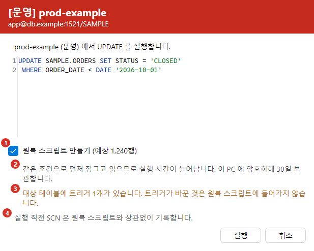
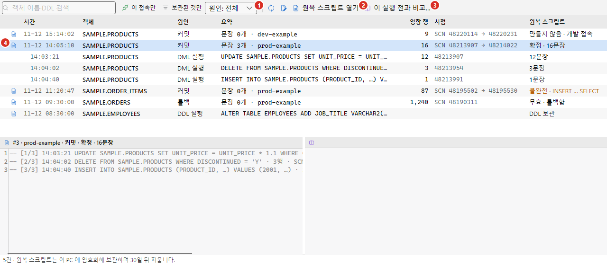
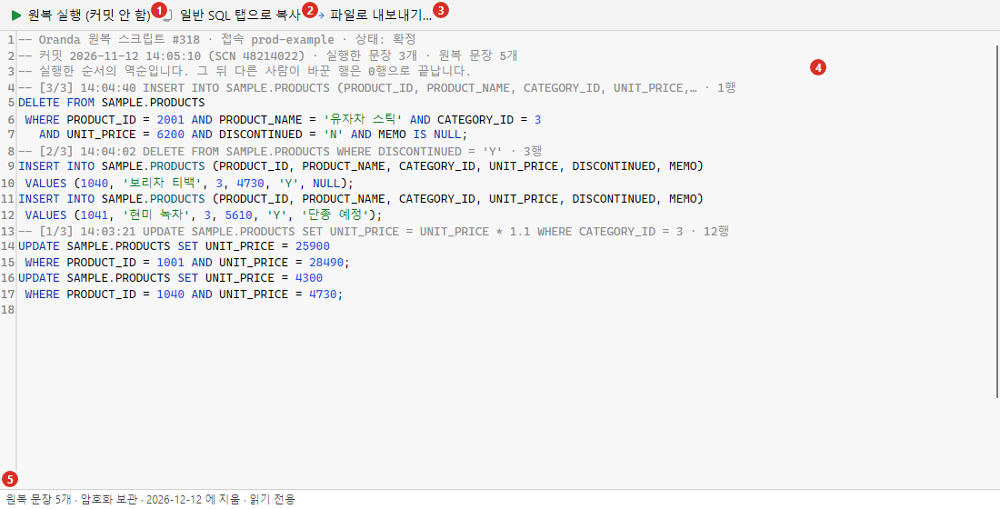
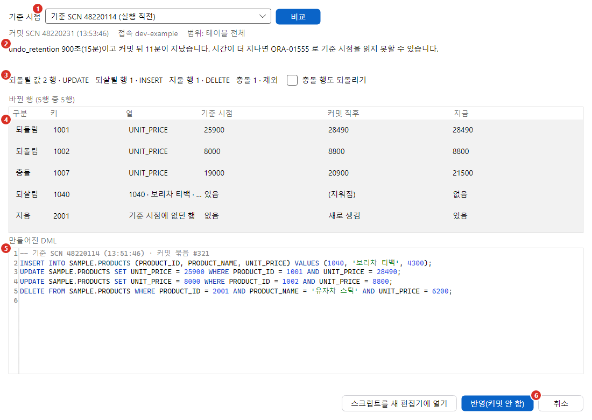

되돌리기 지점은 쓰기 문장(UPDATE, DELETE, INSERT)을 커밋한 뒤에도 실행 직전의 데이터로 되돌릴 수 있게 실행할 때 미리 남겨 두는 기록입니다. Oranda는 두 가지를 남깁니다.

- **원복 스크립트**(운영 접속만): 실행한 문장을 거꾸로 되돌리는 SQL입니다. UPDATE는 이전 값으로 되돌리는 UPDATE, DELETE는 지운 행을 다시 넣는 INSERT, INSERT는 넣은 행을 지우는 DELETE가 됩니다.
- **실행 직전 시점**(모든 접속): 쓰기 문장을 보내기 직전의 시점 번호입니다. Oracle은 SCN, Tibero는 TSN입니다. 원복 스크립트가 없는 실행은 이 시점과 지금 데이터를 비교해 되돌립니다.

되돌리기는 자동으로 실행하지 않습니다. 미리 본 뒤 커밋하지 않은 상태로 반영하고, 커밋이나 롤백은 사용자가 직접 합니다. 그 뒤 다른 사람이 다시 바꾼 행은 덮어쓰지 않습니다.

## 무엇이 남는가

| 접속 환경 | 원복 스크립트 | 실행 직전 시점 | 되돌리는 방법 |
|---|---|---|---|
| 운영 | 만듭니다. 실행 확인 창에서 끌 수 있습니다. | 기록합니다. | 원복 스크립트를 열어 실행합니다. 없으면 시점 비교를 씁니다. |
| 테스트 | 만들지 않습니다. | 기록합니다. | 이 실행 전과 비교 |
| 개발 | 만들지 않습니다. | 기록합니다. | 이 실행 전과 비교 |

- 원복 스크립트는 같은 조건으로 행을 먼저 잠그고 읽기 때문에 실행 시간이 늘어납니다. 실수했을 때의 비용이 큰 운영 접속에서만 만듭니다. 개발·테스트 접속에는 원복 스크립트를 켜는 설정이 없습니다.
- 실행 직전 시점은 숫자 하나만 읽으므로 실행이 거의 느려지지 않습니다. [설정](../../settings/options/#되돌리기)에서 끌 수 있습니다.
- 원복 스크립트는 커밋 한 번이 파일 하나입니다. 같은 트랜잭션에서 실행한 문장은 함께 커밋되므로 되돌리는 단위도 커밋 한 번(커밋 묶음)입니다.
- 원복 스크립트에는 실제 데이터가 들어가므로 이 PC 에 암호화해 보관합니다. 키는 접속 비밀번호와 같은 OS 보안 저장소(Windows 는 DPAPI 로 암호화한 파일, macOS 는 키체인)에 둡니다. 키를 지우거나 잃으면 보관 중인 원복 스크립트를 열 수 없습니다. 보관 기간이 지나면(처음 값 30일) 지웁니다.
- 원복 스크립트를 만들다 실패하거나 시점을 읽지 못해도 사용자 문장은 그대로 실행됩니다. 이유는 메시지 창과 변경 일지에 남습니다.

### 원복 스크립트를 만드는 문장

| 문장 | 원복 문장 | 원복 문장의 조건 |
|---|---|---|
| UPDATE | 이전 값으로 되돌리는 UPDATE | 키 = 값, 그리고 바꾼 열 = 실행 직후 값 |
| DELETE | 지운 행을 넣는 INSERT | 없습니다. 같은 키가 이미 있으면 충돌로 알립니다. |
| 한 행 INSERT … VALUES | 넣은 행을 지우는 DELETE | 키 = 값, 그리고 모든 열 = 넣은 값 |

- 원복 UPDATE와 DELETE는 「실행 직후 값과 지금 값이 같은 행」만 바꿉니다. 그 뒤 다른 사람이 다시 바꾼 행은 0행으로 끝나므로 덮어쓰지 않습니다.
- 값이 NULL이었던 열은 `IS NULL`로 비교합니다.
- 한 행 INSERT … VALUES 는 넣은 행을 찾으려고 문장 끝에 `RETURNING ROWID INTO`를 붙여 실행합니다. 메시지 창에 그 사실이 한 줄 남습니다.

## 실행 확인 창의 원복 줄

운영 접속에서 쓰기 문장을 실행하면 나오는 [실행 확인 창](../execute/#실행-확인-창)에 원복 줄이 더해집니다.

1. 원복 스크립트 만들기: 처음 값은 설정 「운영 접속에서 원복 스크립트 만들기」를 따릅니다. 끄고 실행하면 이 문장의 원복 스크립트를 만들지 않습니다. 괄호 안은 같은 조건으로 미리 센 예상 행 수이고, 세지 못하면 「예상 행 수 알 수 없음」이 나옵니다.
2. 실행 시간이 늘어난다는 안내와 보관 일수입니다.
3. 경고 줄: 대상 테이블에 트리거나 `ON DELETE CASCADE` 외래 키가 있거나 큰 열(CLOB 등)이 있으면 나옵니다. 트리거나 CASCADE 로 함께 바뀐 다른 테이블은 원복 스크립트에 들어가지 않습니다.
4. 실행 직전 시점은 원복 스크립트와 상관없이 기록한다는 안내입니다.

- 예상 행 수가 [문장당 상한](../../settings/options/#되돌리기)(처음 값 100,000행)을 넘으면 확인란이 꺼지고 흐려지며 「상한을 넘어 원복 스크립트 없이 실행합니다(예상 123,456행 > 100,000)」가 나옵니다. 실행하거나 취소합니다.
- 원복 스크립트 대상이 아닌 문장(MERGE 등)은 확인란 대신 「이 문장은 원복 스크립트를 만들지 않습니다(MERGE). 실행 직전 SCN 만 기록합니다.」가 나옵니다.
- `TRUNCATE`, `ALTER TABLE … DROP COLUMN`, `DROP TABLE … PURGE` 앞에서는 「먼저 백업 테이블 만들기 (SAMPLE.PRODUCTS → 이름 아래 칸)」 확인란과 이름 칸이 나옵니다. 확인란은 처음에 꺼져 있고, 켜야 이름 칸을 고칠 수 있습니다. 이 확인란은 실행 확인 창이 나오는 테스트·운영 접속에서만 보이고, 설정 「TRUNCATE·DROP COLUMN·DROP … PURGE 앞에서 백업 테이블 만들기 권하기」를 끄면 나오지 않습니다.
  - 확인란 아래에 권하는 이유(「TRUNCATE 뒤에는 AS OF 로도 이전 데이터를 읽을 수 없습니다」 등)와 「백업 테이블을 만드는 CREATE TABLE … AS SELECT 는 DDL 이라 열린 트랜잭션을 먼저 커밋합니다.」가 나옵니다.
  - 이름 칸의 처음 값은 `ORB_<테이블 이름>_<월일시분>`이고, 지금 접속한 사용자의 스키마에 만듭니다. 이름은 영문자로 시작하고 영문자·숫자·`_` `$` `#` 만 씁니다. 쓸 수 없는 이름이면 「백업 테이블 이름은 영문자로 시작하고 영문자·숫자·_ $ # 만 씁니다.」가 나오고 실행 단추가 꺼집니다.
  - 고르면 원래 문장을 보내기 전에 `CREATE TABLE 이름 AS SELECT …`로 데이터를 서버에 복사합니다. DROP COLUMN 이면 기본 키(없으면 ROWID)와 지울 열만 복사합니다.
  - 백업 테이블을 만들지 못하면 원래 문장을 보내지 않고 「백업 테이블을 만들지 못했습니다: 이유. 백업 없이 실행하려면 체크를 끄고 다시 실행하세요」로 끝납니다.
- 실행 확인 창을 묻지 않고 실행하는 경우(개발 접속, 미리 확인한 문장)는 설정의 처음 값대로 합니다.

## 실행 로그

[메시지 창](../execute/#메시지-창)에 문장마다 원복 스크립트 한 줄이 남습니다.

| 줄 | 뜻 |
|---|---|
| 원복 스크립트 12문장 (운영 접속, 커밋하면 확정) | 원복 문장을 만들었습니다. 커밋하면 확정됩니다. |
| 원복 스크립트 불완전: 행 수 다름(잠금 12, 실행 13) — 커밋 전에 확인하세요 | 먼저 잠근 행 수와 실제로 바뀐 행 수가 다릅니다. 노란 경고로 나옵니다. 다른 이유도 함께 있으면 모든 이유를 「 · 」로 이은 줄이 하나 더 나옵니다. 다른 이유(큰 열, ID 열 등)로만 불완전하면 「원복 스크립트 불완전: 이유 — 커밋 전에 확인하세요」 한 줄입니다. |
| 원복 스크립트를 만들지 않았습니다: 상한 넘음 | 상한을 넘어 만들지 않았습니다. |
| 원복 스크립트를 만들려고 문장 끝에 RETURNING ROWID INTO 를 붙여 실행했습니다. | 한 행 INSERT 의 넣은 행을 찾으려고 문장을 덧붙였습니다. |
| 원복 스크립트용 잠금은 풀었습니다 | 사용자 문장이 실패하거나 취소되어, 원복 스크립트를 만들려고 먼저 건 행 잠금을 풀었습니다. 내부 저장점으로 되돌리므로 트랜잭션은 열린 채로 남습니다(커밋하지 않은 변경이 있는 것으로 보일 수 있습니다). |
| 원복 스크립트를 저장하지 못했습니다: 이유 | 원복 문장은 만들었지만 이 PC 에 저장하지 못했습니다. 사용자 문장은 그대로 실행됐습니다. |

원복 스크립트 없이 시점만 기록한 문장(개발·테스트 접속)은 줄을 남기지 않습니다.

### 커밋 전 경고

설정 「잠근 행 수와 실행한 행 수가 다르면 커밋 전에 알리기」가 켜져 있고 지금 트랜잭션에 행 수가 다른 문장이 있으면, 커밋할 때 「이 트랜잭션의 원복 스크립트는 불완전합니다: 잠근 행 수와 실행한 행 수가 다른 문장이 있습니다. 커밋할까요?」를 묻습니다. WHERE 에 `SYSDATE`·`ROWNUM` 이 있거나, 두 문장 사이에 다른 세션이 조건에 맞는 행을 넣고 커밋하면 생깁니다. 툴바·메뉴·세션 창의 커밋과 편집기에서 실행하는 `COMMIT` 문장에서 묻습니다. 스크립트 안의 `COMMIT` 은 그 문장을 보내기 직전에 묻고, 「취소」하면 스크립트를 멈춥니다. 자동 커밋은 묻지 않습니다.

## 변경 일지에서 커밋 묶음 보기

**도구 > 변경 일지**에는 DDL 보관본과 함께 커밋 묶음이 시간 순서로 나옵니다([변경 일지](../../tools/db-tools/#변경-일지)).

1. 원인 거르기: 「원인: 전체」, 「DDL 실행」, 「컴파일」, 「DML」 중에서 고릅니다. 「DML」은 커밋 묶음만 보입니다.
2. 원복 스크립트 열기: 고른 커밋 묶음의 원복 스크립트를 새 탭에 엽니다. 원복 스크립트가 있는 묶음을 골라야 켜집니다.
3. 이 실행 전과 비교…: 고른 묶음(또는 묶음 안 문장)의 실행 직전 시점과 지금 데이터를 비교하는 창을 엽니다.
4. 목록: 커밋 묶음 줄은 두 번 누르면 펼쳐져 묶음 안 문장이 실행한 순서대로 나옵니다.

- 열: 시간, 객체, 원인, 요약, 영향 행, 시점, 원복 스크립트입니다. 머리글 칸의 오른쪽 경계를 끌어 열 폭을 바꿉니다. 요약 열은 남은 폭을 차지합니다. 경계를 두 번 누르면 처음 폭으로 돌아갑니다. 바꾼 폭은 다음에 열 때도 남습니다.
- 묶음 줄의 원인은 「커밋」, 「롤백」, 「모름」입니다. 요약은 「문장 3개 · prod-example」처럼 문장 수와 접속이고, 시점은 「SCN 48213907 → 48214022」(실행 직전 → 커밋)입니다. 롤백한 묶음은 실행 직전 시점만 나옵니다. 객체는 첫 테이블이고, 둘 이상이면 「SAMPLE.PRODUCTS 외 2」처럼 나옵니다.
- 펼친 문장 줄의 원인은 「DML 실행」이고, 요약은 비밀 값을 가린 문장 한 줄, 시점은 그 문장의 실행 직전 시점, 원복 스크립트 칸은 원복 문장 수입니다.
- 아래 두 칸: 묶음을 고르면 왼쪽 칸에 실행한 문장이 한 줄씩 나오고, 바인드 변수(`:v1`)는 저장된 값(`'홍길동'`, `NULL`, `TO_DATE(…)`)으로 바꿔 보입니다. 보여 주기만 바꾼 글이고 실행한 문장은 그대로입니다. 값이 저장되지 않은 변수(비밀번호 같은 이름)는 이름 그대로 남고, 200자가 넘는 값은 「…(300자)」로 줄입니다. 오른쪽 칸에는 보관된 원복 스크립트가 「원복 스크립트 열기」와 같은 글로 나옵니다. 원복 스크립트가 없으면 제목에 이유(예: 「원복 스크립트 없음: 만들지 않음 · 개발 접속」)가 나옵니다. DDL 보관본을 고르면 오른쪽 칸은 이전 버전과의 차이입니다.
- 원복 스크립트가 없는 묶음의 끝을 모르면 원인이 「커밋(추정)」으로 나옵니다.
- 상태 줄에 「원복 스크립트는 이 PC 에 암호화해 보관하며 30일 뒤 지웁니다.」가 나옵니다.

### 상태 다섯 가지

| 표시 | 뜻 |
|---|---|
| 확정 · 16문장 | 커밋했고 모든 문장의 원복 문장을 만들었습니다. |
| 불완전 · 이유 | 커밋했지만 일부 행이나 문장의 원복 문장을 만들지 못했습니다. 이유가 함께 나옵니다. |
| 무효 · 롤백함 | 롤백했습니다. 원복 스크립트를 열 수 없습니다. |
| 만들지 않음 · 이유 | 개발·테스트 접속, 설정 끔, 확인 창에서 끔, 상한 넘음, 대상 아님, 안전한 저장소 없음 가운데 하나입니다. |
| 확인 필요 · 이유 | 트랜잭션이 어떻게 끝났는지 모릅니다(예: 커밋 직후 앱이 끝남). 원복 스크립트는 열 수 있고 실행 전에 경고가 나옵니다. |

이 밖에 아직 커밋하지 않은 트랜잭션의 묶음은 「열림 · 커밋 전」으로 나옵니다. 커밋할 수 있는 문장(COMMIT, DDL, PL/SQL)을 보내기 직전에 저장해 두는 것으로, 커밋하면 「확정」이 되고 롤백하면 「무효」가 됩니다. 앱이 끝나 결과를 모르면 다음 시작 때 「확인 필요」로 바뀝니다.

## 원복 스크립트 열기와 실행

「원복 스크립트 열기」를 누르면 「원복 스크립트 #318 · prod-example」 탭이 열립니다. 탭은 읽기 전용이고 자동으로 실행하지 않습니다.

1. 원복 실행 (커밋 안 함): 원복 문장을 실행합니다. 커밋하지 않습니다.
2. 일반 SQL 탭으로 복사: 같은 글을 고칠 수 있는 새 SQL 탭에 넣습니다. 묶음의 접속으로 열립니다. 일부 문장만 되돌리려면 복사한 뒤 그 부분만 골라 실행합니다.
3. 파일로 내보내기…: 원복 스크립트를 `.sql` 파일로 저장합니다. 파일에는 실제 데이터가 평문으로 들어가므로 먼저 묻습니다.
4. 원복 스크립트: 머리 주석(묶음 번호, 접속, 상태, 커밋 시각과 시점, 문장 수) 뒤에 실행한 순서의 역순으로 원복 문장이 나옵니다. 문장마다 원래 문장과 시각, 행 수를 적은 주석이 붙습니다.
5. 상태 줄: 「원복 문장 16개 · 암호화 보관 · 2026-12-12 에 지움 · 읽기 전용」처럼 나옵니다.

- 역순으로 쓰므로 지운 부모 행이 자식 행보다 먼저 되살아나고, UPDATE 한 뒤 지운 행은 먼저 되살아난 다음 이전 값으로 돌아갑니다.
- 불완전한 문장은 원복 문장 위에 `-- 불완전: 이유` 줄이 있습니다. 저장점으로 되돌린 문장은 `-- 무효: …` 주석만 있고 원복 문장이 없습니다.

「원복 실행 (커밋 안 함)」의 순서는 다음과 같습니다.

1. 묶음의 접속이 열려 있어야 합니다. 열려 있지 않으면 「접속 … 이(가) 열려 있지 않습니다」가 나옵니다.
2. 운영 접속이면 「prod-example(운영)에서 원복 문장 16개를 실행합니다. 커밋하지 않습니다.」를 한 번 묻습니다. 문장마다 다시 묻지 않습니다.
3. 원복 문장을 차례로 실행하며 문장마다 영향 행 수가 1인지 봅니다. 0행이면 「그 뒤 다른 사람이 바꾼 행」, 같은 키가 이미 있으면 「충돌: 같은 키가 이미 있음」으로 표시하고 다음 문장을 계속합니다.
4. 끝나면 「되돌림 14 · 0행 1 · 충돌 1 · 오류 0. 커밋하지 않았습니다. 확인한 뒤 커밋이나 롤백을 직접 하세요.」처럼 요약이 나옵니다.
5. 결과를 확인하고 커밋하거나 롤백합니다.

원복 실행으로 되돌린 것도 다시 되돌릴 수 있습니다. 1행을 되돌린 원복 문장마다 반대 문장이 새 커밋 묶음으로 기록되고, 그 세션을 커밋하면 확정됩니다.

## 이 실행 전과 비교

원복 스크립트가 없는 실행(개발·테스트 접속, 상한 넘음, 대상이 아닌 문장)이나 불완전한 원복 스크립트는 기록한 실행 직전 시점과 지금 데이터를 비교해 되돌립니다. 변경 일지에서 커밋 묶음(또는 묶음 안 문장)을 고르고 「이 실행 전과 비교…」를 누릅니다. 결과 그리드의 **플래시백 > 이전 값으로 되돌리기…**도 같은 창을 엽니다([그리드 편집과 플래시백](../grid-edit/#이전-값으로-되돌리기)).

창 제목은 「이 실행 전과 비교 · 테이블 이름」입니다. 위에서 아래로 다음과 같이 구성됩니다.

1. 기준 시점: 비교할 시점을 고릅니다. 변경 일지에서 열면 맨 위에 고른 묶음(「기준 SCN 48213907 (2026-11-12 14:03:20, 실행 직전)」)이 골라져 있습니다. 그 아래에는 그 테이블을 건드린 다른 커밋 묶음이 「커밋 묶음 #315 실행 직전 · 시각」처럼 최신순으로 나오고(롤백한 묶음 제외), 맨 아래에 「시각 직접 지정…」이 있습니다. 시각 직접 지정은 SCN 번호나 `yyyy-MM-dd HH:mm:ss`를 입력합니다. 묶음이 테이블 여럿을 바꿨으면 옆에서 테이블을 고릅니다. 고른 뒤 「비교」를 누릅니다. 상자 아래에 「커밋 SCN 48214022 (14:05:10)」과 접속, 「범위: …」가 나옵니다. 커밋 시점을 모르면 「커밋 시점 없음」입니다. 범위는 바뀐 행을 어떻게 찾았는지 보입니다. 「내 트랜잭션이 바꾼 행(VERSIONS_XID)」, 「실행한 문장의 조건」, 「테이블 전체」, 「고른 행」 가운데 하나이고, 앞의 방법을 쓸 수 없으면 다음 방법으로 넘어갑니다.
2. 안내 줄: undo 보존 기간, 커밋 시점이 없을 때, 기본 키가 없는 테이블처럼 비교 결과를 읽을 때 알아 둘 것이 나옵니다. 오류가 나면 그 아래에 빨간 글로 나옵니다.
3. 요약 줄: 「되돌릴 값 12 행 · UPDATE   되살릴 행 3 · INSERT   지울 행 1 · DELETE   충돌 1 · 제외」처럼 구분마다 행 수와 만들 문장입니다. 옆에 「충돌 행도 되돌리기」 확인란이 있고, 켜면 「제외」가 「포함」으로 바뀝니다.
4. 바뀐 행: 키, 열, 기준 시점, 커밋 직후, 지금 값과 구분이 나옵니다. 앞 1,000줄까지 보입니다.
5. 만들어진 DML: 반영할 문장입니다.
6. 반영(커밋 안 함): 만들어진 DML 을 커밋하지 않고 실행합니다. 옆의 「스크립트를 새 편집기에 열기」와 「취소」도 함께 있습니다. 기준 시점의 값을 undo 에서 잃었고 그 묶음에 원복 스크립트가 있으면 안내 줄 아래에 「원복 스크립트 열기」가 나옵니다.

구분은 다음과 같습니다.

| 구분 | 뜻 | 만드는 DML |
|---|---|---|
| 되돌림 | 이 묶음이 바꾼 뒤 그대로인 행입니다. | 이전 값으로 되돌리는 UPDATE |
| 되살림 | 이 묶음이 지운 행입니다. | INSERT |
| 지움 | 이 묶음이 넣은 행입니다. | DELETE |
| 충돌 | 커밋한 뒤 다른 세션이 다시 바꾼 행입니다. | 처음에는 빠집니다. 「충돌 행도 되돌리기」를 켜면 넣습니다. |
| 같음 | 이 묶음 앞뒤로 값이 같은 행입니다. | 없음 |

- 「반영(커밋 안 함)」은 만들어진 DML을 커밋하지 않고 실행합니다. 되살림 → 되돌림 → 지움 순서로 보냅니다. 운영 접속이면 반영 전에 미리보기 창이 한 번 확인하고, 문장마다 다시 묻지 않습니다. 「스크립트를 새 편집기에 열기」는 같은 DML을 「비교 되돌리기 스크립트」 탭에 엽니다. 끝나면 「14 행을 되돌렸습니다(커밋 안 함). 커밋하려면 커밋 단추, 되돌리려면 롤백.」처럼 나오고, 0행이나 충돌이 있으면 「0행 1개: 그 뒤 다른 사람이 바꾼 행」, 「충돌 1개: 같은 키가 이미 있음」이 함께 나옵니다.
- UPDATE의 조건에는 비교할 때 읽은 지금 값이 들어갑니다. 비교한 뒤 반영하기 전에 바뀐 행은 0행으로 끝나고 덮어쓰지 않습니다.
- 한 번 반영하면 「반영(커밋 안 함)」 단추가 꺼집니다. 다시 하려면 「비교」를 눌러 새로 만듭니다.
- 반영한 것도 다시 되돌릴 수 있습니다. 1행을 바꾼 문장마다 반대 문장이 변경 일지에 「비교 반영」 묶음으로 기록됩니다.
- 커밋 시점이 없으면(시각 직접 지정, 커밋 SCN을 읽지 못함) 기준 시점과 지금만 견주므로, 그 사이 다른 사람이 바꾼 것까지 차이로 잡힙니다.
- 기본 키가 없는 테이블은 ROWID로 견줍니다. 지웠다가 다시 넣은 행은 다른 행으로 보입니다.
- 지난 값은 서버의 undo에서 읽습니다. 「undo_retention 900초(15분)이고 커밋 뒤 11분이 지났습니다. 시간이 더 지나면 ORA-01555 로 기준 시점을 읽지 못할 수 있습니다.」처럼 안내합니다.
- 다른 스키마의 테이블은 FLASHBACK 권한이 있어야 합니다. 뷰는 시점 비교로 되돌릴 수 없습니다.
- 그리드에서 열면 범위가 고른 행(최대 200행)이고 기준 시점 목록 맨 위가 「10분 전」입니다. 커밋 묶음을 고르면 「이 커밋 묶음 전체 보기」로 범위를 묶음 전체로 넓혀 지운 행까지 되살릴 수 있습니다. 고른 행 범위의 요약 줄은 「되돌릴 값 5 행 · UPDATE   충돌 0 · 제외   건너뜀: 그때 없던 행 1, 같은 값 2」처럼 나옵니다. 자세한 차이는 [이전 값으로 되돌리기](../grid-edit/#이전-값으로-되돌리기)를 보세요.

## 한계

- 다음 문장은 원복 스크립트를 만들지 않고 실행 직전 시점만 기록합니다: MERGE, PL/SQL 블록 안의 DML, 뷰를 통한 DML, DB 링크 너머의 테이블, INSERT … SELECT, 대상이 인라인 뷰인 문장.
- 트리거나 `ON DELETE CASCADE` 로 다른 테이블이 함께 바뀐 것은 원복 스크립트에 들어가지 않습니다.
- LOB·LONG 같은 큰 열은 SQL 리터럴로 쓰기 어려워, 값이 있는 행은 「불완전」으로 표시합니다. 그리드의 LOB 저장은 원복 스크립트 없이 시점만 기록합니다.
- 원복 스크립트는 커밋 묶음 단위로 남습니다. 문장 하나만 되돌리려면 원복 스크립트를 일반 SQL 탭으로 복사한 뒤 그 부분만 실행합니다. 시점 비교는 커밋 묶음 단위로만 됩니다.
- 원복 스크립트를 만들면 같은 조건으로 한 번 더 읽고 잠그므로, 대량 DML 은 시간이 두 배 가까이 걸릴 수 있습니다.
- `FLASHBACK TABLE`, Flashback Transaction Query, LogMiner 는 쓰지 않습니다. 추가 권한 없이 동작하게 하려는 것입니다.
- OS 보안 저장소가 없는 PC 에서는 원복 스크립트를 만들지 않습니다(「만들지 않음 · 안전한 저장소 없음」).

## 문제가 생길 때

| 증상 | 원인과 해결 |
|---|---|
| 원복 실행의 모든 문장이 0행으로 끝납니다. | 그 뒤 다른 사람이 값을 바꿨습니다. 이 실행 전과 비교로 지금 값과 견줘 보세요. |
| 「충돌: 같은 키가 이미 있음」이 나옵니다. | 지운 행과 같은 키의 행이 이미 있습니다. 그 행을 확인한 뒤 직접 처리하세요. |
| 「원복 스크립트를 열 수 없습니다」가 나옵니다. | 키가 없거나 파일이 손상됐습니다. 묶음 정보와 시점 비교는 그대로 쓸 수 있습니다. |
| 「만들지 않음 · 권한 없음」이 나옵니다. | 대상 테이블을 먼저 읽고 잠글 권한(SELECT, FOR UPDATE)이 없습니다. 사용자 문장은 그대로 실행됐습니다. |
| 「기준 시점의 값을 undo 에서 잃었습니다」가 나옵니다. | undo 보존 기간이 지났습니다. 원복 스크립트가 있으면 그것을 쓰세요. |
| 「기준 시점 뒤 테이블 정의가 바뀌어(DDL) 그 시점으로 읽을 수 없습니다」가 나옵니다. | 그 사이 DDL 이 실행돼 시점 비교를 할 수 없습니다. |
