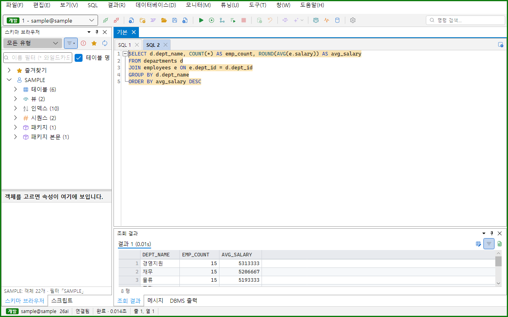
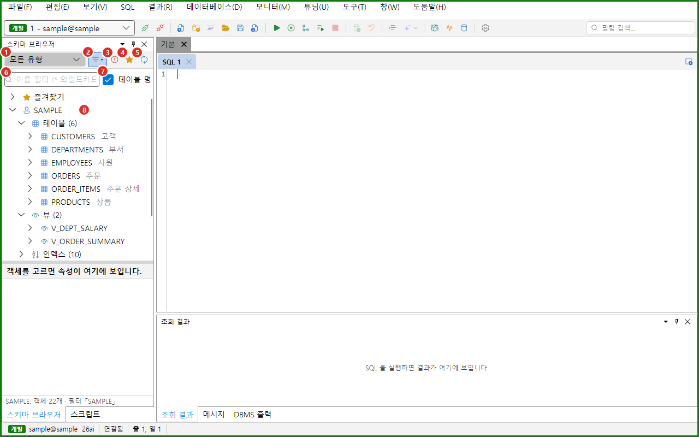
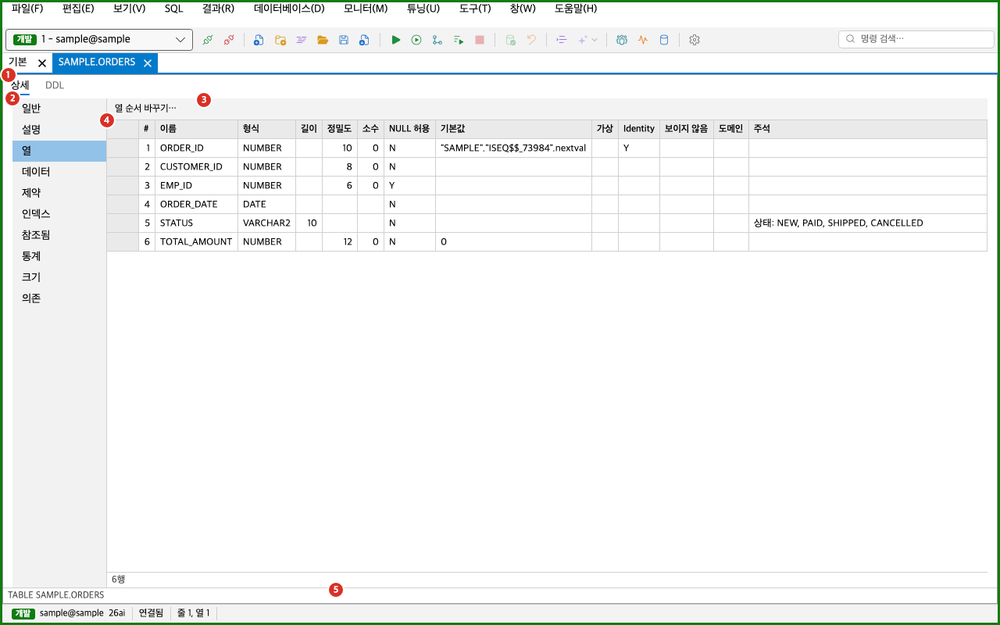
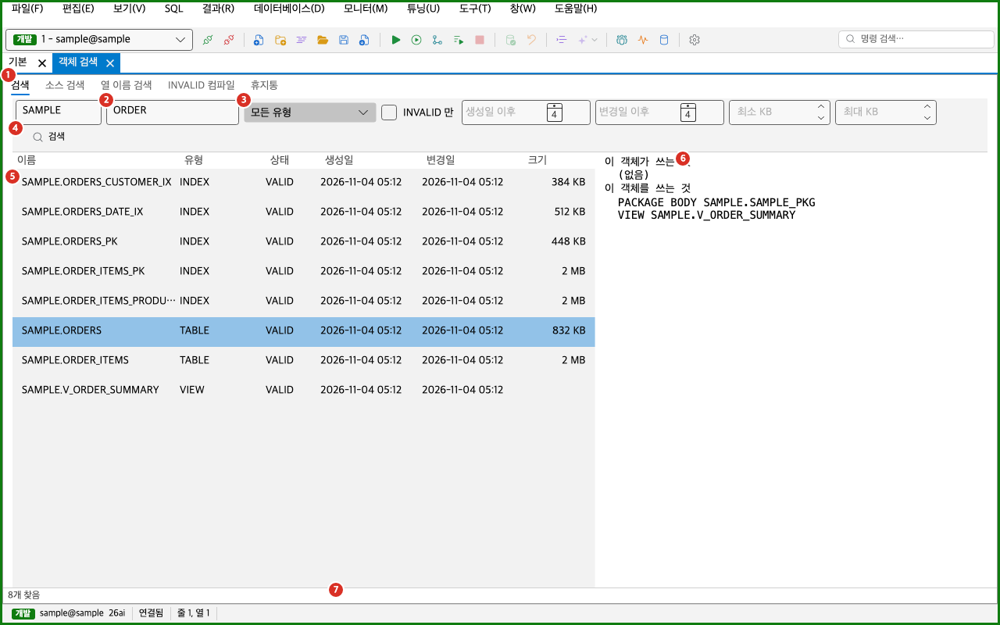

스키마 브라우저는 접속한 DB의 객체를 트리로 보여 주는 도구 창입니다. 이 쪽에서는 트리, 필터, 즐겨찾기, 객체 상세 창, 객체 검색, DB 객체로 이동, 휴지통, 열 순서 바꾸기를 설명합니다. PL/SQL 객체를 편집하고 컴파일하는 방법은 [PL/SQL](../plsql/)을 보세요.

스키마 브라우저는 주 화면의 왼쪽에 있습니다. 보이지 않으면 **보기 > 도구 창 > 스키마 브라우저**를 고르거나 `Alt+1`을 누르세요. macOS에서는 `Ctrl+1`을 누르세요. 접속하기 전에는 상태 줄에 「접속하면 객체 트리가 나타난다」가 보입니다.

:::note[켜진 기능에 따라 항목이 다릅니다]
다음 항목은 해당 기능이 꺼져 있으면 회색이 아니라 메뉴, 오른쪽 클릭 메뉴, 명령 팔레트, 단축키에서 아예 없어집니다.

| 항목 | 필요한 기능 | 기능이 켜지는 주 업무 |
|---|---|---|
| 객체 검색, INVALID 객체 일괄 컴파일, 휴지통 | DB 도구 | 튜닝, 운영 DBA, 모든 기능. 「PL/SQL 패키지·프로시저도 고친다」를 덧붙여도 켜집니다. |
| 오른쪽 클릭 메뉴의 열 순서 바꾸기… | 열 순서 바꾸기 | 운영 DBA, 모든 기능 |
| 표 통계 보기… | 표 통계·통계 수집 스크립트 | 튜닝, 운영 DBA, 모든 기능 |
| 테이블 정의서… | 테이블 정의서 | SQL 개발, 운영 DBA, 조회만, 모든 기능 |

주 업무를 고른 적이 없으면 「SQL 개발」로 동작합니다. 주 업무는 **설정 > 기능** 탭이나 **도구 > Role·기능 고르기…**에서 바꿉니다. 「조회만」에서는 열 순서 바꾸기를 켤 수 없습니다.
:::

## 스키마 브라우저 화면

1. 객체 유형 드롭다운: 트리에 보일 객체 유형을 고릅니다. 모든 유형을 고르거나 아무것도 고르지 않으면 「모든 유형」이 보입니다.
2. 저장 필터 단추: 저장한 필터를 고르거나 고칩니다. 필터를 걸면 단추가 눌린 모양이 됩니다. 마우스를 올리면 「저장 필터 (고르기·편집)」가 보입니다.
3. INVALID 객체만: 켜면 INVALID 객체만 보입니다.
4. 즐겨찾기만: 켜면 즐겨찾기한 객체만 보입니다.
5. 새로 고침: 트리를 처음부터 다시 만듭니다. 마우스를 올리면 「새로 고침 (F5)」가 보입니다.
6. 이름 필터: 객체 이름으로 트리를 거릅니다. 비어 있으면 「이름 필터 (* 와일드카드)」가 보입니다.
7. 「테이블 명」 체크: 이름 필터 칸 오른쪽에 있습니다. 켜면 테이블·뷰 이름 옆에 [테이블 명](#테이블-명)이 보입니다.
8. 객체 트리: 즐겨찾기, 스키마, 객체 유형, 객체를 계층으로 보여 줍니다.

객체를 읽는 동안에는 이름 필터 칸 아래에 가는 진행 막대가 보입니다. 트리 아래에는 [속성 창](#속성-창)과 상태 줄이 있습니다.

### 트리 구성

트리는 다음 순서로 내려갑니다.

- **즐겨찾기**: 맨 위 노드입니다. 즐겨찾기한 객체를 모아 보입니다. 하나도 없으면 「즐겨찾기가 없다」가 보입니다.
- **스키마**: 접속 사용자의 스키마가 맨 위에 오고, 접속하면 저절로 펼쳐집니다. 스키마를 펼치면 상태 줄에 「OWNER: 객체 N개」가 보입니다.
- **객체 유형**: 스키마를 펼치면 유형별 노드가 나옵니다. 이름 뒤에 개수가 붙습니다. 예는 「테이블 (6)」입니다. 객체가 없는 유형은 보이지 않습니다.
- **객체**: 유형을 펼치면 이름순으로 객체가 나옵니다. 이름 뒤의 흐린 글은 부가 설명입니다. 테이블·뷰는 테이블 명(주석)이 흐리게 붙습니다.

객체 유형 노드의 제목은 다음과 같습니다. 이 목록에 없는 유형은 유형 이름 그대로 보입니다.

| 유형 | 노드 제목 |
|---|---|
| TABLE, VIEW, MATERIALIZED VIEW | 테이블, 뷰, 머티리얼라이즈드 뷰 |
| INDEX, SEQUENCE, SYNONYM | 인덱스, 시퀀스, 시노님 |
| PROCEDURE, FUNCTION | 프로시저, 함수 |
| PACKAGE, PACKAGE BODY | 패키지, 패키지 본문 |
| TRIGGER, TYPE, TYPE BODY | 트리거, 타입, 타입 본문 |
| DATABASE LINK, JOB | DB 링크, 스케줄러 잡 |
| DIRECTORY, DOMAIN, PROPERTY GRAPH | 디렉터리, 도메인, 속성 그래프 |
| JAVA SOURCE, JAVA CLASS, JAVA RESOURCE | Java 소스, Java 클래스, Java 리소스 |

한 유형에 객체가 500개를 넘으면 처음 500개만 올리고 마지막에 「더 보기… (N개 남음)」 노드를 둡니다. 이 노드를 두 번 누르거나 `Enter`를 누르면 다음 쪽이 올라옵니다.

표를 펼치면 폴더가 나옵니다. 뷰와 머티리얼라이즈드 뷰는 Columns와 Triggers만 나옵니다. 폴더는 펼칠 때 내용을 읽습니다.

| 폴더 | 내용 |
|---|---|
| Columns | 열 이름과 자료형. 예는 `VARCHAR2(40) NOT NULL`입니다. |
| Indexes | 인덱스 이름. 열 목록이 괄호로 붙고, 유일 인덱스는 앞에 `UNIQUE`가 붙습니다. |
| Constraints | 제약 이름. `PK`, `UNIQUE`, `FK`, `CHECK`와 열 목록이 보입니다. 외래키는 `→ 부모 표`가 붙고, 꺼진 제약은 `DISABLED`가 붙습니다. |
| Triggers | 표에 걸린 트리거. 꺼진 트리거는 `DISABLED`가 붙습니다. |
| Snapshot Log | 표의 머티리얼라이즈드 뷰 로그 표 |
| Recycle Bin | 이 표를 지워서 휴지통에 들어간 이력. 휴지통 이름과 지운 시각이 보입니다. |

- 폴더에 내용이 없으면 「없음」이 보입니다.
- 접속 사용자의 표가 아니면 Recycle Bin은 「권한 없음」입니다. Triggers와 Snapshot Log도 읽을 권한이 없으면 같습니다.
- INVALID 객체의 이름은 빨간색으로 보입니다.
- 즐겨찾기한 객체에는 별 아이콘이 붙습니다.
- Indexes와 Constraints 안의 줄을 누르면 그 표의 객체 상세가 열립니다. Columns 안의 열을 눌러도 아무것도 열리지 않습니다.

### 이름 필터

이름 필터 칸에 글자를 쓰면 입력을 멈춘 뒤 잠시 있다가 트리를 다시 거릅니다. 규칙은 다음과 같습니다.

- 대소문자를 가리지 않습니다. 따옴표로 감싸면 대소문자를 그대로 비교합니다. 예는 `"Emp"`입니다.
- `*`와 `%`는 여러 글자를 뜻합니다.
- 와일드카드가 없으면 그 글자를 포함한 이름을 찾습니다. 예를 들어 `ORDER`는 `ORDERS`와 `ORDER_ITEMS`를 찾습니다.
- `_`는 한 글자 와일드카드가 아니라 밑줄 글자로 비교합니다.

`Ctrl+F`를 누르면 이름 필터 칸으로 포커스가 옮겨 갑니다. macOS에서는 `Cmd+F`입니다. 이 단축키는 스키마 브라우저에 포커스가 있을 때만 동작하고, 명령 이름은 「객체 필터」입니다.

이름 필터는 객체 이름만 거릅니다. 테이블 명(주석)으로는 거르지 않습니다.

### 테이블 명

테이블, 뷰, 머티리얼라이즈드 뷰의 줄에는 이름 뒤에 테이블 주석이 흐린 글씨로 붙습니다. 예를 들어 `CUSTOMERS 고객 마스터`처럼 보입니다.

- 주석이 없는 표는 이름만 보입니다.
- 주석이 여러 줄이면 한 줄로 이어 보이고, 60자를 넘으면 뒤를 「…」로 줄입니다. 전체 주석은 속성 창의 「설명」 탭에서 봅니다.
- 스키마를 펼칠 때 그 스키마의 주석을 한 번에 읽습니다. 이름 필터나 유형만 바꾸면 다시 읽지 않고, 「새로 고침」을 누르면 다시 읽습니다. 주석을 읽을 권한이 없으면 이름만 보입니다.
- 이름 필터 칸 오른쪽의 「테이블 명」 체크를 끄면 숨깁니다. 끈 동안에는 주석을 서버에서 읽지 않습니다. 다시 켜면 펼쳐 둔 스키마의 주석을 읽어 붙입니다.
- 체크 상태는 설정에 남아 앱을 다시 켜도 그대로입니다. 처음에는 켜져 있습니다.

### 유형 선택

유형 드롭다운을 누르면 「전체 선택」과 유형별 체크 상자가 나옵니다. 체크는 누르는 즉시 트리에 반영되고, 목록은 열린 채로 남습니다.

- 닫힌 드롭다운에는 고른 유형이 보입니다. 두 개까지는 「TABLE, VIEW」처럼 이름을, 세 개부터는 「TABLE, VIEW 외 2」처럼 개수를 보입니다.
- 「전체 선택」이 일부만 선택된 상태일 때 누르면 모두 선택됩니다.
- 열린 목록에서 `↑`와 `↓`로 옮기고 `Space`로 체크하며 `Esc`로 닫습니다.
- 고른 유형은 접속마다 따로 기억합니다.

### 저장 필터

저장 필터는 보일 스키마, 보일 객체 유형, 유형별 이름 패턴을 이름 붙여 저장한 것입니다. 저장한 목록은 모든 접속이 같이 쓰고, 어떤 필터를 걸지는 접속마다 따로 기억합니다.

저장 필터 단추를 누르면 메뉴가 열립니다.

- 「필터 없음」: 저장 필터를 풉니다.
- 저장한 필터 이름: 그 필터를 겁니다. 지금 건 필터에 점이 찍힙니다.
- 「필터 편집…」: 필터 편집 창을 엽니다. 오른쪽 클릭 메뉴의 「스키마 브라우저 필터 편집…」도 같은 창을 엽니다.

필터를 걸면 상태 줄에 필터 이름이 나옵니다. 스키마를 펼친 뒤에는 「OWNER: 객체 N개 · 필터 「이름」」, 필터를 바꾼 직후에는 「필터 「이름」 · 스키마 N/M개」가 보입니다. 이름 필터, 유형 선택, INVALID 객체만, 즐겨찾기만은 저장 필터와 함께 적용됩니다.

필터 편집 창의 제목은 「스키마 브라우저 필터」입니다. 위쪽 줄과 탭, 아래 단추로 구성됩니다.

- 필터 고르기 줄: 필터를 고르는 콤보 상자와 「새 필터」, 「필터 저장」, 「필터 삭제」 단추가 있습니다. 「필터 저장」은 창을 닫지 않고 목록만 저장합니다.
- 이름 칸: 고른 필터의 이름을 고칩니다. 이름은 비울 수 없고 다른 필터와 겹칠 수 없습니다.
- 「스키마」 탭: 보일 스키마를 정합니다.
  - 「모든 스키마」: 제한하지 않습니다.
  - 「로그온 스키마만」: 접속 사용자의 스키마만 보입니다.
  - 「객체를 가진 스키마만」: 객체가 하나라도 있는 스키마만 보입니다.
  - 「스키마 고르기」: 콤보 상자에서 스키마를 골라 더하기 단추로 목록에 넣습니다. 목록에서 줄을 고르고 빼기 단추를 누르면 뺍니다.
  - 「정규식으로 고르기」: 정규식으로 스키마 이름을 고릅니다. 대소문자는 무시하고 일부만 맞아도 됩니다. 전체가 맞아야 하면 `^…$`를 쓰세요. 맞는 스키마 개수와 목록이 바로 보입니다.
- 「객체」 탭: 유형마다 체크 상자와 이름 필터 칸이 있습니다. 체크를 풀면 그 유형이 트리에서 사라집니다. 「모두 선택」, 「모두 해제」, 「초기화」 단추로 체크를 한꺼번에 바꿉니다. 아래 「패턴」 칸에 글을 쓰고 「모든 유형에 적용」을 누르면 모든 유형의 이름 필터에 그 글이 들어갑니다.
- 「옵션」 탭: 「_ 를 한 글자 와일드카드로 본다」와 「와일드카드가 없으면 앞뒤에 % 를 붙인다 (포함 검색)」를 켜고 끕니다. 두 번째 항목은 기본으로 켜져 있습니다.
- 「확인」: 편집 창에서 고른 필터를 이 접속에 겁니다. 오류가 있으면 닫히지 않습니다.
- 「취소」: 저장하지 않은 변경을 버리고 닫습니다.

정규식이 올바르지 않으면 칸 테두리가 빨갛게 바뀌고 이유가 보입니다. 이 상태에서는 「확인」과 「필터 저장」이 꺼집니다.

### 즐겨찾기

자주 쓰는 객체는 즐겨찾기로 모아 둡니다. 객체 노드를 오른쪽 클릭하고 「즐겨찾기 추가/빼기」를 고르면 켜고 끕니다. 즐겨찾기한 객체는 접속마다 따로 모이고, 맨 위 「즐겨찾기」 노드 아래와 원래 자리에서 모두 보입니다. 「즐겨찾기만」 단추를 켜면 즐겨찾기한 객체만 남습니다.

즐겨찾기는 실행 중인 앱 안에서만 유지됩니다. 앱을 끝내면 즐겨찾기가 사라집니다.

### 새로 고침

「새로 고침」은 스키마 목록을 다시 읽고 트리를 처음부터 다시 만듭니다. 접속 사용자의 스키마만 펼친 상태가 됩니다. `F5` 키, 오른쪽 클릭 메뉴, 명령 팔레트로도 실행합니다. 명령 이름은 모두 「새로 고침」입니다.

- 객체 목록은 접속별 캐시에서 먼저 읽고, 뒤에서 서버와 맞춥니다.
- 서버와 맞춘 결과 바뀐 객체가 있으면 트리가 스스로 다시 거릅니다. 이때 펼친 유형과 고른 객체는 그대로 둡니다.
- Oranda에서 DDL을 실행한 직후에도 트리가 스스로 다시 거릅니다.

### 오른쪽 클릭 메뉴

트리의 노드를 오른쪽 클릭하면 그 노드를 먼저 고른 뒤 메뉴를 엽니다. 조건에 맞지 않는 항목은 회색이고, 마우스를 올리면 이유가 보입니다. 다음은 이 쪽에서 설명하는 항목입니다.

| 항목 | 쓸 수 있는 노드 | 하는 일 |
|---|---|---|
| 새로 고침 | 접속 중 | 트리를 다시 만듭니다. |
| 스키마 브라우저 필터 편집… | 언제나 | 저장 필터 편집 창을 엽니다. |
| 즐겨찾기 추가/빼기 | 객체 | 즐겨찾기를 켜고 끕니다. |
| 새 SQL | 표, 뷰와 그 아래 노드 | SELECT 문을 채운 새 SQL 탭을 엽니다. |
| 편집기에 이름 넣기 | 객체. SQL 탭이 열려 있어야 합니다. | 이름을 편집기 커서에 넣습니다. |
| 편집기에 SELECT 문 넣기 | 객체. SQL 탭이 열려 있어야 합니다. | SELECT 문을 편집기 커서에 넣습니다. |
| 편집기에 열 목록 넣기 | 객체. SQL 탭이 열려 있어야 합니다. | 열 목록을 편집기 커서에 넣습니다. |
| 객체 상세 열기 | 객체 | 객체 상세 창을 엽니다. |
| DDL 보기 | 객체 | 객체 상세 창을 DDL 탭으로 엽니다. |
| 열 순서 바꾸기… | 객체. 읽기 전용 접속이 아니어야 합니다. | 표에서 열 순서 바꾸기 창을 엽니다. |
| 테이블 정의서… | 표, 뷰와 그 아래 노드 | 테이블 정의서 창을 엽니다. |
| 표 통계 보기… | 표, 뷰와 그 아래 노드 | 통계 보기 탭을 엽니다. |
| INVALID 객체 일괄 컴파일 | 접속 중. 읽기 전용 접속이 아니어야 합니다. | 객체 검색 문서에서 일괄 컴파일합니다. |
| PL/SQL 소스 열기 | 프로시저, 함수, 패키지, 패키지 본문, 트리거, 타입, 타입 본문 | PL/SQL 편집기로 소스를 엽니다. |
| PL/SQL 작업 공간에 추가 | 위와 같음 | 고정 탭으로 PL/SQL 작업 공간에 넣습니다. |
| 프로시저·함수 실행 | 위와 같음 | 실행 창을 엽니다. |
| 휴지통 비우기(Purge), 휴지통에서 되살리기 | 휴지통 항목 | 트리에서는 항상 회색입니다. [객체 검색](#휴지통-탭)의 휴지통 탭을 쓰세요. |

- 열, 인덱스, 제약, 폴더 노드에서는 「즐겨찾기 추가/빼기」, 「편집기에 … 넣기」, 「객체 상세 열기」, 「DDL 보기」가 회색입니다. 이 노드들은 객체가 아니기 때문입니다.
- 「프로시저·함수 실행」은 트리거와 타입에서도 눌러지지만 아무 창도 열리지 않습니다. 프로시저, 함수, 패키지, 패키지 본문에서만 실행 창이 열립니다.
- 「열 순서 바꾸기…」는 뷰에서도 눌러지지만 아무 창도 열리지 않습니다. 표에서만 창이 열립니다.
- PL/SQL 항목은 [PL/SQL](../plsql/)에서 설명합니다. 「PL/SQL 소스 열기」는 PL/SQL 편집기 기능이 꺼져 있어도 남아 있고, 이때는 읽기 전용 SQL 탭으로 엽니다.

### 객체 열기

트리에서 객체를 열면 종류에 따라 열리는 곳이 다릅니다.

- 표, 뷰, 머티리얼라이즈드 뷰, 시퀀스, 시노님, 인덱스 같은 객체는 [객체 상세 창](#객체-상세-창)이 열립니다.
- 프로시저, 함수, 패키지, 패키지 본문, 트리거, 타입, 타입 본문은 PL/SQL 작업 공간의 탭으로 열립니다. PL/SQL 편집기 기능이 꺼져 있으면 「[읽기 전용] OWNER.NAME」 SQL 탭에 읽기 전용으로 열립니다. 주 업무를 고른 적이 없으면 이 경우에 해당합니다.

여는 방법은 두 가지입니다.

- 미리보기: 객체를 한 번 누르거나 방향키로 고르고 잠시 멈추면 미리보기 탭이 열립니다. 포커스는 트리에 남습니다. 다음 객체를 고르면 같은 탭이 그 객체로 바뀝니다. 미리보기 탭은 하나뿐입니다.
- 고정: 객체를 두 번 누르거나 `Enter`를 누르면 고정 탭으로 열리고 포커스가 그 탭으로 갑니다. 열려 있는 미리보기 탭은 고정 탭이 됩니다.

미리보기 탭에서 글을 고치거나 데이터 편집을 켜면 고정 탭이 됩니다. 고친 내용이 남은 미리보기 탭은 다음 객체로 바꾸지 않고 새 탭을 엽니다. 같은 접속의 같은 객체가 이미 열려 있으면 새 탭을 만들지 않고 그 탭을 앞으로 냅니다.

한 번 눌러 열기는 **설정 > 일반** 탭의 「스키마 브라우저」 항목에 있는 「한 번 눌러 미리보기 열기」로 끌 수 있습니다. 끄면 한 번 누르기는 속성 창만 바꾸고, 두 번 누르거나 `Enter`를 눌러야 엽니다.

세션이 실행 중이거나 끊겼거나 접속이 없으면 객체를 열지 않습니다. 이유는 스키마 브라우저 상태 줄에 나옵니다.

### 속성 창

속성 창의 구성은 다음과 같습니다.

- 나누기 막대: 위아래로 끌면 트리와 속성 창의 높이가 바뀝니다.
- 속성 머리: 고른 객체의 유형과 이름을 보입니다. 객체를 고르지 않으면 「객체를 고르면 속성이 여기에 보입니다.」가 보입니다.
- 속성 탭: 객체의 구역이 탭으로 나옵니다.
- 탭 내용: 구역의 표를 보입니다. 마지막 「정의」 탭은 DDL 글을 보입니다.
- 상태 줄: 스키마 브라우저의 상태 글을 보입니다. 스키마별 객체 수나 열기 실패 이유가 나옵니다.

트리에서 객체를 고르면 잠시 뒤 속성이 바뀝니다. 탭 순서는 열, 일반, 설명, 제약, 인덱스, 트리거, 참조됨, 통계, 크기, 파티션, 권한, 의존, 정의입니다. 객체에 없는 구역은 나오지 않습니다. 다른 객체로 옮겨도 보던 탭 이름이 있으면 그 탭이 유지됩니다. 「정의」 탭은 그 탭을 고를 때 DDL을 읽습니다.

스키마와 유형 노드를 고르면 속성 창이 비워집니다. 열, 인덱스, 제약, 폴더 노드를 고르면 속성 창은 그 표의 속성을 그대로 보입니다.

### 편집기에 넣기

SQL 탭이 열려 있으면 객체의 이름, SELECT 문, 열 목록을 편집기에 넣을 수 있습니다. 글은 선택 영역을 바꾸고, 선택이 없으면 커서 위치에 들어갑니다. SQL 탭이 없으면 상태 줄에 「열려 있는 SQL 편집기가 없다」가 보입니다.

| 명령 | 넣는 글 |
|---|---|
| 편집기에 이름 넣기 | `OWNER.NAME`. 이름은 필요할 때만 큰따옴표로 감쌉니다. |
| 편집기에 SELECT 문 넣기 | 표와 뷰는 열마다 한 줄씩 나열한 `SELECT … FROM OWNER.NAME`. 시퀀스는 `SELECT OWNER.NAME.NEXTVAL FROM DUAL`. 그 밖의 객체는 이름. |
| 편집기에 열 목록 넣기 | 표와 뷰는 `COL1, COL2` 모양의 열 목록. 그 밖의 객체는 이름. |

- 열 목록에서 보이지 않는 열은 빠지고, 열 순서는 열 위치를 따릅니다.
- 「새 SQL」은 SELECT 문을 채운 새 SQL 탭을 엽니다. 탭의 접속은 스키마 브라우저의 접속이고 커서는 문장 끝에 놓입니다. 실행은 하지 않습니다.

트리 노드를 편집기로 끌어 놓아도 됩니다.

- 그냥 끌면 표와 뷰는 SELECT 문이 들어갑니다. 시퀀스는 NEXTVAL 조회문, 그 밖의 객체는 이름이 들어갑니다.
- `Ctrl`을 누르고 끌면 이름만 들어갑니다. macOS에서도 `Cmd`가 아니라 `Ctrl` 키입니다.
- `Shift`를 누르고 끌면 열 목록이 들어갑니다.
- 열, 인덱스, 제약 노드를 끌면 그 이름이 들어갑니다.
- 열 목록을 아직 읽지 못했으면 `SELECT *`나 이름이 들어가고 상태 줄에 이유가 나옵니다.

### 스키마 브라우저에서 찾기

편집기에서 이름 위에 커서를 두고 `Alt+F1`을 누르면 그 객체를 트리에서 찾아 고릅니다. macOS에서는 `Option+F1`입니다. 명령 이름은 「스키마 브라우저에서 찾기」입니다. **편집 > 이동** 메뉴와 편집기 오른쪽 클릭 메뉴에도 있습니다.

- 찾을 객체는 다음 순서로 정합니다. 객체 상세나 PL/SQL 작업 공간이 앞에 있으면 그 문서의 객체를 씁니다. 앞에 있는 문서가 SQL 편집기이면 커서 아래 이름을 씁니다.
- 스키마 브라우저가 닫혀 있으면 먼저 엽니다.
- 객체가 이름 필터, 유형 선택, 저장 필터에 가려져 있으면 이 필터를 모두 풀고 다시 찾습니다. 필터가 풀린 채로 남으니 다시 걸어야 합니다.
- 찾으면 스키마와 유형을 펼쳐 객체를 고르고 상태 줄에 「OWNER.NAME (TABLE)」처럼 보입니다. 찾지 못하면 「트리에서 OWNER.NAME 을(를) 찾지 못했다」가 보입니다.

## 객체 상세 창

객체 상세 창은 객체 하나의 구조와 DDL을 문서 탭으로 보여 줍니다. 트리에서 객체를 열거나 「객체 상세 열기」를 고르면 열립니다. 문서 탭 이름은 `OWNER.NAME`입니다.

1. 탭 줄: 「상세」와 「DDL」 탭입니다.
2. 구역 목록: 객체의 구역을 보입니다. 구역을 고르면 오른쪽 표가 바뀝니다.
3. 열 순서 바꾸기… 단추: 표의 「열」 구역에서만 보입니다.
4. 구역 표: 고른 구역의 내용입니다.
5. 상태 줄: 「TABLE OWNER.NAME」처럼 객체 유형과 이름을 보입니다. 읽기에 실패하면 이유가 나옵니다.

표와 뷰는 「열」 구역이 먼저 선택됩니다. 구역은 객체 유형에 따라 다음 중 있는 것만 나옵니다.

| 구역 | 내용 |
|---|---|
| 일반 | 유형, 상태, 생성 시각, 마지막 DDL 시각, 편집 가능 여부, 객체 ID |
| 설명 | 표 주석 |
| 열 | #(열 위치), 이름, 형식, 길이, 정밀도, 소수, NULL 허용, 기본값, 가상, 주석. 12c 이상 서버에서는 Identity, 보이지 않음, 도메인도 나옵니다. |
| 데이터 | 표, 뷰, 머티리얼라이즈드 뷰의 행. 「열」 바로 뒤에 놓입니다. |
| 제약 | 이름, 종류, 열, 참조, 조건, 사용 여부 |
| 인덱스 | 이름, 유일 여부, 종류, 열 |
| 트리거 | 이름, 유형, 이벤트, 상태, WHEN 조건, 소유자 |
| 참조됨 | 이 표를 참조하는 외래키 |
| 파티션 | 파티션 표의 파티션 목록 |
| 통계 | 행 수, 블록 수, 평균 행 길이, 마지막 분석 시각 같은 표 통계 |
| 크기 | 세그먼트별 바이트와 익스텐트, 합계 |
| 권한 | 받는 사람, 권한, 재부여 가능 여부, 부여자 |
| 의존 | 이 객체가 참조하는 객체와 이 객체를 참조하는 객체 |

「제약」이나 「인덱스」 구역에서 줄을 고르면 표 아래에 그 키의 열이 나옵니다. 인덱스는 「인덱스 열」(#, 열/식, 정렬), 제약은 「제약 열」(#, 열, 참조 표, 참조 열)입니다. 줄을 고르기 전에는 「인덱스를 고르면 그 열이 보인다」나 「제약을 고르면 그 열이 보인다」가 보입니다. 함수 기반 인덱스나 내림차순 인덱스는 위 표의 「열」 칸도 식과 `DESC`로 바뀝니다.

### 데이터 탭

「데이터」 구역은 처음 고를 때 행을 읽습니다. 표는 `SELECT t.ROWID, t.* FROM OWNER.NAME t`, 뷰는 `SELECT * FROM OWNER.NAME`으로 읽습니다. 결과 영역은 SQL 편집기의 결과와 같아서 거르기, 행 수 세기, 복사를 같은 방법으로 씁니다. 자세한 내용은 [결과 그리드](../../run/result-grid/)를 보세요.

데이터 구역 위쪽 도구 줄에는 다음 단추가 있습니다.

- 「새로 고침」: 행을 다시 읽습니다.
- 「데이터 읽기 취소」: 읽는 동안에만 보입니다.
- 「편집」: 표에서만 보입니다. 켜면 ROWID로 행을 찾아 고치는 편집 모드가 열립니다. 방법은 [그리드 편집과 플래시백](../../run/grid-edit/)을 보세요.
- 「거르기 줄」: 결과 안에서 거르는 줄을 엽니다.
- 「행 수 세기」: 전체 행 수를 세고 옆에 「전체 N행」을 보입니다.

### DDL 탭

DDL 탭의 구성은 다음과 같습니다.

- DDL 탭: 객체를 만드는 DDL을 보입니다. 「DDL 보기」로 열면 이 탭이 먼저 열립니다.
- DDL 복사: DDL 글 전체를 클립보드에 복사합니다.
- DDL 옵션 체크 상자 다섯 개: 「저장 속성(STORAGE)」, 「세그먼트 속성」, 「테이블스페이스」, 「종결자(;)」, 「종속 객체(인덱스·제약·권한 등)」입니다. 바꾸면 DDL을 다시 읽습니다. 「종결자(;)」만 처음부터 켜져 있습니다.
- DDL 본문: 편집기와 같은 색과 줄 번호로 보이는 읽기 전용 글입니다.

### Java 소스와 클래스

Java 소스와 클래스의 객체 상세 위쪽에는 「다시 컴파일」 단추가 있습니다. 누르면 실행할 문장을 보여 주는 확인 창이 먼저 나옵니다. 서버에 JVM이 없거나 읽기 전용 접속이면 단추가 회색이고 이유가 옆에 보입니다. Java 소스에는 「편집기로 열기」가 있어서 DDL을 새 SQL 탭에 넣습니다. 실행은 하지 않습니다. Java 클래스가 같은 스키마의 Java 소스에서 만들어졌으면 그 소스를 여는 「소스 열기」 단추가 보입니다.

## 열 순서 바꾸기

표의 열 순서를 바꾸는 창입니다. 트리의 「열 순서 바꾸기…」나 객체 상세 「열」 구역의 「열 순서 바꾸기…」 단추로 엽니다. 창 제목은 「열 순서 바꾸기」입니다.

- 왼쪽 열 목록에서 열을 끌어 옮기거나 「▲ 위」와 「▼ 아래」 단추를 누릅니다. 열마다 이름, 자료형, NULL 여부가 보입니다. 보이지 않는 열은 목록에 없습니다.
- 위쪽 라디오 단추로 방식을 고릅니다.
  - 「① INVISIBLE → VISIBLE (12c 이상, 즉시 끝남)」: 미리보기를 본 뒤 「실행」으로 서버에 바로 적용합니다. 12c 미만 서버에서는 이 방식이 숨겨집니다.
  - 「② 재생성 스크립트 (스크립트만 만듦)」: 「새 편집기 탭에 열기」로 스크립트를 새 SQL 탭에 엽니다. 실행은 하지 않으니 검토한 뒤 직접 실행하세요.
- 오른쪽에는 스크립트 미리보기가 나옵니다. 「스크립트 미리보기」를 눌러야 방식 ①의 「실행」이 켜집니다. 순서를 바꾸면 미리보기도 따라 바뀝니다.
- 방식을 쓸 수 없으면 빨간 줄에 「⛔」와 이유가 나옵니다. 이유가 있는 동안에는 미리보기와 실행이 꺼집니다.
- 아래 「소스 경고」 영역은 이 표를 참조하는 PL/SQL 소스에서 `SELECT *`나 열 목록 없는 `INSERT`로 보이는 줄을 찾아 알려 줍니다. 한 줄 단위 검색이라 여러 줄에 걸친 문장, 뷰, 동적 SQL은 찾지 못합니다.
- 방식 ①이 끝나면 표 메타데이터 캐시를 비우고 창의 열 목록을 다시 읽습니다. 객체 상세에서 연 창이면 객체 상세도 다시 읽습니다.

:::caution[방식 ① 「실행」은 되돌릴 수 없습니다]
방식 ①의 「실행」은 DDL을 서버에 보냅니다. DDL은 암묵적으로 커밋되어 롤백할 수 없습니다. 실행하기 전에 스크립트 미리보기를 확인하세요. 운영 접속에서는 실행 확인 창이 나옵니다. 자세한 내용은 [SQL 실행](../../run/execute/)을 보세요.
:::

## 테이블 정의서와 표 통계

- 「테이블 정의서…」: 고른 표 하나로 채워진 테이블 정의서 문서를 엽니다. 형식은 Excel(.xlsx), Markdown(.md), HTML(.html) 중에서 고릅니다. 화면 설명은 [DB 도구](../../tools/db-tools/)를 보세요.
- 「표 통계 보기…」: 고른 표의 통계 보기 탭을 엽니다. 화면 설명은 [튜닝](../../plan/tuning/)을 보세요.

## 객체 검색

객체 검색은 스키마 전체에서 객체, 소스 글, 열 이름을 찾고 INVALID 객체 컴파일과 휴지통을 다루는 문서입니다. **데이터베이스 > 객체 검색**을 고르면 열립니다. 이미 열려 있으면 그 탭이 앞으로 옵니다.

1. 탭 줄: 「검색」, 「소스 검색」, 「열 이름 검색」, 「INVALID 컴파일」, 「휴지통」 탭입니다.
2. 이름 칸: 객체 이름을 씁니다. `*`와 `%`는 와일드카드이고 와일드카드가 없으면 포함 검색입니다. `Enter`를 누르면 검색합니다.
3. 유형 드롭다운: 찾을 객체 유형을 고릅니다. 아무것도 고르지 않으면 Java 객체를 뺀 모든 유형을 찾습니다.
4. 검색 단추: 조건에 맞는 객체를 찾습니다.
5. 결과 목록: 이름, 유형, 상태, 생성일, 변경일, 크기를 보입니다.
6. 참조 관계: 결과 줄을 고르면 「이 객체가 쓰는 것」과 「이 객체를 쓰는 것」이 나옵니다. 없으면 「(없음)」입니다.
7. 상태 줄: 「N개 찾음」이나 「조건에 맞는 객체가 없다」가 보입니다.

이름 칸 앞의 「스키마」 칸은 기본으로 접속 사용자 이름이 들어 있습니다. 「검색」 탭에는 이 밖에 「INVALID 만」 체크 상자, 「생성일 이후」, 「변경일 이후」 날짜, 「최소 KB」, 「최대 KB」 칸이 있습니다. 스키마 칸은 다른 탭과 같이 씁니다.

### 소스 검색 탭

PL/SQL 소스의 본문을 줄 단위로 찾습니다.

- 「스키마」, 「찾을 글자」, 「모든 소스 유형」 콤보 상자(PACKAGE, PACKAGE BODY, PROCEDURE, FUNCTION, TRIGGER, TYPE, TYPE BODY 중 하나)를 채우고 「검색」을 누르세요. 찾을 글자 칸에서 `Enter`를 눌러도 됩니다.
- 「대소문자 구분」, 「단어 단위」, 「정규식」 옵션이 있습니다. 정규식은 Oracle 정규식이고, 틀리면 서버가 알려 준 이유가 상태 줄에 나옵니다.
- 결과는 객체, 유형, 줄, 내용으로 나옵니다. 줄을 두 번 누르면 PL/SQL 편집기가 그 줄로 열립니다.
- 한 번에 1000줄까지 보입니다. 더 있으면 상태 줄에 알려 주니 스키마, 유형, 검색어로 좁히세요.
- 찾을 글자가 비어 있으면 「찾을 글자를 넣으세요」가 보입니다.

### 열 이름 탭

표와 뷰의 열을 이름으로 찾습니다.

- 「스키마」와 「열 이름 (* 와일드카드)」를 채우고 「검색」을 누르세요. 대소문자는 무시하고, 와일드카드가 없으면 포함 검색입니다.
- 결과는 테이블, 유형, 열, 데이터 형식, NULL 허용으로 나옵니다. 줄을 두 번 누르면 그 표의 객체 상세가 열립니다.
- 한 번에 1000개 열까지 보입니다. 열 이름이 비어 있으면 「찾을 열 이름을 넣으세요」가 보입니다.

### INVALID 컴파일 탭

스키마의 INVALID 객체를 한꺼번에 컴파일합니다.

- 「스키마」 칸을 확인하고 「INVALID 객체 일괄 컴파일」을 누르세요. **데이터베이스 > INVALID 객체 일괄 컴파일**과 트리의 오른쪽 클릭 메뉴도 같은 일을 합니다. 트리에서 고른 스키마가 아니라 이 탭의 스키마 칸이 대상입니다. 비어 있으면 접속 사용자의 스키마입니다.
- 객체마다 `ALTER … COMPILE` 문을 실행 엔진으로 보냅니다. 의존 순서 때문에 남는 객체가 있으면 진전이 없을 때까지 최대 3번 되풀이합니다.
- 결과는 객체마다 한 줄씩 「컴파일됨」, 「여전히 INVALID」, 「건너뜀」, 「실패」로 나옵니다. 「여전히 INVALID」는 컴파일 오류가 있다는 뜻이니 PL/SQL 편집기와 [컴파일 오류 창](../plsql/#컴파일과-컴파일-오류-창)에서 확인하세요.
- 상태 줄에 「INVALID N개 중 M개 컴파일됨, K개 남음」처럼 개수가 나옵니다. INVALID 객체가 없으면 「INVALID 객체가 없다」입니다.
- 읽기 전용 접속에서는 단추와 명령이 꺼집니다.
- 명령을 메뉴나 트리에서 실행하면 객체 검색 문서가 열리고 컴파일이 시작됩니다. 결과를 보려면 「INVALID 컴파일」 탭을 고르세요.

### 휴지통 탭

DROP한 표를 되살리거나 영구 삭제합니다. 현재 접속 사용자의 휴지통만 다룹니다.

- 「새로 고침」을 누르면 휴지통 목록을 읽습니다. 목록에는 원래 이름과 유형, 지운 시각, 가능한 동작이 나옵니다. 상태 줄에 「휴지통 N개」나 「휴지통이 비었다」가 나옵니다.
- 「되살리기」는 고른 항목을 되살립니다. 「되살릴 때 새 이름(선택)」 칸에 이름을 쓰면 그 이름으로 되살립니다. 따옴표 없이 쓰면 대문자 이름이 됩니다. 예를 들어 `emp_old`는 `EMP_OLD`가 됩니다. 소문자를 그대로 쓰려면 `"emp_old"`처럼 큰따옴표로 감싸세요.
- 「비우기(Purge)」는 고른 항목 하나를 영구 삭제합니다.
- 「전체 비우기」는 휴지통 전체를 영구 삭제합니다.
- 세 동작 모두 읽기 전용 접속에서는 꺼집니다. 실행은 실행 엔진의 정책 관문과 위험 명령 확인을 거칩니다.

:::caution[비우기는 되돌릴 수 없습니다]
「비우기(Purge)」와 「전체 비우기」로 지운 표는 되살릴 수 없습니다. 먼저 「되살리기」가 필요한지 확인하세요. 운영 접속에서는 특히 조심하세요.
:::

## DB 객체로 이동

DB 객체로 이동은 이름 일부만 쳐서 객체를 바로 여는 창입니다. `Ctrl+P`를 누르면 열립니다. macOS에서는 `Cmd+P`입니다. **편집 > 이동 > DB 객체로 이동**으로도 엽니다. 접속이 있어야 쓸 수 있습니다.

창 제목은 「DB 객체로 이동」이고, 입력 칸에는 「객체 이름 (소유자.이름, * 와일드카드)」가 보입니다.

- 편집기에서 한 줄을 선택해 두고 열면 그 글이 입력 칸에 먼저 들어가 전체가 선택됩니다.
- 객체 목록은 창을 열 때 한 번만 읽고, 글자를 칠 때마다 메모리에서 거릅니다. 스키마 브라우저의 필터와는 상관없이 모든 스키마의 객체를 찾습니다.
- 맞는 순서는 이름이 같은 객체, 앞부분이 같은 객체, 이름에 들어 있는 객체, 밑줄로 나뉜 단어의 머리글자가 맞는 객체입니다. 예를 들어 `ed`는 `EMP_DEPT`를 찾습니다. 같은 점수이면 접속 사용자의 스키마, 짧은 이름, 표와 뷰 같은 유형 순서로 나옵니다.
- `소유자.이름`으로 스키마를 좁힙니다. `*`, `%`, `?`는 와일드카드입니다. 대소문자는 가리지 않습니다.
- 패키지 본문과 타입 본문은 명세가 있으면 명세 한 줄로 보입니다.
- 목록은 200개까지 보입니다. 상태 줄에 개수가 나옵니다.

| 키 | 동작 |
|---|---|
| `Enter` | 고른 객체를 엽니다. PL/SQL 객체는 PL/SQL 편집기, 그 밖의 객체는 객체 상세로 열립니다. |
| `Alt+Enter` | 고른 객체를 스키마 브라우저에서 찾습니다. macOS에서는 `Option+Enter`입니다. 「스키마 브라우저에서 찾기」 단추와 같습니다. |
| `↑`, `↓`, `PageUp`, `PageDown` | 고른 줄을 옮깁니다. `PageUp`과 `PageDown`은 10줄씩 옮깁니다. |
| `Esc` | 창을 닫습니다. |

목록의 줄을 두 번 눌러도 엽니다. 이 창은 한 번에 하나만 열립니다.

## 객체 정보 보기

SQL 편집기에서 이름 위에 커서를 두고 `F4`나 `Alt+C`를 누르면 객체 정보를 봅니다. macOS에서는 `F4`, `Option+C`, `Ctrl+Option+C`가 모두 같은 명령입니다. 명령 이름은 「객체 정보 보기」입니다. 이 키는 편집기에 포커스가 있을 때만 동작하고, 트리에서는 동작하지 않습니다. 접속이 있어야 합니다.

- 이름이 표나 뷰이면 테이블 레이아웃 창이 열립니다. 이 창은 [결과 그리드](../../run/result-grid/#테이블-레이아웃-창)에서 설명합니다.
  - 다른 표나 뷰를 열면 열려 있는 창을 닫지 않고 같은 창에 탭이 하나 늘어납니다. 창이 여러 개이면 마지막으로 포커스가 있던 창에 더해집니다. 이미 열린 표를 다시 열면 탭을 새로 만들지 않고 그 탭으로 이동합니다. 접속이 다르면 같은 이름이라도 다른 탭입니다.
  - 창을 처음 열 때는 Oranda 창이 있는 모니터의 화면 가운데에 나타납니다. 창이 이미 떠 있으면 위치를 바꾸지 않고 탭만 더합니다.
  - 탭 머리를 창 밖으로 끌어 놓거나 탭을 오른쪽 클릭해서 **새 창으로 분리**를 고르면 그 탭이 별도 창이 됩니다. 탭 머리를 다른 테이블 레이아웃 창 위에 끌어다 놓으면 그 창에 합쳐집니다. 탭 줄 위에 놓으면 놓은 자리에, 창의 다른 부분에 놓으면 맨 뒤에 들어갑니다. 탭을 옮겨도 거르기 글, 고른 열, 옵션 단추, 별칭은 그대로입니다.
  - 열을 넣는 대상은 그 탭을 연 편집기 탭의 커서 자리입니다. 그 편집기 탭을 닫으면 넣을 수 없게 되어 넣기 단추가 꺼지고, 닫혀 있는 동안 상태 줄에 안내가 계속 나옵니다. 복사는 계속 됩니다. 같은 표를 다른 편집기 탭에서 다시 열면 넣기 대상이 그 편집기 탭으로 바뀝니다.
  - `Esc`는 지금 보는 탭만 닫습니다. 마지막 탭이면 창도 닫힙니다. 다시 시작하면 탭은 복원되지 않습니다. 이미 열린 표를 다시 열면 컬럼 목록을 새로 읽어 반영하고, 거르기 글과 옵션, 별칭은 그대로 둡니다.
- 표와 뷰가 아닌 객체이면 작은 정보 창이 편집기 커서 아래에 열립니다. 창 제목은 객체 이름이고, 첫 줄에 객체 유형이 나옵니다. 프로시저, 함수, 패키지, 타입이면 그 아래에 서명이 한 줄씩 나옵니다. 다른 창을 막지 않습니다.
- 정보 창의 도구 줄에 「복사」 단추가 있어서 글 전체를 복사합니다. `Esc`를 누르면 닫힙니다.
- 편집기 안에서 정의한 이름이면 정의된 줄을 보여 줍니다.
- 접속이 없으면 「접속이 없어 DB 정보를 볼 수 없다」, 객체를 찾지 못하면 「객체를 찾지 못했다」가 나옵니다.

## 단축키

단축키는 기본 키맵 기준입니다. 키는 [단축키와 명령 팔레트](../../settings/shortcuts/)에서 바꿉니다. macOS에서 `Alt`는 `Option` 키입니다.

| 명령 | Windows | macOS | 동작 조건 |
|---|---|---|---|
| 스키마 브라우저 열기 | `Alt+1` | `Ctrl+1` | 언제나 |
| 새로 고침 | `F5` | `F5` | 스키마 브라우저에 포커스가 있을 때 |
| 객체 필터 | `Ctrl+F` | `Cmd+F` | 스키마 브라우저에 포커스가 있을 때 |
| DB 객체로 이동 | `Ctrl+P` | `Cmd+P` | 접속 중 |
| 스키마 브라우저에서 찾기 | `Alt+F1` | `Option+F1` | 접속 중 |
| 객체 정보 보기 | `F4`, `Alt+C` | `F4`, `Option+C`, `Ctrl+Option+C` | 편집기에 포커스가 있을 때 |

나머지 명령은 오른쪽 클릭 메뉴, 메뉴 막대, 명령 팔레트로 실행합니다. 트리에서 `Enter`로 객체를 여는 키와 두 번 누르기는 트리의 고정 동작입니다.

## 자주 하는 작업

### 이름으로 객체를 찾아 열기

1. 스키마 브라우저의 이름 필터 칸에 이름 일부를 쓰세요.
2. 필요하면 유형 드롭다운에서 유형을 고르세요.
3. 트리에서 객체를 두 번 누르세요. 훑어보기만 하려면 객체를 한 번만 누르세요.

### 표의 SELECT 문을 새 SQL 탭에 넣기

1. 트리에서 표를 오른쪽 클릭하세요.
2. 「새 SQL」을 고르세요.
3. 열린 탭에서 SELECT 문을 확인하고 실행하세요. 실행 방법은 [SQL 실행](../../run/execute/)을 보세요.

### 표의 열 목록을 열려 있는 편집기에 넣기

1. 열 목록을 넣을 SQL 탭을 열고 넣을 자리에 커서를 두세요.
2. 스키마 브라우저에서 표를 오른쪽 클릭하세요.
3. 「편집기에 열 목록 넣기」를 고르세요.

### 이름 일부로 객체 열기

1. `Ctrl+P`를 누르세요. macOS에서는 `Cmd+P`를 누르세요.
2. 이름 일부를 쓰세요. 예를 들어 `ord`를 쓰세요.
3. `↓`로 객체를 고르세요.
4. `Enter`를 누르세요.

### 열 이름으로 표 찾기

1. **데이터베이스 > 객체 검색**을 고르세요.
2. 「열 이름 검색」 탭을 고르세요.
3. 「열 이름 (* 와일드카드)」 칸에 열 이름을 쓰세요.
4. 「검색」을 누르세요.
5. 결과 줄을 두 번 눌러 표의 객체 상세를 여세요.

### 객체의 DDL을 복사하기

1. 트리에서 객체를 오른쪽 클릭하세요.
2. 「DDL 보기」를 고르세요.
3. 필요하면 DDL 옵션 체크 상자를 바꾸세요.
4. 「DDL 복사」를 누르세요.

### 저장 필터 만들기

1. 저장 필터 단추를 누르고 「필터 편집…」을 고르세요.
2. 「새 필터」 단추를 누르세요.
3. 이름 칸에 필터 이름을 쓰세요.
4. 「스키마」 탭에서 보일 스키마를 고르세요.
5. 「객체」 탭에서 보일 유형을 고르고 필요하면 이름 필터를 쓰세요.
6. 「확인」을 누르세요.

### INVALID 객체를 한꺼번에 컴파일하기

1. **데이터베이스 > INVALID 객체 일괄 컴파일**을 고르세요.
2. 객체 검색 문서의 「INVALID 컴파일」 탭을 고르세요.
3. 「스키마」 칸이 맞는지 확인하세요. 다른 스키마이면 고친 뒤 「INVALID 객체 일괄 컴파일」 단추를 누르세요.
4. 결과 줄과 상태 줄을 확인하세요. 「여전히 INVALID」인 객체는 PL/SQL 편집기에서 컴파일 오류를 확인하세요.

### 지운 표를 되살리기

1. **데이터베이스 > 객체 검색**을 고르세요.
2. 「휴지통」 탭을 고르세요.
3. 「새로 고침」을 누르세요.
4. 목록에서 되살릴 표를 고르세요.
5. 다른 이름이 필요하면 「되살릴 때 새 이름(선택)」 칸에 이름을 쓰세요.
6. 「되살리기」를 누르세요.

### 표의 열 순서 바꾸기

1. 트리에서 표를 오른쪽 클릭하고 「열 순서 바꾸기…」를 고르세요.
2. 방식을 고르세요.
3. 열을 끌어 새 순서로 옮기세요.
4. 「스크립트 미리보기」를 누르고 스크립트를 확인하세요.
5. 방식 ①이면 「실행」을 누르세요. 방식 ②이면 「새 편집기 탭에 열기」를 누르고 열린 탭에서 검토한 뒤 직접 실행하세요.

## 문제가 생길 때

| 증상 | 원인 | 해결 |
|---|---|---|
| 트리가 비어 있고 「접속하면 객체 트리가 나타난다」가 보입니다. | 접속이 없습니다. | 접속 관리자에서 접속하세요. |
| 트리에 객체가 보이지 않습니다. | 이름 필터, 유형 선택, 「INVALID 객체만」, 「즐겨찾기만」, 저장 필터가 걸려 있습니다. | 걸린 필터를 푸세요. 객체가 없으면 「해당하는 객체가 없다」가 보입니다. |
| 다른 접속이나 다른 도구로 만든 객체가 안 보입니다. | 객체 목록을 캐시에서 먼저 읽습니다. | 「새로 고침」을 누르세요. 서버와 맞춘 결과가 바뀌면 트리가 스스로 다시 그려집니다. |
| 객체를 눌러도 아무것도 열리지 않습니다. | 세션이 실행 중이거나 끊겼거나 접속이 없습니다. | 상태 줄의 이유를 읽고, 실행이 끝난 뒤 다시 여세요. |
| 한 번 눌러도 미리보기가 열리지 않습니다. | 「한 번 눌러 미리보기 열기」가 꺼져 있습니다. | 객체를 두 번 누르거나 설정에서 켜세요. |
| 「객체 검색」, 「INVALID 객체 일괄 컴파일」, 「열 순서 바꾸기…」, 「표 통계 보기…」 메뉴가 없습니다. | 해당 기능이 꺼져 있습니다. | 이 쪽 앞의 표를 보고 **설정 > 기능**에서 주 업무를 바꾸세요. |
| 「편집기에 … 넣기」가 회색입니다. | 열려 있는 SQL 탭이 없거나 고른 노드가 객체가 아닙니다. | SQL 탭을 열고 표, 뷰 같은 객체 노드를 고르세요. |
| 「열 순서 바꾸기…」나 「INVALID 객체 일괄 컴파일」이 회색입니다. | 읽기 전용 접속이거나 조회 전용 Role입니다. | 쓰기가 가능한 접속에서 실행하세요. |
| 「휴지통에서 되살리기」와 「휴지통 비우기(Purge)」가 트리에서 회색입니다. | 이 두 명령은 휴지통 항목을 고른 상태에서만 켜지는데, 트리의 Recycle Bin 항목으로는 그 상태가 되지 않습니다. | 객체 검색의 「휴지통」 탭에서 실행하세요. |
| Recycle Bin 폴더에 「권한 없음」이 보입니다. | 접속 사용자의 표가 아닙니다. | 그 표의 소유자로 접속하세요. |
| 스키마 브라우저에서 찾기를 했더니 필터가 사라졌습니다. | 찾는 객체가 필터에 가려지면 필터를 모두 풀고 다시 찾습니다. | 필터를 다시 거세요. |
| 테이블 이름 옆에 테이블 명이 안 보입니다. | 「테이블 명」 체크가 꺼져 있거나, 주석이 없거나, 주석을 읽을 권한이 없습니다. | 이름 필터 칸 오른쪽의 「테이블 명」을 켜세요. 주석을 방금 바꿨으면 「새로 고침」을 누르세요. |
| 앱을 다시 켜니 즐겨찾기가 없습니다. | 즐겨찾기는 실행 중인 앱 안에서만 유지됩니다. | 즐겨찾기를 다시 지정하세요. |
| 「DB 객체로 이동」에 Java 객체가 나오지 않습니다. | 이 창은 객체 목록 캐시에서 찾고, Java 객체는 캐시에 넣지 않습니다. | 스키마 브라우저에서 스키마를 펼쳐 찾으세요. |
| 열 순서 바꾸기에서 방식 ①이 보이지 않습니다. | 12c 미만 서버입니다. | 방식 ②의 재생성 스크립트를 쓰세요. |
| 「이 서버 버전에서는 열 순서 바꾸기를 쓸 수 없다」가 보입니다. | 서버 버전용 카탈로그가 없습니다. | 이 기능을 쓸 수 없습니다. |
| 정규식 스키마 필터의 「확인」이 꺼져 있습니다. | 정규식이 올바르지 않습니다. | 칸 아래의 이유를 보고 정규식을 고치세요. |
