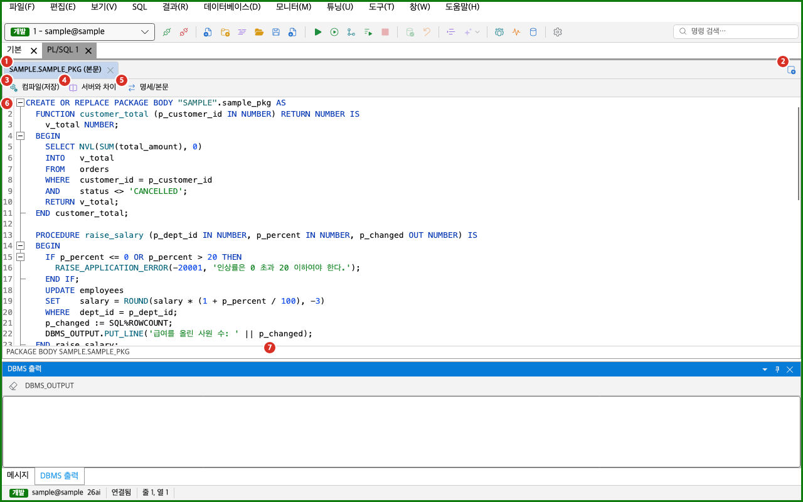
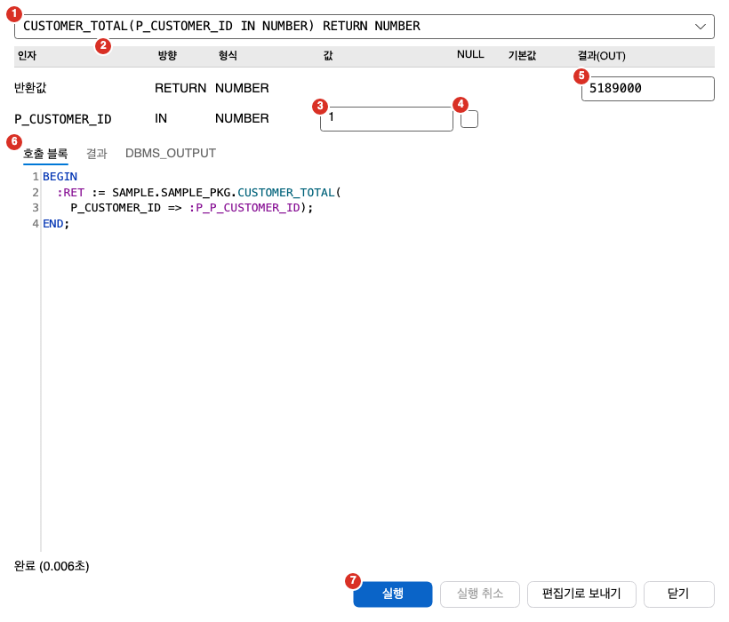

PL/SQL 편집기는 서버에 있는 프로시저, 함수, 패키지, 트리거, 타입의 소스를 고치고 컴파일하는 화면입니다. 이 쪽에서는 PL/SQL 작업 공간, 소스 열기, 컴파일과 컴파일 오류 창, 서버 소스와 비교, 명세와 본문 전환, 실행 창, 작업 공간 파일 저장을 설명합니다. 객체를 찾고 여는 방법은 [스키마 브라우저](../browser/)를 보세요.

:::note[켜진 기능에 따라 항목이 다릅니다]
다음 항목은 해당 기능이 꺼져 있으면 회색이 아니라 메뉴, 오른쪽 클릭 메뉴, 명령 팔레트, 단축키에서 아예 없어집니다.

| 항목 | 필요한 기능 | 기능이 켜지는 주 업무 |
|---|---|---|
| 새 PL/SQL 편집기, SQL > PL/SQL 메뉴의 컴파일·전환·차이, 컴파일 오류 창 | PL/SQL 편집기·컴파일·컴파일 오류 창 | 튜닝, 운영 DBA, 모든 기능. 「PL/SQL 패키지·프로시저도 고친다」를 덧붙여도 켜집니다. |
| PL/SQL 실행 대화상자, 프로시저·함수 실행 | PL/SQL 실행 대화상자 | 운영 DBA, 모든 기능. 「PL/SQL 패키지·프로시저도 고친다」를 덧붙여도 켜집니다. |
| PL/SQL 작업 공간에 추가, PL/SQL 작업 공간 파일로 저장, 작업 공간 자동 저장과 복원 | PL/SQL 작업 공간 저장·복원 | 모든 기능. 「PL/SQL 패키지·프로시저도 고친다」를 덧붙여도 켜집니다. |

주 업무를 고른 적이 없으면 「SQL 개발」로 동작하고, 이때는 위 항목이 모두 없습니다. 주 업무는 **설정 > 기능** 탭이나 **도구 > Role·기능 고르기…**에서 바꿉니다. 「조회만」에서는 세 기능을 켤 수 없습니다. 작업 공간 저장·복원은 앱을 다시 시작해야 바뀝니다.

「PL/SQL 소스 열기」는 PL/SQL 편집기가 꺼져 있어도 남습니다. 이때는 소스를 「[읽기 전용] OWNER.NAME」 SQL 탭에 읽기 전용으로 엽니다. 패키지 본문이면 이름 뒤에 `BODY`가 붙습니다. 상태 표시줄과 스키마 브라우저 상태 줄에 「PL/SQL 편집기 기능이 꺼져 있어 읽기 전용으로 열었습니다」가 나옵니다.
:::

## PL/SQL 편집기 화면

PL/SQL 편집기는 문서 영역에 PL/SQL 작업 공간 탭으로 열립니다. 작업 공간 하나가 문서 탭 하나이고, 그 안에 PL/SQL 탭이 여러 개 있습니다. 문서 탭 이름은 「PL/SQL 1」, 「PL/SQL 2」처럼 쓰고 있지 않은 가장 작은 번호가 붙습니다.



1. PL/SQL 탭 줄: 작업 공간의 PL/SQL 탭입니다. 탭 이름은 `OWNER.NAME`이고, 패키지 본문은 `OWNER.NAME (본문)`입니다. 탭 오른쪽의 「PL/SQL 탭 닫기」 단추로 탭을 닫습니다.
2. 새 PL/SQL 탭 단추: 이 작업 공간에 새 PL/SQL 탭을 더합니다. 단추의 이름은 「새 PL/SQL 탭」입니다.
3. 컴파일(저장) 단추: 편집기의 소스를 서버에 컴파일합니다.
4. 서버와 차이 단추: 서버 소스와 내 소스의 차이를 오른쪽에 보입니다.
5. 명세/본문 단추: 패키지와 타입에서만 보입니다. 반대쪽 소스를 엽니다.
6. 편집기: SQL 편집기와 같은 편집기입니다. 구문 강조, 찾기, 실행 취소를 그대로 씁니다.
7. 상태 줄: 객체 유형과 이름, 컴파일 결과, 읽기 실패 같은 안내를 보입니다.

탭 줄에 대한 규칙은 다음과 같습니다.

- 스키마 브라우저에서 객체를 한 번 눌러 연 탭은 미리보기 탭이고 탭 이름이 기울어집니다. 미리보기 탭은 모든 작업 공간을 통틀어 하나뿐입니다. 글을 고치거나 탭 머리를 두 번 누르면 보통 탭이 됩니다.
- 한 작업 공간의 탭이 서로 다른 접속을 쓰면 탭 이름 뒤에 `@접속 이름`이 붙습니다.
- 탭 머리를 오른쪽 클릭하면 「닫기」와 「다른 탭 닫기」가 나옵니다.
- 탭이 하나도 없으면 「PL/SQL 탭이 없습니다. 스키마 브라우저에서 객체를 열거나 탭 줄의 + 로 새 PL/SQL 탭을 엽니다.」가 보입니다.
- 탭에서 시작한 실행 창이 블록을 돌리는 동안에는 탭 머리에 회전 표시가 보입니다.
- 소스를 서버에서 읽는 동안 그 탭을 닫거나 다음 미리보기가 그 자리를 바꾸면 읽기를 멈춥니다.

탭을 새로 열 때 들어갈 작업 공간은 다음 순서로 정합니다. 명세와 본문 전환이나 탭 줄의 「새 PL/SQL 탭」이면 그 작업 공간, 활성 문서가 PL/SQL 작업 공간이면 그 작업 공간, 마지막으로 쓴 작업 공간 순서입니다. 모두 없으면 새 작업 공간을 만듭니다.

### 소스 열기

서버 객체의 소스를 여는 방법은 다음과 같습니다.

- 스키마 브라우저에서 프로시저, 함수, 패키지, 패키지 본문, 트리거, 타입, 타입 본문을 한 번 누르면 미리보기 탭, 두 번 누르거나 `Enter`를 누르면 고정 탭으로 열립니다.
- 객체를 오른쪽 클릭하고 「PL/SQL 소스 열기」를 고릅니다.
- 객체를 오른쪽 클릭하고 「PL/SQL 작업 공간에 추가」를 고릅니다. 고정 탭으로 들어가고 포커스는 스키마 브라우저에 남습니다. 패키지는 명세와 본문이 함께 들어갑니다. 짝을 읽지 못하면 그 탭만 빠집니다.
- `Ctrl+P`로 연 「DB 객체로 이동」 창에서 객체를 고릅니다.
- 객체 검색의 「소스 검색」 결과 줄을 두 번 누르면 그 줄로 열립니다. 방법은 [스키마 브라우저](../browser/#소스-검색-탭)를 보세요.

같은 접속의 같은 객체가 어느 작업 공간에든 열려 있으면 새로 열지 않고 그 탭을 앞으로 냅니다. 패키지 명세와 본문은 서로 다른 객체입니다.

서버 소스는 편집기에 `CREATE OR REPLACE`가 앞에 붙어서 보입니다. 첫 줄에는 소유자 이름이 다시 적힙니다. 다른 스키마로 컴파일되는 일을 막기 위해서입니다.

### 새 PL/SQL 만들기

**파일 > 새 PL/SQL 편집기**를 고르거나 도구 막대의 같은 이름 단추를 누르세요. `Ctrl+Shift+N`을 눌러도 됩니다. macOS에서는 `Cmd+Shift+N`입니다.

- 새 탭 이름은 「새 PL/SQL」이고 다음 뼈대가 들어 있습니다.

```sql
CREATE OR REPLACE PROCEDURE new_procedure
IS
BEGIN
    NULL;
END new_procedure;
```

- 탭의 접속은 스키마 브라우저가 보는 접속이고, 없으면 지금 접속입니다.
- 이 탭은 아직 서버 객체가 아닙니다. 컴파일하면 소스 머리글의 유형과 이름으로 서버에 만듭니다. 소유자가 없으면 접속 사용자의 스키마에 만듭니다.

### 파일로 열기

**파일 > 파일 열기**로 PL/SQL 소스 파일을 고르면 SQL 탭이 아니라 PL/SQL 작업 공간 탭으로 열립니다. 확장자는 `.pks`, `.pkb`, `.pls`, `.plb`, `.prc`, `.fnc`, `.trg`입니다. `.sql`과 `.pck` 같은 다른 확장자는 SQL 탭으로 열립니다.

- 파일 탭은 서버 객체가 아닙니다. 컴파일할 때 소스 머리글로 대상을 정합니다.
- 파일 탭을 컴파일해도 파일에는 쓰지 않습니다. 파일에 쓰는 일과 서버에 컴파일하는 일은 따로입니다.
- 같은 파일이 이미 SQL 탭이나 PL/SQL 탭에 열려 있으면 그 탭을 앞으로 냅니다.

## 컴파일과 컴파일 오류 창

「컴파일(저장)」은 편집기의 소스를 서버에 `CREATE OR REPLACE`로 보냅니다. 방법은 세 가지입니다.

- 편집기에 포커스를 두고 `F5`를 누릅니다. macOS에서도 `F5`입니다.
- **SQL > PL/SQL > 컴파일(저장)**을 고릅니다.
- 편집기 위쪽의 「컴파일(저장)」 단추를 누릅니다.

접속이 있고, 실행 중인 문장이 없고, 읽기 전용 접속이 아니어야 명령을 쓸 수 있습니다. 컴파일은 다음 순서로 진행됩니다.

1. 소스 머리글에서 유형과 이름을 읽습니다. 이름이나 유형이 열 때와 달라졌으면 새 객체로 봅니다.
2. 서버의 마지막 DDL 시각이 열 때와 같은지 확인합니다. 다르면 충돌로 보고 멈춥니다.
3. 다른 세션이 이 객체를 쓰고 있는지 확인합니다. 쓰고 있으면 경고하고 멈춥니다. 확인 권한이 없으면 경고 없이 진행합니다.
4. 지금 서버에 있는 소스를 변경 일지에 보관합니다. 새 객체이면 보관할 소스가 없어 건너뜁니다. 변경 일지는 [DB 도구](../../tools/db-tools/)에서 설명합니다.
5. 실행 엔진으로 보냅니다. 정책 관문과 실행 확인을 거치고, 운영 접속에서는 실행 확인 창이 나옵니다. 자세한 내용은 [SQL 실행](../../run/execute/)을 보세요.
6. 서버의 오류 목록을 읽어 컴파일 오류 창에 올리고, 마지막 DDL 시각을 새로 기억합니다.

충돌 띠의 「무시하고 덮어쓰기」로 컴파일하면 2단계와 3단계를 건너뜁니다.

컴파일할 수 있는 소스는 PL/SQL 단위 하나입니다. 단위의 끝은 단독 줄의 `/`입니다. `/`가 없으면 글 끝까지 한 단위입니다. 단위 뒤의 `/` 줄, `SHOW ERRORS`, 빈 줄, 주석은 떼고 보냅니다. 그 뒤에 `GRANT`나 두 번째 `CREATE` 같은 글이 남아 있으면 컴파일하지 않습니다.

결과는 상태 줄에 나옵니다.

| 상태 줄 | 뜻 |
|---|---|
| 컴파일됨 | 오류도 경고도 없습니다. |
| 컴파일됨 (경고 N건) | 컴파일됐고 경고만 있습니다. |
| 컴파일됐지만 오류 N건 | 객체는 만들어졌지만 INVALID입니다. 컴파일 오류 창에서 오류를 확인하세요. |
| 접속이 없다 | 접속이 없습니다. |
| PACKAGE·PROCEDURE·FUNCTION·TRIGGER·TYPE 소스가 아니다 | 소스 머리글을 읽지 못했습니다. |
| 단위가 여러 개인 파일은 컴파일하지 않는다로 시작하는 글 | 소스에 단위가 둘 이상 있습니다. SQL 탭에서 스크립트로 실행하세요. |
| 다른 사람이 서버 소스를 바꿨다로 시작하는 글 | 충돌입니다. 아래 충돌 띠를 보세요. |
| 다른 세션 N개가 이 객체를 쓰고 있다로 시작하는 글 | 사용 중 경고입니다. 아래 충돌 띠를 보세요. |
| 정책이 컴파일을 막았다 | 정책 관문이 막았습니다. |
| 컴파일이 취소됐다 | 실행 확인에서 취소했습니다. |
| ORA 오류 번호와 메시지 | 서버가 문장을 거부했습니다. |

### 충돌 띠

충돌이나 사용 중 경고가 나면 편집기 위에 띠가 나옵니다. 편집하는 동안 서버 소스가 바뀐 경우에는 「편집하는 동안 다른 사람이 서버의 이 소스를 바꿨다.」로 시작하는 안내가 보입니다. 사용 중 경고이면 「다른 세션 N개가 이 객체를 쓰고 있다.」로 시작하는 안내가 보입니다.

- 「무시하고 덮어쓰기」: 충돌과 사용 중 경고를 알고도 컴파일합니다.
- 「서버 소스 다시 읽기」: 서버 소스를 다시 읽어 편집기를 바꿉니다. 고친 내용은 사라집니다.

덮어쓰기 전에 「서버와 차이」로 무엇이 다른지 먼저 확인하세요.

### 컴파일 오류 창

컴파일 오류 창은 마지막으로 컴파일했거나 연 PL/SQL 탭의 오류와 경고를 보여 줍니다.


1. 머리 줄: 상태 아이콘과 요약입니다. 「탭 이름: 오류 N건, 경고 M건」이나 「탭 이름: 컴파일 오류 없음」이 보입니다. 아이콘은 오류가 있으면 오류, 경고만 있으면 경고, 깨끗하면 확인 표시입니다. 아직 컴파일한 탭이 없으면 「컴파일 오류 없음」이 보입니다.
2. 표 머리글: 종류, 줄:열, 메시지 열 이름입니다.
3. 종류: 아이콘과 「오류」 또는 「경고」입니다.
4. 줄:열: 오류 위치입니다. 서버가 알려 준 줄과 열 번호입니다.
5. 메시지: 서버의 오류 메시지입니다.

- 줄을 고르면 그 탭의 오류 위치로 커서가 옮겨지고 편집기로 포커스가 갑니다. 마우스를 올리면 「두 번 누르면 그 줄로 이동」이라는 도움말이 보이지만, 줄을 고르는 순간 이동합니다.
- 오류 위치는 서버 소스 기준이고, 편집기에 앞에 붙은 `CREATE OR REPLACE`를 고려해 맞춥니다.
- 창은 아래 도구 창 자리에 열립니다. **보기 > 도구 창 > 컴파일 오류**를 고르거나 명령 팔레트에서 「컴파일 오류」를 실행하면 열립니다.
- 명령(`F5`와 메뉴)으로 컴파일하면 오류가 없어도 이 창이 자동으로 열립니다. 위쪽 단추로 컴파일하면 오류나 경고가 있을 때만 열립니다.
- 객체를 열 때 읽은 기존 오류도 같은 창에 올라갑니다. 뒤에서 읽는 다른 탭의 오류는 올라가지 않습니다.
- 닫은 탭의 오류 목록은 창에서 치워집니다.

## 서버 소스와 비교

편집한 소스를 서버의 현재 소스와 줄 단위로 견줍니다.


1. 서버와 차이 단추: 서버 소스를 새로 읽어 차이 보기를 엽니다.
2. 편집기: 내가 고친 소스입니다. 차이 보기를 열면 편집기가 왼쪽 절반으로 줄어듭니다.
3. 서버 머리: 나란히 보기의 왼쪽이 서버 소스라는 표시입니다.
4. 내 소스 머리: 나란히 보기의 오른쪽이 편집기 소스라는 표시입니다.
5. 차이 닫기 단추: 차이 보기를 닫습니다.
6. 차이 본문: 서버 소스와 내 소스를 나란히 보입니다. 줄 번호가 붙고, 서버에만 있는 줄은 `−`, 내 소스에만 있는 줄은 `+`로 표시됩니다.

- 비교할 때 줄 끝 공백, 문서 끝 빈 줄, `CREATE OR REPLACE` 머리는 무시합니다.
- 차이가 없으면 차이 칸에 「(차이 없음)」이 보입니다.
- 편집기와 차이 칸 사이의 경계를 끌면 너비가 바뀝니다.
- 위쪽 「서버와 차이」 단추는 언제나 누를 수 있습니다. **SQL > PL/SQL > 서버 소스와 차이 보기** 명령은 편집하는 동안 서버 소스가 바뀐 것을 알았을 때만 켜집니다.
- 서버 소스가 열 때와 달라진 것을 컴파일이나 접속 복원 때 알게 되면 충돌 띠가 나오고 차이 보기가 함께 채워집니다.
- 서버에 없는 새 문서와 파일 탭에서는 비교할 서버 소스가 없어 아무것도 열리지 않습니다.

PL/SQL 탭의 차이 보기는 MyBatis 매퍼 저장 창과 같은 나란히 보기 표를 씁니다. 그 저장 창(제목 「파일 이름 에 저장」, 「바뀌는 부분」 영역)은 MyBatis 저장 때만 열리고 PL/SQL 컴파일에서는 열리지 않습니다. 자세한 내용은 [MyBatis](../../editor/mybatis/)를 보세요.

## 명세와 본문 전환

패키지와 타입은 명세와 본문이 따로 있는 객체입니다. 명세 탭에서 `Ctrl+Shift+B`를 누르면 본문이 열리고, 본문 탭에서 누르면 명세가 열립니다. macOS에서는 `Cmd+Shift+B`입니다.

- **SQL > PL/SQL > 명세/본문 전환**이나 편집기 위쪽의 「명세/본문」 단추로도 같은 일을 합니다.
- 반대쪽은 같은 작업 공간의 새 탭으로 열립니다. 이미 어느 작업 공간에든 열려 있으면 그 탭으로 옮겨 갑니다.
- 지금 탭은 그대로 남으므로 고치던 글을 잃지 않습니다.
- 반대쪽이 서버에 없으면 탭을 만들지 않고 상태 줄에 이유를 보입니다.
- 패키지와 타입 탭에서만 쓸 수 있습니다.

## PL/SQL 실행 창

PL/SQL 실행 창은 프로시저나 함수의 인자를 입력해서 호출하고 결과를 보는 창입니다. 제목은 「PL/SQL 실행」 뒤에 객체 이름이 붙습니다.

여는 방법은 세 가지입니다.

- PL/SQL 편집기에서 `Ctrl+Enter`를 누릅니다. macOS에서는 `Cmd+Enter`입니다.
- **SQL > PL/SQL > PL/SQL 실행 대화상자**를 고릅니다.
- 스키마 브라우저에서 프로시저, 함수, 패키지, 패키지 본문을 오른쪽 클릭하고 「프로시저·함수 실행」을 고릅니다.

편집기에서 여는 명령은 서버에서 연 프로시저, 함수, 패키지, 패키지 본문 탭에서만 켜집니다. 새 문서는 컴파일해서 서버 객체가 된 뒤에 켜집니다. 트리거와 타입은 실행할 수 없습니다.



1. 호출 대상 콤보 상자: 후보가 둘 이상일 때만 보입니다. 패키지는 멤버마다 후보가 되고, 오버로드도 따로 나옵니다.
2. 인자 표 머리글: 인자, 방향, 형식, 값, NULL, 기본값, 결과(OUT) 열입니다.
3. 값 칸: IN과 IN OUT 인자에 값을 씁니다.
4. NULL과 기본값 체크 상자: NULL을 보내거나 기본값을 씁니다.
5. 결과(OUT) 칸: 실행한 뒤 OUT 값과 함수의 반환값이 나옵니다.
6. 탭 줄: 「호출 블록」, 「결과」, 「DBMS_OUTPUT」 탭입니다.
7. 단추 줄: 「실행」, 「실행 취소」, 「편집기로 보내기」, 「닫기」 단추입니다.

창 아래에는 상태 글이 한 줄 나옵니다.

### 호출 대상과 인자

- 후보의 글은 `NAME(A IN NUMBER, B OUT VARCHAR2) RETURN NUMBER` 모양입니다. 기본값이 있는 인자에는 `DEFAULT`가 붙고, 오버로드는 `[오버로드 N]`이 붙습니다.
- 함수의 반환값은 「반환값」이라는 이름에 방향 `RETURN`으로 나옵니다.
- 방향은 `IN`, `OUT`, `IN OUT`입니다. OUT 전용 인자와 반환값에는 값 칸이 없고 결과 칸만 있습니다.
- NULL을 체크하면 값 칸이 꺼지고 NULL을 보냅니다.
- 기본값이 있는 IN 인자에는 「기본값」 체크 상자가 있고 처음부터 체크되어 있습니다. 체크하면 그 인자를 빼고 호출합니다. 값을 직접 보내려면 체크를 푸세요.
- BOOLEAN 인자는 값 칸에 `TRUE`나 `FALSE`를 씁니다.
- 값은 글에 끼워 넣지 않고 모두 바인드 변수로 보냅니다.
- 입력이 바뀔 때마다 「호출 블록」 탭의 글이 다시 만들어집니다. 형식이 맞지 않는 값이 있으면 그 탭 아래에 빨간 글로 이유가 나오고 「실행」이 꺼집니다.

대화상자에서 입력할 수 없는 형식은 값 칸에 이유가 나옵니다.

| 형식 | 안내 |
|---|---|
| REF CURSOR(IN) | 「REF CURSOR 는 입력(IN)으로 보낼 수 없습니다. 편집기에서 직접 열어 넘기세요.」 |
| PL/SQL RECORD | 「레코드 형식은 대화상자에서 입력할 수 없습니다. 편집기에서 직접 호출하세요.」 |
| 컬렉션 | 「컬렉션 형식은 대화상자에서 입력할 수 없습니다. 편집기에서 직접 호출하세요.」 |
| 객체, XML, JSON | 「객체·XML·JSON 형식은 대화상자에서 입력할 수 없습니다. 편집기에서 직접 호출하세요.」 |
| 그 밖의 형식 | 「형식 X 은(는) 대화상자에서 지원하지 않습니다.」 |

### 실행

「실행」을 누르면 호출 블록을 실행 엔진으로 보냅니다. 정책 관문과 실행 확인을 거치므로 운영 접속에서는 실행 확인 창이 나옵니다. 실행 중에는 편집기 탭 머리에 회전 표시가 보이고 「실행 취소」가 켜집니다.

- 이 창은 다른 창을 막지 않습니다. 결과를 보면서 값을 고쳐 다시 실행할 수 있습니다.
- 기본 단추는 「닫기」입니다. `Enter`를 눌러도 실행되지 않습니다.
- 편집기에서 열면 그 PL/SQL 탭의 접속으로 실행합니다. 스키마 브라우저에서 열면 지금 접속으로 실행하고, 활성 SQL 작업 공간이 같은 접속을 쓰면 그 작업 공간의 세션으로 실행합니다.
- 접속이 이미 다른 문장을 실행 중이면 「그 접속은 지금 실행 중입니다. 끝난 뒤 다시 실행하세요.」가 나옵니다.

실행이 끝나면 다음이 채워집니다.

- 결과(OUT) 칸: OUT 값과 반환값이 나옵니다. BOOLEAN은 `TRUE`나 `FALSE`, NULL은 `NULL`로 보입니다.
- 「결과」 탭: OUT 인자가 REF CURSOR이면 결과 그리드로 열립니다. 결과 칸에는 커서라는 안내가 나옵니다. 결과 그리드는 [결과 그리드](../../run/result-grid/)와 같습니다.
- 「DBMS_OUTPUT」 탭: 블록이 DBMS_OUTPUT으로 낸 글이 나옵니다.
- 상태 글: 성공하면 「완료 (N초)」가 나옵니다. 변경이 커밋되지 않았으면 「미커밋 변경 있음」이 붙습니다. 오류이면 오류 번호와 메시지가 빨간 글로 나옵니다. 정책 관문이 막았으면 「거부됨: 이유」, 취소했으면 「취소되었습니다.」가 나옵니다.

자동 커밋이 켜져 있고 읽기 전용 접속이 아니면 성공한 뒤 바로 커밋합니다. 꺼져 있으면 변경이 남으므로 직접 커밋하거나 롤백하세요. 자세한 내용은 [SQL 실행](../../run/execute/)을 보세요.

### 편집기로 보내기

「편집기로 보내기」를 누르면 호출 블록을 새 SQL 탭에 넣고 창을 닫습니다. 입력한 값은 `-- :바인드이름 (형식) = 값` 주석으로 앞에 적히고, 블록 뒤에 `/`가 붙습니다. 값은 글 안에 들어가지 않으므로 SQL 탭에서 실행할 때 바인드 값을 다시 입력합니다. 기본값을 쓰는 인자는 주석에 적히지 않습니다.

실행 창을 열지 못하면 상태 글에 이유가 나옵니다. 「접속이 없습니다. 접속한 뒤 실행하세요.」, 「인자 정보를 읽지 못했습니다: 이유」, 「실행할 수 있는 프로시저·함수가 없습니다.」, 「프로시저·함수 정보를 찾지 못했습니다.」가 있습니다. 인자가 없으면 「인자가 없습니다. 「실행」 을 누르면 바로 호출합니다.」가 나옵니다.

## 작업 공간 저장과 파일

### 자동 저장과 복원

PL/SQL 작업 공간은 자동으로 저장됩니다. 주기는 **설정 > 일반** 탭의 「자동 저장(초)」를 따릅니다. 값은 1초에서 10초입니다. 앱을 끝낼 때 한 번 더 저장합니다.

- 미리보기 탭은 저장하지 않습니다. 미리보기만 담은 작업 공간도 저장하지 않습니다.
- 앱을 다시 켜면 **설정 > 일반** 탭의 「시작할 때 마지막 작업 공간 열기」가 켜져 있을 때 작업 공간을 되살립니다. 열린 목록의 앞에서부터 10개까지 되살립니다.
- 되살린 탭에는 저장한 글이 그대로 들어 있고, 고친 채 저장한 탭은 고친 상태로 열립니다.
- 되살린 탭은 접속이 열릴 때까지 기다립니다. 그 접속이 열리면 저장해 둔 마지막 DDL 시각과 서버를 견줍니다. 달라졌으면 충돌 띠가 나옵니다.
- 접속을 기다리는 동안은 상태 줄에 「접속하면 서버 소스와 견준다」가 보이고, 이 탭에서는 실행과 명세/본문 전환을 쓸 수 없습니다.
- 사용자가 닫은 작업 공간은 백업 폴더로 옮겨지고 다음 시작에 되살아나지 않습니다.

### 작업 공간 파일

작업 공간을 `.plsql-workspace.md` 파일로 저장해서 다른 PC와 나눌 수 있습니다. 파일은 UTF-8이고 사람이 읽을 수 있는 Markdown입니다. 탭마다 제목, 접속 이름, 마지막 DDL 시각, SQL 코드 블록이 들어 있습니다. 접속은 PC마다 다른 ID가 아니라 접속 이름으로 적힙니다.

- 저장: **파일 > 작업 공간 > PL/SQL 작업 공간 파일로 저장**을 고르세요. 처음이면 저장 위치를 묻고, 확장자가 `.plsql-workspace.md`가 아니면 붙입니다. 이미 저장한 작업 공간이면 같은 파일에 덮어씁니다. 임시 파일에 쓴 뒤 바꿔 넣으므로 쓰다가 실패해도 기존 파일이 남습니다.
- 열기: 「파일 열기」나 「작업 공간 열기…」 명령으로 `.plsql-workspace.md` 파일을 고르세요. 같은 파일에서 온 작업 공간이 이미 열려 있으면 그 작업 공간을 앞으로 냅니다.
- 접속은 이름이 같은 접속 프로필을 찾아 붙입니다. 없으면 접속 없이 열립니다. 이름이 같은 프로필이 둘 이상이면 「같은 이름의 접속이 둘 이상이라 접속 없이 열었다」로 시작하는 안내가 나옵니다.
- 파일에 묶인 탭은 열 때 디스크의 파일을 다시 읽습니다. PL/SQL 소스 확장자가 아니거나 파일이 없으면 묶음을 풀고 작업 공간 파일에 적힌 글로 연 새 탭이 됩니다.
- 파일을 읽지 못하면 「파일을 열지 못했다」로 시작하는 안내가 나옵니다.

### 탭 닫기와 저장 확인

고친 PL/SQL 탭을 닫으면 저장 여부를 묻는 창이 뜹니다. 창의 모양은 SQL 탭과 같습니다. 자세한 내용은 [SQL 편집기](../../editor/sql-editor/)를 보세요.

- 「저장」은 서버가 아니라 로컬 파일에 저장합니다. 파일에 묶인 탭이면 그 파일에, 아니면 다른 이름으로 저장합니다.
- 서버에 반영하는 일은 컴파일로만 합니다.
- 서버 객체를 연 탭이나 컴파일한 탭은 마지막으로 읽거나 컴파일한 뒤에 고쳤을 때 묻습니다.
- 새 탭은 사용자가 글을 직접 썼을 때 묻습니다. 뼈대 그대로면 묻지 않습니다.
- 작업 공간 문서를 닫을 때는 고친 탭마다 차례로 묻습니다.
- 앱을 끝낼 때는 묻지 않습니다. 작업 공간이 저장되기 때문입니다.

## 단축키

단축키는 기본 키맵 기준입니다. 키는 [단축키와 명령 팔레트](../../settings/shortcuts/)에서 바꿉니다. PL/SQL 편집기 키는 편집기에 포커스가 있을 때만 동작합니다.

| 명령 | Windows | macOS | 동작 조건 |
|---|---|---|---|
| 새 PL/SQL 편집기 | `Ctrl+Shift+N` | `Cmd+Shift+N` | 언제나 |
| 컴파일(저장) | `F5` | `F5` | PL/SQL 편집기에 포커스가 있을 때 |
| 명세/본문 전환 | `Ctrl+Shift+B` | `Cmd+Shift+B` | PL/SQL 편집기에 포커스가 있을 때 |
| PL/SQL 실행 대화상자 | `Ctrl+Enter` | `Cmd+Enter` | PL/SQL 편집기에 포커스가 있을 때 |
| 서버 소스와 차이 보기 | 없음 | 없음 | 키가 없습니다. |
| PL/SQL 소스 열기 | 없음 | 없음 | 키가 없습니다. |
| PL/SQL 작업 공간에 추가 | 없음 | 없음 | 키가 없습니다. |
| 프로시저·함수 실행 | 없음 | 없음 | 키가 없습니다. |
| PL/SQL 작업 공간 파일로 저장 | 없음 | 없음 | 키가 없습니다. |
| 컴파일 오류 | 없음 | 없음 | 키가 없습니다. |

## 자주 하는 작업

### 패키지 본문을 고쳐서 컴파일하기

1. 스키마 브라우저에서 패키지 본문을 두 번 누르세요.
2. 편집기에서 소스를 고치세요.
3. `F5`를 누르세요.
4. 상태 줄이 「컴파일됨」인지 확인하세요.
5. 「컴파일됐지만 오류 N건」이면 컴파일 오류 창에서 오류 줄을 누르세요.

### 컴파일 오류 줄로 이동하기

1. 컴파일 오류 창이 닫혀 있으면 **보기 > 도구 창 > 컴파일 오류**를 고르세요.
2. 오류 목록에서 줄을 고르세요.
3. 편집기에서 커서가 놓인 위치를 고치세요.
4. 다시 컴파일하세요.

### 서버 소스와 비교하고 덮어쓰기

1. 컴파일하다가 충돌 띠가 나오면 「서버와 차이」를 누르세요.
2. 오른쪽 차이 보기에서 서버에서 바뀐 줄을 확인하세요.
3. 내 소스로 덮어써도 되면 「무시하고 덮어쓰기」를 누르세요.
4. 서버 소스를 받아야 하면 「서버 소스 다시 읽기」를 누르세요. 고친 내용이 사라집니다.

### 명세와 본문을 오가며 고치기

1. 패키지 명세 탭에서 `Ctrl+Shift+B`를 누르세요. macOS에서는 `Cmd+Shift+B`를 누르세요.
2. 열린 본문 탭에서 소스를 고치세요.
3. 명세를 다시 고쳐야 하면 본문 탭에서 같은 키를 누르세요.
4. 명세를 먼저 컴파일하고 본문을 컴파일하세요.

### 새 프로시저 만들기

1. **파일 > 새 PL/SQL 편집기**를 고르세요.
2. 뼈대의 이름과 본문을 고치세요.
3. `F5`를 누르세요.
4. 스키마 브라우저에서 「새로 고침」을 누르세요. 프로시저 유형 아래에 새 객체가 보입니다.

### 프로시저나 함수 실행하기

1. 스키마 브라우저에서 패키지를 오른쪽 클릭하고 「프로시저·함수 실행」을 고르세요.
2. 호출 대상 콤보 상자에서 멤버를 고르세요.
3. 값 칸에 인자를 쓰세요.
4. 「호출 블록」 탭에서 블록을 확인하세요.
5. 「실행」을 누르세요.
6. 결과(OUT) 칸, 「결과」 탭, 「DBMS_OUTPUT」 탭을 확인하세요.

:::caution[데이터를 바꾸는 프로시저는 커밋될 수 있습니다]
`UPDATE`를 하는 프로시저를 실행했을 때 자동 커밋이 켜져 있으면 바로 확정됩니다. 롤백으로 되돌릴 수 없습니다. 운영 DB에서는 실행하기 전에 자동 커밋 상태를 확인하세요.
:::

### 작업 공간을 파일로 저장하고 다시 열기

1. 저장할 PL/SQL 작업 공간 탭을 앞으로 내세요.
2. **파일 > 작업 공간 > PL/SQL 작업 공간 파일로 저장**을 고르세요.
3. 파일 이름을 정하고 저장하세요.
4. 다시 열 때는 「파일 열기」에서 `.plsql-workspace.md` 파일을 고르세요.

## 문제가 생길 때

| 증상 | 원인 | 해결 |
|---|---|---|
| 메뉴에 PL/SQL 항목이 없습니다. | PL/SQL 기능이 꺼져 있습니다. 주 업무를 고른 적이 없으면 「SQL 개발」로 동작합니다. | 이 쪽 앞의 표를 보고 **설정 > 기능**에서 「PL/SQL 패키지·프로시저도 고친다」를 켜세요. |
| 「PL/SQL 소스 열기」를 했더니 「[읽기 전용] …」 SQL 탭이 열립니다. | PL/SQL 편집기 기능이 꺼져 있습니다. | **설정 > 기능**에서 PL/SQL 기능을 켜세요. |
| 「컴파일(저장)」이 회색입니다. | 접속이 없거나, 실행 중인 문장이 있거나, 읽기 전용 접속이거나, 조회 전용 Role입니다. | 마우스를 올려 이유를 읽고, 쓰기가 가능한 접속에서 실행이 끝난 뒤 컴파일하세요. |
| 「서버 소스와 차이 보기」가 회색입니다. | 서버 소스가 바뀐 것을 아직 모릅니다. | 편집기 위쪽의 「서버와 차이」 단추를 누르세요. |
| 「명세/본문 전환」이 회색이거나 「명세/본문」 단추가 없습니다. | 패키지나 타입 탭이 아닙니다. | 패키지 명세나 본문 탭에서 쓰세요. |
| 「PL/SQL 실행 대화상자」가 회색입니다. | 서버에서 연 프로시저, 함수, 패키지, 패키지 본문 탭이 아니거나, 접속을 기다리는 복원 탭이거나, 실행 중인 문장이 있습니다. | 새 문서이면 먼저 컴파일하세요. 복원 탭이면 접속을 여세요. |
| 컴파일했더니 충돌 띠가 나옵니다. | 편집하는 동안 다른 사람이 서버 소스를 바꿨습니다. | 「서버와 차이」로 확인하고 덮어쓰거나 서버 소스를 다시 읽으세요. |
| 「다른 세션 N개가 이 객체를 쓰고 있다」가 나옵니다. | 다른 세션이 이 객체를 쓰는 중입니다. 지금 컴파일하면 기다리거나 그 세션이 영향을 받습니다. | 세션이 끝난 뒤 컴파일하거나 「무시하고 덮어쓰기」를 누르세요. |
| 「단위가 여러 개인 파일은 컴파일하지 않는다」로 시작하는 글이 나옵니다. | 소스에 `GRANT`나 두 번째 `CREATE` 같은 글이 더 있습니다. | 단위를 하나씩 나누거나 SQL 탭에서 스크립트로 실행하세요. |
| 「PACKAGE·PROCEDURE·FUNCTION·TRIGGER·TYPE 소스가 아니다」가 나옵니다. | 소스 머리글을 읽지 못했습니다. | 소스가 `CREATE OR REPLACE` 또는 유형 이름으로 시작하는지 확인하세요. |
| 「컴파일됐지만 오류 N건」이 나옵니다. | 소스에 컴파일 오류가 있어 객체가 INVALID입니다. | 컴파일 오류 창에서 오류 줄을 고쳐 다시 컴파일하세요. |
| 컴파일 오류 창이 비어 있습니다. | 아직 컴파일한 탭이 없거나, 마지막으로 올린 탭을 닫았습니다. | 탭을 컴파일하거나 다시 여세요. |
| 「이 탭을 연 접속이 아직 열리지 않았다」로 시작하는 글이 나옵니다. | 앱을 다시 켜서 복원한 탭이 저장해 둔 접속을 기다리고 있습니다. | 그 접속을 여세요. 열리면 서버 소스와 견주고 컴파일할 수 있습니다. |
| 파일을 열었더니 PL/SQL 탭이 아니라 SQL 탭으로 열립니다. | 확장자가 `.pks`, `.pkb`, `.pls`, `.plb`, `.prc`, `.fnc`, `.trg`가 아닙니다. | 확장자를 맞추거나 SQL 탭에서 쓰세요. |
| 실행 창에서 「실행」이 꺼져 있습니다. | 값의 형식이 맞지 않거나, 실행 중이거나, 접속이 없습니다. | 「호출 블록」 탭 아래의 빨간 글을 읽고 값을 고치세요. |
| 값 칸에 「레코드 형식은 대화상자에서 입력할 수 없습니다」 같은 안내가 나옵니다. | 대화상자가 지원하지 않는 형식입니다. | 「편집기로 보내기」를 쓰거나 SQL 탭에서 직접 호출하세요. |
| 실행 뒤 상태 글에 「미커밋 변경 있음」이 붙습니다. | 자동 커밋이 꺼져 있어 변경이 남았습니다. | 커밋하거나 롤백하세요. |
| `.plsql-workspace.md`를 열었더니 접속이 없습니다. | 같은 이름의 접속 프로필이 없거나 둘 이상입니다. | 접속 이름을 맞추거나 중복 프로필을 정리하세요. |
