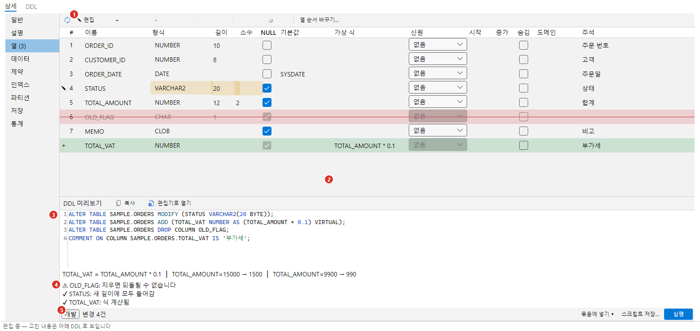
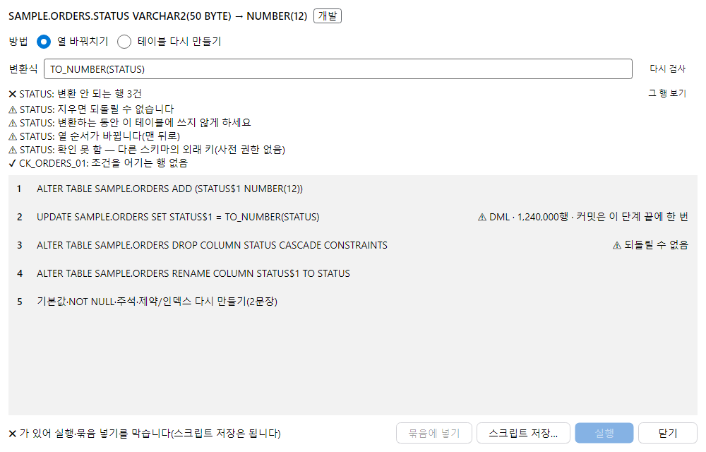
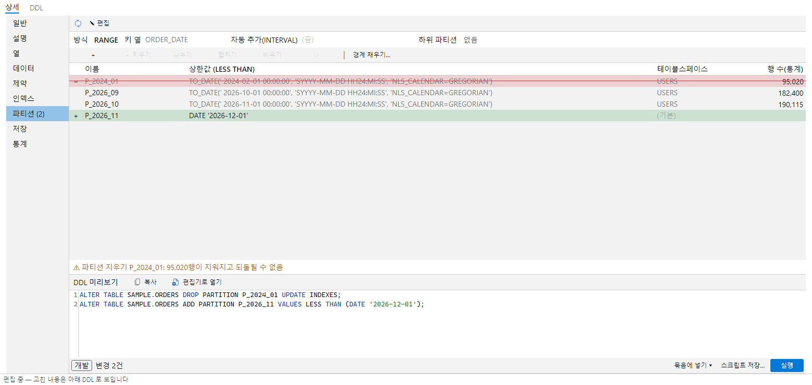
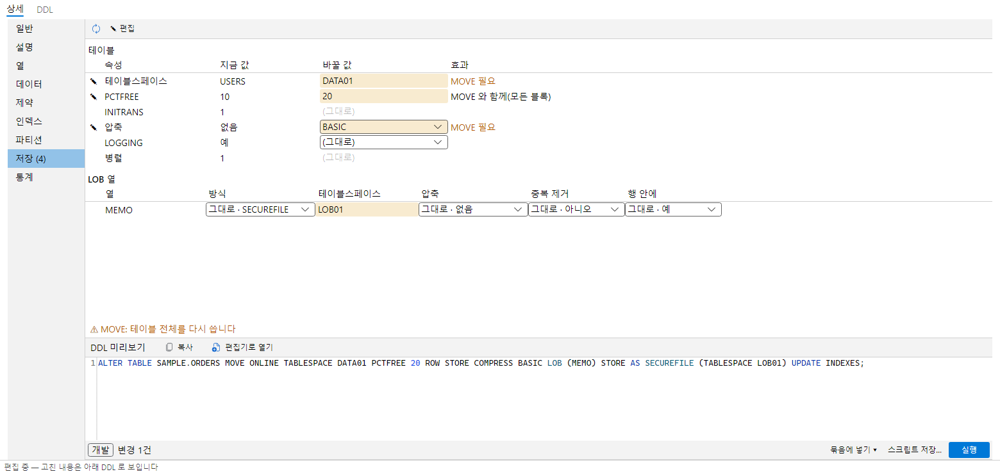
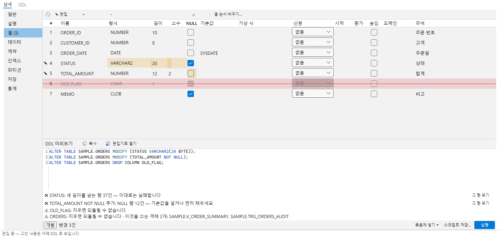

테이블 편집기는 테이블의 구조를 표에서 고치는 기능입니다. 객체 상세 창에서 **✎ 편집**을 켜고 열, 제약, 인덱스를 고치면 바뀐 만큼의 DDL이 아래에 바로 보입니다. DDL을 확인한 뒤 실행하거나, `.sql` 파일로 저장하거나, [반영 묶음](../../tools/db-tools/#반영-묶음)에 넣습니다. 새 테이블도 같은 화면에서 만듭니다. 객체 상세 창 자체는 [스키마 브라우저](../browser/#객체-상세-창)에서 설명합니다.

:::note[켜진 기능에 따라 다릅니다]
테이블 편집기는 「테이블 편집」 기능입니다. 주 업무가 「SQL 개발」, 「운영 DBA」, 「모든 기능」이거나 「함께 하는 일」을 덧붙이면 켜집니다. 「튜닝」과 「조회만」에서는 꺼져 있습니다. 기능이 꺼져 있으면 **✎ 편집** 단추와 **테이블 편집 켜기·끄기** 명령이 없어집니다. 기능은 **설정 > 기능** 탭에서 바꿉니다. 자세한 내용은 [설정](../../settings/options/#기능)을 보세요.
:::

## 편집 켜기와 끄기

1. 스키마 브라우저에서 테이블을 열어 객체 상세 창을 엽니다.
2. 「열」, 「제약」, 「인덱스」, 「설명」 구역(파티션 테이블이면 「파티션」도) 중 하나를 고릅니다. 이 구역에서만 **✎ 편집** 단추가 보입니다.
3. **✎ 편집**을 켭니다. 또는 명령 팔레트의 「테이블 편집 켜기·끄기」를 씁니다. 읽기 전용 접속에서는 이 명령이 꺼져 있습니다.

대상은 테이블(TABLE)뿐입니다. 뷰, 시퀀스, 인덱스 같은 객체에는 단추가 없습니다.

- 편집을 켜면 서버에서 테이블 정보를 캐시를 쓰지 않고 새로 읽습니다. 다른 사람이 그사이 바꾼 구조 위에 DDL을 만들지 않기 위해서입니다.
- 편집은 탭 하나에 하나입니다. 「열」에서 고치고 「제약」으로 옮겨도 고친 내용은 그대로입니다. DDL 미리보기는 모든 구역의 변경을 함께 보여 줍니다.
- 고친 내용이 있는 구역 이름 뒤에 건수가 붙습니다. 예는 「열 (2)」입니다.
- 편집 중에도 「일반」, 「통계」 같은 다른 구역은 그대로 볼 수 있습니다.
- 임시 테이블, 외부 테이블, 인덱스 구성 테이블(IOT), 클러스터 테이블은 고칠 수 있는 범위가 좁습니다. 편집을 켜면 상태 줄에 이유가 나옵니다. 일반 테이블이 아닌 경우 열 주석과 기본값, 테이블 주석만 고칠 수 있고, 임시 테이블과 IOT는 열 추가·지우기와 테이블 이름도 고칠 수 있습니다.
- 읽기 전용 접속에서는 「실행」이 회색입니다. 「스크립트 저장…」은 쓸 수 있습니다.

고친 내용이 있을 때 다음 동작은 먼저 묻습니다.

| 동작 | 묻는 글 |
|---|---|
| **✎ 편집**을 끔 | 「고친 내용을 버리고 편집을 끌까요?」 |
| 「새로 고침」 단추 | 「고친 내용을 버리고 새로 읽을까요?」 |
| 탭 닫기, 앱 끝내기 | 「고친 내용을 버리고 탭을 닫을까요?」 |
| 「열 순서 바꾸기…」 | 먼저 아래 「실행」으로 반영하거나 버려야 한다는 안내와 함께 버릴지 묻습니다. |

기존 열의 순서는 이 편집기에서 바꾸지 않습니다. 「열 순서 바꾸기…」 창을 쓰세요. 방법은 [스키마 브라우저](../browser/#열-순서-바꾸기)에서 설명합니다. 편집 도구줄의 「↑」와 「↓」는 아직 실행하지 않은 새 열만 옮깁니다.

## 편집 화면



1. 편집 도구줄: **✎ 편집**, 줄 단추, 「열 순서 바꾸기…」가 있습니다.
2. 편집 표: 구역마다 다른 표입니다. 아래 구역별 설명을 보세요.
3. DDL 미리보기: 고친 내용에서 만든 문장입니다. 읽기 전용이고 줄 순서가 실제 실행 순서입니다.
4. 검사 줄: 실행 전 검사 결과입니다. 검사 결과가 없으면 보이지 않습니다.
5. 아래 단추 줄: 환경 배지, 변경 건수, 「묶음에 넣기 ▾」, 「스크립트 저장…」, 「실행」입니다.

편집 도구줄의 단추는 다음과 같습니다.

| 단추 | 하는 일 |
|---|---|
| 「새로 고침」(아이콘) | 상세를 서버에서 다시 읽습니다. 고친 내용이 있으면 먼저 묻습니다. |
| 「＋」 | 새 줄을 더합니다. 열과 인덱스 구역에서 씁니다. |
| 「＋ ▾」 | 새 제약을 고릅니다. 제약 구역에서만 보입니다. |
| 「－」 | 고른 줄을 지울 줄로 표시합니다. 다시 누르면 되살립니다. |
| 「↑」, 「↓」 | 새 열의 순서를 바꿉니다. 열 구역에서만 보입니다. |
| 「↺」 | 고른 줄을 원래대로 되돌립니다. |
| 「열 순서 바꾸기…」 | 기존 열 순서를 바꾸는 창을 엽니다. |

표의 색과 줄 머리 표시는 다음과 같습니다.

| 모양 | 뜻 |
|---|---|
| 노란 칸, 줄 머리 「✎」 | 고친 칸 |
| 초록 줄, 줄 머리 「+」 | 새 줄 |
| 빨간 줄, 줄 머리 「−」 | 지울 줄 |
| 흐린 줄 | 이 편집기에서 고치지 않는 줄 |

칸에 글을 쓰고 칸을 벗어나면 그 글이 모델에 들어가고, 그때 아래 DDL이 다시 만들어집니다. 고쳤다가 원래 값으로 되돌리면 그 문장도 사라집니다. 편집을 켜고 아무것도 고치지 않으면 변경 건수는 「바뀐 것 없음」입니다.

:::caution[미리보기와 실행되는 문장은 같습니다]
「실행」, 「스크립트 저장…」, 「묶음에 넣기 ▾」는 모두 아래 DDL 미리보기에 보이는 문장을 그대로 씁니다. 미리보기에 없는 문장이 실행되는 일은 없습니다.
:::

## 열

「열」 구역의 표입니다. 칸은 다음과 같습니다.

| 칸 | 설명 |
|---|---|
| # | 열 위치. 편집 중에도 원래 순서를 보입니다. |
| 이름 | 열 이름. 고치면 `RENAME COLUMN`이 됩니다. |
| 형식 | 목록에서 고르거나 직접 씁니다. VARCHAR2, NVARCHAR2, CHAR, NCHAR, NUMBER, DATE, TIMESTAMP, TIMESTAMP WITH TIME ZONE, CLOB, NCLOB, BLOB, RAW입니다. |
| 길이 | 문자 형식은 길이, NUMBER는 정밀도입니다. |
| 소수 | NUMBER의 소수 자리입니다. |
| NULL | 체크하면 NULL을 허용합니다. |
| 기본값 | 기본값 식입니다. 비우면 기본값을 없앱니다. |
| 가상 식 | 값이 있으면 가상 열입니다. |
| 신원, 시작, 증가 | 신원 열 설정입니다. |
| 숨김 | 숨김(INVISIBLE) 열입니다. |
| 도메인 | 도메인 열입니다. |
| 주석 | 열 주석입니다. |

- 새 열은 「＋」로 더하고, 이미 있는 열은 이름, 형식, 길이, 소수, NULL, 기본값, 주석을 고칠 수 있습니다.
- 한 열의 여러 속성을 고치면 `MODIFY` 한 문장으로 모읍니다. 바뀐 속성만 씁니다. 여러 열을 한 문장으로 모으지는 않습니다.
- 기존 열의 길이를 바꿀 때는 원래 길이 기준(BYTE 또는 CHAR)을 그대로 씁니다. 새 열은 기준을 쓰지 않아 세션 기본값을 따릅니다.
- 입력이 올바르지 않으면 줄에 마우스를 올렸을 때 이유가 보입니다. 예는 「길이는 0 이상 정수입니다」입니다.

### 가상 열

「가상 식」 칸에 식을 쓰면 그 줄은 가상 열입니다. 형식은 비워도 됩니다. 서버가 식에서 정합니다. 길이, NULL, 기본값 칸은 흐려집니다.

- 식을 고치고 칸을 벗어나면 실제 데이터 5줄로 계산해 DDL 미리보기 아래 한 줄로 미리 보여 줍니다. 식을 계산하지 못하면 오류 메시지가 그 줄에 나오고, 실행 전 검사에서 ✖가 됩니다.
- 식이 아직 없는 새 열을 쓰면 「아직 없는 새 열을 써서 실행 뒤에 확인합니다」가 나옵니다.
- 새 테이블은 데이터가 없으므로 계산하지 않고 식 문법만 확인합니다. 맞으면 「✔ 식 문법 확인됨」이 나옵니다.
- 이미 있는 가상 열의 식은 Oracle에서 `MODIFY`로 바꿉니다. Tibero는 이 문장을 받지 않습니다. 칸은 막히지 않고, 열을 지우고 다시 넣는 문장이 만들어지며(열이 맨 뒤로 갑니다) 검사 줄에 「<열>: 가상 식 변경을 열 지우고 다시 넣기로 합니다」 ⚠가 나옵니다.

### 신원, 숨김, 도메인

- 신원: 목록에서 「없음」, 「ALWAYS」, 「BY DEFAULT」, 「ON NULL」을 고르고 「시작」, 「증가」를 정수로 씁니다. 이미 있는 일반 열을 신원 열로 바꾸는 것은 Oracle이 데이터가 없어도 막으므로 늘 ✖가 됩니다. 서버에서 신원 속성을 읽지 못한 열은 「신원 없애기」 단추만 나옵니다.
- 숨김: 체크하면 `INVISIBLE`, 풀면 `VISIBLE`입니다. 열이 맨 뒤로 가므로 「숨김을 바꾸면 열 순서가 바뀝니다(맨 뒤로)」 ⚠가 나옵니다.
- 도메인: 도메인 이름을 씁니다. 지우면 도메인을 뗍니다.

이 칸들은 서버가 지원하지 않으면 흐려지고 마우스를 올리면 이유가 나옵니다. [Tibero와 서버 버전 차이](#tibero와-서버-버전-차이)를 보세요.

### 열 형식 자동 변환

데이터가 있는 열의 형식을 바꾸면(예: VARCHAR2를 NUMBER로) 실행 전 검사가 ✖로 막습니다. 이 ✖ 옆의 「변환해서 바꾸기…」 단추로 변환 창을 열 수 있습니다.



- 방법은 두 가지입니다. 「열 바꿔치기」는 빠르지만 열이 맨 뒤로 갑니다. 「테이블 다시 만들기」는 열 순서를 지키지만 오래 걸립니다.
- 「열 바꿔치기」는 임시 열(`<열>$N`)을 더하고, `UPDATE`로 변환식을 채우고, 원래 열을 지우고, 임시 열 이름을 원래대로 바꾼 뒤, NOT NULL, 기본값, 주석, 제약, 인덱스를 다시 만들고, 이 열을 쓰는 뷰와 PL/SQL을 다시 컴파일합니다.
- 변환식은 기본으로 `CAST(열 AS 새 형식)`입니다. 형식 쌍에 맞는 값이 있으면 그 식을 채웁니다. 예는 VARCHAR2에서 NUMBER로 바꿀 때의 `TO_NUMBER(열)`입니다. 식은 직접 고칠 수 있습니다.
- 변환할 수 없는 행이 1건이라도 있으면 ✖입니다. 「그 행 보기」로 확인하고 고친 뒤 실행하세요.
- 중간에 실패하면 끝난 단계까지 표시하고, 남은 단계 스크립트를 SQL 편집기로 엽니다.
- 이 흐름의 `UPDATE`는 DML입니다. 반영 묶음과 의뢰용 스크립트에는 예외로 들어가고, 스크립트 머리 주석에 `-- DML 포함`이 붙으며 `UPDATE` 뒤에 `COMMIT;`이 붙습니다.

:::caution[열 바꿔치기는 쓰기를 멈춰야 합니다]
`UPDATE`부터 원래 열을 지울 때까지 그 테이블에 다른 쓰기가 없어야 합니다. 행 트리거는 `UPDATE`로 모든 행에서 실행됩니다. 이 내용도 ⚠로 알려 줍니다.
:::

## 제약

「제약」 구역의 표입니다. 칸은 이름, 종류, 열, 참조, 삭제 규칙, 조건, 사용입니다.

- 「＋ ▾」를 누르면 「기본 키(PK)」, 「유일 키(UK)」, 「외래 키(FK)」, 「CHECK」를 고릅니다. 새 줄이 생기고 이름이 규칙대로 채워집니다. PK가 이미 있으면 「기본 키(PK)」는 흐립니다.
- 이름 규칙은 `PK_<테이블>`, `UK_<테이블>_NN`, `FK_<테이블>_NN`, `CK_<테이블>_NN`, `IX_<테이블>_NN`입니다. `NN`은 같은 종류 가운데 가장 큰 번호에 1을 더한 두 자리 수입니다. 이름은 고칠 수 있습니다. 서버의 이름 길이 한도를 넘으면 테이블 이름 쪽을 줄입니다.
- 「열」 칸에 열 이름을 쉼표로 씁니다. 편집 중인 새 열도 쓸 수 있습니다.
- 외래 키는 「참조」 칸에 `소유자.테이블 (열, …)` 모양으로 쓰고 「삭제 규칙」에서 「없음」, 「CASCADE」, 「SET NULL」을 고릅니다.
- CHECK는 「조건」 칸에 식을 씁니다. NOT NULL은 열 구역의 「NULL」 칸이 맡습니다.
- 「사용」 체크를 끄면 `DISABLE CONSTRAINT`, 켜면 `ENABLE CONSTRAINT`입니다.
- 이미 있는 제약의 열이나 조건을 바꾸면 `DROP`과 `ADD` 두 문장이 됩니다.
- 서버가 이름을 지은 제약(`SYS_C…` 같은 이름)을 지우거나 바꾸면 그 이름으로 문장을 만듭니다. 다른 DB에서는 이름이 달라 실패하므로 ⚠가 붙습니다.

## 인덱스

「인덱스」 구역의 표입니다. 칸은 이름, 유일, 종류, 열, 테이블스페이스입니다.

- 「열」 칸에 `열 [DESC], …`로 씁니다. 함수 기반 인덱스는 식도 씁니다.
- 「종류」는 「NORMAL」, 「FUNCTION-BASED」, 「BITMAP」입니다. 비트맵 인덱스는 유일로 만들 수 없습니다. Oracle Standard·Express Edition처럼 비트맵을 지원하지 않는 서버에서는 「BITMAP」을 고를 때 받아들이지 않고, 종류 칸에 마우스를 올리면 이유가 나옵니다. 실행 전 검사의 ✖는 마지막 안전장치입니다. 식이 있는 인덱스를 NORMAL이나 BITMAP으로 바꾸려면 먼저 열 칸에서 식을 빼야 합니다.
- 테이블스페이스를 비워 두면 접속 기본값을 씁니다. 문장에도 쓰지 않습니다.
- 열 구성을 바꾸면 `DROP INDEX`와 `CREATE INDEX` 두 문장이 됩니다. 이름만 바꾸면 `ALTER INDEX … RENAME TO`입니다.
- PK와 UK 제약이 만든 인덱스는 흐립니다. 제약 구역에서 고치세요.
- 그 밖의 종류(도메인 인덱스 등)는 「이 종류의 인덱스는 지우기만 됩니다」가 나오고 지우기만 됩니다.

## 설명

「설명」 구역에는 「테이블 이름」과 「테이블 주석」이 있습니다.

- 「테이블 주석」을 고치면 `COMMENT ON TABLE`이 됩니다. 지우면 `IS ''`입니다. 열 주석은 열 구역에서 고칩니다.
- 「테이블 이름」을 고치면 `ALTER TABLE … RENAME TO` 문장이 모든 문장 뒤에 붙습니다. 새 이름에는 소유자를 붙이지 않습니다.
- 이름을 바꾸면 「규칙 이름도 바꾸기」 체크가 나옵니다. 기본은 꺼짐입니다. 켜면 `PK_`, `UK_`, `FK_`, `CK_`, `IX_` 옛 이름 꼴의 제약과 인덱스 이름도 새 이름으로 바꿉니다.
- 이 테이블을 쓰는 뷰, PL/SQL, 시노님이 무효가 되므로 ⚠가 나오고 목록을 보여 줍니다.
- 테이블 이름 바꾸기를 못 하는 서버에서는 칸이 흐려지고 마우스를 올리면 이유가 나옵니다.

## 파티션

파티션 테이블은 「파티션」 구역에서도 **✎ 편집**을 켜고 파티션을 고칩니다. 파티션이 없는 일반 테이블에는 이 구역이 처음에는 없습니다. 다른 구역에서 **✎ 편집**을 켜면 「인덱스」 뒤에 빈 「파티션」 구역이 생기고, 편집을 끄면 다시 없어집니다.

위쪽에는 파티션 정보 칸이 있습니다.

| 칸 | 설명 |
|---|---|
| 방식 | 「없음」, 「RANGE」, 「LIST」, 「HASH」. 일반 테이블에서 고르면 파티션 테이블로 바꿉니다. 바꾸기를 못 하는 서버에서는 이 칸이 흐려지고 이유가 나옵니다. |
| 키 열 | 파티션 키 열을 쉼표로 씁니다. 이미 파티션 테이블이면 바꿀 수 없습니다. |
| 자동 추가(INTERVAL) | 범위 파티션의 자동 추가 간격입니다. 예는 `NUMTOYMINTERVAL(1, 'MONTH')`입니다. 비우면 끕니다. |
| 하위 파티션 | 보기만 합니다. 하위 파티션 편집은 지원하지 않습니다. |

도구줄과 표는 다음과 같습니다.

| 단추 | 하는 일 |
|---|---|
| 「＋」 | 새 파티션을 끝에 더합니다. 범위는 마지막 경계 뒤에만 더합니다. |
| 「－ 지우기」 | 고른 파티션을 지웁니다. 다시 누르면 되살립니다. |
| 「나누기」 | 고른 파티션을 나눕니다. 바로 위에 새 줄이 생기니 나눌 경계를 쓰세요. |
| 「합치기」 | 고른 파티션을 바로 다음 파티션과 합칩니다. 해시는 안 됩니다. |
| 「비우기」 | 고른 파티션의 행을 모두 지웁니다. |
| 「↺」 | 고른 줄을 원래대로 되돌립니다. |
| 「경계 채우기…」 | 「시작」, 「단위」, 「개수」, 「간격」을 쓰고 「채우기」를 누르면 범위 파티션 줄을 한꺼번에 만듭니다. 예는 2026-01부터 매월 12개입니다. 이미 있는 이름의 줄은 건너뜁니다. |

표의 칸은 이름, 상한값(LESS THAN) 또는 값 목록, 테이블스페이스, 행 수(통계)입니다.



- 만든 문장은 `ADD PARTITION`, `DROP PARTITION`, `COALESCE PARTITION`(해시), `RENAME PARTITION`, `SPLIT PARTITION`, `MERGE PARTITIONS`, `TRUNCATE PARTITION`, `SET INTERVAL`입니다. 인덱스가 UNUSABLE이 되지 않도록 `UPDATE INDEXES`를 붙입니다. 나누기와 합치기 뒤에도 전역 인덱스가 UNUSABLE로 남는 서버(Tibero)에서는 `ALTER INDEX … REBUILD`를 덧붙입니다.
- 이미 있는 파티션의 경계와 테이블스페이스는 바꿀 수 없습니다. 경계를 바꾸려면 나누기와 합치기를 씁니다.
- 파티션 방식과 키 열은 파티션 테이블을 만들 때만 정합니다. 파티션 테이블을 일반 테이블로 되돌리는 것은 지원하지 않습니다.
- 지우기와 비우기는 행이 사라지고 되돌릴 수 없습니다. 편집기에서 허용하며, 지우는 행 수와 함께 ⚠가 나옵니다.
- 일반 테이블을 파티션 테이블로 바꾸는 것은 Oracle 12.2 이상 Enterprise Edition에서만 됩니다. `ALTER TABLE … MODIFY PARTITION BY … ONLINE` 한 문장입니다. 그 밖의 서버(Tibero, Oracle 12.1 이하, Standard·Express Edition)에서는 「방식」 칸이 흐려지고 마우스를 올리면 이유가 나옵니다.
- 파티션 키 열을 지우거나 형식을 바꾸면 ✖입니다.

## 저장 속성과 LOB

「저장」 구역에서 테이블의 저장 속성과 LOB 열의 저장 방식을 고칩니다. 표에는 「지금 값」과 「바꿀 값」이 있고, 「바꿀 값」을 비우면 그 속성은 그대로 둡니다.



- 테이블 속성은 테이블스페이스, PCTFREE, INITRANS, 압축, LOGGING, 병렬입니다. 「효과」 칸에 「MOVE 필요」, 「새 블록부터」 또는 「MOVE 와 함께(모든 블록)」가 나옵니다.
- LOB 열은 방식(SECUREFILE, BASICFILE), 테이블스페이스, 압축, 중복 제거, 행 안에를 고칩니다. LOB 열이 없으면 이 칸이 없습니다.
- `MOVE`가 필요한 변경(테이블스페이스, 압축, LOB 저장 방식)은 `ALTER TABLE … MOVE` 한 문장으로 모읍니다. 서버가 허용하면 `ONLINE`과 `UPDATE INDEXES`를 붙이고, 안 되면 `MOVE` 뒤에 인덱스마다 `ALTER INDEX … REBUILD`를 붙입니다.
- `MOVE`는 테이블 전체를 다시 쓰므로 ⚠가 나옵니다. `ONLINE`이 안 되는 서버에서는 그동안 DML이 잠긴다는 ⚠도 나옵니다.
- 새 테이블에서는 이 구역의 값이 `CREATE TABLE`의 저장 절이 됩니다. `STORAGE (INITIAL …, NEXT …)`는 새 테이블에서만 쓸 수 있습니다.

## 새 테이블

:::caution[준비 중]
「새 테이블…」·「이 구조로 새 테이블…」 메뉴와 「✎ 새 테이블」 탭, 아래 「만들던 새 테이블 저장」의 닫기 확인과 「만들던 새 테이블…」 메뉴는 아직 앱에 없습니다. 다음 버전에서 들어옵니다.
:::

새 테이블은 빈 객체 상세 탭에서 만듭니다.

1. 스키마 브라우저에서 소유자 노드나 「테이블」 폴더 노드를 오른쪽 클릭하고 「새 테이블…」을 고릅니다. 만든 테이블을 바탕으로 하려면 테이블 노드를 오른쪽 클릭하고 「이 구조로 새 테이블…」을 고릅니다.
2. 「✎ 새 테이블」 탭이 열립니다. 위쪽에서 소유자(기본은 고른 노드의 소유자), 이름, 주석을 정합니다. 일반 테이블 말고 임시 테이블(`ON COMMIT DELETE ROWS` 또는 `PRESERVE ROWS`)이나 인덱스 구성 테이블(IOT, PK 필수)을 고를 수도 있습니다.
3. 「열」, 「제약」, 「인덱스」 구역에서 채웁니다. 처음부터 편집 중이라 **✎ 편집**은 끌 수 없습니다.
4. 아래 DDL 미리보기를 확인하고 「실행」을 누릅니다.

<!-- 그림: table-edit-new.png -->

- 미리보기의 문장 순서는 `CREATE TABLE`(PK, UK, CHECK 포함), 외래 키 `ALTER TABLE … ADD CONSTRAINT`, `COMMENT ON TABLE`, `COMMENT ON COLUMN`, `CREATE INDEX`입니다. 파티션과 저장 속성은 `CREATE TABLE` 안에 들어갑니다.
- 제약과 인덱스 이름의 `<테이블>`은 이름 칸을 고치면 따라 바뀝니다. 직접 고친 이름은 따라 바뀌지 않습니다.
- 「이 구조로 새 테이블…」은 원본의 열(가상 열 포함), 주석, 제약, 인덱스, 신원 속성을 복사합니다. 제약과 인덱스 이름은 새 테이블 이름으로 규칙대로 다시 만들고, 외래 키는 같은 참조로 복사합니다.
- 실행에 성공하면 같은 탭이 그 테이블의 객체 상세로 바뀌고 스키마 브라우저에 새 테이블이 나타납니다.

### 만들던 새 테이블 저장

새 테이블 탭의 작업 내용은 앱이 알아서 저장합니다.

- 30초마다, 그리고 탭을 닫을 때 작업 내용을 저장합니다. 아무것도 고치지 않았으면 저장하지 않습니다.
- 탭을 닫으려 하면 「버리기」, 「남겨 두기」, 「취소」를 묻습니다. 「버리기」는 저장분까지 지우고, 「남겨 두기」는 저장해 두고 닫고, 「취소」는 탭을 닫지 않습니다.
- 앱을 끝낼 때 열려 있던 새 테이블 탭은 다음에 앱을 켜면 작업 공간 복원 때 함께 되살아납니다. 실행에 성공하거나 「버리기」를 고르면 저장분을 지웁니다.
- 「남겨 두기」로 닫은 작업은 스키마 브라우저에서 소유자 노드를 오른쪽 클릭하고 「만들던 새 테이블…」을 골라 다시 엽니다.

## 실행 전 검사

「실행」과 「묶음에 넣기 ▾」를 누르면 먼저 데이터를 읽어 검사합니다. 검사는 읽기만 하고 실행 기록, 변경 일지, 반영 묶음에 남지 않습니다. 검사 질의가 시간 제한(기본 10초)을 넘으면 「확인 못 함」 ⚠로 끝납니다.



검사 결과는 DDL 미리보기 아래 검사 줄에 한 줄씩 나옵니다. ✖, ⚠, ✔ 순서입니다. 줄 끝의 「그 행 보기」를 누르면 그 행을 고르는 SELECT가 새 SQL 탭에 열립니다.

| 표시 | 뜻 | 예 |
|---|---|---|
| ✖ | 실패가 확실해서 실행과 묶음 넣기를 막습니다. | 새 길이를 넘는 행이 있음. NOT NULL을 더하는데 NULL 행이 있음. PK나 UK를 더하는데 키가 겹침. 외래 키를 더하는데 짝 없는 행이 있음. CHECK를 어기는 행이 있음. 가상 식을 계산하지 못함. 이름이 이미 있음. 데이터가 있어 형식을 바꿀 수 없음. 서버가 지원하지 않는 편집. |
| ⚠ | 알리기만 합니다. | 지우면 되돌릴 수 없음(이 객체를 쓰는 뷰, 트리거, PL/SQL 목록 포함). 서버가 지은 이름의 제약을 다룸. 행이 많은 운영 테이블을 오래 잠글 수 있음. 가상 식 변경을 열 지우고 다시 넣기로 함. 숨김을 바꾸면 열이 맨 뒤로 감. 테이블 이름을 바꾸면 이 테이블을 쓰는 객체가 무효가 됨. 확인 못 함. |
| ✔ | 검사했고 걸리지 않았습니다. | 항목별 한 줄 |

- ✖가 하나라도 있으면 「실행」과 「묶음에 넣기 ▾」는 하지 않습니다. 「스크립트 저장…」은 막지 않습니다. 개발 DB의 데이터와 운영 DB의 데이터가 다를 수 있기 때문입니다.
- 행이 많은 운영 테이블의 기준은 약 100만 행입니다. 이때 「운영은 「의뢰용 스크립트 저장」을 권합니다」라고 알려 줍니다.
- Tibero처럼 휴지통이 꺼진 서버는 지우기 ⚠에 「휴지통 없이 바로 지워짐」이 붙습니다.

## 실행

**실행**을 누르면 검사한 뒤 DDL을 한 문장씩 차례로 실행합니다.

- 개발 접속이면 ⚠가 있어도 확인 창 없이 실행합니다. ⚠는 검사 줄에 보이고, 실행 결과와 함께 메시지 창에도 경고로 남습니다.
- 테스트 접속이면 ⚠가 있을 때 「실행 전 검사」 창에 줄을 보여 주고 「그래도 실행할까요?」를 묻습니다.
- 운영 접속이면 실행 확인 창이 한 번 뜹니다. 이 창에 실행할 문장 전체와 검사 줄이 함께 보입니다. 문장마다 따로 묻지 않습니다. 확인 창에는 「앞 문장이 성공한 뒤 뒤 문장이 실패하면 앞 문장은 남습니다(DDL 은 문장마다 자동 커밋)」라는 안내가 나옵니다. 이 확인에는 백업 테이블 제안이 없으니 필요하면 먼저 백업하세요. 확인 창은 [SQL 실행](../../run/execute/)에서 설명합니다.
- 그 세션에 커밋하지 않은 변경이 있으면 「이 세션에 커밋하지 않은 변경이 있습니다. DDL 을 실행하면 그 변경도 커밋됩니다. 계속할까요?」를 묻습니다.
- DDL은 문장마다 자동으로 커밋되므로 되돌릴 수 없습니다. 실행 이력과 변경 일지(DDL 앞의 이전 DDL)는 남습니다.

개발·테스트 접속에서는 「실행」이 강조된 기본 단추이고, 운영 접속에서는 「스크립트 저장…」이 강조되고 「실행」은 보통 단추입니다.

실행이 끝나면 상태 줄에 결과가 나옵니다.

| 결과 | 상태 줄 | 이후 |
|---|---|---|
| 모두 성공 | 「N문장을 실행했다」 | 메타데이터 캐시를 비우고 상세를 다시 읽은 뒤 편집을 끕니다. |
| 중간 실패 | 「N문장 중 M문장을 반영한 뒤 M+1번째 문장이 실패했다: 이유」 | 상세를 다시 읽고, 이미 반영된 문장을 뺀 나머지 편집만 남겨 DDL을 다시 계산합니다. 파티션 편집은 다시 읽은 상태로 돌아가고 「파티션 편집은 다시 읽은 상태로 돌렸다(남은 파티션 편집은 다시 하세요)」가 함께 나오니, 남은 파티션 편집은 다시 하세요. |
| 첫 문장부터 실패 | 「실행하지 못했다: 이유」 | 편집은 그대로입니다. |
| 정책이 막음 | 「정책이 실행을 막았다」 또는 정책이 준 이유 | 편집은 그대로입니다. |
| ✖로 막힘 | 「실행 전 검사에서 ✖ 가 있어 실행하지 않았다」 | 검사 줄을 보고 고칩니다. |
| 취소 | 「실행하지 않았다」 | 편집은 그대로입니다. |

실행하는 사이 편집이 바뀌면 「확인하는 사이 편집이 바뀌어 실행하지 않았다. 다시 실행하세요」가 나옵니다. 다시 읽기에 실패하면 이미 반영된 문장을 다시 보내지 않도록 「새로 고침」을 누르기 전까지 「실행」이 회색입니다.

## 스크립트 저장

**스크립트 저장…**은 실행하지 않고 이 편집의 DDL을 의뢰용 `.sql` 파일로 저장합니다. 운영 DB 변경을 DB 관리 팀에 의뢰서로 요청할 때 씁니다.

```sql
-- 이름: SAMPLE.ORDERS
-- 만든 날짜: 2026-11-17
-- 대상 DBMS: Oracle
-- 문장 수: 2
-- 테이블스페이스를 쓰지 않은 문장은 실행 계정의 기본 테이블스페이스에 만들어진다.

ALTER TABLE SAMPLE.ORDERS ADD (MEMO VARCHAR2(200));

COMMENT ON COLUMN SAMPLE.ORDERS.MEMO IS '비고';
```

- 파일 이름 제안은 `<테이블>.sql`입니다.
- 접속 이름과 호스트는 넣지 않습니다. 파일은 UTF-8(BOM 없음)이고 줄바꿈은 운영체제 기본입니다.
- 일반 DDL은 끝에 `;`가 붙고, PL/SQL 블록은 다음 줄에 `/`가 붙습니다.
- DDL이 아닌 문장이 있으면 저장하지 않습니다.
- 머리 주석에는 테이블스페이스 안내가 늘 한 줄 붙습니다. 특정 테이블스페이스가 필요하면 인덱스 구역의 「테이블스페이스」 칸에서 지정하세요.

여러 건을 한 파일로 묶어야 하면 [반영 묶음](../../tools/db-tools/#반영-묶음)을 쓰세요.

## 묶음에 넣기

**묶음에 넣기 ▾**는 실행하지 않고 지금 편집의 DDL을 반영 묶음에 넣습니다. 반영 묶음 기능이 켜져 있을 때만 보입니다. 기능은 켠 뒤 앱을 다시 시작해야 적용됩니다. 넣기 전에 실행 전 검사를 돌리고 ✖가 있으면 넣지 않습니다.

- 「지금 묶음에 넣기」: 「지금 묶음」으로 정한 묶음 끝에 넣습니다.
- 「새 묶음에 넣기…」: 묶음 이름을 묻고(처음 값은 「테이블 이름 월/일」) 새 묶음을 만들어 「지금 묶음」으로 정한 뒤 넣습니다.

결과는 상태 줄에 나옵니다. 예는 「묶음에 2문장을 넣었다」입니다. 다음 경우에는 넣지 않고 이유를 알려 줍니다.

- 「지금 묶음」이 없음
- 이 접속의 DBMS가 묶음의 DBMS와 다름
- 이 테이블의 소유자가 묶음의 대상 소유자가 아님
- 문장이 모두 이미 묶음에 있음

「실행」에 성공하면 「지금 묶음」이 있을 때 그 문장들이 자동으로 묶음에 들어갑니다. 같은 문장을 다시 넣지는 않습니다. 자세한 규칙은 [반영 묶음](../../tools/db-tools/#자동으로-들어가는-규칙)에서 설명합니다.

## Tibero와 서버 버전 차이

Oracle과 Tibero는 같은 화면과 같은 흐름으로 씁니다. 서버가 지원하지 않는 기능은 칸이나 단추가 흐려지고 마우스를 올리면 이유가 나옵니다. 흐린 칸이나 단추를 누를 수 없을 때는 먼저 마우스를 올려 이유를 확인하세요.

| 기능 | 이유 글 |
|---|---|
| 신원 열 | 「Tibero 는 신원 열(GENERATED … AS IDENTITY)을 지원하지 않습니다」 |
| 숨김 열 | 「Tibero 는 숨김 열(INVISIBLE)을 지원하지 않습니다」 |
| 도메인 열 | 「Tibero 는 도메인 열을 지원하지 않습니다」 |
| 일반 테이블을 파티션 테이블로 | 「Tibero 에서는 일반 테이블을 파티션 테이블로 바로 바꿀 수 없습니다」 |
| 해시 파티션 수 바꾸기 | 「Tibero 는 해시 파티션 수를 바꾸지 못합니다(ADD·COALESCE PARTITION)」 |

Tibero에서 가상 식을 바꾸는 경우는 칸이 막히지 않습니다. 열을 지우고 다시 넣는 문장이 되고 검사 줄에 ⚠가 나옵니다. 위 [가상 열](#가상-열)을 보세요.

Oracle 서버 버전에 따른 제한도 같은 방식으로 나옵니다. 일반 테이블을 파티션 테이블로 바꾸는 칸은 Oracle에서도 12.2 이상 Enterprise Edition이 아니면 흐려집니다.

- 「Oracle 12c 이상에서만 됩니다」
- 「Oracle 12.2 이상에서만 됩니다」
- 「Oracle 23ai 이상에서만 됩니다」
- 「이 Oracle 에디션(Standard·Express)에는 없는 기능입니다」
- 「서버 버전을 알 수 없어 끕니다」

제약과 인덱스 이름의 길이 한도는 Tibero 6 이상과 Oracle 12.2 이상이 128바이트이고, 그보다 오래된 서버(Oracle 12.1 포함)는 30바이트입니다. Tibero는 휴지통이 꺼져 있는 것이 기본이라 지운 객체를 되살릴 수 없습니다. BFILE은 Oracle과 Tibero 모두 형식 목록에 없습니다.

## 자주 하는 작업

### 열 하나를 더하고 의뢰용 스크립트로 저장하기

1. 스키마 브라우저에서 `SAMPLE.ORDERS`를 열고 「열」 구역을 고릅니다.
2. **✎ 편집**을 켭니다.
3. 「＋」를 누르고 새 줄의 이름, 형식, 길이, 주석을 씁니다.
4. 아래 DDL 미리보기에서 `ALTER TABLE SAMPLE.ORDERS ADD …`를 확인합니다.
5. **스크립트 저장…**을 누르고 파일을 정합니다.

### 열 길이를 줄이기 전에 넘치는 행 찾기

1. 「열」 구역에서 **✎ 편집**을 켜고 줄이려는 열의 「길이」를 고칩니다.
2. 「실행」을 누릅니다. 새 길이를 넘는 행이 있으면 검사 줄에 ✖와 건수가 나오고 실행되지 않습니다.
3. 「그 행 보기」를 눌러 새 SQL 탭에서 해당 행을 확인합니다.
4. 데이터를 고친 뒤 다시 「실행」을 누릅니다.

### 외래 키를 더하기

1. 「제약」 구역에서 **✎ 편집**을 켭니다.
2. 「＋ ▾」를 누르고 「외래 키(FK)」를 고릅니다.
3. 「열」 칸에 `ORDER_ID`, 「참조」 칸에 `SAMPLE.ORDERS (ORDER_ID)`를 씁니다. `SAMPLE.ORDER_ITEMS`에 거는 외래 키 예입니다.
4. 「삭제 규칙」을 고르고 DDL 미리보기와 검사 줄을 확인합니다.
5. 「실행」을 누릅니다.

### 개발 DB에서 실행한 결과를 묶음에 모으기

1. **도구 > 반영 묶음**을 열고 「새 묶음」을 눌러 묶음을 만듭니다.
2. 객체 상세에서 편집한 뒤 「실행」을 누릅니다. 성공한 DDL이 자동으로 묶음에 들어갑니다.
3. 묶음 창에서 순서와 체크를 확인하고 「의뢰용 스크립트 저장…」을 누릅니다.

## 문제가 생길 때

| 증상 | 원인 | 해결 |
|---|---|---|
| **✎ 편집** 단추가 없습니다. | 「테이블 편집」 기능이 꺼져 있거나, 테이블이 아니거나, 편집 구역이 아닙니다. | **설정 > 기능**을 확인하세요. 테이블의 「열」, 「제약」, 「인덱스」, 「설명」, 「파티션」 구역을 고르세요. |
| 「실행」이 회색입니다. | 읽기 전용 접속이거나, 바뀐 문장이 없거나, 이전 실행 뒤 다시 읽기에 실패했습니다. | 쓰기 가능한 접속을 쓰거나 「새로 고침」을 누르세요. 「스크립트 저장…」은 쓸 수 있습니다. |
| 「실행 전 검사에서 ✖ 가 있어 실행하지 않았다」가 나옵니다. | 실패가 확실한 편집이 있습니다. | 검사 줄을 읽고 편집을 고치거나 데이터를 고치세요. 「그 행 보기」를 쓰세요. |
| 칸이 흐려서 고칠 수 없습니다. | 서버나 방언이 지원하지 않거나, 일반 테이블이 아닙니다. | 마우스를 올려 이유를 확인하세요. |
| 실행이 중간에 멈췄습니다. | 앞 문장은 반영되고 뒤 문장이 실패했습니다. DDL은 문장마다 자동 커밋됩니다. | 상태 줄의 실패 이유를 보고 남은 편집을 고쳐 다시 실행하세요. 앞 문장은 되돌아가지 않습니다. |
| 「묶음에 넣기 ▾」가 없습니다. | 「반영 묶음」 기능이 꺼져 있거나, 켠 뒤 앱을 다시 시작하지 않았습니다. | **설정 > 기능**에서 확인하고 앱을 다시 시작하세요. |
| 묶음에 넣었는데 대상 소유자가 아니라는 말이 나옵니다. | 묶음의 대상 소유자에 이 테이블의 소유자가 없습니다. | 묶음 창에서 대상 소유자를 고치세요. |
| 가상 식 미리보기에 「확인 못 함(시간 초과)」가 나옵니다. | 계산 질의가 시간 제한(10초)을 넘었습니다. | 식을 단순하게 하거나 실행 뒤에 확인하세요. |
