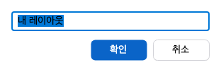

Oranda의 화면은 가운데의 문서 영역과 둘레의 도구 창으로 이루어집니다. 이 쪽에서는 도구 창을 열고 닫는 방법, 문서 탭을 옮기고 나누는 방법, 목록 표의 열 폭을 바꾸는 방법, 배치를 처음 상태로 되돌리거나 이름을 붙여 저장하는 방법을 설명합니다. 창과 관련한 명령은 모두 **창** 메뉴와 **보기 > 도구 창** 메뉴에 있습니다.

## 문서와 도구 창

| 종류 | 설명 | 예 |
|---|---|---|
| 문서 | 가운데 문서 영역에 탭으로 열립니다. | SQL 편집기, PL/SQL 편집기, 객체 상세, 객체 검색, 세션 모니터, Lock 모니터 |
| 도구 창 | 문서 영역의 왼쪽, 오른쪽, 아래에 붙습니다. 보이거나 숨길 수 있습니다. | 스키마 브라우저, 바인드 변수, 조회 결과 |

### 처음 배치

처음 설치한 상태의 도구 창 배치는 다음과 같습니다.

| 자리 | 처음에 보이는 창 | 처음에 닫혀 있는 창 |
|---|---|---|
| 왼쪽 | 스키마 브라우저, 스크립트 | 세션 |
| 아래 | 조회 결과, 메시지, DBMS 출력 | 실행 계획, 실행 이력, 컴파일 오류, 변경 일지 |
| 오른쪽 | 없음 | 문서 개요, 템플릿, 바인드 변수, 행 보기, AI 대화 |

- 닫혀 있는 창은 처음 열 때 위 표의 자리로 갑니다.
- 같은 자리의 창은 탭으로 묶입니다. 아래 자리는 「조회 결과」, 「메시지」, 「DBMS 출력」 탭이 한 묶음입니다.
- 기능이 꺼져 있으면 그 기능의 창이 메뉴에 없습니다. [설정](../options/)의 「기능」 탭을 보세요.

## 도구 창 열고 닫기

1. **보기 > 도구 창**을 엽니다.
2. 목록에서 창 이름을 고릅니다. 보이는 창이면 숨기고, 숨은 창이면 보입니다.

- 목록은 왼쪽, 아래, 오른쪽 자리 순서로 나옵니다.
- 도구 창의 이름 줄 오른쪽에 있는 닫기(✕) 단추로도 창을 숨깁니다.
- 목록의 체크 표시는 메뉴를 열 때마다 지금 화면을 다시 읽어 맞춥니다. 닫기 단추나 뜬 창을 닫아서 숨긴 창은 체크가 풀려 있습니다.

### 켜고 끌 때 움직이는 것

도구 창을 켜거나 꺼도 배치 전체를 다시 짓지 않습니다. 그 창 하나만 넣고 빼므로 화면이 깜박이지 않고, 다른 창의 자리와 크기, 나눈 문서 영역은 그대로입니다.

- 켜기: 창이 원래 자리(위 「처음 배치」 표의 자리)의 묶음에 탭으로 들어가고 앞으로 나옵니다. 그 묶음이 비어 있거나 접혀 있으면 보이는 크기로 펼칩니다. 그 자리에 묶음이 없으면 새 묶음 하나만 더합니다.
- 끄기: 그 탭만 뺍니다. 묶음에 탭이 하나도 남지 않으면(핀으로 접어 둔 창도 없으면) 그 묶음과 경계선을 치우고, 남은 몫은 문서 영역이 가집니다. 핀으로 접어 둔 창이 남아 있으면 묶음은 접힌 채 남습니다.
- 떼어 내 띄운 도구 창은 메뉴에서 체크가 풀려 있습니다. 메뉴에서 고르면 메인 창의 원래 자리로 돌아오고, 비게 된 뜬 창은 닫힙니다.
- 배치를 다시 짓는 것은 보통 앱을 시작할 때, **창 > 레이아웃 초기화**, **창 > 저장한 레이아웃 적용**뿐입니다.

### 핀으로 접어 둔 창

도구 창 이름 줄의 핀 단추를 누르면 창이 화면 가장자리의 막대로 접힙니다. 막대의 이름을 누르면 창이 잠시 펼쳐지고, 다른 곳을 누르면 다시 접힙니다.

- 접어 둔 창도 보이는 창으로 칩니다. **보기 > 도구 창** 목록에서 체크된 채로 나오고, 고르면 숨깁니다.
- 접어 둔 상태는 배치와 함께 저장되어 다음 시작 때도 접힌 채 나옵니다.
- 아래 묶음의 창을 모두 핀으로 접은 채 저장해도, 다음 시작 때 그 묶음은 높이 0 이 아니라 처음 높이로 되살아납니다.
- 도구 창마다 단축키가 있습니다. 예를 들어 스키마 브라우저는 `Alt+1`, 메시지는 `Alt+3`입니다. 전체 목록은 [단축키와 명령 팔레트](../shortcuts/)를 보세요.

## 문서 탭 다루기

**창** 메뉴의 항목입니다. 문서가 열려 있어야 켜집니다.

| 메뉴 항목 | 하는 일 |
|---|---|
| 다음 탭 | 다음 문서 탭으로 갑니다. `Ctrl+Tab`(macOS `Ctrl+Tab`)입니다. |
| 이전 탭 | 이전 문서 탭으로 갑니다. `Ctrl+Shift+Tab`(macOS `Ctrl+Shift+Tab`)입니다. |
| 오른쪽으로 분할 | 지금 탭을 새 문서 영역에 담아 오른쪽에 나란히 둡니다. |
| 아래로 분할 | 지금 탭을 새 문서 영역에 담아 아래에 둡니다. |
| 문서로 포커스 | 키보드 포커스를 문서로 돌려 보냅니다. |
| 결과 영역 보이기/숨기기 | SQL 탭의 결과 영역을 보이거나 숨깁니다. SQL 탭이 활성일 때만 켜집니다. `Ctrl+Shift+R`(macOS `Cmd+Shift+R`)입니다. |

문서 탭을 오른쪽 클릭하면 「이름 바꾸기」와 「닫기」가 나옵니다. 탭의 종류에 따라 항목이 더 나올 수 있습니다.

### 나눈 문서 영역이 유지되는 경우

- 도구 창을 보이거나 숨길 때는 나눈 문서 영역이 그대로 남습니다. 예를 들어 작업 세션이 둘이 되어 세션 창이 저절로 열려도, 결과 창을 켜고 꺼도 나눈 모양과 칸의 비율은 바뀌지 않습니다.
- 아래로 나눈 문서 영역은 아래 도구 창과 나란히 놓이며, 도구 창을 보이거나 숨겨도 아래 도구 창의 높이는 그대로입니다.
- 나눈 문서 영역은 아래 경우에 한 영역으로 합쳐집니다.
  - **창 > 레이아웃 초기화**를 실행할 때.
  - **창 > 저장한 레이아웃 적용**으로 이름 붙인 배치를 불러올 때.
  - 앱을 다시 시작할 때. `layout.json`에는 문서 영역이 하나만 기록되므로 나눈 모양은 저장되지 않습니다.
- 도구 창에 가로막혀 나란하지 않은 문서 영역이 있으면(탭을 창 가장자리에 끌어 놓아 도구 창 열 옆에 따로 놓인 경우 등), 이 영역의 탭은 첫 번째 문서 영역으로 옮겨집니다.
- 문서 영역의 탭 줄에 끌어 넣은 도구 창은 닫힌 창으로 칩니다. **보기 > 도구 창**에서 고르면 원래 자리로 옮겨집니다.

## 목록 표의 열 폭

도구 창과 문서의 목록 표(변경 일지, 실행 이력, 컴파일 오류, 바인드 변수, 객체 검색, 실행 계획 비교, Lock 모니터, 튜닝 도우미, 테이블 레이아웃, 객체 상세의 표 등)는 열 폭을 바꿀 수 있습니다.

- 머리글 칸의 오른쪽 경계를 끌어 폭을 바꿉니다. 그 열의 모든 행이 함께 움직입니다. 마지막 열은 남은 폭을 차지합니다.
- 경계를 두 번 누르면 그 열만 처음 폭으로 돌아갑니다.
- 머리글을 오른쪽 클릭해 「열 폭 처음으로」를 고르면 그 표의 모든 열이 처음 폭으로 돌아갑니다.
- 내용에 맞춰 폭이 정해지는 표(테이블 레이아웃 창, 객체 상세의 표)도 끌 수 있습니다. 끈 열은 그 폭으로 고정되고, 두 번 누르거나 「열 폭 처음으로」를 고르면 다시 내용 폭이 됩니다.
- 바꾼 폭은 화면마다 따로 기억해 다음에 열 때도 남습니다. 사용자 데이터 폴더의 `table-columns.json`에 저장합니다.
- 머리글 줄이 없는 표(메시지 창 등)는 폭을 바꿀 수 없습니다.
- 결과 그리드의 열 폭은 이 규칙과 다릅니다. [결과 그리드](../../run/result-grid/#열-다루기)를 보세요.

## 배치 되돌리기

**창 > 레이아웃 초기화**는 도구 창 배치를 위 표의 처음 상태로 되돌립니다. 도구 창을 잘못 옮기거나 닫아서 찾기 어려울 때 씁니다.

## 이름 붙여 저장

자주 쓰는 도구 창 배치를 이름을 붙여 저장하고 필요할 때 불러옵니다. 예를 들어 「튜닝」 배치와 「코딩」 배치를 따로 둘 수 있습니다.

### 저장

1. 도구 창을 원하는 모양으로 배치합니다.
2. **창 > 레이아웃 이름 붙여 저장**을 엽니다.
3. 「레이아웃 이름」 창에 이름을 씁니다. 처음 글은 「내 레이아웃」입니다.
4. 확인합니다.

같은 이름으로 저장하면 이전에 저장한 배치를 덮어씁니다. 한글 이름도 쓸 수 있습니다.

### 적용

1. **창 > 저장한 레이아웃 적용**을 엽니다.
2. 「적용할 레이아웃」 창에서 이름을 고릅니다.

적용하면 도구 창 배치만 바뀝니다. 열려 있는 문서와 작업 공간은 그대로 둡니다. 창의 위치와 크기는 저장하지 않으므로 바뀌지 않습니다.

### 지우기

1. **창 > 저장한 레이아웃 지우기**를 엽니다.
2. 「지울 레이아웃」 창에서 이름을 고릅니다.

저장한 배치가 없으면 「저장한 레이아웃이 없습니다. 「창 → 레이아웃 이름 붙여 저장」으로 먼저 저장하세요.」가 나옵니다.

## 배치의 자동 저장

- 지금의 배치와 창의 위치는 `layout.json`에 저장합니다. 앱을 끝낼 때와, 배치를 바꾼 뒤 잠시 쉬었을 때 저장합니다.
- 다음에 앱을 시작하면 저장한 배치로 열립니다.
- 이름 붙인 배치는 사용자 데이터 폴더의 `layouts` 폴더에 따로 저장합니다.
- `layout.json`이 없거나 손상되었으면 처음 배치로 시작하고 알림이 나옵니다.
- 새 버전 Oranda가 만든 `layout.json`은 읽기 전용으로 다루고 저장하지 않습니다.
