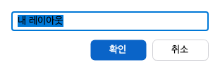

Oranda의 화면은 가운데의 문서 영역과 둘레의 도구 창으로 이루어집니다. 이 쪽에서는 도구 창을 열고 닫는 방법, 문서 탭을 옮기고 나누는 방법, 배치를 처음 상태로 되돌리거나 이름을 붙여 저장하는 방법을 설명합니다. 창과 관련한 명령은 모두 **창** 메뉴와 **보기 > 도구 창** 메뉴에 있습니다.

## 문서와 도구 창

| 종류 | 설명 | 예 |
|---|---|---|
| 문서 | 가운데 문서 영역에 탭으로 열립니다. | SQL 편집기, PL/SQL 편집기, 객체 상세, 객체 검색, 세션 모니터, Lock 모니터 |
| 도구 창 | 문서 영역의 왼쪽, 오른쪽, 아래에 붙습니다. 보이거나 숨길 수 있습니다. | 스키마 브라우저, 바인드 변수, 조회 결과 |

### 처음 배치

처음 설치한 상태의 도구 창 배치는 다음과 같습니다.

| 자리 | 처음에 보이는 창 | 처음에 닫혀 있는 창 |
|---|---|---|
| 왼쪽 | 스키마 브라우저, 스크립트 | 세션 |
| 아래 | 조회 결과, 메시지, DBMS 출력 | 실행 계획, 실행 이력, 컴파일 오류, 변경 일지 |
| 오른쪽 | 없음 | 문서 개요, 템플릿, 바인드 변수, 행 보기, AI 대화 |

- 닫혀 있는 창은 처음 열 때 위 표의 자리로 갑니다.
- 같은 자리의 창은 탭으로 묶입니다. 아래 자리는 「조회 결과」, 「메시지」, 「DBMS 출력」 탭이 한 묶음입니다.
- 기능이 꺼져 있으면 그 기능의 창이 메뉴에 없습니다. [설정](../options/)의 「기능」 탭을 보세요.

## 도구 창 열고 닫기

1. **보기 > 도구 창**을 엽니다.
2. 목록에서 창 이름을 고릅니다. 보이는 창이면 숨기고, 숨은 창이면 보입니다.

- 목록은 왼쪽, 아래, 오른쪽 자리 순서로 나옵니다.
- 도구 창의 이름 줄 오른쪽에 있는 닫기(✕) 단추로도 창을 숨깁니다.
- 도구 창마다 단축키가 있습니다. 예를 들어 스키마 브라우저는 `Alt+1`, 메시지는 `Alt+3`입니다. 전체 목록은 [단축키와 명령 팔레트](../shortcuts/)를 보세요.

## 문서 탭 다루기

**창** 메뉴의 항목입니다. 문서가 열려 있어야 켜집니다.

| 메뉴 항목 | 하는 일 |
|---|---|
| 다음 탭 | 다음 문서 탭으로 갑니다. `Ctrl+Tab`(macOS `Ctrl+Tab`)입니다. |
| 이전 탭 | 이전 문서 탭으로 갑니다. `Ctrl+Shift+Tab`(macOS `Ctrl+Shift+Tab`)입니다. |
| 오른쪽으로 분할 | 지금 탭을 새 문서 영역에 담아 오른쪽에 나란히 둡니다. |
| 아래로 분할 | 지금 탭을 새 문서 영역에 담아 아래에 둡니다. |
| 문서로 포커스 | 키보드 포커스를 문서로 돌려 보냅니다. |
| 결과 영역 보이기/숨기기 | SQL 탭의 결과 영역을 보이거나 숨깁니다. SQL 탭이 활성일 때만 켜집니다. `Ctrl+Shift+R`(macOS `Cmd+Shift+R`)입니다. |

문서 탭을 오른쪽 클릭하면 「이름 바꾸기」와 「닫기」가 나옵니다. 탭의 종류에 따라 항목이 더 나올 수 있습니다.

## 배치 되돌리기

**창 > 레이아웃 초기화**는 도구 창 배치를 위 표의 처음 상태로 되돌립니다. 도구 창을 잘못 옮기거나 닫아서 찾기 어려울 때 씁니다.

## 이름 붙여 저장

자주 쓰는 도구 창 배치를 이름을 붙여 저장하고 필요할 때 불러옵니다. 예를 들어 「튜닝」 배치와 「코딩」 배치를 따로 둘 수 있습니다.

### 저장

1. 도구 창을 원하는 모양으로 배치합니다.
2. **창 > 레이아웃 이름 붙여 저장**을 엽니다.
3. 「레이아웃 이름」 창에 이름을 씁니다. 처음 글은 「내 레이아웃」입니다.
4. 확인합니다.

같은 이름으로 저장하면 이전에 저장한 배치를 덮어씁니다. 한글 이름도 쓸 수 있습니다.

### 적용

1. **창 > 저장한 레이아웃 적용**을 엽니다.
2. 「적용할 레이아웃」 창에서 이름을 고릅니다.

적용하면 도구 창 배치만 바뀝니다. 열려 있는 문서와 작업 공간은 그대로 둡니다. 창의 위치와 크기는 저장하지 않으므로 바뀌지 않습니다.

### 지우기

1. **창 > 저장한 레이아웃 지우기**를 엽니다.
2. 「지울 레이아웃」 창에서 이름을 고릅니다.

저장한 배치가 없으면 「저장한 레이아웃이 없습니다. 「창 → 레이아웃 이름 붙여 저장」으로 먼저 저장하세요.」가 나옵니다.

## 배치의 자동 저장

- 지금의 배치와 창의 위치는 `layout.json`에 저장합니다. 앱을 끝낼 때와, 배치를 바꾼 뒤 잠시 쉬었을 때 저장합니다.
- 다음에 앱을 시작하면 저장한 배치로 열립니다.
- 이름 붙인 배치는 사용자 데이터 폴더의 `layouts` 폴더에 따로 저장합니다.
- `layout.json`이 없거나 손상되었으면 처음 배치로 시작하고 알림이 나옵니다.
- 새 버전 Oranda가 만든 `layout.json`은 읽기 전용으로 다루고 저장하지 않습니다.
