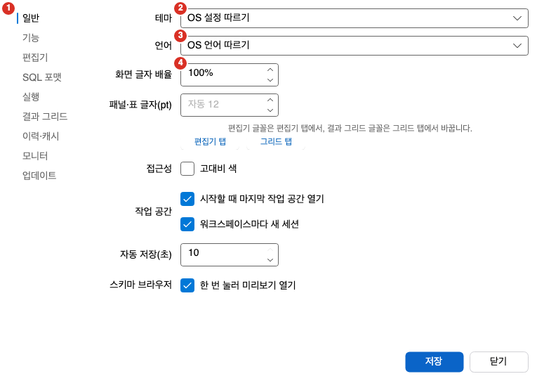
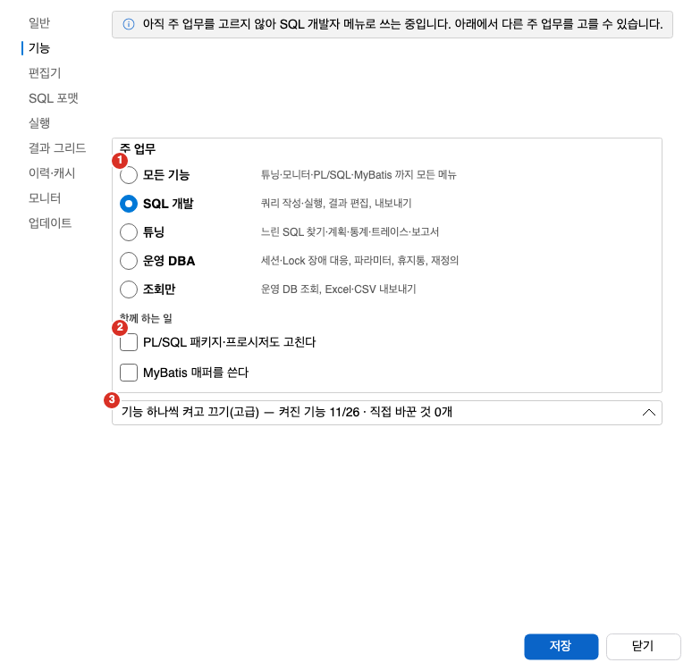
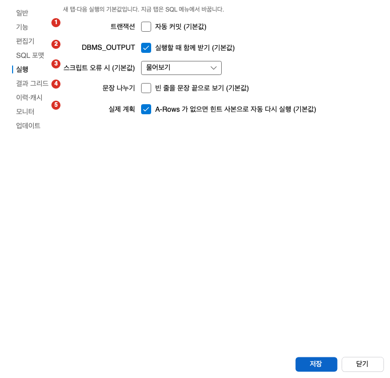
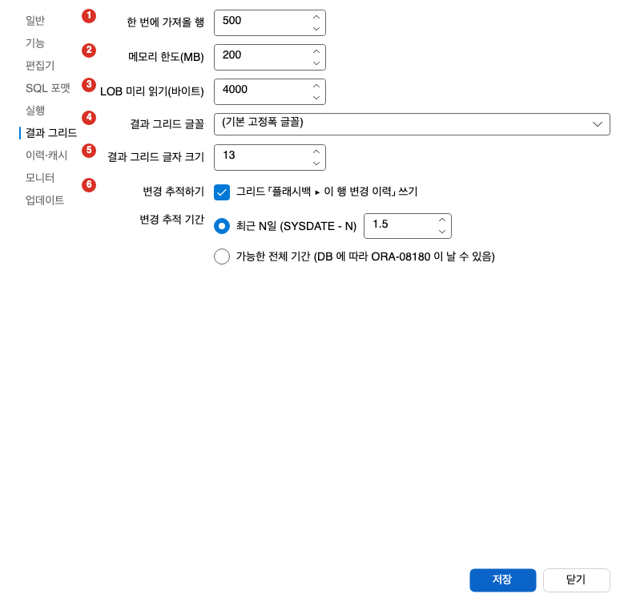

설정 창은 Oranda의 기본 동작을 정하는 곳입니다. 이 쪽에서는 설정 창을 여는 방법, 탭별 항목과 처음 값, 테마와 글자 크기를 바로 바꾸는 메뉴, 설정을 파일로 옮기는 방법을 설명합니다. 단축키는 [단축키와 명령 팔레트](../shortcuts/)를 보세요. 창 배치는 [창 배치와 도구 창](../layout/)을 보세요.

## 설정 창 열기

- **도구 > 설정**을 엽니다. 도구 모음의 톱니바퀴 단추도 같은 창을 엽니다.
- macOS에서는 **Oranda > 설정…**(`Cmd+,`)으로도 엽니다.
- **도구 > UI 언어**도 같은 설정 창을 엽니다.

창 왼쪽에 탭 목록이 있고 오른쪽에 고른 탭의 항목이 있습니다. 아래쪽의 **저장**을 누르면 모든 탭의 값을 한꺼번에 저장하고 바로 적용합니다. **닫기**나 `Esc`는 저장하지 않고 닫습니다.

- 새 버전 Oranda가 만든 설정 파일이면 창 아래에 안내가 나오고 **저장**이 꺼집니다. 이 설정 파일은 저장하지 않습니다.
- 설정 값은 사용자 데이터 폴더의 `settings.json`에 저장합니다.

## 탭 목록

탭은 위에서 아래로 다음 순서입니다.

| 탭 | 하는 일 |
|---|---|
| 일반 | 테마, 언어, 화면 글자 배율, 작업 공간, 스키마 브라우저 |
| 기능 | 주 업무를 골라 보이는 메뉴와 도구를 정합니다 |
| 편집기 | 편집기 글꼴, 탭 너비, SQL 점검, 감사 컬럼 |
| SQL 포맷 | SQL 정리 방식 |
| 실행 | 새 탭의 실행 기본값 |
| 되돌리기 | 실행 직전 시점 기록, 운영 접속의 원복 스크립트, 보관 기간 |
| 결과 그리드 | 한 번에 가져올 행 수, 글꼴, 변경 추적 |
| 이력·캐시 | 실행 이력과 메타데이터 캐시 보관 |
| 모니터 | 모니터 새로 고침 간격 |
| 업데이트 | 자동 업데이트 |
| AI 모델 | AI 모델 연결. AI 튜닝 기능이 켜져 있을 때만 보입니다. |

1. 탭 목록: 탭을 고르면 오른쪽 항목이 바뀝니다.
2. 테마: 밝게, 어둡게, OS 설정 따르기 중에서 고릅니다.
3. 언어: OS 언어 따르기, 한국어, English 중에서 고릅니다.
4. 화면 글자 배율: 화면 전체의 글자 크기를 퍼센트로 정합니다.

### 일반

| 항목 | 설명 | 처음 값 |
|---|---|---|
| 테마 | 「밝게」, 「어둡게」, 「OS 설정 따르기」 중에서 고릅니다. | OS 설정 따르기 |
| 언어 | 「OS 언어 따르기」, 「한국어」, 「English」 중에서 고릅니다. 저장하면 메뉴와 도구 창 제목이 재시작 없이 바뀝니다. | OS 언어 따르기 |
| 화면 글자 배율 | 화면 전체의 글자 크기를 80%에서 250% 사이로 정합니다. 10% 단위입니다. | 100% |
| 패널·테이블 글자(pt) | 도구 창과 테이블의 글자 크기를 8에서 32 사이로 정합니다. 비워 두면 화면 글자 배율에 맞춰 자동으로 정합니다. | 비어 있음(자동) |
| 접근성 | 「고대비 색」을 켜면 고대비 색을 씁니다. | 꺼짐 |
| 작업 공간 | 「시작할 때 마지막 작업 공간 열기」와 「워크스페이스마다 새 세션」을 켜고 끕니다. | 둘 다 켜짐 |
| 자동 저장(초) | 작업 공간을 자동 저장하는 간격입니다. 1에서 10 사이입니다. | 10 |
| 스키마 브라우저 | 「한 번 눌러 미리보기 열기」를 켜고 끕니다. | 켜짐 |

- 편집기와 결과 그리드의 글꼴은 이 탭에서 바꾸지 않습니다. 탭 안의 「편집기 탭」, 「그리드 탭」 링크로 해당 탭에 갑니다.
- 「워크스페이스마다 새 세션」을 켜면 새 작업 공간이 처음 실행할 때 같은 DB에 자기 세션을 엽니다. 끄면 지금 접속의 세션을 함께 씁니다.
- 작업 공간은 [작업 공간](../../editor/workspaces/)을 보세요.

### 기능

이 탭은 하는 일에 맞춰 메뉴와 도구를 줄이거나 늘립니다.

1. 주 업무: 하는 일을 하나 고릅니다.
2. 함께 하는 일: 주 업무에 덧붙입니다.
3. 기능 하나씩 켜고 끄기(고급): 펼치면 기능을 하나씩 정합니다.

- **주 업무**: 「SQL 개발」, 「튜닝」, 「운영 DBA」, 「조회만」, 「모든 기능」 중에서 하나를 고릅니다. 고른 일에 맞는 메뉴만 남습니다. 처음 설치한 상태에서는 아무것도 고르지 않았으므로 「SQL 개발」 메뉴로 씁니다. 탭에 이 사실을 알리는 안내가 나옵니다.
- **함께 하는 일**: 「PL/SQL 패키지·프로시저도 고친다」와 「MyBatis 매퍼를 쓴다」를 덧붙입니다. 「모든 기능」에는 이미 들어 있습니다.
- **조회만**: DML, DDL, PL/SQL 실행을 막습니다. 「함께 하는 일」은 「조회만」에는 붙일 수 없습니다. 차단을 풀려면 다른 주 업무를 고르세요.
- **기능 하나씩 켜고 끄기(고급)**: 접힌 묶음을 펼치면 기능을 하나씩 켜고 끕니다. 각 기능의 상태는 「기본값」, 「직접 켬」, 「직접 끔」으로 보입니다. **기본값으로 되돌리기** 단추가 있습니다.
- 다른 기능이 먼저 켜져 있어야 하는 기능은 「… 이(가) 켜져 있어야 합니다」가 나옵니다.
- 일부 기능은 앱을 다시 시작해야 적용됩니다. 이때 「재시작하면 적용됩니다: …」가 나옵니다.
- Diagnostics Pack과 Tuning Pack 보유 선언은 이 탭이 아니라 접속 프로필에서 합니다. 탭의 「접속 관리자 열기」 링크로 접속 관리자를 엽니다.

### 편집기

| 항목 | 설명 | 처음 값 |
|---|---|---|
| 에디터 글꼴 | 글꼴 이름을 목록에서 고르거나 직접 씁니다. 설치되지 않은 글꼴 이름도 지우지 않고 둡니다. | 기본 고정폭 글꼴 |
| 에디터 글자 크기 | 8에서 32 사이입니다. | 13 |
| 탭 너비 | 1에서 16 사이입니다. | 4 |
| SQL 점검(lint) 켜기 | 편집기의 SQL 점검을 켜고 끕니다. | 켜짐 |
| 감사 컬럼 | 감사 컬럼의 이름 목록입니다. 쉼표나 줄바꿈으로 나눕니다. `*`와 `?`를 쓸 수 있고 대소문자는 가리지 않습니다. | 비어 있음 |

감사 컬럼 칸이 비어 있으면 안내 글로 `REG_DT, REG_ID, UPD_DT, UPD_ID, *_USER_ID`가 보입니다. 테이블 레이아웃 창의 「감사 컬럼 빼기」가 이 목록의 컬럼을 테이블에서 뺍니다.

### SQL 포맷

SQL 정리 방식을 고릅니다. 이 탭에는 「키워드 맞춤」(왼쪽, 오른쪽), 「목록 쉼표」(뒤에, 앞에), 「키워드 대소문자」(그대로, 대문자, 소문자), 「GROUP BY 열 목록」(한 줄, 여러 줄)이 있습니다. 아래쪽에 현재 프로필 이름과 미리보기가 나옵니다. **기본값** 단추로 처음 값으로 되돌리고, **자세히…** 링크로 포매터 프로필 화면을 엽니다.

그림과 번호별 설명은 [SQL 편집기 보조 기능](../../editor/assist/)에 있습니다.

### 실행

이 탭의 값은 새 탭과 다음 실행의 기본값입니다. 지금 열린 탭은 **SQL** 메뉴의 「(이번 실행)」 항목에서 바꿉니다.

그림의 번호는 아래 표의 항목 순서와 같습니다: 1 트랜잭션, 2 DBMS_OUTPUT, 3 스크립트 오류 시, 4 문장 나누기, 5 실제 계획입니다.

| 항목 | 설명 | 처음 값 |
|---|---|---|
| 트랜잭션 | 「자동 커밋 (기본값)」입니다. | 꺼짐 |
| DBMS_OUTPUT | 「실행할 때 함께 받기 (기본값)」입니다. | 켜짐 |
| 스크립트 오류 시 (기본값) | 「물어보기」, 「멈추기」, 「계속하기」 중에서 고릅니다. | 물어보기 |
| 문장 나누기 | 「빈 줄을 문장 끝으로 보기 (기본값)」입니다. | 꺼짐 |
| 실제 계획 | 「A-Rows 가 없으면 힌트 사본으로 자동 다시 실행 (기본값)」입니다. | 켜짐 |

각 항목은 [SQL 실행](../../run/execute/)과 [실행 계획](../../plan/execution-plan/)에서 설명합니다.

### 되돌리기

쓰기 문장을 실행할 때 남기는 [되돌리기 지점](../../run/rollback/)을 정합니다.

<!-- 그림: settings-rollback.png (Windows 렌더가 들어오면 이미지로 바꾼다) -->

| 항목 | 설명 | 처음 값 |
|---|---|---|
| 쓰기 문장을 실행할 때 직전 시점(SCN) 기록 | 모든 접속에서 쓰기 문장을 보내기 직전의 시점 번호를 변경 일지에 남깁니다. 끄면 「이 실행 전과 비교」의 기준 시점이 남지 않습니다. | 켜짐 |
| 운영 접속에서 원복 스크립트 만들기 | 운영 접속의 실행 확인 창에서 「원복 스크립트 만들기」 확인란의 처음 값입니다. 끄면 확인란이 꺼진 채 나오고, 묻지 않고 실행하는 문장은 만들지 않습니다. 개발·테스트 접속에는 켜는 항목이 없습니다. | 켜짐 |
| 문장당 상한 | 예상 행 수가 이 값을 넘으면 원복 스크립트 없이 실행합니다. 1~1,000,000행입니다. | 100,000행 |
| 보관 기간 | 원복 스크립트와 커밋 묶음을 지우기까지의 일수입니다. 1~365일이며 다음 정리부터 적용합니다. 줄이면 「지난 묶음 n개가 다음 시작 때 지워집니다.」가 나옵니다. | 30일 |
| 잠근 행 수와 실행한 행 수가 다르면 커밋 전에 알리기 | 원복 스크립트가 불완전한 트랜잭션을 커밋할 때 묻습니다. 꺼도 메시지 창의 경고는 남습니다. | 켜짐 |
| TRUNCATE·DROP COLUMN·DROP … PURGE 앞에서 백업 테이블 만들기 권하기 | 실행 확인 창에 「먼저 백업 테이블 만들기」 확인란을 보입니다. | 켜짐 |

- 이 PC 에 OS 보안 저장소가 없으면 「운영 접속에서 원복 스크립트 만들기」가 흐려지고 「이 PC 에는 안전한 키 저장소가 없어 원복 스크립트를 만들 수 없습니다」가 나옵니다.
- 탭 아래쪽에 지금 보관 중인 묶음 수와 크기(「묶음 42개 · 3.1 MB」)가 나옵니다. 「모두 지우기…」를 누르면 한 번 더 묻고, 「지우기」를 누르면 보관 중인 묶음과 원복 스크립트 파일을 모두 지웁니다. 되돌릴 수 없습니다. 지금 열린(커밋하지 않은) 트랜잭션의 묶음은 지우지 않습니다. 커밋하면 그 원복 스크립트가 필요하기 때문입니다.

### 결과 그리드

그림의 번호는 아래 표의 항목 순서와 같습니다: 1 한 번에 가져올 행, 2 메모리 한도, 3 LOB 미리 읽기, 4 결과 그리드 글꼴, 5 결과 그리드 글자 크기, 6 변경 추적하기입니다.

| 항목 | 설명 | 처음 값 |
|---|---|---|
| 한 번에 가져올 행 | 한 번에 가져오는 행 수입니다. 50에서 100000 사이입니다. | 500 |
| 메모리 한도(MB) | 결과가 쓰는 메모리 한도입니다. 16에서 4096 사이입니다. | 200 |
| LOB 미리 읽기(바이트) | LOB 값을 처음에 읽는 크기입니다. 0에서 1048576 사이입니다. | 4000 |
| 결과 그리드 글꼴 | 글꼴 이름입니다. | 기본 고정폭 글꼴 |
| 결과 그리드 글자 크기 | 8에서 32 사이입니다. | 13 |
| 변경 추적하기 | 「그리드 「플래시백 ▸ 이 행 변경 이력」 쓰기」를 켜고 끕니다. | 켜짐 |
| 변경 추적 기간 | 「최근 N일 (SYSDATE - N)」 또는 「가능한 전체 기간」을 고릅니다. 변경 추적하기를 끄면 이 항목도 꺼집니다. | 최근 1.5일 |

「가능한 전체 기간」은 DB에 따라 ORA-08180이 날 수 있습니다. 결과를 읽는 방법은 [결과 그리드](../../run/result-grid/)를, 변경 이력은 [그리드 편집과 플래시백](../../run/grid-edit/)을 보세요.

### 이력·캐시

| 항목 | 설명 | 처음 값 |
|---|---|---|
| 실행 이력 | 「실행한 SQL 을 기록」을 켜고 끕니다. | 켜짐 |
| 바인드 값 | 「바인드 값도 함께 기록」을 켜고 끕니다. | 꺼짐 |
| 최대 개수 | 이력의 최대 개수입니다. 100에서 1000000 사이입니다. | 50000 |
| 보관 일수 | 이력 보관 일수입니다. 1에서 3650 사이입니다. | 180 |
| 메타데이터 캐시(일) | 메타데이터 캐시 보관 일수입니다. 1에서 365 사이입니다. | 30 |
| 객체 목록 유효기간(일) | 스키마 브라우저 객체 목록 캐시를 서버에서 마지막으로 다 받은 지 이 일수가 지나면, 접속한 뒤 처음 목록을 읽을 때 바로 뒤에서 전체 목록을 다시 받습니다. 0에서 365 사이이고, 0이면 기한이 없습니다. | 1 |

### 모니터

| 항목 | 설명 | 처음 값 |
|---|---|---|
| 새로 고침(초) | 모니터의 자동 새로 고침 간격입니다. 2에서 60 사이입니다. | 5 |

모니터는 [DB 모니터](../../tools/monitor/)를 보세요.

### 업데이트

업데이트 탭은 [업데이트와 릴리스 노트](../../install/update/)에서 설명합니다.

## 테마와 글자 크기 바꾸기

설정 창을 열지 않고 **보기** 메뉴에서 바로 바꿀 수 있습니다.

| 메뉴 항목 | 하는 일 |
|---|---|
| 테마 > 밝은 테마, 어두운 테마, OS 테마 따르기 | 테마를 바꾸고 저장합니다. |
| 글자 크게 | 글자를 한 단계 키웁니다. |
| 글자 작게 | 글자를 한 단계 줄입니다. |
| 글자 크기 원래대로 | 글자 크기를 처음 값 13으로 되돌립니다. |

- 포커스가 결과 그리드 안에 있으면 그리드 글자 크기를 바꿉니다. 그 밖의 곳에서는 편집기 글자 크기를 바꿉니다.
- 한 단계는 1이고 크기는 8에서 32 사이입니다.
- 이 메뉴로 바꾼 값은 설정 창의 「에디터 글자 크기」, 「결과 그리드 글자 크기」와 같은 값입니다.

## 설정 내보내기와 가져오기

다른 PC로 설정을 옮기거나 백업할 때 씁니다.

1. **도구 > 설정 내보내기**를 엽니다.
2. 파일 이름을 정합니다. 처음 이름은 `oranda-settings.json`입니다.
3. 다른 PC에서 **도구 > 설정 가져오기**를 열고 그 파일을 고릅니다.

- 파일에는 설정 전체, 사용자 키맵, 사용자 코드 조각이 들어 있습니다.
- 가져오면 지금 설정이 가져온 설정으로 바뀝니다. 가져오기 전에 지금 설정을 내보내서 보관하세요.
- 파일은 먼저 전부 읽어 확인하고 나서 씁니다. 형식이 틀린 파일이면 아무것도 바꾸지 않습니다.
- 파일에 AI 모델 연결 설정이 들어 있을 수 있습니다. 다른 사람에게 보내기 전에 파일을 열어 확인하세요.
