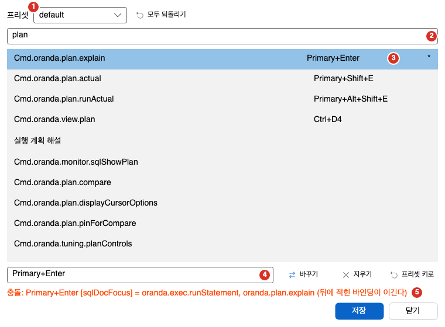
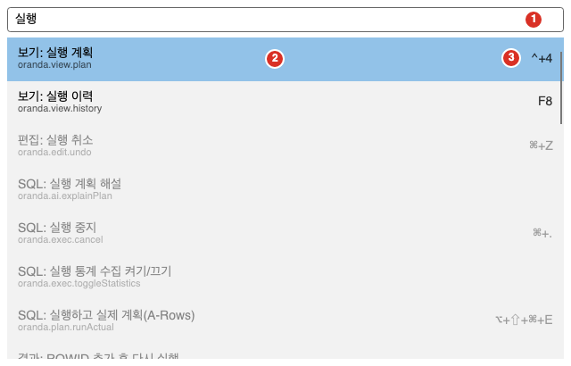

Oranda의 모든 명령은 단축키로 부르거나 명령 팔레트에서 이름으로 찾아 부를 수 있습니다. 이 쪽에서는 기본 단축키, 키맵 프리셋, 단축키 바꾸는 방법, 명령 팔레트를 설명합니다.

- 아래 표의 키는 Windows 기준입니다. macOS 열에는 macOS의 키를 따로 적었습니다. 대체로 `Ctrl`은 `Cmd`로, `Alt`는 `Option`으로 바뀌지만 예외가 있으니 macOS 열을 보세요.
- 표의 「범위」는 그 키가 동작하는 자리입니다. 범위가 없는 키는 어디서나 동작합니다.
- 메뉴 항목에도 그 명령의 단축키가 함께 보입니다.

## 기본 단축키

### 파일과 접속

| 동작 | Windows | macOS |
|---|---|---|
| 새 SQL 편집기 | `Ctrl+N` | `Cmd+N` |
| 새 PL/SQL 편집기 | `Ctrl+Shift+N` | `Cmd+Shift+N` |
| 파일 열기 | `Ctrl+O` | `Cmd+O` |
| 저장 | `Ctrl+S` | `Cmd+S` |
| 모두 저장 | `Ctrl+Shift+S` | `Cmd+Shift+S` |
| 탭 닫기 | `Ctrl+W` | `Cmd+W` |
| 닫은 탭 다시 열기 | `Ctrl+Shift+T` | `Cmd+Shift+T` |
| 접속 관리자 | `Ctrl+Shift+O` | `Cmd+Shift+O` |
| 설정 | `Ctrl+,` | `Cmd+,` |
| 사용자 문서(이 매뉴얼 열기) | `F1` | `F1` |
| 다음 탭 | `Ctrl+Tab` | `Ctrl+Tab` |
| 이전 탭 | `Ctrl+Shift+Tab` | `Ctrl+Shift+Tab` |

### 편집기

범위는 편집기에 포커스가 있을 때입니다.

| 동작 | Windows | macOS |
|---|---|---|
| 실행 취소 | `Ctrl+Z` | `Cmd+Z` |
| 다시 실행 | `Ctrl+Y` | `Cmd+Shift+Z` |
| 잘라내기, 복사, 붙여넣기, 모두 선택 | `Ctrl+X`, `Ctrl+C`, `Ctrl+V`, `Ctrl+A` | `Cmd+X`, `Cmd+C`, `Cmd+V`, `Cmd+A` |
| 찾기 | `Ctrl+F` | `Cmd+F` |
| 바꾸기 | `Ctrl+H` | `Cmd+Option+F` |
| 다음 찾기 | `F3` | `Cmd+G` |
| 이전 찾기 | `Shift+F3` | `Cmd+Shift+G` |
| 줄로 이동 | `Ctrl+G` | `Cmd+L` |
| 줄 주석 토글 | `Ctrl+/` | `Cmd+/` |
| 블록 주석 토글 | `Ctrl+Shift+/` | `Cmd+Shift+/` |
| 대문자로, 소문자로 | `Ctrl+Shift+U`, `Ctrl+U` | `Cmd+Shift+U`, `Cmd+U` |
| 줄 복제, 줄 삭제 | `Ctrl+D`, `Ctrl+Shift+K` | `Cmd+D`, `Cmd+Shift+K` |
| 북마크 토글 | `Ctrl+F2` | `Cmd+F2` |
| 다음 북마크, 이전 북마크 | `F2`, `Shift+F2` | `F2`, `Shift+F2` |
| 접기, 펼치기 | `Ctrl+Shift+[`, `Ctrl+Shift+]` | `Cmd+Shift+[`, `Cmd+Shift+]` |
| 짝 괄호로 이동 | `Ctrl+]` | `Cmd+]` |
| 위에 커서 더하기, 아래에 커서 더하기 | `Ctrl+Alt+Up`, `Ctrl+Alt+Down` | `Cmd+Option+Up`, `Cmd+Option+Down` |
| 자동완성 열기 | `Ctrl+Space` | `Option+Esc` |
| 인자 도움말 | `Ctrl+Shift+Space` | `Cmd+Shift+Space` |
| 코드 조각 삽입 | `Ctrl+Shift+J` | `Cmd+Shift+J` |
| SQL 정리(포맷) | `Ctrl+Shift+F` | `Cmd+Shift+F` |

### 이동

| 동작 | Windows | macOS |
|---|---|---|
| 정의로 이동 | `F12` | `F12` |
| 참조 찾기 | `Shift+F12` | `Shift+F12` |
| 객체 정보 보기 | `F4`, `Alt+C` | `F4`, `Option+C`, `Ctrl+Option+C` |
| 뒤로, 앞으로 | `Alt+Left`, `Alt+Right` | `Cmd+Ctrl+Left`, `Cmd+Ctrl+Right` |
| DB 객체로 이동 | `Ctrl+P` | `Cmd+P` |
| 스키마 브라우저에서 찾기 | `Alt+F1` | `Option+F1` |

### 실행과 계획

범위는 SQL 탭에 포커스가 있을 때입니다.

| 동작 | Windows | macOS |
|---|---|---|
| 현재 문장 실행 | `Ctrl+Enter` | `Cmd+Enter` |
| 커서의 하위 쿼리 실행 | `Alt+Shift+Enter` | `Option+Shift+Enter` |
| 스크립트 전체 실행 | `F5` | `F5` |
| 커서 문장부터 끝까지 실행 | `Alt+F5` | `Option+F5` |
| 순차 실행 | `Ctrl+Shift+Enter` | `Cmd+Shift+Enter` |
| 새 결과 탭으로 실행 | `F11` | `Cmd+Option+Enter` |
| 결과 편집 모드로 실행 | `F9` | `Ctrl+Enter`, `F9` |
| 실행 중지 | `Ctrl+Break` | `Cmd+.` |
| 결과 영역 보이기/숨기기 | `Ctrl+Shift+R` | `Cmd+Shift+R` |
| 예상 실행 계획 | `Ctrl+E` | `Cmd+E` |
| 실제 실행 계획(마지막 실행) | `Ctrl+Shift+E` | `Cmd+Shift+E` |
| 실행하고 실제 계획(A-Rows) | `Ctrl+Alt+Shift+E` | `Cmd+Option+Shift+E` |

자세한 내용은 [SQL 실행](../../run/execute/)과 [실행 계획](../../plan/execution-plan/)을 보세요.

### 결과 그리드

범위는 결과 그리드에 포커스가 있을 때입니다.

| 동작 | Windows | macOS |
|---|---|---|
| 복사 | `Ctrl+C` | `Cmd+C` |
| 머리글과 함께 복사 | `Ctrl+Shift+C` | `Cmd+Shift+C` |
| 행 복사 | `Ctrl+Alt+C` | `Cmd+Option+C` |
| 결과에서 찾기 | `Ctrl+F` | `Cmd+F` |
| Excel로 내보내기 | `Ctrl+Alt+E` | `Cmd+Option+E` |
| 모두 가져오기 | `Alt+End` | `Option+End` |
| 참조하는 행 열기(부모) | `F4` | `F4` |
| 이 행을 참조하는 행 열기 | `Shift+F4` | `Shift+F4` |
| 행 보기 | `Alt+Enter` | `Cmd+Option+R` |
| 행 추가 | `Alt+Insert` | `Cmd+Option+N` |
| 행 복제 | `Ctrl+Shift+D`, `Ctrl+D` | `Cmd+Shift+D`, `Cmd+D` |
| 행 붙여넣기 | `Ctrl+Shift+V` | `Cmd+Shift+V` |

행 삭제 키는 Windows에서 `Alt+Delete`, `Ctrl+Delete`입니다. 자세한 내용은 [결과 그리드](../../run/result-grid/)와 [그리드 편집과 플래시백](../../run/grid-edit/)을 보세요.

### 도구 창

| 동작 | Windows | macOS |
|---|---|---|
| 스키마 브라우저 | `Alt+1` | `Ctrl+1` |
| DBMS 출력 | `Alt+2` | `Ctrl+2` |
| 메시지 | `Alt+3` | `Ctrl+3` |
| 실행 계획 | `Alt+4` | `Ctrl+4` |
| 실행 이력 | `F8`, `Alt+5` | `F8`, `Ctrl+5` |
| 이름 붙인 스크립트 | `Ctrl+R` | `Cmd+R` |
| 명령 팔레트 | `Ctrl+Shift+P` | `Cmd+Shift+P` |
| 글자 크게 | `Ctrl+=` | `Cmd+=` |
| 글자 작게 | `Ctrl+-` | `Cmd+-` |
| 글자 크기 원래대로 | `Ctrl+0` | `Cmd+0` |

### 스키마, PL/SQL, 모니터

| 동작 | 범위 | 키 |
|---|---|---|
| 스키마 브라우저 새로 고침 | 스키마 브라우저 | `F5` |
| 스키마 브라우저 이름 필터 | 스키마 브라우저 | `Ctrl+F`(macOS `Cmd+F`) |
| 컴파일 | PL/SQL 편집기 | `F5` |
| 명세/본문 전환 | PL/SQL 편집기 | `Ctrl+Shift+B`(macOS `Cmd+Shift+B`) |
| PL/SQL 실행 | PL/SQL 편집기 | `Ctrl+Enter`(macOS `Cmd+Enter`) |
| 모니터 새로 고침 | 모니터 창 | `F5` |
| Lock 모니터 새로 고침 | Lock 모니터 | `F5` |
| 매퍼 시나리오 실행 | MyBatis 편집기 | `Ctrl+Enter`, `F9`(macOS `Ctrl+Enter`, `F9`) |
| 매퍼 문장 정리 | MyBatis 편집기 | `Ctrl+Shift+F`(macOS `Cmd+Shift+F`) |

## 키맵 프리셋

다른 프로그램에 익숙하면 그 프로그램과 비슷한 키맵 프리셋을 고릅니다. 프리셋은 네 개입니다.

- 기본
- Orange 5
- PL/SQL Developer
- SQL Developer

**도구 > 단축키 프리셋**에서 하나를 고르면 바로 바뀝니다. 위 표는 「기본」 프리셋 기준입니다. 다른 프리셋은 일부 키가 다릅니다. 프리셋에서도 `F1`은 사용자 문서이고 `Ctrl+Shift+P`는 명령 팔레트입니다.

## 단축키 바꾸기

1. 프리셋 목록: 바탕이 될 프리셋입니다.
2. 찾기: 「명령·키 찾기」 칸입니다.
3. 명령 목록: 명령과 지금 키입니다. 내가 바꾼 줄 끝에는 `*`가 붙습니다.
4. 새 키 칸과 단추: 「바꾸기」, 「지우기」, 「프리셋 키로」입니다.
5. 충돌 안내: 같은 범위에서 키가 겹치면 나옵니다.

바꾸는 순서는 다음과 같습니다.

1. **도구 > 단축키 설정**을 엽니다.
2. 맨 위 「프리셋」 목록에서 바탕이 될 프리셋을 고릅니다. 프리셋을 바꾸어도 내가 바꾼 키는 그대로 남습니다.
3. 「명령·키 찾기」 칸에 명령 이름이나 키를 씁니다. 띄어쓰기로 낱말을 나누면 모든 낱말이 맞는 줄만 남습니다. 명령 이름에 마우스를 올리면 명령 ID가 보입니다.
4. 목록에서 명령을 고릅니다. 키가 없는 명령도 목록에 있습니다.
5. 아래 칸에 새 키를 씁니다. 작성 규칙은 다음과 같습니다.
   - `Primary+Shift+F`처럼 `+`로 잇습니다. `Primary`는 Windows에서 `Ctrl`, macOS에서 `Cmd`입니다.
   - 연속 키는 공백으로 나눕니다.
   - 키를 여러 개 주려면 쉼표로 나눕니다.
6. 단추를 누릅니다.
   - **바꾸기**: 고른 명령의 키를 새 키로 바꿉니다. 형식이 틀리면 이유가 아래에 나오고 바뀌지 않습니다.
   - **지우기**: 고른 명령의 키를 모두 지웁니다. 바탕 프리셋의 키도 끕니다.
   - **프리셋 키로**: 고른 명령을 프리셋의 키로 되돌립니다.
   - **모두 되돌리기**: 내가 바꾼 키를 모두 버리고 프리셋 그대로 둡니다.
7. **저장**을 누릅니다. 저장하기 전에는 적용되지 않습니다. **닫기**는 저장하지 않고 닫습니다.

- 내가 바꾼 줄 끝에는 `*`가 붙습니다.
- 같은 범위에서 같은 키를 쓰는 명령이 둘 이상이면 아래에 「충돌: …」이 나옵니다. 「(뒤에 적힌 바인딩이 이긴다)」가 함께 나옵니다. 연속 키의 첫 키가 다른 명령의 단일 키와 같을 때도 충돌로 봅니다.
- 설정 파일이 새 버전이면 「설정 파일이 새 버전이라 저장하지 않는다.」가 나오고 저장하지 않습니다.
- 바꾼 키는 사용자 키맵 파일로 저장합니다. 프리셋은 바뀌지 않습니다.
- 바꾼 키를 다른 PC로 옮기려면 [설정](../options/)의 설정 내보내기와 가져오기를 쓰세요. 사용자 키맵도 함께 옮겨집니다.

## 명령 팔레트

명령 팔레트는 모든 명령을 이름으로 찾아 실행하는 창입니다. 메뉴 위치나 단축키를 몰라도 됩니다.

1. 입력 칸: 「명령 이름을 입력하세요」 칸입니다.
2. 결과 줄: 범주와 이름, 명령 ID입니다. 지금 쓸 수 없는 명령은 흐리게 보입니다.
3. 단축키: 그 명령의 단축키입니다.

1. `Ctrl+Shift+P`(macOS `Cmd+Shift+P`)를 누릅니다. **보기** 메뉴의 명령 팔레트 항목이나 도구 모음의 「명령 검색…」 단추로도 엽니다.
2. 「명령 이름을 입력하세요」 칸에 명령 이름을 씁니다.
3. `Up`과 `Down`으로 줄을 고르고 `Enter`를 누릅니다. `Esc`를 누르면 닫습니다.

- 목록의 각 줄은 「범주: 이름」이고 아래에 명령 ID가 작게 보입니다. 오른쪽에는 그 명령의 단축키가 보입니다.
- 띄어쓰기로 낱말을 나누어 쓰면 모든 낱말이 맞는 명령만 남습니다. 낱말은 명령 이름, 범주, 명령 ID에서 찾습니다. 이름이 낱말로 시작하는 명령이 먼저 나옵니다.
- 지금 쓸 수 없는 명령은 흐리게 보입니다. 흐린 줄은 `Enter`를 눌러도 실행되지 않고 창이 그대로 있습니다.
- 글자를 쓰기 전에는 최근에 실행한 명령이 위에 나옵니다.
- 맞는 명령이 없으면 「일치하는 명령이 없다」가 나옵니다.
- 명령을 실행하면 팔레트가 먼저 닫히고 명령이 실행됩니다.
