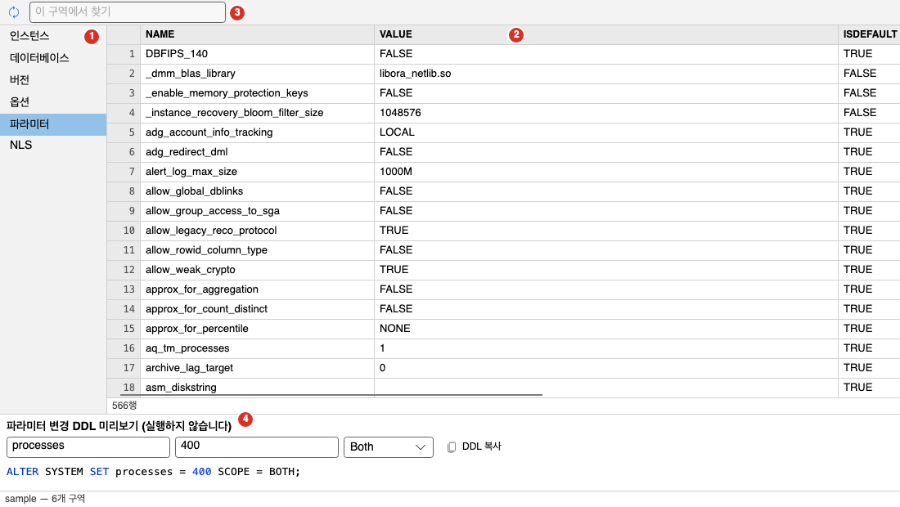
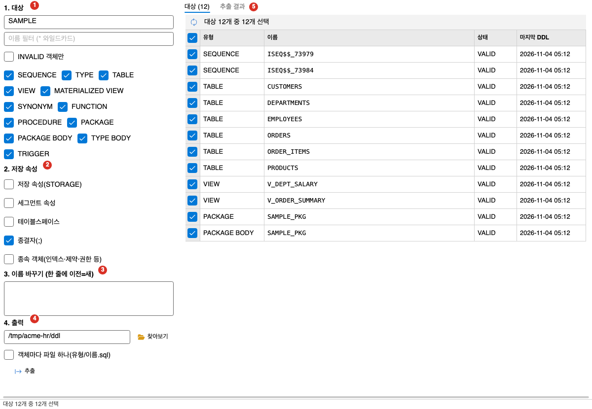
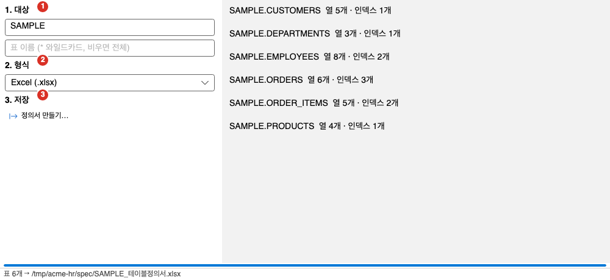
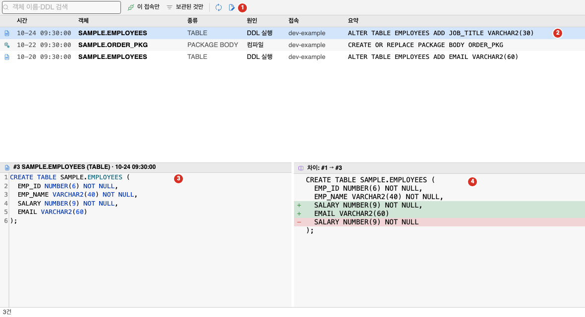
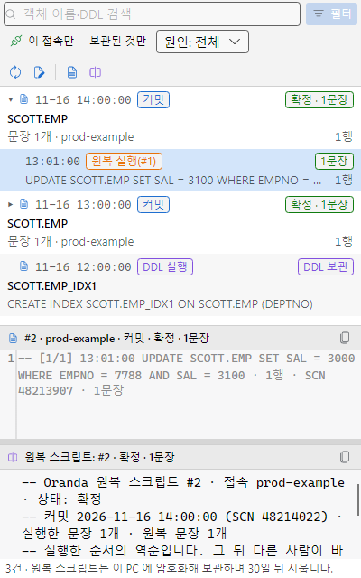
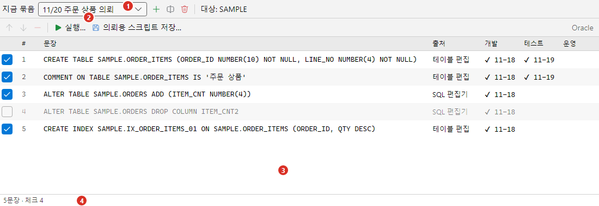

DB 도구는 접속한 DB 전체를 다루는 보조 기능입니다. 이 쪽에서는 DB 정보, DDL 일괄 추출, 테이블 정의서, 변경 일지, 반영 묶음, Role·기능 고르기를 설명합니다. 객체를 이름으로 찾는 객체 검색은 [스키마 브라우저](../../schema/browser/)에서 설명합니다.

- DB 정보와 DDL 일괄 추출은 **데이터베이스** 메뉴에, 테이블 정의서, 변경 일지, 반영 묶음은 **도구** 메뉴에 있습니다.
- DB 정보, DDL 일괄 추출, 테이블 정의서는 접속이 있어야 켜집니다. 모두 DB를 읽기만 합니다.
- 기능이 꺼져 있으면 메뉴에 나타나지 않습니다. 설정 창의 「기능」 탭에서 켭니다. [설정](../../settings/options/)을 보세요.

## DB 정보

**데이터베이스 > DB 정보**나 도구 모음의 DB 정보 단추로 엽니다. 인스턴스, 버전, 옵션, 파라미터, NLS 설정을 한 곳에서 봅니다.

1. 구역 목록: 왼쪽 목록에서 구역을 고릅니다. 구역은 「인스턴스」, 「데이터베이스」, 「버전」, 「옵션」, 「파라미터」, 「NLS」입니다.
2. 구역 표: 고른 구역의 내용입니다. 「인스턴스」와 「데이터베이스」는 「항목」과 「값」 두 열입니다.
3. 이 구역에서 찾기 칸: 고른 구역의 모든 열에서 글을 찾아 행을 거릅니다. 대소문자를 가리지 않습니다.
4. 파라미터 변경 DDL 미리보기: 아래 「파라미터 변경 DDL」을 보세요.

- 찾기 칸 왼쪽의 새로 고침 단추는 서버에서 다시 읽습니다.
- 창 아래의 상태 줄은 접속 이름과 읽은 구역 수를 보입니다.
- 구역 하나를 읽지 못해도(권한 부족 등) 나머지 구역은 보입니다. 읽지 못한 구역은 「오류」 열에 이유가 한 줄로 나오고 상태 줄에 「{n}개 구역 중 {m}개는 권한 등으로 읽지 못했다」가 나옵니다.

### 파라미터 변경 DDL

창 아래쪽의 「파라미터 변경 DDL 미리보기 (실행하지 않습니다)」는 파라미터를 바꾸는 `ALTER SYSTEM` 문을 만들어 줍니다. 만들기만 하고 실행하지 않습니다.

1. 「파라미터」 구역에서 행을 고릅니다. 「파라미터 이름」 칸과 「새 값」 칸에 이름과 현재 값이 채워집니다. 직접 입력해도 됩니다.
2. 「새 값」을 원하는 값으로 고칩니다.
3. 적용 범위를 고릅니다: Memory, Spfile, Both입니다. 처음 값은 Both입니다.
4. 미리보기 칸에 `ALTER SYSTEM SET 이름 = 값 SCOPE = BOTH;` 모양의 문장이 나옵니다. 문자 값은 작은따옴표로 감쌉니다.
5. 「DDL 복사」를 눌러 복사합니다. 편집기에 붙여 넣어 확인한 뒤 직접 실행하세요.

- 파라미터 이름이 올바르지 않으면 미리보기 칸 아래에 빨간 글로 이유가 나옵니다.
- 실제 실행은 SQL 편집기에서 직접 합니다.

## DDL 일괄 추출

**데이터베이스 > DDL 일괄 추출**로 엽니다. 한 스키마의 객체 DDL을 파일로 저장합니다. DB에는 쓰지 않습니다.

창 왼쪽에서 조건과 출력을 정하고, 오른쪽에서 추출할 객체를 고릅니다.

1. 대상: 아래 「1. 대상」을 보세요.
2. 저장 속성: 아래 「2. 저장 속성」을 보세요.
3. 이름 바꾸기: 아래 「3. 이름 바꾸기」를 보세요.
4. 출력: 아래 「4. 출력」을 보세요.
5. 추출 대상 탭: 아래 「오른쪽 탭」을 보세요.

### 1. 대상

| 항목 | 설명 |
|---|---|
| 스키마 | 추출할 스키마입니다. 접속 계정이 처음 값입니다. |
| 이름 필터 (* 와일드카드) | 객체 이름으로 거릅니다. |
| INVALID 객체만 | INVALID 객체만 대상으로 합니다. |
| 유형 확인란 | SEQUENCE, TYPE, TABLE, VIEW, MATERIALIZED VIEW, SYNONYM, FUNCTION, PROCEDURE, PACKAGE, PACKAGE BODY, TYPE BODY, TRIGGER입니다. 처음에는 모두 체크되어 있습니다. |

### 2. 저장 속성

| 항목 | 처음 값 | 설명 |
|---|---|---|
| 저장 속성(STORAGE) | 꺼짐 | STORAGE 절을 넣습니다. |
| 세그먼트 속성 | 꺼짐 | 세그먼트 속성을 넣습니다. |
| 테이블스페이스 | 꺼짐 | TABLESPACE를 넣습니다. |
| 종결자(;) | 켜짐 | 문장 끝에 `;`를 붙입니다. |
| 종속 객체(인덱스·제약·권한 등) | 꺼짐 | 객체에 딸린 DDL도 함께 추출합니다. |

### 3. 이름 바꾸기

「이름 바꾸기 (한 줄에 이전=새)」 칸에 한 줄에 하나씩 `이전=새`로 씁니다. 스키마와 객체 이름을 바꿔 추출할 때 씁니다. 형식이 틀린 줄은 건너뜁니다. 빈 줄과 `#`으로 시작하는 줄은 무시합니다.

- 따옴표 없이 쓴 이름은 대문자로 봅니다. `scott=hr`은 `SCOTT=HR`과 같습니다.
- 대소문자를 그대로 두려면 큰따옴표로 감싸세요. 예를 들어 `"Mixed"="New"`입니다.

### 4. 출력

- 「출력 폴더」: DDL 파일을 쓸 폴더입니다. 「찾아보기」 단추로 고릅니다. 처음 값은 내 문서 폴더의 `oranda-ddl` 폴더입니다.
- 「객체마다 파일 하나(유형/이름.sql)」: 체크하면 객체마다 `유형/이름.sql` 파일을 만듭니다. 체크하지 않으면 스키마 하나에 파일 하나(`스키마.sql`)로 모읍니다. 처음 값은 꺼짐입니다.
- 「추출」: 오른쪽 「추출 대상」에서 체크한 객체의 DDL을 파일로 씁니다.

### 오른쪽 탭

- 「추출 대상」: 조건에 맞는 객체의 목록입니다. 열은 체크, 유형, 이름, 상태, 마지막 DDL입니다. `Space`로 체크를 바꾸고 머리 칸의 확인란으로 전체를 선택하거나 해제합니다. 「대상 다시 조회 (F5)」로 다시 읽습니다. 「추출」은 체크한 객체만 추출합니다.
- 「추출 결과」: 추출한 객체마다 「완료 …」나 「실패 … — 이유」가 줄로 나옵니다. 아직 추출하지 않았으면 「아직 추출한 결과가 없습니다. 출력 폴더를 확인하고 「추출」을 누르세요.」가 나옵니다.

- 조건에 맞는 객체가 5,000개를 넘으면 앞쪽만 보입니다. 이때는 스키마, 이름, 유형을 좁히세요.
- 아래 진행 막대가 추출 진행을 보입니다. 끝나면 상태 줄에 「{n}개 추출, {m}개 실패 → 파일 {k}개 (폴더)」가 나옵니다.
- 상태 줄에 이유가 나오는 경우: 「스키마를 입력하세요」, 「출력 폴더를 입력하세요」, 「유형을 하나 이상 고르세요」, 「조건에 맞는 객체가 없다」, 「체크한 객체가 없다」입니다.

## 테이블 정의서

테이블의 열, 키, 인덱스를 정리한 문서를 만듭니다. 파일 형식은 Excel(.xlsx), Markdown(.md), HTML(.html)입니다.

1. 대상: 스키마와 테이블 이름입니다.
2. 형식: 파일 형식입니다.
3. 저장: 「정의서 만들기…」 단추입니다.

1. 테이블 하나의 정의서는 스키마 브라우저에서 테이블을 오른쪽 클릭해 **테이블 정의서…**를 고릅니다. 여러 테이블은 **도구 > 테이블 정의서…**를 고릅니다.
2. 「테이블 정의서」 문서 탭이 열립니다. 테이블 하나로 열면 탭 이름이 「테이블 정의서 {테이블 이름}」이고 스키마와 테이블 이름이 채워집니다.
3. 「1. 대상」에서 「스키마」와 「테이블 이름」을 정합니다. 테이블 이름은 `*` 와일드카드를 쓸 수 있고 비우면 스키마의 모든 테이블입니다.
4. 「2. 형식」에서 Excel, Markdown, HTML 중 하나를 고릅니다.
5. 「3. 저장」의 「정의서 만들기…」를 누르고 저장할 파일을 정합니다. 제안하는 파일 이름은 `{스키마}_{테이블}_테이블정의서.xlsx`나 `{스키마}_테이블정의서.xlsx` 모양입니다.
6. 목록에 「{스키마}.{테이블}  열 {n}개 · 인덱스 {m}개」가 줄마다 나오고 상태 줄에 「테이블 {n}개 → {파일}」이 나옵니다.

- 문서에는 생성 시각과 목차가 들어갑니다. 테이블마다 테이블 설명, 열 표, 인덱스 표가 나옵니다.
- 열 표의 열은 순번, 열 이름, 타입, NULL, PK, FK, 기본값, 주석입니다. 타입에는 길이와 정밀도가 붙습니다(`NUMBER(7,2)`, `VARCHAR2(10)`). FK 열에는 참조하는 `부모테이블.열`이 나옵니다. 부모 테이블을 읽지 못하면 테이블 이름만 적습니다.
- 인덱스 표의 열은 인덱스, 고유, 열입니다.
- 대상은 테이블(`TABLE`)만입니다. 조건에 맞는 테이블이 없으면 「조건에 맞는 테이블이 없다」가 나옵니다.
- 상태 줄 이유: 「스키마를 입력하세요」, 「저장할 파일을 정하세요」입니다.

## 변경 일지

변경 일지는 DB 객체를 바꾸기 직전의 서버 DDL을 자동으로 보관합니다. 잘못 바꿨을 때 이전 DDL을 다시 볼 수 있습니다. 쓰기 문장(UPDATE, DELETE, INSERT)의 실행 기록도 커밋 묶음으로 함께 보입니다. 커밋 묶음과 원복 스크립트는 [되돌리기 지점](../../run/rollback/)에서 설명합니다.

### 보관되는 것

- DDL 실행 직전: `ALTER`, `DROP`, `CREATE OR REPLACE`, `RENAME` 문을 보내기 직전에 대상 객체의 현재 DDL을 읽어 보관합니다. 정책이나 확인을 통과한 뒤에 보관하므로 거부된 문장은 남지 않습니다.
- PL/SQL 컴파일 직전: PL/SQL 편집기에서 컴파일하기 직전의 서버 소스를 보관합니다.
- 같은 객체의 마지막 성공 보관본과 내용이 같으면 새로 쌓지 않습니다.
- 보관에 실패하면(권한 부족, 시간 초과, 객체 없음) 이유만 남기고 실행은 그대로 진행합니다. 일지 때문에 실행이 막히지 않습니다.
- 보관본과 요약에 들어 있는 비밀 값은 가려서 저장합니다.
- 일지는 앱 안에 저장하며 DB에는 쓰지 않습니다. 365일이 지났거나 객체당 50개를 넘는 오래된 보관본은 지웁니다. 이 값은 설정 창에 없습니다.

### 변경 일지 창

**도구 > 변경 일지**로 엽니다. 스키마 브라우저에서 객체를 오른쪽 클릭해 **변경 일지 보기**를 고르면 그 객체의 보관본만 나옵니다. 객체로 거른 상태는 도구 모음에 보이고 「해제」 단추로 풉니다.

1. 도구 모음: 아래 표의 항목입니다.
2. 목록: 보관본마다 한 줄입니다.
3. DDL 본문: 고른 보관본의 DDL입니다.
4. 차이 보기: 같은 객체의 바로 앞 보관본과의 차이입니다.

그림의 보관본은 설명을 위해 지어낸 예시입니다.

도구 모음은 다음과 같습니다.

| 항목 | 설명 |
|---|---|
| 객체 이름·DDL 검색 | 객체 이름과 보관한 DDL에서 글을 찾습니다. |
| 이 접속만 | 지금 접속의 변경만 봅니다. |
| 보관된 것만 | 보관에 실패한 줄을 숨깁니다. |
| 원인 | 「원인: 전체」, 「DDL 실행」, 「컴파일」, 「DML」 중에서 고릅니다. 「DML」은 커밋 묶음만 보입니다. |
| 새로 고침 | 목록을 다시 읽습니다. |
| 이 DDL 을 새 편집기에 열기 | 고른 보관본의 이전 DDL을 새 SQL 탭에 엽니다. |
| 원복 스크립트 열기 | 고른 커밋 묶음의 원복 스크립트를 새 탭에 엽니다. 원복 스크립트가 있는 묶음을 골라야 켜집니다. |
| 이 실행 전과 비교… | 고른 커밋 묶음(또는 묶음 안 문장)의 실행 직전 시점과 지금 데이터를 비교합니다. |
| ✨ 이 기간 요약 | 목록에 보이는 지금 접속의 변경을 AI가 한 단락으로 요약해 목록 위 AI 띠에 보입니다. 아래 표를 보세요. 좁은 도구 줄에서는 「✨ 요약」입니다. |

- 목록 열: 시간, 객체, 원인, 요약, 영향 행, 시점, 원복 스크립트입니다. DDL 보관본의 원인은 「DDL 실행」이나 「컴파일」이고 원복 스크립트 칸에 「DDL 보관」이 나옵니다. 요약에는 실행한 문장의 앞부분이 나오고, 보관에 실패한 줄은 「보관 실패: 이유」가 빨간 글로 나옵니다.
- 커밋 묶음 줄의 원인은 「커밋」, 「롤백」, 「모름」이고, 두 번 누르면 묶음 안 문장(원인 「DML 실행」)이 펼쳐집니다. 원복 스크립트 칸은 「확정 · 16문장」처럼 상태를 보입니다([상태 다섯 가지](../../run/rollback/#상태-다섯-가지)).
- 목록은 최근 순입니다. DDL 보관본과 커밋 묶음을 합쳐 한 번에 300건까지 보입니다.
- 줄을 고르면 아래에 그 보관본의 DDL이 나옵니다. 같은 객체의 바로 앞 보관본이 있으면 차이도 함께 보입니다. 줄 두 개를 고르면 두 보관본의 차이를 보입니다. 차이 줄의 `+`는 새 쪽에만 있는 줄이고 `-`는 옛 쪽에만 있는 줄입니다.

### 이 기간 요약

「✨ 이 기간 요약」은 지금 목록에 보이는 줄 가운데 **지금 접속**의 변경만 AI에 보냅니다. 일지는 여러 접속의 변경을 함께 보이므로, 허용 수준과 값 가림을 한 접속 기준으로 정하려는 규칙입니다. 기간은 그 줄들의 첫 시각부터 끝 시각까지입니다.

- 시각, 종류(DDL, UPDATE 등), 객체 이름, 영향 행 수와 객체·종류별 합계는 늘 보냅니다.
- 문장 글은 접속의 AI 허용 수준이 「조회+행 값」이고 값을 가리지 않는 접속일 때만 보냅니다. 그 밖에는 띠 아래에 「값 없이 요약했습니다.」가 나옵니다.
- 답은 「요약」과 「눈여겨볼 점」 두 칸입니다. 가벼운 일 모델 한 번짜리 요청입니다. 띠의 단추는 [AI 대화](../../ai/chat/#ai-띠)를 보세요.

### 좁게 붙였을 때

변경 일지 창의 폭이 560보다 좁으면(왼쪽이나 오른쪽에 붙였을 때) 표 대신 카드 목록으로 바뀝니다. 폭을 다시 넓히면 바로 표로 돌아옵니다. 고른 줄과 단추가 하는 일은 같습니다.

- 카드 첫 줄은 시간, 원인, 원복 스크립트 상태입니다. 원인은 색으로도 나뉩니다(커밋 파랑, 원복 실행 주황, DDL 실행·컴파일 보라). 둘째 줄은 객체, 셋째 줄은 요약과 영향 행입니다. 묶음 안 문장은 들여 쓴 두 줄 카드입니다.
- 표에만 있던 시점과 원복 스크립트 상태 전문은 카드에 마우스를 올리면 보입니다.
- 「필터」를 누르면 「이 접속만」, 「보관된 것만」, 원인 거르기 줄을 접거나 펼칩니다. 도구 모음 단추는 아이콘만 보이고, 마우스를 올리면 이름이 나옵니다.
- 아래 두 상자(DDL·실행한 문장과 차이·원복 스크립트)는 위아래로 쌓이고, 긴 줄은 줄바꿈해 보입니다. 사이 선을 끌어 높이를 나누고, 각 상자 제목 오른쪽 단추로 그 상자 글을 복사합니다.

### 이전 DDL로 되돌리기

변경 일지는 자동으로 되돌리지 않습니다.

1. 되돌릴 보관본을 고릅니다.
2. 「이 DDL 을 새 편집기에 열기」를 누릅니다. 새 SQL 탭에 보관본이 열립니다. 첫 줄 주석에 어느 보관본인지(번호, 객체, 시각)가 나옵니다.
3. 내용을 확인합니다. 자동으로 실행하지 않습니다.
4. 실행하려면 직접 실행합니다. PL/SQL 소스는 끝에 `/` 줄이 붙고 그 밖의 DDL은 끝에 `;`가 붙어 한 문장으로 실행됩니다.

- 보관에 실패한 줄은 열 DDL이 없어 「보관된 DDL 이 없는 항목이다」가 나옵니다.

## 반영 묶음

반영 묶음은 개발하면서 실행한 DDL을 이름 붙인 묶음에 모아 두고, 개발·테스트·운영 중 어디까지 실행했는지 표시하고, 체크한 문장만 의뢰용 `.sql` 파일 하나로 저장하는 도구 창입니다. 운영 DB 변경을 DB 관리 팀에 의뢰서로 요청할 때 개발 쪽이 스크립트를 한 파일로 만들어 넘기는 흐름에 맞췄습니다.

- 묶음에는 DDL만 들어갑니다. SELECT와 DML은 들어가지 않습니다.
- 묶음은 이 PC에만 있습니다. 다른 PC와 나눌 때는 의뢰용 스크립트 파일로 나눕니다.
- 묶음 문장의 전문은 이 PC의 앱 저장소에 평문으로 남습니다. 변경 일지의 DDL 보관본과 같은 수준입니다. CHECK 조건이나 기본값에 리터럴이 있으면 그대로 남습니다.
- 「반영 묶음」 기능이 켜져 있어야 합니다. 주 업무가 「SQL 개발」, 「운영 DBA」, 「모든 기능」이거나 「함께 하는 일」을 덧붙이면 켜집니다. 「튜닝」과 「조회만」에서는 꺼져 있습니다. 기능이 꺼져 있으면 메뉴와 창이 나타나지 않습니다. 기능을 켠 뒤에는 앱을 다시 시작해야 적용됩니다.

### 반영 묶음 창

**도구 > 반영 묶음**으로 엽니다. 명령 팔레트의 「반영 묶음」으로도 엽니다. 변경 일지 옆에 있는 아래쪽 도구 창입니다.

1. 제목 줄: 「지금 묶음」 목록, 새 묶음, 이름 바꾸기, 묶음 지우기, 대상 소유자 단추입니다.
2. 도구 줄: 위로, 아래로, 문장 지우기, 「실행…」, 「의뢰용 스크립트 저장…」, 오른쪽 끝의 대상 DBMS입니다.
3. 문장 표: 체크, #, 문장, 출처, 개발, 테스트, 운영입니다.
4. 상태 줄: 「5문장 · 체크 4」처럼 문장 수와 체크한 수가 나옵니다.

| 항목 | 설명 |
|---|---|
| 지금 묶음 | 목록에서 지금 쓸 묶음을 고릅니다. 묶음이 없으면 「묶음 없음」이 보입니다. 자동으로 들어가는 DDL은 이 묶음에 쌓입니다. |
| 새 묶음 | 「새 반영 묶음」 창에서 「묶음 이름」을 쓰면 새 묶음을 만들고 바로 「지금 묶음」으로 정합니다. 처음 이름은 「반영 묶음 2026-11-17」 모양입니다. |
| 이름 바꾸기 | 「묶음 이름 바꾸기」 창에서 이름을 고칩니다. |
| 묶음 지우기 | 확인 창에서 「지우기」를 누르면 묶음과 그 문장, 실행 표시를 지웁니다. 되돌릴 수 없습니다. |
| 대상 | 대상 소유자 단추입니다. 「대상: SAMPLE」처럼 보입니다. 누르면 「대상 소유자」 창이 열리고, 소유자를 쉼표로 나누어 고칩니다. |
| 위로, 아래로 | 고른 문장을 한 칸 옮깁니다. 이 순서가 실행 순서이고 저장 순서입니다. |
| 문장 지우기 | 고른 문장을 묶음에서 지웁니다. 확인 창에서 「지우기」를 누릅니다. 그 문장의 실행 표시도 함께 지워집니다. |
| 실행… | 체크한 문장을 고른 접속에 순서대로 실행합니다. 아래 「묶음 실행」을 보세요. |
| 의뢰용 스크립트 저장… | 체크한 문장을 `.sql` 파일 하나로 저장합니다. 아래 「의뢰용 스크립트 저장」을 보세요. |
| 대상 DBMS | 묶음의 DBMS입니다. 비어 있는 묶음은 「DBMS: 첫 문장을 따름」이 보입니다. |

문장 표는 다음과 같습니다.

- 체크: 켠 문장만 실행하고 저장합니다. 체크를 끈 줄은 흐리게 보입니다.
- 문장: 한 줄 요약입니다. 마우스를 올리면 전문이 보입니다. 주의할 문장은 ⚠ 아이콘이 붙고 이유가 같이 보입니다.
- 출처: 「테이블 편집」 또는 「SQL 편집기」입니다. SQL 편집기에는 스크립트 실행이 포함됩니다.
- 개발, 테스트, 운영: 그 환경의 접속에서 마지막으로 성공한 날짜입니다. 「✔ 11-17」처럼 보이고 올해가 아니면 연도가 붙습니다. 비어 있으면 아직 실행하지 않은 것입니다.
- 줄을 두 번 누르면 「N번 문장」 창에 전문이 열립니다. 「고치기」로 오타를 고치고 「편집기에서 열기」로 새 SQL 탭에 옮길 수 있습니다. 고치면 이 문장의 실행 표시(개발·테스트·운영)는 지워집니다. 문장은 하나만 둘 수 있습니다.
- 헤더의 경계를 끌어 열 폭을 바꿉니다.

### 자동으로 들어가는 규칙

「지금 묶음」이 있으면 SQL 편집기에서 DDL을 실행해 성공할 때마다 그 문장이 묶음 끝에 저절로 들어갑니다. 테이블 편집기의 「실행」도 같습니다. 다음 조건을 모두 만족해야 합니다.

- 「지금 묶음」이 있습니다.
- DDL이고 성공했습니다. 실패한 문장은 들어가지 않습니다. `ALTER SESSION`과 `ALTER SYSTEM`은 객체를 바꾸지 않아 들어가지 않습니다.
- 출처가 SQL 편집기(스크립트 실행, PL/SQL 컴파일, 실행 기록에서 다시 실행한 것 포함)나 테이블 편집기입니다. 묶음 창의 「실행…」, 스키마 브라우저 명령(열 순서 바꾸기 등), 데이터 복사, AI 에이전트, 모니터에서 실행한 문장은 들어가지 않습니다.
- 접속 DBMS가 묶음의 DBMS와 같습니다. 다르면 넣지 않고 메시지 창에 한 줄 알립니다. 예는 「반영 묶음 「…」은 Oracle 묶음이라 Tibero 접속에서 실행한 DDL 을 넣지 않았다.」입니다. 빈 묶음은 첫 문장의 DBMS를 따릅니다.
- 문장이 바꾸는 객체의 소유자가 묶음의 대상 소유자 목록에 있습니다. 소유자를 쓰지 않은 문장은 그 세션의 현재 스키마를 소유자로 봅니다. 목록에 없으면 알림 없이 넣지 않습니다. 접속에서 만든 새 묶음(테이블 편집기의 「새 묶음에 넣기…」 등)의 대상 소유자는 그 접속의 현재 스키마로 채워집니다. 묶음 창의 새 묶음 단추로 접속 없이 만든 묶음은 「대상: 첫 문장을 따름」으로 보이고, 소유자 목록이 비어 있으면 첫 문장이 들어올 때 그 문장의 소유자가 대상이 됩니다. 대상 소유자 단추로 더하거나 뺍니다.

넣을 때 다음 처리를 합니다.

- 소유자 없이 쓴 이름에는 소유자를 붙여 저장합니다. 의뢰 스크립트가 실행 계정과 상관없이 같은 객체를 바꾸게 하기 위해서입니다. 문장 모양을 몰라 소유자를 붙이지 못하면 원문 그대로 넣고 ⚠를 붙입니다.
- 같은 묶음에 같은 문장(공백 차이는 무시)이 이미 있으면 새로 넣지 않고 그 문장에 실행 표시만 남깁니다. 개발에서 묶음에 들어간 문장을 테스트 접속에서 다시 실행하면 겹치지 않고 「테스트」 칸에 날짜가 붙습니다.
- 문장에 들어 있는 비밀 값은 가려서(`***`) 저장합니다. 가린 문장은 실행하거나 저장하기 전에 다시 적어야 합니다.
- 넣으면 도구 창 제목에 건수가 잠깐 붙습니다. 예는 「반영 묶음 (+2)」입니다. 창을 열지는 않습니다. 이미 있는 문장에 실행 표시만 남겼으면 「반영 묶음 (✔1)」입니다.
- GRANT, TRUNCATE, DROP TABLE처럼 DDL로 분류되는 문장은 모두 들어갑니다. 빼고 싶은 문장은 체크를 끄세요.

테이블 편집기의 「묶음에 넣기 ▾」는 실행하지 않고 편집 내용을 같은 판정으로 묶음에 넣습니다. [테이블 편집기](../../schema/table-editor/#묶음에-넣기)를 보세요.

### 묶음 실행

**실행…**은 체크한 문장을 고른 접속에 순서대로 실행합니다. 테스트 DB에서 묶음을 시험할 때 씁니다.

1. 체크한 문장이 있는 묶음에서 「실행…」을 누릅니다. 「묶음 실행」 창이 열립니다.
2. 「실행할 접속」에서 지금 열린 접속을 고릅니다. 접속 이름 뒤에 환경과 DBMS가 붙습니다. 묶음의 DBMS와 다른 접속은 고를 수 없고 이유가 보입니다. 열린 접속이 없으면 창이 열리지 않고, 알림 상자에 「열린 접속이 없다. 실행할 접속을 먼저 연다.」가 나옵니다.
3. 운영 접속을 고르면 「운영 접속이다. 실행 전에 확인을 한 번 받는다.」가 빨갛게 나옵니다.
4. 필요하면 「소유자 바꾸기」를 씁니다. 아래 「소유자 바꾸기」를 보세요.
5. 「실행」을 누릅니다. 먼저 실행 전 검사를 하고(상태 「실행 전 검사 중…」), 통과하면 상태에 「실행 중… 3/12」처럼 진행이 나옵니다.

보내기 전에 다음을 차례로 거칩니다.

- **실행 전 검사**: 테이블 편집기의 [실행 전 검사](../../schema/table-editor/#실행-전-검사)와 같은 검사를 묶음 문장에도 합니다. 읽을 수 있는 문장(열 길이 줄이기, NOT NULL, PK·UK·FK·CHECK 추가, 지우기 등)만 검사하고, 결과는 창 안에 ✖, ⚠, ✔ 순서로 나옵니다. 앞 문장이 만들거나 지우거나 고치는 테이블은 데이터를 검사하지 않고 「확인 못 함」 ⚠로 둡니다.
- ✖가 있으면 실행하지 않고 「실행 전 검사에서 ✖ 가 있어 실행하지 않았다(의뢰용 스크립트 저장은 된다).」가 나옵니다.
- 정책이 막는 문장이 있으면 「정책이 실행을 막았다: 이유」가 나옵니다.
- 테스트·운영 접속에서 정책이 확인을 요구하면 문장마다 묻지 않고 확인 창을 한 번만 띄웁니다. 그 창에 문장 목록과 검사 줄이 함께 실립니다.
- 확인 창 없이 ⚠만 있는 테스트·운영 접속은 「⚠ 를 확인하고 「그래도 실행」을 누르면 보낸다.」가 나오고 단추가 「그래도 실행」으로 바뀝니다. 한 번 더 눌러야 보냅니다. 개발 접속은 ⚠를 보이기만 하고 바로 보냅니다.
- 그 세션에 커밋하지 않은 변경이 있으면 먼저 묻습니다.

- 문장은 화면 순서대로 하나씩 보냅니다. 한 문장이 실패하면 거기서 멈추고 「2/12 문장 성공. 3번째 문장에서 멈췄다: 이유」가 나옵니다. 앞 문장은 DDL이 자동으로 커밋되어 남습니다.
- 실행 중에는 아래 단추가 「중지」로 바뀝니다. 끝나면 「3/3 문장을 dev-example 에 실행했다.」가 나옵니다.
- 성공한 문장마다 그 접속의 환경 칸(개발·테스트·운영)에 날짜가 남습니다.
- 실행은 다른 실행과 마찬가지로 정책 관문을 거치고 실행 기록에 남습니다.
- 비밀 값을 가린 문장이 있으면 실행하지 않습니다. 그 문장의 체크를 풀거나, 편집기에서 열어 비밀 값을 적고 직접 실행하세요.

### 실행 전 AI 검토

묶음 실행 창과 테이블 편집기의 DDL 미리 보기에는 「AI 검토」가 있습니다. 실행하려는 문장을 주 모델이 살펴 위험도(낮음, 보통, 높음)와 점검 항목(잠금 시간, 무효화될 객체, 공간, 소요 시간, 되돌리기 가능 여부)을 창 안의 검토 띠에 보이고, 권하는 실행 순서와 시간대를 적습니다.

- 검토는 조언입니다. 실행 단추를 막지 않습니다.
- 앱이 정해진 규칙으로 내는 경고는 그대로 나오고, AI 검토는 그 위에 덧붙습니다.
- 「채팅에서 이어 보기」로 AI 대화 창에서 이어 물을 수 있습니다. [AI 대화](../../ai/chat/#화면에서-바로-하는-일)를 보세요.

### 의뢰용 스크립트 저장

**의뢰용 스크립트 저장…**은 체크한 문장만 화면 순서대로 `.sql` 파일 하나에 씁니다.

1. 「의뢰용 스크립트 저장…」을 누르면 같은 이름의 창이 열립니다. 머리에 「묶음 이름 · Oracle · 체크한 문장 3개」가 보입니다.
2. 필요하면 「소유자 바꾸기」를 씁니다.
3. 「저장…」을 눌러 파일을 정합니다. 저장에 성공하면 창이 닫힙니다. 실패하면 창이 열린 채로 이유가 창 안에 나옵니다.

파일 형식은 다음과 같습니다.

- 머리 주석에 묶음 이름, 만든 날짜, 대상 DBMS, 문장 수가 들어갑니다. 접속 이름과 호스트는 넣지 않습니다.
- 테이블스페이스를 쓰지 않은 문장은 실행 계정의 기본 테이블스페이스에 만들어진다는 안내가 머리 주석에 한 줄 들어갑니다.
- 일반 DDL은 끝에 `;`, PL/SQL 블록은 다음 줄에 `/`가 붙습니다.
- 인코딩은 UTF-8(BOM 없음), 줄바꿈은 운영체제 기본입니다.
- 실행 전 검사에서 ✖가 나온 편집이라도 스크립트는 저장할 수 있습니다. 개발 DB의 데이터로는 실패해도 운영 DB의 데이터로는 성공할 수 있기 때문입니다.
- 열 형식 자동 변환의 `UPDATE`처럼 DML이 들어 있는 묶음은 머리 주석에 `-- DML 포함`이 붙고 `UPDATE` 뒤에 `COMMIT;`이 붙습니다. 머리 주석 전문은 `-- DML 포함: 열 형식 변환의 UPDATE(바로 뒤 COMMIT)`입니다. 이것이 DDL만 담는 규칙의 유일한 예외입니다. 열 형식 자동 변환은 아직 준비 중이라 지금은 이 표시가 붙는 묶음이 없습니다.
- 저장 창에는 소유자를 붙이지 못했거나 비밀 값을 가린 문장이 있으면 ⚠ 안내가 나옵니다. 가린 문장(`***`)은 저장한 파일에서 다시 적어야 합니다.

### 소유자 바꾸기

테스트 DB나 운영 DB의 스키마 이름이 개발과 다를 때 씁니다. 「실행…」 창과 「의뢰용 스크립트 저장」 창에 「소유자 바꾸기」 칸이 있습니다.

- 묶음의 대상 소유자와 체크한 각 문장의 소유자를 합쳐, 겹치지 않게 한 줄씩 나옵니다. 「SAMPLE → SAMPLE」처럼 바꿀 이름 칸이 있고, 처음에는 같은 이름이라 바뀌지 않습니다.
- 칸에 쓴 이름은 따옴표 없이 쓰면 대문자로 맞춥니다.
- 문장 안의 `SAMPLE.` 뒤에 이름이 오는 소유자 한정 이름만 바꿉니다. 문자열 리터럴과 주석 안은 바꾸지 않습니다.
- 묶음 안의 문장 자체는 바뀌지 않고 실행하거나 저장하는 글만 바뀝니다.
- 소유자를 붙이지 못한 문장은 이 기능이 닿지 않습니다. 실행할 때는 실행 접속의 현재 스키마에서 실행되고, 저장한 파일에서는 실행 계정의 스키마 기준으로 쓰입니다.

## Role·기능 고르기

**도구 > Role·기능 고르기…**는 설정 창을 「기능」 탭으로 엽니다. 주 업무를 바꾸거나 기능을 하나씩 켜고 끕니다. 항목 설명은 [설정](../../settings/options/)을 보세요. 상태 표시줄의 막음 알림이나 시작 화면의 기본 Role 카드에서 「설정 열기」, 「바꾸기…」를 눌러도 같은 탭이 열립니다.

## 자주 하는 작업

### 스키마의 모든 테이블을 DDL 파일로 저장하기

1. **데이터베이스 > DDL 일괄 추출**을 엽니다.
2. 「스키마」를 확인하고 「유형」에서 TABLE만 체크합니다.
3. 필요하면 「종속 객체(인덱스·제약·권한 등)」를 체크합니다.
4. 「출력 폴더」를 정합니다.
5. 「추출 대상」 탭에서 대상 목록을 확인하고 「추출」을 누릅니다.
6. 「추출 결과」 탭에서 실패한 객체가 없는지 확인합니다.

### 파라미터 값을 바꾸기 전에 문장 만들기

1. **데이터베이스 > DB 정보**를 열고 「파라미터」 구역을 고릅니다.
2. 이름을 찾아 행을 고릅니다.
3. 「새 값」과 적용 범위를 정합니다.
4. 「DDL 복사」를 누르고 SQL 편집기에 붙여 넣어 DBA와 확인한 뒤 실행합니다.

### 실수로 바꾼 프로시저 되돌리기

1. 스키마 브라우저에서 프로시저를 오른쪽 클릭해 **변경 일지 보기**를 고릅니다.
2. 바꾸기 전 시각의 보관본을 고르고 차이를 확인합니다.
3. 「이 DDL 을 새 편집기에 열기」를 누릅니다.
4. 내용을 확인하고 실행합니다.

### 개발에서 만든 DDL을 모아 의뢰용 스크립트로 저장하기

1. **도구 > 반영 묶음**을 열고 새 묶음 단추를 눌러 이름을 정합니다.
2. 대상 소유자 단추에서 `SAMPLE`처럼 이 묶음이 다룰 소유자를 확인합니다.
3. SQL 편집기와 테이블 편집기에서 평소처럼 DDL을 실행합니다. 성공한 문장이 묶음에 쌓입니다.
4. 묶음 창에서 시험용으로 실행한 문장의 체크를 끄고, 위로·아래로 단추로 순서를 맞춥니다.
5. 「실행…」으로 테스트 접속에 실행해 봅니다. 「테스트」 칸에 날짜가 붙습니다.
6. 「의뢰용 스크립트 저장…」을 눌러 `.sql` 파일을 저장하고 의뢰서에 첨부합니다.

## 문제가 생길 때

| 증상 | 원인과 해결 |
|---|---|
| DB 정보에서 일부 구역이 「오류」입니다 | 계정에 해당 뷰를 읽을 권한이 없습니다. 이유를 확인하고 DBA에게 권한을 요청하세요. 다른 구역은 그대로 보입니다. |
| DDL 추출의 「추출 대상」이 앞쪽만 보입니다 | 객체가 5,000개를 넘습니다. 스키마, 이름 필터, 유형을 좁히세요. |
| DDL 추출에서 「체크한 객체가 없다」가 나옵니다 | 「추출 대상」 탭에서 객체를 체크하세요. |
| 변경 일지에 「보관 실패: …」 줄이 있습니다 | 그 시점에 DDL을 읽지 못했습니다. 실행은 정상으로 진행되었습니다. 이유를 확인하세요. |
| 변경 일지 메뉴가 보이지 않습니다 | 변경 일지 기능이 꺼져 있을 수 있습니다. **도구 > Role·기능 고르기…**에서 확인하세요. |
| 테이블 정의서의 FK 열에 테이블 이름만 나옵니다 | 부모 테이블을 읽을 권한이 없습니다. |
| 반영 묶음 메뉴가 보이지 않습니다 | 반영 묶음 기능이 꺼져 있거나, 켠 뒤 앱을 다시 시작하지 않았을 수 있습니다. **도구 > Role·기능 고르기…**에서 확인하세요. |
| 실행한 DDL이 묶음에 들어가지 않습니다 | 「지금 묶음」이 없거나, 접속 DBMS가 묶음과 다르거나, 문장이 바꾸는 객체의 소유자가 묶음의 대상 소유자에 없습니다. SELECT와 DML, 실패한 문장, 묶음 창이나 열 순서 바꾸기, 데이터 복사에서 실행한 문장도 들어가지 않습니다. 대상 소유자 단추로 소유자를 확인하세요. |
| 「실행…」에서 접속을 고를 수 없습니다 | 묶음의 DBMS와 다른 접속입니다. 같은 DBMS의 접속을 고르세요. |
