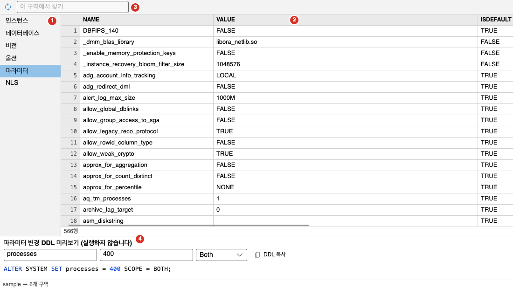
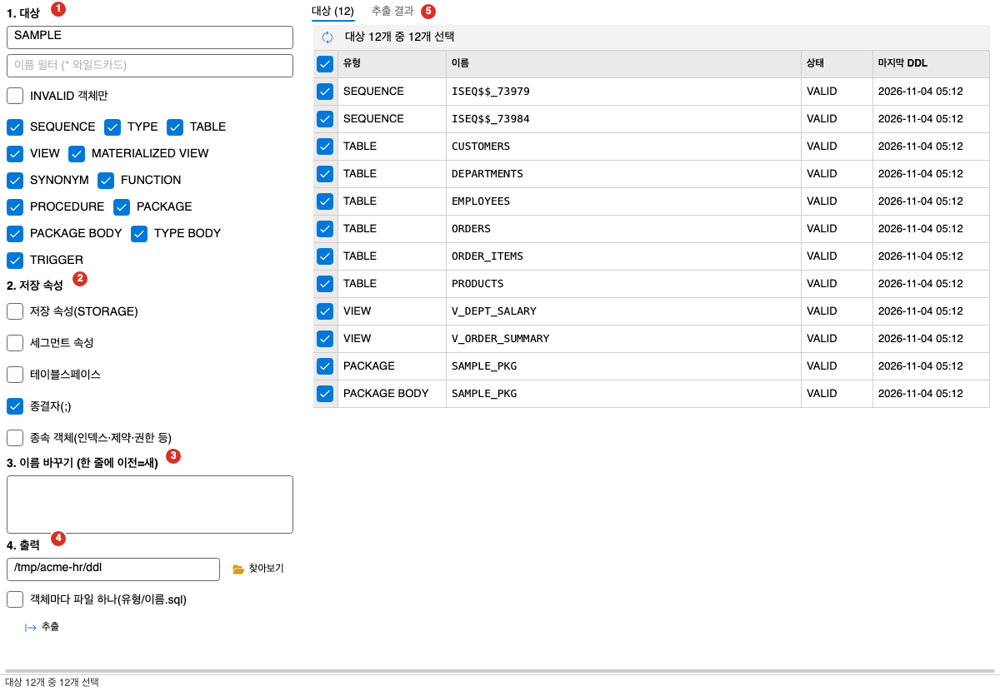
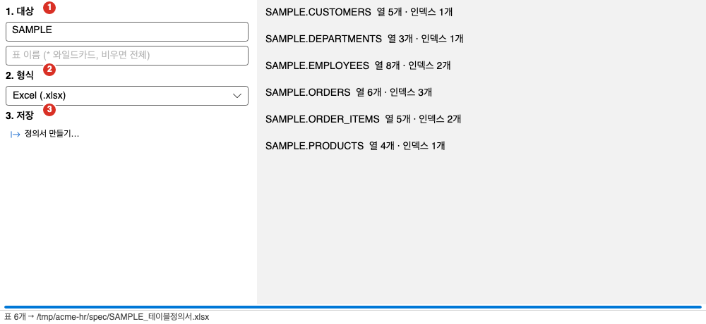
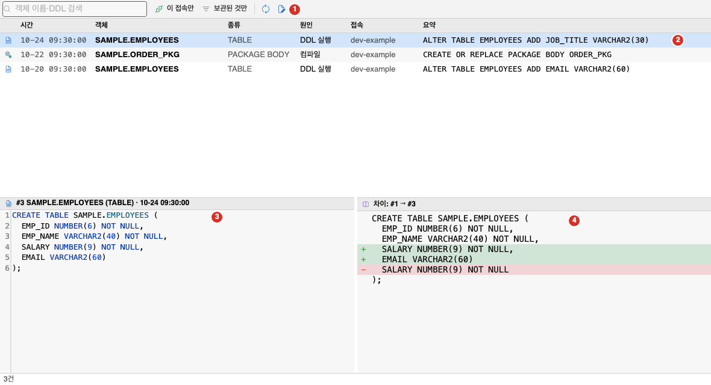

DB 도구는 접속한 DB 전체를 다루는 보조 기능입니다. 이 쪽에서는 DB 정보, DDL 일괄 추출, 테이블 정의서, 변경 일지, Role·기능 고르기를 설명합니다. 객체를 이름으로 찾는 객체 검색은 [스키마 브라우저](../../schema/browser/)에서 설명합니다.

- DB 정보와 DDL 일괄 추출은 **데이터베이스** 메뉴에, 테이블 정의서와 변경 일지는 **도구** 메뉴에 있습니다.
- DB 정보, DDL 일괄 추출, 테이블 정의서는 접속이 있어야 켜집니다. 모두 DB를 읽기만 합니다.
- 기능이 꺼져 있으면 메뉴에 나타나지 않습니다. 설정 창의 「기능」 탭에서 켭니다. [설정](../../settings/options/)을 보세요.

## DB 정보

**데이터베이스 > DB 정보**나 도구 모음의 DB 정보 단추로 엽니다. 인스턴스, 버전, 옵션, 파라미터, NLS 설정을 한 곳에서 봅니다.

1. 구역 목록: 왼쪽 목록에서 구역을 고릅니다. 구역은 「인스턴스」, 「데이터베이스」, 「버전」, 「옵션」, 「파라미터」, 「NLS」입니다.
2. 구역 표: 고른 구역의 내용입니다. 「인스턴스」와 「데이터베이스」는 「항목」과 「값」 두 열입니다.
3. 이 구역에서 찾기 칸: 고른 구역의 모든 열에서 글을 찾아 행을 거릅니다. 대소문자를 가리지 않습니다.
4. 파라미터 변경 DDL 미리보기: 아래 「파라미터 변경 DDL」을 보세요.

- 찾기 칸 왼쪽의 새로 고침 단추는 서버에서 다시 읽습니다.
- 창 아래의 상태 줄은 접속 이름과 읽은 구역 수를 보입니다.
- 구역 하나를 읽지 못해도(권한 부족 등) 나머지 구역은 보입니다. 읽지 못한 구역은 「오류」 열에 이유가 한 줄로 나오고 상태 줄에 「{n}개 구역 중 {m}개는 권한 등으로 읽지 못했다」가 나옵니다.

### 파라미터 변경 DDL

창 아래쪽의 「파라미터 변경 DDL 미리보기 (실행하지 않습니다)」는 파라미터를 바꾸는 `ALTER SYSTEM` 문을 만들어 줍니다. 만들기만 하고 실행하지 않습니다.

1. 「파라미터」 구역에서 행을 고릅니다. 「파라미터 이름」 칸과 「새 값」 칸에 이름과 현재 값이 채워집니다. 직접 입력해도 됩니다.
2. 「새 값」을 원하는 값으로 고칩니다.
3. 적용 범위를 고릅니다: Memory, Spfile, Both입니다. 처음 값은 Both입니다.
4. 미리보기 칸에 `ALTER SYSTEM SET 이름 = 값 SCOPE = BOTH;` 모양의 문장이 나옵니다. 문자 값은 작은따옴표로 감쌉니다.
5. 「DDL 복사」를 눌러 복사합니다. 편집기에 붙여 넣어 확인한 뒤 직접 실행하세요.

- 파라미터 이름이 올바르지 않으면 미리보기 칸 아래에 빨간 글로 이유가 나옵니다.
- 실제 실행은 SQL 편집기에서 직접 합니다.

## DDL 일괄 추출

**데이터베이스 > DDL 일괄 추출**로 엽니다. 한 스키마의 객체 DDL을 파일로 저장합니다. DB에는 쓰지 않습니다.

창 왼쪽에서 조건과 출력을 정하고, 오른쪽에서 추출할 객체를 고릅니다.

1. 대상: 아래 「1. 대상」을 보세요.
2. 저장 속성: 아래 「2. 저장 속성」을 보세요.
3. 이름 바꾸기: 아래 「3. 이름 바꾸기」를 보세요.
4. 출력: 아래 「4. 출력」을 보세요.
5. 추출 대상 탭: 아래 「오른쪽 탭」을 보세요.

### 1. 대상

| 항목 | 설명 |
|---|---|
| 스키마 | 추출할 스키마입니다. 접속 계정이 처음 값입니다. |
| 이름 필터 (* 와일드카드) | 객체 이름으로 거릅니다. |
| INVALID 객체만 | INVALID 객체만 대상으로 합니다. |
| 유형 확인란 | SEQUENCE, TYPE, TABLE, VIEW, MATERIALIZED VIEW, SYNONYM, FUNCTION, PROCEDURE, PACKAGE, PACKAGE BODY, TYPE BODY, TRIGGER입니다. 처음에는 모두 체크되어 있습니다. |

### 2. 저장 속성

| 항목 | 처음 값 | 설명 |
|---|---|---|
| 저장 속성(STORAGE) | 꺼짐 | STORAGE 절을 넣습니다. |
| 세그먼트 속성 | 꺼짐 | 세그먼트 속성을 넣습니다. |
| 테이블스페이스 | 꺼짐 | TABLESPACE를 넣습니다. |
| 종결자(;) | 켜짐 | 문장 끝에 `;`를 붙입니다. |
| 종속 객체(인덱스·제약·권한 등) | 꺼짐 | 객체에 딸린 DDL도 함께 추출합니다. |

### 3. 이름 바꾸기

「이름 바꾸기 (한 줄에 이전=새)」 칸에 한 줄에 하나씩 `이전=새`로 씁니다. 스키마와 객체 이름을 바꿔 추출할 때 씁니다. 형식이 틀린 줄은 건너뜁니다. 빈 줄과 `#`으로 시작하는 줄은 무시합니다.

### 4. 출력

- 「출력 폴더」: DDL 파일을 쓸 폴더입니다. 「찾아보기」 단추로 고릅니다. 처음 값은 내 문서 폴더의 `oranda-ddl` 폴더입니다.
- 「객체마다 파일 하나(유형/이름.sql)」: 체크하면 객체마다 `유형/이름.sql` 파일을 만듭니다. 체크하지 않으면 스키마 하나에 파일 하나(`스키마.sql`)로 모읍니다. 처음 값은 꺼짐입니다.
- 「추출」: 오른쪽 「추출 대상」에서 체크한 객체의 DDL을 파일로 씁니다.

### 오른쪽 탭

- 「추출 대상」: 조건에 맞는 객체의 목록입니다. 열은 체크, 유형, 이름, 상태, 마지막 DDL입니다. `Space`로 체크를 바꾸고 머리 칸의 확인란으로 전체를 선택하거나 해제합니다. 「대상 다시 조회 (F5)」로 다시 읽습니다. 「추출」은 체크한 객체만 추출합니다.
- 「추출 결과」: 추출한 객체마다 「완료 …」나 「실패 … — 이유」가 줄로 나옵니다. 아직 추출하지 않았으면 「아직 추출한 결과가 없습니다. 출력 폴더를 확인하고 「추출」을 누르세요.」가 나옵니다.

- 조건에 맞는 객체가 5,000개를 넘으면 앞쪽만 보입니다. 이때는 스키마, 이름, 유형을 좁히세요.
- 아래 진행 막대가 추출 진행을 보입니다. 끝나면 상태 줄에 「{n}개 추출, {m}개 실패 → 파일 {k}개 (폴더)」가 나옵니다.
- 상태 줄에 이유가 나오는 경우: 「스키마를 입력하세요」, 「출력 폴더를 입력하세요」, 「유형을 하나 이상 고르세요」, 「조건에 맞는 객체가 없다」, 「체크한 객체가 없다」입니다.

## 테이블 정의서

표의 열, 키, 인덱스를 정리한 문서를 만듭니다. 파일 형식은 Excel(.xlsx), Markdown(.md), HTML(.html)입니다.

1. 대상: 스키마와 표 이름입니다.
2. 형식: 파일 형식입니다.
3. 저장: 「정의서 만들기…」 단추입니다.

1. 표 하나의 정의서는 스키마 브라우저에서 표를 오른쪽 클릭해 **테이블 정의서…**를 고릅니다. 여러 표는 **도구 > 테이블 정의서…**를 고릅니다.
2. 「테이블 정의서」 문서 탭이 열립니다. 표 하나로 열면 탭 이름이 「테이블 정의서 {표 이름}」이고 스키마와 표 이름이 채워집니다.
3. 「1. 대상」에서 「스키마」와 「표 이름」을 정합니다. 표 이름은 `*` 와일드카드를 쓸 수 있고 비우면 스키마의 모든 표입니다.
4. 「2. 형식」에서 Excel, Markdown, HTML 중 하나를 고릅니다.
5. 「3. 저장」의 「정의서 만들기…」를 누르고 저장할 파일을 정합니다. 제안하는 파일 이름은 `{스키마}_{표}_테이블정의서.xlsx`나 `{스키마}_테이블정의서.xlsx` 모양입니다.
6. 목록에 「{스키마}.{표}  열 {n}개 · 인덱스 {m}개」가 줄마다 나오고 상태 줄에 「표 {n}개 → {파일}」이 나옵니다.

- 문서에는 생성 시각과 목차가 들어갑니다. 표마다 표 설명, 열 표, 인덱스 표가 나옵니다.
- 열 표의 열은 순번, 열 이름, 타입, NULL, PK, FK, 기본값, 주석입니다. 타입에는 길이와 정밀도가 붙습니다(`NUMBER(7,2)`, `VARCHAR2(10)`). FK 열에는 참조하는 `부모표.열`이 나옵니다. 부모 표를 읽지 못하면 표 이름만 적습니다.
- 인덱스 표의 열은 인덱스, 고유, 열입니다.
- 대상은 표(`TABLE`)만입니다. 조건에 맞는 표가 없으면 「조건에 맞는 표가 없다」가 나옵니다.
- 상태 줄 이유: 「스키마를 입력하세요」, 「저장할 파일을 정하세요」입니다.

## 변경 일지

변경 일지는 DB 객체를 바꾸기 직전의 서버 DDL을 자동으로 보관합니다. 잘못 바꿨을 때 이전 DDL을 다시 볼 수 있습니다.

### 보관되는 것

- DDL 실행 직전: `ALTER`, `DROP`, `CREATE OR REPLACE`, `RENAME` 문을 보내기 직전에 대상 객체의 현재 DDL을 읽어 보관합니다. 정책이나 확인을 통과한 뒤에 보관하므로 거부된 문장은 남지 않습니다.
- PL/SQL 컴파일 직전: PL/SQL 편집기에서 컴파일하기 직전의 서버 소스를 보관합니다.
- 같은 객체의 마지막 성공 보관본과 내용이 같으면 새로 쌓지 않습니다.
- 보관에 실패하면(권한 부족, 시간 초과, 객체 없음) 이유만 남기고 실행은 그대로 진행합니다. 일지 때문에 실행이 막히지 않습니다.
- 보관본과 요약에 들어 있는 비밀 값은 가려서 저장합니다.
- 일지는 앱 안에 저장하며 DB에는 쓰지 않습니다. 365일이 지났거나 객체당 50개를 넘는 오래된 보관본은 지웁니다. 이 값은 설정 창에 없습니다.

### 변경 일지 창

**도구 > 변경 일지**로 엽니다. 스키마 브라우저에서 객체를 오른쪽 클릭해 **변경 일지 보기**를 고르면 그 객체의 보관본만 나옵니다. 객체로 거른 상태는 도구 모음에 보이고 「해제」 단추로 풉니다.

1. 도구 모음: 아래 표의 항목입니다.
2. 목록: 보관본마다 한 줄입니다.
3. DDL 본문: 고른 보관본의 DDL입니다.
4. 차이 보기: 같은 객체의 바로 앞 보관본과의 차이입니다.

그림의 보관본은 설명을 위해 지어낸 예시입니다.

도구 모음은 다음과 같습니다.

| 항목 | 설명 |
|---|---|
| 객체 이름·DDL 검색 | 객체 이름과 보관한 DDL에서 글을 찾습니다. |
| 이 접속만 | 지금 접속의 변경만 봅니다. |
| 보관된 것만 | 보관에 실패한 줄을 숨깁니다. |
| 새로 고침 | 목록을 다시 읽습니다. |
| 이 DDL 을 새 편집기에 열기 | 고른 보관본의 이전 DDL을 새 SQL 탭에 엽니다. |

- 목록 열: 아이콘, 시간, 객체, 종류, 원인, 접속, 요약입니다. 원인은 「DDL 실행」이나 「컴파일」입니다. 요약에는 실행한 문장의 앞부분이 나오고, 보관에 실패한 줄은 「보관 실패: 이유」가 빨간 글로 나옵니다.
- 목록은 최근 순이며 한 번에 300건을 읽습니다.
- 줄을 고르면 아래에 그 보관본의 DDL이 나옵니다. 같은 객체의 바로 앞 보관본이 있으면 차이도 함께 보입니다. 줄 두 개를 고르면 두 보관본의 차이를 보입니다. 차이 줄의 `+`는 새 쪽에만 있는 줄이고 `-`는 옛 쪽에만 있는 줄입니다.

### 이전 DDL로 되돌리기

변경 일지는 자동으로 되돌리지 않습니다.

1. 되돌릴 보관본을 고릅니다.
2. 「이 DDL 을 새 편집기에 열기」를 누릅니다. 새 SQL 탭에 보관본이 열립니다. 첫 줄 주석에 어느 보관본인지(번호, 객체, 시각)가 나옵니다.
3. 내용을 확인합니다. 자동으로 실행하지 않습니다.
4. 실행하려면 직접 실행합니다. PL/SQL 소스는 끝에 `/` 줄이 붙고 그 밖의 DDL은 끝에 `;`가 붙어 한 문장으로 실행됩니다.

- 보관에 실패한 줄은 열 DDL이 없어 「보관된 DDL 이 없는 항목이다」가 나옵니다.

## Role·기능 고르기

**도구 > Role·기능 고르기…**는 설정 창을 「기능」 탭으로 엽니다. 주 업무를 바꾸거나 기능을 하나씩 켜고 끕니다. 항목 설명은 [설정](../../settings/options/)을 보세요. 상태 표시줄의 막음 알림이나 시작 화면의 기본 Role 카드에서 「설정 열기」, 「바꾸기…」를 눌러도 같은 탭이 열립니다.

## 자주 하는 작업

### 스키마의 모든 표를 DDL 파일로 저장하기

1. **데이터베이스 > DDL 일괄 추출**을 엽니다.
2. 「스키마」를 확인하고 「유형」에서 TABLE만 체크합니다.
3. 필요하면 「종속 객체(인덱스·제약·권한 등)」를 체크합니다.
4. 「출력 폴더」를 정합니다.
5. 「추출 대상」 탭에서 대상 목록을 확인하고 「추출」을 누릅니다.
6. 「추출 결과」 탭에서 실패한 객체가 없는지 확인합니다.

### 파라미터 값을 바꾸기 전에 문장 만들기

1. **데이터베이스 > DB 정보**를 열고 「파라미터」 구역을 고릅니다.
2. 이름을 찾아 행을 고릅니다.
3. 「새 값」과 적용 범위를 정합니다.
4. 「DDL 복사」를 누르고 SQL 편집기에 붙여 넣어 DBA와 확인한 뒤 실행합니다.

### 실수로 바꾼 프로시저 되돌리기

1. 스키마 브라우저에서 프로시저를 오른쪽 클릭해 **변경 일지 보기**를 고릅니다.
2. 바꾸기 전 시각의 보관본을 고르고 차이를 확인합니다.
3. 「이 DDL 을 새 편집기에 열기」를 누릅니다.
4. 내용을 확인하고 실행합니다.

## 문제가 생길 때

| 증상 | 원인과 해결 |
|---|---|
| DB 정보에서 일부 구역이 「오류」입니다 | 계정에 해당 뷰를 읽을 권한이 없습니다. 이유를 확인하고 DBA에게 권한을 요청하세요. 다른 구역은 그대로 보입니다. |
| DDL 추출의 「추출 대상」이 앞쪽만 보입니다 | 객체가 5,000개를 넘습니다. 스키마, 이름 필터, 유형을 좁히세요. |
| DDL 추출에서 「체크한 객체가 없다」가 나옵니다 | 「추출 대상」 탭에서 객체를 체크하세요. |
| 변경 일지에 「보관 실패: …」 줄이 있습니다 | 그 시점에 DDL을 읽지 못했습니다. 실행은 정상으로 진행되었습니다. 이유를 확인하세요. |
| 변경 일지 메뉴가 보이지 않습니다 | 변경 일지 기능이 꺼져 있을 수 있습니다. **도구 > Role·기능 고르기…**에서 확인하세요. |
| 테이블 정의서의 FK 열에 표 이름만 나옵니다 | 부모 표를 읽을 권한이 없습니다. |
