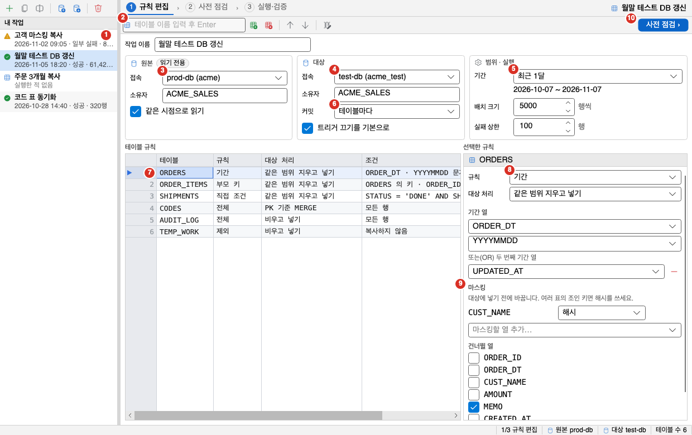
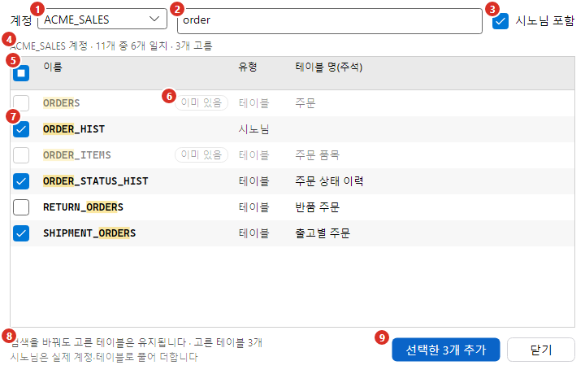
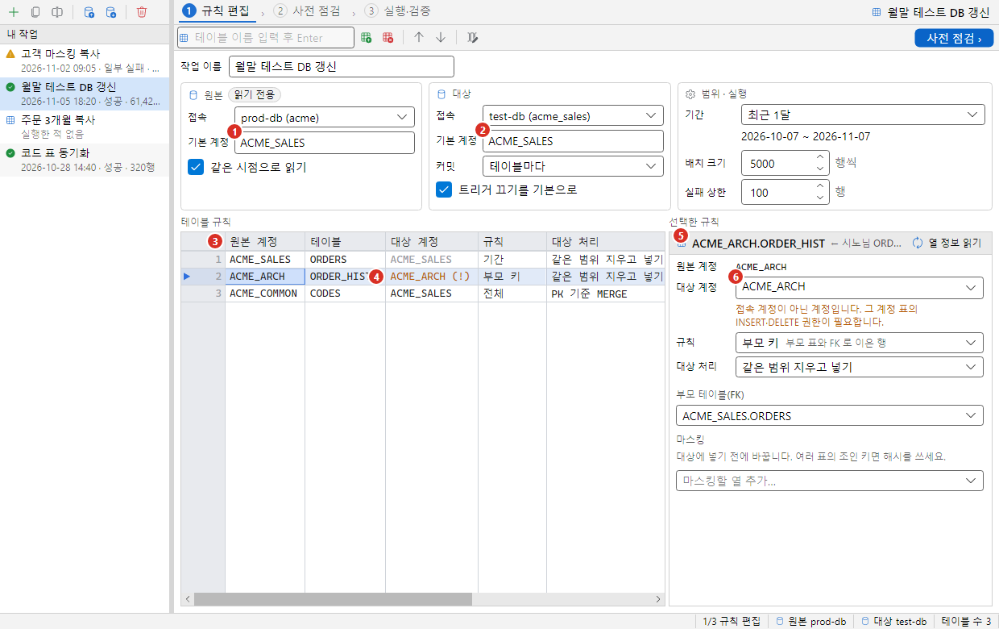
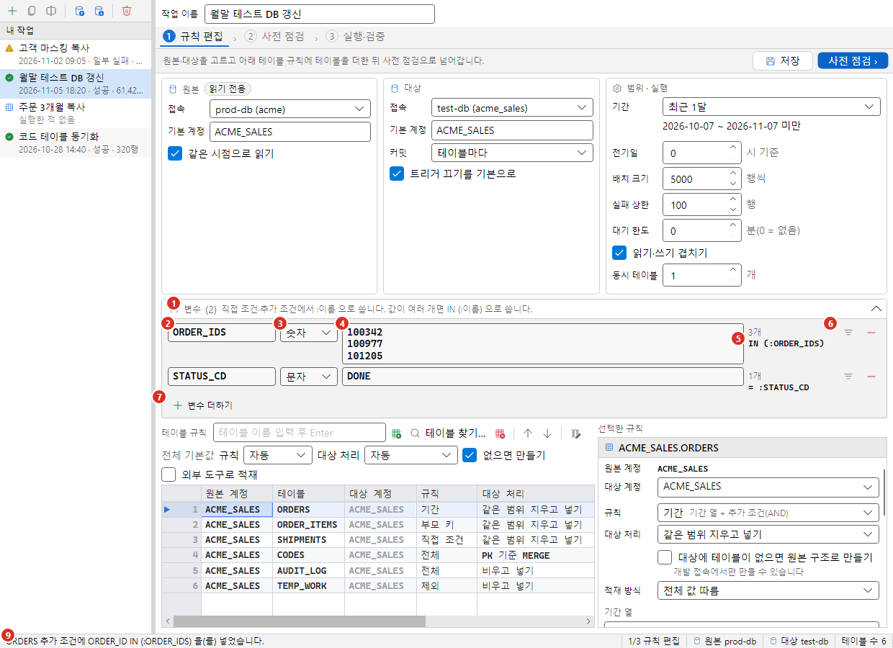
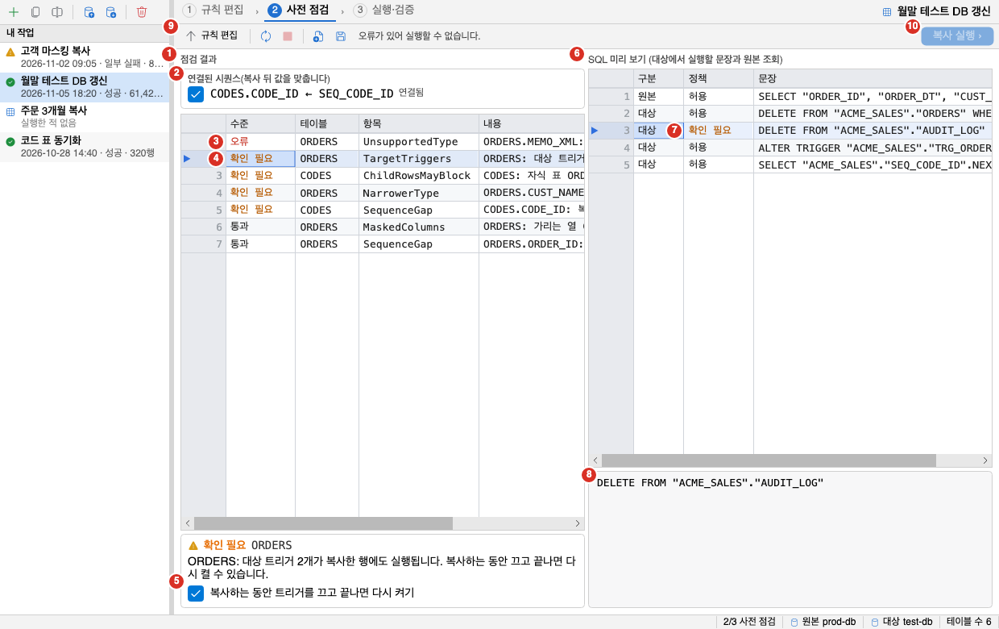
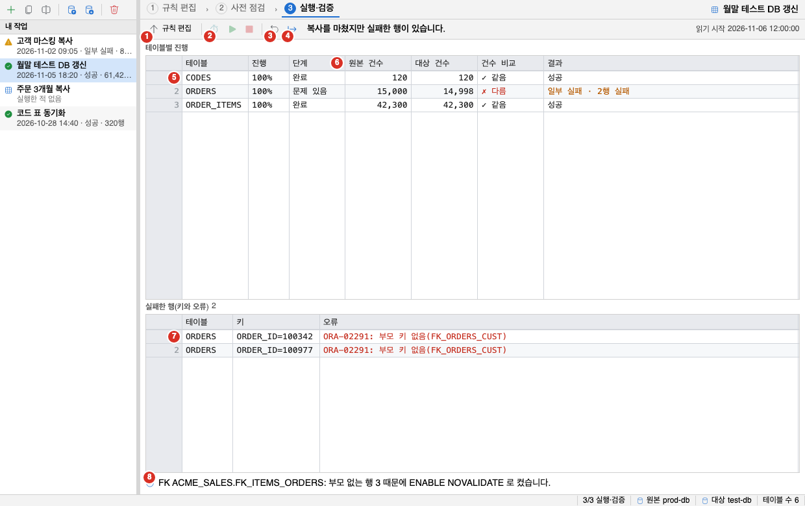
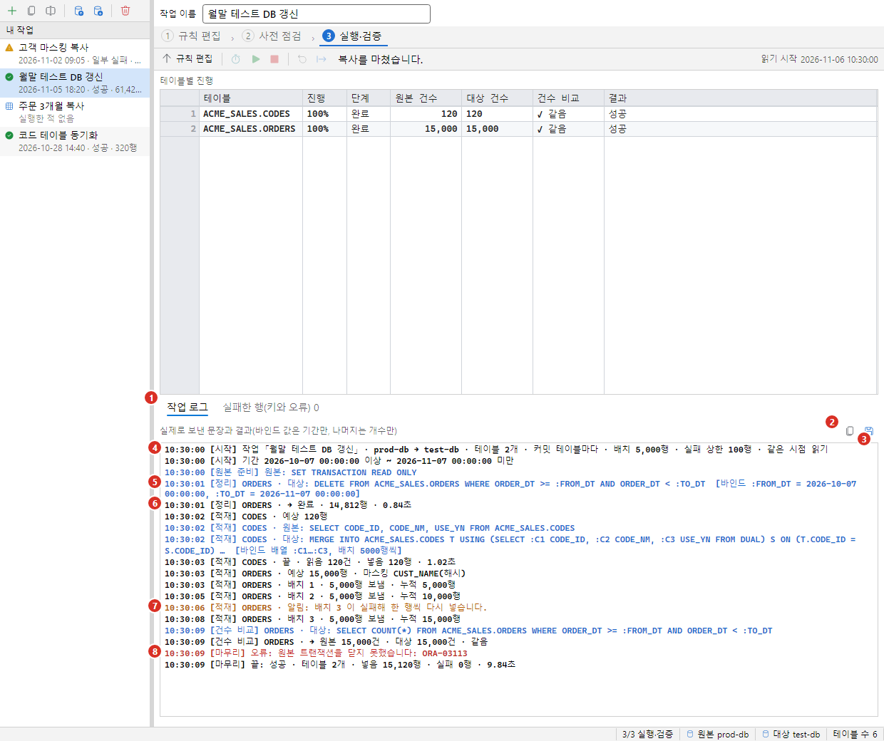
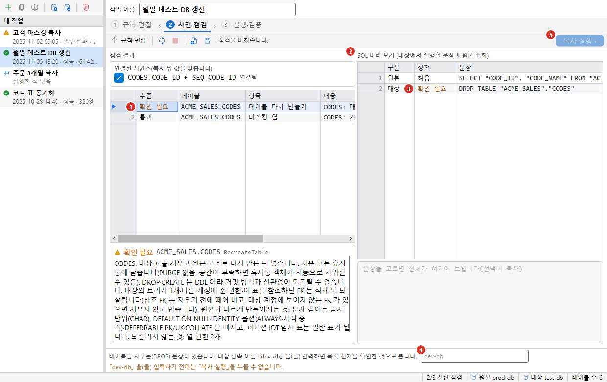
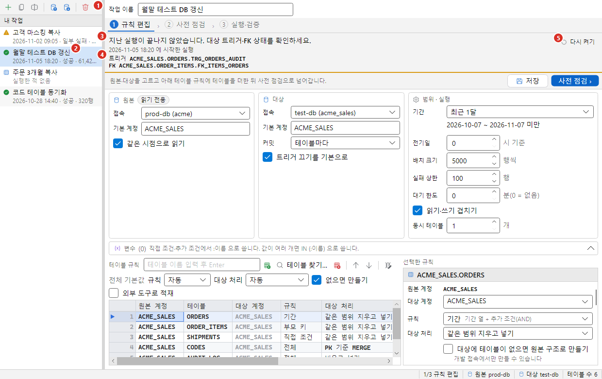

데이터 복사는 원본 접속에서 읽은 행을 대상 접속의 표에 넣습니다. 운영 DB의 최근 데이터를 개발 DB로 가져오거나, 개인정보 열을 가려서 테스트 DB에 채울 때 씁니다. 파일을 거치지 않으므로 [데이터 내보내기와 가져오기](../data-transfer/)보다 한 단계가 적습니다.

복사 작업은 세 단계로 진행합니다.

1. 규칙 편집: 원본과 대상 접속, 기간, 표마다 복사 규칙을 정합니다.
2. 사전 점검: 대상에 실제로 보내기 전에 권한과 열 차이, 실행할 SQL을 확인합니다.
3. 실행·검증: 복사하고, 원본과 대상의 건수를 비교하고, 실패한 행을 처리합니다.

설정한 내용은 「작업」으로 저장하므로 같은 복사를 나중에 다시 실행할 수 있습니다.

## 안전 장치

복사는 대상 표의 행을 지우고 다시 넣을 수 있으므로 다음 장치가 걸려 있습니다. 끄는 설정은 없습니다.

| 장치 | 동작 |
|---|---|
| 운영 접속은 대상으로 쓸 수 없음 | 환경이 「운영」인 접속은 대상 목록에서 회색으로 보이고 고를 수 없습니다. 저장된 작업의 대상이 이 PC에서 운영 접속이면 작업을 열 때 대상을 비웁니다. 사전 점검과 실행 직전에도 접속 목록을 다시 읽어 확인합니다. |
| 원본에는 쓰지 않음 | 원본 세션은 읽기 전용으로 열고, 복사를 실행하는 동안 읽기 전용 트랜잭션 안에서만 읽습니다. 사전 점검의 조회도 읽기 전용 세션으로 합니다. 실행 정책도 조회가 아닌 문장을 한 번 더 막습니다. |
| 표를 지우는 일은 개발 접속에서만 | 「테이블 다시 만들기」는 환경이 「개발」인 접속을 대상으로 할 때만 목록에 나옵니다. 「테스트」 접속도 쓸 수 없습니다. 사전 점검과 실행 직전에 한 번 더 확인하고, `DROP` 문장은 대상 접속 이름을 다시 입력해야 실행합니다. 자세한 내용은 [테이블 다시 만들기](#테이블-다시-만들기)에서 설명합니다. |
| 읽기 전용 접속은 대상이 될 수 없음 | 읽기 전용 접속을 대상으로 고르면 규칙 편집 단계에 「대상 접속이 읽기 전용이라 복사할 수 없습니다. 쓰기가 가능한 접속을 고르세요.」가 나오고 **사전 점검** 단추가 꺼집니다. 대상 목록의 그 항목에도 같은 안내가 붙습니다. 그래도 쓰기 문장은 실행 정책이 한 번 더 거부하며, 이 거부는 미리 확인해도 통과하지 못합니다. |
| 읽는 표를 지우지 않음 | 같은 DB에서 어떤 규칙이 지우고 넣을 대상 표(계정·표)가 어떤 규칙이 읽는 원본 표와 같으면 대상 정리가 원본 행을 지울 수 있으므로 시작하지 않습니다. 같은 접속이면 규칙 편집에서, 이름이 다른 접속이 같은 DB를 가리키면 사전 점검에서 막습니다. |
| 다른 계정에 쓸 때는 한 번 더 물음 | 대상 접속 계정이 아닌 계정의 표에 쓰는 규칙은 규칙 그리드에서 경고색으로 보이고, 사전 점검에 확인 항목이 나오며, **복사 실행**을 누르면 계정별로 지울 표 수를 보이는 확인 창이 나옵니다(기본 단추는 취소). |
| 새 버전 작업은 실행하지 않음 | 더 새 버전의 Oranda가 만든 작업 파일은 읽기 전용으로 열리고, 사전 점검과 실행도 할 수 없습니다. 이 버전이 모르는 설정(표마다 계정 등)을 빼고 실행하면 엉뚱한 표를 지울 수 있기 때문입니다. |
| 끈 트리거·FK는 다시 켬 | 복사하는 동안 끈 트리거와 외래키는 끝나면 다시 켭니다. 중지하거나 실패해도 마찬가지입니다. 그래도 켜지 못하면 다음에 그 작업을 열 때 「다시 켜기」가 나옵니다. |
| 모든 문장은 실행 정책을 거침 | 대상에서 실행하는 모든 문장이 일반 SQL 실행과 같은 정책을 지납니다. 대상에서 지우는 문장과 트리거·FK를 끄는 문장은 사전 점검의 미리 보기에서 정책 판정(「확인 필요」, 「실행할 수 없음」)과 함께 미리 보입니다. 넣는 INSERT·MERGE는 미리 보기에 나오지 않지만 실행할 때 같은 정책을 지납니다. |
| 행 값은 디스크에 남기지 않음 | 작업 파일에는 비밀번호도 행 값도 없습니다. 실행 기록에는 실패한 행의 키 열 값만 남습니다. 마스킹한 열의 원래 값은 어디에도 남기지 않습니다. 실행 화면의 작업 로그에도 행 값, 변수 값, 마스킹 값은 나오지 않습니다. |

## 여는 방법

방법은 세 가지입니다. 어느 방법이든 창은 하나만 열리고, 이미 열려 있으면 그 창이 앞으로 나옵니다. 창은 모달이 아니므로 복사가 도는 동안에도 Oranda의 다른 일을 할 수 있습니다.

- **도구 > 데이터 복사…**를 고릅니다. 명령 팔레트에서 「데이터 복사」를 찾아도 같습니다. 단축키는 없습니다.
- 스키마 브라우저에서 표나 시노님을 오른쪽 클릭하고 「데이터 복사에 추가」를 고릅니다. 시노님은 원본 접속에서 실제 계정·표로 풀어 그 표를 더합니다([다른 계정의 표와 시노님](#다른-계정의-표와-시노님)). 열려 있는 작업이 없으면 「새 작업 2026-11-06 10:30」처럼 날짜와 시각이 붙은 이름의 작업을 새로 만들고, 원본 접속이 비어 있으면 그 표를 고른 접속을 원본으로 둡니다. 열려 있는 작업이 있으면 그 작업에 표 규칙을 더합니다.
- 창 왼쪽의 「내 작업」 목록에서 저장된 작업을 고릅니다. 작업 목록은 [작업 저장, 다시 열기, 실행 기록](#작업-저장-다시-열기-실행-기록)에서 설명합니다.

## 1단계: 규칙 편집

창 위쪽의 단계 표시줄에서 현재 단계는 번호가 채워지고 아래에 파란 줄이 그어집니다. 오른쪽 끝에는 열린 작업의 이름이 나옵니다. 작업을 하나도 열지 않았으면 오른쪽 영역이 꺼져 있습니다. 먼저 「내 작업」의 **새 작업**을 누르거나 작업을 고르세요. 위쪽의 표 추가 칸은 작업이 없어도 쓸 수 있고, 이때 새 작업이 자동으로 만들어집니다.

1. 내 작업 목록. 저장한 작업이 이름순으로 나오고, 이름 앞 아이콘이 마지막 실행 결과(성공, 일부 실패, 실패, 중지)를 보이고, 실행한 적이 없으면 표 아이콘과 「실행한 적 없음」이 나옵니다. 위의 도구 모음은 [내 작업](#내-작업)에서 설명합니다.
2. 표 이름 칸. 오른쪽에 표 규칙 추가 아이콘 단추, **테이블 찾기…** 단추, 제거, 위로, 아래로, 열 정보 읽기 아이콘 단추가 있습니다.
3. 「원본」 묶음의 접속. 아래에 기본 계정과 「같은 시점으로 읽기」가 있고, 제목 옆 「읽기 전용」 표지는 원본에 쓰지 않는다는 뜻입니다.
4. 「대상」 묶음의 접속. 아래에 기본 계정, 커밋 단위, 「트리거 끄기를 기본으로」가 있습니다.
5. 「범위 · 실행」 묶음의 기간. 아래에 오늘 날짜로 계산한 범위, 배치 크기, 실패 상한이 있습니다.
6. 커밋 단위
7. 규칙 그리드
8. 선택한 규칙을 편집하는 패널. 맨 위가 원본 계정·대상 계정, 그 아래가 규칙 종류(이름 옆에 짧은 설명)와 대상 처리입니다. 그림의 기간 규칙에는 기간 열 아래에 「추가 조건(AND)」이 있습니다.
9. 마스킹. 열마다 방법 콤보와 오른쪽 빼기(−) 단추가 있고, 아래에 「마스킹할 열 추가…」와 건너뛸 열이 이어집니다.
10. **사전 점검** 단추. 도구 모음 오른쪽 끝의 파란 단추입니다. 바로 왼쪽에 **저장** 단추가 있습니다([작업 저장](#작업-저장)).

창 맨 위의 「작업 이름」 칸은 세 단계 모두에서 보이고, 여기서 고친 이름이 내 작업 목록과 저장 파일에 쓰입니다.

「범위 · 실행」 묶음 아래에는 접어 둔 「변수」 칸이 있습니다. 제목 옆 괄호에 변수 수가 나옵니다. 쓰는 방법은 [변수](#변수)에서 설명합니다.

창 맨 아래 상태 표시줄은 칸으로 나뉩니다. 왼쪽부터 안내나 오류(빨간 글), 지금 단계(`1/3 규칙 편집`), 원본 접속, 대상 접속, 테이블 수이고, 일하는 동안에는 오른쪽 끝에 진행 막대가 움직입니다.

화면의 각 항목은 아래 절에서 순서대로 설명합니다. 접속, 기간, 표 규칙, 실행 옵션은 모두 이 화면에서 정합니다.

### 접속 고르기

- 원본 접속: 접속 관리자에 저장한 접속 중에서 고릅니다. 옆의 「읽기 전용」 표지는 원본에 아무것도 쓰지 않는다는 뜻입니다. 운영 접속도 원본으로는 쓸 수 있습니다.
- 대상 접속: 같은 목록에서 고릅니다. 운영 접속은 회색이고 이름 옆에 「운영 접속 · 대상 불가」가 붙으며, 마우스를 올리면 「운영 접속은 복사 대상으로 쓸 수 없습니다.」가 나옵니다. 읽기 전용 접속은 고를 수 있지만 항목에 「대상 접속이 읽기 전용이라 복사할 수 없습니다. 쓰기가 가능한 접속을 고르세요.」가 붙습니다. 그 접속을 고르면 표 규칙 위에도 같은 문구가 굵게 나오고 **사전 점검** 단추가 꺼집니다.
- 기본 계정: 원본 쪽은 표 이름만 적어 더할 때 먼저 찾는 계정이고, 대상 쪽은 그 계정의 표를 넣을 계정입니다. 대상 기본 계정을 비우면 원본 기본 계정과 같다고 봅니다. 표를 추가할 때 칸이 비어 있으면 원본 기본 계정은 그 표의 계정으로, 대상 기본 계정은 대상 접속의 사용자 이름(대문자)으로 채워집니다. 대상 접속을 아직 고르지 않았으면 대상 기본 계정도 그 표의 계정으로 채워집니다. 기본 계정을 바꾸면(칸을 벗어날 때) 옛 기본 계정을 쓰던 규칙만 새 계정으로 따라 바뀌고, 다른 계정의 규칙은 그대로입니다.

작업 파일에는 접속의 이름과 사용자 이름, 이 PC에서 빨리 찾기 위한 접속 ID 힌트만 저장하고 비밀번호는 저장하지 않습니다. 작업을 열면 이 PC의 접속 목록에서 같은 접속을 다시 찾아 잇습니다. 다음 경우에는 칸을 비우고 이유를 보입니다.

- 원본이나 대상 접속을 이 PC에서 찾지 못하면 「원본 접속 「이름」 을(를) 이 PC 에서 찾지 못했습니다. 접속을 다시 고르세요.」처럼 나옵니다.
- 대상이 이 PC에서 운영 접속이면 「작업에 저장된 대상 접속 「이름」 이(가) 이 PC 에서는 운영 접속이라 대상을 비웠습니다. 개발·테스트 접속을 다시 고르세요.」가 나옵니다. 동료가 보낸 작업으로 운영 DB에 쓰는 일을 막기 위해서입니다.

### 기간

「기간」은 작업 전체에서 하나입니다. 기간 규칙을 쓰는 표에만 적용됩니다.

| 기간 | 범위 |
|---|---|
| 기간 없음 | 날짜 조건을 쓰지 않습니다. |
| 최근 1주, 최근 1달, 최근 3달 | 내일 0시를 끝으로 거꾸로 7일, 1달, 3달입니다. 오늘 데이터까지 들어갑니다. |
| 지난달 | 지난달 1일부터 이번 달 1일 전까지입니다. |
| 직접 지정 | 시작 날짜와 끝 날짜를 달력에서 고릅니다. 끝 날짜 아래 콤보에서 「미만」이나 「끝 날짜 포함」을 고릅니다. |

- 계산된 기간은 「시작 포함 · 끝 제외」입니다. 계산된 날짜에 마우스를 올리면 그렇게 나옵니다.
- 직접 지정은 처음에 「미만」입니다. 끝 날짜는 들어가지 않아서 `2026-11-01 ~ 2026-11-02 미만`이 11월 1일 하루치입니다. 「끝 날짜 포함」을 고르면 끝 날짜 하루 끝까지 들어가서 `2026-11-01 ~ 2026-11-01 끝 날짜 포함`이 같은 하루치입니다. 이때 실제 조건은 끝 날짜 다음 날 0시 미만이라 시각이 있는 `DATE` 열도 끝 날짜 23:59:59까지 들어갑니다.
- 추가 조건의 `:TO_DT`에는 어느 쪽이든 끝 경계(그 시각 미만)가 들어갑니다. `열 < :TO_DT`로 쓰세요.
- 범위에 드는 날이 없으면(예: `2026-11-01 ~ 2026-11-01 미만`) 사전 점검이 「빈 기간」 오류로 실행을 막습니다.
- 「전기일」은 업무 날짜가 바뀌는 시각입니다(0~23시, 처음은 0 = 자정). 7로 두면 `DATE`·`TIMESTAMP` 기간 열의 하루를 그날 07:00부터 다음 날 07:00 전까지로 셉니다. 예를 들어 `2026-11-01 ~ 2026-11-01 끝 날짜 포함`은 `2026-11-01 07:00 이상 2026-11-02 07:00 미만`입니다. `:FROM_DT`·`:TO_DT`에도 같은 시각이 들어갑니다.
- 전기일은 `YYYYMMDD`처럼 문자열로 저장한 날짜 열에는 쓰지 않습니다. 그런 열은 이미 업무 날짜로 저장되어 있으므로 날짜 그대로 비교합니다.
- 「최근 1주」·「지난달」 같은 계산된 기간도 전기일 기준 날짜로 계산합니다. 7시 기준이면 11월 1일 새벽 5시는 아직 10월 31일이라 「지난달」이 9월입니다.
- 작업에는 「최근 1달」 같은 상대 값을 저장합니다. 작업을 열 때마다 오늘 날짜로 다시 계산해서 화면에 보입니다. 예를 들어 2026-11-06에 「최근 1달」은 `2026-10-07 ~ 2026-11-07 미만`입니다.
- 사전 점검 때 계산한 기간을 실행에도 그대로 씁니다. 자정을 넘겨도 범위가 바뀌지 않습니다.

### 표 규칙

위쪽 입력칸에 `표` 또는 `계정.표`를 쓰고 표 규칙 추가 단추를 누르거나 `Enter`를 누릅니다. 입력칸에 들어가면 원본의 표·시노님 이름을 읽기 시작하므로 첫 글자부터 자동 완성 후보가 나옵니다. 후보는 대소문자를 가리지 않고 찾으므로 `order_`처럼 소문자로 쳐도 됩니다. 여러 표를 한 번에 더하려면 [테이블 찾기](#테이블-찾기)를 쓰세요. 원본 세션을 열어 이름을 실제 계정·표로 푼 뒤 규칙을 만들고 그 표의 열 정보를 읽습니다. 원본에서 찾을 수 없는 이름은 더하지 않고 상태 줄에 이유가 나옵니다. 원본 세션을 열지 못했으면(원본 접속을 고르지 않았거나 비밀번호 입력을 취소) 적은 계정, 계정을 적지 않았으면 기본 계정의 표로 더하고 열 정보는 읽지 않으므로, 나중에 그 규칙을 골라 **열 정보 읽기**를 누르세요. 스키마 브라우저에서 추가한 표도 같은 목록에 들어갑니다. 같은 계정의 같은 표를 다시 추가하면 새로 만들지 않고 그 규칙을 선택합니다. 선택한 규칙을 지우려면 제거 단추를 누르거나 그리드에서 `Delete`를 누릅니다. 위로·아래로 단추는 목록에서 보이는 순서만 바꿉니다. 실제 복사 순서는 [복사 순서](#복사-순서)대로 정해집니다.

규칙 그리드는 「원본 계정」, 「테이블」, 「대상 계정」, 「규칙」, 「대상 처리」, 「조건」 여섯 칸이고, 조회 결과 그리드와 같게 다룹니다. 대상 계정이 원본 계정과 같고 대상 접속 계정이면 흐린 글자로, 대상 접속 계정이 아니면 주황 글자와 `(!)`로 보입니다. 머리글을 눌러 정렬하고, 머리글을 끌어 열 순서를 바꾸고, 경계를 끌어 너비를 바꾸고, 머리글의 ▾로 열 필터를 겁니다. 오른쪽 클릭 메뉴에는 복사 명령과 함께 테이블 추가, 규칙 제거, 위로, 아래로, 열 정보 읽기가 있습니다. 줄을 고르면(현재 줄에 ▶) 오른쪽 패널에서 그 규칙을 편집합니다. 패널 머리 띠의 **열 정보 읽기**(도구 모음의 같은 단추)는 원본에서 그 표의 열을 읽어 옵니다. 저장된 작업을 열었을 때처럼 열 정보가 없으면 기간 열, 마스킹, 건너뛸 열 목록이 비어 있으므로 먼저 눌러야 합니다. 원본 세션이 이미 열려 있으면 자동으로 읽습니다.

#### 테이블 찾기

표 이름 칸 옆의 **테이블 찾기…** 단추를 누르면 원본 계정의 표를 검색해 여러 개를 한 번에 규칙으로 더하는 창이 열립니다. 작업을 열고 원본 접속을 고른 뒤에 쓸 수 있고, 원본 세션이 없으면 비밀번호를 묻습니다.

1. 계정 콤보
2. 이름·테이블 명 필터. 그림은 `order`로 걸러 이름에 `ORDER`가 든 표만 보입니다.
3. 「시노님 포함」 체크
4. 계정, 전체 수, 맞는 수, 고른 수 요약 줄
5. 머리글의 체크. 보이는 표를 모두 고르거나 풉니다.
6. 「이미 있음」 표지. 작업 규칙에 이미 있는 표라 흐리고 체크할 수 없습니다.
7. 고른 표. 이름에서 검색어와 맞는 글자가 강조됩니다. 「유형」이 시노님인 줄은 더할 때 실제 표로 풉니다.
8. 검색을 바꿔도 고른 표가 남는다는 안내와 고른 수
9. **선택한 N개 추가** 단추

| 항목 | 설명 |
|---|---|
| 계정 | 검색할 원본 계정입니다. 처음에는 원본 기본 계정(비어 있으면 원본 접속 계정)이 골라져 있습니다. 계정을 바꾸면 그 계정의 표를 읽습니다. |
| 이름·테이블 명 필터 | 치는 대로 목록이 걸러집니다. 표 이름과 테이블 명(표 주석)에서 대소문자를 가리지 않고 찾으므로 소문자로 쳐도 됩니다. |
| 시노님 포함 | 켜면 그 계정의 시노님도 목록에 나옵니다. |
| 목록 | 체크, 「이름」, 「유형」(테이블, 시노님), 「테이블 명(주석)」 칸입니다. 이름에서 검색어와 맞는 글자는 강조됩니다. 이미 작업 규칙에 있는 표는 흐리게 「이미 있음」 표지와 함께 나오고 체크할 수 없습니다. |
| 머리글의 체크 | 지금 보이는 표를 모두 고르거나 모두 풉니다(「이미 있음」 표는 빼고). |
| **선택한 N개 추가** | 고른 표를 규칙으로 더하고 창을 닫습니다. 고른 표가 없으면 꺼져 있습니다. `Enter`도 같습니다. |
| **닫기** | 더하지 않고 닫습니다. `Esc`도 같습니다. |

- 필터 칸이 비어 있으면 목록을 늘어놓지 않고 「이름을 입력하면 걸러 보입니다 — 전체 N개」가 나옵니다. 맞는 표가 없으면 「「검색어」 와 맞는 표가 없습니다」가 나옵니다.
- `*`가 없으면 이름이나 테이블 명에 검색어가 들어 있는 표를 찾습니다. `*`를 쓰면 와일드카드로 보고 **이름 전체**와 맞춥니다. 예를 들어 `ord*`는 `ORD`로 시작하는 표, `*_hist`는 `_HIST`로 끝나는 표입니다. 테이블 명은 `*`를 뺀 글자가 들어 있는지로 봅니다.
- 목록 위의 줄에 「APP 계정 · 1,240개 중 35개 일치 · 3개 고름」처럼 맞는 수와 고른 수가 나옵니다. 한 번에 500개까지만 보이고, 넘으면 「처음 500개만 보입니다(검색을 좁혀 주세요)」가 붙습니다.
- 고른 표는 검색어나 계정을 바꿔도 남습니다. 창 아래에 「검색을 바꿔도 고른 표는 유지됩니다 · 고른 표 N개」가 나오므로 여러 번 검색해 모은 뒤 한 번에 더하면 됩니다.
- 시노님은 표 이름 칸에 쓸 때와 같이 실제 계정·표로 풀어 더합니다([다른 계정의 표와 시노님](#다른-계정의-표와-시노님)).
- 더한 뒤 상태 줄에 「테이블 N개 규칙을 추가했습니다.」가 나옵니다. 더하지 못한 표가 있으면 뒤에 이유가 붙습니다.
- 계정의 표를 읽지 못하면 목록 자리에 「APP 계정의 표를 읽지 못했습니다: …」가 나옵니다. 테이블 명을 읽지 못하면 테이블 명 칸만 빈 채로 고를 수 있습니다.

#### 다른 계정의 표와 시노님

한 작업에 여러 계정의 표를 담을 수 있습니다. 시노님으로 쓰는 표도 시노님 이름으로 더하면 됩니다.

1. 원본 기본 계정. 표 이름만 적으면 이 계정에서 먼저 찾습니다.
2. 대상 기본 계정. 원본 기본 계정의 표를 넣을 계정입니다.
3. 「원본 계정」 칸. 규칙마다 실제로 읽는 계정입니다.
4. 「대상 계정」 칸. 대상 접속 계정이 아닌 계정에 쓰면 주황 글자와 `(!)`로 보입니다.
5. 상세 칸 머리. `계정.표` 와, 시노님으로 더했으면 「← 시노님 이름」이 작게 붙습니다.
6. 대상 계정 콤보. 「원본과 같음」, 「기본 대상」, 「접속 계정」 중에서 고르거나 직접 적습니다.

- 이름만 적으면 원본 기본 계정 → 원본 접속 계정 → `PUBLIC` 시노님 순서로 찾습니다. `계정.표`로 적으면 그 계정만 봅니다(`PUBLIC` 시노님은 보지 않습니다).
- 시노님이면 가리키는 실제 계정·표를 저장합니다. 시노님이 시노님을 가리키면 8단계까지 따라갑니다. 실행할 때는 다시 풀지 않고 저장된 표를 그대로 복사합니다. 나중에 시노님이 다른 표를 가리키게 되면 사전 점검에 「시노님이 가리키는 표 바뀜」 확인 항목이 나옵니다.
- DB 링크를 거치는 시노님이나 `이름@링크`는 다른 DB의 표이므로 더하지 않습니다. 「…그 DB 를 원본 접속으로 고르세요.」가 나옵니다.
- 새 표의 대상 계정은, 원본 계정이 원본 기본 계정이면 대상 기본 계정, 다른 계정이면 원본 계정과 같은 이름입니다. 상세 칸의 「대상 계정」에서 표마다 바꿀 수 있습니다. 원본 계정은 바꿀 수 없으므로, 다른 계정의 표를 쓰려면 `계정.표`로 다시 추가하세요.
- 대상 접속 계정이 아닌 계정에 쓰면 상세 칸에 「접속 계정이 아닌 계정입니다. 그 계정 표의 INSERT·DELETE 권한이 필요합니다.」가 나옵니다. 권한은 사전 점검이 표마다 그 계정 기준으로 봅니다.
- 부모 키 후보도 `계정.표`로 보입니다. 부모 표가 자식 표와 같은 계정이면 그리드의 「조건」 칸에는 표 이름만, 다른 계정이면 `APP.CUSTOMERS 의 키 · CUST_ID`처럼 계정이 붙습니다.
- 대상 계정·표가 같은 규칙이 둘이면 넘어가지 않습니다(「대상 표 … 에 쓰는 규칙이 여럿입니다…」).

#### 규칙 종류

| 규칙 | 복사하는 행 |
|---|---|
| 전체 | 표의 모든 행입니다. |
| 기간 | 기간 열의 값이 작업의 기간 안에 있는 행입니다. 열을 하나 또는 둘 고르고, 필요하면 추가 조건을 AND 로 더합니다. |
| 부모 키 | 부모 표에서 복사하는 행과 외래키로 이어진 행만입니다. |
| 직접 조건 | 입력한 `WHERE` 조건에 맞는 행입니다. 규칙 콤보에 「WHERE 절 직접 입력」이라는 설명이 붙어 있습니다. 조건 안에서 `:FROM_DT`, `:TO_DT`로 작업의 기간을 쓸 수 있습니다. |
| 제외 | 복사하지 않습니다. |

**기간 규칙**

- 기간 열 후보는 DATE, TIMESTAMP 열과, 길이가 6·8·10·14·19자인 VARCHAR2·CHAR 열입니다. 업무 날짜 열이 먼저 나오고, `CREATED_AT`처럼 생성 시각으로 보이는 열은 뒤에 「생성 시각」 표시와 함께 나옵니다.
- 「두 번째 기간 열 더하기(OR)」를 누르면 두 열 중 하나라도 기간 안인 행을 복사합니다. 생성 시각과 수정 시각을 함께 보고 싶을 때 씁니다. 열은 최대 두 개입니다.
- 문자열 열을 고르면 「문자열 날짜 형식」 칸이 나옵니다. 열 길이로 형식을 추정해서 채웁니다(6자는 `YYYYMM`, 8자는 `YYYYMMDD`, 10자는 `YYYY-MM-DD`, 14자는 `YYYYMMDDHH24MISS`, 19자는 `YYYY-MM-DD HH24:MI:SS`). 목록에서 고르거나 직접 쓸 수 있습니다.
- 직접 쓰는 형식은 `YYYY`, `MM`, `DD`, `HH24`, `MI`, `SS`를 이 순서로, 앞에서부터 건너뛰지 않고 한 번씩만 써야 합니다. 구분자는 `-`, `/`, `:`, `.`, 공백입니다. 문자열 비교가 날짜 순서와 같아야 하므로 `DD/MM/YYYY`처럼 순서가 다른 형식은 쓸 수 없습니다.
- `YYYYMM`처럼 일이 없는 형식은 달 경계에 맞춥니다.
- 규칙 그리드의 「조건」 칸에는 `ORDER_DT · YYYYMMDD 문자열`처럼 열과 형식이 보입니다.
- 「추가 조건(AND)」 칸에 `STATUS = 'DONE'`처럼 `WHERE` 뒤에 올 조건을 쓰면, 기간 안의 행 가운데 그 조건에도 맞는 행만 복사합니다. 원본 조회와 건수 비교뿐 아니라 「같은 범위 지우고 넣기」의 대상 지우기와 이 표를 부모로 쓰는 부모 키 규칙에도 같은 조건이 붙습니다. 그래서 기간 안이라도 조건에 맞지 않는 대상 행은 지우지 않고 남깁니다. 조건 안에서 `:FROM_DT`, `:TO_DT`로 작업의 기간을 쓸 수 있습니다. 실제 문장은 사전 점검의 SQL 미리 보기에서 `(기간식) AND (추가 조건)` 모양으로 확인할 수 있고, 규칙 그리드의 「조건」 칸에는 `ORDER_DT · 추가 조건 STATUS = 'DONE'`처럼 함께 보입니다. 규칙 종류를 기간이 아닌 것으로 바꾸면 추가 조건은 저장하지 않습니다. 기간 없이 조건만 쓰려면 「직접 조건」을 고르세요.
- 추가 조건과 직접 조건은 괄호 하나 안에 들어가야 합니다. 작은따옴표 문자열 밖에서 괄호 짝이 맞지 않거나(`X = 1) OR (1 = 1` 같은 조건은 대상 지우기를 표 전체로 넓힙니다), 주석(`--`, `/*`)이나 `;`이 있으면 입력칸 아래에 이유가 빨갛게 나오고 사전 점검으로 넘어가지 않습니다. `NOTE = 'a)'`처럼 문자열 안의 괄호와 `--`는 괜찮습니다.

**부모 키 규칙**

- 패널의 「부모 테이블(FK)」 목록에서 원본의 외래키 중 하나를 고릅니다. 부모 정보를 읽은 외래키만 후보입니다.
- 부모 표를 제외로 두면 부모 전체를 기준으로 이어 붙입니다. 이때 사전 점검에 확인 항목이 나옵니다.

**직접 조건**

- `WHERE` 뒤에 올 조건만 씁니다. 조건에 `:FROM_DT`나 `:TO_DT`가 있으면 작업의 기간 시작과 끝 날짜가 들어갑니다. 조건을 아직 쓰지 않았으면 규칙 그리드의 「조건」 칸에 「조건을 입력하세요」가 나옵니다.
- 직접 조건과 기간 규칙의 추가 조건에는 작업 변수를 `:이름`으로 쓸 수 있습니다([변수](#변수)).

#### 대상 처리

대상 표에서 기존 행을 어떻게 다룰지 정합니다. 규칙 종류를 바꾸면 그 종류에 맞는 처리로 바뀝니다. 「전체」는 원본에 기본키(PK)가 있으면 PK 기준 MERGE, 없으면 비우고 넣기입니다. 그 밖의 종류는 같은 범위 지우고 넣기입니다.

| 대상 처리 | 동작 |
|---|---|
| 비우고 넣기 | 대상 표의 모든 행을 `DELETE`로 지우고 넣습니다. `TRUNCATE`는 쓰지 않습니다. |
| 같은 범위 지우고 넣기 | 대상에서 같은 조건의 행만 지우고 넣습니다. PK가 있는 표는 넣을 때 MERGE를 씁니다. 범위 밖에 남은 옛 행과 키가 겹쳐도 충돌하지 않게 하기 위해서입니다. |
| 추가만 | 지우지 않고 넣기만 합니다. 같은 복사를 다시 실행하면 행이 겹칠 수 있습니다. |
| PK 기준 MERGE | PK가 같은 행은 갱신하고 없는 행은 넣습니다. 원본에서 지워진 행은 대상에 남습니다. |
| 테이블 다시 만들기 | 대상 표를 `DROP`으로 지우고 원본 구조로 `CREATE`한 뒤 넣습니다. 대상이 「개발」 접속일 때만 목록에 나옵니다. 되돌릴 수 없으므로 [테이블 다시 만들기](#테이블-다시-만들기)를 먼저 읽으세요. |

대상 처리를 「테이블 다시 만들기」로 둔 채 대상을 「개발」이 아닌 접속으로 바꾸면, 사전 점검으로 넘어갈 때 상태 줄에 「테이블 {표} 의 「테이블 다시 만들기」는 대상이 개발 접속일 때만 쓸 수 있습니다. 대상 처리를 바꾸세요.」가 나오고 넘어가지 않습니다. 다른 사람이 보낸 작업 파일에 이 처리가 들어 있을 때도 같습니다.

#### 적재 방식

테이블마다 대상에 넣는 방식을 고릅니다. 작업 전체의 기본값을 정하고, 테이블마다 따로 바꿀 수 있습니다.

| 적재 방식 | 동작 |
|---|---|
| 기본 | 앱이 원본에서 읽은 행을 배치 크기만큼 묶어 배열 `INSERT`로 넣습니다. |
| 외부 도구 | Oracle 대상은 SQL*Loader로 넣습니다(새로 만드는 테이블은 direct path). 행이 아주 많은 테이블에서 빠릅니다. 도구는 따로 설치해야 합니다. 자세한 내용은 [외부 도구로 적재하기](#외부-도구로-적재하기)에서 설명합니다. |

#### 복사 순서

표 순서는 직접 정하지 않습니다. 외래키를 따라 부모 표를 먼저 넣고 자식 표를 나중에 넣습니다. 대상 정리는 반대로 자식 표부터 합니다. 표들이 외래키로 서로 이어져 순서를 정할 수 없으면 사전 점검에 확인 항목이 나오고, 적재 순서에 따라 실패하는 행이 생길 수 있습니다.

#### 마스킹

「마스킹」은 대상에 넣기 전에 열 값을 바꿉니다. 원래 값은 대상에도 디스크에도 남지 않습니다. 패널 아래쪽 「마스킹할 열 추가…」 목록에서 열을 고르면 한 줄이 생깁니다. 줄마다 열 이름, 방법, 그리고 방법에 따라 고정값이나 남길 글자 수 칸이 있고, 오른쪽 끝의 **−**(마스킹 빼기) 단추를 누르면 그 열의 마스킹을 뺍니다. 뺀 열은 「마스킹할 열 추가…」 목록에 다시 나옵니다.

| 방법 | 결과 |
|---|---|
| 고정값 | 모든 행에 입력한 값을 넣습니다. |
| 앞 n 글자만 남기기 | 앞의 n글자만 두고 나머지를 `*`로 바꿉니다. |
| 뒤 n 글자만 남기기 | 뒤의 n글자만 두고 나머지를 `*`로 바꿉니다. |
| 해시 | 값을 해시한 16진수 글자로 바꿉니다. 열 길이를 넘으면 자릅니다. |
| NULL | NULL을 넣습니다. |

- 문자열 열(`VARCHAR2`, `NVARCHAR2`, `CHAR`, `NCHAR`)은 다섯 가지를 모두 쓸 수 있습니다. 그 밖의 형식은 고정값과 NULL만 됩니다.
- 해시에는 작업마다 정해 둔 비밀 값이 들어갑니다. 같은 값은 같은 해시가 되므로 여러 표에서 조인 키로 쓰는 값은 해시로 가리세요. 작업 파일을 동료와 주고받으면 같은 비밀 값을 쓰므로 서로 복사한 데이터끼리도 조인이 맞습니다.
- NULL 값은 고정값 외의 방법에서 NULL 그대로입니다.
- 기본키·유일키 열과 부모 키 규칙의 연결 열은 가릴 수 없습니다. 걸면 사전 점검에서 오류가 납니다.

#### 건너뛸 열

「건너뛸 열」에서 체크한 열은 원본에서 읽지도 대상에 넣지도 않습니다. 가상 열과 대상에 없는 열은 체크하지 않아도 자동으로 건너뜁니다. 대상 열이 NOT NULL이고 기본값도 없는데 건너뛰면 사전 점검에서 오류가 납니다.

사전 점검에서 「대상에 열 추가」를 고른 열은 「대상에 추가할 열」에 나옵니다. 복사하기 전에 대상 테이블에 그 열을 더합니다. 체크를 풀면 더하지 않고, 대상에 없는 열이라 지금처럼 건너뜁니다([그 자리에서 고치기](#그-자리에서-고치기)).

### 변수

코일 번호, 주문 번호, 자재 코드처럼 조건에 넣을 값 목록을 「변수」로 두고 직접 조건과 기간 규칙의 추가 조건에서 `:이름`으로 씁니다. 변수는 작업에 함께 저장되고, 한 작업의 모든 규칙이 같은 변수를 씁니다.

「범위 · 실행」 묶음 아래의 「변수」 칸을 펼치고 **변수 더하기**를 누르면 한 줄이 생깁니다.

1. 「변수」 칸 머리. 괄호 안이 변수 수이고, 누르면 펼치거나 접습니다.
2. 이름
3. 형식
4. 값. 그림은 세 줄로 적은 주문 번호입니다.
5. 값 수와 쓰는 꼴. 값이 셋이라 `IN (:ORDER_IDS)`이고, 값이 하나인 아래 줄은 `= :STATUS_CD`입니다.
6. **조건에 넣기** 단추
7. **변수 더하기** 단추
8. 고른 규칙(기간 규칙 `ORDERS`)의 「추가 조건(AND)」. **조건에 넣기**를 눌러 원래 조건 뒤에 ` AND ORDER_ID IN (:ORDER_IDS)`가 붙었습니다. 열 이름은 변수 이름 `ORDER_IDS`에서 끝의 `S`를 떼어 찾았습니다.
9. 상태 줄에 나온 결과 안내

| 칸 | 설명 |
|---|---|
| 이름 | `COILS`처럼 적습니다. 앞의 `:`는 빼고 대문자로 바꿔 씁니다. 영문자로 시작하고 영문자·숫자·밑줄로 24자까지입니다. |
| 형식 | 문자, 숫자, 날짜 중에서 고릅니다. 날짜 값은 `yyyy-MM-dd`나 `yyyy-MM-dd HH:mm:ss`로 적습니다. |
| 값 | 줄바꿈, 쉼표, 탭으로 나눠 적습니다. 엑셀 열을 그대로 붙여 넣어도 됩니다. 앞뒤 공백은 지우고 빈 칸과 겹치는 값은 뺍니다. 한 변수에 10,000개까지 넣을 수 있습니다. |
| 값 수와 쓰는 꼴 | 나눈 값의 수(`3개`)와 조건에 쓰는 꼴이 나옵니다. 값이 하나면 `= :COILS`, 여럿이면 `IN (:COILS)`입니다. |
| 조건에 넣기(깔때기 아이콘) | 고른 규칙의 조건에 이 변수를 넣습니다([조건에 넣기](#조건에-넣기)). |
| 변수 빼기(−) | 이 변수를 뺍니다. |

- 이름이 꼴에 맞지 않거나, 두 번 있거나, 값이 없거나, 값이 형식에 맞지 않으면 값 칸 아래에 이유가 빨갛게 나오고 사전 점검으로 넘어가지 않습니다.
- `FROM_DT`, `TO_DT`는 기간이 쓰는 이름이라 변수로 쓸 수 없습니다. `_숫자`로 끝나거나 `B1_FROM`, `C1`, `K1` 꼴인 이름도 복사가 쓰는 바인드 이름이라 쓸 수 없습니다.
- 조건에 쓴 `:이름`이 변수에도 없고 `:FROM_DT`·`:TO_DT`도 아니면 「테이블 {표} 의 조건을 쓸 수 없습니다. 변수 :이름 이(가) 없습니다. 작업 변수에 더하세요.」가 나오고 넘어가지 않습니다.
- 값이 1,000개를 넘어도 Oracle 11g에서 실행됩니다. 값은 바인드로 보내므로 문장에 값 글자가 들어가지 않습니다.
- 사전 점검의 SQL 미리 보기와 SQL 스크립트에는 변수 값이 아니라 `:COILS_1` 같은 바인드 이름이 나옵니다.

#### 조건에 넣기

규칙 그리드에서 규칙을 고른 뒤 변수 줄의 **조건에 넣기**를 누르면, 그 규칙의 조건에 `열 IN (:이름)`(값이 하나면 `열 = :이름`)이 들어갑니다. 결과는 상태 줄에 「ORDERS 직접 조건에 COIL_NO IN (:COILS) 을(를) 넣었습니다.」처럼 나옵니다.

| 고른 규칙 | 넣는 곳 |
|---|---|
| 직접 조건 | 「WHERE 조건」 칸 |
| 기간 | 「추가 조건(AND)」 칸. 기간 안의 행 가운데 변수 값에 맞는 행만 복사합니다. |
| 전체 | 규칙을 「직접 조건」으로 바꾸고 「WHERE 조건」 칸에 넣습니다. 상태 줄에 「… 규칙을 「전체」에서 「직접 조건」으로 바꾸고 … 을(를) 넣었습니다.」가 나옵니다. |
| 부모 키, 제외 | 조건을 받지 않으므로 단추가 꺼져 있습니다. |

- 「전체」에서 「직접 조건」으로 바꾸면 대상 처리도 「같은 범위 지우고 넣기」로 바뀝니다([대상 처리](#대상-처리)). 「비우고 넣기」가 남아 있으면 조건에 맞는 행만 넣으면서 대상 표의 나머지 행까지 모두 지우기 때문입니다. 필요하면 대상 처리를 다시 고르세요.
- 조건이 이미 있으면 뒤에 ` AND `로 이어 붙입니다. 같은 `:이름`이 이미 조건에 있으면 넣지 않고 「… 조건에 이미 :이름 이(가) 있습니다.」가 나옵니다.
- 열 이름은 변수 이름으로 그 표의 열에서 찾습니다. 대소문자는 가리지 않고 다음 순서로 처음 맞는 열을 씁니다.
  1. 변수와 같은 이름: `COIL_NO` → `COIL_NO`
  2. 끝의 `S`를 뗀 이름: `CSM_DOC_NOS` → `CSM_DOC_NO`
  3. 끝의 `_LIST`, `_LST`, `_IDS`, `_NOS`, `_CODES`, `_CDS`, `_VALUES`, `_VALS`, `_ARR`, `_SET`을 뗀 이름: `MAT_CD_LIST` → `MAT_CD`
- 맞는 열이 없거나 그 규칙의 열 정보를 아직 읽지 않았으면 `열이름 IN (:이름)`처럼 자리표를 넣고, 상태 줄에 「… 열 이름(열이름)을 고쳐 주세요.」가 경고색으로 나옵니다. 조건 칸에서 `열이름`을 실제 열 이름으로 고치세요.

### 실행 옵션

| 항목 | 설명 |
|---|---|
| 같은 시점으로 읽기(「원본」 묶음) | 처음 값은 켜짐입니다. 원본을 읽기 전용 트랜잭션 하나로 열어 모든 표를 같은 시점으로 읽습니다. 끄면 표마다 따로 읽으므로 표 사이에 시점 차이가 생길 수 있습니다. |
| 배치 크기(「범위 · 실행」 묶음) | 한 번에 넣는 행 수입니다. 1에서 50000 사이이고 처음 값은 5000입니다. |
| 커밋 단위(「대상」 묶음의 「커밋」) | 테이블마다(처음 값), 배치마다, 모두 끝난 뒤 한 번 중에서 고릅니다. 차이는 [커밋 방식](#커밋-방식)에서 설명합니다. |
| 실패 상한(「범위 · 실행」 묶음) | 한 표에서 넣지 못한 행이 이 수를 넘으면 그 표를 멈춥니다. 1에서 100000 사이이고 처음 값은 100입니다. |
| 트리거 끄기를 기본으로(「대상」 묶음) | 켜면 사전 점검에서 「복사하는 동안 트리거를 끄고 끝나면 다시 켜기」 선택지가 처음부터 체크되어 있습니다. |
| 동시 테이블(「범위 · 실행」 묶음) | 한 번에 복사할 테이블 수입니다. 1에서 4 사이이고 처음 값은 1(한 테이블씩)입니다. 2 이상은 커밋이 「테이블마다」나 「배치마다」일 때만 동시로 돕니다. 「같은 시점으로 읽기」를 켜 두어도 원본 시작 시점 번호(SCN) 하나로 모든 테이블을 읽으며 동시로 돕니다. 아니면 칸 아래에 그 이유가 나옵니다. 자세한 것은 [동시 테이블 복사](#동시-테이블-복사)에서 설명합니다. |

### 작업 저장

규칙 편집 중에 한 일은 사전 점검으로 넘어가지 않아도 저장할 수 있습니다.

- 도구 모음의 **저장** 단추를 누르거나 `Ctrl+S`(macOS는 `Cmd+S`)를 누르면 지금까지 편집한 접속, 기간, 규칙, 변수, 옵션을 그대로 저장합니다. 상태 줄에 「작업 「이름」 을(를) 저장했습니다.」가 나옵니다. 입력 확인은 하지 않으므로 조건을 덜 쓴 상태로도 저장됩니다. 확인은 사전 점검으로 넘어갈 때 합니다.
- 다른 작업을 열 때와 창을 닫을 때도 편집한 내용을 알림 없이 먼저 저장합니다.
- 저장된 작업과 바뀐 것이 없으면 파일을 쓰지 않습니다. 단추를 누르면 「바뀐 내용이 없습니다(이미 저장됨).」가 나옵니다.
- 저장하지 못하면 상태 줄에 「작업을 저장하지 못했습니다: …」가 나옵니다. 창을 닫다가 저장하지 못했으면 창이 닫히지 않고 남으므로 이유를 확인하세요. 그래도 한 번 더 닫으면 저장하지 않고 닫힙니다.
- 새 버전 Oranda가 만든 읽기 전용 작업은 저장하지 않습니다([저장되는 때와 내용](#저장되는-때와-내용)).
- 원본·대상 「기본 계정」 칸에 글자를 치는 중에 바로 `Ctrl+S`를 누르면 방금 친 값은 저장되지 않습니다. 기본 계정은 칸을 벗어날 때 반영되므로, 칸을 벗어난 뒤 다시 저장하세요.

### 사전 점검으로 넘어가기

**사전 점검** 단추를 누르면 다음 순서로 진행합니다.

1. 입력을 확인합니다. 문제가 있으면 상태 줄에 이유가 나오고 넘어가지 않습니다. 대상이 읽기 전용이면 이 단추 자체가 꺼져 있습니다.
   - 「원본 접속을 고르세요.」
   - 「대상 접속을 고르세요.」
   - 「운영 접속은 복사 대상으로 쓸 수 없습니다.」
   - 「대상 접속이 읽기 전용이라 복사할 수 없습니다. 쓰기가 가능한 접속을 고르세요.」
   - 「원본과 대상이 같은 접속이고 지울 대상 표가 읽을 원본 표와 같습니다. 원본 행이 지워질 수 있어 시작하지 않습니다. (계정.표) 대상 계정을 바꾸세요.」
   - 「대상 표 {계정.표} 에 쓰는 규칙이 여럿입니다(…). 대상 계정을 바꾸거나 하나만 남기세요.」
   - 「새 버전 Oranda 가 만든 작업이라 사전 점검·실행을 할 수 없습니다. Oranda 를 업데이트하세요.」(이때는 단추 자체가 꺼지고 위쪽 띠에도 나옵니다)
   - 「테이블 {표} 의 조건을 쓸 수 없습니다. {이유}」(직접 조건이나 추가 조건의 괄호 짝이 맞지 않거나 주석·`;`이 있을 때)
   - 「복사할 테이블을 하나 이상 추가하세요.」(제외가 아닌 규칙이 하나도 없을 때)
2. 작업을 저장합니다.
3. 원본과 대상 세션을 엽니다. 저장된 비밀번호가 없으면 입력창이 나옵니다. 표를 추가하거나 열 정보를 읽느라 원본 세션을 이미 열었으면 그 세션을 그대로 쓰므로 원본 비밀번호를 다시 묻지 않습니다. 입력을 취소하면 「원본·대상 세션을 열지 않았습니다(비밀번호 입력을 취소했거나 접속하지 못했습니다).」가 나옵니다. 열린 세션은 창을 닫거나 다른 작업을 열 때까지 씁니다.
4. 사전 점검을 돌립니다.

점검한 뒤 **규칙 편집**으로 돌아가도 점검 결과는 남습니다. 규칙, 기간, 접속을 바꾸지 않고 **사전 점검**을 다시 누르면 점검을 다시 하지 않고 그 결과로 돌아갑니다. 상태 줄에 「이전 사전 점검 결과입니다(3분 전 점검). 규칙이 바뀌지 않았습니다. 다시 점검하려면 「다시 점검」을 누르세요.」가 나오고 도구 모음에 「3분 전 점검」이 보입니다. 바꿨으면 점검을 다시 합니다.

규칙 편집 도구 모음의 **점검 결과 보기**는 다시 점검하지 않고 남은 결과를 보입니다. 규칙을 고쳤으면 결과 위에 「규칙이 바뀌어 다시 점검이 필요합니다. 다시 점검하기 전에는 「복사 실행」을 할 수 없습니다.」 띠가 나오고 **복사 실행**과 **선택한 것 처리**가 꺼집니다. 띠의 **다시 점검**을 누르면 지금 규칙으로 점검합니다. 복사를 실행한 뒤에는 대상이 바뀌었을 수 있어 그 결과를 다시 쓰지 않고, 이 단추도 사라집니다.

## 2단계: 사전 점검

사전 점검은 대상에 아무것도 쓰지 않고 읽기만 합니다. 왼쪽에 「점검 결과」, 오른쪽에 「SQL 미리 보기」가 나옵니다. 표마다 예상 건수를 세므로 큰 표는 시간이 걸립니다. 위쪽 줄에 진행 상황이 보이고 **점검 취소**로 멈출 수 있습니다.

1. 점검 결과 그리드. 「수준」, 「테이블」(`계정.표`), 「항목」, 「내용」 칸입니다. 작업 전체에 대한 항목(다른 계정 표에 씀, 같은 시점 읽기 등)은 「테이블」 칸이 비어 있습니다. 「항목」 칸에는 「대상 트리거」, 「자식 행이 지우기를 막음」처럼 점검 이름이 나옵니다.
2. 연결된 시퀀스 목록. 작업에 연결한 시퀀스가 있을 때만 나옵니다.
3. 오류 항목. 이 항목 때문에 **복사 실행**이 꺼져 있습니다.
4. 확인 필요 항목. 점검을 마치면 첫 확인 필요 항목이 골라져 있습니다.
5. 고른 항목의 상세 칸. 표 이름 옆에 점검 코드가 작게 나오고, 아래에 내용 전체와 선택지가 나옵니다. 그림의 체크는 복사 동안 트리거를 끕니다.
6. SQL 미리 보기 그리드. 원본에서 읽을 조회, 대상에서 지우는 문장, 끄는 문장, 시퀀스를 소비하는 문장이 한 줄씩 나옵니다.
7. 「정책」 칸의 「확인 필요」. 실행 정책이 확인을 요구하는 문장입니다.
8. 고른 문장 전체. 글을 골라 복사할 수 있습니다.
9. 도구 모음. **규칙 편집**, **다시 점검**, **점검 취소**, **편집기로 열기**, **SQL 스크립트로 저장** 단추가 있습니다.
10. **복사 실행** 단추. 오류가 있어 꺼져 있습니다.

### 점검 결과

항목은 오류, 확인 필요, 통과 순서로 나옵니다. 「수준」 칸의 글자색이 오류는 빨강, 확인 필요는 주황입니다. 그리드는 조회 결과 그리드처럼 정렬, 열 필터, 복사를 쓸 수 있습니다. 줄을 고르면 아래 상세 칸에 아이콘, 수준, 표, 점검 코드(`TargetTriggers`처럼 작은 글자), 내용 전체, 선택지가 나옵니다. 점검 코드는 문의하거나 검색할 때 씁니다. 다시 점검하면 앞서 고른 항목(같은 표, 같은 항목)을 다시 고릅니다.

| 수준 | 뜻 | 복사 실행 |
|---|---|---|
| 오류 | 이대로 실행하면 실패하거나 위험합니다. | 오류가 하나라도 있으면 **복사 실행**이 꺼집니다. |
| 확인 필요 | 실행은 되지만 결과가 기대와 다를 수 있습니다. 읽어 보고 필요하면 선택지를 고릅니다. | 막지 않습니다. |
| 통과 | 확인했거나 참고할 내용입니다. | 막지 않습니다. |

대표적인 항목은 다음과 같습니다.

| 수준 | 항목 |
|---|---|
| 오류 | 원본 표가 없거나 SELECT 권한이 없음. 대상 표가 없거나 접근할 수 없음. 대상 표에 필요한 권한(SELECT, INSERT, 처리에 따라 DELETE, UPDATE)이 없음. 복사가 지원하지 않는 형식의 열. 대상 열이 `GENERATED ALWAYS AS IDENTITY`. 대상 열이 NOT NULL이고 기본값이 없는데 원본에서 값을 가져올 수 없음. PK 기준 MERGE인데 대상에 쓸 PK가 없음. 마스킹 규칙의 열이 없거나 형식에 맞지 않음, 키 열에 마스킹을 건 경우. 대상이 운영 접속이거나 원본과 같은 DB의 같은 소유자. 「테이블 다시 만들기」를 쓸 수 없는 경우([아래](#막는-오류)에서 설명). |
| 확인 필요 | 대상에 없는 열이라 건너뜀. 대상 열이 원본보다 좁아 값이 잘리거나 실패할 수 있음. 대상에만 있는 제약 때문에 실패 행이 생길 수 있음. 대상 트리거가 복사한 행에도 실행됨. 지울 때 자식 표의 행 때문에 `ORA-02292`가 날 수 있음. 기간 범위 안에 문자열 날짜의 길이가 형식과 다른 값이 있음. 부모 표가 제외되어 부모 전체를 기준으로 이음. 표들이 외래키로 순환함. PK가 없어 다시 실행하면 행이 겹칠 수 있음. 예상 읽기 시간이 원본의 `UNDO_RETENTION`보다 길어 `ORA-01555`로 멈출 수 있음. 「테이블 다시 만들기」로 표를 지우고 다시 만든다는 알림. |
| 통과 | 가리는 열 목록. 읽기 시간 점검처럼 문제가 없다는 확인. 시퀀스 후보. |

### 시퀀스 연결

복사한 표의 기본키가 시퀀스로 만들어지는 값이면, 복사 뒤 대상의 시퀀스가 복사한 최대값보다 뒤에 있어야 테스트 중 새 행을 넣을 때 PK 충돌이 나지 않습니다. 시퀀스를 작업에 연결해 두면 복사가 끝난 뒤 대상의 시퀀스 값을 그 위치로 옮깁니다.

- 후보: 숫자 키 열마다 대상 소유자의 시퀀스 중 이름이 `SEQ_열 이름`, `열 이름_SEQ`, `표 이름_SEQ`, `SEQ_표 이름`, `표 이름_열 이름_SEQ` 중 하나인 것을 찾습니다. 찾으면 통과 항목으로 「표.열: 시퀀스 후보 이름. 작업에 연결하면 복사 뒤 값을 맞춥니다.」가 나오고, 그 항목을 고르면 상세 칸에 「작업에 연결: 표.열 ← 시퀀스」 체크가 처음에는 꺼진 채로 나옵니다.
- 연결: 체크를 켜면 작업을 저장하고 점검을 다시 합니다. 연결한 시퀀스는 점검 결과 위쪽 「연결된 시퀀스(복사 뒤 값을 맞춥니다)」 목록에 `표.열 ← 시퀀스`와 「연결됨」으로 나옵니다. 목록의 체크를 끄면 연결이 풀리고, 이때도 작업을 저장하고 점검을 다시 합니다. 점검이나 복사가 도는 중이거나 세션이 없으면 체크가 원래대로 돌아갑니다.
- 연결한 시퀀스의 점검: 값을 소비하지 않고 시퀀스의 `LAST_NUMBER`와 원본 범위의 최대값으로 어림해서 확인 항목을 냅니다. 「CODES.CODE_ID: 복사 뒤 시퀀스 SEQ_CODE_ID 를 약 1,250번 소비해 값을 앞당깁니다.」처럼 소비할 횟수를 알립니다. 필요한 횟수가 기준 이상(처음 값 10,000,000)이면 「…를 N번 소비해야 해서 시간이 오래 걸릴 수 있습니다. 진행할지 정하세요.」가 나오고 「시간이 걸려도 시퀀스를 보정하며 진행」 선택지를 체크해야 실행합니다. 시퀀스를 볼 수 없으면(없거나 SELECT 권한이 없음) 「…보정하지 않습니다. 테스트 중 PK 충돌이 날 수 있습니다.」가 나옵니다.
- 실행: 모든 표의 적재가 끝난 뒤 단계가 「시퀀스」가 됩니다. 적재를 끝내고 되돌리지 않은 표만 보정하며, 대상 표의 현재 최대값 뒤로 넘어갈 때까지 시퀀스 값을 소비합니다. 소비한 값은 되돌릴 수 없습니다. 알림 줄에 「시퀀스 SEQ_CODE_ID: NEXTVAL 1250개를 소비해 CODES.CODE_ID 최대값 뒤로 옮겼습니다.」처럼 나옵니다.

### 선택지

일부 항목은 고르면 상세 칸에 체크 상자가 나옵니다.

| 선택지 | 나오는 경우 | 동작 |
|---|---|---|
| 복사하는 동안 트리거를 끄고 끝나면 다시 켜기 | 대상 소유자의 트리거가 있고, 대상 계정이 소유자이거나 `ALTER ANY TRIGGER` 권한이 있을 때 | 이 표의 트리거를 복사 동안 끕니다. |
| 복사하는 동안 이 FK를 끄고 끝나면 다시 켜기 | 지울 때 자식 표가 막을 수 있고, 대상 계정이 그 표의 소유자이거나 `ALTER ANY TABLE` 권한이 있을 때 | 막는 외래키를 복사 동안 끕니다. |
| 시간이 걸려도 시퀀스를 보정하며 진행 | 연결한 시퀀스를 소비해야 할 횟수가 기준 이상일 때 | 오래 걸리는 시퀀스 보정을 허용합니다. 체크하지 않으면 보정을 건너뛰고 알림만 남깁니다. |
| 이 열 건너뛰기 | 지원하지 않는 형식 오류 | 규칙의 건너뛸 열에 더합니다. |
| 대상 처리를 PK 기준 MERGE 로 바꾸기 | 자식 표 때문에 지울 수 없을 수 있고 대상에 PK가 있을 때 | 그 표의 대상 처리를 바꿉니다. |

- 권한이 없어서 끌 수 없으면 선택지는 나오지 않고 알림만 남습니다.
- 「이 열 건너뛰기」와 「대상 처리를 PK 기준 MERGE 로 바꾸기」는 작업의 규칙을 바꾸므로 체크하는 순간 적용하고, 작업을 저장한 뒤 점검을 다시 돌립니다. 트리거와 FK를 끄는 선택지와 시퀀스 보정 진행은 실행에만 영향을 줍니다. 시퀀스 연결은 작업을 저장하고 점검을 다시 하는 점이 규칙을 바꾸는 선택지와 같습니다.
- 고칠 수 있는 항목은 상세 칸에 이 선택지 대신 아래 [그 자리에서 고치기](#그-자리에서-고치기)의 체크가 나옵니다.

### 그 자리에서 고치기

점검 결과 가운데 규칙을 바꿔 풀 수 있는 항목은 결과 그리드 위 「그 자리에서 고칠 수 있는 항목 n건 · 고른 것 m건」 목록에 한 줄씩 나오고, 그리드의 「처리」 칸에 고칠 방법이 나옵니다. 고칠 줄을 체크하고 **선택한 것 처리**를 누르면 고른 처리를 규칙에 적용하고, 작업을 저장한 뒤 점검을 다시 합니다. 끝나면 목록 위에 「3건 처리 — 사전 점검을 다시 했습니다」가 나옵니다. **모두 선택**과 **선택 해제**로 한 번에 고르거나 풀 수 있습니다. 상세 칸에도 고른 항목의 같은 체크가 나옵니다.

| 항목 | 처리 | 바뀌는 것 |
|---|---|---|
| 대상 테이블 없음(대상이 개발 접속) | 없으면 만들기 켜기 | 그 테이블의 「없으면 만들기」를 켭니다. |
| 대상에 없는 열 | 그 열 빼고 복사 또는 대상에 열 추가(콤보 상자로 하나를 고릅니다) | 「건너뛸 열」에 넣거나, 「대상에 추가할 열」에 넣습니다. |
| 지원하지 않는 형식, 열 추가 막힘 | 그 열 빼고 복사 | 「건너뛸 열」에 넣습니다. |
| 자식 행이 지우기를 막음 | PK 기준 MERGE 로 바꾸기 또는 복사하는 동안 자식 FK 끄기 | 그 테이블의 대상 처리를 바꾸거나, 실행할 때 FK 를 끕니다. |
| 대상 트리거(끌 권한이 있을 때) | 복사하는 동안 트리거 끄기 | 실행할 때 트리거를 끕니다. |
| 시퀀스 보정 횟수가 기준 이상 | 시간이 걸려도 시퀀스 보정 | 실행할 때 보정합니다. |
| 시퀀스 후보 | 시퀀스 연결 | 작업에 시퀀스를 연결합니다. 대상에 없으면 적재 전에 만듭니다. |
| 동시 복사 안내(확인 필요) | 한 테이블씩 복사 | 실행 옵션의 동시 테이블 수를 1로 둡니다. |
| 시점 읽기 권한 없음 | 한 테이블씩 복사 또는 같은 시점 읽기 끄기 | 동시 테이블 수를 1로 두거나 「같은 시점으로 읽기」를 끕니다. |

- 처리는 규칙 값만 바꿉니다. 규칙 편집에서 같은 칸(「없으면 만들기」 체크, 「건너뛸 열」, 「대상에 추가할 열」, 대상 처리, 실행 옵션)을 바꿔 되돌릴 수 있습니다. 바꾼 칸은 테이블별로 따로 바꾼 것으로 표시되어 전체 기본값을 바꿔도 그대로입니다.
- 트리거·FK 끄기와 시퀀스 보정 진행은 실행에만 쓰는 결정이라 점검을 다시 하지 않고 그 선택지를 고릅니다(「1건 처리 — 실행할 때 적용합니다」). 다른 처리로 점검을 다시 해도 고른 결정은 남습니다.
- 사전 점검은 대상에 아무 문장도 보내지 않습니다. 테이블 만들기와 열 추가는 복사를 실행할 때 미리 보기에 보인 문장 그대로 보냅니다.

#### 대상에 열 추가

「대상에 열 추가」를 고르면 다시 점검한 결과에 「대상에 열 추가」 확인 항목이 나오고, SQL 미리 보기에 `ALTER TABLE "계정"."테이블" ADD ("열" 형식)` 이 나옵니다. 형식은 원본 열 형식입니다.

- 열은 NULL 허용으로, 기본값 없이 더합니다. 행이 있는 테이블에 NOT NULL 열을 더하면 실패하기 때문입니다. IDENTITY, INVISIBLE, 주석도 옮기지 않습니다.
- 대상이 개발 접속이고 대상 테이블 소유자 계정(또는 `ALTER ANY TABLE` 권한)으로 접속했을 때만 더합니다. 아니면 「열 추가 막힘」 오류가 나고, 처리로 「그 열 빼고 복사」를 고를 수 있습니다.
- 실행하면 테이블 만들기 뒤, 대상을 지우기 전에 열을 더합니다. 더하지 못하면 그 테이블은 지우지도 넣지도 않고 실패로 둡니다. 다른 테이블은 계속합니다.
- 적재가 실패해도 더한 열은 지우지 않습니다. 결과의 그 테이블 알림에 「대상에 열을 더했습니다: …」가 남습니다. 지우려면 `ALTER TABLE … DROP COLUMN` 을 직접 실행하세요.

### SQL 미리 보기

원본에서 읽을 조회, 대상에서 지우는 `DELETE`, 「테이블 다시 만들기」로 지울 표의 `DROP TABLE`, 「대상에 열 추가」로 더하는 `ALTER TABLE … ADD`, 끌 수 있는 트리거와 FK를 끄는 문장, 연결한 시퀀스를 소비하는 문장이 나옵니다. 대상에 넣는 `INSERT`와 `MERGE`, 표를 다시 만드는 `CREATE`와 되살리는 문장은 나오지 않습니다. 그리드의 「구분」 칸은 「대상」이나 「원본」이고, 「정책」 칸은 「허용」이거나 다음 둘 중 하나입니다. 「문장」 칸에는 문장이 한 줄로 나오고, 줄을 고르면 아래 칸에 문장 전체가 나옵니다. 끄는 문장은 선택지를 체크하지 않아도 보입니다.

- 「확인 필요」(주황): 실행 정책이 확인을 요구하는 문장입니다. 예를 들면 조건 없는 `DELETE`입니다. 미리 보기에서 이미 보였으므로 **복사 실행**을 누르면 미리 확인한 것으로 봅니다. 다만 `DROP TABLE`처럼 대상 이름을 다시 입력해야 하는 문장은 다음 띠에서 입력을 마쳐야 합니다.
- 「실행할 수 없음」(빨강): 실행 정책이 거부한 문장입니다. 하나라도 있으면 **복사 실행**이 꺼지고, 미리 확인해도 실행하지 않습니다.

위쪽 도구 모음의 단추는 다음과 같습니다.

| 단추 | 설명 |
|---|---|
| 규칙 편집 | 1단계로 돌아갑니다. |
| 다시 점검(새로 고침 아이콘) | 지금 규칙으로 점검을 다시 합니다. 옆에 「n분 전 점검」이 보입니다. |
| 점검 취소 | 도는 점검을 멈춥니다. 멈춘 점검의 결과로는 실행할 수 없습니다. |
| 편집기로 열기 | 미리 보기를 새 SQL 탭으로 엽니다. |
| SQL 스크립트로 저장 | 미리 보기를 `.sql` 파일로 저장합니다. 원본 조회는 주석으로 들어갑니다. |
| 복사 실행 | 3단계로 넘어가 복사를 시작합니다. |

**복사 실행**은 점검을 마쳤고 오류와 거부된 문장이 없을 때만 켜집니다. 미리 보기에 `DROP TABLE`이 있으면 대상 접속 이름을 다시 입력해야 켜집니다([아래](#대상-접속-이름-다시-입력)에서 설명). 누르면 실행 직전에 다시 확인합니다.

- 점검한 뒤 규칙을 바꿨으면 「점검한 뒤 작업이 바뀌었습니다. 다시 점검하세요.」가 나오고 실행하지 않습니다.
- 접속 목록을 다시 읽어 대상이 운영 접속이 되었으면 「운영 접속은 복사 대상으로 쓸 수 없습니다. 다시 점검하세요.」가 나오고 실행하지 않습니다.
- 접속의 환경 라벨, 읽기 전용, 사용자, 주소가 바뀌었거나 접속이 목록에서 사라졌으면 「점검한 뒤 접속 설정이 바뀌었습니다. 다시 점검하세요.」가 나오고 실행하지 않습니다. 두 경우 모두 옛 세션은 닫습니다.
- 대상 계정이 둘 이상이거나 대상 접속 계정이 아닌 계정에 쓰면 「복사 실행 확인」 창이 나옵니다. 「대상 계정 3곳의 표를 지우고 넣습니다. 계속할까요?」 아래에 `APP2 · 표 1개 · 같은 범위 지우고 넣기 1`처럼 계정마다 지우고 넣을 표 수와 대상 처리가 나옵니다(접속 계정이 아닌 줄은 주황). 기본 단추는 **취소**라 `Enter`를 눌러도 실행하지 않습니다. 취소하면 「복사를 시작하지 않았습니다.」가 나옵니다.

## 3단계: 실행과 검증

복사를 시작하면 표마다 한 줄씩 진행 상황이 나옵니다. 「테이블」 칸은 진행 그리드와 실패한 행 그리드 모두 `계정.표`입니다.

1. **규칙 편집** 단추. 복사가 도는 동안에는 꺼집니다.
2. **일시 정지**, **계속**, **중지** 단추. 그림은 복사가 끝난 상태라 모두 꺼져 있습니다.
3. **실패 행만 다시 넣기** 단추
4. **CSV로 저장** 단추
5. 표별 진행 그리드
6. 원본 건수, 대상 건수, 건수 비교 칸. 위쪽 도구 모음 오른쪽 끝에는 복사가 끝난 뒤 원본 읽기를 시작한 시각이 「읽기 시작 날짜 시각」으로 나옵니다.
7. 실패한 행 그리드. 아래 칸의 「실패한 행(키와 오류)」 탭에 있고, 표 이름, 키 열 값, 오류가 나오고 탭 제목에 개수가 붙습니다. 옆의 「작업 로그」 탭은 [작업 로그](#작업-로그)에서 설명합니다.
8. 알림 줄. 실행 중에 생긴 알림이 나옵니다.

| 칸 | 설명 |
|---|---|
| 테이블 | 복사하는 표입니다. 제외한 표는 나오지 않습니다. |
| 진행 | 예상 건수 대비 읽은 행의 비율(%)입니다. 배치를 하나 처리할 때마다 갱신됩니다. 예상 건수를 모르면 읽은 행 수가 나옵니다. |
| 단계 | 지금 하는 일입니다. 대기, 끄기, 다시 만들기(「테이블 다시 만들기」 표만), 정리(대상 행 지우기), 적재, 시퀀스, 다시 켜기, 되살리기(다시 만든 표만), 건수 비교 순서로 바뀌고, 끝나면 「완료」나 「문제 있음」이 됩니다. 실패 행을 다시 넣을 때는 「다시 넣기」입니다. |
| 원본 건수, 대상 건수 | 원본은 적재하면서 읽은 행 수이고, 대상은 끝난 뒤 같은 조건으로 센 행 수입니다. |
| 건수 비교 | 두 건수가 같으면 「✓ 같음」, 다르면 빨간 「✗ 다름」입니다. 비교 전이면 비어 있습니다. |
| 결과 | 성공, 일부 실패, 실패, 중지와 그 표에 남긴 메시지입니다. 일부 실패와 중지는 주황, 실패는 빨강입니다. |

내부 순서는 이렇습니다. 끌 트리거와 FK를 기록하고 끕니다. 「테이블 다시 만들기」 표가 있으면 지우고 다시 만듭니다([테이블 다시 만들기](#테이블-다시-만들기)). 대상 표를 지웁니다(자식 표부터). 행을 넣습니다(부모 표부터). 대상 트랜잭션을 끝내고 끈 것을 다시 켭니다. 마지막으로 건수를 비교합니다. 끌 것을 끄기 전에 기록 파일에 먼저 적어 두므로, 앱이 갑자기 꺼져도 다음에 다시 켤 수 있습니다.

위쪽 줄에는 **규칙 편집**(복사가 도는 동안에는 꺼짐), 일시 정지, 계속, 중지, **실패 행만 다시 넣기**, **CSV로 저장** 아이콘 단추와 상태가 있습니다. 진행 그리드 아래 칸은 「작업 로그」와 「실패한 행(키와 오류)」 두 탭입니다. 복사를 시작하면 작업 로그 탭이 보이고, 끝났을 때 실패한 행이 있으면 실패한 행 탭으로 바뀝니다. 진행 그리드와 실패한 행 그리드는 조회 결과 그리드처럼 정렬, 열 필터, 복사를 쓸 수 있습니다.

### 작업 로그

「작업 로그」 탭에는 실행기가 대상과 원본에 실제로 보낸 문장과 그 결과가 시간 순서로 한 줄씩 쌓입니다. 무엇을 어떤 순서로 실행했는지, 어디서 멈췄는지 볼 때 씁니다. 줄은 `10:30:15 [적재] ORDERS · 배치 3 · 5,000행 보냄 · 누적 15,000행`처럼 시각, 단계, 표, 내용 순서입니다. 표는 기본 원본 계정의 표면 이름만(`ORDERS`), 다른 계정의 표면 `계정.표`(`APP2.ORDERS`)로 나옵니다.

1. 「작업 로그」 탭
2. **로그 복사** 단추
3. **로그 저장…** 단추
4. 시작 줄. 작업 이름, 접속, 표 수, 커밋 단위 같은 실행 설정과 계산된 기간이 나옵니다.
5. 문장 줄(파란 글). 대상에 보낸 `DELETE`와 기간 경계 바인드 값입니다.
6. 결과 줄. 바로 위 문장의 결과(지운 행 수, 걸린 시간)입니다.
7. 알림 줄(주황 글)
8. 오류 줄(빨간 글). 그 아래가 끝 줄입니다.

| 단계 | 남는 내용 |
|---|---|
| 시작 | 작업 이름, 원본 → 대상 접속, 표 수, 커밋 단위, 배치 크기, 실패 행 상한, 같은 시점 읽기 여부, 계산된 기간(`… 이상 ~ … 미만`) |
| 원본 준비 | 원본의 앞 트랜잭션을 닫고 읽기 전용 트랜잭션을 여는 문장 |
| 끄기 | 끌 트리거·FK 수를 실행 기록에 먼저 남겼다는 줄과 끄는 문장 |
| 다시 만들기 | 「테이블 다시 만들기」 표에서 받아 둔 트리거·권한·FK 수와 `DROP`·`CREATE` 문장 |
| 정리 | 대상에서 지우는 `DELETE` 문장과 지운 행 수 |
| 적재 | 표마다 예상 건수, 원본 `SELECT`와 `INSERT`·`MERGE` 문장 한 번씩, 마스킹한 열과 방법, 배치마다 보낸 행 수와 누적 행 수(「배치마다」 커밋이면 `COMMIT`도), 실패한 배치를 한 행씩 다시 넣는 과정과 실패 행의 오류, 표 끝의 읽은 건수·넣은 행 수·걸린 시간 |
| 시퀀스 | 대상 표의 최대값과 시퀀스를 소비하는 문장 |
| 다시 켜기, 되살리기 | 끈 트리거·FK를 켜는 문장과 다시 만든 표의 트리거·권한·FK를 붙이는 문장 |
| 건수 비교 | 표마다 대상에서 세는 `SELECT COUNT(*)` 문장과 `→ 원본 1,234건 · 대상 1,234건 · 같음`(또는 `다름`) |
| 마무리 | 대상 커밋이나 되돌리기, 원본 트랜잭션 닫기, 결과(`끝: 성공`, `끝: 일부 실패` 등)와 표 수, 넣은 행 수, 실패 행 수, 걸린 시간 |

- 문장 줄은 `대상: DELETE FROM …`처럼 앞에 「원본」이나 「대상」이 붙고, 보낸 뒤 `→ 완료 · 120행 · 0.42초`처럼 결과가 이어집니다.
- 바인드 값은 기간 경계(`:FROM_DT`, `:TO_DT` 등)만 `[바인드 :FROM_DT = 2026-10-07 00:00:00, …]`처럼 값으로 보입니다. 변수와 키는 `:COILS = 120개`처럼 개수만 보이고 값은 나오지 않습니다. `INSERT`·`MERGE`의 열 값도 `[바인드 배열 :C1…:C8, 배치 5000행씩]`처럼 개수만 나옵니다.
- 행 값, 마스킹한 값, 비밀번호는 로그에 남지 않습니다. 마스킹은 열 이름과 방법(`PHONE(뒤 4자 남김)`)만 나옵니다.
- 문장은 파란 글, 알림(되돌림, 중지 요청 등)은 주황 글로 앞에 「알림:」이 붙고, 오류는 빨간 글로 앞에 「오류:」가 붙습니다.
- 위쪽 오른쪽의 **로그 복사** 단추는 로그 전체를 클립보드에 복사하고, **로그 저장…** 단추는 텍스트 파일(`data-copy-log.txt`)로 저장합니다. 로그가 비어 있으면 꺼져 있습니다.
- 새 줄이 생기면 목록이 맨 아래로 따라갑니다. 화면에는 최근 5,000줄까지만 남기고, 넘으면 앞에서 500줄씩 버리며 위에 「… 앞의 N줄은 버렸습니다(최근 5,000줄까지만 남깁니다).」가 나옵니다. 복사와 저장도 남은 줄만 담습니다.
- 복사를 다시 실행하면 로그를 비우고 새로 쌓습니다. **실패 행만 다시 넣기**의 로그는 앞 실행 로그 뒤에 이어 붙습니다.
- 작업 로그는 화면에만 있고 따로 저장하지 않습니다. 창을 닫거나 다른 작업을 열면 사라지므로, 남겨 두려면 **로그 저장…**을 쓰세요. 로그 폴더의 [실행 기록](#실행-기록) 파일은 이와 별도로 남습니다.

### 커밋 방식

커밋 단위는 대상에 변경을 확정하는 시점을 정합니다. 복사 도중에 실패하거나 중지했을 때 어디까지 대상에 남는지가 달라집니다.

| 커밋 단위 | 확정 시점 | 실패하거나 중지하면 |
|---|---|---|
| 테이블마다 (처음 값) | 표 하나를 다 넣을 때마다 | 실패한 표는 그 표의 적재분만 되돌리고 다른 표는 이어서 진행합니다. 되돌린 표의 실패 행은 목록에서 빠집니다. 중지하면 도는 표의 적재분을 되돌리고, 이미 끝난 표는 남습니다. |
| 배치마다 | 배치마다 | 이미 커밋한 배치는 남습니다. 실패한 표를 되돌릴 수 없고, 표를 끝내지 못했으면 그 표의 실패 행 목록은 비웁니다. 큰 표에서 대상의 부담이 가장 적습니다. 중지하면 커밋하지 않은 마지막 배치만 되돌립니다. |
| 모두 끝난 뒤 한 번 | 모든 표를 마친 뒤 한 번 | 표가 하나라도 실패하면(실패 행 상한 초과, 지우기·읽기·커밋 실패) 「「모두 끝난 뒤 한 번 커밋」이라 실패 때문에 모든 변경을 되돌렸습니다.」가 나오고 모두 되돌립니다. 실패 행이 상한 안이면 커밋하고 「일부 실패」로 끝납니다. 중지하면 모두 되돌려서 대상이 실행 전 상태가 됩니다. 다만 「테이블 다시 만들기」의 `DROP`·`CREATE`는 되돌릴 수 없습니다([테이블 다시 만들기](#테이블-다시-만들기)). |

- 대상 정리는 모든 표에 먼저 하므로 앞 표의 커밋이 뒤 표의 지우기까지 확정합니다. 그래서 「테이블마다」와 「배치마다」에서는 표를 지우기만 하고 넣지 못한 채 끝날 수 있습니다. 이 경우 결과에 「대상 정리(DELETE)는 확정됐지만 적재를 끝내지 못했습니다. 다시 실행하세요.」가 나옵니다. 다시 실행하면 같은 결과가 됩니다.
- 되돌리기가 필요한 복사이면 「모두 끝난 뒤 한 번」을 쓰세요. 다만 행이 아주 많으면 대상의 롤백 공간을 많이 쓰고, 되돌리는 데도 시간이 걸립니다.

### 같은 시점 기준 읽기

「같은 시점으로 읽기」가 켜져 있으면 원본의 읽기 전용 트랜잭션 하나로 모든 표를 읽으므로 표 사이에 시점 차이가 없습니다. 이 방식은 원본의 `UNDO_RETENTION` 동안만 유지됩니다. 읽는 시간이 길어 그 시간을 넘길 것 같으면 사전 점검에 확인 항목이 나옵니다. 실행 중 `ORA-01555`가 나면 「원본 읽기가 오래 걸려 이전 시점 데이터를 읽지 못했습니다(ORA-01555). 기간을 줄이거나 나눠 실행하세요.」가 나오고 복사를 멈춥니다.

### 동시 테이블 복사

「동시 테이블」을 2 이상으로 고르면 테이블 여러 개를 함께 복사합니다. 테이블마다 원본·대상 세션 한 쌍을 쓰므로, 실행을 시작할 때 고른 수만큼 세션 쌍을 더 엽니다(비밀번호는 접속마다 한 번만 묻습니다). 서버의 세션 수 한도 때문에 일부만 열리면 열린 수로 줄여 복사하고 작업 로그에 남깁니다.

- 외래키로 이어진 테이블은 부모 → 자식 단계로 나눕니다. 한 단계의 테이블을 함께 복사하고, 앞 단계가 모두 끝난 뒤에 다음 단계를 시작합니다. 외래키가 서로 돌아 순서를 정할 수 없는 테이블과 그 뒤에 기대는 테이블은 한 테이블씩 복사합니다. 상태 줄에 「동시 2개 · 단계 1/3」처럼 지금 단계가 나옵니다.
- **동시 복사는 지우기를 먼저 확정합니다.** 대상 정리(DELETE)를 모두 한 뒤 바로 커밋하고 적재를 시작합니다. 그래서 첫 테이블을 넣기 전에 중지해도 지운 행은 돌아오지 않습니다. 사전 점검에 이 내용의 확인 항목이 나옵니다.
- 「같은 시점으로 읽기」를 켜 두면 복사를 시작할 때 원본 시점 번호(SCN) 하나를 잡아 모든 테이블을 그 시점(`AS OF SCN`)으로 읽습니다. 그 번호는 작업 로그와 실행 화면의 「읽기 시작」 옆에 「SCN 1234」처럼 나옵니다. 다른 계정의 테이블은 `FLASHBACK` 권한(또는 `FLASHBACK ANY TABLE`)이 있어야 하며, 없으면 사전 점검에 오류가 나옵니다. 복사가 오래 걸리면 그동안 원본 UNDO 가 남아 있어야 하고, 모자라면 그 테이블을 실패로 두고 복사를 멈춥니다(Oracle `ORA-01555`). 어느 경우에도 지금 데이터로 바꿔 읽지 않습니다. 「모두 끝난 뒤 한 번」 커밋은 동시로 복사하지 않습니다(세션마다 트랜잭션이 따로라 한꺼번에 되돌릴 수 없습니다). 「실패 행만 다시 넣기」는 늘 한 테이블씩 넣습니다.
- 실패 행 상한은 테이블마다입니다. 한 테이블이 실패해도 다른 테이블은 이어서 복사합니다. 원본 읽기가 오래 걸려 복사 전체를 멈추면 다른 테이블도 다음 배치 앞에서 멈추고 그 테이블의 적재분을 되돌립니다.
- 중지하면 테이블마다 커밋하지 않은 부분을 되돌리고, 모든 테이블이 끝난 뒤에 끈 트리거·FK 를 다시 켭니다.
- LOB 열이 있는 테이블은 메모리를 많이 쓰므로 한 번에 하나만 복사합니다. 원본에서 여러 테이블을 동시에 읽으므로 원본 부하가 커집니다.

### 일시 정지와 중지

| 단추 | 동작 |
|---|---|
| 일시 정지 | 지금 배치가 끝난 뒤 멈춥니다. 「계속」으로 이어 갑니다. |
| 중지 | 커밋하지 않은 부분을 모두 되돌리고(커밋 단위에 따라 도는 배치, 도는 표, 또는 전체) 끈 트리거·FK를 다시 켠 뒤 끝냅니다. 이미 커밋한 부분은 남습니다. 중지하면 「사용자가 복사를 중지했습니다.」가 나옵니다. |

복사가 도는 중에 창을 닫으려 하면 「복사가 도는 중입니다. 중지하고 창을 닫을까요? 지금 배치는 되돌리고, 끈 트리거·FK 는 다시 켠 뒤 닫습니다.」가 나옵니다. 승인하면 정리가 끝날 때까지 창이 열려 있다가 닫힙니다. 메시지의 「지금 배치는 되돌리고」는 커밋하지 않은 부분을 되돌린다는 뜻입니다. 복사가 도는 동안에는 다른 작업을 열거나 규칙을 바꿀 수 없고 「복사가 도는 중입니다. 끝나거나 중지한 뒤에 바꾸세요.」가 나옵니다.

### 결과

끝나면 상태 줄과 작업 목록에 결과가 나옵니다.

| 결과 | 뜻 |
|---|---|
| 성공 | 「복사를 마쳤습니다.」 모든 표를 넣었고 실패 행이 없습니다. |
| 일부 실패 | 「복사를 마쳤지만 실패한 행이 있습니다.」 실패 행이 있거나 일부 표가 실패했지만 나머지는 넣었습니다. |
| 실패 | 「복사에 실패했습니다.」 모든 표가 실패했거나, 시작 단계(원본 준비, 끄기)나 `ORA-01555`로 전체가 멈췄거나, 대상 커밋을 하지 못했거나, 「모두 끝난 뒤 한 번」에서 전부 되돌렸거나, 끈 트리거·FK를 다시 켜지 못한 경우, 다시 만든 표의 트리거·권한·참조 FK를 되살리지 못한 경우입니다. |
| 중지 | 「사용자가 복사를 중지했습니다.」 단, 끈 것을 다시 켜지 못하면 「실패」입니다. |

표 아래의 알림 줄에는 외래키를 `NOVALIDATE`로 켰다는 안내처럼 실행 중에 생긴 알림이 나옵니다. 끈 외래키를 다시 켤 때 부모 없는 행 때문에 확인하며 켜지 못하면 `NOVALIDATE`로 켜고 그 행 수를 알립니다.

### 실패한 행

일부 행을 넣지 못해도 복사는 이어집니다. 배치가 실패하면 그 배치를 되돌리고 한 행씩 다시 넣어서 틀린 행만 찾습니다. 넣지 못한 행은 「실패한 행(키와 오류)」 그리드(제목 옆에 개수)에 표 이름, 키 열 값, 오류가 한 줄씩 나옵니다. 한 표의 실패 행이 실패 상한을 넘으면 그 표를 멈추고 되돌리며 「실패 행이 상한(100)을 넘어 이 표를 멈췄습니다.」가 나옵니다.

- **CSV로 저장**: 실패 행의 `table`, `key`, `error`를 CSV 파일로 저장합니다. 누를 때만 저장하고 자동으로 저장하지 않습니다. UTF-8(BOM 있음)이라 Excel에서 한글이 깨지지 않습니다. 키는 `ORDER_ID=1003`처럼 키 열 값만 들어갑니다. 실패 행이 있을 때만 켜집니다.
- **실패 행만 다시 넣기**: 목록의 키로 원본에서 그 행을 다시 읽어 넣습니다. 기간 조건은 쓰지 않고 키만 봅니다. 마스킹도 같은 방법으로 다시 적용합니다. 커밋 단위와 상관없이 표마다 커밋하고, 성공한 행은 목록에서 빠집니다. 다시 넣는 동안에는 일시 정지가 없고 중지만 됩니다. 실행과 같은 직전 확인을 거치므로 점검한 뒤 작업이나 접속이 바뀌었으면 다시 점검하라는 안내가 나옵니다. 끝나면 확정된 표의 대상 건수에 이번에 넣은 행 수를 더해 보이고(되돌려진 표는 그대로), 실패 행이 모두 들어간 표 줄은 「완료」로 바뀝니다. 상태 줄에는 「실패했던 행을 모두 넣었습니다.」나 「실패한 행이 N개 남았습니다.」가 나옵니다.
- 실패 행이 없거나 복사가 도는 중이거나 다른 작업을 열어 이전 실행 정보가 지워졌으면 **실패 행만 다시 넣기**는 꺼집니다. 켜져 있어도 누를 때 점검한 뒤 작업이나 접속이 바뀌었으면 다시 점검하라는 안내가 나옵니다.

다음 경우에는 「실패 행만 다시 넣기」를 쓸 수 없고 전체를 다시 실행해야 합니다.

- 「배치마다 커밋」에서 표의 적재를 끝내지 못했을 때(실패 행 상한 초과, 중지, `ORA-01555`). 표에 「적재를 끝내지 못해 「실패 행만 다시 넣기」를 쓸 수 없습니다. 다시 실행하세요.」가 붙고, 그 표의 실패 행은 목록에서 빠집니다. 일부 행만 다시 넣으면 나머지 배치가 빠진 표가 성공한 것처럼 보이기 때문입니다.
- 표의 적재를 되돌렸을 때(「테이블마다」에서 실패한 표, 「모두 끝난 뒤 한 번」에서 전부 되돌렸을 때). 표에 「적재를 되돌려 확정되지 않은 실패 행을 버렸습니다. 「실패 행만 다시 넣기」 대신 다시 실행하세요.」가 붙고, 그 표의 실패 행은 목록에서 빠집니다.
- 대상 표를 지운 뒤 적재를 끝내지 못했을 때. 「대상 정리(DELETE)는 확정됐지만 적재를 끝내지 못했습니다. 다시 실행하세요.」가 붙습니다.

## 외부 도구로 적재하기

[적재 방식](#적재-방식)을 「외부 도구」로 고른 테이블은 앱이 직접 `INSERT`하지 않고 DBMS의 대량 적재 도구로 넣습니다. Oracle 대상은 SQL*Loader(`sqlldr`)를 씁니다.

외부 도구가 늘 더 빠르지는 않습니다. 도구를 띄우고 데이터 파일을 쓰는 시간이 더해지므로, 서버·네트워크에 따라 기본 방식과 비슷하거나 더 느릴 수 있습니다. 그래서 기본값은 꺼져 있습니다. 큰 테이블에서 쓰려면 실제로 쓸 서버에서 같은 테이블로 두 방식을 먼저 재 보세요. 예를 들어 한 측정(로컬 Oracle 26ai, 50만 행)에서는 기본 방식이 약 8~9만 행/초, 외부 도구(데이터 파일 하나, direct path)가 약 4.4~5.8만 행/초였습니다. SQL*Loader가 넣는 시간만 보면 3~5초로 빨랐지만, 앞서 데이터 파일을 쓰는 시간(약 4.4초)이 더해졌습니다. 큰 테이블이나 원격 서버에서는 결과가 다를 수 있으니 재 보고 쓰세요.

### 동작

1. 앱이 원본을 읽어 PC의 임시 폴더에 데이터 파일과 제어 파일을 씁니다. 마스킹·건너뛸 열은 기본 방식과 똑같이 적용합니다.
2. 도구를 실행해 대상 테이블에 넣습니다. 이번 실행이 만든 테이블(「없으면 만들기」·「다시 만들기」)은 direct path로 넣습니다. 이미 있는 테이블도 「모두 지우고 넣기」이고 대상에 트리거와 FK·CHECK 제약이 없으면 direct path로 넣습니다(넣는 동안 다른 세션은 그 테이블에 쓸 수 없습니다). 그 밖의 이미 있는 테이블은 일반 경로(conventional)로 넣어 트리거와 제약이 앱의 `INSERT`와 같게 동작합니다. 사전 점검의 「외부 도구로 적재」 항목에 어느 경로인지 나옵니다.
3. 도구의 로그와 bad 파일을 읽어 넣은 행 수와 실패한 행을 결과에 넣습니다. 실패 행은 기본 방식처럼 결과의 실패 행 목록에 나옵니다.
4. 끝나면 임시 파일을 지웁니다. 실패하거나 중지해도 지웁니다.

- 비밀번호는 명령줄·로그에 남기지 않고 도구의 표준 입력으로 넘깁니다. 도구가 표준 입력을 읽지 않는 환경에서는 현재 사용자만 읽을 수 있는 임시 파일로 넘기고, 끝나면(실패·중지해도) 지웁니다.
- 도구는 접속 프로필의 접속 주소(EZConnect 또는 TNS 별칭)를 그대로 씁니다.
- 외부 도구로 넣는 테이블은 대상 정리(`DELETE`)를 적재 전에 확정합니다. 도구가 따로 접속해 넣기 때문입니다. 적재가 실패해도 지운 행은 돌아오지 않습니다.
- 다음 경우에는 「외부 도구」를 골라도 기본 방식으로 넣습니다.
  - 대상 처리가 MERGE(키로 맞추기)인 테이블: 「PK 기준 MERGE」, PK가 있는 테이블의 「같은 범위 지우고 넣기」.
  - 커밋 단위가 「모두 끝난 뒤 한 번」인 작업: 도구가 넣은 행은 한꺼번에 되돌릴 수 없기 때문입니다.
  - 도구로 넣을 수 없는 형식의 열(LONG·XMLTYPE 등)이 있거나, 이미 있는 테이블에서 원본과 대상 열의 형식 갈래가 다른 테이블(예: 원본 문자 → 대상 날짜).
  - 대상 접속이 사용자·비밀번호 인증이 아닌 경우(관리자 권한 접속·프록시·지갑).
- 도구를 찾지 못하거나 도구가 실패하면 그 테이블은 정리한 뒤 기본 방식으로 다시 넣습니다. 도구를 찾지 못하는 것은 사전 점검에서 미리 알립니다(「기본 방식으로 적재」 항목).
- 이미 있는 테이블의 「추가만」은 도구가 행을 넣은 뒤 실패하면 그 행을 가려 지울 수 없어 기본 방식으로 다시 넣지 않고 실패로 둡니다.
- 도구가 도는 동안에는 일시 정지와 테이블당 대기 한도가 듣지 않습니다. 중지하면 도구 프로세스를 끝냅니다.

### SQL*Loader 설치

SQL*Loader는 Oracle 라이선스라 앱에 들어 있지 않습니다. Oracle Instant Client로 설치합니다.

1. Oracle Instant Client 다운로드 페이지(oracle.com)에서 같은 버전의 **Basic**(또는 Basic Light) 패키지와 **Tools** 패키지를 받습니다. 대상 DB 버전보다 낮지 않은 클라이언트를 권장합니다.
2. 두 패키지를 같은 폴더(예: `C:\oracle\instantclient_23_x`)에 풉니다. 그 폴더에 `sqlldr.exe`가 생깁니다.
3. 설정(`Ctrl+,`) > 「드라이버」 탭의 「외부 적재 도구」 묶음에서 「SQL*Loader (Oracle 대상)」 칸에 `sqlldr.exe`의 경로나 그 폴더를 적거나 **찾아보기…**로 고릅니다. 그 폴더를 PATH 환경 변수에 넣었다면 칸을 비워 둬도 됩니다. 칸이 비어 있으면 PATH·ORACLE_HOME 등에서 찾고, 찾은 위치가 칸 안에 흐리게 보입니다.
4. Windows에서는 Microsoft Visual C++ 재배포 패키지가 필요할 수 있습니다. 도구가 실행되지 않으면 설치하세요.
5. **도구 확인**을 누릅니다. 「사용할 수 있음 — 경로」와 버전 줄이 보이면 됩니다. 쓸 수 없으면 이유가 빨갛게 나옵니다.
6. 설정 창의 **저장**을 누릅니다.

- 접속 주소가 TNS 별칭이면 `tnsnames.ora`가 든 폴더를 `TNS_ADMIN` 환경 변수로 알려 주세요.
- 「설치 방법」을 펼치면 설정 화면에서도 같은 안내를 볼 수 있습니다.

## 테이블 다시 만들기

대상 표의 구조가 원본과 달라졌을 때(열이 늘었거나 형식이 바뀐 경우)에는 행을 지우고 넣는 것만으로 맞출 수 없습니다. 이때 대상 처리를 「테이블 다시 만들기」로 두면 대상 표를 `DROP TABLE`로 지우고, 원본 구조로 `CREATE TABLE`한 뒤 행을 넣습니다.

**`DROP`과 `CREATE`는 DDL이라 커밋 방식과 상관없이 바로 확정되고, 중지해도 되돌릴 수 없습니다.** 지운 표는 휴지통에 남지만(영구 삭제되는 경우도 있습니다) 복사 자체를 되돌리는 기능은 없습니다. 그래서 아래 조건을 모두 만족할 때만 쓸 수 있습니다.

### 쓸 수 있는 경우

- 대상 접속의 환경이 「개발」입니다. 「테스트」와 「운영」은 쓸 수 없습니다.
- 대상 접속이 대상 소유자의 계정입니다. 다른 계정으로 접속하면 지운 뒤에 트리거와 권한을 되살리지 못할 수 있어서 막습니다.
- 그 계정에 `CREATE TABLE` 권한이 있습니다. 대상 표에 트리거가 있으면 `CREATE TRIGGER`도 있어야 합니다. `CREATE ANY TABLE`, `CREATE ANY TRIGGER`도 인정합니다.
- 대상에 그 표가 이미 있습니다. 대상에 없는 표를 새로 만드는 기능은 아니며, 없으면 「대상에 표가 없거나 접근 권한이 없습니다」 오류가 납니다.
- 지운 뒤 원본 구조로 다시 만들 수 있습니다([막는 오류](#막는-오류)).

규칙 종류와는 상관없습니다. 기간 규칙이나 직접 조건이어도 다시 만든 표에는 그 범위의 행만 들어갑니다. 표 규칙 패널에서 대상 처리를 고르면 됩니다.

### 원본과 같게 만드는 것

원본 계정이 표의 소유자가 아니어도 되도록, 원본에서 `SELECT` 권한으로 읽을 수 있는 정보로 `CREATE` 문장을 만듭니다. 소유자는 대상 소유자로 바뀝니다.

| 만드는 것 | 설명 |
|---|---|
| 열 | 이름, 형식, 기본값, 가상 열, 보이지 않는 열. `IDENTITY` 열은 값을 넣을 수 있게 `GENERATED BY DEFAULT`로 만듭니다. |
| 제약 | 기본키, 고유키, `CHECK`. 꺼져 있던 제약은 꺼진 채로 만듭니다. |
| 인덱스 | 제약이 만들지 않는 일반 인덱스. |
| 주석 | 표와 열의 주석. |
| 외래키 | 같은 작업에서 함께 다시 만드는 표끼리의 외래키만 만듭니다. 적재가 끝난 뒤 원본 정의대로 붙입니다. |

원본과 다르게 만들어지는 것도 있습니다. 문자 열의 길이는 글자 단위(`CHAR`)로 만들고, `DEFAULT ON NULL`, `IDENTITY` 옵션(`ALWAYS`, 시작 값, 증가 값), 지연 가능한(`DEFERRABLE`) 기본키·고유키, `COLLATE`, 도메인은 빠집니다. 파티션, 인덱스 구성 표(IOT), 임시 표는 일반 표가 되고, 테이블스페이스와 저장 속성은 대상의 기본값을 씁니다. 사전 점검의 확인 항목에는 이 가운데 문자 길이, `DEFAULT ON NULL`·`IDENTITY` 옵션, `DEFERRABLE`, `COLLATE`, 도메인(열에 있을 때), 파티션·IOT·임시 표가 나옵니다.

### 막는 오류

사전 점검에서 다음 오류가 나오면 **복사 실행**이 꺼집니다. 지우기 전에 알 수 있는 실패를 막아서, 표를 지운 뒤에야 다시 만들지 못하는 일을 줄입니다.

| 오류 | 뜻 |
|---|---|
| 「대상 접속 '이름' 이 개발 접속이 아니라 「테이블 다시 만들기」를 쓸 수 없습니다. 대상 처리를 바꾸세요.」 | 대상 접속의 환경이 「개발」이 아닙니다. |
| 「「테이블 다시 만들기」는 대상 소유자(ACME_HR) 계정으로 접속해야 합니다(지금 …).」 | 대상 접속의 사용자가 대상 소유자가 아닙니다. |
| 「표를 지우고 다시 만들 권한이 없습니다: CREATE TABLE.」 | 필요한 `CREATE` 권한이 없습니다. 없는 권한이 모두 나옵니다. |
| 「지운 뒤 원본 구조로 다시 만들 수 없어 「테이블 다시 만들기」를 쓸 수 없습니다: …」 | 뒤에 이유가 나옵니다. 이유는 아래 네 가지입니다. |

다시 만들 수 없는 이유는 다음과 같습니다. 이유가 여럿이면 `/`로 이어서 모두 나옵니다.

- 복사가 지원하지 않는 형식의 열이 있습니다. 건너뛸 열로 정한 열도 다시 만들 때는 만들어지므로 같은 오류가 납니다.
- 열 길이가 `STANDARD` 한도(`VARCHAR2` 4000, `NVARCHAR2`와 `RAW` 2000)를 넘는데, 대상의 `MAX_STRING_SIZE`가 `EXTENDED`인지 확인되지 않습니다.
- 열 기본값이나 가상 열의 식이 가리키는 시퀀스나 함수가 대상 소유자에 없습니다.
- 대상 소유자의 다른 표가 이미 쓰는 제약이나 인덱스 이름과 겹칩니다. 같은 작업에서 함께 다시 만드는 표의 이름은 먼저 지워지므로 겹쳐도 괜찮습니다.

이 오류들은 대상 처리를 다른 것으로 바꾸거나, 이유를 해결한 뒤 **다시 점검**하면 됩니다.

### 확인 항목

오류가 없으면 표마다 「확인 필요」 항목이 하나 나옵니다. 읽고 나서 진행하세요.

1. 「테이블 다시 만들기」 확인 항목. 골라져 있어 아래 상세 칸에 내용 전체가 나옵니다.
2. SQL 미리 보기
3. `DROP TABLE` 줄의 「정책」 칸 「확인 필요」
4. 대상 접속 이름을 다시 입력하는 칸. 화면 아래쪽 띠에 있습니다.
5. **복사 실행** 단추. 이름을 입력하기 전에는 꺼져 있습니다.

확인 항목의 내용은 다음과 같습니다.

- 대상 표를 지우고 원본 구조로 다시 만든 뒤 넣습니다.
- 지운 표는 휴지통에 남습니다. `PURGE`를 쓰지 않지만, 공간이 부족하면 휴지통의 객체가 자동으로 지워질 수 있습니다. 표가 `SYSTEM` 테이블스페이스에 있으면 휴지통에 남지 않고 영구 삭제된다는 안내가 대신 나옵니다.
- `DROP`과 `CREATE`는 DDL이라 커밋 방식과 상관없이 되돌릴 수 없습니다.
- 대상 표의 트리거, 다른 계정에 준 권한, 이 표를 참조하던 외래키는 적재가 끝난 뒤 되살립니다. 참조하던 외래키는 지우기 전에 먼저 떼어 냅니다. 대상 계정에 보이지 않는 외래키가 남아 있으면 표를 지우지 않고 멈춥니다.
- 함께 다시 만들지 않는 표를 참조하는 원본의 외래키는 만들지 않습니다.
- 원본과 다르게 만들어지는 것이 있으면 나열합니다.
- 되살리지 않는 것을 나열합니다: 열 권한, 다른 계정이 준 권한, 구체화 뷰 로그(MV 로그), VPD 정책, FGA 정책. 개수가 0이 아닌 것만 나옵니다. 볼 권한이 없어 확인하지 못한 것은 「(확인 못 함)」으로 나옵니다.

「테이블 다시 만들기」 표에서는 트리거와 외래키를 끄는 선택지가 나오지 않습니다. 트리거는 지우면서 함께 없어지고 적재가 끝난 뒤에 되살리며, 이 표를 참조하는 외래키는 지우기 전에 떼었다가 붙이기 때문입니다.

### 대상 접속 이름 다시 입력

SQL 미리 보기에 `DROP TABLE`이 나오면, 그 줄에 「확인 필요」가 붙고 사전 점검 화면 아래쪽에 다음 띠가 나옵니다.

「테이블을 지우는 문장이 있습니다. 대상 접속 이름을 다시 입력하면 목록 전체를 확인한 것으로 봅니다.」

옆의 입력칸에 **대상 접속의 이름**을 그대로 입력합니다. 앞뒤 공백은 무시하고 대소문자는 구분합니다. 한 번 입력하면 지울 표 목록 전체를 확인한 것으로 봅니다. 표 이름이 아니라 접속 이름을 입력하므로, 어느 DB의 표를 지우는지 한 번 더 확인하게 됩니다. 이름이 맞기 전에는 **복사 실행**이 꺼져 있습니다.

`DROP` 문장은 `PURGE`와 `CASCADE CONSTRAINTS`가 없습니다. 다른 스키마의 외래키를 말없이 지우지 않기 위해서입니다.

### 실행하면

실행 단계 칸에 「다시 만들기」와 「되살리기」가 나옵니다. 순서는 이렇습니다.

1. 준비: 표마다 트리거, 권한, 참조 외래키를 받아 두고 `CREATE` 문장을 만듭니다. 하나라도 받지 못하면 **아무것도 지우지 않고** 멈춥니다.
2. 보존: 받아 둔 문장을 실행 기록 파일에 「-- 보존 DDL」 줄로 먼저 씁니다. 쓰지 못하면 지우지 않고 멈춥니다. 앱이 갑자기 꺼져도 이 줄로 되살릴 수 있습니다.
3. 이 세션의 휴지통을 켭니다. DB의 기본 설정이 꺼져 있으면 `PURGE`가 없어도 영구 삭제되기 때문입니다. 켜지 못하면 지우지 않고 멈춥니다.
4. 자식 표부터 참조 외래키를 떼고 `DROP TABLE`합니다.
5. 부모 표부터 `CREATE TABLE`하고 인덱스와 주석을 만듭니다.
6. 평소처럼 행을 넣습니다. 복사 순서는 [복사 순서](#복사-순서)와 같습니다.
7. 대상 트랜잭션을 끝낸 뒤 되살립니다. `IDENTITY` 열의 다음 값을 복사한 최대값 뒤로 옮기고, 트리거, 권한, 같은 작업의 외래키, 참조하던 외래키를 순서대로 붙입니다. 외래키가 부모 없는 행 때문에 켜지지 않으면 `ENABLE NOVALIDATE`로 켜고 그 행 수를 알립니다.

첫 `DROP`을 보낸 뒤에는 **중지**를 눌러도 남은 표의 지우기와 다시 만들기를 모두 마칩니다. 그 뒤 대상 트랜잭션을 끝내면 되살리기를 합니다. 그래서 중지하거나 적재가 실패하면 다시 만든 표가 비어 있거나 일부만 들어 있을 수 있습니다. 상황에 따라 표에 다음 메시지가 붙습니다.

- 적재를 끝내지 못했을 때: 「표를 지우고 다시 만들었지만 적재를 끝내지 못했습니다(비어 있거나 일부만 들어 있습니다). 다시 실행하거나 휴지통에서 되돌리세요.」
- 적재는 끝냈지만 확정하지 못하고 되돌렸을 때(「모두 끝난 뒤 한 번」에서 다른 표가 실패하거나 중지한 경우): 「적재를 되돌려 다시 만든 표가 비어 있습니다(DROP·CREATE 는 되돌릴 수 없습니다). 옛 행은 휴지통의 옛 표에 있습니다. 다시 실행하세요.」

어느 쪽이든 다시 실행하면 같은 결과가 됩니다.

### 끝난 뒤

- **옛 표는 휴지통에 있습니다.** 알림 줄에 「지운 옛 표는 휴지통에 있습니다. 옛 표를 보려면 FLASHBACK TABLE "ACME_HR"."BIN$…" TO BEFORE DROP RENAME TO "표_OLD" 로 다른 이름으로 되살리세요(Flashback 화면에서도 할 수 있습니다).」처럼 휴지통 이름(`BIN$…`)이 나옵니다. 새 표와 이름이 겹치지 않게 `RENAME TO`로 다른 이름을 줍니다.
- **휴지통에 남지 않았을 때**는 「지운 옛 표가 휴지통에 남지 않았습니다(영구 삭제: …)」가 나오고 표가 문제 있음으로 표시됩니다. 이 경우 옛 표는 되돌릴 수 없습니다.
- **되살리지 못한 것**은 원문이 알림과 표의 결과 칸에 「직접 실행하세요: …」와 함께 나옵니다. 트리거, 권한, 참조하던 외래키를 되살리지 못하면 복사 결과가 「실패」입니다. 같은 작업의 외래키나 `IDENTITY` 다음 값을 맞추지 못하면 그 표가 「문제 있음」이 되고 결과는 「일부 실패」입니다. 되살린 트리거가 다시 만든 열 구조와 맞지 않아 컴파일 오류(`ORA-24344`)로 `INVALID`이면 트리거를 꺼 두고 알립니다. 고친 뒤 켜세요.
- **알림 줄의 「되살리지 않은 DDL(직접 실행하세요): …」**는 표를 다시 만들지 못했거나, 대상 트랜잭션을 끝내지 못해 되살리기를 건너뛰었을 때 나옵니다. 지우기 전에 받아 둔 트리거, 권한, 외래키 문장 전체가 들어 있습니다. 표를 다시 만들지 못한 경우에는 「되살리지 않은 DDL(휴지통에서 되돌렸다면 트리거·권한은 이미 있으니 FK 만 직접 실행하세요): …」로 시작합니다. 복사해서 SQL 편집기에서 실행하면 됩니다.

### 도중에 실패했을 때

| 상황 | 알림 | 대상은 |
|---|---|---|
| 지우기 전에 준비를 못 함 | 「다시 만들 준비를 하지 못해 아무 표도 지우지 않고 멈췄습니다.」, 「실행 기록에 보존 DDL 을 쓰지 못해 아무 표도 지우지 않고 멈췄습니다: …」, 「휴지통을 켜지 못해 아무 표도 지우지 않고 멈췄습니다.」 | 변하지 않았습니다. |
| 참조 외래키를 떼지 못함 | 「참조 FK 를 떼어 내지 못해 복사를 멈췄습니다. 떼어 낸 FK 는 다시 붙입니다.」 | 그 표는 지우지 않습니다. 앞서 지운 표가 있으면 다시 만들고, 떼어 낸 외래키는 다시 붙입니다. |
| 보이지 않는 외래키가 있음 | 표 결과: 「대상 계정에 보이지 않는 FK(다른 스키마)가 이 표를 참조하고 있어 지우지 않았습니다(ORA-02449). 그 FK 를 확인하거나 대상 처리를 바꾸세요.」 알림: 「보이지 않는 FK 때문에 표를 지우지 않고 멈췄습니다. 떼어 낸 FK 는 다시 붙입니다.」 | 그 표는 그대로입니다. 앞서 지운 표가 있으면 다시 만들고, 떼어 낸 외래키는 다시 붙입니다. |
| `DROP` 실패 | 「표를 지우지 못해 복사를 멈췄습니다. 이미 지운 표는 다시 만들고 트리거·권한·FK 를 되살립니다.」 | 이미 지운 표는 다시 만들고 되살립니다. |
| 인덱스·주석 문장 실패 | 「다시 만든 표에 적용하지 못한 문장이 있습니다(…). 직접 실행하세요: …」 | 표는 만들어졌고 「문제 있음」, 결과는 「일부 실패」입니다. 알림의 문장을 직접 실행하세요. |
| `CREATE` 실패 | 「지운 테이블을 다시 만들지 못했습니다: …」와 「새 테이블을 만들지 못해 지운 옛 테이블을 휴지통에서 되살렸습니다. …」 | 그 자리에서 휴지통의 옛 테이블를 `FLASHBACK TABLE … TO BEFORE DROP`으로 되살리므로 옛 테이블와 행이 그대로 있고, 그 테이블은 복사하지 않습니다. 다른 테이블의 적재는 이어집니다. 되살린 옛 테이블에 돌아오지 않는 외래키는 알림에 나온 문장을 직접 실행합니다. 휴지통에 남지 않았거나 되살리기도 실패하면 **그 테이블이 없으며**, 알림에 나온 `FLASHBACK TABLE … TO BEFORE DROP`으로 직접 되돌리세요. |

실패했을 때도 끈 트리거와 외래키를 다시 켜고, 떼어 낸 참조 외래키를 다시 붙이는 일은 합니다.

### 이 기능의 한계

- 함께 다시 만든 표는 외래키 없이 먼저 넣고 적재 뒤에 붙이므로, 부모 없는 행이 있으면 `NOVALIDATE`로 켜고 알립니다.
- 지우기 전에 받아 둔 보존 DDL 전체는 실행 기록 파일에만 있습니다. 화면에는 되살리지 못한 문장만 알림에 나옵니다.
- 다른 계정이 소유한 자식 표의 외래키나 열 권한은 대상 계정에 보이지 않을 수 있습니다. 보이지 않는 외래키가 표를 참조하면 위 표처럼 지우지 않고 멈춥니다.

## 작업 저장, 다시 열기, 실행 기록

### 내 작업

창 왼쪽의 「내 작업」 목록에 저장된 작업이 이름순으로 나옵니다. 작업을 고르면 열립니다. 이름 아래에 마지막 실행 요약이 나옵니다. 예: `2026-11-06 10:30 · 성공 · 1,234행`(결과는 성공, 일부 실패, 실패, 중지 중 하나이고 행 수는 끝난 뒤 센 대상 건수의 합입니다. 「추가만」이나 「PK 기준 MERGE」에서는 원래 있던 행도 포함됩니다. 대상 건수를 세지 못한 표는 합에 넣지 않고, 모든 표의 건수를 세지 못하고 끝난 실행(예: 중지)은 요약을 남기지 않습니다).

도구 모음의 단추는 다음과 같습니다. 모두 아이콘 단추이고 마우스를 올리면 이름이 나옵니다.

| 단추 | 설명 |
|---|---|
| 새 작업 | 이름을 물어 빈 작업을 만들고 바로 엽니다. 처음 이름은 「새 작업」이고, 그 이름이 이미 있으면 「새 작업 2」, 「새 작업 3」처럼 겹치지 않는 이름입니다. |
| 복제 | 선택한 작업을 새 이름으로 복사합니다. 처음 이름은 「원래 이름 복사본」이고, 이미 있으면 「원래 이름 복사본 2」처럼 뒤에 번호가 붙습니다. |
| 이름 바꾸기 | 선택한 작업의 이름을 바꿉니다. |
| 내보내기 | 선택한 작업을 `.json` 파일로 저장합니다. 동료에게 보낼 때 씁니다. |
| 가져오기 | 작업 파일을 읽어 목록에 더하고 엽니다. 같은 ID나 이름이 있으면 새 ID나 `(2)`를 붙입니다. |
| 삭제 | 확인을 받고 지웁니다. 「작업 「이름」 을(를) 삭제할까요? 되돌릴 수 없습니다.」가 나옵니다. |

### 저장되는 때와 내용

- 새 작업은 만들 때 저장합니다. 내 작업 도구 모음의 이름 바꾸기, 복제, 가져오기, 삭제도 누르는 즉시 반영됩니다.
- 편집한 내용은 **저장** 단추나 `Ctrl+S`를 누를 때, 다른 작업을 열 때, 창을 닫을 때, **사전 점검**을 누를 때 저장합니다([작업 저장](#작업-저장)). 점검 선택지로 규칙을 바꿀 때도 저장합니다.
- 복사가 끝나면 마지막 실행 정보(시각, 결과, 행 수)를 저장합니다.
- 작업 파일은 사용자 데이터 폴더의 `copy-jobs` 폴더에 있습니다. 비밀번호와 행 값은 들어 있지 않고, 해시 마스킹의 비밀 값은 들어 있습니다.
- 작업 파일의 형식 버전이 이 Oranda보다 새로우면 읽기 전용으로 엽니다. 저장, 이름 바꾸기, 복제, 내보내기는 되지 않고 삭제만 됩니다. Oranda를 최신 버전으로 올리세요.

### 끝나지 않은 지난 실행

트리거나 FK를 끈 채 앱이 꺼졌거나 다시 켜지 못한 실행이 남아 있으면, 그 작업을 열었을 때 단계 표시줄 아래에 띠가 나옵니다.

1. 내 작업 도구 모음. 왼쪽부터 새 작업, 복제, 이름 바꾸기, 내보내기, 가져오기, 삭제입니다.
2. 선택한 작업. 이름 아래에 마지막 실행 요약이 나옵니다.
3. 끝나지 않은 지난 실행 띠
4. 다시 켜야 할 트리거와 FK 목록
5. **다시 켜기** 단추

- 「지난 실행이 끝나지 않았습니다. 대상 트리거·FK 상태를 확인하세요.」
- 시작 시각(`2026-11-06 10:30 에 시작한 실행`)과 끈 객체 목록(`트리거 소유자.표.이름`, `FK 소유자.표.이름`)

**다시 켜기**를 누르면 작업에 저장된 대상 접속에서 끈 트리거와 외래키를 다시 켭니다. 외래키는 먼저 검증하며 켜고, 부모 없는 행 때문에 안 되면 검증 없이 켭니다. 성공하면 「꺼 두었던 트리거·FK 를 다시 켰습니다.」가 나오고 띠가 사라집니다. 하나라도 켜지 못하면 「다시 켜지 못한 항목이 있습니다: …」가 나오고 띠가 남으므로 이유를 해결한 뒤 다시 누르세요. 대상이 운영 접속이 되었으면 세션도 열지 않고 거부합니다. 저장하지 않고 바꾼 대상에는 켜지 않습니다.

### 실행 기록

복사를 실행할 때마다 로그 폴더의 `copy-runs` 폴더에 실행 기록 파일이 하나씩 생깁니다. 파일에는 한 줄에 한 사건씩 끈 객체, 실행한 문장, 표별 결과, 실패 행의 키와 오류가 쌓입니다. 끝나지 않은 실행은 이 파일로 찾습니다. 이 파일을 열어 보는 화면은 없습니다. 지금 실행에서 보낸 문장은 3단계의 [작업 로그](#작업-로그)에서 봅니다.

## 문제가 생겼을 때

| 증상 | 확인할 것 |
|---|---|
| 대상 목록에서 접속을 고를 수 없습니다 | 그 접속의 환경이 「운영」인지 확인하세요. 운영 접속은 대상이 될 수 없습니다. |
| **사전 점검** 단추가 꺼져 있습니다 | 작업을 열지 않았거나, 복사나 점검, 접속 여는 일이 도는 중이거나, 대상 접속이 읽기 전용입니다. 표 규칙 위에 안내가 나와 있는지 보세요. |
| 사전 점검에서 「원본·대상 세션을 열지 않았습니다」가 나옵니다 | 비밀번호 입력을 취소했거나 접속하지 못했습니다. 접속 관리자에서 접속을 확인하고 다시 누르세요. |
| **복사 실행**이 꺼져 있습니다 | 점검 결과에 오류가 있거나, 미리 보기에 「실행할 수 없음」이 있거나, 점검이 아직 도는 중입니다. `DROP TABLE`이 미리 보기에 있으면 아래쪽 띠에 대상 접속 이름을 입력했는지도 보세요. |
| 대상 처리 목록에 「테이블 다시 만들기」가 없습니다 | 대상 접속의 환경이 「개발」이 아닙니다. 접속 관리자에서 환경을 확인하세요. |
| 「테이블 다시 만들기」 뒤 표가 없습니다 | 지운 뒤 다시 만들지 못했습니다. 알림 줄의 `FLASHBACK TABLE … TO BEFORE DROP` 문장으로 휴지통에서 되돌리세요. |
| 점검에서 ORA-02292 경고가 나옵니다 | 대상의 자식 표가 행을 붙잡고 있습니다. 「대상 처리를 PK 기준 MERGE 로 바꾸기」를 고르거나 FK를 끄는 선택지를 쓰세요. |
| 실행했더니 표가 비어 있습니다 | 「테이블마다」나 「배치마다」 커밋에서 지운 뒤 적재를 끝내지 못했을 수 있습니다. 결과의 「다시 실행하세요」를 확인하고 전체를 다시 실행하세요. |
| 「외부 도구」로 고른 테이블이 기본 방식으로 들어갔습니다 | 도구를 찾지 못했거나 도구가 실패했습니다. 사전 점검의 안내와 작업 로그를 보고, 설정 > 「드라이버」 탭에서 **도구 확인**을 눌러 보세요. MERGE 테이블과 「모두 끝난 뒤 한 번」 커밋은 늘 기본 방식입니다. |
| 창이 닫히지 않습니다 | 닫기 전 저장에 실패했습니다. 상태 줄의 「작업을 저장하지 못했습니다: …」를 확인하세요. 한 번 더 닫으면 저장하지 않고 닫힙니다. |
| **조건에 넣기**가 꺼져 있습니다 | 규칙을 고르지 않았거나 고른 규칙이 「부모 키」나 「제외」입니다. |
| 조건에 `열이름`이 들어갔습니다 | 변수 이름으로 열을 찾지 못했습니다. 조건 칸에서 실제 열 이름으로 고치세요. 열 정보를 읽지 않아서였다면 넣은 조건을 지우고 **열 정보 읽기** 뒤에 다시 넣어도 됩니다. |
| 작업을 열었더니 띠가 나옵니다 | 지난 실행이 끈 트리거나 FK를 다시 켜지 못했습니다. **다시 켜기**를 누르세요. |
| **실패 행만 다시 넣기**가 꺼져 있습니다 | 실패 행이 없거나, 복사가 도는 중이거나, 다른 작업을 열어 이전 실행 정보가 지워졌습니다. 작업을 다시 열었으면 사전 점검부터 다시 하세요. |

## 알아 둘 것

- 복사는 Oranda가 있는 PC를 거칩니다. 원본에서 읽은 행이 이 PC를 지나서 대상으로 갑니다.
- CLOB·BLOB은 끝까지 읽어서 넣습니다.
- 원본에서 지운 행은 「PK 기준 MERGE」나 「추가만」으로는 대상에서 지워지지 않습니다. 대상을 원본과 똑같이 맞추려면 「비우고 넣기」나 「같은 범위 지우고 넣기」를 쓰세요.
- 실패 행을 CSV로 저장하거나 실행 기록에 남길 때는 키 열 값만 나갑니다. 키로 쓸 열(PK)이 없는 표는 실패 행을 다시 넣을 수 없습니다. 그 표는 「키 열이 없어 실패 행을 다시 읽을 수 없습니다.」가 나오므로 다시 실행하세요.
- 다시 넣을 때 원본에서 그 키의 행이 그 사이에 지워졌으면 목록에 남고 「원본에 이 키의 행이 없습니다(그 사이 지워졌거나 키 값이 바뀌었습니다).」가 붙습니다.
- 표 추가 칸에 쓴 표 이름은 대문자로 바뀌어 찾습니다.
